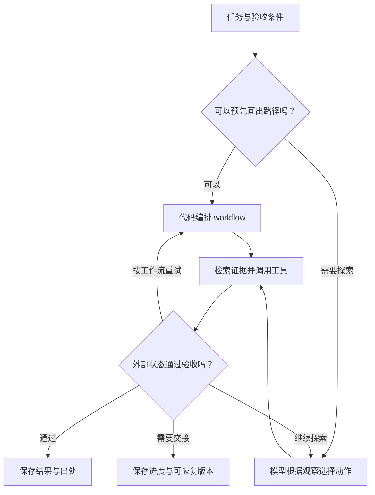

# 01｜Anthropic Agent 工程精读：谁选下一步，谁证明做完了？

> 写 Agent 时，我先在纸上圈出三个地方：下一步在哪里决定，证据从哪里读，结果到哪里验。沿着这三个问题读 Anthropic 的文章，面试里也能讲清一次具体的设计取舍。



## 1. Building effective agents：从一个函数开始画控制流

拿一个代码库做例子。生成发布说明，通常能写出固定顺序：取两个 tag 之间的提交、按模块归类、核对引用、生成草稿。排查一个偶发失败就不同了。要读哪个文件、是否缩小测试范围，取决于上一步拿到的结果。

Anthropic 在 2024 年 12 月 19 日给的划分很好用。**Workflow 由程序安排路径，Agent 根据环境反馈决定下一步动作。** 先试一次带检索或工具的模型调用，再看真实失败是否需要增加节点。[Building effective agents](https://www.anthropic.com/research/building-effective-agents)

| 五种编排 | 适合拿来做什么 | 容易错在哪 |
|---|---|---|
| Prompt chaining，串行链 | 提取提交 → 验证提交号 → 写发布说明 | 摘要漏掉一项，下游已经看不到原文 |
| Routing，路由 | 在已有的代码、文档处理器中选一个 | 混合请求被强制单选，需要复核出口 |
| Parallelization，并行 | 分块检查不同文件，或让多次独立判断投票 | 分块要验覆盖，投票要查错误是否同源 |
| Orchestrator-workers，动态分工 | 领队读完 diff 才知道要查哪几个模块 | 各分支反复查同一处，最后还得去重 |
| Evaluator-optimizer，评审修订 | 一人起草，一人按可核对的标准指出错处 | “再完善一点”没有可操作的停止条件 |

动态分工也能嵌在 workflow 里。程序固定“规划、分派、汇总”三个阶段，把子任务的内容交给模型。开放式单助手则要能反复观察、行动、再观察，并为完成、资料不足、超时分别设出口。

**ACI（Agent-Computer Interface）从模型能看到的界面入手。** 团队跑 SWE-bench 时，工具使用相对路径，模型切换目录后容易沿用旧基准。改为要求绝对路径，就消除了他们观察到的这类错误。宿主仍需校验路径是否在授权范围。

读框架代码时，我会找一次真实的调用参数、结果和停止原因。框架一旦把这三样都藏起来，很难分辨路径选错与工具实现出错。ACI 的研究背景还可以读 Yang 等人的软件工程论文。[Anthropic 的 ACI 附录](https://www.anthropic.com/research/building-effective-agents) · [SWE-agent 论文](https://arxiv.org/abs/2405.15793)

## 2. Contextual Retrieval：为什么给每个块多写几十个 token？

代码文档被切开后，“此选项从下一版起默认启用”单独成了一个块。选项名、软件版本都留在上文。向量能认出这是一条配置说明，精确检索却很难把它和对应的配置项配上。

**入库时补线索，展示时回原文。** 2024 年 9 月 19 日的实验让模型同时读整篇文档与当前块，生成约 50 至 100 tokens 的定位说明。给原块加上这段前缀，同一份增强文本分别进入向量索引和 BM25 索引。[Contextual Retrieval](https://www.anthropic.com/research/contextual-retrieval)

| 索引与排序配置 | Top-20 检索失败率 | 相对基础向量的降幅 |
|---|---:|---:|
| 普通向量 | 5.7% | 基线 |
| 加上下文的向量 | 3.7% | 35% |
| 加上下文的向量 + 加上下文的 BM25 | 2.9% | 49% |
| 双路召回，再重排 | 1.9% | 67% |

向量适合找近义表述，BM25 擅长保住错误码、方法名这样的精确匹配。博客先取 150 个候选重排，再取前 20 个。上表量的是 **1 − recall@20**，5.7% 到 1.9% 相差 3.8 个百分点。答案质量还要往下测一层。

主图汇总代码库、小说、arXiv 和科学论文，用的是实验中表现最好的 Gemini Text 004 配置。

当时估算每百万文档 tokens 的入库费用约 1.02 美元，假定文档 8k、块 800、上下文生成指令 50、生成的定位前缀 100 tokens，并使用提示缓存。重建索引和在线重排要另计。

**我会留下三个排错断点。**

1. 看标准块有没有进候选。没进就检查分块、增强文本、两路共同使用的权限和版本过滤。
2. 看它重排后落在哪一位。若第 150 名以内能找到、前 20 找不到，就固定这批候选单测排序器。
3. 把标准块直接交给生成器。如果仍答错，去查它有没有用对版本、读对原文。继续扩大召回不会补上这一步。

存储时分开记文档版本、块 ID、原文位置、原文、生成前缀和索引版本。这样修错前缀可以重建索引，读者点引文也能直接回源。材料很短且按权限能取全时，全文输入就是很好的对照组。[配套 Notebook，注意末段重排的候选来源](https://github.com/anthropics/claude-cookbooks/blob/8ad5de647d4f0f50c95d74aabc8aa20a3f70cdd3/capabilities/contextual-embeddings/guide.ipynb)

**把三个断点落成一条可复跑的检查。** 下面的改写接入自己的召回、重排和答题函数。标准证据用带版本的块 ID 表示，`answer_ok(ids)` 读取这些块并按同一标准验答案。数据集更新后还能用同一批题定位是哪一层退化。

```python
def inspect_query(expected, retrieve, rerank, answer_ok):
    """三个回调都绑定同一道题和同一份语料快照。"""
    gold = set(expected)
    if not gold:
        raise ValueError("每道题至少需要一个标准块")

    # 同一候选集既用于评估召回，也作为重排输入。
    candidates = list(retrieve(limit=150))
    ranked = list(rerank(candidates))[:20]
    if not set(ranked).issubset(candidates):
        raise ValueError("重排器返回了候选集以外的块")

    missing_before = gold.difference(candidates)
    missing_after = gold.difference(ranked)
    with_gold = answer_ok(sorted(gold))
    with_ranked = answer_ok(ranked)

    # 保留各层独立结果：一条题可以同时有召回和生成问题。
    return {
        "candidate_count": len(candidates),
        "missed_in_retrieval": sorted(missing_before),
        "lost_in_rerank": sorted(missing_after - missing_before),
        "recall_at_20": len(gold.intersection(ranked)) / len(gold),
        "answer_with_gold": with_gold,
        "answer_with_top_20": with_ranked,
    }
```

## 3. Multi-agent Research：派得出十个任务，也要收得回十份证据

Research 产品要解决的是广度搜索。领队先摸清术语并把计划写进外部记忆，再给子助手分配独立范围。每个子助手用自己的窗口搜索，领队按返回的发现决定是否补查，最后由引文助手把陈述对回出处。[Research 工程复盘，2025-06-13](https://www.anthropic.com/research/multi-agent-research-system)

| 原文里的数 | 该怎样记 |
|---|---|
| 相对提高 90.2% | 内部研究题上，Opus 4 领队 + Sonnet 4 子助手，对照单个 Opus 4 |
| 约 4 倍、约 15 倍 tokens | 普通 agent 和多 agent 系统分别与普通聊天比较，两项共用聊天这个基线 |
| 约 80%、约 95% | BrowseComp 分析里，token 用量解释的表现方差；再计入调用次数、模型选择后的合计解释量 |

**派单要写出四样东西**：查哪一问、去哪类来源、哪些范围别人负责、交回什么证据。先用短查询找对术语，再按版本与日期收窄。原团队给简单事实核查的提示是一个助手做 3 至 10 次调用。宿主另设总预算和截止时间。

合并时我想读到的是结论、原文位置、版本和缺口。给分支记父任务 ID 与独立会话 ID，大产物回传句柄。一个分支超时，保住其他分支的结果，再对照应覆盖集合找漏项。三个助手各转述同一页，去重后仍只有一个来源。[领队、子助手与引文提示](https://github.com/anthropics/claude-cookbooks/tree/8ad5de647d4f0f50c95d74aabc8aa20a3f70cdd3/patterns/agents/prompts)

### 编译器、共享论坛与共享购物车：三种完全不同的“多人协作”

- **编译器有能拆开的外部测试。** 2026 年 2 月 5 日的项目用 16 个 Claude，约两周、近 2,000 次会话和约 2 万美元 API 费用，写出约 10 万行 Rust 的 C 编译器，可编译多个架构的 Linux 6.9。[编译器项目](https://www.anthropic.com/research/building-c-compiler)
- 只剩“内核起不来”时，大家会挤到同一个失败上。团队用已知可用的编译器作对照，把故障缩小到文件，再给每个 worker 不同且可复现的快速测试子集。要并行，先把失败信号拆到能单独认领。
- **研究助手需要交换已验证的发现。** 同年 8 月的对齐研究实验先做共享文献综述，5 个助手每轮开新会话，读持久笔记和共享论坛。单次训练限制算力，实验遇到平台期或用尽 48 小时即停。[实验与消融](https://alignment.anthropic.com/2026/automated-alignment-researchers/) · [团队研究索引](https://alignment.anthropic.com/)
- 方法说明在看到结果前冻结，审核绑代码版本，评分环境隔离。在迎合用户意见的任务上，去掉论坛后，弥合“基线到理想得分”差距的比例从 23.3% 降到 17.1%。只分享可复查的尝试，能看出谁真的少走了弯路。
- **多个委托人争同一资源时，要管提交顺序。** 11 月 11 日的 *Worse Together* 比较共享算力、诊所排期、共同下单或出行、发布合并队列。在两款 Claude 上，单一协调者在四种环境的群体得分均占优，差约 10 至 45 个百分点。[作者说明](https://alignment.anthropic.com/2026/worse-together/) · [论文](https://arxiv.org/abs/2610.00583)

共同下单的故障尤其具体：消息已送达，结账的助手却还没读。禁止有未读消息时结账，重跑原失败场景时，Opus 5 挽回约 73%，Sonnet 5 约 62%。共享算力则更适合指定分配者。前一种故障要加提交前置条件，后一种要有分配权。

## 4. Context engineering 与 Skills：下一轮究竟带什么？

窗口还能装下，不代表模型能从长历史里用对那一行。Anthropic 把这种随输入增长、关键信息利用变差的现象称为 *context rot*。测试时固定问题和证据，把它移到头、中、尾部，再加入真实干扰材料，看模型下一次调用是否仍用对参数。[上下文工程，2025-09-29](https://www.anthropic.com/research/effective-context-engineering-for-ai-agents)

| 我想留下什么 | 放在哪里 | 怎么检查没丢 |
|---|---|---|
| 每轮都需要的约束、术语和少量示例 | 简短稳定的前缀 | 改动前缀后看缓存命中，避免频繁变化的定义挤在前面 |
| 大文件、历史日志 | 只给路径、标题、大小，按需读局部 | 记录多花几次调用才找回证据，常用小词表可预取 |
| 做到一半的任务 | Compaction 保留决定、失败尝试、未解依赖和原文位置 | 空窗口只看摘要和引用，能否接着选对工具？ |
| 多轮才会用的事实 | 外部结构化笔记，带来源、时间和失效条件 | 新会话能否找回，来源更新后能否修订？ |
| 高噪声探索 | 子助手独立读，只交带出处的摘要 | 原文举例摘要约 1,000 至 2,000 tokens，同时要验覆盖 |

Claude Code 压缩时保留架构决定、实现细节和未解决的错误，再靠最近访问的文件恢复工作。调压缩器先看哪些遗漏会让接班人重做，再精简可重读的日志。保存原始事件，就能在同一次运行上比较不同摘要的效果。

**Skill 适合装工作方法。** 2025 年 10 月 16 日的设计把加载拆成三层：先看 `SKILL.md` 的 YAML 字段 `name`、`description`，选中后读步骤，需要细节时才打开附件或运行脚本。PDF 技能把字段坐标等确定性工作交给程序。[Agent Skills](https://www.anthropic.com/research/equipping-agents-for-the-real-world-with-agent-skills) · [PDF 技能目录](https://github.com/anthropics/skills/tree/e4bb5d960d87126ff3b3a8af1a104b7db67560ba/skills/pdf)

MCP 提供受权限控制的动作，Skill 描述何时调用、怎样组合这些动作。排查漏触发先读描述，排查误触发就跑一组无关任务。两组一起看命中、入窗 tokens 和完成率。技能目录越长，仅名字与简介也会占掉启动空间。

### 记忆实验：什么时候值得把笔记整理成 Wiki？

2026 年 11 月 6 日的记忆实验区分两个写入时机。当场记笔记能留住“为什么停在这里”；离线的 *dreaming* 横看多段 transcript，修正错记、合并重复、修链接，再决定哪些条目进入启动索引。变化发生在可修订的文本与链接里。[The components of agent memory](https://www.anthropic.com/research/components-of-agent-memory)

| Stainless 的 25 道题 | 满足评分项的比例 |
|---|---:|
| 仅 Wiki，整理从 2 次会话增至 128 次 | 13% → 48% |
| 仅搜索原文 | 53% |
| Wiki 配合搜索，随整理增加 | 54% → 61%，每题约省 2 万 tokens |

语料约 35 万份文件、4.2 亿 tokens。算不算划得来，看离线整理与维护要花多少、同一版 Wiki 能服务多少查询。保留原文搜索后，可以检查一次综合答案到底引用了哪几个版本。

合同实验更能说明怎样写页。多助手同写一张表会覆盖彼此，摘要又容易吞细节。改成每份合同一页、一页一个写者，关键条款留原话，简报覆盖从 41/57 到 57/57。另一个 Wiki 长到原文的 1.77 倍，页数和压缩率都代替不了查全率。

文中 Claude Code 自动记忆只预载 `MEMORY.md` 开头 200 行或 25 KB，先到者为限。高频、稳定、能撤回的条目才值得放在这里，其他笔记留一个索引入口。归纳出错时，能按来源版本找到受影响的页。[dreaming Cookbook 合入记录](https://github.com/anthropics/claude-cookbooks/pull/959)

## 5. Writing effective tools：把重试原因写回接口

“大家周三什么时候有空？”若只暴露按人员列出日历的 API，模型得逐个查、换时区、求交集。一个查共同空档的只读工具就能完成这项工作；发送邀请单独做权限校验。设计接口时，先找出用户真正想完成的动作。[Writing effective tools，2025-09-11](https://www.anthropic.com/research/writing-tools-for-agents)

- **名字让人能选。** 给工具加业务域，说明适用范围、参数从哪里取得。用失败轨迹分清没发现工具、挑错工具、参数写错、工具实现漏数据和读错返回值。
- **删字段要考虑下一步。** 官方 Slack 查询的详细结果占 206 tokens，简略结果占 72 tokens。继续读回复所需的线程 ID 在简略版里被省掉了。如果下一步总要重查，这个字段就该留下。
- **截断处给游标。** 标明还有几页、是否仍是同一快照；错误信息说清哪个字段应当从哪取得。文中 Claude Code 当时的工具结果上限是 25,000 tokens，小查询只需返回够用的几行。
- **改工具也要跑题。** 固定起点和留出题，记首个错误参数、重试、耗时、tokens 与终态，让另一个会话读轨迹提修改。Research 团队有一次改描述后，助手完成任务耗时少约 40%。[评测 Notebook](https://github.com/anthropics/claude-cookbooks/blob/8ad5de647d4f0f50c95d74aabc8aa20a3f70cdd3/tool_evaluation/tool_evaluation.ipynb) · [耗时案例](https://www.anthropic.com/research/multi-agent-research-system)

### MCP 代码执行与 Advanced tool use：说明太长，还是结果太长？

2025 年 11 月 4 日的 MCP 文章把工具呈现为可浏览的代码目录。模型先列目录，再读选中函数的签名，在隔离环境里运行调用工具的代码。

示例加载量从 150,000 降至 2,000 tokens，约省 98.7%。一万行工作表可以在本地筛成五行再返回。[Code execution with MCP](https://www.anthropic.com/research/code-execution-with-mcp)

11 月 24 日的平台文章给了三个独立的改法。测量前先在 trace 里标出：第一次调用之前装了多少定义，调用之间转述了多少数据，以及哪项参数组合反复出错。[Advanced tool use](https://www.anthropic.com/research/advanced-tool-use)

| 看到的浪费 | 改哪一处 | 原文测得什么 |
|---|---|---|
| 启动时加载了大量低频定义 | Tool Search 常驻，其余定义用 `defer_loading` 按需展开 | 内部 MCP 任务：Opus 4 从 49% 到 74%，Opus 4.5 从 79.5% 到 88.1% |
| 模型每轮都在搬运明细 | PTC 让沙箱程序循环、筛选、聚合 | 复杂研究任务平均从 43,588 到 27,297 tokens，约少 37% |
| 类型都合法，组合仍不合用 | 在工具定义的 `input_examples` 给代表性实参 | 复杂参数处理准确率从 72% 到 90% |

**两处实现细节**：托管搜索仍随客户端请求声明可发现的定义，应先按权限筛好目录。PTC 调到自定义工具时容器暂停，宿主执行函数，按调用 ID 回填结果，带上容器 ID 续算。[Tool Search 协议](https://platform.claude.com/docs/en/agents-and-tools/tool-use/tool-search-tool) · [PTC 协议](https://platform.claude.com/docs/en/agents-and-tools/tool-use/programmatic-tool-calling)

常用的小工具直接加载就好。只有需要多轮查询、明细很长时，再衡量 PTC 节省的推理用量。客户端仍传输原始数据，下游仍承担真实查询。按模型 tokens、传输字节、沙箱时间、数据库调用分别计数，才能定位下一处开销。

## 6. Long-running harnesses：给下一班一个干净、能跑的提交

2025 年 11 月 26 日的长程编码文章里，助手会一次铺开太多功能，也会看到像样的界面就提早收工。作者让第一班 initializer 建环境，后续 coding agent 每班只推进一个用户可观察的功能。两个角色可以用同一模型分别开会话。[长程 Harness](https://www.anthropic.com/research/effective-harnesses-for-long-running-agents)

| 接班时打开什么 | 我想从中知道什么 |
|---|---|
| `feature_list.json` | 原案例列了 200 多项，含 `category`、`description`、`steps`、`passes`，初始都未通过 |
| `init.sh` | 怎样在干净环境启动服务，并先做最基本的验证 |
| `claude-progress.txt` | 刚验了什么、哪里还卡着、下班从哪里接 |
| Git 历史和差异 | 哪个版本可运行，哪些改动与这次验证一起交接 |

启动后先读进度、做冒烟测试，再挑未通过的一项。聊天功能要在真实界面里打开会话、输入、读回响应。原方案让 worker 只改 `passes`，因为实验中 JSON 较少被模型改坏；要强制这一点，可以让独立测试进程持有结果写权限。[自主编码 Quickstart](https://github.com/anthropics/claude-quickstarts/tree/4a4224bdf0e9cfb3332167b69c90457403813625/autonomous-coding)

### 应用 Harness：一轮评审值多少时间？

2026 年 3 月 24 日的实验加了规划者、生成者和用 Playwright 操作界面的独立评审者。早期每个 sprint 开始前商定验收标准，分别检查功能、视觉和产品深度。复古游戏制作器一题，Opus 4.5 单跑约 20 分钟、9 美元，完整流程约 6 小时、200 美元。[应用开发实验](https://www.anthropic.com/research/harness-design-long-running-apps)

4.5 借 SDK 自动压缩延续会话。到 Opus 4.6，作者逐项移除约束，去掉逐 sprint 编排，留下规划和末端评审。少了规划容易漏做功能，接近能力边界时评审仍能抓到大错。换模型后，逐个拿掉部件重跑同一道题，比整套照搬更有说服力。

### Managed Agents：把能重启的进程和不能丢的事实分开

2026 年 4 月 8 日的设计分三层。**Session** 追加记录事件，**Harness** 读日志、调模型和路由工具，**Sandbox** 执行程序。容器挂了可以记为一次工具错误，Harness 挂了可从日志接续。模型看到的窗口只是从日志取出的一份视图。[Managed Agents](https://www.anthropic.com/research/managed-agents)

按需申请执行环境后，首 token 延迟 p50 约降 60%，p95 降逾 90%。凭证放在隔离层外的代理或保管服务。恢复写操作时记录稳定业务键：若外部服务已成功、会话还没记下回执就崩了，先用该键查结果，再决定是否重试。

**Claude Code 的一次反例**：本应只在空闲一小时后清一次旧思考内容，缺陷却让恢复后的每一轮都继续清理，重复读取并破坏缓存。同期还有默认推理强度和系统提示改动。团队扩大评测、分别消融并撤回相关改动。[4 月 23 日官方复盘](https://www.anthropic.com/research/april-23-postmortem)

4 月 2 日 Stella Laurenzo 已在 issue 里贴出自己会话中的误判和过早收工。拿这些记录构造“持续活跃、空闲后首轮、恢复后第二三轮”的回放，再对照官方根因。尤其要测第二轮：一次性清理应当已经退出。[用户原始记录](https://github.com/anthropics/claude-code/issues/42796)

## 7. Demystifying evals：先写出什么算过，再看模型怎么做

我会把一次测试分成五样：task 是题目，trial 是这次尝试，transcript 是全过程，outcome 是环境最后变成什么样，grader 负责判分。

比如“保存草稿”，应当关掉编辑页再读回正文。只搜回复里的“已保存”，服务端根本没收到请求也能得分。[Agent 评测，2026-01-09](https://www.anthropic.com/research/demystifying-evals-for-ai-agents)

| 谁来判 | 交给它的证据 | 怎样校准 |
|---|---|---|
| 程序 | 记录是否唯一、测试能否通过、出处能否打开 | 用已知正确和应失败的样本各跑一次，允许等价实现 |
| 模型 | 引文是否支持结论、解释有没有漏条件 | 按维度列评分标准，与领域专家的标样比对 |
| 人 | 新任务的边界、难判的产品体验 | 独立评分，讨论分歧，再把标准写回题库 |

每个 trial 用干净快照。能力集放还做不稳的题，回归集守住已经交付的行为。既读失败轨迹，也抽查可疑的满分。验收通过的路径可以有多条，只有授权、业务终态等硬条件需要写死。

**两个容易背反的指标**：单题单次通过率为 0.75，三次独立同分布时，至少一次成功的 pass@3 为 `1 − (1 − 0.75)³ ≈ 98.4%`，次次成功的 pass^3 为 `0.75³ ≈ 42.2%`。前者需要能挑出合格结果，后者关心重复使用的稳定性。先分题估计，再聚合。

### 机器资源、人工监督和安全评测各自测什么？

- **资源上限会改分。** 2 月 5 日的 Terminal-Bench 2.0 实验固定模型、任务、Harness，换六档资源。严格限制到不限额，基础设施错误从 5.8% 到 0.5%，成功率增约 6 个百分点。仅从 1 倍到 3 倍，错误已降到 2.1%，成功率变化仍在噪声内。[基础设施实验](https://www.anthropic.com/research/infrastructure-noise)
- **运行时长要跟完成质量分开读。** 2025 年 10 月至 2026 年 1 月，Claude Code 单轮耗时 P99.9 从不足 25 分钟到超过 45 分钟。资深用户更常自动批准，也更常中途打断。面板还应记录澄清、打断和经验证完成。[2 月 18 日自治测量](https://www.anthropic.com/research/measuring-agent-autonomy)
- **批准疲劳会遮住权限问题。** 团队观察到用户批准约 93% 的提示。3 月 25 日的 auto mode 先快速筛查，再核对授权意图。良性流量误拦从第一阶段 8.5% 降到整条流程 0.4%；另一组真实越权倾向操作仍漏判约 17%。[auto mode](https://www.anthropic.com/research/claude-code-auto-mode)
- **资源边界由运行环境执行。** 云端短命容器、Claude Code 本地沙箱、Cowork 本地虚拟机各自能读的文件、能访问的网络不同。Claude Code 沙箱工作中权限提示少了 84%。给工具画清读写范围和网络出口，才能说明一次批准放行了什么。[5 月 25 日隔离设计](https://www.anthropic.com/research/how-we-contain-claude)
- **单轮题满分附近难分高低。** 11 月 13 日指南给出的近期模型 API 单轮无害响应率为 94% 至 98%。加入多轮交互，按整段判断，成对测试应帮助和应限制的请求，再用人工标样校准裁判并报告不确定性。[安全评测指南](https://www.anthropic.com/research/building-strong-safety-evaluations)
- **线上拦截率还少一个分母。** 2026 年 8 月，Anthropic 最常用的内部研究与工程代理平台分析了超过十亿次决策。在线监控覆盖 100% 的动作，拦下约 0.002%。要估漏判，仍得从已放行样本抽查，并单独记录事后复核与等待时间。[生产监督测量](https://www.anthropic.com/institute/measuring-pace-of-ai-development)

## 选型速查

| 最先出错的地方 | 我会先做的小实验 |
|---|---|
| 简单任务也要走很久 | 以一次调用或固定流程为基线，回放一条确实需要改道的题 |
| 答案找错出处 | 追标准块从候选到前 20 的排名，再单测给对证据时的回答 |
| 多分支越跑越贵 | 给单助手相近总预算，按独立证据数、每件合格成本和尾延迟比较 |
| 换会话就从头做 | 丢掉容器和聊天历史，从日志、Git、功能清单恢复，数重做了多少外部请求 |
| 一重试就重复写 | 分别在请求发出前、业务成功但回填前中断，检查是否恢复到同一业务结果 |

算每件合格成本时，把失败重试、重排、沙箱和人工复核都计入分子。按难度看中位和尾部等待，也记首次拿到有用证据的时间。这样才能解释某种设计究竟省下了谁的等待。[工程文章索引](https://www.anthropic.com/engineering) · [配套 Cookbook 精读](./02-anthropic-cookbooks-and-patterns.md)

**一手资料速查**：[流程与 ACI 附录](https://www.anthropic.com/research/building-effective-agents) · [检索实验与成本假设](https://www.anthropic.com/research/contextual-retrieval) · [Research 架构与提示](https://www.anthropic.com/research/multi-agent-research-system) · [长任务评测指南](https://www.anthropic.com/research/demystifying-evals-for-ai-agents)

## 六道面试深挖题

### 1. 文件工具总在切目录后读错文件，你会改哪里？

1. **先看调用。** 我会把失败参数和当时的工作目录放在一起，确认同一个相对路径是不是已经指到另一个文件。
2. **消掉歧义。** 工具要求绝对路径，宿主再校验授权根目录。用同一批切目录的任务比较误读、重试和最终完成率。
3. **追问：多写一句提示够吗？** 提示能减少误用，参数校验还能把静默读错变成一次可恢复的报错。

### 2. Top-20 漏检少了 67%，用户为什么还说答案错？

1. **先说分母。** 5.7% 到 1.9% 衡量证据没进前 20 的比例，最终答对还要看版本和推理。
2. **给它正确证据重答。** 能答对就回查候选和重排；仍错就查它引用了哪一句、采取了什么动作。
3. **追问：多塞一百块呢？** 我会先扩大供重排的候选，再测最终窗口大小、证据位置和延迟。

### 3. 要不要给一个慢任务开四个子助手？

1. **先画依赖。** 四份互不依赖的资料适合分头读；大家反复改同一份状态，要先确定谁负责提交。
2. **公平比较。** 同题、同工具、同截止时间，跑普通单助手、加预算的单助手和有限分支的多助手，看合格率与成本。
3. **追问：最快的那组就赢吗？** 还要看慢分支超时后漏了什么，四份报告合并后剩几条独立证据。

### 4. 快到窗口上限，第一批删什么？

1. **挑能找回的。** 我先清带稳定版本和位置的长工具结果，保留查回它的条件、关键决定和还没解决的错误。
2. **安排空窗口接班。** 让新会话选下一步工具并填参数。光复述前情，看不出它会不会继续做错。
3. **追问：写操作也能靠摘要恢复吗？** 用业务键查外部回执。摘要只告诉我该查哪一笔。

### 5. 同一题跑三次中过一次，能用来承诺稳定性吗？

1. **先问谁挑答案。** 离线有可靠裁判可以用 pass@3 估计能否找到解，用户每次都需要成功则看单次表现和 pass^3。
2. **再看判分证据。** 每次从干净状态开始，读真实终态。写成功却超时的情况要靠幂等键去重。
3. **追问：换台机器能直接比分吗？** 固定资源保证量和硬上限，单列基础设施错误，否则连能跑的解法都会变。

### 6. 有了 Wiki，为什么仍要搜原文？

1. **我把 Wiki 当索引和综合笔记。** 每条归纳保留出处与版本，冲突条款可以追到原话，过期条目可以撤回。
2. **三组一起跑。** 比较单用搜索、单用 Wiki 和两者合用，按单条查询与跨文档综合分别看质量，再摊离线整理成本。
3. **追问：哪些记忆启动就加载？** 选高频、稳定、有来源的少量条目，其余按需读。错误越靠近启动层，下次重复犯错的机会越多。
