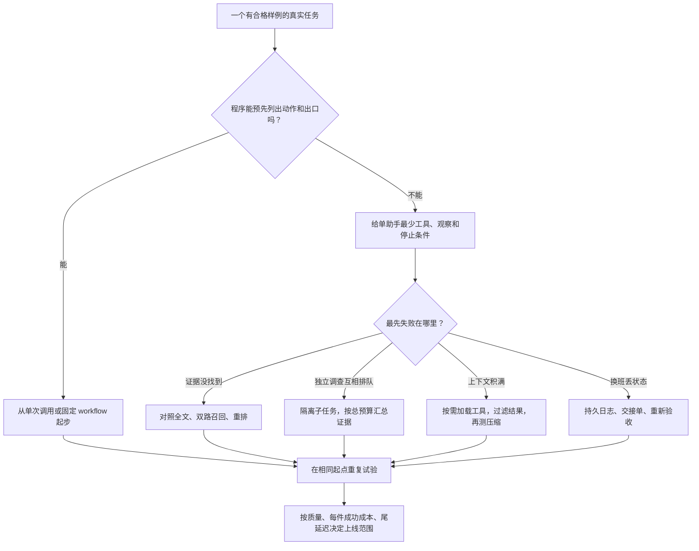
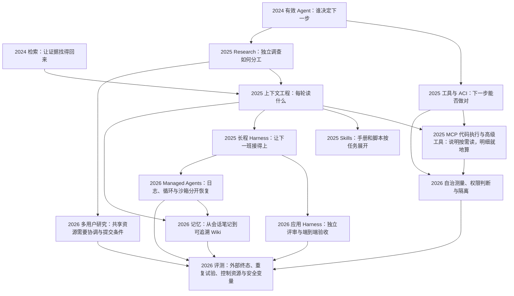

# 01｜Anthropic Agent 工程精读：从一个工具调用，到能交接、能验收的系统

用户关掉聊天窗口，明天再打开，同一个助手还能找到昨天的证据、继续没做完的事，并证明自己做对了吗？本文沿着这个问题读 Anthropic 的工程文章和研究，让你在做系统设计或回答面试题时，能说清哪一步交给模型、哪一步必须由程序负责。

**资料核至 2026 年 11 月 24 日。** 下文把实验数字与原文放在同一节。内部评测、单个项目的账单、线上观测和论文对照实验各自回答不同的问题。贯穿全文的「企业客服调查一笔重复扣费」是教学案例，文中的表设计与上线建议是从原文推导的实现。配套篇提供可手写的代码和固定版本的 Notebook。[配套源码精读](./02-anthropic-cookbooks-and-patterns.md)

## 先看一笔扣费怎样穿过整个系统

客服说「帮我查一下客户怎么被扣了两次」。模型先得区分两条账单和同一笔钱的两次状态变化，再找到当时生效的政策。订单系统偶尔会超时，调查也可能换班；真正退钱还涉及另一层权限。只拿最终答复跟标准答案比，很容易漏掉「答得漂亮，钱退了两次」这样的故障。

| 你在产品上看到的现象 | 系统实际需要回答的问题 | 首先应该读哪项工作 |
|---|---|---|
| 助手把预授权和结算当成两笔付款 | 哪些业务状态可用程序判定，哪一步需要探索？ | Building effective agents、Writing effective tools |
| 它准确引用了另一地区的条款 | 搜索时能否找回完整证据，能否追到适用版本？ | Contextual Retrieval、Context engineering |
| 查得很慢，三个助手还找到了同一页 | 调查能否分成相互独立的问题，合并时谁去重？ | Multi-agent research、Worse Together |
| 搜索几个系统就用完上下文 | 该把接口说明、明细计算和业务操作手册放在哪里？ | Advanced tool use、MCP 代码执行、Skills |
| 换班后从头调查，还把上次猜测当事实 | 哪些信息要写成笔记，哪些必须回读原始凭据？ | Long-running harnesses、Managed Agents、Agent memory |
| 客服以为已结案，客户却再次来电 | 用什么外部状态证明完成，谁能停止或撤回操作？ | Demystifying evals、自治测量、隔离与安全评测 |

模型在这里相当于值班工程师。**Harness 是围绕它运行的那层程序**，负责把哪份材料送进这次请求、允许它使用哪些工具、怎样处理失败，以及凭什么结束这一班。一个聊天请求可以没有数据库；一笔可能执行两次的退款必须有自己的业务记录。先分清这两种状态，后面许多设计选择就容易了。

## 一、Building effective agents：决定谁有权选择下一步

**2024-12-19，工程方法文章。** 假设每张发票都要做币种识别、字段提取和总额校验。就算提取这一步用了模型，程序仍能预先画出所有出口。换成「找出账上多出来的这笔钱从哪来」，查完账才知道下一步该找支付渠道、续费记录还是客服备注。Anthropic 用一个可观察的标准区分 workflow 和 agent：前者由代码安排路径，后者由模型根据环境反馈决定接下来干什么。一次调用如果能解决问题，就从一次调用起步。[Building effective agents，定义、五种流程与 ACI 附录](https://www.anthropic.com/research/building-effective-agents)

| 编排 | 下一步由谁决定 | 可以直接画成什么业务流程 | 容易误用之处 |
|---|---|---|---|
| Prompt chaining，串行链 | 程序固定次序，中间可设校验门 | 提取订单行 → 算术核对 → 生成说明 | 上一步漏了一行，下一步可能把错表写成流畅文字 |
| Routing，分流 | 规则或分类器从已登记的处理器中选一个 | 账单问题送财务解释器，账号问题送登录流程 | 强迫混合意图工单单选，漏掉半个请求 |
| Parallelization，并行 | 程序预先确定分工或投票规则 | 两个分支分别查金额证据和适用条款，等两边返回 | 同一错误资料被读三遍，多数票仍会错 |
| Orchestrator-workers，动态分工 | 协调者读题后才产出子任务 | 用户上传新材料后，临时增加某地区税项调查 | 每个工人都写一份完整报告，合并成本比调查还高 |
| Evaluator-optimizer，评审与修订 | 评审依据标准决定重写或收工 | 对外答复的每句金额解释都要对应凭证 | 标准只写「再好一点」，循环会把文字改长 |

并行里还有一个值得当场区分的问题。**切块**让几个人做不同的事，解决覆盖或耗时；**投票**让几个人独立做同一件事，解决个别判断不稳。前者要检查各块是否都回来，后者要检查错误是否相关。服务条款本身过期时，多数投票不会提高正确率。动态分工也不等于完全自治。主流程可以规定「计划、分派、汇总」三个固定阶段，只把每阶段的任务内容留给模型决定。

开放任务的最小循环是「观察环境 → 选择动作 → 执行 → 读取新环境」。退出同时考虑目标已达到、轮次耗尽、缺少输入。若下游有副作用，应在宿主校验授权范围；若是算术题，就让确定性代码验算。框架可以帮你写消息收发，抽象层一旦遮住实际发给模型的参数和结果，就很难判断错误发生在哪一步。原文是一份设计指南，没有给五种流程排成功率名次。为自己的业务录一条正确路径，再设计一条需要改道的反例，比争论框架名字更能检验你是否真的需要 agent。

**ACI，Agent-Computer Interface**，关心的是模型眼中的操作界面。人看到当前文件夹能顺手输入相对路径，模型在多轮操作后很容易拿旧目录当基准。团队在 SWE-bench 上把文件工具改为要求绝对路径，消除了当时观察到的这类误用。工程迁移可以很小：给账务工具传稳定的交易标识，返回金额单位、时区和下一步允许做什么；不要让调用者靠读屏幕猜哪串数字才是交易号。ACI 的研究脉络还可追到 SWE-agent 论文。该论文由 Yang 等作者发表，区分作者有助于区分论文中的受控实验与 Anthropic 的工程经验。[Anthropic 工具设计附录](https://www.anthropic.com/research/building-effective-agents) · [SWE-agent 原始论文](https://arxiv.org/abs/2405.15793)

## 二、Contextual Retrieval：切开以后，怎样找回「这是谁的哪一条」

**2024-09-19，检索实验。** 一页政策写「本条自次月起生效」，公司、地区、版本全在标题里。如果单独索引这一句，向量看得出它关于生效日期，却不知道属于哪次修订。模型即使善于推理，也没法从送错的材料推回正确答案。Anthropic 针对的是入库时的资料损失。[Introducing Contextual Retrieval，方法、数据和附录](https://www.anthropic.com/research/contextual-retrieval)

它在离线阶段同时给模型看整篇文档和当前块，让模型只生成一小段能定位这块材料的上下文，通常约 50–100 tokens。把定位文字放到原块前面，**同一份增强文本**分别建向量索引和 BM25 关键词索引。向量能找「扣了两次」与「重复结算」这样的近义描述，关键词能保住条款编号、报错码和精确产品名。在线搜索先广召回，再让 reranker 把问题与候选块成对比较。论文式实验中的设置是取前 150 个候选重排，送前 20 个给模型。重排只能调整候选顺序；关键块在前一阶段就丢了，再贵的重排也救不回来。

| 文章报告的配置 | 未进入前 20 的比例 | 对基础向量检索的相对下降 |
|---|---:|---:|
| 普通向量检索 | 5.7% | 基线 |
| 仅上下文增强向量 | 3.7% | 35% |
| 增强向量加增强 BM25 | 2.9% | 49% |
| 上述双路召回再重排 | 1.9% | 67% |

这里量的是 **1 − recall@20**，分母是应被找回的证据。5.7% 到 1.9% 相差 3.8 个百分点；不能据此说客服正确率提高了 67%。图表跨代码库、小说、arXiv 与科学论文取平均，主图采用实验中表现最好的 Gemini Text 004 配置。博客给过每百万文档 tokens 约 1.02 美元的历史入库估算，假设文档 8k、块 800、说明 50、生成前缀 100 tokens 并用提示缓存。估算针对那次配置与当时定价。生产预算要另算更新频率、失败重建和每次查询的重排成本。[实验口径与成本假设](https://www.anthropic.com/research/contextual-retrieval)

落库时可以保留六样东西：文档版本、块标识、原文位置、未经改写的正文、生成的定位文字、索引版本。UI 显示原文并跳回原文位置。定位文字里如果写错适用地区，工程师能单独修入库任务，消费者也不会把模型补的文字误认为合同原话。把权限过滤放在向量与关键词两路共同的候选边界，避免得分靠前的无权文档挤走有权证据。若全文本来很短、按权限就能取全，可先直接送入上下文，省掉索引、漂移和重建的负担。

排查一条失败记录时，先记录标准证据是否进过候选，再看是否被重排挤出前二十，最后拿正确证据直接喂给生成器。三次观察分别指向分块/召回、排序和答案推理。对用户来说都是「答案错了」，对维护者却是三张不同的工单。官方 Notebook 能复现这套对照思路，但它使用自己的语料和标注，末段重排示范也走了简化线路。不要拿其输出栏的一个数代替博客的整组实验。[Cookbook 中的检索实现](https://github.com/anthropics/claude-cookbooks/blob/8ad5de647d4f0f50c95d74aabc8aa20a3f70cdd3/capabilities/contextual-embeddings/guide.ipynb)

## 三、Multi-agent Research：分头找证据，必须有人对缺口负责

**2025-06-13，Research 产品工程复盘。** 「这个费率什么时候改过」只需一条证据链；「比较十个地区三年来的费率变化」有多条互不依赖的证据链。一个人顺序搜十遍会慢，十个人都拿到同一条模糊指令又会撞车。Anthropic 的 LeadResearcher 先判断广度、拟计划、把计划写进外部记忆，随后派子助手各自检索，再根据带出处的发现决定是否开下一轮。最后还有专门的引用处理，把报告里的陈述和来源对齐。[How we built our multi-agent research system](https://www.anthropic.com/research/multi-agent-research-system)

这套做法把上下文隔离变成收益。调查欧洲条款的助手不用看到另一位读过的五十页美国产品历史。领队需要的是可核实的陈述、出处、适用时间和仍不清楚的地方。复杂工单的派单可以写成「查 4 月至 6 月的欧洲企业版扣费政策，只接受生效公告或带版本的官方政策；交回条款、生效日、证据位置，并列出未覆盖国家」。给工人规定交付物与边界，还要说明去哪种工具找。只在内部工单里有的事实，搜公开网页再多次也找不到。

**15 倍的分母是普通聊天。** 团队观察到一般 agent 约用聊天的 4 倍 tokens，多 agent 系统约用聊天的 15 倍。在内部研究评测里，Opus 4 领队加 Sonnet 4 子助手相对单 Opus 4 的表现提高 90.2%；这是该组测试的相对表现，不能改写成准确率增加 90.2 个百分点。另一次对 BrowseComp 的分析中，token 使用量单项解释约 80% 的表现方差，加上工具调用数和模型选择合计约 95%。这些是不同口径的数据；「多花 tokens 就会因果性地多拿几分」并未由此得到证明。[实验、成本基线与适用限制](https://www.anthropic.com/research/multi-agent-research-system)

搜索策略影响的往往是后半程。用很长的问句开搜会提前把某个假设写进检索条件。先用短查询摸清术语，再以产品名、日期、原始链接收窄。领队并行派单、工人并行做独立工具调用，可以缩短墙钟时间；下一步的输入依赖上一条证据时仍须串行。原文给模型不同复杂度的工作量提示，如简单事实核查可由一个助手做 3–10 次工具调用。这是当时的提示设计；宿主还应有总预算、单分支上限和截止时间，以免每个子助手都认为「我再搜一次就行」。

在业务上，用「补到几条新证据」判断是否值得继续分工。先让单助手在同题、同工具上跑，再给它与多助手相近的总预算，最后比较单位合格报告成本和等待时间。底层要给每个分支独立会话标识、父任务标识和证据引用。大产物存到受控工作区，只回传句柄。一个子任务超时时保存其他结果，并让报告标明缺哪一块。若各分支得不断同步同一份购物车或同时写同一笔退款，沟通与冲突会吞掉独立搜索的优势。后面的多用户论文给出了直接反例。[官方领队、子助手与引文提示目录](https://github.com/anthropics/claude-cookbooks/tree/8ad5de647d4f0f50c95d74aabc8aa20a3f70cdd3/patterns/agents/prompts)

## 四、Context engineering：每一轮只带能改变下一步决定的材料

**2025-09-29，上下文工程方法。** 值班员手头有事故录像、十次重复查询和一张最新工单。想让他判断下一步，把整箱资料倒在桌上未必有帮助。写 prompt 解决「怎么交代任务」，上下文工程继续追问「模型这个时刻能看到哪些指令、工具、消息和证据，各占了多少注意力」。每一轮都得重做这个选择。[Effective context engineering for AI agents](https://www.anthropic.com/research/effective-context-engineering-for-ai-agents)

所谓 **context rot**，是随着输入变长，模型从中找出并正确使用关键信息的表现可能下降。标称窗口告诉你接不接得下，却没有给出对每项业务都适用的可靠读懂长度。原文把注意力的有限性、长序列里的位置关系等作为解释，也讨论了不同模型与任务的差异。业务验证可以固定问题和唯一证据，逐渐增加真实但不相关的历史，轮换证据在头、中、尾的位置，同时测「有没有引用它」和「有没有按它行动」。若只要求复述一句密码般的测试文字，测不出遇到两版条款时会用哪版。

短程上，系统说明要给目标、约束和少量代表性示例。过细的条件树很快过时，过宽的口号又不给动作标准。已知每次都需要的租户与有效期可预取；需要时才看的文件给路径、标题、大小等轻量线索，让助手先搜索再读取局部。即时检索省下 tokens，代价是更多调用和搜索判断；常用小词表如果每次都要费一轮发现，就该放在稳定前缀。固定前缀还有缓存收益，频繁变化的工具原样移到最前面会使后面的复用失效。

| 长程手段 | 怎样腾出窗口 | 保留什么才能继续 | 新故障从哪里来 |
|---|---|---|---|
| Compaction，压缩 | 写接班摘要，用摘要及必要的近期内容起下一段 | 当前目标、已确认决定、失败尝试、未解依赖、原证据位置 | 摘要遗漏一个例外，后续会把猜测当既定结论 |
| Structured note-taking，结构化笔记 | 做事过程中把以后要用的事实写到窗口外 | 可更新的状态、来源、时间及失效条件 | 过时偏好被长期加载，错一次以后反复错 |
| Sub-agents，子助手 | 把高噪声探索放在独立窗口 | 汇总结果、出处、覆盖范围、无法解释之处 | 主助手收到无出处的结论，难以发现两个工人其实用了同一来源 |

压缩重点首先是**召回关键状态**。先用真实长会话检查哪些遗漏会让接班人重做，再删能凭路径重新读取的长输出。原文讨论 Claude Code 压缩时保留架构决定、未解决错误及实现细节，并以最近访问文件等线索重新开工。写笔记适合持续变化的目标，例如在游戏里记地图与已达里程碑；子助手适合一次弄清一个范围很大的问题，原文举例回到主窗口的摘要通常约 1,000–2,000 tokens，并未规定统一配额。工程上三者可以叠用：工人探索，领队在账单记录里记下可复核结论，主窗口快满时再压缩。[长任务的三种处理方法](https://www.anthropic.com/research/effective-context-engineering-for-ai-agents)

对重复扣费工单，最值得保留的是「第二笔还是待清算，明天查流水 T17」，最容易误删的是「政策在付款后才生效」。给压缩器一个回放测试：新会话只能读摘要和明确引用的文件，让它写出下一次应调用的工具、参数和原因。能复述前情却拿错日期，摘要仍然不合格。把未压缩事件流留在有保留期限的存储里，就可以对比压缩前后的行为，甚至尝试新的摘要算法，而不用请客户把一整段对话重讲一遍。

## 五、Writing effective tools：调用者误用接口，先检查接口怎么长的

**2025-09-11，工具设计与评测。** 用户想知道「周三大家什么时候都有空」，人类工程师可以拿人员列表、逐人查日历再求交集。按数据库表逐个暴露 API，会让助手重复传标识、读大量无用预约，还可能混淆时区。原文建议围绕用户要完成的工作合并操作。按需返回可预约时间就能完成这一步；最终发出邀请仍应保留独立、可控的写操作。[Writing effective tools for agents — with agents](https://www.anthropic.com/research/writing-tools-for-agents)

先给工具分配容易区分的命名空间，再看实际误选矩阵。若检索工单与检索聊天都叫 search，模型要靠多份相似说明来猜。用业务域和动作起名，让描述写出「何时用、何时应换另一个、参数如何从上一工具取得」。返回值同样是接口：对模型有意义的名称、状态和时间应该靠前，下一次操作需要的内部标识要保留，几十个无关字段默认不返回。原文同一 Slack 查询的详细结果为 206 tokens，简略结果为 72 tokens；简略版省去的线程标识恰是继续取回复时需要的字段。删到调用者必须立刻再查一次，就已经删过头。

控制响应长度需要一个可继续的出口。返回前几行同时给可靠游标、总数是否为估算、以及继续查同一快照的办法。没有截断标记，助手会把第一屏当全集。错误也要能指导下一步，例如告诉它传入的是账单号而该工具要交易号，并给出可查询交易号的只读入口。原文提到当时 Claude Code 默认限制工具结果为 25,000 tokens，是该产品的防线；一个只需三行金额的业务工具不应把这个上限当目标。[返回内容、命名空间与评测过程](https://www.anthropic.com/research/writing-tools-for-agents)

具体怎么「和 Agent 一起迭代」？给出真实任务与可核对的答案，让一个 agent 尝试使用工具，收集调用、失败参数、重试、耗时、tokens 和最终业务状态。另一个会话读失败轨迹，提议改名、补一条例子或合并接口，再从相同起点跑含留出题的任务集。若工具本身漏查历史数据，改描述只会让助手更熟练地调用一个有缺陷的接口。把故障分成没选中、选错参数、工具查错、读错结果，才能把改动交给正确的维护者。研究产品团队还报告过一次改工具说明使后续代理完成任务耗时下降约 40% 的案例，它来自 Research 系统复盘，不能当作所有工具优化的回报率。[工具评测 Notebook](https://github.com/anthropics/claude-cookbooks/blob/8ad5de647d4f0f50c95d74aabc8aa20a3f70cdd3/tool_evaluation/tool_evaluation.ipynb) · [40% 案例出处](https://www.anthropic.com/research/multi-agent-research-system)

接回扣费业务，可以先做一个只读的扣费调查工具，把渠道流水与订单状态按同一币种、时区组织起来。试题同时放进两种情况：订单号相同但支付不同；金额相同但属于不同客户。前者防漏判，后者防误合并。若工具连着授权操作，宿主按当前租户和用户能看的范围校验参数；模型从报告里读到一个真实交易标识，也不能凭此扩大可查询范围。

## 六、MCP 上的代码执行与 Advanced tool use：两种浪费，两处动刀

**2025-11-04 与 2025-11-24，两篇相关但接口不同的工程文章。** 想象客服查一个月的账。第一次浪费发生在查询之前：把连着的每套系统的完整说明都印出来。第二次发生在查询之后：为了知道哪天超额，让模型逐行看几万笔明细。前者应推迟加载工具定义，后者应把过滤和求和留在计算环境里。[Code execution with MCP](https://www.anthropic.com/research/code-execution-with-mcp) · [Introducing advanced tool use](https://www.anthropic.com/research/advanced-tool-use)

第一篇展示一种 MCP 客户端的设计。宿主将服务的工具呈现为文件系统中的代码接口，助手先列出服务目录，按需读取某个函数签名，在隔离环境里写一段代码调用它。代码可以直接将取回的数据传给另一个已授权的工具；模型只看最后的汇总。在文中的工具加载示例里，消耗从 150,000 降至 2,000 tokens，约省 98.7%。这说明按需展开目录能省掉多少无关说明，不能据此外推所有请求都能便宜 98.7%。原文另举一万行工作表本地筛出五行的例子；敏感原始行能留在执行环境里，但哪些字段可输出、哪些目的地能接收它们，仍由系统控制。

第二篇把三个问题分别做成开发平台能力。

| 如果瓶颈在这里 | API 机制 | 官方观测以及如何解释 |
|---|---|---|
| 还没提问，工具说明已占掉窗口 | Tool Search Tool 常驻，其余定义可标记 `defer_loading`；搜索返回引用再展开 | 大工具库内部 MCP 评测中，Opus 4 从 49% 到 74%，Opus 4.5 从 79.5% 到 88.1% |
| 一条数据依赖下一条，模型不断转述明细 | Programmatic Tool Calling（PTC）让沙箱代码调用已开放函数，客户端接住调用，把结果送回正在等它的脚本 | 复杂研究任务的平均消耗从 43,588 到 27,297 tokens，约少 37%，指标是这些任务的用量 |
| 字段类型正确，业务组合却总写错 | Tool Use Examples 在工具定义的 `input_examples` 中给出常用和容易混淆的实参组合 | 内部复杂参数处理测试从 72% 到 90%；样例有输入成本，也会影响模型偏好的路径 |

三者可以组合，但各有机会成本。两个常用只读工具直接加载更快，搜索本身要花一次发现动作；金额很小的单条查询用直接调用更透明，需要读上百页再按部门对账时才轮到 PTC。工具示例要专挑 schema 表达不清的约束，比如缺省币种和自定义币种如何搭配，且示例本身必须能通过验证。写程序汇总之前先定义返回字段、单位与缺失值；否则只是把会读错表的模型换成会加错数的脚本。[搜索、程序化调用与示例的实验说明](https://www.anthropic.com/research/advanced-tool-use)

有两个接口细节会影响真实系统。使用托管搜索时，延迟加载控制进入模型窗口的内容，客户端请求仍声明可搜索的定义；宿主可先按用户权限生成目录。PTC 中，自定义函数仍可能在你的服务器上运行，代码容器暂停等待结果；续传要带对应调用 ID 和暂停响应的容器 ID。沙箱规则要限制文件、网络和计算资源，宿主负责租户隔离、重试和幂等。脚本只打印超额客户数确实省下模型 tokens，但数据库仍执行了实际读操作，API 吞吐和沙箱计算也要计费或限流。要测端到端成本就分别记录这些数。[Tool Search 协议](https://platform.claude.com/docs/en/agents-and-tools/tool-use/tool-search-tool) · [PTC 续传与约束](https://platform.claude.com/docs/en/agents-and-tools/tool-use/programmatic-tool-calling)

## 七、Long-running harnesses：接班人需要一份能在机器上验证的交接单

**2025-11-26，跨窗口编码实验。** 让助手「做一个聊天应用」，第一轮可能把文件铺得满满当当，第二轮看到界面已经像样，就宣布完成。另一种失败是上一班留下半个迁移脚本，下一班整段时间都在猜怎样启动项目。压缩一份聊天记录能省窗口，却不会自动产生清晰的验收条件或可启动的环境。[Effective harnesses for long-running agents](https://www.anthropic.com/research/effective-harnesses-for-long-running-agents)

Anthropic 把第一班和后续班次设成两种角色。**Initializer** 把产品描述展开为外部可观察的功能，初始化 Git、环境启动脚本和进度文件。案例里列出了二百多项特性，全部从未通过开始。**Coding Agent** 每个新会话先认识环境、读进度和 Git 历史、跑一条基本功能，选一项未通过特性，做小步修改，亲自走通用户路径，再写交接并提交。这里的「双 Agent」指前后承担不同职责，完全可以由同一模型在不同会话执行。

| 工件 | 回答接班人的哪个问题 | 谁能改变什么 |
|---|---|---|
| `feature_list.json` | 原合同有哪些用户动作，各自通过了吗？ | 原方案要求 worker 只改 `passes`；需求变化应独立评审 |
| `claude-progress.txt` | 本轮看了哪项、证据在哪、下轮第一步是什么？ | 每班留下一段短记录，过长时以索引指向旧记录 |
| `init.sh` | 在这台环境怎样启动、怎样检查基本服务？ | 初始化阶段准备；变更后在干净环境重跑 |
| Git 提交及其差异 | 哪些代码、测试和状态属于同一次进展？ | 用小提交绑定变更；恢复前先定位最近可运行版本 |

原始 JSON 把 `category`、`description`、`steps` 与布尔值 `passes` 放在同一条目。步骤写成「打开新聊天、输入内容、得到响应」这种用户能观察的行为。原文选 JSON 是因为试验中模型较少随意改坏结构；格式本身没有权限控制能力。生产时可把需求清单与验收结果分开写，让独立测试进程签发结果。若工程师新加一条规格，要留下是谁、何时、基于哪次需求变更加的。否则任何模型都能通过缩小题目得到满分。

原作者发现，单元测试和命令行请求都正常时，真实界面仍可能不能用，通过浏览器自动化更容易发现遗漏。对账工单也有对应检查：刷新后案件能否恢复，重新打开详情后是否仍能跳到证据，重复点击处理按钮会不会多记一笔。让下一班从新会话、新浏览器和刚提交的版本起步，才能检验交接是否真够用。**完成是一条读取外部状态后成立的判定。** 代码已提交、功能标为绿、用户任务已完成，三者可以在不同时间发生。[官方自主编码 Quickstart，含两套提示与驱动代码](https://github.com/anthropics/claude-quickstarts/tree/4a4224bdf0e9cfb3332167b69c90457403813625/autonomous-coding)

## 八、Agent Skills：把工作方法写成能按需翻开的手册

**2025-10-16，Skills 设计说明。** 每家企业都有自己的报表格式。把每种格式的填表细则塞到系统提示，问候语也要背着整本手册；只把脚本扔进目录，助手又不知道该在什么时候用。Skills 的办法是先让模型看到一张索引卡，用到时再翻正文与附件。[Equipping agents for the real world with Agent Skills](https://www.anthropic.com/research/equipping-agents-for-the-real-world-with-agent-skills)

技能目录以 `SKILL.md` 为入口。第一层是 YAML 头中的 `name`、`description`，让模型判断适用情形。第二层是被选中才读取的操作步骤。第三层是步骤指向的表格说明、样例和脚本。表单的字段坐标可交给脚本处理，模型只需知道输入和输出，就能复用那个程序的确定性。阅读实际 PDF 技能会看到入口、专项说明与脚本是独立文件；生产写引用时应以仓库实际文件大小写为准。原文是架构与实例说明，没有报告一个能横向套用的技能成功率。[官方 PDF 技能目录](https://github.com/anthropics/skills/tree/e4bb5d960d87126ff3b3a8af1a104b7db67560ba/skills/pdf)

**Skill 与 MCP 的接缝**可以在一张工单上说明。访问账单系统、按凭证取交易属于有权限的接口，可以由 MCP 服务暴露。遇到争议时先核对授权、再按当地政策解释、最后附上证据，属于可复用的工作方法，可以写成 Skill。访问接口可以脱离这份手册服务其他流程，同一份手册也能在权限允许时调用多个服务。技能文本描述「申请退款」不会授予付款权限；运行它内含的程序，同样要经过宿主的文件和网络边界。

调优先看两种相反的错。该用技能却没用，先查描述是否包含用户会说的业务语言；无关任务动不动就打开技能，先缩小触发条件。打开后还选错操作，则把最常用的路径留在正文，把稀有条件移到可发现的独立文件。维护时给每个技能同时保存一组应触发与一组不应触发的任务，更新技能后跑两组，再查入窗 tokens 与完成率。技能越多，名称和说明本身的成本也会增加，不能因为正文延迟加载就无限扩大启动目录。

## 九、Demystifying evals：把最后一句「完成了」与最后一条数据库记录分开看

**2026-01-09，Agent 评测方法。** 评客服退款助手，最简单的判据是回答里有没有「已退款」。模型可能先写下这三个字，随后支付服务超时；也可能钱退成功了，却没有说评测期望的关键词。原文把一次任务拆成题目、一次尝试、运行全记录 transcript、最终环境状态 outcome 和给证据打分的 grader。你评的是模型、工具、提示和运行环境共同组成的产品。[Demystifying evals for AI agents](https://www.anthropic.com/research/demystifying-evals-for-ai-agents)

| 判分者 | 最擅长确定的事实 | 怎样知道判错了 |
|---|---|---|
| 代码 grader | 金额是否相符、只产生一笔记录、端到端测试是否通过、必需出处是否存在 | 给它一组已知应过和应失败的结果；检查错误容差、替代实现、时区等边界 |
| 模型 grader | 引文是否真的支持结论、解释是否漏掉适用条件、答复有没有解用户的问题 | 让领域专家独立打样本，比较分歧；使用明确量表并允许证据不足 |
| 人类 grader | 新任务的合理边界、主观质量、机器裁判很难区分的业务例外 | 使用共同锚点和独立复核，把分歧写回标准；控制成本与等待时间 |

每个 trial 从干净快照开始。先做一条你知道能通过的参考解，验证环境和裁判；抽读成功与失败轨迹，追到第一处偏离事实的位置。有些「失败」来自验证器把合法路径判错，有些「成功」来自沿用了上一轮留下的数据库行。对主观解释可以分维度打分，对不可违反的写入次数则使用硬条件。不要要求助手刚好走过开发者设想的三次搜索，除非特定步骤本身就是业务要求。该强制的是有授权、结果正确、状态可核对。

**pass@k 与 pass^k 问的是两个问题。** 前者问同题尝试 k 次至少有一次成功的可能性，适合能自动挑出正确候选的离线开发；后者问 k 次是否次次成功，适合客户重复使用时的稳定性。同一题单次通过概率 p 为 0.75，假设各次独立同分布，三次至少一次通过约 98.4%，三次全过约 42.2%。实时退款不会因为三次里有一次成功就允许丢掉另两位客户的失败；也不能默认系统知道哪次答案是对的。分题先估算再聚合，保留重复次数与区间。把难易不同的题揉成一个平均 p，再套幂公式，会给出误导性的稳定性。

落地时同时维护两套题。**能力集**收当前尚不能稳定完成、对产品又重要的任务；**回归集**保住已经交付给用户的能力。早期先从真实故障做少量能读懂的题，发现评分规则的漏洞比收集一千条合成题更划算。测到几乎全绿后，要保留这些题守回归，同时加入更难的新题检验改进。记录成本、尾延迟、环境错误率，挑选失败率高和「可疑的满分」样本读 transcript，再决定改提示、改接口还是改题。自动分数的最大用处，是帮人找到下一段值得读的记录。

## 十、2026 的修正与扩展：旧建议在什么条件下会失效

### 二月的两种测量：让许多助手工作，和让一个助手工作很久

编译器项目把「增加助手能不能加速」变成一个有外部裁判的问题。16 个 Claude 在约两周、近两千次会话中开发 Rust 写的 C 编译器，API 成本约两万美元，产物约十万行，可编译多个架构的 Linux 6.9。工程上真正稀缺的是能分开的失败信号。不同工人可以认领不同失败测试；当只剩「整个内核启动失败」时，所有人容易围观同一个问题。团队用已知能工作的编译器作对照，把可疑范围缩小到独立文件，并让不同工人的快速测试覆盖不同但对各自可复现的子集。这是一个带清晰外部反馈、花费很高的项目案例，不能推出任意代码库都适合十六人并写。[Building a C compiler with a team of parallel Claudes，2026-02-05](https://www.anthropic.com/research/building-c-compiler)

同日的基础设施实验反过来问「你的好成绩里有多少来自机器」。在 Terminal-Bench 2.0 的六档资源配置下，保持模型、任务和 harness 一致，从严格资源限制到不设上限，基础设施错误率从 5.8% 降至 0.5%，总成功率上升约 6 个百分点。只从一倍放宽到三倍时，基础设施错误已降到 2.1%，成功率变化仍在统计噪声内；再放宽时，一些原本跑不了的高资源解法变得可行。工程含义是同时公布资源保证量和硬上限，区分机器杀掉任务与助手给错答案。选择适中的余量要用自己的任务校准。[Quantifying infrastructure noise in agentic coding evals，2026-02-05](https://www.anthropic.com/research/infrastructure-noise)

自治研究则观察实际交互。2025 年 10 月至 2026 年 1 月，Claude Code 第 99.9 百分位的单轮持续时间从不足 25 分钟增长到超过 45 分钟。这量的是现实会话尾部连续运行的时间。它与「人要做五个小时的题，模型能否在一半试验中完成」属于两个坐标。资深用户更常开自动批准也更常中途打断，说明一个监督系统还得让人看得懂进展、随时停得下来。观察性日志受人群与任务选择影响，不能从耗时变长推出完成质量提高。自己的仪表盘应同时报告接受任务、启动运行、人工打断、主动求澄清、经验证完成几个阶段。[Measuring AI agent autonomy in practice，2026-02-18](https://www.anthropic.com/research/measuring-agent-autonomy)

### 三月的应用 Harness：把「像成品」拆成可试用的交付合同

早期双角色方法解决了跨窗口遗忘，仍然会交付看上去好看、点开不工作的应用。三月的作者用规划者把短提示扩成产品规格，生成者实现，独立评审者用 Playwright 通过真实界面查状态，验证功能、视觉和产品深度等维度。早期版本在每个 sprint 前由生成者和评审者写出双方认可的验收约定，每个关键维度各有门槛。对复古游戏制作器这一题，Opus 4.5 单跑约 20 分钟、9 美元，完整 harness 约 6 小时、200 美元。较高质量伴随显著成本；这是一组项目对照，不能外推平均投资回报。[Harness design for long-running application development，2026-03-24](https://www.anthropic.com/research/harness-design-long-running-apps)

更有价值的是拆掉哪些部件。Opus 4.5 实验借 SDK 自动压缩维持连续会话；后续在 Opus 4.6 上作者逐项移除约束，取消逐 sprint 结构，保留规划与末端评审。缺规划时模型会少做产品功能；靠近模型能力边界的任务，独立评审仍能抓到大错。业务上先列出每个组件是为消除哪类失败而加，再做逐项消融：同题、同预算记录删掉组件后引入了哪些漏测，省下了多少等待。可以删除过时的脚手架，同时把真实用户入口的验收留下。新模型更能坚持工作不代表它自动拥有定义产品范围的权力。

### 四月的 Managed Agents：工作台坏了，还要知道事情做到哪一步

把模型循环、执行容器和会话状态全塞进一台长寿命机器，最难回答的问题是「容器没了以后，刚才那次提交究竟成功没有」。Managed Agents 抽出三个可以独立替换的部分。Session 是追加写入的事件日志，Harness 拉取事件、调用模型、路由工具，Sandbox 负责运行程序。容器故障变成可以记录的工具错误，harness 故障可由新实例读取日志恢复；模型当前看到的几十条消息只是日志的一种投影。它可以回读旧事件，也可以换一套压缩策略重新投影。[Scaling Managed Agents，2026-04-08](https://www.anthropic.com/research/managed-agents)

原文报告按需申请执行环境后，首 token 延迟 p50 约下降 60%，p95 下降超过 90%。这衡量用户开始看到响应的等待时间，不能当作任务总耗时降幅。凭证由隔离层外的代理或保管服务处理，执行代码只拿完成这项工作的能力。业务迁移可把事件定义为「发起、送达、业务方已确认、结果已回填」，各含业务操作标识。执行成功却来不及写确认时，恢复进程先按业务标识查询外部账本。追加日志能告诉你最后看到了什么；要做到只退一次款，还得靠业务方的幂等键和状态核对。

四月还有一次很适合拿来做回归测试的 Claude Code 质量事故。某项优化原本只在会话空闲一小时以后清一次旧思考内容，错误实现让同一会话随后每一轮都继续清理，助手显得健忘、重复，后续请求也持续破坏缓存。同期另有默认推理强度与系统提示的改动。若只观察总成功率，很难把三种影响拆开。团队扩大评测并分别消融提示，撤回相关改动。产品团队可以按「持续活跃」「长时间空闲后刚回来」「恢复后的第二、三轮」建三组回放，分别量缓存命中、重复读取和代码质量。一项仅应生效一次的策略，最有价值的测试往往是它下一次是否安静地退出。[Claude Code 质量事故复盘，2026-04-23](https://www.anthropic.com/research/april-23-postmortem)

社区侧还有一份可配对阅读的一手记录。4 月 2 日，Stella Laurenzo 在 Claude Code 仓库开 issue，描述复杂工程任务上错误判断与过早宣称完成，并附上对自己工作环境中会话日志的分析。把这份报告当作构造回归任务的线索，再对照官方复盘定位机制；一个用户的时间序列无法单独判定根因，也不能证明后来披露的缺陷解释了全部现象。[用户原始问题与讨论](https://github.com/anthropics/claude-code/issues/42796) · [团队事故复盘](https://www.anthropic.com/research/april-23-postmortem)

### 三月与五月的安全工程：减少弹窗以后，边界由谁执行

逐个弹窗会产生批准疲劳。Claude Code 团队观察到用户批准约 93% 的权限提示；auto mode 采用两阶段判断，先快速筛出需要仔细判断的动作，再核对用户授权意图。在内部良性流量上的误拦率，从第一阶段的 8.5% 到整条流水线的 0.4%；对一组真实越权倾向操作，仍有约 17% 漏判。这给部署者两个不同的分母，不能把 0.4% 误读成风险发生率。对退款来说，可把调查权限常开，把真正改账交给按账户、金额和业务条件强制校验的执行服务。统计分类器可以减少打扰，资金边界则必须独立执行。[How we built Claude Code auto mode，2026-03-25](https://www.anthropic.com/research/claude-code-auto-mode)

五月的跨产品复盘把资源边界讲得更具体。云端的短命容器、Claude Code 的本地沙箱与 Cowork 的本地虚拟机各有可见文件、网络出口和监督方式，不能把「跑在容器里」当作完整说明。团队在 Claude Code 沙箱工作中报告权限提示减少 84%。选型时画出输入从哪里来、程序能读什么、谁可把数据写出边界。租户的知识检索要在凭证作用域内做，诊断日志还要能回答「哪个主体在何时获准调用什么」。这让故障排查和权限审计能读同一份业务记录。[How we contain Claude across products，2026-05-25](https://www.anthropic.com/research/how-we-contain-claude)

### 八月的自动化研究实验：让研究员换班，怎样保住试验的可信度

研究任务也能用交接单，但有个编码演示不容易暴露的问题：如果同一个助手既提出方法、又挑成绩最好的运行来汇报，团队怎么知道得分真的进步了？Anthropic Fellows 的自动化对齐研究实验先让文献助手做共享综述，再让五个研究助手并行迭代。每次迭代都开新会话，从持久笔记了解自己试过什么，通过共享论坛看到同伴的方法与结果。研究者在看见结果前把方法说明冻结，审核绑定到具体代码版本，评测者在隔离环境里评分。单次训练的算力受限，主循环在达到平台期或用完 48 小时预算时停止。[实验原文与 Harness 第三节](https://alignment.anthropic.com/2026/automated-alignment-researchers/) · [团队按月份整理的研究索引](https://alignment.anthropic.com/)

有信息量的对照发生在迎合用户意见这一项任务上。去掉共享发现论坛后，实验中已弥合的基线到理想得分的差距比例从 23.3% 降到 17.1%；这个分母既非正确回答数，也非模型整体安全性。对应用团队，这是将「助手互相讨论有没有价值」变成能测的问题。可以只共享已验收的试验摘要、代码指纹和失败原因，再比较重复试验的比例与最终留出题成绩。若共享讨论只是放大第一个人的错误，独立跑出来的反例就会消失；若同事反复踩同一条已证实的死路，共享一行可核验的失败记录就可能值回成本。[消融结果与实验限制](https://alignment.anthropic.com/2026/automated-alignment-researchers/)

### 十一月的记忆实验：什么时候值得把一堆记录整理成 Wiki

搜索能回答「这段话在哪里」，记忆还要回答「我现在看到的事情，下一班什么时候会用到」。11 月 6 日的文章把当场记笔记与离线整理分开。前者抓住在场才知道的重要性；后者回看多段记录，修正错记、合并重复、补断链，或把特别重要的条目移到下次启动时可见的索引。文中称这个离线过程为 dreaming。这里没有通过重新训练模型改变权重，能够查看、修订和撤销的是持久存储里的文本与链接。[The components of agent memory，2026-11-06](https://www.anthropic.com/research/components-of-agent-memory)

Stainless 实验用约 35 万份文件、约 4.2 亿 tokens 和 25 个问题衡量满足评分项的比例。随着整理由 2 次会话增加到 128 次，单用 Wiki 的得分从 13% 到 48%；原文搜索单用得 53%，搜索与 Wiki 合用从 54% 到 61%，每题约省两万 tokens。把预计算量与在线查询的节省放在同一本账上，才知道要服务多少次查询才值得建库。只有少量一次性问题时，索引建设与维护可能比直接检索更贵；反复跨文档比对、稳定事实多时，预先归并关系才有机会摊薄成本。

另一个合同任务给出了具体失效方式。多个助手写同一张条款表，摘要丢失细节，而且并发写入互相覆盖。改成一份合同一页、每页一位写者，关键条款保留原话，相关简报覆盖的评分事实从 41/57 到 57/57。这是一个具体任务，不能用来保证下一份合同的完整率。另一个 Wiki 甚至长到原文的 1.77 倍。要判断是否有用，数「压短了多少」还不够，需看关键事实能否找齐、引用能否回源、来源失效后能否定位受影响的页。[Wiki 与搜索的对照及反例](https://www.anthropic.com/research/components-of-agent-memory)

在企业知识库里，可给笔记加有效日期、来源版本和修订历史，定期整理时将互相冲突的记录并排呈现，交回业务所有者裁定。高层索引只装经常用且已核实的东西。Claude Code 在文中所述的自动记忆机制只预载 `MEMORY.md` 开头的 200 行或 25 KB，以先达到的限制为界，其余通过索引按需读。这个产品细节很能说明设计思路：每条晋升到启动层的错误以后都会重复出现。对账助手应把「某客户曾有两次待清算」保留为有日期的个案，把「怎样区分预授权和结算」放进有所有者的流程说明。二者的读者和失效条件不同。[记忆层级与注入边界](https://www.anthropic.com/research/components-of-agent-memory)

### 十一月的多用户论文与安全评测：测试中要让现实里的约束出现

Research 产品的工人共享一个目标；不同客户各有一个助手时，每个助手都有自己的委托人。Anthropic Fellows 的 Worse Together 用共享算力预算、诊所排期、共同下单或旅行安排、发布合并队列四种模拟环境作对照。在两款 Claude 模型上，一个协调者服务所有人与代理间对等协商相比，四个环境的群体结果平均到各场景后均占优，差约 10–45 个百分点。分数衡量群体相对可达最优策略的表现。这里的实验对象与 2025 年广度检索完全不同，两个结果可以同时成立。[团队研究说明，2026-11-11](https://alignment.anthropic.com/2026/worse-together/) · [研究论文与实验设置](https://arxiv.org/abs/2610.00583)

共同下单的根因很有启发：消息送达负责结账的助手，并不代表它在提交前已经读到。一个在有未读消息时阻止结账的系统条件，在重新运行失败场景时分别挽回 Opus 5 约 73%、Sonnet 5 约 62% 的失败。共享预算则更受益于设置明确的分配者。业务设计可以把「等待所有参与者本轮确认」写成状态转换，绑定购物车版本，一旦有人改购物车就使旧确认失效。若大家争用的是同一本账，就让一个服务仲裁可写余额；多开几组互相转述的对话很难替代并发控制。[论文作者的对照与干预](https://alignment.anthropic.com/2026/worse-together/)

11 月 13 日的安全评测指南补上了「怎样知道防护变好」。单轮题若几乎全过，很适合守回归，难以拉开新模型。团队报告其近期多个模型在 API 单轮题上的总体无害响应率处于 94%–98%，多轮评测更能拉开差异。他们预先明确测量目标、设计既该帮助也该限制的对照题，由人校准裁判，多轮按整段对话判定，并报告统计不确定性。应用到退款助手，既测它能否阻止错退，又测它有没有把证据齐备的正常申请全拦下。只把「拒绝」当成功条件，停掉整个产品也能得满分。[Building strong safety evaluations，2026-11-13](https://www.anthropic.com/research/building-strong-safety-evaluations)

同样要小心生产监控的分母。Anthropic Institute 的公开测量以 2026 年 8 月其最常用的内部研究与工程代理平台为范围，区分执行前的在线检查与执行后回看的监控。超过十亿次决策中，在线监控拦下约 0.002%；这量的是拦截比例，没有提供所有应拦动作的真值。即使接入覆盖率达到 100%，也不能从低拦截率推断低漏判率。部署自己的审批层时，分开观察覆盖率、延迟、升级人工复核比例，并从允许通过的样本里找漏判。这样便能把实验题里的准确率与真实业务流量中的监督能力接起来。[Anthropic Institute 的生产监督测量](https://www.anthropic.com/institute/measuring-pace-of-ai-development)

## 十一、选型决策：先定位卡住的一步，再增加一层设施

**从一周工单里选上线样本。** 给每条工单标出期望结果、可查原证据、可做动作和禁止副作用。包括「实际上只扣了一次」「旧政策已过期」「查不到证据，应该保留待核实」这三类容易被忽视的负例。先做只读调查，记录模型第一次从真实路径偏出去的位置。若已有逻辑能解掉大半问题，保持这部分确定性，把探索留给剩下的异常。高风险写动作在业务服务内做相同的状态校验，人工接手也沿用这份状态。

**把成本除以合格交付件数。** 比较两种架构，分子包括整批请求的模型、重排、沙箱和经手人工成本，分母是经独立验收合格的工单数。只看成功请求的账单会漏掉失败重试；只看平均速度会掩盖多分支等待最慢工人。按任务难度分别看中位和尾部等待，另外记录从提问到第一条有用证据的时间。如果大多数人只需要一笔交易的状态，让简单路径先把答案给出来，只有出现跨地区、跨版本证据冲突才升级调查，收益通常比所有工单统一走大流程更容易验证。

**把恢复演练放在一次副作用的两边。** 测试环境里，第一次让执行器在向业务服务发送前停止，第二次让它在业务服务确认后、回写会话前停止。前者应允许继续提交，后者应查回同一结果；任一情况都不能让工单显示两笔退款。接着丢掉执行容器、换一个不带聊天历史的 worker，让其根据事件日志、特征清单和受控存储恢复。这样一次演练同时测出了三个量：恢复耗时、重做的外部请求数、重启之后仍找不到的事实数。它们比对话长度更能告诉你长程能力是否足以上线。

## 十二、六道面试深挖题

### 1. 同一个模型，为什么只改工具接口就可能少犯错？

**考察点**是能否从模型实际可见的信息解释错误。**可这样答**：先重放一次失败调用。模型换目录后仍提供相对路径，宿主解释参数时已经指向另一处，所以增加模型思考时间并未消除歧义。把输入换成项目范围内可验证的绝对路径，在工具层验证范围；如果参数错误，返回可定位的理由。用包含目录切换的旧工单重跑，比较误操作、重试和最终成功率。**追问「只改 prompt 呢」**：提示可以提醒，接口校验能把错误从静默生效变为明确失败，两者可分别做对照。绝对路径消除了相对基准的歧义，访问权限仍须宿主另行检查。

### 2. 检索漏失下降 67%，为什么产品团队没看到答案正确率同步提高？

**考察点**是是否清楚指标分母和误差链。**可这样答**：博客衡量相关块未进入前二十的比例，从 5.7% 到 1.9%。我会先按线上题型做召回检查，再人工看召回证据是否适用该客户，然后让生成器在标准证据和实际证据上各答一次。如果两者都错，优先修推理、提示或业务规则。如果标准证据有效，继续看融合、重排、版本和权限过滤。**追问「多取到一百条呢」**：测固定证据不同位置时的利用率和延迟。更多候选可送重排，不等于每条都要进最终窗口。

### 3. 老板看到 90.2% 的数字，要求所有工单都用多 Agent，怎样设计试验？

**考察点**是把论文里的收益变成可检验的业务假设。**可这样答**：先按任务是否可拆成独立证据链分桶。三组分别是当前单助手、获得相近总预算的单助手、有限分支的多助手；共享工具、证据权限、独立评分标准和截止时间。看合格率、重复检索、每件合格成本和尾延迟。**追问「多开几个总能更稳吧」**：若几个助手会写同一共享资源，加独立确认或集中仲裁，把并发写冲突列为单独失败类型。Research 的广度题与多用户下单的目标函数不同。

### 4. 上下文快满了，删什么最安全？

**考察点**是数据能否重建。**可这样答**：先找可重新查询、有稳定版本和引用的明细，保留查询条件、关键结果与证据地址。把外部写操作的业务标识留在权威日志，单独保存未决条件和失败过的计划。压缩后从空窗口接班，看下一步工具、参数、授权判断是否仍正确。**追问「为什么不总是写一份摘要」**：摘要本身也可能出错，若把原始材料与出处一起扔掉，接班人无法发现错误。要对同一份事件日志试不同的上下文投影。

### 5. 退款 Agent 离线三次中有一次成功，就能上线吗？

**考察点**是选择指标和验证副作用。**可这样答**：先区分离线试三条候选与客户的单次真实写入。三次中有一次成功对找候选有用，在线重复交付更关心单次成功与连续稳定。判分应查数据库的金额、订单和唯一交易，答复能否解释原因再由模型与人抽检。**追问「能否失败自动再试」**：读请求可有界重试，写请求应带稳定业务键；响应丢失后先查回执。否则把重试率调高可能同时提高正确回复率和重复退款率。

### 6. 有持久记忆以后，为什么还要保留原始搜索和验收工具？

**考察点**是能否区分派生知识和权威事实。**可这样答**：笔记会随政策更新而过期，Wiki 能整合多份材料，但会漏事实、互相覆盖。记录来源版本，让重要结论能回到原文件。对照只有搜索、只有 Wiki、两者合用三组，再算离线整理的摊销。验收工具读取当前系统，能发现笔记写着「已修好」而最近提交又破坏的功能。**追问「什么时候自动加载记忆」**：只提升跨多次任务复用、来源稳定且有办法撤销的条目。其余内容在索引上保留一行入口，需要时再查。

## 一手资料与延伸阅读

- 想校正一个设计决策，先读 2024 年的流程与 ACI 文章，再读原始 ACI 论文。前者给系统选型，后者提供软件工程接口设计的实验背景。[Anthropic 的流程与工具附录](https://www.anthropic.com/research/building-effective-agents) · [SWE-agent 论文](https://arxiv.org/abs/2405.15793)
- 想复查架构是否节省成本，先读检索实验确认质量指标，再读工具与 Research 文章确认比较基线。三处数字分别针对召回、工具调用与研究任务。[检索实验](https://www.anthropic.com/research/contextual-retrieval) · [工具使用实验](https://www.anthropic.com/research/advanced-tool-use) · [Research 复盘](https://www.anthropic.com/research/multi-agent-research-system)
- 想做长期运行的产品，把跨窗口编码、三月应用开发和四月托管架构连着读。它们依次回答如何交班、怎样检查交付质量、机器坏了如何恢复。[双角色交接](https://www.anthropic.com/research/effective-harnesses-for-long-running-agents) · [应用质量评审](https://www.anthropic.com/research/harness-design-long-running-apps) · [托管架构](https://www.anthropic.com/research/managed-agents)
- 想辨别新架构何时失效，十一月有三种不同证据：记忆实验的对照组、多用户协调论文，以及安全评测的设计和报告指南。[记忆实验](https://www.anthropic.com/research/components-of-agent-memory) · [多用户多助手论文](https://arxiv.org/abs/2610.00583) · [安全评测指南](https://www.anthropic.com/research/building-strong-safety-evaluations)
- 想追踪实现，GitHub 上的 dreaming Cookbook 合并记录把 Notebook、提示和样例日志放在同一次变更里，适合区分研究发现与可直接阅读的演示代码。[官方仓库 PR 959](https://github.com/anthropics/claude-cookbooks/pull/959) · [官方工程索引](https://www.anthropic.com/engineering)

## 全景演进图：每条连线都是上一步留下的工程问题

