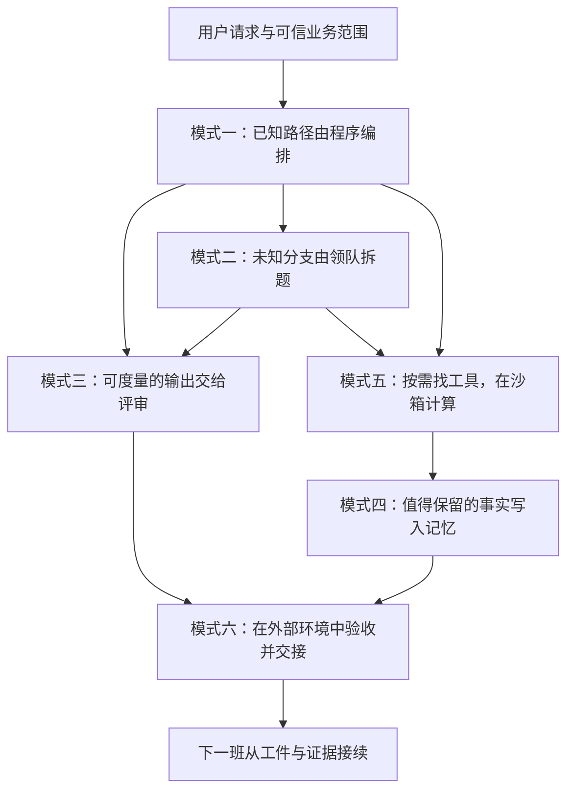
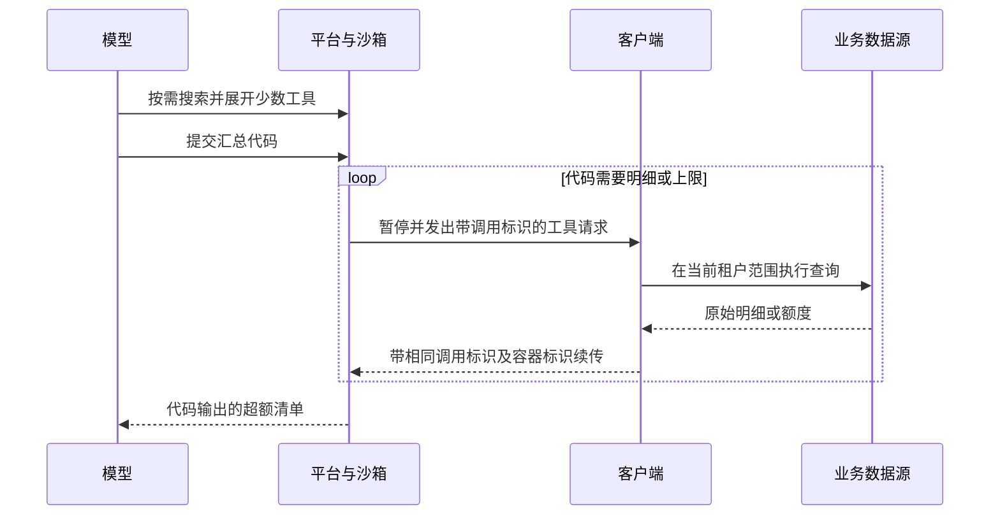
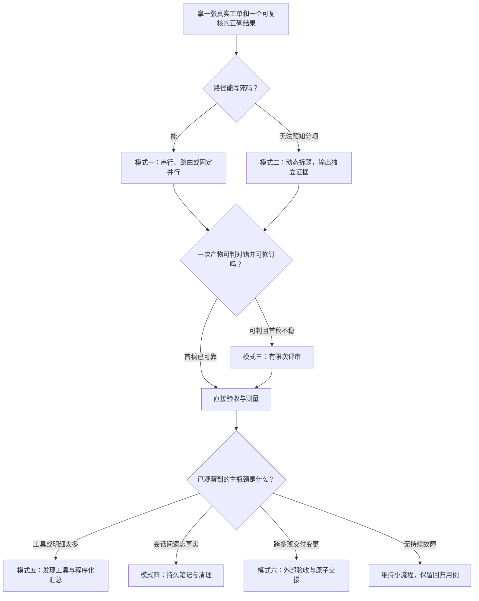

# 02｜拆开 Anthropic Cookbooks：六种能手写、能交接、能验收的 Agent 工程模式

想知道一个 Agent 为什么比普通函数贵、又为什么值得用，最好的办法是顺着一笔真实请求追下去：谁决定下一步、哪些字节经过模型、谁把结果写进了数据库、哪行代码有权说「做完了」。本文带你读官方 Notebook，并用一个工单系统把六种模式写到可以动手实现的粒度。

**源码快照截至 2026 年 11 月 24 日。** 旧仓库名 `anthropics/anthropic-cookbook` 现重定向到 `anthropics/claude-cookbooks`。下文的 Cookbook、Quickstarts、Skills 分别固定到当时的提交 `8ad5de6`、`4a4224b`、`e4bb5d9`。论文或博客显式推荐的材料与本文为对照另选的材料，在地图中分别标明。小段 Python 是本文改写，服务端工具的字段以同日查得的 Claude 文档为准；每个模式都指出它跟官方演示的差别。[旧入口](https://github.com/anthropics/anthropic-cookbook) · [固定版 Cookbook](https://github.com/anthropics/claude-cookbooks/tree/8ad5de647d4f0f50c95d74aabc8aa20a3f70cdd3) · [配套方法与论文精读](./01-anthropic-agent-engineering-canon.md)

## 先画出程序和模型之间的接缝



可以先只写右半边的测试。以「上月被扣了两次」为例，准备一笔正常预授权、一笔真实重复扣费、一笔同额但来自不同账户的扣费。做三次离线回放，检查分类、证据、建议和最终业务状态。第一轮甚至可以让固定函数代替模型。这样当你接入真实模型后，会知道多出来的失败来自模型决策、消息序列，还是你自己的数据管道。

## 一、Notebook 地图：按想观察的行为打开文件

下表中的链接直接指向文件。读代码时先找第一次模型调用，再找下一次调用的输入。中间那些 Python 对象就是这份 Notebook 真正教你的接口。单元格包含的历史输出可帮助理解形状，模型、价格和依赖后来都可能变化。

| 打开哪份官方源码 | 它实际演示什么 | 与文章的关系、最值得追的一行 |
|---|---|---|
| [patterns/agents/basic_workflows.ipynb](https://github.com/anthropics/claude-cookbooks/blob/8ad5de647d4f0f50c95d74aabc8aa20a3f70cdd3/patterns/agents/basic_workflows.ipynb) | 将结构化抽取串成链，并行分析不同人群，给支持工单分流 | Building effective agents 配套模式。检查 `chain` 怎么把输出当下步输入，`route` 怎么把类别映射到提示 |
| [patterns/agents/orchestrator_workers.ipynb](https://github.com/anthropics/claude-cookbooks/blob/8ad5de647d4f0f50c95d74aabc8aa20a3f70cdd3/patterns/agents/orchestrator_workers.ipynb) | 规划器从营销任务拆出不同角度，分别生成内容 | 同组模式。读 `parse_tasks` 和 `FlexibleOrchestrator.process`，区分能独立执行与代码已经并发执行 |
| [patterns/agents/evaluator_optimizer.ipynb](https://github.com/anthropics/claude-cookbooks/blob/8ad5de647d4f0f50c95d74aabc8aa20a3f70cdd3/patterns/agents/evaluator_optimizer.ipynb) | 生成与评审各一次调用，反馈随上次产物进入下一轮 | 同组模式。`loop` 的通过分支明确，持续不通过要靠宿主另设上限 |
| [patterns/agents/async_multi_agent_orchestration.ipynb](https://github.com/anthropics/claude-cookbooks/blob/8ad5de647d4f0f50c95d74aabc8aa20a3f70cdd3/patterns/agents/async_multi_agent_orchestration.ipynb) | 在实际异步调度里比较固定团队与动态创建子助手 | 同目录延伸。模型发出派单后，查看等待与回收结果在何处发生 |
| [patterns/agents/latency_multi_agent.ipynb](https://github.com/anthropics/claude-cookbooks/blob/8ad5de647d4f0f50c95d74aabc8aa20a3f70cdd3/patterns/agents/latency_multi_agent.ipynb) | 团队计时、协调工具、任务工具和端到端检查 | 延伸。适合解释为什么并发后总工作量上升，而用户等待可能下降 |
| [capabilities/contextual-embeddings/guide.ipynb](https://github.com/anthropics/claude-cookbooks/blob/8ad5de647d4f0f50c95d74aabc8aa20a3f70cdd3/capabilities/contextual-embeddings/guide.ipynb) | 用带标准块的查询测普通向量、带上下文向量、BM25 融合及重排 | Contextual Retrieval 配套。先看 `situate_context`，再看每个评测单元传入哪个检索器 |
| [tool_evaluation/tool_evaluation.ipynb](https://github.com/anthropics/claude-cookbooks/blob/8ad5de647d4f0f50c95d74aabc8aa20a3f70cdd3/tool_evaluation/tool_evaluation.ipynb) | 从题目运行工具循环，记录调用和用时，汇总成功或失败 | Writing effective tools 配套。它连同一个响应里的多个调用都要逐个配回结果 |
| [tool_use/memory_cookbook.ipynb](https://github.com/anthropics/claude-cookbooks/blob/8ad5de647d4f0f50c95d74aabc8aa20a3f70cdd3/tool_use/memory_cookbook.ipynb) | 客户端执行文件式记忆命令，演示跨会话代码审查与上下文清理 | 上下文工程配套主题。真正写盘的是旁边的 `memory_tool.py`；找代码不用猜顶层有个 memory 目录 |
| [tool_use/context_engineering/context_engineering_tools.ipynb](https://github.com/anthropics/claude-cookbooks/blob/8ad5de647d4f0f50c95d74aabc8aa20a3f70cdd3/tool_use/context_engineering/context_engineering_tools.ipynb) | 在研究语料上运行不同方式的上下文管理，并展示清理记录 | 延伸对照。检查与记忆配合时保留、排除哪些结果，再追最终答案 |
| [tool_use/tool_search_alternate_approaches.ipynb](https://github.com/anthropics/claude-cookbooks/blob/8ad5de647d4f0f50c95d74aabc8aa20a3f70cdd3/tool_use/tool_search_alternate_approaches.ipynb) | 小目录加 `describe_tool`，客户端按名展开接口并返回工具引用 | Advanced tool use 的发现模式延伸。这里是自定义发现，跟在请求里声明全部延迟工具有区别 |
| [tool_use/tool_search_with_embeddings.ipynb](https://github.com/anthropics/claude-cookbooks/blob/8ad5de647d4f0f50c95d74aabc8aa20a3f70cdd3/tool_use/tool_search_with_embeddings.ipynb) | 将工具描述嵌入，按语义找候选，用 `tool_reference` 交还可用接口 | 工具发现参考实现。读 `tool_to_text` 就能看到哪些字段决定工具能否被找到 |
| [tool_use/programmatic_tool_calling_ptc.ipynb](https://github.com/anthropics/claude-cookbooks/blob/8ad5de647d4f0f50c95d74aabc8aa20a3f70cdd3/tool_use/programmatic_tool_calling_ptc.ipynb) | 相同报销题分别走普通工具循环与 PTC，对比用量、耗时与 API 次数 | Advanced tool use 配套。看 `caller`、容器 ID 和两份结果去了哪里 |
| [tool_use/parallel_tools.ipynb](https://github.com/anthropics/claude-cookbooks/blob/8ad5de647d4f0f50c95d74aabc8aa20a3f70cdd3/tool_use/parallel_tools.ipynb) | 在一次模型响应里拿到多个相互独立的工具请求并处理结果 | 延伸。用它区分「同一助手同时调几把工具」和「多个助手各自作决定」 |
| [skills/notebooks/01_skills_introduction.ipynb](https://github.com/anthropics/claude-cookbooks/blob/8ad5de647d4f0f50c95d74aabc8aa20a3f70cdd3/skills/notebooks/01_skills_introduction.ipynb) | 从技能配置到生成并取回文档工件 | Skills 文章链接的 Cookbook 系列入口；跟着产物文件走一遍才能理解文件句柄 |
| [skills/notebooks/03_skills_custom_development.ipynb](https://github.com/anthropics/claude-cookbooks/blob/8ad5de647d4f0f50c95d74aabc8aa20a3f70cdd3/skills/notebooks/03_skills_custom_development.ipynb) | 构建、管理并版本化财务比率与品牌格式等自定义技能 | 同系列进阶。观察哪些工作由脚本固定，哪些留给模型选取 |
| [managed_agents/CMA_dreaming_with_a_dynamic_workflow.ipynb](https://github.com/anthropics/claude-cookbooks/blob/8ad5de647d4f0f50c95d74aabc8aa20a3f70cdd3/managed_agents/CMA_dreaming_with_a_dynamic_workflow.ipynb) | 从多份 transcript 提取持久事实，整理索引，在新会话只读挂载 | 2026 年记忆实验的实现对读材料。可追到分析者、整理者的独立提示与示例记录 |

另有两组特别值得读的**非 Notebook 源码**。Research 的领队、子助手和引文助手提示是三个 Markdown 文件；它们公开的是角色约定，无法据此得知线上队列、调度与权限服务的全部实现。长程编码的参考实现位于另一个仓库 `claude-quickstarts/autonomous-coding`，包括 Python 驱动和两份会话提示；特征清单和进度文件在运行的项目中生成。查不到仓库里预置的项目进度文件是正常的。[研究提示目录](https://github.com/anthropics/claude-cookbooks/tree/8ad5de647d4f0f50c95d74aabc8aa20a3f70cdd3/patterns/agents/prompts) · [自主编码参考目录](https://github.com/anthropics/claude-quickstarts/tree/4a4224bdf0e9cfb3332167b69c90457403813625/autonomous-coding)

### 两个热身断点：一个看数据，一个看调用

在检索 Notebook 的 `evaluate_retrieval` 停住。每道查询带应命中的文档与块位置，函数找到对应原文，再跟检索结果中的原文比对，单题得分是找回的标准块数除以标准块总数。源码展示的 Pass@10 指前十个检索结果覆盖标准块的表现；这跟「给同一道 Agent 题十次尝试，至少一次成功」恰好用了相似名字，分母完全不同。线上有两份不同版本但正文一样的条款时，按去空格后的正文比对还可能掩盖取错版本，建议以不可变块标识和文档版本作主键，附带原文做人工核对。[检索评测单元](https://github.com/anthropics/claude-cookbooks/blob/8ad5de647d4f0f50c95d74aabc8aa20a3f70cdd3/capabilities/contextual-embeddings/guide.ipynb)

再去看 `retrieve_advanced`。它按排名融合两路，默认语义权重 0.8、BM25 权重 0.2，一条候选在某一路排第一，贡献就是该路权重乘以一，第二乘以二分之一。这样不需要拿两个原本不可比的检索分数硬加。到了重排演示，源码为简化只取上下文向量候选再传给 Cohere；博客中 67% 的结论来自双路召回再重排。复现实验时把每个版本实际调用的函数、数据切分和参数一起登记。普通向量、上下文向量、双路、双路加重排要在同一张题表上逐个跑，才能说增益来自哪一层。[Notebook](https://github.com/anthropics/claude-cookbooks/blob/8ad5de647d4f0f50c95d74aabc8aa20a3f70cdd3/capabilities/contextual-embeddings/guide.ipynb) · [博客实验配置](https://www.anthropic.com/research/contextual-retrieval)

在工具评测 Notebook 中，观察同一轮模型给出两条工具调用时发生什么。宿主为每条调用配一个结果，统一放入紧邻的用户消息，再继续下一次模型调用。一个独立查询报错，应把它的失败也绑定回对应 ID，否则一个问题会变成整轮消息协议错误。源码教学里有动态调用示例；实际服务可使用开发者注册的函数表并校验参数。测试时抓到这段消息，通常比看最终回复更快找到「模型说查过，数据库从没收到请求」的问题。

## 二、模式一：串行链、路由、并行，先管好已知路径

客户发来一张长工单。你已经知道需要识别问题类型、整理证据、写回复；每个环节都可以用模型，但没人需要现场发明流程。官方 `chain` 把上一步字符串交给下一步，`parallel` 用线程池处理一组输入，`route` 从预设的处理方式中选择。三个短函数说明同一底座可以有不同控制流。产品化的第一步，是把「字符串刚好长得像结果」变为能检查的合同。[basic_workflows.ipynb](https://github.com/anthropics/claude-cookbooks/blob/8ad5de647d4f0f50c95d74aabc8aa20a3f70cdd3/patterns/agents/basic_workflows.ipynb)

以下三个模式共用一个最小调用接口 `ask(instruction, data) -> str`。真实适配器每次创建新的消息数组，只接收调用方显式传进来的数据。环境中设置 `ANTHROPIC_API_KEY` 与支持 Messages 的 `CLAUDE_MODEL` 即可接 SDK。离线时可传入有相同签名的普通函数。示例将模型返回的 JSON 当作未经验证的数据；决定动作的字段在边界检查。这里没有给助手注册任何写业务的工具。

```python
import json
import os
from concurrent.futures import ThreadPoolExecutor

def make_ask(client):
    def ask(instruction, data):
        reply = client.messages.create(
            model=os.environ["CLAUDE_MODEL"], max_tokens=1200,
            system=instruction,
            messages=[{"role": "user", "content": json.dumps(data, ensure_ascii=False)}],
        )
        if reply.stop_reason != "end_turn":
            raise ValueError(f"模型没有完整结束本轮：{reply.stop_reason}")
        return "".join(b.text for b in reply.content if b.type == "text")
    return ask

def triage(ticket, ask):
    # 先路由。白名单决定可用分支，模型给的文字不能当函数名执行。
    routes = {"billing": "解释账务证据", "account": "解释账户状态"}
    route = ask("只输出 billing、account 或 review，混合意图选 review", ticket).strip()
    if route not in routes:
        return {"state": "review", "reason": "需要拆开或确认工单意图"}

    # 两个事先已知的视角，各自看到同一份原始工单。
    prompts = ("提取有原文支持的事实", "列出仍须向客户核对的信息")
    with ThreadPoolExecutor(max_workers=2) as pool:
        facts, gaps = list(pool.map(lambda p: ask(p, ticket), prompts))

    # 固定链的下一步。事实缺失时不要继续生成一封确定语气的答复。
    if not facts.strip() or not gaps.strip():
        return {"state": "review", "reason": "调查分支未返回"}
    draft = ask(routes[route] + "。写一份草稿，区分已知和待查。",
                {"ticket": ticket, "facts": facts, "gaps": gaps})
    return {"state": "draft", "route": route, "text": draft}
```

这里的确定性指流程次序和出口，模型分类本身会变。账务分类错到账号分支，后面即使每个函数都准确也会得到一封答非所问的草稿。先用分流混淆表找最常互相串门的两类，再决定要改提示、补例子还是把分类边界交给规则。若工单已经有用户自己选的产品与问题类型，直接使用经验证的结构化字段往往能省一次模型调用；保留混合或缺失字段的复核出口。按分支看通过率，常见问题占九成时总体准确率很容易掩盖小类一直被误路由。

串行链最常见的数据事故是中途丢掉原文。第一次模型说「已付款」时也许把「正在付款」读错了，第二次只看摘要就失去纠错依据。示例最终生成仍能看到原工单；长工单可换成准确的段落位置和按需读取服务。并行共用原输入时无需把两位的中间草稿互发。若一个分支收集事实，另一个分支必须知道这些事实才能分析，那就是有依赖的两步，把它们强行并行会制造两份各持假设的答案。示例只检查基本返回，生产验收还要抽取有出处的事实，校验标识和引用，并对真实工单测实质正确率。

现在算等待时间。两个独立读操作各耗两秒和四秒，串行仅这部分要六秒，理想并行由慢分支决定，约四秒，再加排队、序列化和汇总。若共用有严格并发配额的服务，两条请求可能仍然排队。宿主必须设请求超时、并发上限和取消策略；线程池的 worker 数只限制本次函数的并发，十个进程各开两个线程仍可打出二十份请求。真正的租户限流应放在共享入口或工具服务，避免只在本地函数上看起来限制得很好。

## 三、模式二：Orchestrator–Workers，把分工单交给模型，把写权限留在宿主

用户要求「比较这份合同与我们的不同地区政策」。上传前无法知道合同涉及几个地区，提前固定工人数量会漏范围或浪费请求。官方 `FlexibleOrchestrator` 让领队产出带类型与说明的 XML 子任务，解析后为每个 worker 构造新提示，交回一组结果。固定版本的 `process` 在普通 `for` 循环里调用 worker。想利用独立窗口可保留这个实现，想让多个远端请求同时运行才需要线程池或异步调度。[orchestrator_workers.ipynb](https://github.com/anthropics/claude-cookbooks/blob/8ad5de647d4f0f50c95d74aabc8aa20a3f70cdd3/patterns/agents/orchestrator_workers.ipynb) · [真正的异步参考](https://github.com/anthropics/claude-cookbooks/blob/8ad5de647d4f0f50c95d74aabc8aa20a3f70cdd3/patterns/agents/async_multi_agent_orchestration.ipynb)

下面的教学实现给领队一个受权目录，值是该任务可读的短资料。领队只能从目录中选键，宿主为每个 worker 构造新输入。任务多时传句柄再经权限接口读取；这里直接传文本，方便读者观察隔离到底发生在哪里。模型负责提出问题，证据编号由程序填入，归并时没有成功的分支会留在缺口名单里。

```python
def investigate(question, sources, ask):
    plan = json.loads(ask(
        '只输出 JSON 数组。每项含 source、question；选互不重叠的资料，最多四项。',
        {"goal": question, "available": list(sources)},
    ))
    if not isinstance(plan, list) or not 1 <= len(plan) <= 4:
        raise ValueError("计划为空或超出分支预算")
    selected = set()
    for part in plan:
        if not isinstance(part, dict):
            raise ValueError("子任务必须是对象")
        key, task = part.get("source"), part.get("question")
        if (not isinstance(key, str) or key not in sources or key in selected
                or not isinstance(task, str) or not task.strip()):
            raise ValueError("子任务范围不明确或引用了不可读的资料")
        selected.add(key)

    def run(part):
        key = part["source"]
        # 新调用只带本分支资料。领队和其他工人的消息都不在这个对象里。
        try:
            claim = ask("按资料回答子问题；证据不足请明说，只给结论和原文短引。",
                        {"question": part["question"], "evidence": sources[key]})
            if not claim.strip():
                raise ValueError("空结果")
            return {"source": key, "state": "returned", "claim": claim}
        except (TimeoutError, ValueError):
            return {"source": key, "state": "missing"}

    with ThreadPoolExecutor(max_workers=2) as pool:
        reports = list(pool.map(run, plan))
    findings = [r for r in reports if r["state"] == "returned"]
    missing = [r["source"] for r in reports if r["state"] == "missing"]
    if not findings:
        return {"state": "incomplete", "missing": missing, "evidence": []}
    answer = ask("只用已返回证据归并，保留来源、冲突与缺口。",
                 {"question": question, "findings": findings, "missing": missing})
    return {"state": "partial" if missing else "assembled",
            "answer": answer, "evidence": findings, "missing": missing}
```

为什么让程序附上来源？模型可能写错编号，把本来容易查证的句子连到另一份合同。由程序记录「这次调用看到证据 A」只证明它看过 A，还不能证明 A 真支持它的结论。下一级裁判可将短引与 A 对齐，抽样复查断章取义、时区和适用地区。领队漏派整个地区时，所有被派分支都成功也不会出现 missing。若任务要求覆盖合同里所有地区，先从原始合同形成应覆盖集合，归并后做集合差，再给一次有界补查机会。

上下文隔离有另一半常被漏掉。给一个全新的消息数组，只隔离了模型能看见的文字。两个工人仍可能用同一进程凭证打开同一目录，或同时更新同一张表。给每个分支派独立只读数据范围、临时工作目录和可控工具集合，需要写共享结果时交给一个合并者。真实 SDK 的超时、限流与断网异常应在适配器映射成明确类别；示例仅处理定义好的超时与空结果，其余异常交还宿主。有效的恢复是单独重跑失败分支并保留已返回证据，同时校验其版本是否过期。

一个能减少返工的 Prompt 约定是「交什么、去哪里找、哪里不用找、什么时候停」。Research 领队提示、子助手提示、引文助手提示可以对照着读。第一种角色安排调查，第二种角色收证据，第三种角色处理引文；让三者都收到整段原始浏览轨迹会破坏隔离。成本核算把领队计划、所有 worker、汇总与重试都加在一起。多分支在同一时间查询结束只改善等待，账单不会因此自动减少。[官方研究角色提示](https://github.com/anthropics/claude-cookbooks/tree/8ad5de647d4f0f50c95d74aabc8aa20a3f70cdd3/patterns/agents/prompts)

## 四、模式三：Evaluator–Optimizer，让评审能指出下一版具体要修什么

「再写得专业些」很难收工；「金额写成分而不是元，且第二段缺少交易凭证」则可以修一次就验。官方 Notebook 用生成器给出候选，独立评审调用读取原题与产物，输出判定及反馈；只要没有收到 PASS 就在 `while True` 中继续，并把过去尝试写入下一轮输入。展示反馈机制时很直观，接收费 API 后要给循环加轮数、总耗时和停止原因。不能把「预算到顶」悄悄当成通过。[evaluator_optimizer.ipynb](https://github.com/anthropics/claude-cookbooks/blob/8ad5de647d4f0f50c95d74aabc8aa20a3f70cdd3/patterns/agents/evaluator_optimizer.ipynb)

```python
def revise(task, ask, hard_checks, max_rounds=3):
    if not 1 <= max_rounds <= 8:
        raise ValueError("需要有限的轮数")
    previous, feedback = "", "生成第一份候选"
    seen, history = set(), []
    for turn in range(1, max_rounds + 1):
        candidate = ask("按原题写候选；根据具体反馈修订。",
                        {"task": task, "previous": previous, "feedback": feedback})
        normalized = candidate.strip()
        if not normalized or normalized in seen:
            return {"state": "stalled", "candidate": previous, "history": history}
        seen.add(normalized)
        defects = hard_checks(candidate)  # 返回可复现的问题列表，空列表表示硬检查通过。
        if defects:
            feedback = "；".join(defects)
        else:
            review = json.loads(ask(
                '独立按题目核对引用和适用条件。返回 JSON，pass 为布尔值，fix 为字符串。',
                {"task": task, "candidate": candidate},
            ))
            if type(review.get("pass")) is not bool or not isinstance(review.get("fix"), str):
                raise ValueError("评审结果格式错误")
            if review["pass"]:
                return {"state": "accepted", "candidate": candidate,
                        "history": history + [{"round": turn, "result": "accepted"}]}
            feedback = review["fix"].strip()
            if not feedback:
                raise ValueError("未通过却没有可用的修订理由")
        history.append({"round": turn, "result": "rejected", "feedback": feedback})
        previous = candidate
    return {"state": "budget_exhausted", "candidate": previous, "history": history}
```

把金额单位、字段完整度和必须存在的凭证引用放进 `hard_checks`；这些量让程序检查，快且可复现。解释是否误导客户才交给独立模型裁判。这里的独立意指评审单独拿原题、明确标准与候选，不沿用生成者那段带自我辩护的对话。生成与评审即使用同一模型仍可能共享盲点。对涉及金额的决定应由权威数据库核实，并用人工标样校准软裁判。若所有候选都被判错，先拿已知合格答案跑一次检查器。测试环境的字段名改了或评语模板冲突，同样能让所有候选永远无法通过。

这个循环只给下一轮上一次产物和一个可操作理由。旧稿可存到 trace 里，回放时可见；反复把全部旧稿放进提示会混入已改正的错误。示例对完全重复的候选会停；即便模型每次只改一个标点，轮数上限仍能结束。在线服务另有整单超时、模型最大输出与金额预算，由调用适配器执行。评审反馈的另一个出口是「缺外部资料」，这种情形应回到检索或交给人，而非请求生成者凭空修出证据。

判断值不值得多一轮，建议按错误类型分组。若第一轮就能机器判定结构合法且业务结果正确，直接返回比每次都做模型评审省钱。若任务是开放式答复，先算首稿接受率，再看二稿中有多少真修掉了首稿问题、又引入多少新问题。保留上次通过硬条件的候选，能在最后一轮退化时给人提供参考。人工复核界面可同时显示首稿、最终稿与裁判理由，运营能分辨这些额外调用到底是在纠实质错误，还是往复修改语气。

## 五、模式四：Memory Tool 与 Context Editing，先让事实能找回，再清掉旧结果

客服转班后，最想知道的是「上个人确认了什么，根据哪笔流水，还差什么」。让每个新窗口重读所有聊天很贵；只写「差不多查完」又没有用。这里有两套时钟：模型在每轮生成前要看到合适材料，业务记录要在几天后甚至发生故障后仍然可查。**Memory Tool 让客户端保存可检索的笔记；Context Editing 改变服务器本次给模型看的历史。** 笔记写在哪儿、谁能删、何时失效由你的应用决定。[Memory 工具协议](https://platform.claude.com/docs/en/agents-and-tools/tool-use/memory-tool) · [Context editing 参数与响应](https://platform.claude.com/docs/en/build-with-claude/context-editing)

官方 `MemoryToolHandler` 把模型的逻辑路径 `/memories` 映射到客户端目录。它支持查看、创建、定点替换、插入、删除、改名，校验解析后的路径属于记忆根目录。你可以让会话 A 写一条有出处的交接，完全丢掉它的消息列表，然后让会话 B 在同一受授权目录读回。反过来，把根目录换为另一租户的空目录，应该什么也读不到。两组测试一起做，能区分「的确持久化」和「碰巧还在同一段上下文」。[memory_tool.py 的真实处理器](https://github.com/anthropics/claude-cookbooks/blob/8ad5de647d4f0f50c95d74aabc8aa20a3f70cdd3/tool_use/memory_tool.py)

下面代码在该仓库的 `tool_use` 目录中运行，复用它的处理器；`case_dir` 是宿主从授权案件查得的私有目录。为了让清理有真实对象，另注册一个只读交易快照工具。付款标识在本地字典校验，模型不能凭输入切换租户。示例每个案件只有一个写者；多个进程并发时给每份笔记加版本检查，或由同一事务存储接管更新。

```python
import json
from pathlib import Path
from memory_tool import MemoryToolHandler

def research_case(client, model, case_dir, transactions, question, max_turns=12):
    notes = MemoryToolHandler(str(Path(case_dir)))
    ledger = {
        "name": "read_transaction", "description": "按本案交易号读账本快照，金额单位是分",
        "input_schema": {"type": "object", "properties": {"id": {"type": "string"}},
                         "required": ["id"], "additionalProperties": False},
    }
    tools = [{"type": "memory_20250818", "name": "memory"}, ledger]
    edits = [{"type": "clear_tool_uses_20250919",
              "trigger": {"type": "input_tokens", "value": 30000},
              "keep": {"type": "tool_uses", "value": 3},
              "clear_at_least": {"type": "input_tokens", "value": 5000},
              "exclude_tools": ["memory"]}]
    messages = [{"role": "user", "content": question}]
    for _ in range(max_turns):
        reply = client.beta.messages.create(
            model=model, max_tokens=1500, tools=tools, messages=messages,
            system="先查看本案笔记。关键事实写上交易号和快照版本，猜测单列。",
            betas=["context-management-2025-06-27"], context_management={"edits": edits},
        )
        messages.append({"role": "assistant", "content": reply.content})
        if reply.stop_reason == "end_turn":
            return reply
        if reply.stop_reason != "tool_use":
            raise RuntimeError(f"调查未完成：{reply.stop_reason}")
        results = []
        for block in reply.content:
            if block.type != "tool_use":
                continue
            if block.name == "memory":
                outcome = notes.execute(**block.input)
            elif (block.name == "read_transaction" and isinstance(block.input.get("id"), str)
                  and block.input["id"] in transactions):
                outcome = {"success": json.dumps(transactions[block.input["id"]], ensure_ascii=False)}
            else:
                outcome = {"error": "本案没有该工具或交易记录"}
            results.append({"type": "tool_result", "tool_use_id": block.id,
                            "is_error": "error" in outcome,
                            "content": outcome.get("success", outcome.get("error", ""))})
        messages.append({"role": "user", "content": results})
    raise TimeoutError("本班轮数已用完，请保留案件待续")
```

这段示例有意把三件事放在不同位置。原始交易快照属于账本，笔记是从快照推导出的观察，会话消息则是传输协议。模型调记忆写入时，必须等客户端实际执行成功才能把结果回传；若写盘失败，返回带同一调用 ID 的错误。恢复时从新消息开始，第一步读目录、再读具体笔记、最后按标识回查快照。实现里用同一目录让新会话继承笔记，并未让同一应用的所有客户共用一份主记忆。进程凭证、保留期限、删除请求和备份也须落在这一租户边界内。

清理配置中的三万个输入 tokens 是**触发值**，三次是保留最近工具使用的数量，五千是每次清理至少应释放的 tokens；这些都是示例参数。服务器按时间选择可清理的旧结果，用占位表示移除，默认保留工具调用输入，把实际处理统计放在响应的 `context_management` 中。客户端继续提交有效、成对的完整消息。自己从列表中间删掉一条 `tool_result` 可能使前一轮的 `tool_use` 永远找不到配对。排除 memory 能避免刚交回来的笔记操作立刻被清理，但长篇读记忆本身也占窗口；靠逐段读取和小索引控制它的长度。

如果测试里一直看不到清理，先量是否真的达到阈值、可删的非排除项是否足够、保留项是否已经占满结果集合，再看缓存。清掉旧前缀之后可能需要重写缓存，这就是一次清出足够空间的价值。平台搭配记忆工具会在临近阈值时提醒模型保存有用信息；提醒不能证明模型已经保存，更不能代替业务回执。为售后工单设计一项验收：强制经历真实清理后再问「是哪笔交易，为什么仍然要等」，既要求给对结论，也要求能跳到保留版本的原始流水。

### 从一份笔记到一座 Wiki，中间多了一个整理任务

2026 年的 dreaming Cookbook 给了一个可追程序路径的版本。领队编排工作，每份会话记录交给分析者读，分析者提取值得跨会话保留的事实，全部结束后整理者修重复、断链和索引。新助手把得到的存储以只读方式挂载。读 `work_request.md`、`analyzer_system.md`、`organizer_system.md` 时分别问：谁知道哪些会话没处理，谁能修改哪些条目，谁负责在所有修改完成后重整目录？「命令运行成功」只能说明流程结束，还要核对有多少输入真正经过分析、哪些事实在成品中可被再次找到。[Managed Agents 的 dreaming Notebook](https://github.com/anthropics/claude-cookbooks/blob/8ad5de647d4f0f50c95d74aabc8aa20a3f70cdd3/managed_agents/CMA_dreaming_with_a_dynamic_workflow.ipynb) · [作者合入代码与说明的 PR](https://github.com/anthropics/claude-cookbooks/pull/959)

什么时候应把两种方案分开部署？当场笔记能及时记下眼前这个工单为什么停在这里；离线整理可横看多个案件，发现同一条旧政策一再导致误判。但离线写入可能滞后，也可能把某一次例外扩写成普遍规则。给每条归纳保留若干输入来源及适用日期，先发布到一个新的只读版本，回放已有工单，合格后再切换默认索引。一条错误归纳影响许多案件时可以一次回滚。别把原始 transcript 变成有权更改 Agent 指令的文档；分析者从中读事实，宿主决定权限、数据归属和发布。

## 六、模式五：Tool Search 与 PTC，分清谁发现函数、谁运行函数、谁看到结果

一个助手可以接很多服务，但一笔费用调查往往只需要三把工具。注册全部接口供搜索、按需展开选中的定义，解决工具入窗成本。随后把「对每个人查报销、按状态过滤、汇总、查例外额度」写成沙箱中的程序，解决中间明细反复经过模型的成本。两件事可分别上线。若业务早有固定报表接口，直接调用一次报表更简单；脚本编排适合查询条件和组合确实会变化的场景。[高级工具设计文章](https://www.anthropic.com/research/advanced-tool-use)

先选一种发现方式。官方托管搜索有正则与 BM25 形式；请求附上所有允许发现的定义，搜索工具常驻，低频工具设 `defer_loading=True`。自定义语义搜索 Notebook 则把工具名、描述和参数变成向量，用相似度选候选；自定义 `describe_tool` 示例让模型在一个精简目录挑名字再取定义。这三条路的运营代价不同。精确工具名已广为人知时，小目录很好调试；用户词汇离函数名较远时，语义检索召回更好与否得靠测试；托管方式少维护一套搜索服务。无论哪条路，当前主体无权调用的工具应在授权目录外被滤去。[托管搜索定义与展开方式](https://platform.claude.com/docs/en/agents-and-tools/tool-use/tool-search-tool)

下例把本文的「查一批已授权部门的用量」当作一个安全的只读练习。每个部门有用量明细与上限，计算以整数为单位。代码执行版本用文档接受的 `code_execution_20260120`。固定快照里的报销 Notebook 仍展示较早的 `code_execution_20250825` 与 beta 用法；同一段请求要选一套相容协议。使用支持搜索和 PTC 的模型，宿主为本次调用显式提供 `client`、`model` 与已按权限筛好的 `departments`。字典示例可设为 `{"客服": {"rows": [40, 80], "limit": 100}}`。[PTC 当前接口与限制](https://platform.claude.com/docs/en/agents-and-tools/tool-use/programmatic-tool-calling)

```python
import json

def usage_report(client, model, departments, max_rounds=24):
    version = "code_execution_20260120"
    schema = {"type": "object", "properties": {"department": {"type": "string"}},
              "required": ["department"], "additionalProperties": False}
    fields = {"get_usage_rows": ("rows", "读取已结算用量，返回整数数组"),
              "get_usage_limit": ("limit", "读取同期同单位上限，返回整数")}
    tools = [
        {"type": "tool_search_tool_bm25_20251119", "name": "tool_search_tool_bm25"},
        {"type": version, "name": "code_execution"},
    ]
    for name, (_, description) in fields.items():
        tools.append({"name": name, "description": description, "input_schema": schema,
                      "defer_loading": True, "allowed_callers": [version]})
    request = {"goal": "查找用量与上限工具，在代码中汇总，只打印超额部门和差额。",
               "departments": list(departments)}
    messages = [{"role": "user", "content": json.dumps(request, ensure_ascii=False)}]
    container = None
    for _ in range(max_rounds):
        args = {"container": container} if container else {}
        reply = client.messages.create(model=model, max_tokens=4096, tools=tools,
                                       messages=messages, **args)
        messages.append({"role": "assistant", "content": reply.content})
        if reply.container:
            container = reply.container.id
        if reply.stop_reason == "end_turn":
            return reply
        if reply.stop_reason == "pause_turn":
            continue  # 托管工具本轮暂停，原样续传 assistant 内容。
        if reply.stop_reason != "tool_use" or not container:
            raise RuntimeError(f"程序化调用未完成：{reply.stop_reason}")
        results = []
        for call in reply.content:
            if call.type != "tool_use":
                continue  # 搜索及沙箱的 server_tool_use 由平台处理。
            name, dept = call.name, call.input.get("department")
            allowed = (getattr(call.caller, "type", None) == version
                       and name in fields and isinstance(dept, str) and dept in departments)
            if allowed:
                field, _ = fields[name]
                value = departments[dept][field]
            else:
                value = {"error": "当前工具调用或部门不在授权查询范围内"}
            results.append({"type": "tool_result", "tool_use_id": call.id,
                            "is_error": not allowed, "content": json.dumps(value)})
        if not results:
            raise RuntimeError("未找到需由客户端完成的请求")
        messages.append({"role": "user", "content": results})
    raise TimeoutError("查询超出续传预算")
```

下面是**容器里的计算主体**，用于说明上段代码另一侧发生了什么。工具函数由平台注入，返回约定的 JSON 文本。教学用函数接收这些异步函数作为参数，因此也能用本地的假函数测试。同一部门两次只读查询互不依赖，下面跨调用并发；部门之间顺序推进，避免一次挤满下游。实际生成的代码由模型选择。对账系统应把可接受单位、数据源版本与必查部门用独立校验器核对。

```python
import asyncio
import json

async def over_limit(names, get_usage_rows, get_usage_limit):
    flagged = []
    for name in names:
        raw_rows, raw_limit = await asyncio.gather(
            get_usage_rows(department=name), get_usage_limit(department=name),
        )
        rows, limit = json.loads(raw_rows), json.loads(raw_limit)
        if type(limit) is not int or not isinstance(rows, list) or any(type(x) is not int for x in rows):
            raise ValueError("明细与上限必须使用同一整数单位")
        excess = sum(rows) - limit
        if excess > 0:
            flagged.append({"department": name, "excess": excess})
    return flagged
```



注意客户端仍然收到并传回原始明细；网络中也确实传输了它们，模型的推理窗口只需最终汇总。Notebook 的费用例子分别计模型用量、时间和客户端 API 次数，还专门指出 PTC 的 API 次数有时更多。少一次让模型读表再决定的推理，不等价于少一个 HTTP 请求。测量时分别数模型决策、宿主请求、下游查询及传输字节。多家工具服务的失败形态也不同，一家返回不可读并不表示消费额为零；遇到部分失败必须输出「覆盖不全」或停止出具总数。容器到期后，纯读取可从业务快照重算，有副作用的脚本则不能直接重放。[普通与程序化工具调用的对照 Notebook](https://github.com/anthropics/claude-cookbooks/blob/8ad5de647d4f0f50c95d74aabc8aa20a3f70cdd3/tool_use/programmatic_tool_calling_ptc.ipynb)

还有一个可观测的成本是「搜到了，但模型没有选对」。给一组工单标记可完成任务的最小工具集合，先统计发现阶段能否把它带入候选，再统计加载后参数是否正确。第一项低就改名称、描述或搜索策略；第二项低则为了日期格式、默认值、组合参数补 `input_examples`，用留出工单比较。多次往返只是症状。一个发现器可以有极高的候选召回，同时因为每次返回三十份相近定义而让工具选择更难。多设一项「首次正确调用前已消耗多少 tokens」，比单纯追求召回率更贴近这类系统的用户体验。

## 七、模式六：Long-running Harness，给陌生接班人一份能启动的项目

早晨接手昨晚的工单系统，你需要四个答案：原来约定了哪些功能、当前代码是什么版本、最近一次用户路径验证到了哪里、今天第一步是什么。官方 Quickstart 的 `agent.py` 看项目里是否存在 `feature_list.json` 来选择初始化或继续，每班新建 client；`initializer_prompt.md` 要求生成清单、启动脚本和初始项目状态，`coding_prompt.md` 要求接班先查看环境、做基本验证，再完成一个功能并记录进展。阅读 `progress.py` 会看到它统计的是 JSON 中有多少 `passes` 为真。这个计数器本身不运行测试。[agent.py](https://github.com/anthropics/claude-quickstarts/blob/4a4224bdf0e9cfb3332167b69c90457403813625/autonomous-coding/agent.py) · [progress.py](https://github.com/anthropics/claude-quickstarts/blob/4a4224bdf0e9cfb3332167b69c90457403813625/autonomous-coding/progress.py) · [两套会话提示](https://github.com/anthropics/claude-quickstarts/tree/4a4224bdf0e9cfb3332167b69c90457403813625/autonomous-coding/prompts)

### 交接协议先写成一个反例

假设某功能的描述是「保存客服草稿，刷新后仍显示」。工人只在输入框里看到刚输入的文字，便标为通过。下一班跳过该功能，直到演示才发现数据从未到达服务器。修法是初始化时就列出打开、录入、保存、重新载入、观察持久化这几步，再由独立执行器按提交版本跑测试。下例在原始 `category/description/steps/passes` 外增加稳定的 `id` 以关联测试。JSON 不承担锁的职责；Git 引用指向最近一次对外承认的交接提交。

```json
[
  {
    "id": "draft-reload",
    "category": "functional",
    "description": "客服保存草稿后，重新打开案件仍能看到相同正文",
    "steps": ["打开测试案件", "输入新正文并保存", "重新进入案件", "核对正文"],
    "passes": false
  }
]
```

下面这段 Python 是单项目的宿主核心。用一个独立 Git 引用保存已验收进度，不碰用户正在开发的分支。每班在**从给定 base 创建的干净临时 worktree** 上执行。初始化回调 `setup(directory)` 在这棵树准备应用和启动脚本，返回功能列表；工作回调 `implement(directory, feature)` 在该树写代码。两个回调都可以接 Claude Agent SDK，也可以在离线测试中接普通函数。回调只拿任务目录的写权限，Git 引用和验收环境由宿主管理。以下代码要求 Python 3、Git 和已设置的 Git 提交身份。

```python
import json
import subprocess
from copy import deepcopy
from pathlib import Path

RUN_REF = "refs/agent-runs/case-app"
FEATURES, LOG = "feature_list.json", "claude-progress.txt"

def git(directory, *args):
    return subprocess.check_output(["git", "-C", str(directory), *args], text=True).strip()

def snapshot(directory, parent, message):
    # 制作提交对象；在验收前，接班引用仍停在旧版。
    git(directory, "add", "--all")
    tree = git(directory, "write-tree")
    return git(directory, "commit-tree", tree, "-p", parent, "-m", message)

def save_features(directory, features):
    (directory / FEATURES).write_text(
        json.dumps(features, ensure_ascii=False, indent=2) + "\n", encoding="utf-8")

def initialize(directory, base, setup):
    directory = Path(directory)
    features = setup(directory)
    if not isinstance(features, list) or not features:
        raise ValueError("初始化未产出完整清单")
    ids = [item["id"] for item in features]
    if not all(isinstance(i, str) and i for i in ids) or len(ids) != len(set(ids)):
        raise ValueError("每项需求需要唯一标识")
    for item in features:
        if not item["description"] or not item["steps"]:
            raise ValueError("需要用户可观察的行为与步骤")
        item["passes"] = False
    save_features(directory, features)
    (directory / LOG).write_text("初始化完成，先运行启动自检。\n", encoding="utf-8")
    first = snapshot(directory, base, "建立功能清单与启动环境")
    git(directory, "update-ref", RUN_REF, first, "")  # 要求引用此前不存在。
    return first

def run_shift(directory, base, implement, verify):
    directory = Path(directory)
    if git(directory, "rev-parse", "HEAD") != base or git(directory, "status", "--porcelain"):
        raise ValueError("请从已发布进度创建干净工作树")
    features = json.loads((directory / FEATURES).read_text(encoding="utf-8"))
    todo = next((f for f in features if not f["passes"]), None)
    passed = [f["id"] for f in features if f["passes"]]
    if todo is None:
        verify(base, passed)  # 可信 runner 从此提交重新构建，失败即抛错。
        return {"state": "done", "commit": base}

    # 工人先按交接记录启动并做冒烟自检，再实现这一项。
    implement(directory, deepcopy(todo))
    proposal = snapshot(directory, base, "实现 " + todo["id"])
    if git(directory, "diff", "--name-only", base, proposal, "--", FEATURES, LOG):
        raise ValueError("工人改动了宿主管理的清单或进度")
    evidence = verify(proposal, passed + [todo["id"]])  # 工件地址，仅测试全部通过才返回。
    todo["passes"] = True
    save_features(directory, features)
    with (directory / LOG).open("a", encoding="utf-8") as out:
        out.write(f"{todo['id']} 已验收，代码 {proposal}，证据 {evidence}\n")
    checked = snapshot(directory, proposal, "记录验收 " + todo["id"])
    git(directory, "update-ref", RUN_REF, checked, base)  # 有其他班次先发布则失败。
    return {"state": "checkpoint", "commit": checked, "evidence": evidence}
```

`verify(commit, ids)` 是最重要的适配器合同。它在另一处从指定提交检出应用、以固定测试数据启动服务、执行外部维护的冒烟和对应功能验收；成功返回不可变的报告地址，失败保存截图和错误位置并抛出异常。下一班从 `git rev-parse refs/agent-runs/case-app` 取得版本，再开新的工作树。因此若工人在中途耗尽窗口或评测进程退出，公开引用仍指向上一班完整状态；若两班基于同一旧版完成，最后一步的旧值比较只允许一个发布。失败的候选可以由运维另存作诊断。这个协议用于没有真实业务副作用的编码工作；正式退款或发信还必须在业务服务另行去重。

浏览器验收可写成下面的 Playwright 测试体。参数由 runner 提供：浏览器上下文已登录一个测试坐席，`case_url` 是每次试验单独建立的空案件。点击保存后等待服务确认，再新开页面从 URL 读取。这个请求顺序能发现许多只在浏览器组件内更新、重开即丢的实现。若产品允许缓存草稿而测试目标要求跨设备恢复，就必须再开全新的浏览器上下文或由测试后端核查持久记录。

```python
from uuid import uuid4
from playwright.sync_api import expect

def check_draft_reload(context, case_url):
    content = "回访草稿-" + uuid4().hex[:12]
    editor = context.new_page()
    editor.goto(case_url)
    editor.get_by_label("草稿").fill(content)
    editor.get_by_role("button", name="保存").click()
    expect(editor.get_by_role("status")).to_have_text("已保存")
    editor.close()
    reopened = context.new_page()
    try:
        reopened.goto(case_url)
        expect(reopened.get_by_label("草稿")).to_have_value(content)
    finally:
        reopened.close()
```

实际驱动循环启动时先识别引用是否已建立，再调用初始化或工作会话，收到 `checkpoint` 继续，只有 `done` 才结束；每班的时间、整单的成本、连续失败次数另有上限。原 Quickstart 的 `--max-iterations` 是轮数保护，默认持续循环；不能把屏幕上的进度百分比误当成退出逻辑。若某项连续失败三次，交接记录应写「阻塞于保存后读回，失败报告在哪」，工单保持未完成。此时给人一次明确可复现的问题，比开第四个窗口再从头试一次更能推进项目。

从应用团队看，交接协议把「这周做了什么」变成用户能体验到的增量；从平台团队看，它把「哪份代码通过哪条测试」变成可审计关联。测试工件最好还保存浏览器版本、初始数据版本和运行时间。否则某个通过状态保持了三周，依赖升级后应用早就启动不了，工单还会一直显示绿色。将已通过功能加入每次变更后的回归，在昂贵的全量回归前允许按受影响范围运行，并在最终交付前跑全量。是否能删去每班规划、是否改成尾部集中评审，可以按这一套验收对新模型做消融。[2026 年应用 Harness 对照](https://www.anthropic.com/research/harness-design-long-running-apps)

## 八、六种常见反模式，沿第一处错误定位

| 线上症状 | 为什么很容易在演示里通过 | 去哪里找第一处证据 | 可以做的最小修复 |
|---|---|---|---|
| 把五十个 MCP 工具的完整说明全塞进系统提示，简单任务也慢 | 演示只量模型给出第一句的速度，工具少时碰巧选对 | 量任务开始前的输入 tokens、首次正确调用时间和最常误选的一对工具 | 高频项常驻，其余按权限延迟展开，压缩重名工具的说明 |
| 把每个 JSON 都全文回传模型，账单查询变成读表比赛 | 小测试数据只有五行，没看到上下文膨胀 | 画出一次查询的模型输入与数据库返回字节；检查最终结论实际用了几列 | 工具端裁列、游标分页，大批量时在受限沙箱汇总 |
| 「三个 Agent 都同意」就算三条独立证据 | 三份流畅答复很像独立判断 | 比较原文地址、上游数据集版本与引文，查有无同一来源转述 | 按稳定证据标识去重，保留分歧与覆盖缺口 |
| 记忆被当成权威账本，助手写过就永远是真的 | 只在刚写入的会话里测，数据和权限都没变化 | 用全新会话和更新后的政策做测试，再查来源与生效时间 | 把事实快照、归纳笔记与权限记录分开，过期笔记重新查原文 |
| 评审一直要求「更全面」，费用不断上涨 | 偶尔很快给 PASS 的题掩盖了长尾 | 看同题连续修订的问题是否相同，已知合格答案能否过关 | 编写可失败的标准、硬门槛、停滞检测以及预算出口 |
| 工人宣布完成或把 `passes` 改真，项目就停止 | 首屏像样，演示者没离开当前页面 | 重启服务、换测试账户、新开浏览器，核对最终业务记录 | 外部 runner 从指定提交验证，在验收后由宿主更新清单和进度 |

「五十个会崩」并没有一个神奇数字。五十个短而不相似的只读定义，可能比五个带长 HTML 和模糊写权限说明的接口更容易使用。先比较三种设置：完整目录常驻、只精选当前任务常用工具、可搜索的完整授权目录。每组记录覆盖率、正确工具首选率、运行成本，再逐步加入新工具。若精选组漏了少数稀有任务，保留搜索后备；若搜索本身变成主要时延，则把命中很高的少数接口提前放回前缀。

另一类严重误差来自把观察当承诺。模型回复「已经保存」是文本；出现工具调用是一次意图；客户端收到成功回执是一次观察；独立从业务服务读回结果才是对应测试的证据。系统中最好能用同一业务标识串起四者。这样遇到客服投诉时，可以一眼看出是宿主压根没有执行、业务执行后回填失败，还是数据保存正常但 UI 读了旧快照，而无需把聊天全文发给四个团队各猜一遍。

## 九、选型树与上线顺序：从哪一个 Notebook 开始改



如果你是工单产品的第一位工程师，先用模式一加一个外部验收。让十几类真实问题通过系统，再线下读几条失败与成功轨迹，按「选错分支、缺资料、拿错资料、处理错、写入错、验证错」归因。一条改动只对准其中一类。例如正确条款一直未进候选，优先改检索，不要同时增加评审、扩大窗口、换模型；否则即便成功率上升，也很难知道下周该保留哪份成本。少量问题用于诊断，正式发布是否足够稳定仍需更大且覆盖业务分布的重复试验。

调度器的并发、评审的轮数、上下文的清理阈值、PTC 的续传次数都是不同预算。给每一笔工单一个总截止时间，在各层逐步分配，开始新分支前检查剩余，而非每层都声称「最多再等三十秒」。做一次过载演练：下游一半返回慢、一个 worker 无结果、容器过期。应能看到已完成证据，能够重放只读工作，无法确定的写操作进入核对队列。这个阶段成功的标志是运营知道该接哪一手，用户看到的状态和实际信息一致。

### 用一笔故障把六个模式连起来

一张工单写着「两笔扣款，第二笔是昨天看到的」。已知路由送去账务调查；若系统只按金额和日期查询，可能拿到两个不同账户的记录。调查接口先校验案件授权、返回有版本的交易标识。若新证据表明客户还涉及两个地区，领队才拆地区政策子任务。两个助手只能读自己的材料，回交明确的生效日与来源。模型把「授权」误写成「结算」时，评审用数据库里的状态枚举指出具体错误，不需要重跑整个检索。计算多笔汇总留在沙箱，向主窗口只交超额条目与证据地址。

这笔工单之后停了一晚。第二天能靠笔记迅速恢复，但结案前再按交易标识查一次实时状态，以免昨日仍冻结的款项今天已经撤销。如果这是正在开发的工单应用，worker 还要过「刷新后仍显示最新处理状态」的端到端测试，才能把这项功能标为通过。做系统设计时先讲清这条数据流，再决定要不要用某个框架。六个模式对应六个不同的决策与故障点，可以只取其中一个，仍然形成有明确输入和退出条件的产品。

## 十、七道面试深挖题，以及继续追问时怎么答

### 1. 模型分类也是不确定的，为什么还叫确定性 workflow？

**考察点**是控制流与结果的区别。**回答思路**：固定的是程序事先登记的节点、合法出口、并发和验收方式。模型可以把账务错分成账号，宿主依然只会进入已注册分支。给混合工单和未知类别设置复核出口，记录每类召回与实际解决率。**继续追问「分类结果直接拼成工具名可以吗」**：先做白名单映射，验证主体权限，避免自然语言直接决定可执行函数。若已有可靠结构化字段，先用它路由，把会变的语义判断留给确实模糊的工单。

### 2. 领队派了四个任务，怎样证明四个子助手真的独立？

**考察点**是消息、状态与权限的三层隔离。**回答思路**：每个任务创建全新消息数组，给一个范围明确的目标和各自可见的只读资料；运行时另设工作目录和凭证范围。证据带来源与版本，合并器控制写共享结果。看 trace 中两个工人的输入并做交叉读取的负测试。**继续追问「只把分支函数改成 async 呢」**：异步只改变并发调度，如果闭包捕获同一个历史列表或所有任务共用写权限，污染仍会发生；还要检查全局并发和超时策略。

### 3. 一个生成评审循环有时越改越差，怎么排错？

**考察点**是目标漂移和裁判误差。**回答思路**：冻结一组候选与专家判定，先测评审者能否稳定指出真实缺陷。将可机器核对的条件移到硬检查，生成与评审分别读取原题；记录每轮修掉和新引入的问题，返回最近通过硬检查的候选给人复核。**继续追问「为什么不能提高最大轮数」**：若每一轮都在修同一个被误判的问题，提高轮数只增加成本。没有变化、无有效反馈、超时和预算到顶都应是可观测的未完成出口。

### 4. 删掉旧 tool_result 后 API 报错，或者模型忘记已做的事，分别查哪层？

**考察点**是消息协议与记忆内容的区别。**回答思路**：协议报错先查每条待完成客户端工具调用是否有紧邻、同 ID 的结果，托管搜索的返回块是否被误删；优先用服务器的编辑策略改变模型视图。请求成功却忘事，则查是否写入了能持久化的结构化结论、能否在新会话回读和核验。**继续追问「token 省了为何账单没降」**：编辑会影响前缀缓存，看实际清除量、重写缓存和后续命中，再查是否为读回过多笔记额外增加了轮数。

### 5. PTC 把明细留在沙箱，既省 tokens，为什么实际网络请求还增加？

**考察点**是有没有区分推理、传输和业务操作。**回答思路**：代码中调用自定义工具时容器暂停，客户端仍回送对应 ID 的结果，可能还要在同一容器里续算好几次。省下的是整表进入模型上下文和逐步由模型决定的成本；网络次数取决于函数粒度和依赖。分别记录模型用量、API 次数、数据库查询、尾延迟。**继续追问「任何时候都用 PTC 吗」**：只读单条记录常常一次直接调用更快；若是高度稳定的固定报表，业务后端聚合本就能避免传表。

### 6. 两个编码 worker 都报告通过，在发布前发生竞态怎么办？

**考察点**是版本绑定、外部验收和幂等交接。**回答思路**：两人从同一基线独立工作，测试报告必须绑定具体候选提交；更新公开进度时用基线比较交换，只允许一人先发布。另一人读取新基线重新整合再测试。每项的 `passes` 由受控宿主写入，不能光听实现者自报。**继续追问「已经通过的测试还要再跑吗」**：整合后的版本有新的相互作用，原报告不再证明它正确。按依赖跑受影响的回归，最后从用户入口做完整验收。

### 7. 一个 Wiki 在内部问答上加了八个百分点，怎样决定要不要每天重建？

**考察点**是稀疏收益、维护成本与回滚能力。**回答思路**：核对对照、分母和任务分布。原文的 53% 到 61% 是特定语料与问题上，搜索和成熟 Wiki 合用时满足评分项的比例。自己按查单条与跨文档综合分桶，统计质量、引用正确性、每日查询量，以及重建和处理过期信息的费用。**继续追问「构建完成如何安全生效」**：写入新版本，在同一批问题上检索回放，检查遗漏、覆盖与旧链接；通过后只读切换，新版本有问题能迅速撤回。[记忆实验口径](https://www.anthropic.com/research/components-of-agent-memory)

## 怎样复查这些改写的代码

下面是本章在本地用固定输入核对过的路径。模型响应使用预设值，方便复现每个分支；这些检查验证 Python 控制流、磁盘状态和调用协议的组装。上游模型究竟会给出怎样的分类、计划和工具参数，需要带真实模型另测。

| 试验输入 | 应能直接观察到什么 |
|---|---|
| 路由分别返回 billing 和未知类别 | 前者完成并行分支、交一份草稿，后者直接进入人工复核 |
| 拆成 A、B 两份资料，让 B 超时 | A 的输入只有自己的资料；汇总返回 partial，并列出 B 的缺口 |
| 评审先发现硬错误、第二轮通过；再让生成器一直交回旧稿 | 前一次返回 accepted，后一次返回 stalled；限制为一轮时得到 budget_exhausted |
| 同轮写一条案件笔记并读交易，另起一个空会话 | 两项结果各自绑定原调用 ID；新会话仍可从官方客户端处理器读回写在磁盘上的交易标识 |
| 模拟沙箱暂停，在同一容器请求一个授权与一个未授权部门 | 宿主保留容器 ID，结果消息标明失败项；给汇总函数 60 和 90 两条用量、上限 100，得到差额 50 |
| 从同一 Git 基线分别测试失败、中途接班和两个写者争先发布 | 验收失败不会推进引用；先成功者发布，过时的写者被 Git 拦下；新工作树能重新验收并返回 done |

浏览器示例也在临时测试服务上走了一遍真实 Chrome：保存随机生成的草稿，关闭编辑页，从原 URL 重新打开，断言读到相同内容；同时核对测试服务收到的保存值。测试服务仅用于验证本章示例。

## 一手参考资料与延伸阅读

- 打算实现自己的循环，先读官方模式目录的三个基础 Notebook，再读异步版本；观察每次在程序与模型之间传递的值。[Agent Patterns 固定版目录](https://github.com/anthropics/claude-cookbooks/tree/8ad5de647d4f0f50c95d74aabc8aa20a3f70cdd3/patterns/agents)
- 打算上线长对话，逐项对照记忆、服务器清理和程序化调用的消息要求。Notebook 负责说明思路，当前客户端参数以文档和所选模型支持为准。[Memory Tool](https://platform.claude.com/docs/en/agents-and-tools/tool-use/memory-tool) · [Context Editing](https://platform.claude.com/docs/en/build-with-claude/context-editing) · [Programmatic Tool Calling](https://platform.claude.com/docs/en/agents-and-tools/tool-use/programmatic-tool-calling)
- 想把工作方法交给另一个团队，先看技能仓库如何把入口、参考文件和脚本分开，再从 Cookbook 学调用端如何取回产物。[官方 PDF Skill 固定版](https://github.com/anthropics/skills/tree/e4bb5d960d87126ff3b3a8af1a104b7db67560ba/skills/pdf) · [Skills Cookbook 系列](https://github.com/anthropics/claude-cookbooks/tree/8ad5de647d4f0f50c95d74aabc8aa20a3f70cdd3/skills/notebooks)
- 想评估脚手架带来的真实增益，把官方自主编码代码、长程应用实验和评测指南放在同一个复盘里，分别查「代码做了什么」「结果有什么变化」「结果怎样被判对」。[Quickstarts](https://github.com/anthropics/claude-quickstarts/tree/4a4224bdf0e9cfb3332167b69c90457403813625/autonomous-coding) · [长程应用实验](https://www.anthropic.com/research/harness-design-long-running-apps) · [Agent 评测指南](https://www.anthropic.com/research/demystifying-evals-for-ai-agents)
