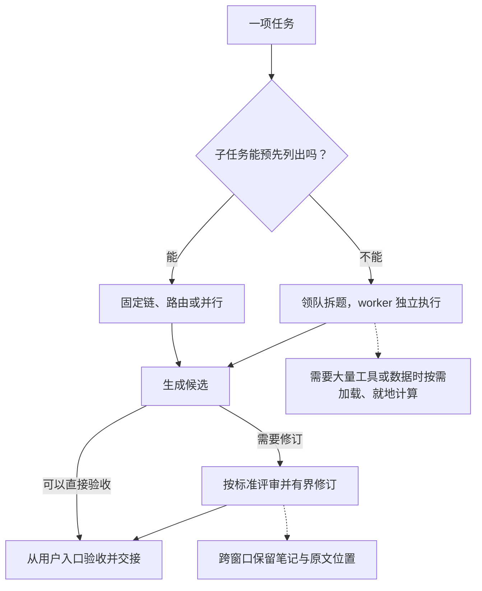
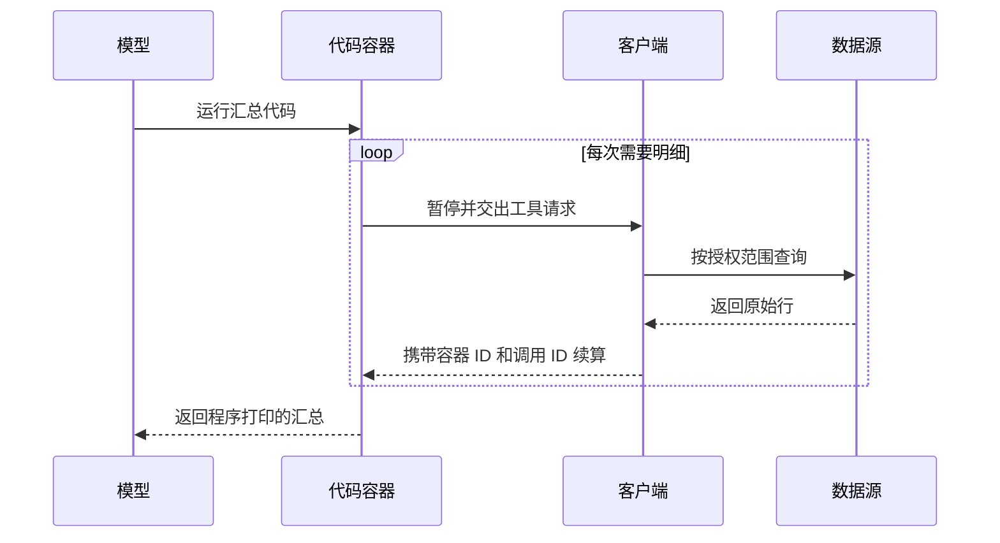

# 02｜Anthropic Cookbooks 精读：顺着一次调用，读懂六种工程模式

> 我读 Notebook 时会停在两处：模型刚刚返回了什么，宿主接着把什么送进下一轮。分清这两步，就能讲清并行发生在哪里、清理历史会丢什么，以及哪行代码有权宣布任务完成。



以下按 2026 年 11 月 24 日的源码快照读。Cookbook 固定在 `8ad5de6`，Quickstarts 在 `4a4224b`，Skills 在 `e4bb5d9`。旧仓库名仍会跳转。

文中的 Python 是便于调试的改写，官方原例的函数名和入口放在各节旁。[旧仓库入口](https://github.com/anthropics/anthropic-cookbook) · [固定版 Cookbook](https://github.com/anthropics/claude-cookbooks/tree/8ad5de647d4f0f50c95d74aabc8aa20a3f70cdd3) · [配套文章与实验](./01-anthropic-agent-engineering-canon.md)

## 读源码先设两个断点：一个看证据，一个看消息

**检索的断点在 `evaluate_retrieval`。** 每道题指定应命中的文档和块位置。函数取出对应原文，与检索结果逐块比较，再算找回的标准块数占比。

Notebook 输出里的 Pass@10 指前十个结果的覆盖情况；Agent 评测里的 pass@10 才指十次尝试至少成功一次。[检索 Notebook](https://github.com/anthropics/claude-cookbooks/blob/8ad5de647d4f0f50c95d74aabc8aa20a3f70cdd3/capabilities/contextual-embeddings/guide.ipynb)

- `situate_context` 读全文，为当前块写定位说明。`retrieve_advanced` 按排名融合两路：默认向量权重 0.8，BM25 权重 0.2，第 1 名贡献整份权重，第 2 名贡献一半。
- 最后演示 Cohere 重排时，只取上下文向量的候选。博客的 67% 相对降幅来自**双路召回再重排**。想重现实验，把各阶段的检索函数、数据切分和 k 都固定下来。[博客实验设置](https://www.anthropic.com/research/contextual-retrieval)
- 两个版本里可能有一模一样的段落。只比较去掉首尾空白的文本会给取错版本的候选算分。我会用文档版本和块 ID 判命中，再把原文留给人复查。

这份快照把 9 个代码库切块，用 248 道查询评测。复现时我会先抄下各个运行单元实际输出的分数，再看最后的文字总结。二者有细微出入时，看调用的函数和数据就能解释自己测了哪条路径。[固定版检索实验](https://github.com/anthropics/claude-cookbooks/blob/8ad5de647d4f0f50c95d74aabc8aa20a3f70cdd3/capabilities/contextual-embeddings/guide.ipynb)

| 该单元实际传给检索器的配置 | Pass@10 | Pass@20 |
|---|---:|---:|
| 基础向量 | 87.15% | 90.06% |
| 带上下文的向量 | 92.34% | 94.29% |
| 带上下文的向量 + BM25 | 92.31% | 95.23% |
| 带上下文的向量候选 → 重排 | 95.26% | 97.45% |

同一份混合索引，前 10 的覆盖略低于只用增强向量，前 20 却更高。若线上只取十块，先固定这个 k，再调融合权重。拿前二十的改善给前十的调用方做承诺，中间就换了一道题。

**工具的断点在第二次模型调用前。** 同一轮有两个客户端 `tool_use` 时，宿主执行两项操作，给每项配上同 ID 的 `tool_result`，放在紧随其后的同一条 user 消息里。单项查询报错，就给那一项回错误；漏一个 ID 可能让整轮都过不了协议检查。[工具评测 Notebook](https://github.com/anthropics/claude-cookbooks/blob/8ad5de647d4f0f50c95d74aabc8aa20a3f70cdd3/tool_evaluation/tool_evaluation.ipynb)

评测 Notebook 记录任务、调用与耗时，再汇总成败。查“为什么模型说读过，数据库却没收到请求”时，我先读这条消息和宿主日志。业务代码里用注册过的函数表分派请求，参数逐项验证，方便区分选错工具、工具失败和读错结果。

## 1. Basic workflows：串行、路由、并行各解决哪一步？

`basic_workflows.ipynb` 用 `chain` 串起结构化提取，用线程池 `parallel` 分析不同人群，再以 `route` 把支持请求送到预设提示。读完可以拿 PR diff 练手：路由区分代码和文档，两个分支分别抽取改动和待核实项，最后合成审阅草稿。[基础流程 Notebook](https://github.com/anthropics/claude-cookbooks/blob/8ad5de647d4f0f50c95d74aabc8aa20a3f70cdd3/patterns/agents/basic_workflows.ipynb)

```python
import json
import os
from concurrent.futures import ThreadPoolExecutor

def make_ask(client):
    def ask(instruction, data):
        reply = client.messages.create(
            model=os.environ["CLAUDE_MODEL"], max_tokens=1200,
            system=instruction,
            messages=[{"role": "user", "content": json.dumps(data, ensure_ascii=False)}],
        )
        if reply.stop_reason != "end_turn":
            raise ValueError(f"模型没有完整结束本轮：{reply.stop_reason}")
        return "".join(b.text for b in reply.content if b.type == "text")
    return ask

def review_diff(diff, ask):
    routes = {"code": "核对行为变化与测试", "docs": "核对说明与引用"}
    route = ask("只输出 code、docs 或 review，混合改动选 review", diff).strip()
    if route not in routes:
        return {"state": "review", "reason": "需要确认审阅范围"}

    # 两个问题都能独立从 diff 里回答，各自收到原文。
    prompts = ("抽取能定位到文件和行的改动", "列出需进一步核实的问题，无则写无")
    with ThreadPoolExecutor(max_workers=2) as pool:
        changes, gaps = list(pool.map(lambda prompt: ask(prompt, diff), prompts))

    if not changes.strip() or not gaps.strip():
        return {"state": "review", "reason": "分析结果缺失"}
    draft = ask(routes[route], {"diff": diff, "changes": changes, "gaps": gaps})
    return {"state": "draft", "route": route, "text": draft}
```

前三个示例共用 `ask(instruction, data) -> str`。真调用可把 `anthropic.Anthropic()` 传给 `make_ask`，配置 `ANTHROPIC_API_KEY` 和 `CLAUDE_MODEL`；离线时传同签名的普通函数。每次只创建本次的消息数组，能直接检查每个分支看到了什么。

**读代码时注意两个出口。** 已有可靠的文件类型，可以直接路由。需要模型分类时，只准进入已登记的处理器，混合或未知类别留给复核。按类别统计误路由，比总体命中率更容易发现小类一直分错。

最终生成保留原始 diff，避免第一轮的误读一路传下去。长 diff 可以只传版本与行号，再按需回读。非空检查能抓漏返回，引用是否真的支持“行为已改变”，仍要靠原文或测试判定。

两个独立查询各需 2 秒和 4 秒，串行约 6 秒，理想并行约 4 秒再加调度与合并。如果第二个问题必须先知道第一个结果，就应串行。进程内的两个线程也只约束这个进程，跨进程配额和超时应设在共享入口。

## 2. Orchestrator-workers：先核对分工，再启动 worker

分析一个陌生仓库，事先未必知道哪些模块受影响。官方例子从营销任务中拆出不同角度：领队产出带类型和说明的 XML，`parse_tasks` 解析，`FlexibleOrchestrator.process` 再逐个建 worker 提示。这里确实写的是普通 `for` 循环。[动态分工 Notebook](https://github.com/anthropics/claude-cookbooks/blob/8ad5de647d4f0f50c95d74aabc8aa20a3f70cdd3/patterns/agents/orchestrator_workers.ipynb)

下面把计划改成 JSON。宿主先给领队一份本次可读的资料目录，核对键名、分支数和重复分派，worker 才开始读正文。计划最多四项、线程最多两个，分别控制总工作量和同时发出的请求。

```python
def investigate(question, sources, ask):
    plan = json.loads(ask(
        '只输出 JSON 数组。每项含 source、question，选互不重叠的资料，最多四项。',
        {"goal": question, "available": list(sources)},
    ))
    if not isinstance(plan, list) or not 1 <= len(plan) <= 4:
        raise ValueError("计划为空或超出分支预算")
    selected = set()
    for part in plan:
        if not isinstance(part, dict):
            raise ValueError("子任务必须是对象")
        key, task = part.get("source"), part.get("question")
        if (not isinstance(key, str) or key not in sources or key in selected
                or not isinstance(task, str) or not task.strip()):
            raise ValueError("子任务范围不明确或引用了不可读的资料")
        selected.add(key)

    def run(part):
        key = part["source"]
        # 新调用只带本分支资料。领队和其他分支的消息都不在这个对象里。
        try:
            claim = ask("按资料回答子问题，证据不足请明说，只给结论和原文短引。",
                        {"question": part["question"], "evidence": sources[key]})
            if not claim.strip():
                raise ValueError("空结果")
            return {"source": key, "state": "returned", "claim": claim}
        except (TimeoutError, ValueError):
            return {"source": key, "state": "missing"}

    with ThreadPoolExecutor(max_workers=2) as pool:
        reports = list(pool.map(run, plan))
    findings = [r for r in reports if r["state"] == "returned"]
    missing = [r["source"] for r in reports if r["state"] == "missing"]
    if not findings:
        return {"state": "incomplete", "missing": missing, "evidence": []}
    answer = ask("只用已返回证据归并，保留文件版本、冲突与缺口。",
                 {"question": question, "findings": findings, "missing": missing})
    return {"state": "partial" if missing else "assembled",
            "answer": answer, "evidence": findings, "missing": missing}
```

**为什么由程序附来源？** 它能证明某次调用读了哪个文件。至于那句话有没有断章取义，要把短引和该文件的对应版本对齐。领队漏派一个模块时，所有已派分支也可能全绿；应覆盖集合要从原始任务另行取得，汇总后做差集。

| 想观察的行为 | 去源码哪里看 | 最容易误会的地方 |
|---|---|---|
| 模型派单后谁等待、谁收回结果 | [异步编排 Notebook](https://github.com/anthropics/claude-cookbooks/blob/8ad5de647d4f0f50c95d74aabc8aa20a3f70cdd3/patterns/agents/async_multi_agent_orchestration.ipynb) 对比固定团队与动态创建 | 新消息数组隔离历史，并发由调度器决定 |
| 用户到底少等了多久 | [延迟 Notebook](https://github.com/anthropics/claude-cookbooks/blob/8ad5de647d4f0f50c95d74aabc8aa20a3f70cdd3/patterns/agents/latency_multi_agent.ipynb) 分开计协调、任务工具和端到端时间 | 领队、worker、汇总和重试都产生用量 |
| 同一轮发出多个只读工具请求 | [并行工具 Notebook](https://github.com/anthropics/claude-cookbooks/blob/8ad5de647d4f0f50c95d74aabc8aa20a3f70cdd3/tool_use/parallel_tools.ipynb) 对照一次 assistant 响应的多个 ID | 一个助手同时用多把工具，只需一个决策上下文 |
| 一份派单怎样限制范围 | [Research 的三份角色提示](https://github.com/anthropics/claude-cookbooks/tree/8ad5de647d4f0f50c95d74aabc8aa20a3f70cdd3/patterns/agents/prompts) 对读领队、子助手和引文助手 | 提示规定交什么，凭证和可写目录由运行时分配 |

**迟到的 worker 应该看到几点？** 延迟 Notebook 给全队共用一个时钟，工具结果回来、下一次模型调用之前，把经过的秒数加到最新 user 消息末尾。晚 182 秒才启动的 worker，第一眼看到的就是 182 秒。[团队计时源码](https://github.com/anthropics/claude-cookbooks/blob/8ad5de647d4f0f50c95d74aabc8aa20a3f70cdd3/patterns/agents/latency_multi_agent.ipynb)

可以对照三组：无时钟、时钟加一句提示强调时间、时钟同时显示已用时间和总预算。时间戳放在最新消息末尾，能复用之前的稳定前缀。显示还剩多久给模型做取舍，真正到期时仍由宿主停止派单。

隔离要一路做到资源层。给 worker 独立工作目录和受限的只读工具，共享结果交给一个合并者。一个分支超时，就保留其他证据、列出缺口，重试前核对版本。SDK 的断网、限流、超时要在调用适配器归类，整项任务还需要一个共同的截止时间。

## 3. Evaluator-optimizer：把“再改一版”变成能收工的循环

官方生成器给候选，评审调用独立读原题和候选，返回判定与反馈。`loop` 会把过去的尝试传进下一轮，收到 PASS 才退出；源码里有 `while True`。接真实 API 时，我想保住反馈这条线，也想知道最后是哪条条件让循环停下。[评审与修订 Notebook](https://github.com/anthropics/claude-cookbooks/blob/8ad5de647d4f0f50c95d74aabc8aa20a3f70cdd3/patterns/agents/evaluator_optimizer.ipynb)

```python
def revise(task, ask, hard_checks, max_rounds=3):
    if not 1 <= max_rounds <= 8:
        raise ValueError("需要有限的轮数")
    previous, feedback = "", "生成第一份候选"
    seen, history = set(), []
    for turn in range(1, max_rounds + 1):
        candidate = ask("按原题写候选；根据具体反馈修订。",
                        {"task": task, "previous": previous, "feedback": feedback})
        normalized = candidate.strip()
        if not normalized or normalized in seen:
            return {"state": "stalled", "candidate": previous, "history": history}
        seen.add(normalized)
        defects = hard_checks(candidate)  # 返回可复现的问题列表，空列表表示硬检查通过。
        if defects:
            feedback = "；".join(defects)
        else:
            review = json.loads(ask(
                '独立按题目核对引用和适用条件。返回 JSON，pass 为布尔值，fix 为字符串。',
                {"task": task, "candidate": candidate},
            ))
            if (not isinstance(review, dict) or type(review.get("pass")) is not bool
                    or not isinstance(review.get("fix"), str)):
                raise ValueError("评审结果格式错误")
            if review["pass"]:
                return {"state": "accepted", "candidate": candidate,
                        "history": history + [{"round": turn, "result": "accepted"}]}
            feedback = review["fix"].strip()
            if not feedback:
                raise ValueError("未通过却没有可用的修订理由")
        history.append({"round": turn, "result": "rejected", "feedback": feedback})
        previous = candidate
    return {"state": "budget_exhausted", "candidate": previous, "history": history}
```

| 一次评审发生了什么 | 合理的下一步 |
|---|---|
| 引用 ID 不存在、字段单位不对 | 交给 `hard_checks`，把可复现的错误交还生成器 |
| 引文存在，但解释漏掉前置条件 | 新开评审调用，只给原题、候选和明确的量表 |
| 两轮交出相同文本，或已经用尽轮数 | 留下候选和 history，分别记录停滞或预算耗尽 |
| 缺少能判定的外部证据 | 返回检索或请人补资料，继续润色解决不了事实缺口 |

用专家判过的首稿校准裁判，也拿一份已知合格答案跑硬检查。生成者和评审者即使分开会话，仍可能共享模型盲点。除了通过率，还要数二稿修掉几个真问题，又引入几个新问题。旧稿放 trace，保留最近通过硬检查的版本供人复核。

上面的循环只带上一稿和一条反馈，避免早已修掉的问题继续留在提示里。重复检测只能拦住相同文本，改个标点就能绕开，所以轮数、整单时限和费用各自要有出口。若首稿已通过可信的确定性检查，直接交付就少一次评审调用。

## 4. Memory 与 Context Editing：关掉会话以后，什么还能读到？

代码审查是很好的测试。A 会话记下“在哪个提交验证过哪个文件”，B 从空消息数组启动。如果 B 能用同一个授权目录读回笔记、再从版本库查到原文，才真的测到了跨会话记忆。[Memory Cookbook](https://github.com/anthropics/claude-cookbooks/blob/8ad5de647d4f0f50c95d74aabc8aa20a3f70cdd3/tool_use/memory_cookbook.ipynb)

`MemoryToolHandler` 把逻辑路径 `/memories` 映射到客户端存储，支持查看、创建、定点替换、插入、删除和改名。路径解析后必须仍在根内。

下例从官方仓库的 `tool_use` 目录导入处理器；`files` 是宿主按仓库权限准备的只读版本快照。[处理器源码](https://github.com/anthropics/claude-cookbooks/blob/8ad5de647d4f0f50c95d74aabc8aa20a3f70cdd3/tool_use/memory_tool.py) · [Memory Tool 协议](https://platform.claude.com/docs/en/agents-and-tools/tool-use/memory-tool)

```python
import json
from pathlib import Path
from memory_tool import MemoryToolHandler

def review_files(client, model, repo_dir, files, question, max_turns=12):
    notes = MemoryToolHandler(str(Path(repo_dir)))
    reader = {
        "name": "read_file_snapshot", "description": "按已授权文件 ID 读带版本的源码快照",
        "input_schema": {"type": "object", "properties": {"id": {"type": "string"}},
                         "required": ["id"], "additionalProperties": False},
    }
    tools = [{"type": "memory_20250818", "name": "memory"}, reader]
    edits = [{"type": "clear_tool_uses_20250919",
              "trigger": {"type": "input_tokens", "value": 30000},
              "keep": {"type": "tool_uses", "value": 3},
              "clear_at_least": {"type": "input_tokens", "value": 5000},
              "exclude_tools": ["memory"]}]
    messages = [{"role": "user", "content": question}]
    for _ in range(max_turns):
        reply = client.beta.messages.create(
            model=model, max_tokens=1500, tools=tools, messages=messages,
            system="先读仓库笔记。记录文件 ID、提交版本、已验证结论和待查问题。",
            betas=["context-management-2025-06-27"], context_management={"edits": edits},
        )
        messages.append({"role": "assistant", "content": reply.content})
        if reply.stop_reason == "end_turn":
            return reply
        if reply.stop_reason != "tool_use":
            raise RuntimeError(f"审阅未完成：{reply.stop_reason}")
        results = []  # 每个客户端调用都要有一个对应结果。
        for block in reply.content:
            if block.type != "tool_use":
                continue
            if block.name == "memory":
                outcome = notes.execute(**block.input)
            elif (block.name == "read_file_snapshot" and isinstance(block.input.get("id"), str)
                  and block.input["id"] in files):
                outcome = {"success": json.dumps(files[block.input["id"]], ensure_ascii=False)}
            else:
                outcome = {"error": "当前目录没有该工具或文件"}
            results.append({"type": "tool_result", "tool_use_id": block.id,
                            "is_error": "error" in outcome,
                            "content": outcome.get("success", outcome.get("error", ""))})
        messages.append({"role": "user", "content": results})
    raise TimeoutError("本轮预算已用完，请保留进度")
```

**清理配置中的三个数读法不同。** 30,000 是触发编辑的输入 token 数，3 是保留最近多少次工具使用，5,000 是一次至少要清出的 tokens。这是示例配置。可删除的结果太少时，超过触发阈值也未必发生清理。[Context Editing 协议](https://platform.claude.com/docs/en/build-with-claude/context-editing)

- **服务器清理的是模型视图。** 旧结果用占位表示，默认保留调用输入。客户端仍提交完整且配对的消息。看响应的 `context_management` 能知道实际处理量。
- **记忆由客户端写盘。** 排除 `memory` 可保留刚回来的笔记操作。临近阈值的保存提醒不能代替写盘回执。读大笔记可先看索引，再读局部；清前缀还会影响缓存，要一起看重建和后续命中。
- **换目录做负测试。** 丢掉 A 的历史，用同目录启动 B 应能查回来源，换另一租户的空目录应读不到。并发写同页要做版本检查，备份、删除和保留期也按同一归属管理。

研究语料上的 `context_engineering_tools.ipynb` 可以对照多种管理方式。看清它排除了哪些工具、清出了哪些旧结果，再问同一道需要早期证据的问题。消息协议完整和最终能找回证据，是两件分别能测的事。[上下文管理 Notebook](https://github.com/anthropics/claude-cookbooks/blob/8ad5de647d4f0f50c95d74aabc8aa20a3f70cdd3/tool_use/context_engineering/context_engineering_tools.ipynb)

### Dreaming：让整理者在所有分析者结束后再动索引

每份 transcript 先由分析者提取值得复用的事实，领队追踪处理进度，最后由整理者去重、修断链和重建索引。新会话把整理后的存储只读挂载。

读 `work_request.md`、`analyzer_system.md`、`organizer_system.md`，就能对上这三份职责。[动态工作流 Notebook](https://github.com/anthropics/claude-cookbooks/blob/8ad5de647d4f0f50c95d74aabc8aa20a3f70cdd3/managed_agents/CMA_dreaming_with_a_dynamic_workflow.ipynb) · [PR 959](https://github.com/anthropics/claude-cookbooks/pull/959)

Stainless 那组 25 道题里，单用原文搜索满足 53% 的评分项，配成熟 Wiki 达到 61%。决定重建频率时，我会分开测单条查找和跨文档综合，算每次查询节省多少、一次整理要花多少，以及事实多久会变。[记忆实验](https://www.anthropic.com/research/components-of-agent-memory)

当场笔记可以记住为何暂停，离线归纳可能晚于来源更新。新 Wiki 单独发布一个版本，保留来源和适用日期，回放已有问题后再切换默认索引。这样既能检出“流程跑完但漏分析几份输入”，也能撤回把个例写成通则的一页。

## 5. Tool Search 与 PTC：找到函数以后，明细经过谁？

报销 Notebook 让同一道题分别走普通工具循环和程序化调用。最值得对照的并非最终表格，而是**原始行由谁接收、模型读到哪一份结果**。工具定义太多发生在调用之前，明细太多发生在调用之后，可以分别处理。[PTC Notebook](https://github.com/anthropics/claude-cookbooks/blob/8ad5de647d4f0f50c95d74aabc8aa20a3f70cdd3/tool_use/programmatic_tool_calling_ptc.ipynb) · [高级工具文章](https://www.anthropic.com/research/advanced-tool-use)

| 怎样发现接口 | 模型首先看到什么 | 我会用什么题测它 |
|---|---|---|
| 托管正则或 BM25 搜索 | 常驻搜索工具；授权目录中低频定义设 `defer_loading` | 能否从任务语言找到稀有函数，常用工具是否值得直接加载 [协议](https://platform.claude.com/docs/en/agents-and-tools/tool-use/tool-search-tool) |
| 自定义 `describe_tool` | 一份小目录，按名取定义与工具引用 | 已知准确名称时，首次正确调用前花几轮 [目录发现示例](https://github.com/anthropics/claude-cookbooks/blob/8ad5de647d4f0f50c95d74aabc8aa20a3f70cdd3/tool_use/tool_search_alternate_approaches.ipynb) |
| 自定义语义搜索 | `tool_to_text` 把名称、描述和参数转成检索文本，命中后返回 `tool_reference` | 用户说法和函数名差很远时，正确工具能否进候选 [向量搜索示例](https://github.com/anthropics/claude-cookbooks/blob/8ad5de647d4f0f50c95d74aabc8aa20a3f70cdd3/tool_use/tool_search_with_embeddings.ipynb) |

**宿主这一侧**处理的是暂停与续传。下面允许代码容器调用两项只读函数，读取同一时期、同一单位的用量和上限。宿主先筛好 `departments`，再核对每一项请求的调用方、工具名和部门。

```python
import json

def usage_report(client, model, departments, max_rounds=24):
    version = "code_execution_20260120"
    schema = {"type": "object", "properties": {"department": {"type": "string"}},
              "required": ["department"], "additionalProperties": False}
    fields = {"get_usage_rows": ("rows", "读取已结算用量，返回整数数组"),
              "get_usage_limit": ("limit", "读取同期同单位上限，返回整数")}
    tools = [
        {"type": "tool_search_tool_bm25_20251119", "name": "tool_search_tool_bm25"},
        {"type": version, "name": "code_execution"},
    ]
    for name, (_, description) in fields.items():
        tools.append({"name": name, "description": description, "input_schema": schema,
                      "defer_loading": True, "allowed_callers": [version]})
    request = {"goal": "查找用量与上限工具，在代码中汇总，只打印超额部门和差额。",
               "departments": list(departments)}
    messages = [{"role": "user", "content": json.dumps(request, ensure_ascii=False)}]
    container = None
    for _ in range(max_rounds):
        args = {"container": container} if container else {}
        reply = client.messages.create(model=model, max_tokens=4096, tools=tools,
                                       messages=messages, **args)
        messages.append({"role": "assistant", "content": reply.content})
        if reply.container:
            container = reply.container.id
        if reply.stop_reason == "end_turn":
            return reply
        if reply.stop_reason == "pause_turn":
            continue  # 托管工具本轮暂停，原样续传 assistant 内容。
        if reply.stop_reason != "tool_use" or not container:
            raise RuntimeError(f"程序化调用未完成：{reply.stop_reason}")
        results = []
        for call in reply.content:
            if call.type != "tool_use":
                continue  # 搜索及沙箱的 server_tool_use 由平台处理。
            name, dept = call.name, call.input.get("department")
            allowed = (getattr(call.caller, "type", None) == version
                       and name in fields and isinstance(dept, str) and dept in departments)
            if allowed:
                field, _ = fields[name]
                value = departments[dept][field]
            else:
                value = {"error": "当前工具调用或部门不在授权查询范围内"}
            results.append({"type": "tool_result", "tool_use_id": call.id,
                            "is_error": not allowed, "content": json.dumps(value)})
        if not results:
            raise RuntimeError("未找到需由客户端完成的请求")
        messages.append({"role": "user", "content": results})
    raise TimeoutError("查询超出续传预算")
```

快照里的报销例子用 `code_execution_20250825` 和 beta 接口，上例选 `code_execution_20260120` 与支持 PTC 的模型。

收到 `pause_turn` 时保留 assistant 内容继续；收到自定义 `tool_use` 时，续传请求要带容器 ID，每条结果还要配自己的调用 ID。[PTC 续传协议](https://platform.claude.com/docs/en/agents-and-tools/tool-use/programmatic-tool-calling)



**容器这一侧**只做计算。下面的函数接收平台注入的异步工具，方便换成本地函数单测。每个部门的两个读操作并行，部门之间依次推进。原始行出错时应明确报告覆盖缺口，把错误当成零会直接算错总数。

```python
import asyncio
import json

async def over_limit(names, get_usage_rows, get_usage_limit):
    flagged = []
    missing = []
    for name in names:
        # 同一部门的明细和上限共用一个快照，两次读取互不依赖。
        try:
            raw_rows, raw_limit = await asyncio.gather(
                get_usage_rows(department=name),
                get_usage_limit(department=name),
            )
            rows, limit = json.loads(raw_rows), json.loads(raw_limit)
            if type(limit) is not int or not isinstance(rows, list):
                raise ValueError("上限或明细类型不符")
            if any(type(value) is not int for value in rows):
                raise ValueError("用量必须是同一单位的整数")
        except (ValueError, TypeError, TimeoutError):
            missing.append(name)
            continue

        excess = sum(rows) - limit
        if excess > 0:
            flagged.append({"department": name, "excess": excess})

    return {"flagged": flagged, "missing": missing,
            "state": "partial" if missing else "complete"}
```

给部门传入 `[60, 90]`、上限 `100`，模型只需看到差额 `50`。明细仍经过网络和客户端；PTC 也可能需要多次 API 续传。分别计推理用量、API 次数、下游查询、传输字节和端到端耗时，才能解释到底省在哪。

**这份 Notebook 的历史输出值得手算一次。** 普通循环记录 110,473 tokens、35.38 秒，PTC 记录 15,919 tokens、34.88 秒。用量少了 85.6%，耗时只少 1.4%。打印出的最终比较表里，两边都是 4 次 API 调用。[并排运行的两个单元](https://github.com/anthropics/claude-cookbooks/blob/8ad5de647d4f0f50c95d74aabc8aa20a3f70cdd3/tool_use/programmatic_tool_calling_ptc.ipynb)

为什么前一个输出又印着 PTC 只调了 3 次？那一行统计的是历史中 assistant 消息的条数，末表用的是发请求时累计的计数器。要定位网络等待，应在发请求的位置计数，不能从最后剩几条消息倒推。

再比一下答案：两份输出都列出三人超额，但对同一位员工，普通循环报告差额 1,753.62 美元，PTC 报告 4,177.88 美元。真要验收，就用同一快照重算已批准、属该季度的差旅行，再扣对应额度。只验名单会放过金额算错。[报销 Notebook 的输出](https://github.com/anthropics/claude-cookbooks/blob/8ad5de647d4f0f50c95d74aabc8aa20a3f70cdd3/tool_use/programmatic_tool_calling_ptc.ipynb)

若一张固定报表能回答问题，直接调后端聚合。需要临时组合大量数据再用 PTC。搜得到却常填错参数，查 `input_examples`；很久才第一次调对工具，查搜索候选是否塞了太多相近定义。容器丢失时可从同版快照重算纯读，外部写操作要先核对回执。

## 6. Long-running harness：一个提交要经过什么才能交班？

Quickstart 的 `agent.py` 根据项目里有无 `feature_list.json` 选 initializer 或 coding 会话，每班新建 client。

初始化提示负责环境和清单，编码提示要求读进度、做基本验证、推进一项功能。`progress.py` 只是统计有多少个 `passes` 为真。[驱动代码](https://github.com/anthropics/claude-quickstarts/blob/4a4224bdf0e9cfb3332167b69c90457403813625/autonomous-coding/agent.py) · [进度统计](https://github.com/anthropics/claude-quickstarts/blob/4a4224bdf0e9cfb3332167b69c90457403813625/autonomous-coding/progress.py) · [两份提示](https://github.com/anthropics/claude-quickstarts/tree/4a4224bdf0e9cfb3332167b69c90457403813625/autonomous-coding/prompts)

源码中的清单和进度文件在项目运行时生成。一个功能的 `category`、`description`、`steps` 描述用户行为，`passes` 从 false 开始。比如“保存后重开仍能读到同一份草稿”，步骤就得走到**重新打开**，只在文本框看到原值还差了一次读取。[Quickstart 目录](https://github.com/anthropics/claude-quickstarts/tree/4a4224bdf0e9cfb3332167b69c90457403813625/autonomous-coding)

**初始化：把验收起点写进 Git。** 下面给每项另加稳定的 `id` 关联测试，要求 Python 3、Git 和提交身份。宿主在指定 base 的干净临时 worktree 中调用 `setup` 生成清单与启动脚本，再建立独立的交接引用。

```python
import json
import subprocess
from copy import deepcopy
from pathlib import Path

RUN_REF = "refs/agent-runs/draft-editor"
FEATURES, LOG = "feature_list.json", "claude-progress.txt"

def git(directory, *args):
    return subprocess.check_output(["git", "-C", str(directory), *args], text=True).strip()

def snapshot(directory, parent, message):
    # 制作提交对象；在验收前，接班引用仍停在旧版。
    git(directory, "add", "--all")
    tree = git(directory, "write-tree")
    return git(directory, "commit-tree", tree, "-p", parent, "-m", message)

def save_features(directory, features):
    (directory / FEATURES).write_text(
        json.dumps(features, ensure_ascii=False, indent=2) + "\n", encoding="utf-8")

def initialize(directory, base, setup):
    directory = Path(directory)
    if git(directory, "rev-parse", "HEAD") != base or git(directory, "status", "--porcelain"):
        raise ValueError("初始化需要指定版本的干净工作树")
    features = setup(directory)
    if not isinstance(features, list) or not features:
        raise ValueError("初始化未产出完整清单")
    ids = [item["id"] for item in features]
    if not all(isinstance(i, str) and i for i in ids) or len(ids) != len(set(ids)):
        raise ValueError("每项需求需要唯一标识")
    for item in features:
        if not item["description"] or not item["steps"]:
            raise ValueError("需要用户可观察的行为与步骤")
        item["passes"] = False
    save_features(directory, features)
    (directory / LOG).write_text("初始化完成，先运行启动自检。\n", encoding="utf-8")
    first = snapshot(directory, base, "建立功能清单与启动环境")
    git(directory, "update-ref", RUN_REF, first, "")  # 要求引用此前不存在。
    return first
```

**工作会话：先验候选提交，再推进引用。** `implement` 只在分配的工作树里改实现，`verify(commit, ids)` 由独立 runner 检出指定提交、启动应用、跑冒烟和对应功能。通过才返回不可变报告地址，失败保留报告并抛错。

```python
def run_shift(directory, base, implement, verify):
    directory = Path(directory)
    if git(directory, "rev-parse", "HEAD") != base or git(directory, "status", "--porcelain"):
        raise ValueError("请从已发布进度创建干净工作树")
    # 在实现回调运行前，保存本班要遵守的验收清单。
    features = json.loads((directory / FEATURES).read_text(encoding="utf-8"))
    todo = next((f for f in features if not f["passes"]), None)
    passed = [f["id"] for f in features if f["passes"]]
    if todo is None:
        verify(base, passed)  # 可信 runner 从此提交重新构建，失败即抛错。
        return {"state": "done", "commit": base}

    # 工人先按交接记录启动并做冒烟自检，再实现这一项。
    implement(directory, deepcopy(todo))
    proposal = snapshot(directory, base, "实现 " + todo["id"])
    if git(directory, "diff", "--name-only", base, proposal, "--", FEATURES, LOG):
        raise ValueError("工人改动了宿主管理的清单或进度")
    evidence = verify(proposal, passed + [todo["id"]])  # 工件地址，仅测试全部通过才返回。
    todo["passes"] = True
    save_features(directory, features)
    with (directory / LOG).open("a", encoding="utf-8") as out:
        out.write(f"{todo['id']} 已验收，代码 {proposal}，证据 {evidence}\n")
    checked = snapshot(directory, proposal, "记录验收 " + todo["id"])
    git(directory, "update-ref", RUN_REF, checked, base)  # 有其他班次先发布则失败。
    return {"state": "checkpoint", "commit": checked, "evidence": evidence}
```

这里我最在意 `update-ref` 的最后一个参数。两个 worker 都从同一 base 出发，各有一份绿报告。先完成者更新公开引用，后完成者的旧值已经对不上，只能取新基线整合、重新验收。没人能悄悄用旧提交覆盖别人刚验过的功能。

清单、交接日志和公开引用要由宿主管理，runner 的测试也独立维护。把 `passes` 改成 true 的权限交给实现者，或者允许运行的代码改裁判，两种做法都会让进度与实际能力脱节。中途挂掉时从最近已发布引用重开工作树即可。

**把“保存成功”变成浏览器能证明的事。** 下例在隔离测试数据上操作；runner 提供浏览器实例、地址和测试用户的登录状态。第一次写随机内容，第二次从新的浏览器上下文打开同一地址，能抓出只把数据放在组件或浏览器缓存里的实现。

```python
from uuid import uuid4
from playwright.sync_api import expect

def check_draft_reload(browser, draft_url, login_state):
    # 两个上下文使用相同账号，但不共享本次写入的浏览器存储。
    text = "草稿-" + uuid4().hex
    editor_context = browser.new_context(storage_state=login_state)
    try:
        editor = editor_context.new_page()
        editor.goto(draft_url)
        save = editor.get_by_role("button", name="保存")
        expect(save).to_be_enabled()
        editor.get_by_label("草稿").fill(text)
        save.click()
        expect(editor.get_by_role("status")).to_have_text("已保存")
    finally:
        editor_context.close()

    reader_context = browser.new_context(storage_state=login_state)
    try:
        reader = reader_context.new_page()
        reader.goto(draft_url)
        saved_draft = reader.get_by_label("草稿")
        expect(saved_draft).to_have_value(text)
    finally:
        reader_context.close()

    # 供 runner 和后端持久化记录比对。
    return text
```

驱动收到 `checkpoint` 后从新提交开下一班，收到 `done` 才结束。原 Quickstart 默认持续循环，`--max-iterations` 是上限。连续卡在同一步时，把报告地址和失败断言留给接班人；最终交付前在新环境再跑已通过功能。[应用 Harness 对照实验](https://www.anthropic.com/research/harness-design-long-running-apps)

## 选型速查：先看 trace 里第一处错误

| 看到什么 | 优先改哪一处 |
|---|---|
| 简单问题启动慢、工具名选错 | 比较全量常驻、精选常驻和授权目录搜索。看首次正确调用时间与稀有工具覆盖 |
| 五行样例跑得快，真实表一大就卡 | 先裁列、分页；要跨页计算时再比较 PTC 和后端聚合 |
| 三个 worker 一致同意，却只有一条原始证据 | 按原文与版本去重，单列缺口；共享资源交给一个合并者 |
| 新会话反复引用过期结论 | 查笔记来源、时间和是否能回读快照；新索引验证后再切换 |
| 每轮评审都要求“更全面” | 用合格答案测裁判，再给失败理由、轮数和停滞设明确出口 |
| 进度显示全绿，用户重开页面却丢数据 | 从绑定的提交启动应用，换浏览器上下文读终态，报告与版本一起保存 |

### 我会留下的四条回归用例

1. **把模型换成固定响应。** 第一次给未知路由，检查流程能停在复核；再让一个已派 worker 超时，另一个正常返回。结果里应能同时看到已收证据和缺失来源。
2. **在同一轮返回两个调用 ID。** 一项写记忆，一项读文件；下一轮的 user 消息里应出现两项结果。彻底丢掉消息历史，换新会话再读刚才写下的文件 ID。
3. **暂停同一个 PTC 容器。** 让一个获准的部门查询和一个越界查询同时返回。两项结果要各自配对，越界项回错误；模型不能拿“当前无法查询”当成用量为零。
4. **在验收的两边中断进程。** 实现完成但验证失败，公开引用应保持旧值；两个候选都通过但只有一个抢先更新引用，另一个要报告基线过期。最后从已发布版本重开，再验一次。

**Skills 的两个源码入口**

- 入门例子从配置技能一直走到取回文档。跟着文件句柄下载一次成品，就能分清 API 返回的元数据和交给用户的文件。[入门 Notebook](https://github.com/anthropics/claude-cookbooks/blob/8ad5de647d4f0f50c95d74aabc8aa20a3f70cdd3/skills/notebooks/01_skills_introduction.ipynb)
- 自定义开发例子把财务比率计算和品牌格式做成可版本化的技能。对照 PDF 技能目录，看哪一步由模型选择、哪一步直接运行脚本。[自定义开发](https://github.com/anthropics/claude-cookbooks/blob/8ad5de647d4f0f50c95d74aabc8aa20a3f70cdd3/skills/notebooks/03_skills_custom_development.ipynb) · [PDF 技能源码](https://github.com/anthropics/skills/tree/e4bb5d960d87126ff3b3a8af1a104b7db67560ba/skills/pdf)

**一手资料入口**：[Agent Patterns 目录](https://github.com/anthropics/claude-cookbooks/tree/8ad5de647d4f0f50c95d74aabc8aa20a3f70cdd3/patterns/agents) · [Skills Notebook 系列](https://github.com/anthropics/claude-cookbooks/tree/8ad5de647d4f0f50c95d74aabc8aa20a3f70cdd3/skills/notebooks) · [Agent 评测指南](https://www.anthropic.com/research/demystifying-evals-for-ai-agents)

## 六道面试深挖题

### 1. 路由用了模型，为什么还是 workflow？

1. **看允许的下一步。** 分类可能出错，但流程能走的分支、每一步传什么、哪里能退出，都由程序预先登记。
2. **看错了怎么办。** 我用白名单映射处理器，未知或混合意图进入复核，按类别看误分和最终解决率。
3. **追问：两个分支能同时跑吗？** 只要都只读、输入齐全就可以；后一个要用前一个的结果时，再多线程也省不了这个依赖。

### 2. 开四个异步任务就等于四个独立助手吗？

1. **我会看实际请求。** 每个 worker 应有自己的消息数组、资料范围和交付物；复用一个可变历史列表会互相污染。
2. **再看资源。** 检查凭证、工作目录和共享写入。注入一个分支超时，另外三份证据应保得住。
3. **追问：怎样知道没漏查？** 从原题提取应覆盖范围，与已返回的来源做差。只数四个 future 都结束，查不出领队漏派。

### 3. 生成和评审来回改，质量却下降，怎么查？

1. **先拿标样查裁判。** 如果专家认可的稿也被拒，就先修标准。能查字段、版本和引用的交给程序。
2. **再逐轮比缺陷。** 留下原题、每稿和反馈，统计修掉和新引入的错误。重复、用完预算都应留下未完成原因。
3. **追问：反馈总说缺事实呢？** 让流程返回检索并核对来源。生成器再改几轮，也写不出它没读到的证据。

### 4. 清理历史后忘事，和删掉消息后 API 报错，分别查哪？

1. **协议报错查 ID。** 每个客户端调用是否有紧邻的同 ID 结果，托管工具返回的块是否完整？正常使用服务端编辑时，客户端仍保留消息配对。
2. **忘事查持久化。** 从空会话读同一份笔记，再循版本找原文。顺带检查权限是否跟会话一起切换。
3. **追问：每晚重建 Wiki 划算吗？** 比搜索、Wiki 与组合三组，按实际查询量摊整理费用；索引发布要能回滚。

### 5. PTC 省了模型 tokens，为什么网络请求还可能增加？

1. **画一笔调用。** 沙箱要明细时会暂停，客户端仍要查数据并带结果续传。只有脚本汇总后的输出需要模型推理。
2. **分开计量。** 我会同时看模型用量、宿主 API 次数、下游查询和尾延迟，再考虑改函数粒度。
3. **追问：只靠调用 ID 能续算吗？** 它只说明在回答哪个调用，还要指回暂停的容器。数据不全时报告缺口，不能算成零。

### 6. 两个 worker 都通过了测试，谁的提交能作为下一班起点？

1. **先绑定版本。** 每份测试报告只证明自己的候选提交通过；公开引用指向最近一次已验收状态。
2. **发布时比较旧值。** 两人都从同一 base 开始，只有先更新引用的人能成功。另一人整合到新基线后再跑测试。
3. **追问：为何还要从用户入口重跑？** 单测能证明保存函数被调用，重开页面才能验证用户读回的内容。合并后的代码还可能改变之前已经通过的路径。
