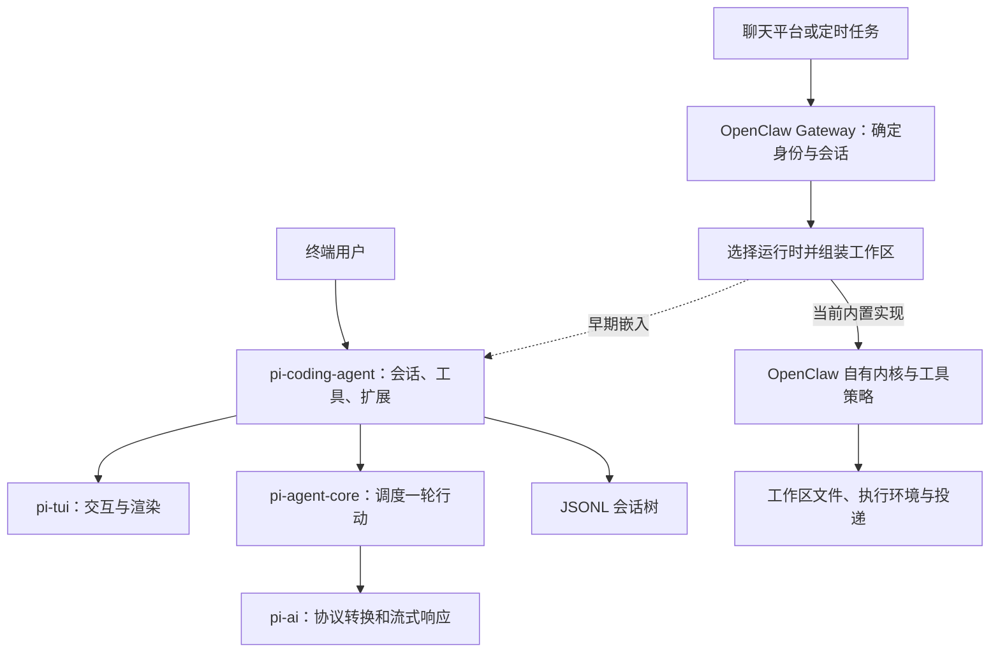
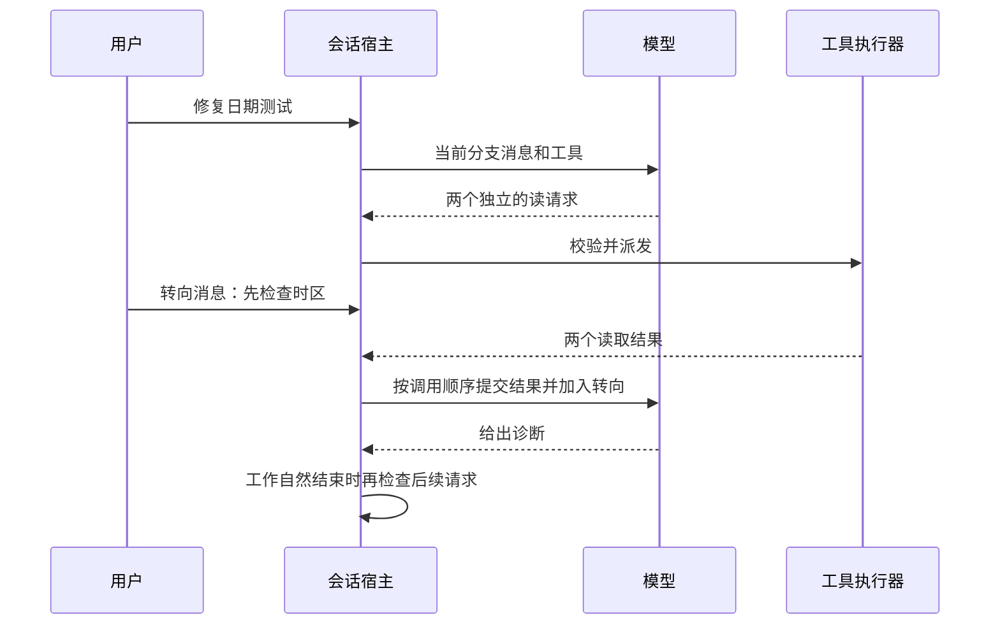

# Pi 与 OpenClaw：从终端里的四个工具，走到手机里的常驻助手

同事让你在终端修一个测试，和他半夜在家庭群里问“明天有什么要紧事”，都可以由同一类模型回答。难处在两个不同的地方。前者要让人看清模型读了什么、改了什么，走错时能换条路；后者要先弄清是谁在问、应该翻哪本笔记、有没有资格把答案发回这个群。沿着一条消息跟下去，就能解释 Pi 为什么把核心做小，OpenClaw 又为什么需要单独的网关、调度和身份边界。

**版本坐标为 2026 年 11 月 24 日。** Mario Zechner 在 2025 年介绍 Pi 时确实主动舍弃了内置 MCP、子 Agent 和计划模式。今天的 Pi 保留四个基础工具，也已经随包提供可替换的 MCP 扩展。OpenClaw 早期直接嵌入 Pi SDK，今天的内置循环归 OpenClaw 所有。把时间标在箭头上，两个看似冲突的源码答案就能同时成立。[Mario 的设计原文][mario] · [Pi 的 CLI][cli] · [早期集成][old] · [当前运行时][claw]

从旧文顺藤摸瓜时，仓库名和包名很容易认错。Mario 当年的链接指向 `badlogic/pi-mono`，当时使用 `@mariozechner` 作用域；本文固定提交位于 `earendil-works/pi`，当前编码前端包名为 `@earendil-works/pi-coding-agent`。查原始设计从作者博客进入，查今天的参数从固定提交的 CLI 文档进入。[作者的旧包链接][mario] · [当前仓库与包说明][pkg]

## 全景：先找负责下一步的那一层



读图时可以做个小实验。把终端换成网页，工具结果送回模型的顺序应该相同；把 WhatsApp 换成 Telegram，接收者的身份却未必相同。前一个要求把界面从循环里抽走，后一个要求把渠道识别放到循环之前。同一个“解耦”的词，落到代码里是两道完全不同的边界。[Pi 的包说明][pkg] · [Gateway 架构][gw]

## 一、为什么愿意用四个工具干活

想象模型要修一个日期解析错误。它可以用 `bash` 搜索测试名字，用 `read` 看出输入含时区，用 `edit` 替换那个分支，再运行已有测试；缺失的测试样例可以用 `write` 建文件。四个动词覆盖了发现、理解、变更、验证。宿主机已经有搜索器、编译器和测试程序，工具箱不用再为每种语言装一个“查符号”“修导入”“跑单测”。从调用轨迹上，人也能认出哪一步取得了证据，哪一步改动了现场。[作者的工具集解释][mario] · [当前工具选择][cli]

看一个容易算错的账。假设一次安装带入四十个业务工具，而今天只修测试。有的提供商需要把工具声明编码进模型输入。每个名字、描述、参数和返回约定都可能占位置；“搜索文件”“搜索文本”“搜索项目”相似到一定程度，模型还得先猜用哪一个。四个常见动词让这个选择问题变小。可是若业务每轮都要提交结构化工单，模型反复拼命令、猜字段、处理格式错误，一次窄而清楚的原生工具调用就可能更便宜。判断工具该不该入驻，要算到任务结束，要计入重试和验证，光比较第一轮输入长度容易选错。

短系统提示也有相同的账。作者希望自己能解释每一段进入模型的文字，新增一个模式不会悄悄影响昨天跑通的任务。源码 `system-prompt.ts` 按可见工具拼装介绍和规则，还会组合项目上下文、技能等材料。因而“短”描述的是出厂设计和对可见输入的控制。带了仓库说明、扩展和用户定制后，实际请求可以很长。对有缓存的提供商，稳定的开头能使连续请求复用已经计算的前缀；缩短开头减少冷启动输入，固定顺序才有助于复用，两项收益应分别测量。[系统提示构造][prompt] · [模型层的用量说明][ai]

同理，“低幻觉”是可以检验的工程假设。少几个容易混淆的入口，可能减少叫错工具；模型面对陌生的命令行程序也可能捏造参数。如何知道哪种效应更大？用同一提交、模型和任务，把两套工具清单各跑多次；给错误分三类，分别记录调用不存在的工具、调用存在但参数非法、参数合法但改错对象。前两类下降、最后一类上升时，演示看起来更干净，用户却没有得到更可靠的修改。Mario 给了他自己选工具的理由，可跨模型泛化的错误率要靠自己的回放集测。[作者的实验与限制][mario]

### 三个被留在外面的流程，以及其中一个回来的方式

MCP 解决的是用统一协议连接工具服务器。初版 Pi 的取舍是，已有命令行工具可让模型在需要时读取帮助，少数人的服务器清单不必压在所有请求的开头。到本文快照，Pi 已有 `builtin:mcp`，可以连接配置的服务器。`direct` 使工具直接进入声明，`deferred` 可以通过工具搜索加载，默认的 `codemode` 暴露方式允许脚本按需找工具、过滤结果。服务端工具出现后，稳定的间接入口无需把全部声明重写一遍。使用频率高、参数简单的少数工具可以直接暴露，几百个长尾操作则可延后。这个演变保留了原来想解决的“谁付上下文成本”问题，也改变了“必须自己写 MCP 客户端”的旧答案。[内置 MCP 的连接和暴露规则][mcp]

子 Agent 的诱惑在于让三个人同时查问题。代价是父会话要分派、描述现场、回收结果；孩子得重新读一部分材料。如果下一个动作取决于上一个测试的报错，拆成三段只会付三次交接成本。初版作者更看重可检查的完整轨迹，当时愿意自行启动独立会话。当前 README 仍把子 Agent 和计划模式列为由用户或包按需提供的功能。宿主有能力创建第二个 Agent，和默认交互必须经过一个委派器，是两种产品决定。[作者解释][mario] · [当前编码前端][pkg]

计划模式解决的是“先讨论、批准后再动手”。个人熟悉的仓库里，用户发一句“先解释，你先别改”，很快就能开工；共享生产环境里，真正的只读阶段应该由工具执行器强制。即使把 `edit` 和 `write` 从清单拿掉，仍要检查 `bash` 的实际能力。把“请先做计划”留给提示词，把“现在允许写什么”交给操作系统或受限工具，两者可以组合。Pi 把这种工作流交给扩展，团队也因此要自己负责验证它的边界。

## 二、沿着一次工具调用读三个包

**先看模型那一侧。** 流式响应好比收到一份分成几十封信送来的表单。收到半个文件名时可以在屏幕上显示进度，只有整份表单结束并通过校验后才适合打开文件。`pi-ai` 为多个提供商提供统一的消息、内容块和流事件；文本增量、工具调用参数、结束原因、用量都需要独立处理。上层可以用同一套事件驱动 UI，同时保留模型和提供商信息。跨提供商续聊还涉及工具调用标识、思考块的表示以及对方是否接受旧数据。能在新模型上继续完成任务，并不意味着两家服务能交换同一块推理缓存。[模型层 README][ai] · [Mario 的适配经验][mario]

**再看谁决定发下一次请求。** `pi-agent-core` 接受应用内部的 `AgentMessage`，必要时变换上下文，再经 `convertToLlm` 投影成模型能吃的消息。模型产生工具调用，循环校验输入、执行工具，把带调用标识的结果写回，然后再问模型；模型返回自然语言且没有待处理工作时才具备自然结束的条件。工具可以交出两类信息：给模型的短内容，以及给界面或应用的结构化细节。一个很长的测试报告，用户希望展开滚动，模型通常只需要失败名字、错误和取回报告的方式。把这两种消费者分开，可避免一次 UI 改版悄悄改变任务成本。[Agent 类型与事件][core] · [循环源码][loop]

核心的 `AgentState` 还把正在变化的部分单列出来：`streamingMessage` 表示当前尚在生成的助手消息，`pendingToolCalls` 跟踪未收尾的工具，`messages` 保存已经装入对话的消息。订阅者也可能异步落盘；收到 `agent_end` 表示循环不再发新事件，等待 `waitForIdle()` 才覆盖订阅者的收尾。假如界面在最后一个字画出来时立刻关闭文件，导出的轨迹可能偏偏少了最有价值的最后一次工具回执。[状态与事件的源码契约][core]

**实际运行有三个时钟。** 提供商传来文本的时刻、工具做完的时刻、结果写入对话的顺序，各有用途。当前核心默认允许合适的同批调用并行，预检查按序，完成事件可按实际完成次序到达，而提交到消息历史的结果遵循助手给出的调用顺序；还可设置串行执行。查两个不同文件可以利用这个差异提早刷新界面。先写配置再读回验证应该跨有依赖的步骤，或者明确串行。保证输出的排列稳定，只保证读者看到同一种排列，无法把本来并发的副作用倒回重排。[执行顺序说明][core] · [调度实现][loop]

用户说“先停一下，你看错目录了”，和说“好了以后顺便补个测试”，对调度器是两种输入。Pi 的 `steer` 在正常转向检查点让下一次模型决策尽快看到补充；`followUp` 等当前工作自然走完、没有需要继续的工具或转向消息时再进来。当前版本的正常转向点在这一轮工具批次完成后。已经启动的写操作不会被一条转向消息撤销。若需求是取消运行，需要走中止信号，并核对已经写入的文件或启动的进程。作者还在 X 上专门演示过，压缩期间也可以先收下两类消息；收下与消费之间的这段时间，就是交互体验和并发错误最容易交汇的地方。[队列语义][core] · [Mario 的发布说明][xpi]



**最后看宿主。** `pi-coding-agent` 负责工作目录、会话持久化、资源发现以及如何启动交互、批处理或 SDK 会话。终端绘制由 `pi-tui` 提供；扩展能订阅事件、加工具和命令、定制展示。Skill 把可复用做法写成说明，按名称和描述发现后再读正文；Prompt Template 把用户自己想多次发送的提示保存起来展开。把“发布前检查哪些东西”写成 Skill，把“针对这个差异做审查”的输入写成模板，把“每次工具调用前检查目标目录”做成可执行扩展，三者有不同的调用者、失败方式和测试成本。[编码前端][pkg] · [扩展生命周期][ext]

选扩展时还要算信任。加载 TypeScript 扩展等于让代码在宿主的权限背景下运行；一段技能说明则是进入模型的文字，只有后续工具授予能力时才可能产生系统副作用。两者都可能造成错误，但调查方法不同。一个插件载入即改文件，要看宿主过程和插件版本；一段技能使模型误改文件，要看技能内容、工具调用与审批。记录启用资源的版本和来源，比只把最终一屏终端文字贴给同事更能复盘。[扩展与安装说明][ext]

## 三、一棵树怎样容纳走错的路

设想你怀疑测试慢是网络问题，花了五轮才发现真正原因是本地夹具。删掉五轮会丢掉排除网络的证据；继续把五轮都送进去，会让模型带着一大堆已经放弃的假设。Pi 对这件事作了两个独立决定：已经发生的事情记在磁盘上，下一轮要读哪些消息则按当前叶子重新算。日志可以按写入时间排列，逻辑历史却能长成一棵树。[会话操作][sessions] · [会话管理源码][sm]

下面是一个会话文件中几条消息的**字段投影**，为了看清关系省去了文件头、时间戳和助手消息的提供商元数据。真实格式是一行一条 JSON；每条可分支记录持有 `id` 和 `parentId`。文件头有自己的会话标识，首条可分支记录的父指针为空。样例里的短标识只用于读图。[格式定义][sm]

```jsonl
{"type":"message","id":"a","parentId":null,"message":{"role":"user","content":"找出测试慢的原因"}}
{"type":"message","id":"b","parentId":"a","message":{"role":"assistant","content":[{"type":"text","text":"先查网络等待"}]}}
{"type":"message","id":"c","parentId":"b","message":{"role":"user","content":"离线复现了"}}
{"type":"branch_summary","id":"d","parentId":"a","fromId":"c","summary":"断网仍然慢，保留离线复现作为证据。"}
{"type":"message","id":"e","parentId":"d","message":{"role":"user","content":"这次先查测试夹具"}}
```

文件内先写 `c` 再写 `d`，但 `d` 的父节点是 `a`。叶子 `e` 的祖先链为 `e → d → a`。把这一链翻过来，就得到了新路线上的输入材料；旧路线 `a → b → c` 仍可浏览。`fromId` 交代摘要来自哪里，`parentId` 决定摘要贴到哪里，两者不可互换。`/tree` 可以在同一会话内换位置继续，`/fork` 适合创建独立会话，把另一条路线交给别人或单独维护。分叉保住的是对话证据；工作目录里的代码、数据库写入、外发消息各有自己的状态，移动对话指针不会还原它们。[导航与派生会话][sessions] · [分支总结][compact]

```python
def ancestry(entries, leaf):
    """示意：把一条逻辑分支按正序取出；生产读取器还需处理文件头与迁移。"""
    by_id = {entry["id"]: entry for entry in entries}
    path, seen = [], set()
    while leaf is not None:
        if leaf in seen or leaf not in by_id:
            raise ValueError("父链断裂或有环，停止构造上下文")
        seen.add(leaf)
        entry = by_id[leaf]
        path.append(entry)
        leaf = entry["parentId"]
    return list(reversed(path))
```

有了这条路径，到底还要摘要什么？**分支总结**解决的是换路时的交接。先找两条路径最近的公共祖先，把离开的旧叶子到公共祖先之间的独有工作取出来，在有限预算内总结，再把总结附到目的位置。两条路共同拥有的用户要求无需再花钱概括。若用户正在独立比较两个解法，可以跳过总结，免得第二条提前继承第一条的偏见。若第一条花两小时排除了数据库，就值得带一句“离线数据同样复现，见某个测试”。[导航钩子与摘要算法][compact]

**Compaction** 解决的是继续沿同一路线时窗口快装满的问题。产品在当前投影接近 `contextWindow - reserveTokens` 的边界时准备摘要；`reserveTokens` 是触发所需的余量，`keepRecentTokens` 则帮助挑选保留的最近区间。它寻找合法切点，避免把工具结果单独留在新窗口开头，再把早期材料总结成 `compaction` 条目，记下 `summary`、`firstKeptEntryId` 和 `tokensBefore`。下次向模型提交的是摘要加保留段，未被选中的历史仍可在原会话中查到。第二次压缩还要考虑上一次留下的那段历史；直接按“上次生成摘要的时间”切，会悄悄跳过一批仍有意义的消息。[切点与重复压缩][compact]

例如同一轮先运行编译、再调用测试，测试返回二十页日志。若恰在日志开头硬切，保留段就出现一串没有来源的结果。若把整轮无条件扔掉，就可能丢失用户给的验收条件。Pi 对跨越一次长交互的切点有专门处理，还追踪读过和改过的文件。自己的摘要器应优先保留用户硬约束、已执行的副作用、可复现的证据位置、正在等的结果。把“一个测试没跑”总结成“验证完成”，会比丢掉一段讨论贵得多。[长轮拆分和文件跟踪][compact]

在产品层想用便宜模型做压缩，或想给代码审查任务单独保留风险清单，可以订阅 `session_before_compact`；要控制换分支时如何交接，入口是 `session_before_tree`。前者能接收准备好的待总结材料、最近保留边界和 token 估计，返回自己的压缩结果或取消。接管这个钩子意味着要对字段的正确性和中途取消负责。写测试时刻意让摘要器超时，再读一次原分支；期待的是旧内容仍可续用，或者得到明确可恢复的失败，绝不能只有一条写着“已经压缩”的空记录。[自定义摘要契约][compact]

## 四、OpenClaw 怎样把终端内核搬进一台常开的机器

打开二月底的源码文档，有一行决定了整套架构：宿主直接调用 `createAgentSession()` 构造 `AgentSession`。当时四个 Pi 包固定到同一代版本。`runEmbeddedPiAgent()` 管一次任务，单次尝试负责会话准备，把渠道专用的工具和提示接进去，再订阅 SDK 事件。这样 Telegram 能拿到逐步输出，宿主能决定哪一条进工作记录、哪一条发给人，也能在切换模型或轮换授权时继续控制会话生命周期。若只启动一个终端子进程再抓屏，数据到手时往往已经被渲染成几行字，调用标识、取消语义和结果细节都很难恢复。[二月底的 SDK 依赖和调用图][old]

有一份真实的问题报告说明这层接口为什么要测。一位开发者报告，升级 Pi 后 OpenClaw 仍能正常对话，模型却再也没有调用工具。按报告的定位，旧适配器传入的空工具数组，在新版本中被解释成了空的名字许可名单，连单独注入的工具都被过滤掉。这个个案的可迁移经验是：测试嵌入层时，除了检查本地工具注册成功，还要检查一条真实模型请求里是否有预期声明，再发一个无副作用调用验证整条回路。[OpenClaw 的一手问题报告][compat]

再打开十一月的架构文档，找到同样的所有权问题。`src/agents/embedded-agent-runner/` 负责尝试、模型参数和记录装配，`packages/agent-core/` 提供自己的循环及会话契约，`src/llm/` 负责提供商传输，`src/agents/harness/` 选择内置或插件运行时。老配置中的 `pi` 归一成 `openclaw`；终端组件仍使用上游 `pi-tui`。这些事实足以说明架构的演变。至于维护团队为什么在某天决定内化某一块，架构图本身证明不了。可以推导的收益是宿主有能力把工具策略、凭据和一次任务选用的运行时一起固定，代价是需要维护原来由上游负责的协议细节。[十一月运行时布局和兼容别名][claw]

还有一处磁盘上的变化特别容易验证。Pi 的树状会话保存在 JSONL 中；当前 OpenClaw 的多 Agent 路径表则把活动会话与 transcript 定位到每个 Agent 目录下的 `openclaw-agent.sqlite`，旧 `sessions/` 目录列作历史或归档材料。只拷贝日记文件保存不了会话；沿用早期运维脚本只拷贝旧会话目录，同样可能漏掉当前状态。这也是梳理内核继承关系时要追到实际存储位置的原因。[当前会话和工作区路径][routes]

举个具体的故障。一次检查还在读文件，管理员此时更新了模型和插件配置。若第一半工具是旧插件注册的，第二半交给新版插件回收，结果可能解释错，授权判断也可能不一致。当前文档描述的做法是准备一个完整的运行时版本，接纳任务时绑定该代；执行已开始后，嵌套工作继续使用已选定的实现。这个问题在个人终端重开一次就好了，在常驻网关上却可能一天碰到很多次。阅读历史依赖回答的是“从哪来”，阅读这一段回答的是“今天谁负责在热更新时兑现承诺”。[运行时发布与任务准入][claw]

### Gateway 为什么需要先处理身份才问模型

OpenClaw 的长驻 Gateway 持有渠道连接。管理界面、CLI 和设备节点通过 WebSocket 接进来，节点表明自己的角色与能力；聊天平台各有自己的连接方式。这个布局让一台手机断网后重连时，服务端仍有机会继续接消息、跑计划任务、查找对应的会话。反过来，网关成了非常重要的信任点。处理聊天文字、管理设备连接、配置服务是三种权限，产品即使放在同一个界面，也需要服务端分别检查。[Gateway 协议与所有权][gw]

假设同一个人既在私人对话里叫助手查旅行安排，也在项目群里请它总结会议。若只按显示名建会话，他会在群中“记得”一次私聊里的查询。多 Agent 绑定提供了先于推理的路由：按渠道、账号、对端或群组等明确条件选所有者，具体匹配优先，同一层级按配置顺序。绑定决定哪个 Agent 接手；该 Agent 的会话划分再决定哪些历史共用。两者都要显式考虑。有人把绑定写错时，给模型加一句“别泄露隐私”救不了已经选错的读写目录。[多 Agent 的匹配规则][routes] · [工作区的上下文边界][ws]

私聊和群聊还暴露出“答给谁”比“谁提问”更微妙的地方。比如在团队频道请私人助手提醒自己带护照，入站来源明确，却不能自动推出提醒也该发到团队频道。设计类似系统时，我会把触发者、执行身份、目标会话、投递位置当作四个独立字段。日志里只存显示名不足以追查错发，存渠道原始令牌又扩大泄露面。记录受控的内部标识及对应关系就能检查“这单本来属于谁，谁真的收到”，并允许分别撤销发送和读取权限。[多账号绑定示例][routes] · [调度的投递选项][cron]

### 工作区记忆是一本谁能翻开的笔记

| 文件 | 放进什么才划算 | 一旦放错会怎样 |
|---|---|---|
| `SOUL.md` | 稳定的人格、语气和与人相处的边界 | 一次性的任务细节长期影响无关会话 |
| `AGENTS.md` | 操作习惯、优先级、工作区记忆的读写约定 | 把权限寄托在文字里，工具实际仍能越过约定 |
| `USER.md` | 当前有效的个人偏好和沟通要求 | 一次代他人提问被误当成永久偏好 |
| `MEMORY.md` | 经挑选的非画像事实、长期决定、简短结论 | 私人记录在共享上下文被读出，或过期决定被当成现状 |
| `memory/YYYY-MM-DD.md` | 当天发生的事、证据位置、决定的来由 | 每天全量注入会越用越贵，细节也会覆盖真正重要的规则 |

当前工作区说明把 `MEMORY.md` 限于主要的私人会话，建议开局看今天和昨天的日记，让更久的材料按需取回。必需文件和可选文件缺失时的处理不同，注入还有长度预算。团队要做备份时，单独备份工作区文件不足以恢复整个服务：接入凭据、网关配置和会话状态有各自的生命周期。反过来，分享一个人格模板也不应该顺手把用户日记一起发布。把文件用途写清楚，对运维和隐私都有立刻可见的好处。[文件地图与备份说明][ws]

在界面里经常有人说“助手忘了昨天交代的事”。先按数据去向问三个小问题。昨天只是对话中提过，还是有工具把结论写成日记？今天是不是切到了另一个工作区或共享会话？文件在磁盘上，但本轮注入是否截断，是否真的调用过检索？这三种故障分别落在写入、路由、读取上。把整个目录塞回提示能暂时遮住第三种问题，却会加剧前两种问题的影响。定位时给每次上下文装配留下所选文件、版本、截断情况和可见范围，比打印整份私人记忆更合适。[工作区加载规则][ws]

### Heartbeat、Cron 和“做完后叫我”是三种语义

有些事情按钟表发生，例如周五九点发周报；有些事情是定期去看现场，有变化才通知；还有些事情有明确完成事件，例如测试结束。早期的 Heartbeat 周期性唤起助手，由待办清单与当前上下文判断有没有值得打扰用户的事，Cron 则适合有单独时间和目标的任务。十一月的迁移文档把原有监控收进普通 Automations 作业，保留计划、运行历史、任务便笺和投递设置，`openclaw cron` 作为命令别名继续存在。现有安装通过 Doctor 迁移；新的文章若仍教读者只改 `HEARTBEAT.md` 来创建调度，就会让人等一个永远不会触发的提醒。[心跳迁移说明][hb] · [Automations 与命令入口][cron]

监控的状态比“每隔半小时叫醒模型”丰富得多。任务要记上次检查过哪里、此次有没有变化、发给谁、上次发送成功没有。迁移后的作业有自己的 scratch 保存任务专用信息，空清单和缺失清单可以有不同语义，`no_change` 可抑制自动投递。源码文档还特别说明旧的心跳重复通知抑制和缺路由预跳过已有变化。迁移时真正要验证的是用户明早会收到几条提醒，光确认任务定义都拷贝过来还不够。[任务便笺、静默结果与投递变更][hb]

假设一项检查发现合同即将过期，通知已经发到手机，服务恰好在写“投递成功”前重启。如果把重启解释为“整次检查从没做过”，很容易重复发送。自己的实现可以用“任务编号、计划触发时间、目标”生成稳定业务键，把检查结果与投递尝试分开写。发消息的外部系统若能按同一键去重，重试会更安全；外部系统没有这个能力时，保留“结果未知”并先对账。这个方案是设计练习；要判断某个渠道究竟能保证什么，需要读它自己的投递接口。定时任务持久化本身只能保证有人记得该做什么。[OpenClaw 作业运行历史][cron]

### Skills 市场和多 Agent 属于两条扩展轴

ClawHub 提供技能的发现、分发和版本管理。Skill 帮助模型按一套约定使用已有能力；插件则可以向宿主注册渠道、工具或其他资源。安装一份“整理周报”的说明书容易，决定它可以读哪些工作区、能否把结果发到群里，需要另外配置。一个技能被很多人安装只能说明大家需要它，每次升级仍应能回答“这次加载了哪一版，读取和投递边界是否改变”。多 Agent 路由则解决多个身份各自持有工作区与会话的问题；同一个人完全可以有一个私人助手、一个只回答项目群问题的助手，各自安装相同的技能。[ClawHub 官方仓库][hub] · [多 Agent 独立空间][routes]

## 五、从一次故障倒推你要实现什么

试着验收这样一个小产品：工程师通过私聊要求检查昨晚的导出任务，临时去群里答同事的问题，隔天回来还要继续原来的诊断。这里至少有三种“继续”。继续同一条推理路线要找会话叶子，继续追查线上事实要找那次导出的编号，继续处理后台动作要找一个仍然有效的作业或进程。把这三种编号都叫作“会话 ID”会让重试十分危险。

| 要恢复的东西 | 足够小的持久化证据 | 恢复时首先检查 |
|---|---|---|
| 模型看到的工作现场 | 叶子、父链、压缩边界、所用工具版本 | 重新投影后的调用和结果是否配对 |
| 已改过的外部世界 | 提交号、工件地址、外部回执、文件版本 | 外部效果是否已经发生，是否需要人工合并 |
| 谁拥有这份资料 | 渠道绑定、所有者、群组或私聊标记 | 今天的身份和昨天获准的范围是否一致 |
| 下一次该做的事 | 调度规则、时区、计划时刻、上次结果 | 到期槽位是否已处理，投递和执行是否分别结算 |

从落地成本看，先问请求能否在一次前台会话里完成。能，就从 Pi 风格的模型适配、工具循环和可读日志起步；若用户还要回头尝试不同方案，优先加会话树和可恢复压缩。用户会在不同设备、频道间切换，就优先确定身份绑定和工作区；用户关机后也要提醒，则必须给调度、凭据和投递找常驻的拥有者。若服务的是彼此不信任的多个客户，无论选哪套上层，都要把工具凭据和系统资源隔离到与客户一致的边界。单纯多建几个 Agent 名称不会隔离宿主机。[Pi 的会话与核心][sessions] · [OpenClaw 工作区与沙箱的区别][ws]

一个可执行的验收办法，是固定同一仓库快照和一条失败测试，分两次跑。第一轮让模型只读，转向消息刚好在两个慢读取之间到达，检查事件先后和下一次请求内容。第二轮允许修改，走一条会失败的路线，再切回公共祖先，分别选择保留和跳过分支总结。核对旧分支可查、当前投影里没有多出的工具结果、磁盘上已写的文件仍真实存在。最后让测试报告大到跨过压缩阈值，验证下一轮仍能说出哪条测试失败、证据在哪里。这样一次演练覆盖了 UI、持久化和模型输入三层。

再给网络入口做一次对照。用同一用户分别从私聊与群发送完全一样的问题，检查两次匹配的所有者和可见文件；把调度时刻挪到跨日边界，观察日记选哪一天、通知用哪个时区。手动制造一次投递失败，确认操作者能分辨“模型检查完了但没送到”和“模型根本没跑”。这些场景比截一张成功通知更能解释为什么 OpenClaw 要在循环外付出这么多工程成本。

## 六、面试桌上的七次追问

### 1. 如果只许保留四个工具，你从哪里知道第五个真的有用？

**考察点。** 工具设计要同时看表达能力、上下文费用、误用和工程边界。**可直接回答。** 我会拿团队最高频的五十类任务分组，用相同模型和仓库快照比较基础版与新增工具版。一个“按工单号读取状态”的工具若能省去多轮探索，并且把凭据限制在只读接口，就同时赢得了成本和权限上的收益。比较单位是一件完成且验收通过的任务。**追问：有缓存就不用管声明长度了吗？** 冷启动、过期和前缀改变仍需重新计算；命中缓存的 token 也仍在窗口里，声明相似还会干扰选择。

### 2. 用户按下“转向”，下一秒文件还是被改了，算程序出错吗？

**考察点。** 能不能把意图入队、执行取消、外部副作用分开。**可直接回答。** 我会查转向消息入队时工具是否已经派发。在这一版 Pi 中，正常转向影响工具批次之后的模型请求；用户需要撤销已生效的写入时，要用文件快照或版本控制。产品的按钮和文案应该让人知道它影响哪一层。**追问：若动作可能发通知呢？** 需要在投递前设单独检查点；发出后保留外部回执，取消本地循环也不能收回已被对方看到的消息。

### 3. 为什么保存一份完整消息数组仍然做不好回溯？

**考察点。** 是否理解日志与可见路径。**可直接回答。** 数组可以当存储容器，缺的是表达父子关系的索引。分支节点带父标识后，两条路线共享前缀，既能重建任意叶子的输入，也能只总结离开路线独有的证据。查找时把记录按标识建表，沿父指针走回根，再倒序装配。**追问：同时写同一会话怎么办？** 让写入方声明预期父节点和归属；可以接受真实分叉，也可要求只有当前叶子的所有者能前移。静默抢占最后写入位置会让一方感觉工作凭空消失。

### 4. 压缩后模型忘了用户说过不能碰数据库，如何定位？

**考察点。** 能否从可重放记录找出丢失发生在哪一层。**可直接回答。** 先沿分支找到原话，确认它在本次压缩输入里，再查摘要、保留边界和真正发给提供商的消息。原话不在输入，是路由或投影问题；输入里有而摘要遗漏，是压缩质量问题；最后请求里有仍违规，要检查工具的写权限。**追问：把摘要模型换强一点够吗？** 对访问数据库这样的硬约束，我会交给权限层实施，并在压缩回归测试里验证下一次任务仍知道限制。

### 5. OpenClaw 究竟是不是一个 Pi 包装器？

**考察点。** 能不能用可验证的版本解释源码演变。**可直接回答。** 二月底的树里能看到直接构造 Pi 会话、注入工具和订阅事件。十一月内置执行器、模型传输和会话管理均归 OpenClaw 自己，旧运行时名字兼容，终端仍用上游组件。面试时我会指给你看两份固定提交的不同入口。**追问：早期封装仍值得借鉴哪一招？** 嵌入结构化事件接口可保留控制权；我会沿用这个边界，使换内核时渠道侧仍能收进度、取消和最终结果。

### 6. 定时做检查和后台等任务完成，可以共用一个每分钟轮询吗？

**考察点。** 能否说明唤醒条件、费用和可靠性。**可直接回答。** 已知完成事件的任务可以在收到事件时继续，需要固定时刻执行的任务交给调度器；只有外部系统无事件接口，才按预算轮询。每次检查保存游标，有变化才投递。十一月 OpenClaw 把监控迁成普通作业，正好说明统一管理的对象可以是任务，触发方式仍要有区别。**追问：消息没收到就重新执行吗？** 先查看执行状态和投递回执，有结果就只修复投递。

### 7. 把私人助手扩到家庭群，最先改哪一层？

**考察点。** 是否把多 Agent 路由误当成多人安全隔离。**可直接回答。** 先定群身份、群工作区、出站目标和可读文件，再配置工具凭据。以两条相同问题分别在私聊、群聊重放，验证私人记忆不会出现在群会话请求中，也无法经工具间接读出。用户体验上仍是同一个机器人，后台拥有者与可见历史可以不同。**追问：怎样让家人共用旅行计划？** 给共享计划单独建来源明确、权限合适的文档，把被授权的行程写进去，让家庭助手只读取共享副本。

## 一手资料与继续读源码的顺序

- 先读作者对四工具、可观测性和默认工作流的解释，再读他在 X 上说明压缩期间入队和树节点链接的发布记录，可以区分设计动机和交互结果。[设计手记][mario] · [作者的 X 讨论][xpi]
- 打开同一提交的系统提示、工具调度和事件说明，搜索 `convertToLlm`、`turn_end`、`followUp`；再看 MCP 的三种暴露方式，核实哪些行为仍是默认值。[系统提示][prompt] · [循环][loop] · [核心契约][core] · [MCP][mcp]
- 用一个分支摘要和一个压缩条目对照阅读，分别查 `fromId` 和 `firstKeptEntryId`，两条链接给出数据结构、切点和扩展回调。[会话管理器][sm] · [压缩参考][compact]
- 把 OpenClaw 两代运行时文档并排阅读，再顺着网关、工作区和调度文档追到一条任务如何投递。心跳迁移页保留了升级时最容易误判的兼容差异。[早期 Pi 集成][old] · [现行架构][claw] · [网关][gw] · [工作区][ws] · [心跳迁移][hb]

[mario]: https://mariozechner.at/posts/2025-11-30-pi-coding-agent/
[cli]: https://github.com/earendil-works/pi/blob/0ab23c37b074252d04e31f5cfb99491f0613fb80/packages/coding-agent/docs/cli.md
[old]: https://github.com/openclaw/openclaw/blob/1828fdee8b628aab486fc57a193150902d1c33b3/docs/pi.md
[claw]: https://github.com/openclaw/openclaw/blob/8656b1e18257d7fcb48009a7954064b89c995180/docs/agent-runtime-architecture.md
[pkg]: https://github.com/earendil-works/pi/blob/0ab23c37b074252d04e31f5cfb99491f0613fb80/packages/coding-agent/README.md
[gw]: https://github.com/openclaw/openclaw/blob/8656b1e18257d7fcb48009a7954064b89c995180/docs/concepts/architecture.md
[prompt]: https://github.com/earendil-works/pi/blob/0ab23c37b074252d04e31f5cfb99491f0613fb80/packages/coding-agent/src/core/system-prompt.ts
[ai]: https://github.com/earendil-works/pi/blob/0ab23c37b074252d04e31f5cfb99491f0613fb80/packages/ai/README.md
[mcp]: https://github.com/earendil-works/pi/blob/0ab23c37b074252d04e31f5cfb99491f0613fb80/packages/coding-agent/docs/mcp.md
[core]: https://github.com/earendil-works/pi/blob/0ab23c37b074252d04e31f5cfb99491f0613fb80/packages/agent/README.md
[loop]: https://github.com/earendil-works/pi/blob/0ab23c37b074252d04e31f5cfb99491f0613fb80/packages/agent/src/agent-loop.ts
[xpi]: https://x.com/badlogicgames/status/2008326252332265572
[ext]: https://github.com/earendil-works/pi/blob/0ab23c37b074252d04e31f5cfb99491f0613fb80/packages/coding-agent/docs/extensions.md
[sessions]: https://github.com/earendil-works/pi/blob/0ab23c37b074252d04e31f5cfb99491f0613fb80/packages/coding-agent/docs/sessions.md
[sm]: https://github.com/earendil-works/pi/blob/0ab23c37b074252d04e31f5cfb99491f0613fb80/packages/coding-agent/src/core/session-manager.ts
[compact]: https://github.com/earendil-works/pi/blob/0ab23c37b074252d04e31f5cfb99491f0613fb80/packages/coding-agent/docs/compaction.md
[ws]: https://github.com/openclaw/openclaw/blob/8656b1e18257d7fcb48009a7954064b89c995180/docs/concepts/agent-workspace.md
[routes]: https://github.com/openclaw/openclaw/blob/8656b1e18257d7fcb48009a7954064b89c995180/docs/concepts/multi-agent.md
[hb]: https://github.com/openclaw/openclaw/blob/8656b1e18257d7fcb48009a7954064b89c995180/docs/gateway/heartbeat.md
[cron]: https://github.com/openclaw/openclaw/blob/8656b1e18257d7fcb48009a7954064b89c995180/docs/automation/cron-jobs.md
[hub]: https://github.com/openclaw/clawhub
[compat]: https://github.com/openclaw/openclaw/issues/69974
