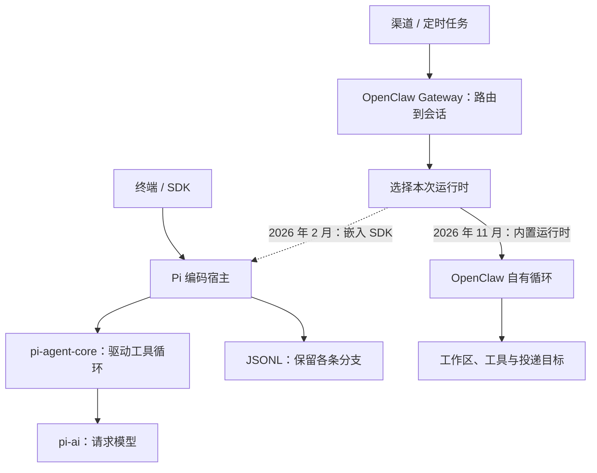
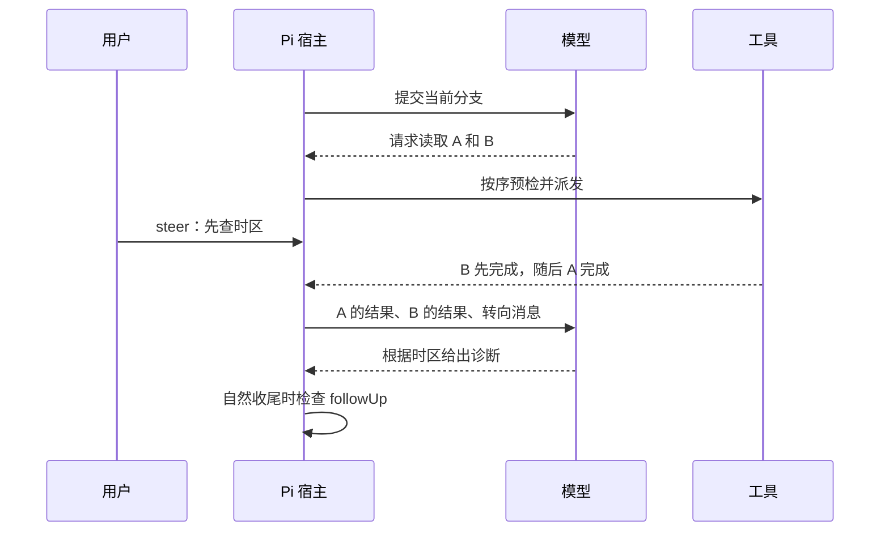
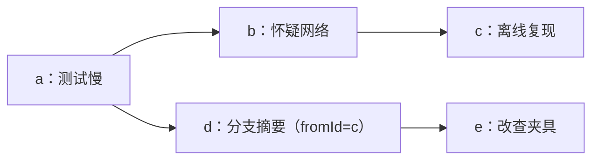

# Pi 与 OpenClaw：从一次工具调用，读到一台常驻网关

> Pi 让你看清模型刚做了什么，还能回到分岔口再试一次。OpenClaw 多管一件事：手机上来的这句话，究竟该用谁的工作区、谁的权限，又该答到哪里？



## 从默认的四个工具读起

读 Mario Zechner 的 2025 年设计手记，可以从一个很实际的问题入手：修一条失败的测试，到底需要几个模型工具？用 `bash` 搜报错、运行测试，`read` 看实现，`edit` 替换目标片段，缺个夹具再用 `write` 建文件。搜索器和编译器已经装在机器上。[设计手记][mario]

四个是**默认启用的基础工具**。2026 年 11 月 24 日的 CLI 允许用 `defaultTools` 改默认集合，也可以用 `--tools` 针对一次运行选择工具。读旧代码时还得认包名：当年的 `badlogic/pi-mono` 使用 `@mariozechner`，本文快照在 `earendil-works/pi`，编码包叫 `@earendil-works/pi-coding-agent`。[CLI][cli] · [编码包][pkg]

| 加到模型面前的东西 | 什么时候划算 | 实际要付的代价 |
|---|---|---|
| 一条 Shell 命令 | 仓库已经有测试脚本，模型读帮助就会用 | 参数得拼对，错误也得看懂，权限跟着执行环境走 |
| 一个专用工具 | 高频操作有固定字段，例如按工单号只读查询 | 名字、说明和参数会进入请求，多个相似入口容易选错 |
| 一份按需读取的说明 | 操作多步，但用到的都是现成工具 | 描述得足够准确，模型才找得到这份说明 |

`system-prompt.ts` 根据可见工具组装说明，再合入项目上下文、技能等材料。同一套 Pi，换个仓库就可能发出更长的请求。少放说明可以省冷启动输入。要让服务端复用算过的前缀，还得保持前面内容与排列稳定。[提示构造][prompt] · [模型用量][ai]

**怎么判断该不该加第五个工具？** 固定仓库提交和模型，比较完成同一任务的调用轮数、重试和测试结果。把叫错工具、填错参数、改错对象分别计数。若模型少拼了四次命令，却总能把格式正确的请求发给错误项目，单看工具成功率会得出相反结论。

### MCP 回来了，为什么四工具的思路还管用？

初版把 MCP、子 Agent 和计划模式留给使用者。作者愿意先在需要时查 CLI 帮助，也希望从一条完整轨迹看清每步花了多少上下文。到 11 月，CLI 已随包提供可替换的 `builtin:mcp`。同一台工具服务器可以这样接：[作者的取舍][mario] · [MCP 配置][mcp]

| 暴露方式 | 模型怎样用到工具 | 我会用在哪里 |
|---|---|---|
| `direct` | 工具直接列在请求中，可以立刻调用 | 几乎每轮都会读的少数接口 |
| `deferred` | `tool_search` 找到匹配项，下一次模型请求才带上声明 | 有许多接口，选中后要连续直接调用 |
| `codemode`（默认暴露方式） | 脚本用 `searchTools()` 发现工具，组合调用、筛结果 | 接口多，模型最终只关心少量数据 |

这项选择会改变首轮延迟。Pi 在后台连接已启用的服务器，首个提示最多等带直接工具的服务器 10 秒，因为请求要带上它们的声明。脚本间接调用的工具则可以等到用时再找。工具的增减无需改写整段脚本入口说明。[连接与暴露规则][mcp]

嵌入应用另有一步：SDK 会话默认不加载 CLI 的内置扩展，宿主要把 MCP 以及相应的 codemode 或工具搜索扩展交给资源加载器。遇到“终端能调，嵌入后消失”，先比两边的资源加载和实际请求里的声明。[SDK 加载说明][mcp]

子 Agent 和计划模式仍可由用户或包提供。查两个独立目录值得开两条会话，连续修同一条断言则得反复交接现场。只想先听方案，一条用户指令就能表达。若要求审完才能动文件，执行器还要限制 `bash` 的写入能力。[默认工作流][pkg]

## 调用怎样穿过四个包

| 包 | 它握着什么 | 顺着哪条线往下读 |
|---|---|---|
| `pi-coding-agent` | 工作目录、会话、资源加载，交互、批处理和 SDK 入口 | 哪些工具、说明和历史交给这次运行 |
| `pi-tui` | 终端交互与渲染 | 哪些增量要马上显示，哪些详情可以展开 |
| `pi-agent-core` | 应用消息、工具批次、事件与输入队列 | 什么时候还要再问一次模型 |
| `pi-ai` | 各提供商的消息、内容块、流事件与用量 | 如何把不同模型的返回转换成相同的上层事件 |

模型只流出半个文件名时，界面已经可以显示进度，执行器却要等参数完整并通过校验。跨提供商续聊还要处理工具调用 ID、思考块和历史消息的兼容。旧消息能被新模型理解，也不代表新提供商拥有旧请求的推理缓存。[模型适配][ai]

在 `agent-loop.ts` 里，应用先按需要变换 `AgentMessage`，再用 `convertToLlm` 生成模型消息。模型提出调用，核心执行工具，把携带调用 ID 的结果送回下一轮。工具可以分别返回给模型的精简内容和给界面的结构化详情：人可以展开整份测试日志，模型只需失败位置和取回路径。[循环源码][loop] · [工具契约][core]

**对照一批工具调用的事件，最容易看懂并行：**

1. 助手按 A、B 的顺序请求读文件。默认并行模式先依次预检，再让允许并行的调用一起执行。
2. B 先读完，界面先收到 B 的完成事件。等整个批次结束，写回历史的结果依然按 A、B 排列，`turn_end` 也沿用调用顺序。
3. 若 B 必须核对 A 刚写好的内容，就拆成前后两轮，或显式串行。历史顺序再整齐，也无法替并行进程安排副作用。[批次调度][core] · [实现][loop]



“目录错了，先看这里”用 `steer`，在正常转向检查点影响下一次模型决策。“查完顺便加个测试”用 `followUp`，等工具和转向都处理完再接。压缩期间也能收下消息。用户输入已入队，和已启动的工具被取消，是两个时刻。要停止执行还要中止并核对已产生的改动。[队列][core] · [作者演示][xpi]

读状态时看 `AgentState` 的三个位置：尚在生成的回复在 `streamingMessage`，未收尾的调用在 `pendingToolCalls`，已经纳入对话的内容在 `messages`。收到 `agent_end` 后循环不再发新事件。导出日志前等 `waitForIdle()`，才能等到异步订阅者完成最后一次写入。[状态与订阅][core]

**工作流放哪层？** 反复发送的审查请求适合 Prompt Template。发布前要查哪几项可以写成 Skill，先发现名称和描述，用时读正文。每次工具调用前都要检查目标目录，则放在订阅生命周期事件的扩展里。[资源类型][pkg] · [扩展接口][ext]

安装 TypeScript 扩展意味着宿主会执行代码。加载技能先给模型增加一段文字。排查一次意外修改时，前者查扩展版本和加载时机，后者查哪段说明引出了哪个工具调用。两种情况都值得把启用资源的来源记录在会话旁。[扩展加载][ext]

## JSONL 怎样把一份日志读成多条路

Pi 把“发生过什么”顺序追加到磁盘，把“模型这次该看到什么”留到读时决定。下面是同一文件里的字段投影：省去了文件头、时间戳和提供商信息，首条可分支记录的 `parentId` 为空。[会话格式][sm]

```jsonl
{"type":"message","id":"a","parentId":null,"message":{"role":"user","content":"为什么测试这么慢？"}}
{"type":"message","id":"b","parentId":"a","message":{"role":"assistant","content":[{"type":"text","text":"先检查网络等待。"}]}}
{"type":"message","id":"c","parentId":"b","message":{"role":"user","content":"断网也能复现。"}}
{"type":"branch_summary","id":"d","parentId":"a","fromId":"c","summary":"断网仍慢，已有离线复现。"}
{"type":"message","id":"e","parentId":"d","message":{"role":"user","content":"回到起点，看看测试夹具。"}}
```

读最后一条，沿父指针得到 `e → d → a`，反转后就是新路线的材料。关键在第四行：`fromId=c` 表明摘要来自哪条旧路，`parentId=a` 决定把它接在哪儿。旧路线仍可查看，模型沿新路线能继承离线复现的结论。[会话管理器][sm]



图上的箭头只画父子关系。若把 d 的摘要来源 c 也当父节点，新分支就会读到整段本想丢开的推理。反过来，只保留摘要文本、删掉来源，等有人质疑“断网也慢”时，就找不到最初那条复现记录。

```python
def branch_path(entries, leaf):
    """示意：输入已解析的树记录，不含会话文件头。"""
    by_id = {e["id"]: e for e in entries}
    reverse_path, visited = [], set()
    while leaf is not None:
        if leaf in visited or leaf not in by_id:
            raise ValueError("父链损坏，无法恢复这条分支")
        visited.add(leaf)
        entry = by_id[leaf]
        reverse_path.append(entry)
        leaf = entry["parentId"]
    return reverse_path[::-1]
```

`/tree` 在同一会话换个节点继续，`/fork` 派生一份独立会话。两个方案要各自比较时，切分支可以不带旧路总结。切回起点后，上一路建的文件还在工作目录里。希望代码也回到当时的状态，得另外管理工作树或快照。[会话导航][sessions]

| 容易混淆的两种摘要 | 取哪些材料 | 下一轮怎么接着读 |
|---|---|---|
| 分支总结 | 找公共祖先，只提炼离开路线独有的工作 | 把结论挂到目标位置，可以选择跳过 |
| 窗口压缩 `compaction` | 同一路线上较早的历史，保留近期一段 | 用摘要加保留段组装输入，原记录仍在 |

压缩的触发余量看 `contextWindow - reserveTokens`，挑保留段看 `keepRecentTokens`。切点要照顾消息结构：只留下测试结果却丢了调用，下一轮就不知道日志从哪里来。跨很长的一轮时还要处理轮内材料，记录读过和改过的文件。[切点与文件跟踪][compact]

11 月快照的默认余量是 16,384 token，近期保留预算是 20,000 token。正常在用户消息边界切。如果单个用户请求引出的一连串行动已经超过保留预算，Pi 可以在其中一条助手消息处切开，把更早的历史和这次请求被切掉的前半段分别总结，再合起来。[长轮切分][compact]

磁盘上的压缩条目保存 `summary`、`firstKeptEntryId`、`tokensBefore`。再压一次时，从上次摘要和当时保留下来的历史接起。若简单地按“上次写摘要的时间”过滤，时间更早、上次特意保留的那批消息就会漏掉。[重复压缩][compact]

宿主要换摘要模型或保留专门的审查清单，可以接 `session_before_compact`。要改切树时的交接，用 `session_before_tree`。自定义压缩可拿到待总结材料、估算用量与保留边界，也可取消。测试这个钩子时我会故意让摘要失败一次，再打开旧叶子，检查原分支能否继续。[自定义钩子][compact]

## OpenClaw 的两代运行时：二月和十一月各打开一次

| 2026 年快照 | 谁在驱动模型循环 | 宿主掌握的接口 |
|---|---|---|
| 2 月底 | 四个 Pi 包同锁在 `0.49.3` | `runEmbeddedPiAgent()` 管任务，单次尝试用 `createAgentSession()` 构造 `AgentSession` |
| 11 月 | OpenClaw 的 `packages/agent-core/` 持有循环、会话契约 | `src/agents/harness/` 选内置或插件运行时，`src/llm/` 管模型传输 |

二月那版直接嵌入 SDK。OpenClaw 在构造会话时加入渠道工具和提示，订阅事件，决定哪些进度发往 Telegram、哪些只记在本地。模型切换、授权轮换也由宿主掌握。若仅抓终端文字，工具调用 ID 和取消时机都很难找回来。[早期集成图][old]

一个真实兼容问题就出在这个接口上：报告者升级后仍能聊天，却再也没见到工具调用。旧适配器传入空工具数组，新语义把它当作空的名字许可名单，另外注入的工具一起被过滤。

回归时要看**模型收到的声明**，再实际调一个只读工具。本地注册表有名字，只验证了前半程。[问题原帖][compat]

十一月从 `src/agents/embedded-agent-runner/` 读一次尝试如何装配模型参数和记录，再往自有核心追循环。旧配置里的 `pi` 会归一为 `openclaw`，终端仍用上游 `pi-tui`。保留配置名和界面依赖，都不足以判断今天谁在执行工具。[当前架构][claw]

追错工具时还可再往下走一层：`src/agents/agent-tools*.ts` 管工具参数、策略、执行前后的适配，以及宿主和沙箱里的编辑工具。`src/agents/sessions/` 则管会话持久化、资源发现和扩展加载。工具没装进会话，和装进来却被策略拒绝，分别从这两个入口查。[模块布局][claw]

常驻进程还有热更新问题：系统准备好完整的一代运行时，接纳任务时选定版本。任务及其嵌套工作沿用这个选择。否则旧插件发出的调用遇上新插件解释回执，连一次调用中途的权限口径都可能改变。[运行时准入][claw]

## Gateway 先分清是谁，再取记忆和工具

Gateway 长驻并持有聊天渠道连接。CLI、管理界面、设备节点经 WebSocket 接入，节点还声明角色和能力。即使手机断线，服务端仍能接消息、找到会话、跑计划任务。管理设备、发送聊天、修改服务配置需要各自检查权限。[网关架构][gw]

**同一人同时出现在私聊和群里，怎样避免串线？** 先按渠道、账号、对端或群组做绑定，匹配更具体的规则优先，同级按配置顺序。绑定选出负责的 Agent，会话划分再决定共享哪些历史。显示名相同，无从证明两次请求有相同的读取范围。[多 Agent 路由][routes]

我会分别记录触发者、执行身份、目标会话和投递位置。群里请助手稍后私下提醒，群是入口，私聊才是出口。排障日志保留能对照这四项的内部标识就够了，没必要把接入令牌或私人记忆一起打出来。[渠道绑定][routes] · [投递目标][cron]

| 工作区文件 | 适合放什么 | 读写时要留心 |
|---|---|---|
| `SOUL.md` | 稳定语气、人格与交互边界 | 临时任务会影响后续无关对话 |
| `AGENTS.md` | 工作惯例、优先级、记忆使用规则 | 实际文件权限还要由宿主执行 |
| `USER.md` | 用户长期偏好 | 替人提问时的要求别归到本人 |
| `MEMORY.md` | 精选长期事实和决定 | 工作区说明将它留给主要私人会话 |
| `memory/YYYY-MM-DD.md` | 当天事件、决定依据和证据位置 | 开局看今昨两天，更早的按需找 |

文件注入有长度预算，必需文件和可选文件缺失时的处理也不同。“昨天说过，今天又忘了”可以顺着三处查：昨天是否真正写盘、今天是否路由到同一工作区、这轮有没有加载或截断那段文字。[工作区规则][ws]

磁盘恢复也要分层：11 月每个 Agent 的活动会话和 transcript 在 `openclaw-agent.sqlite`，旧 `sessions/` 目录用于历史或归档。完整恢复还要分别照顾工作区、网关配置及凭据。分享人格模板时则只取对应文件，别顺手带出日记。[路径表][routes] · [备份说明][ws]

**工作目录到底隔开了什么？** 工作区给相对路径提供默认起点。未开沙箱时，能否读取工作区外的绝对路径仍取决于宿主权限。要把群会话限制在获准文件内，可以配 `agents.defaults.sandbox` 或单个 Agent 的沙箱设置。[工作区与沙箱][ws]

启用沙箱且 `workspaceAccess` 不是 `"rw"` 时，工具操作的是 `~/.openclaw/sandboxes` 下的沙箱工作区。排查“文件明明写了，人却找不到”时，先查这次工具实际使用的目录和挂载，再决定该从哪里取产物。[沙箱工作区][ws]

### 从 Heartbeat 迁移到 Automations

旧 Heartbeat 定期唤醒助手，看清单、判断有没有变化。Cron 有明确计划时刻和投递目标。测试完成这种已有事件的工作，可以收到完成信号再继续。三者都能提醒人，唤醒条件却不同。[心跳迁移][hb] · [调度][cron]

到 11 月，原有监控迁成普通 Automations 作业，Doctor 负责迁移，`openclaw cron` 仍是命令别名。维护计划时查作业、运行历史和投递设置。单改 `HEARTBEAT.md` 不会替你创建新调度。[迁移说明][hb]

- 每个作业有自己的 scratch，可存上次检查位置。空清单与缺失清单可能走不同路径，`no_change` 可以抑制自动投递。
- 旧心跳的重复通知抑制和缺路由预跳过也有变化。迁移后跑一次“现场没变”，再跑一次“现场变了但投递失败”，分别看运行记录和用户实际收到的消息。[行为差异][hb]

若发送成功后服务恰好重启，重跑整项检查可能再发一遍。自己的实现可按作业、计划时刻、目标生成业务键，把执行结果和投递回执分开记。外部服务能去重就沿用同一键。回执未知时先查原发送记录。[作业运行历史][cron]

## 选型：你需要恢复哪一份现场？

| 下次回来要接着做什么 | 优先实现 | 一个能暴露错误的检查 |
|---|---|---|
| 终端继续查代码 | Pi 工具循环、树和压缩 | 切回祖先后仍能查旧路，当前分支的调用与回执成对 |
| 手机、群聊切换 | OpenClaw 身份绑定、工作区与会话划分 | 私聊和群发同一句话，核对两次模型请求的可见文件 |
| 关机后仍收到提醒 | 常驻调度、凭据、投递回执 | 制造一次投递失败，单独恢复发送，核对时区与跨日日记 |
| 多人复用同一操作方法 | ClawHub 分发和管理 Skill 版本 | 升级后查加载版本、读取范围和出站目标 |

ClawHub 分发做法。插件可以向宿主注册渠道或工具。多 Agent 绑定负责把不同身份送进各自的工作区。这三项可以组合。服务互不信任的用户时，还要把进程、可用凭据和可读目录隔开，否则不同 Agent 仍可能经同一把工具读到彼此的文件。[ClawHub][hub] · [工作区与沙箱][ws]

## 一手资料

- Pi 的设计与调用链：[作者手记][mario]、[CLI][cli]、[Agent Loop][loop]、[MCP 暴露方式][mcp]。
- Pi 的会话格式：[SessionManager][sm]、[压缩与分支总结][compact]、[导航命令][sessions]。
- OpenClaw 的版本对照：[二月的 Pi 集成][old]、[十一月的运行时][claw]、[存储与路由][routes]、[Heartbeat 迁移][hb]。

## 面试：六个可以直接开口的问题

### 1. Pi 默认只有四个工具，为什么今天还能接 MCP？

**考察点**：基础工具、协议接入和请求声明的区别。

1. “我先用四个动词修一次测试：搜和跑用 bash，查看用 read，局部改用 edit，新建用 write。”
2. “初版省掉了内置 MCP。现在 CLI 随包带扩展，常用工具直接声明，长尾工具可以搜索，或交给脚本按需找。”
3. “我会用完成一次任务的总成本决定怎么暴露，也会看错误调用有没有少。”

**连环追问**：有缓存还怕清单长吗？冷启动和前缀变化都要付费，命中的声明也占窗口，相似的工具名仍会让模型选错。

### 2. 用户已经点了转向，文件怎么还会被写进去？

**考察点**：消息入队、取消执行与恢复现场。

1. “我先看工具派发时间。转向消息入队后，正常要等当前工具批次结束，下一轮才看见它。”
2. “如果只是追加工作，就用 followUp 等自然结束。真要叫停，得发中止信号，再查已经改了哪些文件。”
3. “界面可以先显示完成的工具，模型收到的结果还是按调用顺序排。”

**连环追问**：如果动作是发消息呢？发送前单独检查，发送后凭外部回执确认，本地取消无法撤回对方已读的内容。

### 3. 会话树和压缩各存了什么？

**考察点**：能用磁盘上的字段还原模型的输入。

1. “每条树记录有 id 和 parentId。我从叶子往回走，再反转，就得到了这一条路。”
2. “切路时只总结旧路独有的工作，fromId 指向来源。沿原路走到窗口快满了，才用压缩摘要加近期消息。”
3. “如果压缩后忘了硬约束，我会依次对原话、摘要输入、保留边界和真正发出的请求。”

**连环追问**：两个人同时推进叶子呢？记录各自预期的父节点，显式保留分叉或限制写入方，避免最后写入者悄悄覆盖另一条路。

### 4. OpenClaw 到底是不是在跑 Pi？

**考察点**：用调用入口回答版本问题。

1. “看二月底，答案是直接嵌入。四个包锁在同一版本，宿主创建 Pi 会话，注入工具并订阅事件。”
2. “看十一月，内置循环、会话和模型传输都归 OpenClaw。旧名字还兼容，终端组件仍来自 Pi。”
3. “升级后还能聊天不够。我会核对一次真实请求的工具声明，再做一个无副作用调用。”

**连环追问**：为什么还要给运行时分代？已经开始的任务要用同一套插件解释工具调用和结果，热更新留给后来接入的任务。

### 5. 私人助手接进项目群，先改哪儿？

**考察点**：分清入站身份、能读的材料和出站目标。

1. “先把群和私聊分别绑定到合适的 Agent，再定各自哪些会话共用历史。”
2. “私人长期记忆留在私人会话。群里要共用的计划单独存，工具凭据只允许读获准范围。”
3. “我会从两处发同一句话，看上下文装了哪些文件，最后发给了谁。”

**连环追问**：只换一个工作区名字行吗？还得验证工具能读到的实际目录，工作区约定本身拦不住进程访问。

### 6. 周五的提醒没收到，要重跑模型吗？

**考察点**：分辨计划未触发、执行失败和投递失败。

1. “我先找计划时刻和运行历史，确认这次真触发了，时区也对。”
2. “如果结果是 no_change，静默是预期行为。有结果却发送失败，我只补投递。”
3. “回执不明先对账。用稳定业务键关联同一时刻和目标，可以避免重启后再通知一遍。”

**连环追问**：测试结束也要每分钟唤醒助手吗？已有完成事件就订阅它，只有现场不给事件时，才需要按预算定期检查。

[mario]: https://mariozechner.at/posts/2025-11-30-pi-coding-agent/
[cli]: https://github.com/earendil-works/pi/blob/0ab23c37b074252d04e31f5cfb99491f0613fb80/packages/coding-agent/docs/cli.md
[old]: https://github.com/openclaw/openclaw/blob/1828fdee8b628aab486fc57a193150902d1c33b3/docs/pi.md
[claw]: https://github.com/openclaw/openclaw/blob/8656b1e18257d7fcb48009a7954064b89c995180/docs/agent-runtime-architecture.md
[pkg]: https://github.com/earendil-works/pi/blob/0ab23c37b074252d04e31f5cfb99491f0613fb80/packages/coding-agent/README.md
[gw]: https://github.com/openclaw/openclaw/blob/8656b1e18257d7fcb48009a7954064b89c995180/docs/concepts/architecture.md
[prompt]: https://github.com/earendil-works/pi/blob/0ab23c37b074252d04e31f5cfb99491f0613fb80/packages/coding-agent/src/core/system-prompt.ts
[ai]: https://github.com/earendil-works/pi/blob/0ab23c37b074252d04e31f5cfb99491f0613fb80/packages/ai/README.md
[mcp]: https://github.com/earendil-works/pi/blob/0ab23c37b074252d04e31f5cfb99491f0613fb80/packages/coding-agent/docs/mcp.md
[core]: https://github.com/earendil-works/pi/blob/0ab23c37b074252d04e31f5cfb99491f0613fb80/packages/agent/README.md
[loop]: https://github.com/earendil-works/pi/blob/0ab23c37b074252d04e31f5cfb99491f0613fb80/packages/agent/src/agent-loop.ts
[xpi]: https://x.com/badlogicgames/status/2008326252332265572
[ext]: https://github.com/earendil-works/pi/blob/0ab23c37b074252d04e31f5cfb99491f0613fb80/packages/coding-agent/docs/extensions.md
[sessions]: https://github.com/earendil-works/pi/blob/0ab23c37b074252d04e31f5cfb99491f0613fb80/packages/coding-agent/docs/sessions.md
[sm]: https://github.com/earendil-works/pi/blob/0ab23c37b074252d04e31f5cfb99491f0613fb80/packages/coding-agent/src/core/session-manager.ts
[compact]: https://github.com/earendil-works/pi/blob/0ab23c37b074252d04e31f5cfb99491f0613fb80/packages/coding-agent/docs/compaction.md
[ws]: https://github.com/openclaw/openclaw/blob/8656b1e18257d7fcb48009a7954064b89c995180/docs/concepts/agent-workspace.md
[routes]: https://github.com/openclaw/openclaw/blob/8656b1e18257d7fcb48009a7954064b89c995180/docs/concepts/multi-agent.md
[hb]: https://github.com/openclaw/openclaw/blob/8656b1e18257d7fcb48009a7954064b89c995180/docs/gateway/heartbeat.md
[cron]: https://github.com/openclaw/openclaw/blob/8656b1e18257d7fcb48009a7954064b89c995180/docs/automation/cron-jobs.md
[hub]: https://github.com/openclaw/clawhub
[compat]: https://github.com/openclaw/openclaw/issues/69974
