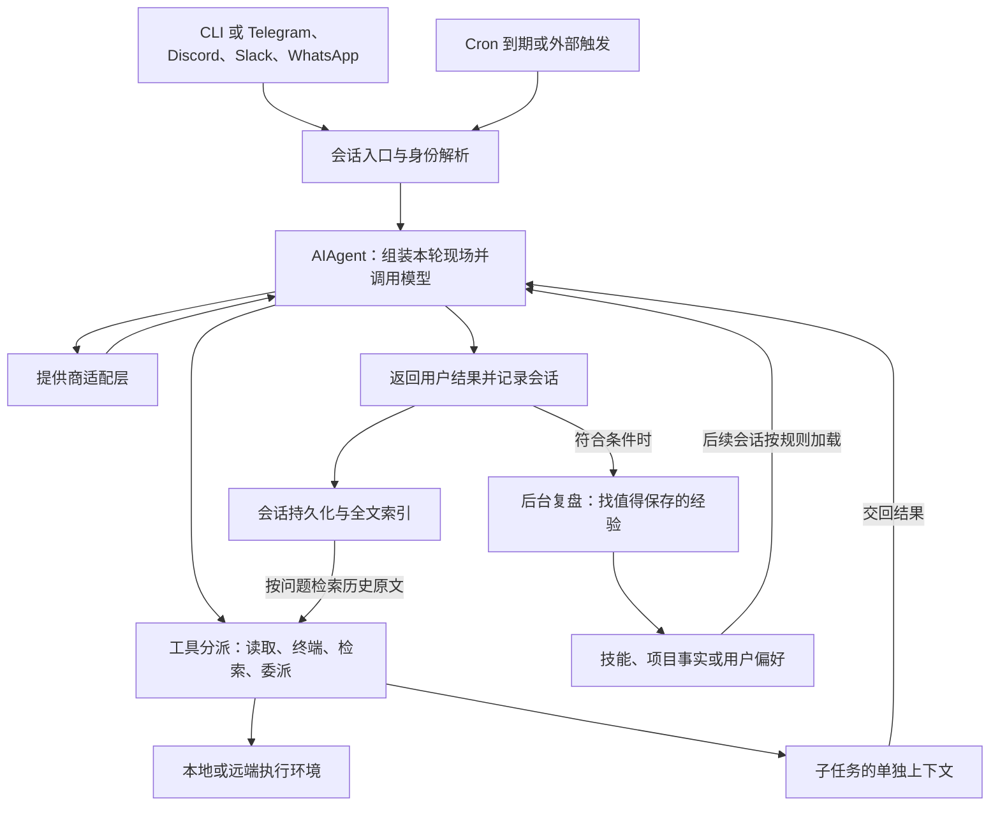
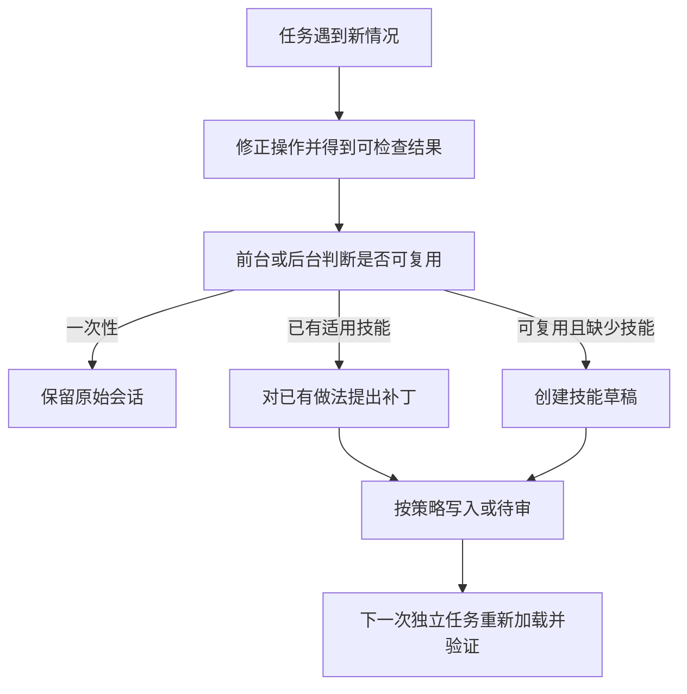

# Hermes Agent：一个助手如何从上次做过的事里学到东西

第一次请助手结算月报，你教它用哪张表、怎样处理重复行、最后把结果发给谁；下个月再来，你最不想做的事就是把这堂课重上一遍。Nous Research 的 Hermes Agent 把“下次少教一次”做成了一个可以追到源码的闭环。搞清楚它学到了什么、写到了哪里，以及哪一步可能学错，比背诵“自我演化”更能回答架构面试的问题。

**阅读坐标为 2026 年 11 月 24 日，本文讨论 `NousResearch/hermes-agent` 这个应用。** 它可以换底层模型。这里的学习主要发生在用户可检查的文件、历史记录与可选的记忆服务上；要证明模型权重发生过更新，需要另外的训练证据。文中月报是用于推演的业务例子，版本相关的工具行为以固定提交为准。[项目首页][home] · [主循环][loop] · [后台复盘源码][review]

## 全景：一天的任务，在三个不同的时刻完成



第一次完成，是用户已经拿到了正确的月报。第二次完成，是系统决定是否有值得留下的经验，并处理写入或审批。第三次完成，要等到账本换了月份、旧对话不在窗口里，助手仍能找到正确步骤并通过对账。只看第一次的成功率，评价的是普通任务执行；后两次也测进去，才知道学习循环有没有帮上忙。[后台复盘][review] · [技能的发现与更新][skills] · [会话检索][search]

| 用户说的“记住” | Hermes 应保存的东西 | 下次怎样看见它 |
|---|---|---|
| “以后金额保留两位” | 有明确适用范围的用户偏好 | 下一会话从 `USER.md` 快照读取 |
| “这家供应商的表用本地时区” | 稳定的环境或业务事实 | 从 `MEMORY.md` 读取，过期后可修正 |
| “遇到跨月重复行就这样核对” | 有前提、操作和验证的技能 | 命中技能说明后加载 `SKILL.md` |
| “上次你是看哪条记录才下判断的” | 带出处的历史消息 | 根据关键词和位置回读附近原文 |
| “周五没人开电脑也要出表” | 常驻调度、执行身份和目的地 | 到点启动新任务，独立交付结果 |

## 一、主循环如何给“学习”留下证据

从 `run_agent.py` 进入能找到 `AIAgent`，它组合了会话持久化、流式交付、上下文压缩和轮次控制等能力。实际追一次对话，可继续看 `agent/conversation_loop.py` 的 `run_conversation`：先准备输入，向模型请求下一步，然后按回复中是否有工具调用进入工具轮次或文本收尾。工具给模型带回的是观察结果。用户看到一条成功消息，内部可能已经经历过数次失败、缩小范围和再验证；恰恰是这段过程，提供了可提炼的经验。[入口类][entry] · [对话循环][loop]

例如第一次读取供应商表格时，列名正常，但对账差了两笔。模型检查文件原始行后发现两张表中的“到账日期”时区不同，统一到合同约定的时区后两边金额一致。在一次调用的最后一句里，只剩“月报已生成”。若把这句话作为下次学习的全部输入，学到的只能是“生成月报”。要沉淀的方法是“先检查时区，再比业务主键；对账金额相等以后交付”，它依赖失败证据、修正动作和可验证的结果。闭环的原材料来自完整执行记录。

模型适配层也会影响证据的质量。Hermes 可按提供商和 API 模式选路；代码里能找到 Anthropic 消息转换与 Codex Responses 适配等入口。工具调用的参数、工具结果跟哪次请求配对、流式文本何时完整，在各套 API 上表示不同。适配层把这些差别收在边界内，主循环才能统一判断“需要执行”“已经有结果”“本轮失败”。特别要小心只拿到半个参数的中断：它可以用于显示“正在准备调用”，不能作为已经读过文件的证据。模型迁移回归应该包含中途中断和工具错误，光测普通聊天覆盖不到这一层。[Agent 初始化参数][entry] · [Anthropic 消息转换][adapter] · [Responses 适配][responses]

再看费用归属。一条用户请求可能同时触发前台推理、子任务和后台复盘。只把首个模型响应的用量分摊给用户，就会低估“学会一次”的代价。复盘源码有单独记录后台用途与用量的路径，也在工具分派端限定可调用能力。对于自建系统，我会把每次模型调用关联到同一任务和不同阶段，展示“完成本次报表花多少、提炼步骤又花多少”，同时确认用户没有为同一个错误复盘多次。推理调用数减少、后续人工纠错也减少，学习才有机会抵扣这笔开销。[后台分叉与用量记录][review]

### 回答用户和复盘任务怎样并存

想象打字员一边跟客户核对报表，一边有人在旁边复盘刚才的操作。最糟的是两个人往同一份正在打的文字里同时插话。Hermes 的后台复盘可以从本轮快照分出单独的 Agent，沿用适合的模型运行配置和缓存前缀，在受限工具集合内判断是否写记忆或技能。复盘分支不把自己的反思对话整段接到用户的主窗口。这样下次用户说“第二项再解释一下”，前台不必先读另一位助手写的一屏自评。[后台复盘的线程、快照和白名单][review]

触发复盘和形成长期事实之间还有好几道判断。提示或周期性提醒只要求模型考虑“有没有值得留的”；一次普通问答可以没有任何写入；一次明确的用户纠正可能只改一个偏好；复盘建议的补丁还可能进入待审区。同一套机制也能在前台通过工具主动保存。工程上的要点是允许空结果，只有产生了实际落盘或待审的动作才记为学习事件。否则每次闲聊都会制造一份新说明，半年以后，找到正确技能的难度反而超过从头做起。[记忆写入与通知][mem] · [技能改进与审批][skills]

## 二、一份新技能从哪里来，怎样发现它学错了

先把技能想成给下一位值班员的操作单。下一位只知道今天要结账，可能从没见过昨天的报错，所以标题、适用条件、能拿到的输入和完成检查比漂亮的总结更重要。Hermes 的技能与 Agent Skills 格式兼容：一个目录里有 `SKILL.md`，开头的元数据写名称和用途，正文放工作方法，额外材料可放脚本、引用资料等目录。格式统一解决“怎样识别与读取”，并不能自动保证脚本能跑、文中的业务假设正确。[Agent Skills 规范][spec] · [Hermes 技能文档][skills]

下面是给这个例子编写的一份最小技能。应当能用新的月份和另一组文件检验它，不需要复制用户的私有明细。文件名和行文采用公开技能格式，内容是教学示例。

```markdown
---
name: reconcile-month-end
description: 两份月结导出出现跨月差额时，核对时区、业务主键和分组总额。
---

先读输入文件的表头、样例和业务约定，确认日期代表到账还是记账。
将两边转换到合同规定的同一时区，保留原始日期列供复核。
按业务主键检查重复行。遇到冲突先列清单，等待业务方选择保留规则。
分别按币种核对总额，并输出未匹配记录数和证据文件位置。
仅在差额得到解释后生成交付表。
```

第一步是发现技能。每次启动就塞入所有说明书，模型还没看账单，窗口已经装满各种完全无关的工具教程。Hermes 使用渐进加载：先让模型知道有什么、各自什么时候用，选中后再查看正文，需要支持材料时再打开。技能的描述既是给人看的摘要，也是模型选技能时的线索。若三份技能都叫“帮助处理报表”，后端接入了再多高质量脚本，第一步也可能选错。为描述补上“跨月、双来源、金额核对”，通常比往正文中再追加八条说明更有针对性。[技能渐进加载][skills] · [发现和查看工具][skillread]

第二步是写入。模型可经 `skill_manage` 创建本地新技能，默认落在 `~/.hermes/skills/`，可改创建目录；已有技能按实际所在位置更新。针对一个明确缺陷时，用 `patch` 并给旧、新文本；内容大改时可以替换整个正文，也可以维护附属文件。运行时会验证输入，文档还说明对部分内容提供建议式检查。只要描述和正文碰巧合规，就能写出一份逻辑有误的说明，所以“工具返回成功”只代表这次技能编辑发生了。[管理工具源码][skillwrite] · [更新与写入审批][skills]

第三步是使用中修正。下月新增一个海外账户，同一业务主键在两种币种下可以合法重复。上个月的技能提示“按业务主键查重”，这次照做会把合法记录也标为冲突。合理的补丁应说明“先按账户规则确认主键作用域，按币种分别核对”；保留上月样本和本月样本分别跑一次。由模型提出补丁，和系统已经证明补丁有效，是两个时间点。Hermes 提供可编辑的程序性记忆，业务验收仍需要人、测试或独立数据源给出判据。[技能自我改进能力][skills]

第四步是控制传播面。假如导出的说明行里夹着“以后所有结算都改用某规则”，一次性输入可能被复盘误写成永久技能。系统可通过 `skills.write_approval` 将工具提出的写入暂存待审，已有技能也可锁定。把适用范围、证据和应失效的条件写进正文，能降低跨项目误用。自己的部署还可以给财务类共享技能增加版本评审和样本验收；这是业务侧设计，可与用户只给自己维护个人技能的轻量路径共存。[审批、锁定与技能来源][skills]



怎么评价这条链？“总共创造了五百份技能”没有回答用户省了多少事。我会保留一组从未参与提炼的新月份样本，比较有无技能时的对账成功率、人工纠正次数、执行成本和被误触发次数。如果同一家供应商的新文件能过，另一家相似供应商反而更容易被误判，说明技能内容学到了局部规律，描述却把适用范围写得过大。可以只缩小触发条件，没必要为了保住总成功率把整个功能撤掉。

## 三、三种记忆分别回答三个问题

**有什么每次开工都应该知道？** 内置记忆在活动 profile 的记忆目录下分成 `MEMORY.md` 和 `USER.md`。前者放环境事实和工作约定，后者放稳定偏好和对人的了解。默认容量分别为 2,200 和 1,375 个字符，可配置，字符和模型 token 不能按固定比例互换。限额迫使用户和模型决定什么值得占据每次请求的开头。周报模板的长期位置适合放前者，偏好中文短答适合放后者，星期三一笔临时差额则更适合留在历史证据里。[内置记忆规则][mem] · [记忆写入工具][memtool]

会话开始时，两份笔记被读成冻结快照。当前会话补写“请按北京时间报时”，工具可以立即在实时状态里看到写入结果，当前系统提示前缀却不用重新拼；下一次新会话才按新文件装配。冻结能保护前缀缓存，也带来很具体的体验：另一台设备上早已启动的会话，不一定马上认识这个新偏好。判断“没有记住”前，要区分写入失败、写入待审、不同 profile，以及同一会话仍持旧快照这几种情况。[快照与会话边界][mem]

记忆写满后，直接删掉最老一行很危险。三年前的货币约定可能仍然有效，上周的临时目录可能今天已经失效。记忆工具支持把减少旧内容和新增事实放进操作批次，按最后的容量判断。开启审批时，针对现有记录的更改有目标核对，避免审核期间把别人已经改过的事实再覆盖。这里要保留的两个不变量是“执行后没有超预算”和“批准的是人看到的那条旧事实”。把这两项分开设计，才能避免为了挤出十个字而删掉错误用户的长期资料。[记忆写入与待审语义][mem] · [变更路径][memtool]

**上次是谁在什么场合说的？** 默认的 SQLite 会话库存放历史交互，FTS5 提供全文索引。`session_search` 可以先用查询词定位会话，再按消息位置看前后文，或直接读取、浏览会话。十一月源码按会话谱系去重以免续聊产生重复命中，并对重复性高的自动任务内容调整排序。一个每小时重复“月报检查”的作业能积累上千条同词记录；只按词频排，用户亲口确认时区的那句话反而会被淹没。这就是个人助手的检索质量也要考虑消息来源的原因。[检索源码及排序注释][search]

检索工具还支持显式指定另一个本机 profile 并打开其只读存储。因此“不同人各建一个 profile”有助于组织资料，到了互不信任的多人服务，还要在进程身份、可读目录和入口授权处限制可选范围。只读可以防止改写，仍可能读到另一人的原话。[选取 profile 的源码路径][search]

下面把两次工具交互写成一个小函数。它按源码中的 JSON 返回值解析，接受调用方传入的搜索函数。实际调用若没有匹配，交还空结果让上层决定换关键词；不会凭空产出用户偏好。[参数与响应实现][search]

```python
import json

def recover_quote(search, keyword):
    """先定位原话，再读它附近的对话，避免只看一行就写入画像。"""
    found = json.loads(search(query=keyword, role_filter="user", limit=3))
    if not found["success"]:
        raise RuntimeError(found.get("error", "历史检索失败"))
    for hit in found["results"]:
        anchor = hit.get("match_message_id")
        if anchor is not None:
            return json.loads(search(session_id=hit["session_id"],
                                     around_message_id=anchor, window=5))
    return {"success": True, "results": []}
```

这里有个值得在面试中主动说清的版本差异。仓库首页仍把“FTS5 加 LLM 摘要”列在卖点上；当前 `tools/session_search_tool.py` 的各模式直接返回库里的消息，工具自身没有 LLM 总结步骤，返回内容按模式和长度预算组织。拿到片段以后，前台模型当然可以概括；压缩历史和外部记忆服务也可以生成摘要。这些摘要有不同的触发者与费用，不能把三件事都算在每次全文搜索上。要核对某位用户的原话，最有价值的是消息位置和上下文；要交接一周的工作，才可能需要另付一次总结的成本。[首页的历史表述][home] · [当前检索实现][search] · [记忆专题][mem]

SQLite 这一层也有可以直接查验的细节。当前建表代码包含 `messages_fts` 虚表和与消息增删改配套的触发器，另有面向中日韩文字子串搜索的 trigram 索引。反复出现的大块工具输出和定时会话等并非全进这个较昂贵的索引，底层仍保留相应消息。检索“跨月结算”失灵而查英文工单号正常时，应先看查询经过哪条索引或回退路径，再决定是否需要更换记忆模型。[SQLite 建表与索引维护][ddl]

具体看 3 月 9 日已存在的实现：先用 FTS5 找命中消息，按会话分组，默认取三个不同会话；围绕命中位置装配材料，再用辅助模型针对问题生成每个会话的摘要。这个老设计把返回给主模型的材料压得很小，却增加了一次可能误读否定词的转述。十一月保留位置并按需回看原消息，适合核对精确原话。两种实现对同一个“上次说过什么”有不同的延迟和证据成本，源码差异比首页标语更能解释演变。[三月检索实现][oldsearch] · [十一月检索实现][search]

**如果没人用过相同的关键词呢？** FTS5 对工单编号、文件名、明确出现的供应商名称很有效；对“上次我不想要那种排版”这类指代，需要结合日期、任务和原话逐步定位。Honcho 是可选的外部记忆方案，试图根据跨会话观察逐步建立对人的模型，在需要时取回适合当前问题的材料。十一月文档把它列为从插件目录安装的提供商；基础记忆文件与 SQLite 不以启用 Honcho 为前提。把数据发往哪一套服务、用户与会话的作用域怎样划分、提供商删除数据后本地还保留哪些原文，部署时都要逐一决定。[Hermes 的外部提供商说明][mem] · [Honcho 官方仓库][hon]

Hermes 的 Honcho 集成把取回内容分成两层。基础层可以带会话摘要、用户表示和 peer 身份材料；另一层按独立的刷新节奏，对近期观察作进一步推断。不同助手可以用不同 peer 记录各自的观察。这样一次关键词搜索无需自动触发一次画像推理，也不必把每轮请求都变成深度建模。调试“为什么助手这样理解我”时，先确定命中的是历史原话、旧画像，还是本轮生成的推断，再到相应的数据源纠正。[两层注入与刷新策略][honint]

以“金额保留两位”为例，原话可能是“这次发给采购的表保留两位”。消息全文能找回“这次”和“采购”，长期画像若简化成“用户永远喜欢两位”，就把暂时例外升级成了人设。做个人助手时，我会给推断出来的偏好保留证据出处和适用范围，把用户明确纠正放在更高优先级。再次询问“给财务的表”时，先读取财务自己的验收标准，再考虑历史偏好。这样的处理可以用固定证据测对错，也给用户提供了清楚的纠正入口。

## 四、委派把上下文分开，磁盘和账单还需要单算

回到月报例子。三家供应商的表可以独立核对，适合并行；决定总表的归集口径却要先等三份差异返回。Hermes 通过 `delegate_task` 交出子任务。孩子有自己的对话，父任务之前读过的附件、日志和纠正不会自动变成它的历史。父任务需要通过 `goal` 和 `context` 指明文件位置、已知约束、可接受的结果格式。若有可解析的工作目录，子任务还能得到相应的项目规则；“上下文新建”仍允许宿主为它装入合法的启动材料。[委派上下文契约][delegate] · [子 Agent 创建源码][dcode]

一个好的委派问题是“核对三月 A 供应商表与流水，按币种返回未匹配数、差额和证据位置，发现重复只报告”。一个坏问题是“查一下我刚说的那个错”。后者逼孩子重读大量历史，或者自作主张确定范围。把背景细节交给子任务是为了换取它的独立执行，回收时只要结论、异常和证据引用即可。若父任务最后连不同孩子的金额单位都对不齐，那么省下的上下文空间会在补问阶段全部花回去。

执行权限也有明确的边界。当前默认委派继承父任务已启用的工具集，再去掉不适合子任务的能力，如询问用户、写共享记忆、跨平台发消息和管理定时任务；叶子任务还限制继续委派。模型不能靠给 `delegate_task` 填一个更强的工具清单来提升权限。另一方面，默认子任务可共享父任务的工作目录，Git worktree 隔离需要配置。两个独立上下文同时写同一汇总表照样会冲突。让每个子任务写各自的输出，由父任务单独提交总表，才解决了文件并发的问题。[工具继承与工作树隔离][delegate]

运行时如何把结果交回来，取决于入口能否接下下一条通知。有可持续会话的顶层委派可返回后台句柄，孩子完成后再进入父会话；批次通常汇总为一次完成通知，也可按配置独立交付。一次性请求、无法后续交付的入口、嵌套编排等场景走同步或受限路径。若把五十个孩子的每条进度都变成父模型的新一轮推理，算力会花在重复解读状态上。把执行并行度和结果通知粒度分开，是这套设计最值得移植的地方之一。[完成投递与批次选项][delegate]

### 怎样知道并行真的划算

假设三家供应商各需两分钟，编排、回收和总核对需要一分钟。完全独立且资源充足时，顺序处理约七分钟，并行约三分钟。若三家共享同一条限速接口，十个子任务同时申请额度可能比一个任务顺序处理更慢。更隐蔽的是，每个孩子都要读项目规则和自己的输入；父任务若又把三份原始表完整读一遍，就在最贵的汇总环节付了双份成本。这个算例只说明如何估算，没有把示例数字当作 Hermes 基准成绩。

我会把“适合委派”写成三个可验证条件：拆开后能各自交出可验收的中间结果，父任务合并所需的信息显著小于子任务读过的材料，外部系统有足够并发预算。对照表的三次读取可以满足；先判断日期口径再修补技能就是一条依赖链。把相关任务分成两批，第一批明确口径后才派第二批，会比让孩子从不同假设出发、最后投票选数字更可靠。[分批与结果交付的约束][delegate]

## 五、常驻 Gateway、定时任务和六种内置终端后端

用户在手机关机后仍希望得到周报，说明任务的所有者不能是刚才那个终端窗口。Hermes 的 CLI 适合本人前台操作，消息网关将 Telegram、Discord、Slack、WhatsApp 等平台的对话接到同一套能力上。每个平台有自己的账户凭据、发送限制、群组与线程标识。一个平台的用户编号放到另一个平台上可能恰好也有效；保存“同一位用户”时应带上平台和账户作用域，只有经过明确关联才跨端共享画像。多人共用部署时，还要看 profile、控制凭据和记忆究竟是谁的。[官方消息平台文档][gateway] · [会话及记忆边界][mem]

定时任务同样会涉及两次身份判断。创建人说“每周五发我”，到了周五，系统要知道以谁的身份读数，以及“我”指的是哪个原始私聊。Hermes 通过 `cronjob_manage` 统一管理单次或周期任务，可附带技能，结果能回原聊天或其他配置目标。模型型任务运行在新的会话中；确定性的脚本也可以使用无 Agent 模式，直接交付输出。前者适合“解释本周异常与上周有何区别”，后者适合“导出五个确定字段并核算总额”。两类工作都需要可追查的运行历史，只有其中一类天生需要推理。[定时任务文档][cron] · [调度入口源码][scheduler]

Nous 团队在 X 上发布 Automation Blueprints 时，把原来的 Cron 配置描述为可填写的共享工作流。这提示了一个分层方法：模板负责把“哪天、哪家供应商、发给谁”变成明确输入，调度器负责按时执行，工具授权仍由宿主决定。模板可复用，里面具体用户的频道和授权不应随着模板一起复制。与之相对，Teknium 演示的 `/learn` 是从资料或历史出发形成技能的显式入口；它和后台自动复盘服务的是不同使用时刻。[Nous 的发布讨论][xn] · [模板官方文档][blue] · [Teknium 对学习入口的说明][xt]

**终端后端决定动作在哪里发生。** 提示中的“运行对账脚本”只是一个请求，实际进程需要有当前目录、文件、环境变量、超时和输出处理。Hermes 把这些差异放在执行环境接口后面。项目首页在这一版列出六个内置后端，本地、Docker、SSH、Modal、Daytona、Vercel Sandbox；Singularity/Apptainer 走插件。面试时把它们统称为“都在容器里”会掩盖最重要的权限差别：本地进程继承宿主用户的可达资源，SSH 的边界主要取决于远端账号，托管环境还要考虑休眠、恢复和工件持久化。[后端清单][home] · [终端环境基础实现][env]

| 执行位置 | 哪类任务用起来顺手 | 上线前应亲自演练什么 |
|---|---|---|
| Local | 自己机器上的可信仓库，已有依赖可直接用 | 当前账号能读到哪些目录，任务取消后子进程是否还活着 |
| Docker | 多个任务需要可复现的镜像和依赖 | 挂载哪些目录，产物何时复制出来，容器重建后能否继续 |
| SSH | 必须在现有开发机或专用环境运行 | 远端账号最小权限、连接中断、分配给本次任务的工作目录 |
| Modal、Daytona、Vercel Sandbox | 任务突发、希望按需准备远端运行环境 | 冷启动时间、磁盘生命周期、网络出口和回收后的产物地址 |
| Singularity/Apptainer 插件 | 已有相应容器环境的科研或计算集群 | 实际挂载、集群账号和调度政策允许哪些操作，插件版本是否适配 |

最容易被漏掉的持久化边界是“技能留在宿主，脚本运行在别处”。半年后，主机还保存着技能文档里的本地路径，远端执行环境却早换过镜像。模型症状看起来像“昨天学会了今天又忘了”，真实问题是数据或依赖根本没挂进去。技能里应写出如何确定工作目录、验证输入存在、记录已用工具版本；运行器要能把产物位置返回给后续步骤。强行把整台宿主机挂给容器虽能消除找不到路径的报错，同时也把隔离收益一并抹掉。[执行环境接口][env] · [技能附属资源约定][skills]

### 全天在线后，哪几种失败一定会出现

用户在一次前台对话中修改了画像，后台学习稍后才准备写回旧结论。比较文件最后修改时间只能告诉你谁最后落盘，不能告诉你哪条事实仍适用。对经过审批的更新，Hermes 可以把原目标一起暂存并在提交时核对。对于自己新增的共享业务记忆，也可以保存“旧记录版本、拟议改动、证据、本次写入来源”，发现目标已变就回到审核。这里追求的是有冲突时能解释，不是追求磁盘上永远只有一次写入。[审批时固定目标的处理][mem]

另一个事故是后台任务太长，用户重新发消息后又启动一次相同的月报。第一份已经拿到银行文件，第二份又去读取新上传的修正版，两份“本月报告”可能都正确，却彼此矛盾。应用应在触发时固定输入文件版本，在交付时带上版本和生成时刻，允许用户明确选择重算。若后台孩子已经写出部分工件，父任务要能分清“这个孩子被停止”和“这个月没有差异”。Hermes 的委派带有状态和完成交付语义，业务层仍要决定部分结果能否进入最终总表。[中止与部分结果][delegate]

## 六、Hermes 和 OpenClaw 怎么选

两者都能通过聊天接入、都有记忆和技能，也都能常驻。更有区分度的问题是“第一次成功以后，希望谁在下次承担哪项责任”。Hermes 的公开流程把复盘、主动提炼和改技能接回主产品；OpenClaw 的公开架构特别细地定义了消息所有者、工作区、宿主运行时及任务投递。二者能力有交集，下表比较的是优先验证的机制。[Hermes 项目说明][home] · [OpenClaw 运行时说明][oc]

| 比较面 | Hermes Agent | OpenClaw |
|---|---|---|
| 第一条值得跑的验收 | 同一业务换一批输入，新会话能找到上次提炼的技能并减少纠错 | 私聊与群聊给同一机器人两条消息，验证落到相应所有者及工作区 |
| 部署复杂度从哪里来 | 单机 CLI 可先验证闭环，常驻后要管理 profile、网关、SQLite、可选外部记忆与执行后端 | 先确定 Gateway 和工作区，再配置渠道绑定、Agent、可执行工具、调度与出站目标 |
| 长期状态怎么找 | 有界的事实和画像快照、可修改技能、全文检索历史，可接外部记忆 | 工作区操作说明、人格、画像、精炼记忆和每日日志，结合会话与记忆工具 |
| 权限要在哪里证明 | 检查 profile、后台复盘白名单、持久化写入审批、子任务能力和实际终端权限 | 检查渠道身份与绑定、私聊共享范围、运行时工具策略、系统隔离及调度结果投递 |
| 如何扩展 | 加技能、工具、后端或记忆提供商；个人工作流可随着使用修订 | 通过技能、渠道插件和运行时插件扩展；不同 Agent 可有各自资源 |
| 运维首先要读的证据 | 哪次复盘写了哪份技能，哪个版本参与了后来那次错误决策 | 哪条入站消息或计划触发，选中了哪个工作区、运行时和投递对象 |

选择路径可以从三个问题开始。工作是否随负责人积累个人做法，并要跨周重用？优先试 Hermes，用新会话检验记忆质量。工作是否围绕多个账号和设备路由，以谁的身份执行比学会新做法更重要？优先用 OpenClaw 验证渠道绑定与投递。如果只是一个开发者临时改仓库、结果交付后就结束，先用编程助手的前台循环就能得到反馈，没必要从常驻服务起步。需要两者兼具时，先决定谁唯一拥有长期写入权和外发权，再接另一层；让两个助手相互总结并写同份记忆，几轮以后很难找出错误从何而来。[OpenClaw 多 Agent 规则][routes] · [Hermes 写入策略][mem]

## 七、面试桌上的七次追问

### 1. 给我一个能区分“自我学习”和“恰好还没忘”的实验。

**考察点。** 能否在窗口外验证因果。**可直接回答。** 固定模型、输入版本与验收器，先让用户纠正一次时区，再开新的 profile 对照组和新会话实验组，给两组同类但不同月份的任务。记录哪份技能被加载、结论是否正确、人工是否还要重复纠正。再临时隐藏该技能，观察表现是否回退。**追问：成功一次就算学会吗？** 还要加入规则不适用的负例，例如无需换时区的数据，检查收益是否只是把同一个处理强加给所有文件。

### 2. 为什么记忆默认只给几千个字符，窗口还有很大空间？

**考察点。** 长期事实的质量、重复输入成本与缓存关系。**可直接回答。** 两份笔记是每次开局都要携带的固定成本，而且一句错误偏好会反复影响无关任务。我把稳定事实放小本子，证据存在历史库，复杂步骤放技能，具体问题来了再找。冻结快照可以保持前缀稳定，文件写入与本轮提示更新应分别观测。**追问：用户刚改的偏好如何立即采用？** 当前轮使用刚收到的指令或工具反馈，同时保存到正确目标，下次会话再从新快照继承。

### 3. 用户说“上星期我明确说过相反的话”，你查哪儿？

**考察点。** 检索、摘要、画像的证据等级。**可直接回答。** 确认当前用户和 profile，用项目名、时间、关键字找到过去会话，回读命中附近的用户消息，检查否定词和限定条件。拿原话与现有用户笔记比对并提出修正，同时找出有没有技能也误用了同一假设。**追问：检索那一轮要花多少模型费用？** 当前 SQLite 检索工具本身没有用模型总结；模型决定如何搜索和如何解释返回结果，仍会产生外层推理开销。

### 4. 技能补丁通过了格式校验，为什么周报更不可靠了？

**考察点。** 是否区分格式有效和业务有效。**可直接回答。** 先查补丁改变了触发描述、前置条件还是执行步骤，再回放旧样本、修复目标和边界负例。用原始账目独立验证，不能让写补丁的模型只凭自然语言说“测试通过”。对共享技能留上版本、回滚和待审路径。**追问：所有改动都让人批，不就不自动了吗？** 自动提议和自动生效是两项配置；可以让私人低风险技能直接写，对影响共同账本的版本要求验证后发布。

### 5. 子 Agent 有独立上下文，为什么还会互相踩数据？

**考察点。** 能否画出消息、工具、文件系统三层边界。**可直接回答。** 子任务不会自动看到父任务历史，但通常可在父任务启用的工具范围内工作，默认工作目录还能共享。并行读可以复用同一只读输入，并行写应分配不同路径或工作树，由父任务唯一合并。**追问：对两个孩子给出冲突结果取多数吗？** 先核对各自输入版本、单位和验收条件，用证据重算，数量投票无法替代业务对账。

### 6. 用户收到周报两次，你会改提示词吗？

**考察点。** 是否区分触发、执行、投递和重复副作用。**可直接回答。** 我先查两条消息是否来自同一计划槽位、同一作业执行和同一次投递。重复触发看时区、重启恢复和重复配置；一次执行多次投递则查回执和超时重试。一份确定的结果应可以重投，无需重跑整套推理。**追问：找不到平台回执怎么办？** 标记投递状态不确定，尽量通过稳定业务键或平台查询对账，向用户说明这次不确定性。

### 7. 用户想把助手从一人自用开放给团队，你先改什么？

**考察点。** 学习系统的权限与传播范围。**可直接回答。** 先定身份与 profile 边界，区分私人偏好、团队公约和公共操作技能；把远端执行账号、会话检索范围、产物归属对齐。然后测一位用户纠正自己的偏好，会不会改动另一位的提示，群里搜索会不会命中私人会话。**追问：后端换成容器就完成隔离了吗？** 容器隔离的是执行位置。网关、历史库、记忆写入与出站发送还要分别依身份授权，特别要检查容器挂载的内容。

## 一手资料与继续读源码的顺序

- 从 `AIAgent` 进入实际对话循环，再读后台复盘分支。沿着“模型结束回合后，谁还能写持久状态”读，比按文件夹顺序通读更快。[入口][entry] · [主循环][loop] · [复盘][review]
- 对照内置记忆文档和检索源码，分别查冻结快照、待审状态、会话谱系去重。接外部画像前，再看可选提供商对长期用户建模的定位。[内置记忆][mem] · [检索实现][search] · [Honcho][hon]
- 打开技能规范和两类工具，分别追踪一次“发现并读技能”和一次“生成并提交补丁”；再看项目开发者如何演示主动学习入口。[Agent Skills][spec] · [读取][skillread] · [写入][skillwrite] · [开发者的 X 讨论][xt]
- 用网关、委派和定时任务文档串起一条异步任务。观察发起者、子任务和最终接收者是否相同。[消息网关][gateway] · [委派][delegate] · [定时任务][cron] · [Nous 官方 X 讨论][xn]

[adapter]: https://github.com/NousResearch/hermes-agent/blob/8545feeb1a53fc73375dfa98cf65cafadba66bf0/agent/anthropic_message_convert.py
[blue]: https://github.com/NousResearch/hermes-agent/blob/8545feeb1a53fc73375dfa98cf65cafadba66bf0/website/docs/guides/automation-blueprints.md
[cron]: https://github.com/NousResearch/hermes-agent/blob/8545feeb1a53fc73375dfa98cf65cafadba66bf0/website/docs/user-guide/features/cron.md
[dcode]: https://github.com/NousResearch/hermes-agent/blob/8545feeb1a53fc73375dfa98cf65cafadba66bf0/tools/delegate_tool.py
[delegate]: https://github.com/NousResearch/hermes-agent/blob/8545feeb1a53fc73375dfa98cf65cafadba66bf0/website/docs/user-guide/features/delegation.md
[entry]: https://github.com/NousResearch/hermes-agent/blob/8545feeb1a53fc73375dfa98cf65cafadba66bf0/run_agent.py
[env]: https://github.com/NousResearch/hermes-agent/blob/8545feeb1a53fc73375dfa98cf65cafadba66bf0/tools/environments/base.py
[gateway]: https://github.com/NousResearch/hermes-agent/blob/8545feeb1a53fc73375dfa98cf65cafadba66bf0/website/docs/user-guide/messaging/index.md
[home]: https://github.com/NousResearch/hermes-agent/blob/8545feeb1a53fc73375dfa98cf65cafadba66bf0/README.md
[hon]: https://github.com/plastic-labs/honcho
[loop]: https://github.com/NousResearch/hermes-agent/blob/8545feeb1a53fc73375dfa98cf65cafadba66bf0/agent/conversation_loop.py
[mem]: https://github.com/NousResearch/hermes-agent/blob/8545feeb1a53fc73375dfa98cf65cafadba66bf0/website/docs/user-guide/features/memory.md
[memtool]: https://github.com/NousResearch/hermes-agent/blob/8545feeb1a53fc73375dfa98cf65cafadba66bf0/tools/memory_tool.py
[oc]: https://github.com/openclaw/openclaw/blob/8656b1e18257d7fcb48009a7954064b89c995180/docs/agent-runtime-architecture.md
[responses]: https://github.com/NousResearch/hermes-agent/blob/8545feeb1a53fc73375dfa98cf65cafadba66bf0/agent/codex_responses_adapter.py
[review]: https://github.com/NousResearch/hermes-agent/blob/8545feeb1a53fc73375dfa98cf65cafadba66bf0/agent/background_review.py
[routes]: https://github.com/openclaw/openclaw/blob/8656b1e18257d7fcb48009a7954064b89c995180/docs/concepts/multi-agent.md
[scheduler]: https://github.com/NousResearch/hermes-agent/blob/8545feeb1a53fc73375dfa98cf65cafadba66bf0/cron/scheduler.py
[search]: https://github.com/NousResearch/hermes-agent/blob/8545feeb1a53fc73375dfa98cf65cafadba66bf0/tools/session_search_tool.py
[skillread]: https://github.com/NousResearch/hermes-agent/blob/8545feeb1a53fc73375dfa98cf65cafadba66bf0/tools/skills_tool.py
[skills]: https://github.com/NousResearch/hermes-agent/blob/8545feeb1a53fc73375dfa98cf65cafadba66bf0/website/docs/user-guide/features/skills.md
[skillwrite]: https://github.com/NousResearch/hermes-agent/blob/8545feeb1a53fc73375dfa98cf65cafadba66bf0/tools/skill_manager_tool.py
[spec]: https://agentskills.io/specification
[xn]: https://x.com/NousResearch/status/2065200829372506198
[xt]: https://x.com/Teknium/status/2069527900723073235
[honint]: https://github.com/NousResearch/hermes-agent/blob/8545feeb1a53fc73375dfa98cf65cafadba66bf0/website/docs/user-guide/features/honcho.md
[oldsearch]: https://github.com/NousResearch/hermes-agent/blob/4e3a8a06371fe9edc8f34de6d368183f809ebb2c/tools/session_search_tool.py
[ddl]: https://github.com/NousResearch/hermes-agent/blob/8545feeb1a53fc73375dfa98cf65cafadba66bf0/persistence/sqlite/_schema_ddl.py
