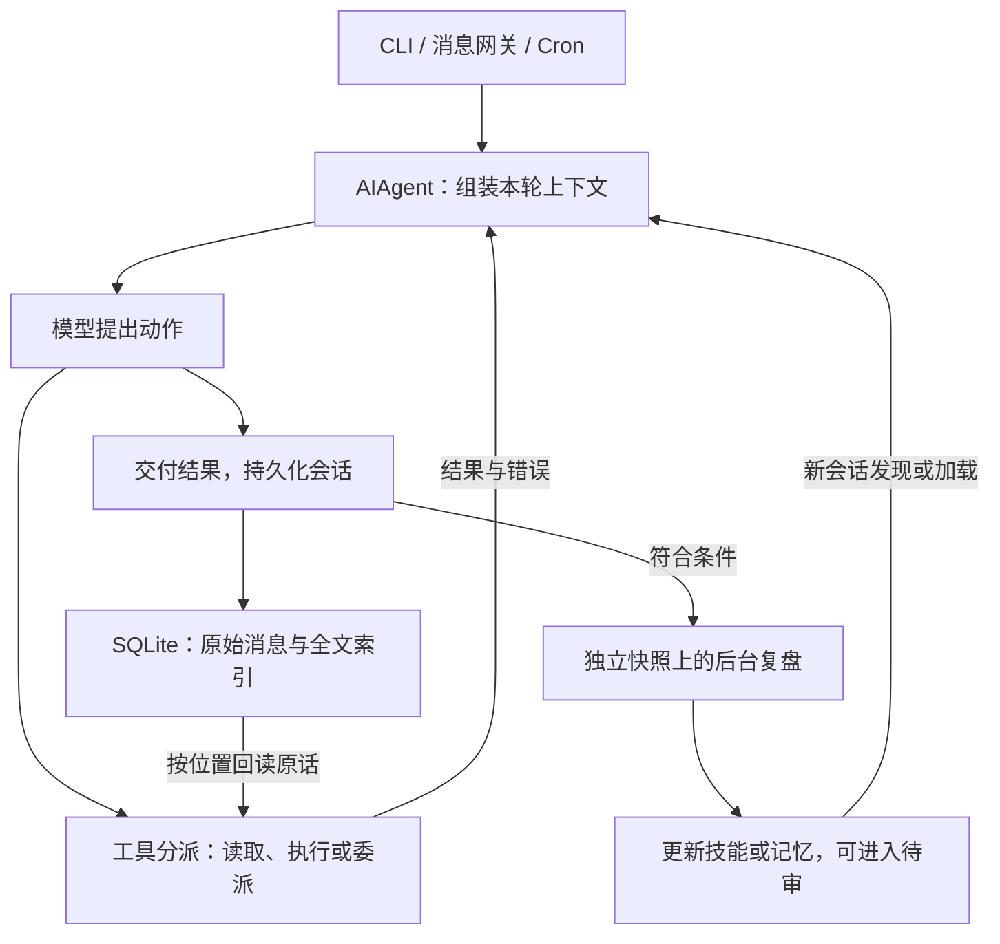
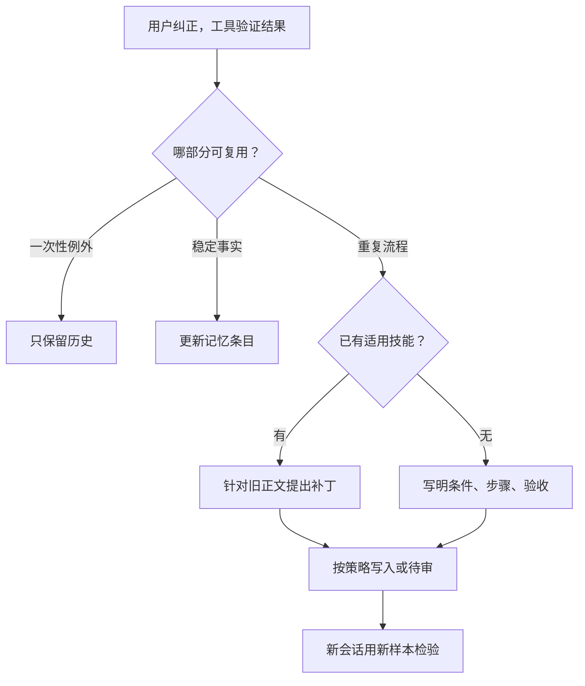

# Hermes Agent：一次纠正，怎样在下一次会话里起作用？

> 用户说“下次也照这个办法做”，Hermes 有三个去处可选：把事实写进记忆，把步骤写成技能，把原话留在历史里。拆开这三条路，就能解释它怎样学会一件事，也能找出它在哪一步学错了。



## 先认清 Hermes 在改什么

本文读的是 Nous Research 的 `hermes-agent` 应用，版本坐标是 **2026 年 11 月 24 日**。一次纠正能留下文件、历史消息或外部记忆记录。换个底层模型，这些材料仍然可以读取。理解这里的“学习”，可以直接检查磁盘，或者在新会话观察工具调用。[项目说明][home]

| 用户下次需要什么 | 交给谁保存 | 复用时看什么 |
|---|---|---|
| “回答时请用中文” | 活动 profile 的 `USER.md` | 新会话开头有没有读到这条偏好 |
| “项目里的日期按当地时区解释” | `MEMORY.md` | 事实适用哪个项目，约定是否还有效 |
| “下次也按这几步核对日期” | 带适用条件和验收步骤的 `SKILL.md` | 模型是否选中它，在新输入上做对 |
| “我上周的原话是什么” | 带会话和消息位置的历史记录 | 当时的限定词、否定词和上下文 |
| “每周五做一次” | 持久化的调度作业 | 哪个时区触发，用谁的权限，送到哪里 |

例如用户纠正“这次导出按本地时区”。历史要留全句。若只是本次例外，永久偏好可以一字不写。只有确认后续同类文件都遵循相同约定，才值得把判断条件和检查办法写进技能。写对了字、放错了地方，下一次照样会错。

## 从主循环分出一次复盘

`run_agent.py` 的 `AIAgent` 把持久化、流式交付、压缩和轮次控制接在一起。往 `agent/conversation_loop.py` 的 `run_conversation` 里跟：组装输入，调用模型，遇到工具请求就派发，把结果作为观察送回去。拿到可收尾的文本才结束本轮。[入口][entry] · [对话循环][loop]

这里最有用的材料常藏在中间：读取日期列，发现午夜附近的样本落在不同日期，按约定转换后重跑，比对通过。最后那句“已经修好了”能交付给人，却没法教另一个会话独立复现。复盘得同时看到原尝试、纠正动作和验证结果。

| 读源码时的落点 | 负责的细节 | 为什么会影响后续学习 |
|---|---|---|
| 提供商适配 | Anthropic 消息转换、Codex Responses 适配、流式参数和调用配对 | 只收到半截参数就断线，不能记成工具已经执行 |
| 前台工具轮次 | 错误、重试、真实输出和最终答复 | 能分清模型猜过的原因和测试验证过的原因 |
| `agent/background_review.py` | 从本轮快照复盘，限定工具范围，单独记录后台用量 | 可以追到哪次复盘提出了哪项长期改动 |

提供商协议不同，同一调用的 ID、参数结束和结果位置也不同。换模型时我会复测“参数还在流式输出就中断”和“工具真执行了但失败”两条路径。前者要等完整请求，后者应当给模型一条失败观察，两者能学到的东西完全不同。[Anthropic 转换][adapter] · [Responses 适配][responses]

### 用户已经收到答案，后台还能做什么？

后台从已完成轮次的快照分出独立 Agent，可沿用合适的模型配置与缓存前缀。它在受限工具集合里考虑是否改记忆或技能，反思过程留在分支里。用户继续追问上一句时，主会话接到的是原来的工作现场。[后台复盘实现][review]

1. **触发**：前台可以主动保存，后台也可以按条件复盘。周期性提醒只是请模型检查有没有值得留的经验。
2. **判断**：能解释异常却只适用今天的输入，就留在历史。长期事实去记忆。有重复操作且能说清验收条件，再考虑技能。
3. **提交**：可能直接写入、产生待审变更，也可能什么都不写。统计学习事件时，要查真实写入或审查记录，不能把每次唤醒都算成“学会”。[记忆工具][memtool] · [技能写入][skills]

后台也要花推理费用。复盘代码单独记录后台用途和用量，因此可以把前台执行、子任务、经验提炼分别计入同一任务。要看这笔钱值不值，得等下一批任务：同类输入少试了几轮？还要不要用户再纠正同一条规则？[用量记录][review]

## 技能的生命周期：发现、读取、打补丁、再验证

我会把 Skill 写成下一次能直接拿来操作的说明书。Agent Skills 的目录里，`SKILL.md` 开头写名称和描述，正文放前置条件、动作与验收，需要时再附脚本和参考资料。下面这份最小示例可以拿两份日期导出来试。[格式规范][spec] · [Hermes Skills][skills]

````markdown
---
name: reconcile-date-exports
description: 两份导出的日期在月末对不上时，核对日期含义、时区和业务主键。
---

先确认两列指的是到账时间还是记账时间，从原始输入保留一行差异样本。
按项目约定统一时区，保留原日期列，方便复核。
按账户和币种确认主键范围，再比对重复行与分组总额。
输出未匹配条数、差额和样本位置。差额未解释时，保留待查项。
````

Hermes 先让模型看到技能的名称和用途。命中后再读正文，支持文件也是需要才打开。若三份说明都叫“处理导出”，模型得读完三遍才能选。把“月末、双来源、日期差异”写进描述，往往比在正文多添几段背景更省事。[技能发现与读取][skillread]

**写入旧技能要找原位置。** `skill_manage` 创建的本地技能默认落在 `~/.hermes/skills/`，新建目录可配置。更新已有技能则写回它实际所在的目录。改一条前提可以用 `patch` 指定旧文和新文，整体流程变化时可替换正文，也能维护附属文件。[管理工具源码][skillwrite]

| 遇到的变化 | 我会改哪一处 | 怎样知道改对了 |
|---|---|---|
| 普通导出也误触发月末核对 | 缩小技能描述里的触发条件 | 给一份日期本就一致的负例，观察是否仍多做转换 |
| 同一主键在不同币种下可以重复 | 修订步骤，写清在哪个范围内判断重复 | 旧样本仍通过，新样本保留合法记录 |
| 工具接受补丁，结果仍算错 | 对照样本检查业务假设 | 用独立算出的分组总额验收，格式校验只证明能保存 |

复盘也会读到外部数据。若资料里一句临时要求被提炼成团队规则，下次所有会话都可能受影响。`skills.write_approval` 可让工具写入先进入待审，已有技能可锁定。私人操作单和多人共用的规则，可以选择不同的生效方式。[审批与锁定][skills]



显式学习还有另一条入口：Teknium 演示的 `/learn` 可以从资料或历史形成技能。它适合用户已经挑出值得学的材料。后台复盘则要先判断这次有没有值得保存的东西。评估两者都可以用未参与提炼的新样本，记录成功率、误触发、人工纠正和执行成本。[开发者的演示][xt]

## 常驻笔记：为什么写进文件，还要等新会话？

内置记忆位于活动 profile 的记忆目录。`MEMORY.md` 默认 **2,200 个字符**，用于稳定事实与工作约定。`USER.md` 默认 **1,375 个字符**，保存用户偏好，两者限额可配。这里数的是字符，不能拿固定倍数换算成模型 token。[记忆说明][mem]

开局时，运行时读取两份笔记，形成**冻结快照**。当前轮工具可以写文件并看到更新，系统提示开头仍沿用启动时的快照，因而有机会复用前缀缓存。此刻刚说的“请用中文”可直接根据当前用户消息执行，另一个早已打开的会话未必立即知道。[快照规则][mem]

| 现象 | 先看什么 | 怎么区分 |
|---|---|---|
| 用户说保存过，新会话却不知道 | 活动 profile、目标文件、待审区 | 写到别人的目录与还没批准是不同故障 |
| 磁盘已经更新，旧会话还按旧偏好回答 | 会话启动时间、工具反馈 | 对比新开的会话是否读到刚写的版本 |
| 容量满了，新事实写不进去 | 旧记录能否精简或合并 | 同批删减和添加，按操作完成后的总容量检查 |

按“最老优先”删除会把仍有效的长期约定挤掉。记忆工具支持成批变更。涉及审批的已有条目会核对原目标。假如后台建议把 A 改成 B，审核前用户已经把 A 纠正为 C，提交时就该发现目标变了。这比只看谁最后写文件可靠。[写入与待审][mem] · [变更实现][memtool]

## 回读历史：三月问摘要，十一月找原话

要回答“你上次到底听我说了什么”，先翻 SQLite。它保存会话和消息，`messages_fts` 是 FTS5 全文检索虚表，消息的增删改配有同步触发器。针对中日韩子串还有 trigram 索引，按连续片段找词，便于检索没有空格分隔的文本。[建表与索引][ddl]

大块工具输出和重复定时会话等材料不会一律进入较贵的 trigram 索引，原消息仍可保存。工单号能命中、中文短语却查不到时，先辨认走的是哪条索引或回退路径，再检查原消息。搜不到与从未保存是两种结论。[SQLite 实现][ddl]

| 同样叫 `session_search` | 2026 年 3 月 9 日的实现 | 2026 年 11 月的实现 |
|---|---|---|
| 第一次查 | FTS5 命中后按会话分组，默认取三个不同会话 | 查询定位命中位置，也支持列览、直接读会话 |
| 怎么给模型材料 | 取命中附近上下文，辅助模型按问题概括每个会话 | 按会话和消息位置读附近原文，按模式与长度预算返回 |
| 工具本身的费用 | 有额外摘要推理，返回材料较短 | 检索工具直接交还记录，外层模型再决定如何解释 |

所以首页的“FTS5 加 LLM 摘要”要配合版本读。十一月实现还按会话谱系去掉续聊的重复命中，并对重复自动任务调整排序。否则一千条周期检查里都写着日期，用户亲口纠正时区的那句话就可能沉到底下。[三月实现][oldsearch] · [十一月实现][search] · [首页][home]

下面用两次调用还原查询过程。先限制用户角色，拿消息位置，再回读周围对话。摘要里很容易漏掉“仅这一次”，带位置的原文允许你当场核对。[工具参数与返回值][search]

```python
import json

def read_user_context(search, keyword):
    """search 是注入的检索工具。无命中时让调用方换词。"""
    page = json.loads(search(query=keyword, role_filter="user", limit=3))
    if not page["success"]:
        raise RuntimeError(page.get("error", "查询失败"))
    for hit in page["results"]:
        anchor = hit.get("match_message_id")
        if anchor is None:
            continue
        nearby = search(
            session_id=hit["session_id"],
            around_message_id=anchor,
            window=5,
        )
        return json.loads(nearby)
    return {"success": True, "results": []}
```

检索还可显式打开另一份本机 profile 的只读存储。只读保护的是历史不被改写。谁有资格看到那句原话，要靠入口授权、进程身份和目录权限控制。多人共用实例时，在群会话里试搜一条私人消息，很容易暴露作用域配错的问题。[跨 profile 检索][search]

### 那 Honcho 又记了什么？

“上次说的是哪条记录”适合关键词和定位。“我通常希望你怎样呈现结果”可能需要跨会话归纳。Honcho 是可选的外部记忆提供商，11 月可从插件目录安装。内置笔记和 SQLite 各自就能工作。[提供商说明][mem] · [Honcho 项目][hon]

集成里有两层取回：基础材料可含会话摘要、用户表示与 peer 身份。进一步的推断有独立刷新节奏，根据近期观察更新。不同助手可以用不同 peer 保存观察。一次精确查询不必因此再跑一轮画像推理。[Honcho 集成][honint]

**纠正顺序很重要。** “这次给采购的表留两位小数”若被归纳成“所有金额都留两位”，先找到原话，确认对象和时间，再修正画像或技能。只修本地笔记，外部服务下次仍可能送回旧推断。部署时也要明确哪些资料发往外部、用户如何分域、删除后本地还留哪些原文。

## 委派：给孩子一份能独立做完的工作

`delegate_task` 给每个子任务一份独立对话。父任务看过的附件和纠正不会全部跟过去，因此 `goal` 该写清要验收什么，`context` 里给输入位置、已知约束和返回格式。有可解析的工作目录时，子任务仍能加载相应项目规则。[委派契约][delegate] · [创建实现][dcode]

例如分别检查三份导出，给每个孩子固定文件版本和币种，要求只交回差额、未匹配数与证据位置。父任务最后统一合并。若让孩子去“查刚才说的那个错”，它得重新猜主键和日期含义，交回来三份数字也无法对齐。

| 隔开的是什么 | 默认行为 | 对并行工作的影响 |
|---|---|---|
| 对话 | 子任务有独立历史 | 正文和约束要明确传，回收时只拿结论和证据 |
| 工具 | 从父任务启用的工具集中再收紧 | 通常去掉向用户提问、写共享记忆、跨端发送、管理定时任务等能力，叶子还限制继续委派 |
| 磁盘 | 默认可以共享父任务工作目录，Git worktree 隔离需配置 | 可并行读固定输入。并行写时分路径或工作树，由父任务合并 |

模型填一个更强的工具清单不能给孩子提权。相反，两个合法的子任务即使互相看不见对话，也完全可能同时覆盖同一文件。看到结果冲突，先比输入版本、输出路径和单位，再看推理过程。[继承与工作区][delegate]

能接收后续通知的顶层会话可先拿后台句柄。子任务完成后，批次通常汇总一次通知，也可分别交付。一次性请求、无法再次交付的入口和嵌套编排要走同步或受限路径。

有子任务中止时，父任务得标出它负责的文件和已完成部分。把“没交回来”当作“没有差异”，最后一张汇总表就会漏掉整份输入。[完成通知与中止][delegate]

**何时值得拆？** 独立核对三份文件可缩短等待，前提是输入、验收和外部接口配额都能分开。若日期口径还没定，应先在一轮里定下来，再发下一批。父任务还得重读全部原始材料，或孩子们挤同一个限速接口时，并行的好处就小得多。

## 让任务离开前台：网关、调度和终端后端

网关把 Telegram、Discord、Slack、WhatsApp 等平台接到同一套能力。平台凭据、发送限制、群组与线程标识各不相同。同样的数字用户 ID 到另一个平台可以指向别人。跨设备共用记忆之前，先确定平台、账号和 profile 的对应关系。[消息网关][gateway]

`cronjob_manage` 管单次和周期任务，可以附带技能，结果送回原聊天或配置目标。需要解释异常的模型任务开新会话。确定性脚本可用无 Agent 模式直接交付输出。触发时固定输入版本和时区，之后便能区分“这一版数据跑过”和“新数据需要重算”。[Cron 文档][cron] · [调度代码][scheduler]

Automation Blueprints 把调度配置做成可填写、可共享的工作流。模板里写明计划、参数和目的地。使用它的人再绑定自己的账号与授权。这样分享的是重复劳动的做法，收件人的私聊和访问凭据仍归各自部署管理。[官方发布][xn] · [模板说明][blue]

| 在哪里执行命令 | 为什么选它 | 恢复任务时先检查 |
|---|---|---|
| Local | 信任本机仓库，依赖已经装好 | 当前账号能读到什么，取消后进程是否结束 |
| Docker | 用同一镜像重现依赖 | 目录挂载、输出是否复制到持久位置 |
| SSH | 输入就在既有开发机上 | 远端账号、工作目录及断线后进程状态 |
| Modal、Daytona、Vercel Sandbox | 按需创建托管执行环境 | 冷启动、网络、休眠和回收后的工件 |
| Singularity/Apptainer | 复用科研集群环境，通过插件接入 | 插件版本、集群挂载与调度约束 |

前四行共六个内置后端，最后一行是插件。执行接口要处理目录、超时和输出。常见误判是技能还在宿主，技能引用的脚本却没挂进远端。先从运行器里验证输入存在，再核对工件回传位置，就能把环境缺失与模型忘记步骤分开。[后端清单][home] · [环境接口][env]

## Hermes 还是 OpenClaw？

| 你更关心的问题 | 先用哪套机制跑通 | 看哪一条证据 |
|---|---|---|
| 纠正一次，下次能少教一步吗？ | Hermes 的复盘、技能补丁与新会话加载 | 哪个技能版本减少了纠正，负例有没有误触发 |
| 多个账号、群聊、设备会不会串？ | OpenClaw 的 Gateway、绑定和独立工作区 | 哪个 Agent 接手、能读哪些文件、发给了谁 |
| 业务需要两者 | 先定长期记忆的写入方和出站发送方 | 一次纠正只写一次，一次完成只投递一次 |

Hermes 可先用单机 CLI 验证学习，再接 profile、SQLite、网关、可选记忆服务和执行后端。OpenClaw 从渠道归属往内看，再选运行时、工作区与工具策略。两者都有技能和记忆。区分它们最快的办法，是亲自跑表里的前两个检查。[Hermes][home] · [OpenClaw 运行时][oc] · [渠道路由][routes]

## 一手资料

- 主循环与学习：[AIAgent][entry]、[对话循环][loop]、[后台复盘][review]、[技能管理工具][skillwrite]。
- 历史回读：[三月源码][oldsearch]、[十一月源码][search]、[SQLite 建表][ddl]、[Honcho 集成][honint]。
- 执行与交付：[委派][delegate]、[终端后端][env]、[消息网关][gateway]、[Cron][cron]。

## 面试：六个可以直接开口的问题

### 1. 怎么证明 Hermes 真学会了，下次不是恰好还记得上文？

**考察点**：跨会话复用和独立验收。

1. “固定模型和验收方法，让用户在第一份输入上纠正一次，记下实际改了哪份技能。”
2. “另开新会话换一份同类输入，看它有没有自己找到那份技能，结果是否正确。”
3. “我还会隐藏技能再跑，并给一个不该使用它的负例。正确复用和少误用都值得测。”

**连环追问**：后台模型说已经学会算吗？我看写入或待审记录，等到下一次独立任务通过才算复用成功。

### 2. 用户刚改了偏好，为什么另一个窗口还在按老习惯回答？

**考察点**：记忆写入、快照与作用域。

1. “我先看是不是同一个 profile，改动写进了 USER.md，还是还在等审批。”
2. “会话启动时读冻结快照，旧窗口可能继续用旧前缀。新开会话就能验证磁盘上的版本。”
3. “当前对话直接按用户刚说的做。稳定偏好占开局预算，长证据放历史，多步做法放技能。”

**连环追问**：为何限几千字符？每次开局都要带，高频重复的错误偏好比单次多花一点 token 更麻烦。

### 3. 用户说“我上周说的明明是反话”，你查摘要还是查原话？

**考察点**：说清不同版本的检索费用和证据来源。

1. “先在正确的 profile 里按项目词和用户角色搜，拿到会话号和命中的消息位置。”
2. “回读前后几条，找‘只限这一次’之类的条件，再对照记忆、技能和外部画像。”
3. “三月实现会请辅助模型概括几个会话，十一月的检索工具直接返回记录，外层模型才负责解释。”

**连环追问**：只读 profile 是否就能对团队开放？只读仍然能看到原话，查询范围也得按身份授权。

### 4. 技能补丁写入成功，为什么下周反而做错？

**考察点**：触发条件、步骤与业务验收。

1. “我先对版本，确认用的就是刚改的那份，再看改的是描述还是操作步骤。”
2. “描述太宽就会用错地方，步骤漏前提则会在正确地方算错。我拿旧样本、新样本、负例各验一次。”
3. “多人共用的技能可以先待审，固定旧版本和证据，验证后再让大家加载。”

**连环追问**：后台建议和用户刚改的事实冲突呢？提交前核对拟修改的原目标。目标已变，就重新审核。

### 5. 两个子 Agent 各有上下文，为什么还会覆盖同一份文件？

**考察点**：消息、工具、文件系统各自的边界。

1. “子任务拿到独立对话，所以我要明确传入文件版本、币种和验收条件。”
2. “工具范围从父任务继承后收紧，但工作目录默认仍可能共享。我给各自独立输出，必要时开工作树。”
3. “孩子只交证据和差异，父任务唯一合并。有孩子中断，要标明哪一部分还没核对。”

**连环追问**：两份结果不一致就投票吗？先看输入版本、单位和范围，再按证据重算。

### 6. 每周五的结果发了两次，应该从哪个模块查？

**考察点**：调度、执行、投递分别留下什么记录。

1. “拿计划槽位和时区找到作业，先区分触发了两次，还是一次执行产生两次发送。”
2. “执行已成功就核对目标和回执。投递超时不必重跑模型，先确认原消息是否送到。”
3. “对重复任务固定输入版本和业务键，这样补投递和重新计算能分开处理。”

**连环追问**：这任务只是导出几个确定字段呢？我会用无 Agent 脚本，让调度器跑脚本并送结果，把推理留给需要解释的异常。

[adapter]: https://github.com/NousResearch/hermes-agent/blob/8545feeb1a53fc73375dfa98cf65cafadba66bf0/agent/anthropic_message_convert.py
[blue]: https://github.com/NousResearch/hermes-agent/blob/8545feeb1a53fc73375dfa98cf65cafadba66bf0/website/docs/guides/automation-blueprints.md
[cron]: https://github.com/NousResearch/hermes-agent/blob/8545feeb1a53fc73375dfa98cf65cafadba66bf0/website/docs/user-guide/features/cron.md
[dcode]: https://github.com/NousResearch/hermes-agent/blob/8545feeb1a53fc73375dfa98cf65cafadba66bf0/tools/delegate_tool.py
[delegate]: https://github.com/NousResearch/hermes-agent/blob/8545feeb1a53fc73375dfa98cf65cafadba66bf0/website/docs/user-guide/features/delegation.md
[entry]: https://github.com/NousResearch/hermes-agent/blob/8545feeb1a53fc73375dfa98cf65cafadba66bf0/run_agent.py
[env]: https://github.com/NousResearch/hermes-agent/blob/8545feeb1a53fc73375dfa98cf65cafadba66bf0/tools/environments/base.py
[gateway]: https://github.com/NousResearch/hermes-agent/blob/8545feeb1a53fc73375dfa98cf65cafadba66bf0/website/docs/user-guide/messaging/index.md
[home]: https://github.com/NousResearch/hermes-agent/blob/8545feeb1a53fc73375dfa98cf65cafadba66bf0/README.md
[hon]: https://github.com/plastic-labs/honcho
[loop]: https://github.com/NousResearch/hermes-agent/blob/8545feeb1a53fc73375dfa98cf65cafadba66bf0/agent/conversation_loop.py
[mem]: https://github.com/NousResearch/hermes-agent/blob/8545feeb1a53fc73375dfa98cf65cafadba66bf0/website/docs/user-guide/features/memory.md
[memtool]: https://github.com/NousResearch/hermes-agent/blob/8545feeb1a53fc73375dfa98cf65cafadba66bf0/tools/memory_tool.py
[oc]: https://github.com/openclaw/openclaw/blob/8656b1e18257d7fcb48009a7954064b89c995180/docs/agent-runtime-architecture.md
[responses]: https://github.com/NousResearch/hermes-agent/blob/8545feeb1a53fc73375dfa98cf65cafadba66bf0/agent/codex_responses_adapter.py
[review]: https://github.com/NousResearch/hermes-agent/blob/8545feeb1a53fc73375dfa98cf65cafadba66bf0/agent/background_review.py
[routes]: https://github.com/openclaw/openclaw/blob/8656b1e18257d7fcb48009a7954064b89c995180/docs/concepts/multi-agent.md
[scheduler]: https://github.com/NousResearch/hermes-agent/blob/8545feeb1a53fc73375dfa98cf65cafadba66bf0/cron/scheduler.py
[search]: https://github.com/NousResearch/hermes-agent/blob/8545feeb1a53fc73375dfa98cf65cafadba66bf0/tools/session_search_tool.py
[skillread]: https://github.com/NousResearch/hermes-agent/blob/8545feeb1a53fc73375dfa98cf65cafadba66bf0/tools/skills_tool.py
[skills]: https://github.com/NousResearch/hermes-agent/blob/8545feeb1a53fc73375dfa98cf65cafadba66bf0/website/docs/user-guide/features/skills.md
[skillwrite]: https://github.com/NousResearch/hermes-agent/blob/8545feeb1a53fc73375dfa98cf65cafadba66bf0/tools/skill_manager_tool.py
[spec]: https://agentskills.io/specification
[xn]: https://x.com/NousResearch/status/2065200829372506198
[xt]: https://x.com/Teknium/status/2069527900723073235
[honint]: https://github.com/NousResearch/hermes-agent/blob/8545feeb1a53fc73375dfa98cf65cafadba66bf0/website/docs/user-guide/features/honcho.md
[oldsearch]: https://github.com/NousResearch/hermes-agent/blob/4e3a8a06371fe9edc8f34de6d368183f809ebb2c/tools/session_search_tool.py
[ddl]: https://github.com/NousResearch/hermes-agent/blob/8545feeb1a53fc73375dfa98cf65cafadba66bf0/persistence/sqlite/_schema_ddl.py
