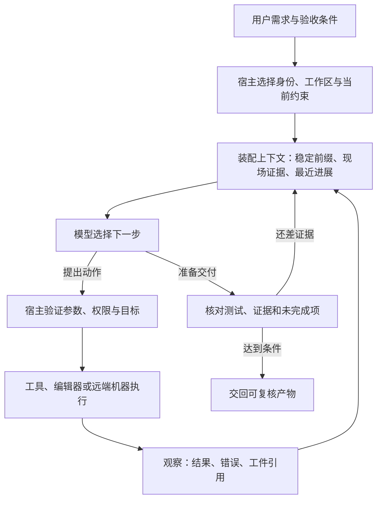
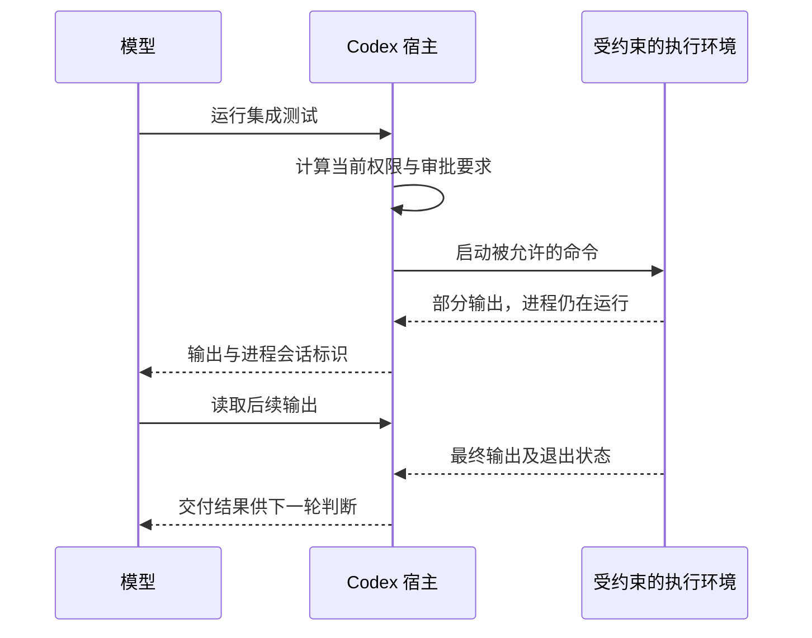

# Claude Code、Codex、Manus、Cursor 与 Devin：同一个任务，五种 Harness 的不同账本

给五个助手同一道题：“把项目里的月度导出改成支持多币种，交给我可以复核的结果。”Claude Code 可以一路搜索、修改、跑测试；Codex 要决定命令在哪些权限下运行；Manus 还可能整理外部资料和交付物；Cursor 能利用你正在看的代码与编辑器诊断；Devin 可以领走工单，在另一台机器上做完再回来。面试时真正能拉开差距的是解释：**信息从哪里来，动作在哪里执行，什么证据能证明任务结束。**

本文以 **2026 年 11 月 24 日** 为核查日。Codex 的实现定位到固定 Git 提交；Claude Code、Manus、Cursor 和 Devin 的内部行为以厂商文档或工程作者披露为界。凡写“我会怎样实现”均为可测试的设计建议。特别是缓存命中率、工具数量和内部函数名，跨产品同名不等于同口径，公开证据只够支持哪一层就讲到哪一层。

## 一、六个维度先看全貌

下表把产品放在行上，便于沿着一次任务横向读完。上下文列只写有公开依据的策略；“未披露”表示不能从公开材料推断命中率、缓存布局或某种编排一定存在。

| 产品 | 循环拓扑 | 工具设计 | 上下文与 KV 缓存 | 沙箱与权限 | 跨会话状态 | 多 Agent 与后台 |
|---|---|---|---|---|---|---|
| Claude Code | 主会话反复取证、行动、验证，可委派独立上下文 | 文件搜索、读取、编辑、Bash，可加 MCP、技能和钩子 | 稳定前缀，动态变化靠后追加；长会话压缩，普通子任务可自建缓存 | 工具许可、Hooks、命令执行隔离各管不同关口 | 项目说明 `CLAUDE.md`、自动记忆入口及主题文件、可续会话 | 专项子任务、后台任务、云端形态 |
| Codex | 客户端、模型和工具围绕线程内的轮次交替 | 命令与会话句柄、编辑、可接外部工具 | 顺序稳定的请求前缀、有预算的压缩；官方披露 Responses 请求装配 | 审批策略叠加 OS 执行限制，平台后端不同 | `AGENTS.md` 作用域、线程记录、工作树及外部产物各自持久化 | 子线程创建、等待、回收；另有独立工作区的 Codex Cloud |
| Manus | 从环境取得观察再行动，广域研究可扇出多份独立任务 | 浏览器、文件与命令等动作，历史披露用状态约束可选动作 | 重视前缀命中，文件引用恢复，待办重述，保留错误证据 | 任务沙箱；2.0 可选云电脑或获授权的本机工作区 | 文件和任务产物可续用，项目环境有独立生命周期 | Wide Research 将大量独立样本分配给子 Agent |
| Cursor | 编辑器中的 Agent 探索、修改并验证，另有 Cloud Agents | 语义搜索与精确搜索、编辑器诊断、代码修改与测试 | 基于代码索引取相关片段，历史研究优化应用编辑；服务端 KV 布局未披露 | 本地编辑器与云端 VM 有不同权限、网络和凭据 | 项目 Rules、代码库索引及版本化开发环境 | 前台编辑和多个云任务可以并行，云端可产出 PR |
| Devin | 异步会话领任务，在独立环境执行，人可检查并接手 | 官方披露 Shell、代码编辑器、浏览器共同工作 | 环境和可复用指令提供上下文；底层 KV 调度未披露 | 云会话从环境快照启动，默认 Linux VM，可配置工具与凭据 | Playbooks 与 Knowledge 的经验正迁往插件中的 Skills | 云端并行委派多个会话，结果通过工件、测试或 PR 验收 |

矩阵中 Claude Code 和 Codex 的主循环分别有官方说明。Manus 的工程博客描述了特定阶段的实现，2.0 公告补充执行形态；Cursor 的索引和云环境是两份不同披露；Devin 的快照文档与首次发布应并读。[Claude Code 工作原理][cla] · [OpenAI 循环拆解][cxloop] · [Manus 工程手记][man] · [Manus 2.0][m20] · [Cursor 搜索][cuse] · [Cursor 云环境][cucloud] · [Devin 环境][dvm] · [Devin 初始披露][dev]



这张图是为了比较而画的最小公共模型。一个产品可以用更多模型、多台机器或多个服务实现其中一格。判断谁拥有循环最简单的办法，是追踪一次工具失败以后，由谁决定重试、换路、请求用户还是结束。只要有人回答“模型自己会想办法”，就再问一句，模型在哪次请求里收到了什么错误。

## 二、Claude Code：把探索的脏活留在主循环能验证的地方

### 主循环为什么可以很短

修多币种导出时，先搜一个已知 CSV 列名，读出生成路径，改一条分支，然后跑测试。测试发现展示层还硬编码了货币符号，模型再回到搜索。Anthropic 将这个过程概括成收集上下文、采取行动、验证结果，三个动作可以重复和交叠。外层可以很简单，因为下一步的依据来自实时观察，宿主无需预先枚举所有仓库里可能出现的错误。简单循环仍要正确处理中断、工具失败、上下文溢出和用户追问，这些都是循环协议的一部分。[Claude Code 如何工作][cla]

面试里有人把这叫 Master Loop，甚至追问是不是名为 `nO` 的函数。官方工作原理页给出了可复现的行为模型，没有承诺这个压缩构建符号是稳定的源码入口。回答时可以直接画出“模型回复含工具请求 → 工具执行 → 结果随下一轮送回 → 交付或继续”，再说明哪一环执行权限检查。这样即使明天改了打包器，答案仍能带人定位“工具执行完、模型却没看到结果”的故障。[官方循环与工具反馈][cla] · [工具参考][ctools]

### 查代码是否一定要预建向量库

已知异常文本是“无法识别货币”，找它的字面出现位置几乎不需要语义理解。先找文本和文件名，再沿定义、调用者与测试打开文件，是 Claude Code 可观察到的按需检索方式。它能读到工作树里刚刚修改、尚未被索引的文件，也能让人复核每一步用了哪个词。若用户只说“某些账单读起来怪”，代码里可能没有“账单”这个词，那就需要从 UI 文案、接口、调用方不断缩小范围。比起笼统说“向量没用”，更准确的判断是哪些问题用结构和精确字符串就能较便宜地定位。[Claude Code 的查找能力][cla] · [Cursor 对语义与精确搜索的实验][cuse]

还有一个很有面试区分度的小变化。`Grep`、`Glob` 和 `Bash` 是经典讲法；十一月官方工具表说明，在 macOS、Linux 和 WSL 的默认主会话里，常通过 Bash 的 `find`、`grep` 搜索，专用的 Grep 和 Glob 在特定配置或环境才出现，Windows 的默认行为有别。控制工具的 Hook 若只盯住名为 `Grep` 的调用，未必能观测今天的真实搜索流量。要把服务行为按“检索文件”归类，同时保留底层真实工具名以便排障。[平台差异与实际调用入口][ctools]

### 长上下文要分别管内容、次序和所有权

`CLAUDE.md` 由人或团队存放长期项目说明，例如“金额用十进制定点表示、变更后运行哪组测试”。Auto Memory 允许助手把经验写入自己维护的记忆目录，用 `MEMORY.md` 作为索引，再按需要读主题文件。当前文档给自动记忆入口设置了行数和字节边界，开局最多读前 200 行或 25 KB，以先到者为准。项目规则可以帮助模型做选择；硬性的外发、删除或目录权限仍应落在宿主。保存对话、保存项目公约、保存用户交互中提炼的经验，是三种不同的持久状态。[指令与自动记忆][cmem]

缓存可以理解为模型服务说“前面这些字我刚算过”，而不是助手“知道用户昨天做过什么”。工程作者 Thariq 给出的构造方法是把稳定的工具定义和系统信息靠前，变化的时间、状态更新靠后，用新增消息传递变化。切换模型、变更工具清单或早期指令会改变缓存条件。如此设计既能复用前缀，又保留真实时间顺序。作者在 X 还报告过一次缓存问题导致用户额度比预期消耗得快，说明这类故障不是漂亮的成本图表而已，用户会直接感受到系统退化。[作者的缓存工程文][pcblog] · [Claude Code 缓存文档][cache] · [作者对实际故障的说明][xcache]

作者还给过两个具体例子。切进计划模式时，可以保留稳定的模式进出工具，把“现在先探索、不要编辑”的变化作为后续消息交代；接入很多 MCP 工具时，可以先暴露供发现的轻量信息，用到时再取得完整说明。这样虽然少了一种缓存失效来源，执行器仍要按当前模式判断能不能改文件。验证时应同时看缓存读入的 token 与前台第一次找到合适工具需要的轮数。[模式切换与延迟加载][pcblog]

压缩阶段最容易把原本省下的钱花回去。若用一整套新系统提示把几万 token 历史重发给同一模型做总结，服务端可能只能冷读。作者披露的一种做法是分出总结请求，尽量复用父任务的系统内容、工具和既有历史，在末尾加压缩要求，且预留空间让要求和摘要容得下。得到摘要后的后续请求又是新投影，仍要区分“生成摘要这次命中”和“主会话下次命中”两个事件。缓存省的是重复计算，压缩还负责控制窗口长度；命中再高也无法让超过窗口上限的输入合法。[缓存友好的压缩分叉][pcblog] · [命中观测字段][cache]

普通专项 Subagent 则可以拥有自己的系统提示、工具范围和上下文，只把重要结果交回父任务。比如检查仓库所有导出入口，可以由孩子读大量文件，最后交回三个路径和未覆盖的用例。这样父会话省下阅读日志，但孩子自己的请求有成本，普通独立前缀也不保证命中父缓存。当前文档还区分复用当前对话的 fork 和普通子任务。看到两个产品都写“fork”，先确认它复用的是文本前缀、磁盘工作树还是权限，三者的成本与风险完全不同。[子 Agent 和分叉][sub] · [子代理的缓存行为][cache]

Hooks 和 Skills 各回答一个问题。要让助手记住“改导出后怎样跑回归”，可以放入按需调用的技能；要在工具执行之前检查路径或在执行之后触发格式检查，可绑定生命周期 Hook。后者应当处理退出状态、超时和结构化结果；技能文本本身无法令一段越权操作在操作系统层失败。对需要沙箱的命令，还得配置文件系统与网络边界。用这三类机制设计一个系统，用户可以改自己的工作方法，而平台仍能对真实动作负责。[Hooks][hooks] · [Skills][cskills] · [沙箱][csb]

## 三、Codex：把一次“运行命令”拆成策略、进程和回执

Rust CLI 解决的是把同一套执行契约带到不同开发环境。代码仓库包含终端界面、核心、协议、执行和沙箱等组件；OpenAI 的工程文章直接展示了用户输入、Responses 请求、模型输出、工具调用和下一轮请求如何衔接。前端看到一段文字，并不能证明一个命令被启动，更不能证明它完成。沿源码读的时候，我会先认出对话线程、模型轮次、工具调用和操作系统进程这四种不同的身份。[Codex 仓库][codrepo] · [循环与请求装配][cxloop]

除了用户消息，一轮请求还可能有项目说明、环境、权限描述和工具。项目说明的发现逻辑能在 `agents_md.rs` 中看到：从当前目录向上确定项目根，再从根向当前目录收集各层说明，支持 `AGENTS.override.md` 等规则；全局用户配置另有来源。团队可在根目录写金额精度，在某个子目录写专用测试命令。遇到“为什么两个工程师在同一仓库里得到不同建议”，先记录两者实际工作目录和加载的文件，再考虑模型采样。若说明文件在上下文中出现却仍做了受限动作，要查执行边界。[项目说明发现源码][agentsmd]

**审批和沙箱是两道不同的门。** 子进程尝试写文件，操作系统要判断能否写；某个动作需要额外授权，宿主要判断能否询问、谁有权批准。在一个禁止升级的会话里，审批策略关闭询问不等于所有命令都能访问所有资源。反过来，宽松的沙箱也不会自动授予“替用户发消息”这种业务权限。把“允许在当前工作区生成测试文件”和“批准这次访问额外目录”分别记录，审计时才知道权力是预先配置的还是临时赋予的。[OpenAI 沙箱工程说明][osbox] · [Linux 执行细节][linux]

例如 `on-request` 允许在策略支持时提出额外权限请求，用户或既有规则决定是否批准；`never` 不接受这种升级请求。一次被拒绝的测试若只缺合法的只读夹具，助手仍可在已有权限下改用本地测试数据。进程超时、权限被拒绝和测试断言失败都可能表现为命令失败，返回给循环的诊断却应当不同，否则模型会用相同方法重试三种不同的故障。[按需审批提示契约][onreq] · [禁止升级的契约][never]

macOS 的实现使用 Seatbelt，把允许的读写和其他系统能力构造成操作系统执行的策略。Linux 的历史讲法常是 Landlock 加 seccomp，十一月固定提交的说明明确写出主路径为 bubblewrap 提供文件系统视图和名称空间隔离，seccomp 过滤系统调用，并保留旧 Landlock 实现。Windows 也有平台自己的执行约束。统一的是上层传入权限配置、下层执行后给出结果的契约，跨平台回归要验证允许和拒绝的实际行为。把所有平台粗略归成“开了一个 Docker 容器”，会错过用户本机工作树、文件挂载和权限模型之间的差别。[Seatbelt 源码][seat] · [Linux 沙箱 README][linux] · [三平台工程披露][osbox]

**Unified Exec 解决的是模型回合和进程寿命不相等。** 一次格式检查几百毫秒就结束；集成测试可能跑十分钟，中途还会不断写输出。若工具必须等到整个命令结束才能返回，前台既看不到进度，也没法继续处理其他信息。`exec_command` 可以按配置先交回已收到的输出，尚未结束的进程可用会话标识继续交互；`write_stdin` 对已存在会话发送字符或读取后续输出。同步完成时直接有退出结果。具体暴露的参数受执行模式影响。这里的进程会话标识与整个用户对话的线程标识作用不同。[命令执行处理器][exec] · [已有进程的后续交互][stdin]



假如测试打印“准备完成”以后沉默三分钟，模型既不能把这句话解释成测试通过，也不应每次轮询都再启动一份。应继续访问已有进程、设输出上限、等待退出状态，并在报告中记录超时或中断。相反，若业务工具返回了“已接受请求，稍后生成报表”，操作系统进程成功退出也只能证明提交请求成功，真正的业务任务还要它自己的完成回执。这样区分能同时解释 CLI 进度展示和云任务的验收语义。

Codex 的多 Agent 工具还有创建、发送输入、等待和回收子线程的入口。把两个独立调查分出去，父线程只读证据和结论，可以缩短关键路径；父子是否共享文件、工具权限和环境，则要看实际配置。Codex Cloud 又是另一层：任务在 OpenAI 管理的环境里用隔离工作区执行，准备好的仓库、依赖和访问设置决定它能不能完成验证。父线程里开两个子任务，与在云中提交两项互相独立的作业，都能让用户“同时做两件事”，但故障恢复、凭据和交付对象差别很大。[创建子线程][spawn] · [等待结果][wait] · [Codex Cloud 的环境与任务][cloud]

Codex 的 KV 成本同样来自多轮重读前缀。OpenAI 的循环工程文列出会破坏前缀复用的变化，还说明如何从早期手动请求摘要发展到自动压缩。读日志时应从一次具体请求下手，分别看工具列表顺序、工作目录和权限消息是否改变，再看窗口是否触发压缩。若会话在角色或权限更改后发生一次合理的冷读，正确做法是记录原因。为了保住缓存而继续发送过时权限信息，会让模型的预期和执行器的真实能力长期不一致。[上下文增长、缓存和压缩][cxloop]

## 四、Manus：让模型能拿回证据，也能想起自己为什么在忙

### 为什么作者把缓存命中率摆在第一位

如果一次任务要问模型四十次，每次只吐出一个短动作，模型却要反复读增长的任务历史，那么花钱最多的地方可能是“重新读”，并非最后那篇报告。Yichao “Peak” Ji 在 2025 年工程手记里报告过 Manus 当时平均约一百比一的输入输出 token 比，并将 KV-cache 命中率列为自己最重视的生产指标。分母、模型和工作负载都来自他们的实践；把这个数直接套到一次性补全或短问答上，没有依据。[Manus 作者的缓存分析][man]

做个简化的小账。假设稳定前缀一万 token，每次工具动作和观察再追加五百，连续决策二十次。冷读总输入规模约为二十份前缀加上一连串逐步增长的后缀；若每次均能复用上一次输入，只需处理首轮和增量部分的大头，仍会有缓存读取价格、生成和传输成本。第一行若放精确到秒的当前时刻，大量相同内容就处在不同前缀之后。把时间放到需要用它的那次观察里，对齐序列化键顺序，保证工具声明稳定，才有资格谈提高命中。这个账只展示数量关系，实际价格、缓存寿命和可复用块大小都由服务决定。[缓存与稳定序列化][man] · [OpenAI 的前缀观察][cxloop]

### 状态机约束“现在可以选什么”，工具执行器复核“真能做什么”

当用户刚发来一条澄清，下一步可能应该先确认；当浏览器还没有打开网页，某些页面动作缺少前提。一个直观实现是每轮重建工具列表，只把当前可用工具写进提示。问题是它会改变模型输入开头，还会让历史轨迹看起来引用了今天已经不存在的工具。Manus 工程文描述的替代方式，是保持动作声明相对稳定，通过状态机与解码约束限制这一步可选的动作。例子包括工具名使用一致前缀，按状态对候选 token 的 logits 做掩码或约束响应前缀。[动作空间的状态约束][man]

“掩码”可以直观理解为在选下一个词时，把某些候选项的得分设到选不出来。它约束的是生成，不能证明真实世界有权限执行这个动作。普通托管 API 也不一定让应用直接操纵 logits；能用的有时只有工具选择或结构化输出选项。自行落地时，我会维护稳定、可版本化的工具目录，用提供商支持的方式限制本轮选择，执行前再根据用户身份、资源、状态和参数做强制检查。若当前状态不允许提交报告，则返回可解释的拒绝，模型可取得正确的下一步。这样服务端的安全性不依赖某一个模型刚好遵守规则。

### 文件是外存，因为你可以拿回来

网页、表格和测试日志动辄几十页，把它们一直放在工作窗口里，后面真正要用的验收条件会被挤掉。Manus 把文件系统当作模型可以直接操作的外部记忆，强调“可恢复的压缩”。网页可以只留引用，文件读取结果可以缩成路径；当模型需要核实某笔金额时再打开相关内容。所谓“无限外存”指模型不必把全部内容常驻在 token 窗口，磁盘配额、保留期限、读取权限和打开文件的时间仍是真实限制。[Manus 的文件系统策略][man]

只留一个链接还有一个常见漏洞：外部页面可能第二天改变，自家导出可能被同名文件覆盖。工程上我会把证据指针细化成来源、获取时刻、内容版本、页码或行区间、仍可访问它的身份。比如汇总里写“原始差额见三月导出第二页，快照编号为某次任务号”，恢复时先验证版本再读取。这里是把作者的可恢复原则落实为一条业务约定。若来源本身不允许持久化，应该记录可恢复范围，别让一段文字承诺日后一定还能拿回原文。

### 待办复述与保留失败分别解决什么问题

任务到了第三十步，最近十轮都在修抓取页面的格式，用户最初说的“还要交一份可下载表格”早已离当前位置很远。作者描述 Manus 会写并更新 `todo.md`。更重要的动作是把当前目标和未完成项重新带回上下文的尾部，使下一次选择动作时再看见它们。如果只写一个文件却从不读取，也不把更新内容呈现在最近的观察中，那么文件的存在无法自动改变模型的注意力。待办要简明，只保留能帮助下一步决策的目标、完成条件和阻塞。[通过复述管理注意力][man]

失败轨迹解决的是另一件事。第一次按金额相等匹配账目，遇到两个相同数值却来自不同币种。若模型看不到这次失败，下一轮可能把同一操作换个措辞再试。留下“尝试过什么、系统给了什么错误、哪些条件没有变化”，它才可以改按业务编号与币种核对。保留失败的证据不等于重复附上每份完整堆栈。可以把重复错误归并并保留首次证据位置与最近状态，切掉无关噪声，同时保留那条决定“别再走这条路”的信息。[错误保留原则][man]

Wide Research 处理的是任务的另一种形状。比较一百家供应商的公开条款时，每个供应商都可以在独立上下文内完成相同的调查，再由父任务比较字段，这比在同一个长历史里连续读一百份材料更合适。如果第十家的取样规则取决于第九家结果，则应分波次调度。独立上下文可以减少局部错误的传播，但共享了错误的评判模板，所有孩子仍可能一起犯错。Manus 2.0 还公开了 Studio、Cloud Computer 和授权本机工作的形态；这些更新说明执行位置在扩展，2025 年文章足以解释取舍，却不能据此断言 2.0 的每一次调用仍遵循同一份内部代码。[Wide Research 说明][wide] · [2.0 工程与产品边界][m20]

## 五、Cursor 与 Devin：一个缩短编辑反馈，一个交付整段异步工作

### Cursor 把哪些成本从用户打字时移走了

同样是定位多币种导出的实现，编辑器通常已经知道当前文件和语言服务报错。Cursor 把精确搜索与语义搜索结合。语义索引使“哪里把付款记录变成人能读的文本”可以定位到名字完全不同的格式化代码，再用精确文本、符号和静态诊断核实。官方的索引文章描述用目录哈希结构跟踪变更，避免每次重新处理整个仓库；搜索文章还说明如何用真实搜索路径训练嵌入模型。维护索引需要同步与计算，回报要靠在新仓库、改名符号和未保存内容上的效果来衡量。[安全索引的实施设计][index] · [语义搜索的对照实验][cuse]

Cursor 公布过同一模型有无语义搜索的实验，除了任务表现，还观察代码后来被保留的比例，以及用户是否要不满地追问。在大型仓库上看到的收益比全部请求平均更明显。这里的设计价值有两层。第一，检索动机应来自特定查询分布，而不是因为大家都在做向量库。第二，离线能找对某段代码，还得在线验证用户最终少改了几次。评估时要把索引完成前的工作树、忽略的文件和权限可见范围纳入样本，否则实际使用者恰好最需要找的新代码可能根本没有候选项。[Cursor 自身的评测方法][cuse]

Shadow Workspace 则源于很朴素的体验问题：助手要试着改一段类型定义，用户还在打字，不能让光标跳动，也不能让助手的临时错误出现在用户当前的诊断框。Cursor 早期工程文披露了隐藏的 Electron 窗口，利用独立编辑状态及语言服务检查假设性改动。文中还讨论过内核级文件夹代理的设想，应把已实现和设想分别讲。语言服务器能检查某些内存中的改动，不代表所有测试和编译器都能在同一份影子状态里运行；涉及落盘、写缓存和启动服务时，要用真正隔离的工作区验证。[Shadow Workspace 设计与实现边界][shadow]

Fast Apply 关注编辑的另一半。强模型可能已经用一段简短说明表达了修改意图，要把它准确落到长文件才是眼前的延迟。Cursor 早期的实现研究选择由专门的应用模型生成修改后的文件，利用绝大部分输出与原文件相同这一先验，采用针对编辑的 speculative decoding：确定性地产生可能照抄的后续片段，由模型验证并前进，于是未改区域可以快速通过。它优化的是把编辑应用到文件的阶段，不应把历史实验吞吐量解读成 Composer 对所有任务的生成速度。[Speculative Edits 原文][apply] · [Composer 官方披露][composer]

Composer 本身还有训练与运行环境之间的联系。Cursor 披露，训练中让模型在开发环境里使用生产搜索、编辑、终端等工具，以强化学习鼓励有效选择工具与可行的并行；训练所需的大量隔离环境复用了后台 Agent 的基础设施。于是一次任务变快可能来自三个不同层次：模型少做几次无效搜索、应用改动更快、编辑器更早给出诊断。拆开记录三段时间，才知道给基座模型换代之后究竟还需不需要优化 Fast Apply。[Composer 的训练与工具环境][composer]

若用户在建议生成期间自己又改了同一行，应用再快也可能覆盖人的新输入。移植这一设计时，我会把编辑明确绑定到产生建议时的文件版本，提交前检查是否需要三方合并；把“编辑已落盘”和“类型检查通过”分别展示。跨文件行为还要运行项目测试。Cursor 今日也有云 Agent，环境支持 VM、单独凭据、产物和多个并行任务。因此“Cursor 等于本地编辑器”只抓住它早期最有特色的交互层。[云环境、快照与验收][cucloud] · [项目 Rules][rules]

### Devin 把哪些工作从用户机器上拿走了

Devin 的公开起点是给软件工程 Agent 一套沙箱内的 Shell、代码编辑器和浏览器。浏览器用于亲自打开刚改过的页面，编辑器对照实现，终端启动服务或测试。三件工具的价值在同一工作环境里闭环：若浏览器连的是旧预览，页面看起来完好一点也不能证明新代码成功。Cognition 的环境文档进一步说明，典型云会话从已准备的环境快照启动，默认是 Linux 虚拟机，含仓库、依赖和配置。题目里常说的“独立容器”，严谨答法是说明其隔离目标，并采用厂商对实际执行环境的称谓；任务内部还可以有自己的容器服务。[Devin 首次工程披露][dev] · [环境与快照][dvm]

异步工程师的验收与 IDE 补全很不一样。一个补全可以让用户看完立刻按键接受，一项三小时的云任务需要人回来时还能回答“基于哪次提交、跑了什么、留下什么、还有哪里未验证”。Devin 的并行会话让不同工单在各自环境中推进，适合边界清楚、验收可自动化的工作。预热快照省去安装依赖的等待；会话中的临时修改不会自动改写未来会话启动的基础镜像。长期需要的新依赖应进环境配置或仓库，否则“昨天 Devin 已经装过”对新会话没有帮助。[环境恢复边界][dvm] · [异步并行的产品披露][dev2]

Playbook 解决的是团队怎样交代重复任务。Knowledge 则曾用于让 Agent 按触发描述回想相关约定；可以让用户审阅由反馈产生的建议。这两种机制跟环境快照很容易混淆：快照能让依赖存在，无法告诉模型团队为什么拒绝某一种迁移；一份操作手册也不能替代实际安装编译器。到十一月两者均有迁移变化：官方说明 Playbooks 正迁向 Skills，自 2026 年 10 月 24 日起新账号从 Skills 开始；Knowledge 页提示旧知识逐步自动迁移为 Plugins 中的 Skills。面试里可以用旧词解释来历，落地时应按当前账号的实际入口验收。[Playbooks 的迁移说明][play] · [Knowledge 与迁移][dknow] · [当前插件文档][dplugin]

| 最小可决策的问题 | 偏向 Cursor 的做法 | 偏向 Devin 云会话的做法 |
|---|---|---|
| 成功是“少等两秒”还是“明天有可合并修改” | 优先优化局部应用、诊断、光标和人的确认 | 优先固定任务边界、环境和交付合同 |
| 失败时是谁最先发现 | 编辑器中的人和静态诊断，马上可以纠正 | 自动测试或任务检查点先发现，人回来读证据 |
| 关键上下文从哪里取得 | 正在编辑的代码、搜索结果、语言服务 | 仓库、可复用指令、配置好的云机器与任务材料 |
| 多任务会争用什么 | 本地缓冲区、文件和开发者注意力 | 云计算预算、共享服务、仓库合并和审查容量 |

## 六、从五个产品反推一套可以实际验收的架构

第一条共识是让模型用观察校正下一步。Claude Code 可以在一条循环里完成，Codex 为工具和进程建立明确协议，Manus 强调保留失败，Cursor 和 Devin 都在缩短改动到验证的距离。它们共同需要某个能回答“改对了吗”的外部标准。做月度导出时，我会预先准备跨币种测试、总额守恒检查和用户可核对的样表。若让同一模型在没有证据的情况下写代码、再替自己签字，能交付的只有一段自述。

第二条共识是模型可见材料的成本与寿命值得分别设计。仓库公约很稳定，适合在前缀；最近一次错误显著影响下一步，适合在尾部；原始报表、日志和截图很大，适合在外存并附上可恢复引用；用户长期偏好则需要作用域与纠正渠道。产品之间真正的分歧在于如何取证：Claude Code 靠主动搜，Cursor 愿意投资语义索引，Manus 靠可操作的文件和浏览器，Devin 愿意预置一台结构接近开发者机器的环境。要先回答数据是否新鲜、能否索引、不同身份能看多少，再决定用哪一种。

第三条是把下一步的选择权和执行权分开。模型可以提出“运行集成测试”，宿主要确定这个身份能用哪台机器、哪个网络与哪些密钥，并留下回执。执行是否完成又是另一件事。若用户从手机断开，谁继续持有进程、谁保存截图、谁在凭据撤销后停止下一步，都得有明确拥有者。前台工具可由人及时纠正，异步环境则需在长期运行、持久状态与受控交付上投入更多。

下面是我会给异步任务实现的**业务状态示意**。例子区别“还在跑”“结果明确”“外部效果未知”，没有假定五家都用这份结构。

```python
def next_step(run, receipt):
    """调用方用同一业务键保存回执，再决定是否询问模型。"""
    if receipt is None:
        return "查询原运行；无法确认时交给人处理"
    if receipt["state"] == "running":
        return "继续订阅原运行"
    if receipt["state"] == "failed":
        return "提交错误与证据位置，重新评估"
    if receipt["state"] == "done" and run["expected_version"] == receipt["version"]:
        return "检查产物是否满足独立验收条件"
    return "核对版本或未知状态，暂缓交付"
```

**选型决策树。** 用户正在编辑器里等、输入经常未保存，先走短反馈路径，重视诊断和版本冲突；用户把边界明确的工单交给系统以后要离开，先做可恢复的云任务、环境快照、测试和交付；任务主要跨网页与文件搜集证据，先做可恢复外存、动作约束和待办重述。如果用户会不断纠正同一种工作方法，再引入 Hermes 式的技能学习和可审查的长期记忆；如果多租户间互不信任，应先建权限和资源隔离，任何记忆与并行优化都只能在这个边界内工作。[Hermes 的技能生命周期][hermes] · [Codex 的执行边界][osbox]

验收这套架构，我会用同一组真实任务做四次受控变化。第一轮打乱工具声明顺序，观察缓存读取与首 token 延迟；第二轮在模型准备写文件时让人改一行，确认有冲突提示；第三轮中断云环境，恢复时核对外部回执，确认不会重复提交；第四轮给很长的失败记录，检查压缩后模型仍说得出该排除哪条路线。最终比较每个通过验收的任务所花时间、成本、用户纠正和不可恢复失败比例。不同系统的瓶颈差异，可以从这些数里读出来，无需为产品名先定胜负。

## 七、面试桌上的八次追问

### 1. 从零做一个类似 Claude Code 的助手，第一周交付什么？

**考察点。** 能不能找出最短的可验证闭环。**可直接回答。** 我会选一个成熟仓库里可稳定复现的失败测试，实现读取、搜索、窄范围编辑、受限命令和真实测试结果回传。先用日志重放一件从失败到通过的任务，记录中断和预算耗尽的状态，然后再增加技能或索引。**追问：没有规划器会不会乱改？** 先用简单任务看失败来自找不到文件、修改错误还是验证不足。只有长依赖链确实造成失败，才引入显式计划与检查点。

### 2. 如果上下文缓存命中率从九成掉到一成，第一步怎么查？

**考察点。** 是否懂提供商的命中条件和可观测信号。**可直接回答。** 保留同一用户、同一模型的两次请求，在合规的观测环境里比较各段散列和长度，从开头找第一个差异，查工具排序、权限、动态时间、模型切换和压缩；同时检查缓存寿命与两次请求的间隔。**追问：命中恢复了，账单为什么还涨？** 看调用总数、输出、重复工具结果及后台子任务，命中率只描述已发请求的一种成本。

### 3. 代码搜索该用 grep 还是向量库？

**考察点。** 能否把选型还原成查询分布。**可直接回答。** 以报错、符号名、配置名为主，优先精确搜索并沿调用关系打开源码；跨团队概念、不同叫法和大型仓库可能从语义召回中获益，用语义找候选、精确工具核对。做同模型对照，按仓库规模和查询类型看任务通过率。**追问：索引晚于工作树怎么办？** 对本地改动优先直接读取，标明索引基线，在最终编辑前校验文件版本。

### 4. 实现一个能使用文件和浏览器的 Manus，怎样既保缓存又管权限？

**考察点。** 生成约束与执行强制能否独立成立。**可直接回答。** 保持同一信任范围内的工具定义稳定，用状态改变当前可选动作；模型服务支持约束解码时可以利用，不支持时也能由宿主检查并反馈。真正执行前始终重新核验身份、参数和目标。**追问：权限变了，稳定前缀还值得保吗？** 首先执行新的真实权限要求，必要时丢失缓存，并把变化告知模型。对不同用户不该可见的能力和内容要在入口隔离。

### 5. 压缩完以后，模型重复尝试一个已经失败三次的方法，怎样修？

**考察点。** 能否通过历史与投影定位错误。**可直接回答。** 对照原记录、摘要输入、摘要结果与下一轮实际提示，确定失败证据在哪一步消失。保留尝试、观察和适用条件，让原始记录通过工件引用取回；下一轮请模型先核对环境是否变化。**追问：保留所有失败会撑爆窗口吗？** 相同原因可归并，保留一次最小复现、首次与最近结果，条件改变时允许重试，避免把曾经失败写成永远禁止。

### 6. 三十分钟的构建被客户端超时，能直接重跑吗？

**考察点。** 进程、对话和外部状态的生命周期。**可直接回答。** 超时先查已有执行句柄和宿主记录，确定运行中、已退出、已提交外部操作或状态未知。将部分输出分段取回，有退出码后再校验目标工件；有副作用的步骤按业务键对账。**追问：机器没了，句柄也没了呢？** 区分可重试的纯计算和效果不明的发布。前者可从固定输入重建，后者先找外部回执，确实无法判断时交由人决定。

### 7. 要像 Hermes 一样变得越来越懂用户，该借鉴哪些做法？

**考察点。** 长期记忆的可纠正性和因果验证。**可直接回答。** 固定项目说明、个人偏好、可执行流程和历史证据分别存。让一次复盘根据真实执行提出变更，保存版本、作用域和证据；拿新会话与新样本检验是否真的减少人工纠正。**追问：写入记忆也要审批，会不会太慢？** 先按影响面划分：私人低风险笔记可直接保存，影响团队或外部动作的共享指令进入待审。用户要能看见并撤销错误学习。

### 8. 多 Agent 比单循环快，要不要默认把每件任务拆十份？

**考察点。** 是否会算关键路径与合并成本。**可直接回答。** 先画依赖图，确认每个孩子能在同一版本的输入上独立验收，用结果格式限制交接量。计算总成本时计入重复前缀、等待、汇总和冲突处理。独立调查一百家供应商适合扇出，修改同一个函数并连续调试则适合顺序完成。**追问：十份报告九份同意就可信吗？** 如果共用同一错误数据源或模板，九份可能同错。要抽查原始证据、引入独立测试，再决定是否采纳。

## 一手资料与继续读源码的顺序

- 对照 Claude Code 的主循环、实际工具表与缓存作者复盘。最值得查的是一次转向或更新是否改变前缀，以及一次普通子任务和压缩分叉为何有不同的命中条件。[工作原理][cla] · [工具与平台差异][ctools] · [缓存工程文][pcblog] · [作者的 X 故障说明][xcache]
- 从 OpenAI 的循环文章追到固定版本的命令处理器，再看 OS 强制策略和独立云任务。这样能明确谁解释模型输出，谁拥有进程，谁保证隔离。[循环工程文][cxloop] · [命令处理器][exec] · [沙箱工程文][osbox] · [云环境][cloud]
- Manus 的早期工程文给出 KV、掩码、外存、复述与失败证据的设计理由；后续公告和帮助中心用于核对已经公开的新执行与并行形态。[工程手记][man] · [Wide Research][wide] · [Manus 2.0][m20]
- Cursor 的四份工程披露分别谈查找、编辑试验、应用速度和云环境；Devin 的环境与迁移文档则说明异步机器及团队知识怎样延续。[语义搜索][cuse] · [影子工作区][shadow] · [快速应用编辑][apply] · [云环境][cucloud] · [Devin 环境][dvm] · [Playbooks][play] · [Knowledge][dknow]

[cla]: https://code.claude.com/docs/en/how-claude-code-works
[cxloop]: https://openai.com/index/unrolling-the-codex-agent-loop/
[man]: https://www.manus.im/blog/Context-Engineering-for-AI-Agents-Lessons-from-Building-Manus
[m20]: https://manus.im/blog/introducing-manus-2-0
[cuse]: https://cursor.com/blog/semsearch
[cucloud]: https://cursor.com/docs/cloud-agent
[dvm]: https://docs.devin.ai/onboard-devin/environment
[dev]: https://cognition.ai/blog/introducing-devin
[ctools]: https://code.claude.com/docs/en/tools-reference
[cmem]: https://code.claude.com/docs/en/memory
[pcblog]: https://claude.dev/blog/lessons-from-building-claude-code-prompt-caching-is-everything/
[cache]: https://code.claude.com/docs/en/prompt-caching
[xcache]: https://x.com/trq212/status/2027232172810416493
[sub]: https://code.claude.com/docs/en/sub-agents
[hooks]: https://code.claude.com/docs/en/hooks
[cskills]: https://code.claude.com/docs/en/skills
[csb]: https://code.claude.com/docs/en/sandboxing
[codrepo]: https://github.com/openai/codex/tree/75df5098a6d92b40dc61e7a9964233ce9c359677
[agentsmd]: https://github.com/openai/codex/blob/75df5098a6d92b40dc61e7a9964233ce9c359677/codex-rs/core/src/agents_md.rs
[osbox]: https://openai.com/index/inside-the-codex-sandbox/
[linux]: https://github.com/openai/codex/blob/75df5098a6d92b40dc61e7a9964233ce9c359677/codex-rs/linux-sandbox/README.md
[seat]: https://github.com/openai/codex/blob/75df5098a6d92b40dc61e7a9964233ce9c359677/codex-rs/sandboxing/src/seatbelt.rs
[exec]: https://github.com/openai/codex/blob/75df5098a6d92b40dc61e7a9964233ce9c359677/codex-rs/core/src/tools/handlers/unified_exec/exec_command.rs
[stdin]: https://github.com/openai/codex/blob/75df5098a6d92b40dc61e7a9964233ce9c359677/codex-rs/core/src/tools/handlers/unified_exec/write_stdin.rs
[spawn]: https://github.com/openai/codex/blob/75df5098a6d92b40dc61e7a9964233ce9c359677/codex-rs/core/src/tools/handlers/multi_agents/spawn.rs
[wait]: https://github.com/openai/codex/blob/75df5098a6d92b40dc61e7a9964233ce9c359677/codex-rs/core/src/tools/handlers/multi_agents/wait.rs
[cloud]: https://help.openai.com/en/articles/20001545-using-codex-cloud
[wide]: https://help.manus.im/en/articles/11960169-what-is-wide-research
[index]: https://cursor.com/blog/secure-codebase-indexing
[shadow]: https://cursor.com/blog/shadow-workspace
[apply]: https://cursor.com/blog/instant-apply
[composer]: https://cursor.com/blog/composer
[rules]: https://cursor.com/docs/rules
[dev2]: https://cognition.ai/blog/devin-2
[play]: https://docs.devin.ai/product-guides/creating-playbooks
[dknow]: https://docs.devin.ai/product-guides/knowledge
[dplugin]: https://docs.devin.ai/product-guides/plugins
[hermes]: https://github.com/NousResearch/hermes-agent/blob/8545feeb1a53fc73375dfa98cf65cafadba66bf0/website/docs/user-guide/features/skills.md
[onreq]: https://github.com/openai/codex/blob/75df5098a6d92b40dc61e7a9964233ce9c359677/codex-rs/prompts/templates/permissions/approval_policy/on_request.md
[never]: https://github.com/openai/codex/blob/75df5098a6d92b40dc61e7a9964233ce9c359677/codex-rs/prompts/templates/permissions/approval_policy/never.md
