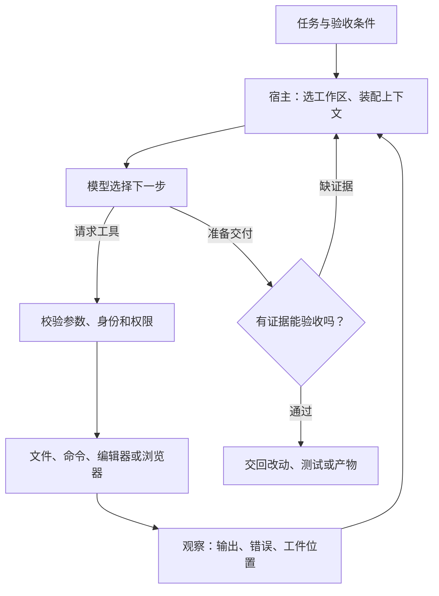
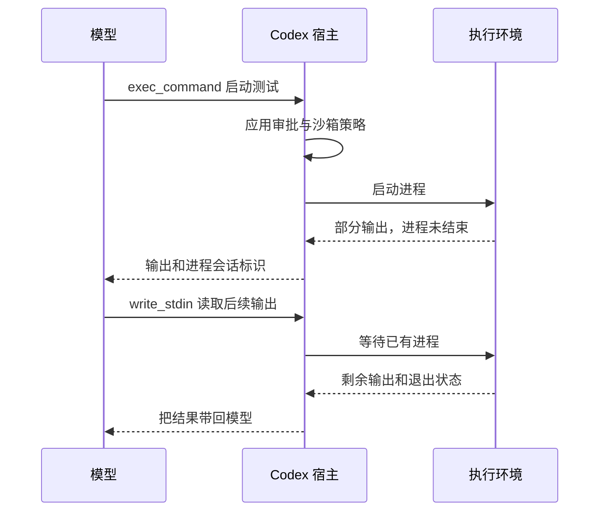

# Claude Code、Codex、Manus、Cursor 与 Devin：沿一次改动拆开五种 Agent

> 测试红了，谁负责找到相关代码？模型说“运行测试”后，谁持有进程？人关掉电脑，谁还拿得到结果？这三个问题能把五种 Agent 的架构讲清楚。



这张图是读实现用的公共模型。查一次失败调用就能顺着箭头走一圈：模型提出的参数在哪，谁批准执行，错误有没有进入下一次请求？下文以 **2026 年 11 月 24 日** 为版本坐标。Codex 可追到 Rust 源码，其余四款按厂商文档和工程作者公开的实现来读。

| 产品 | 先取什么现场 | 动作在哪里发生 | 人回来时看什么 |
|---|---|---|---|
| Claude Code | 项目说明、精确搜索、刚读到的文件 | 主会话调文件和 Bash 工具，可委派专项调查 | 差异、测试、可续的会话 |
| Codex | 按目录加载的规则、线程历史、权限配置 | 宿主分派工具，命令在受策略约束的进程中执行 | 进程输出、退出状态、工作树改动 |
| Manus | 浏览器观察、待办、留在文件里的材料 | 任务环境，可选云电脑或获授权的本机工作区 | 可继续编辑或下载的文件及其证据 |
| Cursor | 当前缓冲区、诊断、索引召回的代码 | 编辑器内快速试改，也能交给云端 VM | 编辑反馈、诊断，或云任务交回的 PR |
| Devin | 工单、仓库、团队做法、预备好的环境 | 独立云会话，默认 Linux VM，允许人中途接手 | 可审查的工件、测试和 PR |

## Claude Code：从一条报错出发，让下一步跟着观察走

Anthropic 把一次工作分成收集上下文、采取行动、验证结果。三件事可以来回穿插：搜到出错的格式函数，读调用方，改分支，跑测试。新断言指向另一处硬编码，就带着断言再搜一次。宿主只需把工具结果可靠地送回模型，不必预先画出所有修复步骤。[工作原理][cla]

面试里有时把这层叫 Master Loop，还会提到压缩产物里的 `nO`。公开契约是可观察的工具循环，构建符号没有稳定入口的保证。要定位“工具执行完却又问一遍”，拿出两次请求，看看第二次有没有收到第一次调用的结果，比猜内部函数名快得多。[工具反馈][cla] · [工具表][ctools]

**11 月的搜索入口**：经典讲法是 Grep 找文本、Glob 找文件、Bash 跑命令。macOS、Linux、WSL 的默认主会话如今通过 Bash 的 `find`、`grep` 搜索，专用工具按配置出现。Windows 默认仍有 Glob 和 Grep。[平台与工具入口][ctools]

知道报错原文时，按字符串搜能直接看到工作树里刚改的文件。只知道“付款单显示不对”，则要沿界面文案、调用者和测试一步步找。做观测时可以把这些调用都归为文件检索，同时保留真实工具名。只监听名叫 `Grep` 的 Hook 会漏掉 Bash 里的搜索。

### 规则、记忆和权限分别放哪？

| 载体 | 谁来维护，何时使用 | 一个具体例子 |
|---|---|---|
| `CLAUDE.md` | 人或团队写项目约定，作为长期说明加载 | 金额保留精度，提交前跑哪些测试 |
| Auto Memory | 助手维护 `MEMORY.md` 索引，详细经验放主题文件 | 同类任务再来时能找到此前确认的做法 |
| Skills / MCP | 前者按需加载工作方法，后者连接外部工具 | 照回归步骤操作，或读取工单系统里的验收条件 |
| Hooks / 沙箱 | Hook 在生命周期节点执行，沙箱约束命令能读写、连接什么 | 调用前检查路径，调用后格式化，系统层限制文件与网络 |

启用 Auto Memory 时，启动只读 `MEMORY.md` 的前 **200 行或 25 KB**，先到哪个算哪个。把细节移到按需读取的主题文件，开局才不会因为日志越积越多而丢掉重要条目。可续会话保存谈过什么，项目公约保存团队约定，自动记忆保存提炼出的经验。[记忆规则][cmem]

Skill 能教模型怎样操作。需要每次都检查路径时，用执行前 Hook，并处理退出状态、超时和结构化结果。涉及命令的文件系统和网络边界，再交给沙箱。这样团队改了说明文字，执行权限依然有明确的实施位置。[Hooks][hooks] · [Skills][cskills] · [沙箱][csb]

### 四种看似相像的“复用”

1. **连续请求**：让稳定的工具声明和系统信息靠前，把此刻的时间、状态变化追加到后面。服务端能复用已经计算的相同前缀。换模型、改工具或改早期指令都会影响命中。[缓存文档][cache]
2. **切计划模式**：工程作者 Thariq 描述过保留进出模式的工具，把“接下来只探索”追加到后续消息。大量 MCP 工具也可先给发现入口，需要时再取详细声明。真正能不能写，仍由执行器按当前模式判断。[工程手记][pcblog]
3. **压缩长对话**：总结请求从父历史分出，尽量保留系统内容、工具和旧消息，在末尾追加总结要求，并预留指令与摘要空间。生成摘要这次可吃到父前缀。主会话换成摘要后的下次命中要另外看。[压缩分叉][pcblog]
4. **委派专题**：普通 Subagent 有自己的提示、工具和对话，查十个文件再交回三个路径，父会话就能少带阅读过程。普通子任务可能自建缓存。文档另有复用当前对话的 fork。后台任务及云端形态还涉及执行位置。[子 Agent][sub] · [缓存行为][cache]

命中缓存的内容仍占上下文窗口。作者曾披露一次缓存故障让用户额度消耗得比预期快。诊断时把输入长度、缓存读取量、调用总数和首次找到合适工具的轮数分开看，才能分辨是每轮变贵了，还是节省声明后多跑了几轮。[作者的故障说明][xcache]

## Codex：线程里一次工具调用，机器上可能是十分钟的进程

Rust CLI 把终端界面、核心循环、协议、执行和平台沙箱分开。用户消息进入线程，核心用项目说明、环境、权限和工具装配 Responses 请求。模型产生调用，宿主执行后把结果交给下一轮。沿日志认四个对象：对话线程、模型轮次、工具调用、操作系统进程。[仓库][codrepo] · [循环拆解][cxloop]

规则为什么会因目录而变？`agents_md.rs` 从当前目录向上确定项目根，再从根向工作目录收集各层说明，支持 `AGENTS.override.md` 等覆盖规则，全局用户配置还有自己的来源。遇到同仓库两人读到不同测试命令，先比启动目录，再比实际加载文件。[规则发现源码][agentsmd]

| 执行前的问题 | 谁来回答 | 例子 |
|---|---|---|
| 要不要发起额外授权？ | 宿主的审批策略 | `on-request` 可按策略请求额外权限，`never` 不接受升级请求 |
| 进程实际能碰哪些资源？ | 平台执行后端 | 文件可写范围、目录视图、系统调用和网络约束 |
| 业务上是否办妥？ | 工具回执和独立验收 | 命令成功提交远端作业，还得等作业自己的完成回执 |

关闭询问不会扩大操作系统授予的权限。命令失败也要拆开看：遇到只读目录，查授权和输出位置。如果是超时，查进程是否还活着。测试断言失败时，把失败用例交回模型。把这三类都翻译成“请重试”，会让模型在错误的一层反复用力。[按需审批][onreq] · [禁止升级][never]

**沙箱的跨平台变化**：macOS 用 Seatbelt 编出系统执行的策略。Linux 的老资料常提 Landlock 加 seccomp。11 月固定提交以 bubblewrap 构造文件系统视图和命名空间，配合 seccomp 过滤系统调用，仍保留旧 Landlock 后端。Windows 使用自己的平台约束。[Seatbelt 源码][seat] · [Linux 沙箱][linux] · [平台设计][osbox]

### Unified Exec：返回首屏输出时，测试可能才刚刚开始



`exec_command` 可先返回部分输出及会话标识。如果已经结束，就直接返回退出结果。`write_stdin` 对原会话发送字符或继续取输出，具体参数依执行模式而定。看到“准备完成”这行就再开一份测试，会把一次慢构建变成多次争用同一缓存的构建。[命令处理器][exec] · [后续交互][stdin]

下面是宿主处理回执的**伪代码**。第一段管可继续读取的进程，第二段管已经提交给外部系统的作业。两种句柄分开保存，人离开终端再回来才能查清楚该等谁。

```python
def resume_task(run, runner, jobs):
    proc = runner.lookup(run.process_handle)
    if proc and proc.running:
        return runner.read_more(proc.handle)
    if proc and proc.exit_code != 0:
        return report_failure(proc.exit_code, proc.log_path)

    # 本地进程退出成功，只能证明它完成了自己的那一步。
    if run.external_job_id:
        receipt = jobs.lookup(run.external_job_id)
        if receipt is None:
            return request_reconciliation(run.business_key)
        if receipt.running:
            return wait_for_job(receipt.id)
        if not receipt.succeeded:
            return report_failure(receipt.state, receipt.log_path)
        return verify_artifact(receipt.artifact, run.expected_version)

    if proc is None:
        return request_reconciliation(run.business_key)
    return verify_artifact(run.output, run.expected_version)
```

Codex 还有创建子线程、发送输入、等待、回收等工具。分出两条调查线程可以并行看不同模块，文件与权限是否共享取决于环境配置。Codex Cloud 则在托管环境的隔离工作区里启动任务，仓库、依赖和访问设置都要在那里准备。[创建子线程][spawn] · [等待][wait] · [Cloud 环境][cloud]

模型侧也要管理重复读取前缀的成本。OpenAI 的循环文章记下了从手工请求摘要到自动压缩的演进。排查冷读，先比较相邻请求的工具排列、工作目录、权限消息和压缩边界。权限真的变了，就执行新权限并通知模型。这次缓存失效有明确原因。[请求装配与压缩][cxloop]

## Manus：长任务的难处是找回材料，并记得为什么找

2025 年，Yichao “Peak” Ji 在工程手记中给出一个解释设计取舍的数字：Manus 当时任务的输入与输出 token 平均约 **100∶1**。模型每次只生成一个短动作，却反复读越来越长的历史，作者因此特别看重 KV-cache 的前缀命中。[工程手记][man]

想象连续二十次请求都带一万 token 的固定材料。如果第一行每次换成精确到秒的时刻，后面相同的材料也失去相同前缀。稳定声明、固定序列化键顺序、把新观察只往尾部加，省的是重复计算。缓存读取价格、寿命、传输和输出仍要计入任务成本。[缓存设计][man]

| 长任务会丢掉什么 | Manus 工程文披露的做法 | 自己实现时怎样检查 |
|---|---|---|
| 相同前缀 | 工具声明保持稳定，用状态约束当前可选动作 | 比较两轮请求从哪个位置开始不同 |
| 被移出窗口的大块证据 | 用文件系统作外存，保留路径或网页引用 | 从当前身份重开来源，核对版本、页码或行区间 |
| 离当前位置太远的目标 | 更新 `todo.md`，把当前目标和未完成项带回上下文尾部 | 检查下一轮是否真看见尚缺的交付物 |
| 已经踩过的坑 | 保留尝试、错误和当时条件 | 压缩后能否说明为何排除这条路线 |

**动作约束怎样省前缀？** 如果每轮删掉一批当前不可用工具，开头会变，历史里还会引用已经消失的声明。作者描述的做法是给同类工具一致的名字前缀，用状态机约束响应前缀或对候选 token 的 logits 做掩码，让模型在当前可选动作里生成。[动作空间设计][man]

普通托管接口未必开放 logits，但仍可利用工具选择或结构化输出。生成阶段帮助选对动作，执行前宿主再检查身份、资源、参数与当前状态。权限撤销之后，哪怕历史里有一次同样的成功调用，也必须按新的真实权限判定。

**可恢复的压缩**意味着模型还能把原文取回来。对长日志，保留文件与行号。对可能变化的网页，记录来源、获取时刻和版本，允许时保存快照。同名文件被覆盖后，孤零零的一段路径无法证明当时看见了什么。磁盘有配额，访问权和保留期也会变。[文件系统策略][man]

待办和失败记录值得分开。待办提醒模型还欠用户一张可下载的表。失败证据告诉模型，相同金额在不同币种里都可能出现，上次仅按金额匹配已经失败。可以合并重复堆栈，保留最小复现和最近结果。输入条件一变，仍应允许重新尝试。[目标复述与错误保留][man]

### 一百个独立样本，还是一条长依赖链？

Wide Research 把独立样本分给不同子 Agent，各自用一份上下文找证据，父任务再按共同字段汇总。调查一百份公开条款很适合这样做。若下一份该查什么取决于上一份的结论，就按依赖分批。统一模板写错时，很多孩子可以同时给出相同的错答。[Wide Research][wide]

Manus 2.0 公布的 Cascade 按项目需要引入专门能力。Studio 提供可继续编辑的工作现场。需要长期运行的项目可以用 Cloud Computer，另有获授权的本机工作方式。Automations 也把触发从定时拓展到连接服务的事件。2.0 的项目环境和 2025 年的上下文设计，回答的是两层问题。[Manus 2.0][m20]

## Cursor：让开发者少等的三段时间

| 延迟花在哪 | 对应机制 | 实际加速的环节 |
|---|---|---|
| 不知道实现叫什么 | 语义索引召回，再配合精确搜索 | 从自然语言问题找到候选位置 |
| 想试改，又怕干扰正在打字的人 | Shadow Workspace 中的编辑状态与语言服务 | 提前获得假设性改动的诊断 |
| 已经知道怎么改，长文件还在逐字生成 | Fast Apply 的专门应用模型与推测解码 | 让未修改的长片段快速通过验证 |

仓库索引用目录哈希跟踪变化，避免每次重算整库。Cursor 还用真实搜索轨迹训练嵌入模型：遇到“生成付款单的地方在哪”，能召回名字里没有“付款单”的函数，再沿调用关系和报错核实。刚改过但索引未更新的文件，要回工作树或编辑缓冲区直接读。[索引设计][index] · [搜索实验][cuse]

Cursor 的实验里，加入语义搜索后，代码问答准确度平均提高 **12.5%**。在线观察到生成代码的保留率提高 **0.3%**，在至少 1,000 个文件的仓库中提高 **2.6%**。没有语义搜索时，不满意的后续请求增加 **2.2%**。这些数字分别衡量找得准、改动留下来、人是否还得纠正。[实验方法与结果][cuse]

早期 Shadow Workspace 使用隐藏的 Electron 窗口，让语言服务在独立编辑状态里试改，用户光标和当前诊断不必被打断。文章也讨论了内核级文件夹代理的设想。需要真实落盘、启动服务、读编译缓存的测试，还得在相应工作区里运行。[Shadow Workspace][shadow]

Fast Apply 利用的是另一条规律：编辑长文件时，多数输出与原文件相同。先确定性地猜出接下来会照抄的片段，再让模型验证并前进。这里缩短的是把修改意图应用到文件的时间。人如果同时改了相同行，提交前还要核对基线版本，必要时三方合并。[Speculative Edits][apply]

Composer 的训练则让模型在开发环境里使用生产搜索、编辑和终端工具，用强化学习鼓励有效选择及可行的并行，训练用的隔离环境复用后台 Agent 的基础设施。要知道升级后哪里变快，可以分别量搜索次数、应用编辑耗时、首个有效诊断的时间。[Composer 工程披露][composer]

Cursor 还有项目 Rules 和可并行的 Cloud Agents。云 VM 有自己的凭据、网络、工件和 PR 交付路径。一个改动在本地缓冲区过了类型检查，到了云端还要确认输入版本、依赖和测试环境。索引技术解释了如何找代码，不能据此推断其服务端 KV 缓存布局。[项目规则][rules] · [云环境][cucloud]

## Devin：人离开后，环境还得能把工单做完

Devin 最初公开的组合是同一沙箱里的 Shell、编辑器和浏览器。用 Shell 启动刚改的服务，编辑器查看实现，再用浏览器打开那个实例。验收时要把预览和提交对应上：浏览器若连的是上一个版本，截图看起来再正常也不能替本次修改作证。[首次披露][dev]

云会话从准备好的环境快照启动，默认是一台 Linux VM，带仓库、依赖和配置。独立会话能并行领不同工单，开发者可中途检查或接手。会话里临时装了编译器，下一台机器仍按基础快照启动。长期依赖应该写入环境配置或仓库。[环境与快照][dvm] · [并行会话][dev2]

| 团队想留下什么 | 载体与变化 | 下次怎样验收 |
|---|---|---|
| 一台能跑测试的机器 | 环境配置与快照 | 新会话从同一仓库版本启动，重新运行测试 |
| 重复工单的做法 | Playbooks 正迁向 Skills。自 **2026 年 10 月 24 日**起，新账号从 Skills 开始 | 从新账号的实际入口加载操作说明 |
| 可按任务取用的团队约定 | 旧 Knowledge 支持按描述取用、审阅反馈建议，逐步自动迁成 Plugins 中的 Skills | 同类任务触发对应规则，人能检查旧知识迁到了哪 |

快照留住“机器里装着什么”，Skill 留住“遇到这种任务怎样做”。两者配齐，离线工单才有条件复现。交接时我会要求附基线提交、测试输出、工件位置和未验证项，这样接手者能决定是否合并，而不用重看几小时的操作录像。[Playbooks 迁移][play] · [Knowledge][dknow] · [Plugins][dplugin]

## 选型：先确定谁在等，以及最后验收什么

| 手里的工作 | 可以先借哪种设计 | 我会亲手试的边界 |
|---|---|---|
| 当面改一个能复现的失败测试 | Claude Code 的主动取证循环 | 故意保留第二处错误，看模型能否根据测试回到搜索 |
| 本机要控制权限，构建又很慢 | Codex 的审批、平台沙箱与进程句柄 | 首屏超时后只读原进程，再核对退出状态与产物 |
| 跨网页找材料、交付表格或报告 | Manus 的文件外存、待办复述与独立研究 | 移出上下文后能否回读来源，最后有没有漏交文件 |
| 人正编辑，不能接受旧建议盖掉新输入 | Cursor 的缓冲区、快速应用和诊断 | 生成建议期间手改同一行，检查版本冲突 |
| 工单边界清楚，人会离线 | Devin 式云会话，也可比较 Codex Cloud、Cursor Cloud | 断开客户端后能否继续，重新接手有没有测试和回执 |

若目标是让用户少重复纠正同一做法，另看 Hermes 的技能复盘：拿新会话、新输入验证旧经验是否仍有效。服务多位用户时，先按身份隔开可读材料、运行环境和出站动作，后续索引、缓存、子任务才有正确的共享范围。[Hermes 技能][hermes] · [Codex 执行边界][osbox]

## 一手资料

- Claude Code 与 Codex：[工具参考][ctools]、[Claude Code 缓存设计][pcblog]、[Codex 循环][cxloop]、[Unified Exec][exec]、[沙箱][osbox]。
- Manus：[上下文工程][man]、[Wide Research][wide]、[2.0 公告][m20]。
- Cursor 与 Devin：[语义搜索][cuse]、[快速应用编辑][apply]、[影子工作区][shadow]、[Devin 环境][dvm]、[团队技能迁移][play]。

## 面试：六个可以直接开口的问题

### 1. 从零做个 Claude Code，第一条能跑的链路是什么？

**考察点**：主循环、搜索与验证。

1. “我选一条能复现的失败测试，让模型按报错搜文件、读调用方，先只做一处能解释的编辑。”
2. “宿主运行测试，把真实退出状态和失败行交回模型。它还有问题就继续搜，通过了就把差异交给人看。”
3. “符号和报错搜得准，我先用精确工具。大仓库里常常连名字都猜不到，再试语义召回并从工作树核实。”

**连环追问**：一定得先做规划器吗？先看失败是找不到代码、改错，还是漏了验证。遇到确有长依赖的任务，再为它加计划和检查点。

### 2. 昨天缓存命中九成，今天只剩一成，怎么查？

**考察点**：找到第一个发生变化的前缀位置。

1. “拿同一模型的相邻两次请求，比较分段长度和散列，从头找第一个差异。”
2. “查工具顺序、动态时间、工作目录、权限变化、模型切换、缓存寿命和这轮有没有压缩。”
3. “把压缩分叉和普通子任务分开算。普通子任务有自己的提示，父会话的命中率解释不了它的账单。”

**连环追问**：命中恢复了为什么还贵？看总轮数、输出和后台调用。重复跑十次便宜请求，也可能比一次完成贵。

### 3. Codex 跑构建，客户端先超时，能重跑吗？

**考察点**：审批策略、进程寿命与外部效果。

1. “我先用已有会话标识读后续输出。客户端等不及，不代表进程退出。”
2. “如果已经退出，就看退出码和工件版本。权限拒绝要查策略，断言失败才去修代码。”
3. “若命令是提交发布，还要查外部作业回执。纯计算可以按固定输入重建，效果未知的发布先对账。”

**连环追问**：审批设为 never 就什么都能跑吗？它关闭升级请求，实际读写范围仍由系统沙箱决定。

### 4. Manus 怎么一边保缓存，一边让模型记得什么能做、什么试过？

**考察点**：动作选择、强制权限和可恢复历史。

1. “工具目录保持稳定，用当前状态限制候选动作。宿主执行前仍核对用户、参数和目标。”
2. “大材料落文件，窗口保留能找回原文的引用。待办和未完成项放到靠后的位置提醒模型。”
3. “失败留下尝试、观察和当时条件。重复错误可合并，下一轮就知道该换路，环境变了也可以再试。”

**连环追问**：权限真的变了呢？立即按新权限执行并更新模型看到的信息，这次冷读值得付。

### 5. Cursor 和 Devin 都会写代码，你会怎样选？

**考察点**：人在不在场，验收要等多久。

1. “人还在编辑器里打字，我更关心缓冲区新不新、建议会不会盖掉手改、诊断多久出现。”
2. “要人离开后独立做完工单，我就固定仓库、环境、凭据范围和验收条件，回来直接看 PR 与测试。”
3. “Cursor 也能跑云任务，所以要比较具体执行模式。Devin 的环境快照管依赖，团队 Skills 管做法。”

**连环追问**：跑通一次就能交接吗？换新会话从声明的环境再跑，排除靠上一次临时安装才成功的情况。

### 6. 一百个样本拆成一百个子 Agent，是不是肯定更快？

**考察点**：依赖、交接成本与共同错误。

1. “我先看样本能否独立验收。调查不同来源可以并行，同一函数要边修边跑测试，就把依赖步骤留在一条线上。”
2. “并发成本要算重复前缀、外部限速和父任务汇总。统一返回字段与证据位置，父任务才不用读全部原文。”
3. “最后抽查原始证据，再用独立标准验收。大家都用了同一份错误模板，一百份相同结论也会错。”

**连环追问**：下一批样本要按上一批结果挑呢？先收第一批并验收，得到选择条件后再派下一批。

[cla]: https://code.claude.com/docs/en/how-claude-code-works
[cxloop]: https://openai.com/index/unrolling-the-codex-agent-loop/
[man]: https://www.manus.im/blog/Context-Engineering-for-AI-Agents-Lessons-from-Building-Manus
[m20]: https://manus.im/blog/introducing-manus-2-0
[cuse]: https://cursor.com/blog/semsearch
[cucloud]: https://cursor.com/docs/cloud-agent
[dvm]: https://docs.devin.ai/onboard-devin/environment
[dev]: https://cognition.ai/blog/introducing-devin
[ctools]: https://code.claude.com/docs/en/tools-reference
[cmem]: https://code.claude.com/docs/en/memory
[pcblog]: https://claude.dev/blog/lessons-from-building-claude-code-prompt-caching-is-everything/
[cache]: https://code.claude.com/docs/en/prompt-caching
[xcache]: https://x.com/trq212/status/2027232172810416493
[sub]: https://code.claude.com/docs/en/sub-agents
[hooks]: https://code.claude.com/docs/en/hooks
[cskills]: https://code.claude.com/docs/en/skills
[csb]: https://code.claude.com/docs/en/sandboxing
[codrepo]: https://github.com/openai/codex/tree/75df5098a6d92b40dc61e7a9964233ce9c359677
[agentsmd]: https://github.com/openai/codex/blob/75df5098a6d92b40dc61e7a9964233ce9c359677/codex-rs/core/src/agents_md.rs
[osbox]: https://openai.com/index/inside-the-codex-sandbox/
[linux]: https://github.com/openai/codex/blob/75df5098a6d92b40dc61e7a9964233ce9c359677/codex-rs/linux-sandbox/README.md
[seat]: https://github.com/openai/codex/blob/75df5098a6d92b40dc61e7a9964233ce9c359677/codex-rs/sandboxing/src/seatbelt.rs
[exec]: https://github.com/openai/codex/blob/75df5098a6d92b40dc61e7a9964233ce9c359677/codex-rs/core/src/tools/handlers/unified_exec/exec_command.rs
[stdin]: https://github.com/openai/codex/blob/75df5098a6d92b40dc61e7a9964233ce9c359677/codex-rs/core/src/tools/handlers/unified_exec/write_stdin.rs
[spawn]: https://github.com/openai/codex/blob/75df5098a6d92b40dc61e7a9964233ce9c359677/codex-rs/core/src/tools/handlers/multi_agents/spawn.rs
[wait]: https://github.com/openai/codex/blob/75df5098a6d92b40dc61e7a9964233ce9c359677/codex-rs/core/src/tools/handlers/multi_agents/wait.rs
[cloud]: https://help.openai.com/en/articles/20001545-using-codex-cloud
[wide]: https://help.manus.im/en/articles/11960169-what-is-wide-research
[index]: https://cursor.com/blog/secure-codebase-indexing
[shadow]: https://cursor.com/blog/shadow-workspace
[apply]: https://cursor.com/blog/instant-apply
[composer]: https://cursor.com/blog/composer
[rules]: https://cursor.com/docs/rules
[dev2]: https://cognition.ai/blog/devin-2
[play]: https://docs.devin.ai/product-guides/creating-playbooks
[dknow]: https://docs.devin.ai/product-guides/knowledge
[dplugin]: https://docs.devin.ai/product-guides/plugins
[hermes]: https://github.com/NousResearch/hermes-agent/blob/8545feeb1a53fc73375dfa98cf65cafadba66bf0/website/docs/user-guide/features/skills.md
[onreq]: https://github.com/openai/codex/blob/75df5098a6d92b40dc61e7a9964233ce9c359677/codex-rs/prompts/templates/permissions/approval_policy/on_request.md
[never]: https://github.com/openai/codex/blob/75df5098a6d92b40dc61e7a9964233ce9c359677/codex-rs/prompts/templates/permissions/approval_policy/never.md
