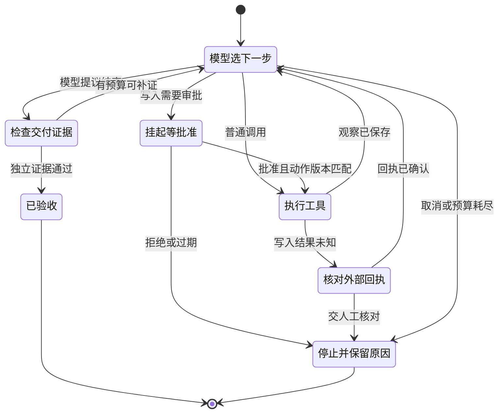

# 模块 03 · Agent Loop：从一次工具调用到可恢复的 Runtime

> 面试官说「Agent 不就是个 while 循环吗？」可以从一次查 CI 讲起：模型选工具，程序拿结果，再让模型决定下一步。真正考验运行时的是，工具已经写成功，进程却没来得及保存回执。

## 先画状态机：谁能把任务标成完成？



读图时抓住三个动作：模型**提议**，工具**执行**，验收器**确认**。给一次任务分配稳定的 `run_id`。浏览器提交命令或订阅进度，后台 worker 按这个编号领任务。用户刷新网页，能找到原来的运行和证据。

一次运行有三种进度：`turn_id` 数模型决策，一轮可以发出多个调用；`call_id` 配对调用与结果，`attempt` 数同一调用的执行尝试；`revision` 随业务事实变化。重试一次读取和用户改了目标，应推动不同的计数。

| 信息放哪儿 | 要保留什么 | 下一轮怎么用 |
|---|---|---|
| 消息历史 | 用户原话、协议输出项、成对的工具调用和结果 | 投影当前需要的上下文，压缩时留下未解问题 |
| 运行状态 | 目标版本、计划、证据索引、命令 ID 和已消费游标 | 恢复待办，先消费尚未处理的转向 |
| 权威业务库 | 对象版本、权限、余额、审批和回执 | 读取快照供决策，临提交时再核验或条件写入 |
| 制品存储 | 大日志、测试报告、原件的哈希、租户和保留期 | 先给摘要和指针，需要哪几行再读哪几行 |

工具定义和长期规则放在稳定前缀，新观察放在后面，有利于复用输入。压缩后做一次小回放：现在查哪个提交？还有哪项没验？哪些动作已失去授权？答错了就补状态字段。权限始终从权威系统读取。

## 五种循环：哪一步值得再问一次模型？

### ReAct：等环境给出新事实

CI 红了才读失败栈，绿了就去查制品签名。第一次调用前没人知道会走哪条路，这次观察值得一次模型往返。如果每轮都按固定顺序读三个接口，把这段写成函数就行。

论文用 Thought、Action、Observation 展示交错过程。接现代 API 时用结构化调用传动作，用 `call_id` 传观察。调试需要参数、结果、证据和简短说明，无须让模型打印私有思考。Codex 的循环也从模型请求、工具输出和追加上下文讲起。

下面用只读工具查指定提交的 CI。传入的 `create` 返回 Responses 字典，`read_ci` 从可信 CI 取回执。真接 SDK 时，在适配器固定模型、指令和工具定义，将响应转成字典即可。

```python
import json

def check_ci(create, read_ci, commit, max_turns=4):
    history = [{"role": "user", "content": f"核对提交 {commit} 的 CI"}]
    receipt = None
    for _ in range(max_turns):
        reply = create(input=list(history))
        if reply["status"] != "completed":
            return {"status": "incomplete"}
        items = reply["output"]
        history.extend(items)  # 按协议保留 reasoning 等关联项及其顺序
        calls = [item for item in items if item["type"] == "function_call"]
        if not calls:
            if receipt and receipt.get("commit") == commit:
                if receipt.get("tests") == "passed":
                    return {"status": "verified", "evidence": receipt}
                if receipt.get("tests") == "failed":
                    return {"status": "tests_failed", "evidence": receipt}
            history.append({"role": "developer", "content": "还缺目标提交的 CI 结果，请补查。"})
            continue

        for call in calls:
            try:
                args = json.loads(call["arguments"])
                if call["name"] != "read_ci" or args != {"commit": commit}:
                    raise ValueError("只允许查询目标提交的 CI")
                receipt = read_ci(commit)
                result = receipt
            except (ValueError, TimeoutError) as err:
                result = {"error": type(err).__name__, "detail": str(err)}
            history.append({"type": "function_call_output",
                            "call_id": call["call_id"],
                            "output": json.dumps(result, ensure_ascii=False)})
    return {"status": "budget_exhausted", "evidence": receipt}
```

模型第一轮就说「通过」，这段程序仍会补查。手工组装 Responses 历史时，按接口规则回传关联的 reasoning items 和工具输出。UI 上的文字摘要无法补回被裁掉的协议项。要让进程可恢复，还得分别保存模型响应与每个调用结果。

### Plan-and-Execute：让计划有版本

Plan-and-Solve 是提示方法：先拆题，再求解。Plan-and-Execute 多了一份可执行计划：规划器生成步骤，执行器领取步骤、取证、回报失败。复杂分解可以交给强模型，容易检查的步骤可以用小模型或普通函数。

- **计划项**：记录稳定步骤 ID、子目标、依赖、输入版本、验收证据。先拿到制品 ID，后面的签名检查才有输入。
- **重规划**：依赖失效、用户改约束、相同阻塞反复出现时，重算受影响的后继。保留仍适用的结果，旧版本的证据标过期。
- **执行账本**：规划器可以删掉未来步骤，已经提交的写入仍留在账本里。每过一个节点就重写全图，既慢，也很难认出恢复时该领哪一步。

### CodeAct：让数据留在执行环境里

找出两百条测试中「只在 Linux 失败」的用例，让模型写程序按用例名分组，一次返回失败集合和证据位置。程序可以循环、联表、保存中间变量。省下来的是模型往返和上下文，程序内部访问服务的次数仍要计费。

- **执行边界**：给只读快照、限定 API 和独立输出目录。用隔离进程或沙箱控制 CPU、内存、磁盘、出站网络、调用次数和硬超时，到期回收进程组。删解释器内置函数挡不住越界访问。
- **结果边界**：大结果落制品库，只回路径、条数和摘要。受限写入另走审批工具，否则代码执行到第四步抛错时，重跑会把前三次写也做一遍。

### Reflexion：下一次尝试能带走什么教训？

测试说「空列表触发第 17 行越界」，比让模型「再想想」多给了一条可执行的线索。Reflexion 将尝试、环境评价、语言反思串起来，让下一次尝试读到上次教训，不用更新权重。

Evaluator-Optimizer 处理的是当前候选：生成器交稿，评审指出缺口，再修稿。评语写清**失败标准、位置、反例、复验方法**。测试输出可作事实，评审意见要验证；跨尝试保存的教训才进入反思记忆。

保留通过验证的最佳候选。若这轮修好一个用例却弄坏两个，就退回最佳版本。连续两轮没有新证据，可以带着未决项交人。最终选哪一稿，取决于验收结果。

### Best-of-N、树搜索和 LATS：先确认环境能回退

同一个补丁任务，Best-of-N 从同一基线采样多个完整候选，再统一打分。Tree of Thoughts 可以在中间思路处分叉和回溯。LATS 把环境反馈接进蒙特卡洛树搜索，经过选择、扩展、评估、回传，把后续预算拨给有希望的分支。

每个节点带父节点、动作、快照指针、估值和已花预算。工作树、模拟器或预览环境能还原分支；已经发送的通知无法随搜索回退。各分支只产生候选，由唯一提交者执行获胜方案。

| 任务特征 | 先试哪种 | 最容易多花在哪儿 |
|---|---|---|
| 下一步依赖刚读到的事实 | ReAct | 串行等待，每轮重复输入前缀 |
| 有长依赖链，部分步骤独立 | Plan-and-Execute | 首轮规划和频繁重规划 |
| 有明确反例，能复验修改 | Reflexion 或生成评审 | 评语与返工叠加尾延迟 |
| 数据量大，变换规则可执行 | CodeAct | 沙箱启动和隐藏的下游调用 |
| 可逆、高价值、有可信评分 | Best-of-N 或 LATS | 多样本打分，树还有逐层依赖 |

评价器也会被搜索挑出漏洞：候选越多，偶然拿高分的错误答案越容易胜出。用未参与搜索的测试复验赢家，保留单样本基线。比较方案时分别记首字延迟、首个有效工具结果、验收耗时和每份通过交付的成本。

## 生产 Runtime 的八个工程问题

### ① 并发工具调度：谁可以一起跑？

并发前看两件事：**依赖**决定有没有输入，**资源冲突**决定能不能同时执行。读构建和读单测可以重叠；查签名要等制品 ID；两次改同一资源要排序。几个调用出现在同一条模型消息里，只说明它们是同批提议。

1. **整批预检**：从可信工具注册表取读写属性、权限、超时、重试条件。验参数、调用 ID 唯一性和依赖顺序，归一租户与资源键。`project/07` 和 `project/7` 可能指向同一把锁。
2. **有界派发**：先并发连续且就绪的读，遇写设屏障，让写独占。需要更高吞吐再上入度计数和就绪队列，只唤醒已满足依赖的后继。依赖说不清就串行或退回补全。
3. **收齐观察**：合并用户取消信号和单次超时，传到实际适配器。每个调用都有成功、失败、跳过或结果未知的槽，按原请求顺序配对回填。一次 Promise 拒绝不会替你取消其他请求。

以下调度器接受已通过参数与权限检查的调用。依赖只能指向本批较早的 ID；工具适配器接收前置结果并负责传递超时。写一旦派发又报错，本批停止后续动作，先核对外部效果。

```python
import asyncio

async def schedule(calls, tools, stop, limit=4):
    if limit < 1:
        raise ValueError("并发数至少为 1")
    seen = set()
    for cid, name, deps in calls:
        if cid in seen or name not in tools or not set(deps) <= seen:
            raise ValueError("调用 ID、工具名或依赖无效")
        seen.add(cid)

    results = {}
    uncertain = False

    async def invoke(call):
        nonlocal uncertain
        cid, name, deps = call
        tool = tools[name]
        if uncertain or stop.is_set() or any(results[d][0] != "ok" for d in deps):
            results[cid] = ("skipped", None)
            return
        try:
            inputs = [results[d][1] for d in deps]
            value = await asyncio.wait_for(tool.run(inputs, stop), tool.timeout)
            results[cid] = ("ok", value)
        except Exception as err:
            uncertain = tool.writes
            results[cid] = ("unknown" if tool.writes else "failed", str(err))

    pos = 0
    while pos < len(calls):
        wave = [calls[pos]]
        pos += 1
        if not tools[wave[0][1]].writes:
            while pos < len(calls) and len(wave) < limit:
                _, name, deps = calls[pos]
                if tools[name].writes or any(d not in results for d in deps):
                    break
                wave.append(calls[pos])
                pos += 1
        await asyncio.gather(*(invoke(call) for call in wave))
    return [(cid, *results[cid]) for cid, _, _ in calls]
```

跨资源持锁要固定顺序；跨进程租约加递增的栅栏令牌，让存储拒绝过期持有者。需要一致视图的多个读绑定同一快照，或在提交时重验。排障把排队等槽、下游耗时、等待同批最慢成员分别计时。

### ② SSE 流式事件：断线之后从哪里接？

界面上的「正在保存」来自文字流，「已保存」必须来自持久状态。事件适配层先分清这两类信号，再把它们发给同一页面。

| 事件 | 用什么标识 | 慢客户端怎么处理 |
|---|---|---|
| `text.delta` | 消息 ID、块 ID | 合并片段，最后从完整文本快照补齐 |
| `tool.started/progress/ended` | 调用 ID、尝试号 | 合并重复进度，按调用更新各自的卡片 |
| `state.changed` | 运行 ID、版本、单调序号 | 保存后再广播，重连可补读并去重 |

Pi 发消息与工具更新，OpenAI Agents SDK 区分原始模型流、运行项和 Agent 更新，Vercel 消息流用 SSE 传类型化数据块。接成自家事件时要保留阶段：流出来的参数可能只有半个 JSON，收齐并校验后才能启动工具。

**一条 SSE 消息怎么落地？** 服务端用 `text/event-stream`，写入 `id: 42`、`event: state.changed` 和一行 `data` JSON，以空行结尾。客户端重连带 `Last-Event-ID`，网关按运行编号补读游标之后的持久事件。

- **顺序**：同一事务更新业务状态、追加事件，可在运行行锁内分配序号。若先抢号再各自提交，42 先于 41 提交，客户端确认 42 后就可能永久漏掉 41。
- **重连**：重复序号去重，发现缺口就补读。游标早于保留期时，先发带基线序号的快照，再发增量。临时 token 不推进持久游标。
- **背压与鉴权**：执行器写完事务即可走，发布器负责广播。慢客户端可断开重连，空闲连接可发心跳。原生 EventSource 不能自定义 Authorization 头，可用同源会话或支持请求头的 fetch。

### ③ Steering：用户改口时，哪次写还来得及停？

`steer` 在下一安全边界应用新约束；`follow-up` 等当前目标收尾再接任务；`cancel` 停止新派发，并尝试中断可取消的在途工作。界面可以马上确认「收到」，执行器确认之后才显示「已停止」。

Pi 的内层循环执行工具，外层检查 follow-up。源码和 issue #2330 给出了容易记反的细节：当前实现等本轮工具批结束后读取 steering。如果产品要求「剩下的写立刻别发」，必须在自己的派发关口加检查。

1. 命令入口按唯一 ID 持久化用户原话、运行编号和基于的版本。接受转向后提高目标版本，阻止旧版本领取新的写许可。连续两次改口也要按序保存。
2. 给可取消的读取发信号，等待工具返回或显式记录取消。先配齐旧调用的结果，再追加用户新消息，从新版本开始决策。删掉旧历史会让已经发生的动作看起来像没发生。
3. 本地写在事务内比较版本再提交。远端写先持久化出站意图，能传版本令牌就让下游拒绝旧请求。已经派发的写转为核对；若已生效，带回执说明，按权限另做补偿。

可以用一个短测试守住这条时序：冻结「读 A」，插话「改查 B」，再排一个「做完后汇总」。期望观察依次为 A 的取消结果、B 的已验证结果和最后的汇总。用会忽略取消的工具再测一次，检查 UI 能否准确显示「正在核对」。

### ④ Durable Execution：恢复到哪一步可以放心重做？

把 worker 停在一次外部写入之后：下游已提交，本地还没记回执。重启时，检查点知道控制流走到哪，步骤日志知道哪些结果可复用，最终有没有写成功则要问下游。这三份记录有不同的提交时刻。

| 崩溃时能读到什么 | 恢复动作 |
|---|---|
| 还没有持久意图 | 在「先落意图再派发」的前提下，可以重新规划 |
| 有意图，缺回执 | 按稳定动作键查下游；支持幂等就用原键重送，否则保留未知，交人核对 |
| 有回执，状态也已提交 | 复用结果继续下一步，跳过已完成的写入 |

**动作键怎样取？** 用租户、业务对象、目标版本、操作类型和规范化参数标识同一意图。多次 attempt 复用同一键。下游应在同一事务中提交键、实际效果和可查询的回执，遇到同键异参要拒绝。

把故障插在两个事务之间，就能亲眼看到这个窗口。下面从「动作已批准，尚未拿到回执」开始。两个 SQLite 文件各管一边，在远端提交后模拟中断。恢复两次，观察登记和完成事件各有几条。

```python
import sqlite3
from pathlib import Path
from tempfile import TemporaryDirectory

def resume(local, remote, lose_reply=False):
    pending = local.execute("SELECT k FROM intent WHERE phase='ready'").fetchone()
    if pending is None:
        return
    key, = pending
    with remote:
        # 同一键只产生一条登记。这里用登记行号模拟下游回执。
        remote.execute("INSERT OR IGNORE INTO registry(k) VALUES (?)", (key,))
    if lose_reply:
        raise ConnectionError("下游已提交，本地没收到回执")

    receipt, = remote.execute("SELECT rowid FROM registry WHERE k=?", (key,)).fetchone()
    with local:
        changed = local.execute("""
            UPDATE intent SET phase='done', receipt=? WHERE k=? AND phase='ready'
        """, (receipt, key)).rowcount
        if changed:
            local.execute("INSERT INTO event VALUES (?, 'done')", (key,))

with TemporaryDirectory() as tmp:
    local = sqlite3.connect(Path(tmp) / "run.db")
    remote = sqlite3.connect(Path(tmp) / "service.db")
    local.executescript("""
        CREATE TABLE intent(k TEXT PRIMARY KEY, phase TEXT, receipt INTEGER);
        CREATE TABLE event(k TEXT, phase TEXT);
        INSERT INTO intent VALUES ('tenant7/abc/register/1', 'ready', NULL);
    """)
    remote.execute("CREATE TABLE registry(k TEXT UNIQUE)")
    try:
        resume(local, remote, lose_reply=True)
    except ConnectionError:
        pass
    local.close()
    local = sqlite3.connect(Path(tmp) / "run.db")
    resume(local, remote)
    resume(local, remote)
    assert remote.execute("SELECT count(*) FROM registry").fetchone() == (1,)
    assert local.execute("SELECT phase, receipt FROM intent").fetchone() == ("done", 1)
    assert local.execute("SELECT phase FROM event").fetchall() == [("done",)]
    local.close()
    remote.close()
```

**五种持久化引擎，先认恢复单位：**

| 引擎 | 重启靠什么 | 等人或外部服务时注意什么 |
|---|---|---|
| LangGraph | 同一 `thread_id` 找到 super-step 检查点；同一轮成功节点可保留 pending writes | `interrupt()` 挂起，`Command(resume=...)` 恢复，中断节点从头执行 |
| Temporal | 根据事件历史重放确定性 Workflow，外部工作交给 Activity | 用 Signal、持久计时器等审批。长 Activity 配 heartbeat 和超时；丢完成回执仍可能重试 |
| Restate | journal 复用 `ctx.run` 等运行时操作的结果，可按键管理对象状态 | durable promise 等另一请求提交决定；下游已写、journal 未记时仍需对账 |
| Inngest | 编排函数可重入，按 step ID 复用 `step.run` 的结果 | `step.waitForEvent` 设置超时并匹配运行和审批代次；处理批准先于等待注册到达的竞态 |
| DBOS | 将操作结果持久化到数据库，区分 workflow step 和数据库事务 | 受支持的事务可包住库内写入；远端 HTTP 单列 step，另做幂等 |

LangGraph 的 `sync` 在下一步前落盘，`async` 让后续执行与写盘重叠，`exit` 在运行退出时存。按能承受的宕机窗口挑。Temporal 的编排代码需确定性，时钟、随机数、网络要走规定的接口或放进 Activity。

选后端时还要问：**谁唤醒 worker？** 图状态和人工节点多，先看带数据库的 LangGraph；跨服务长计时器可交给 Temporal；已有事件入口看 Inngest；按业务键串行看 Restate；运行与业务数据贴近关系库时看 DBOS。

检查点随运行定义一起版本化。老任务用兼容定义恢复，或先显式迁移字段含义。模型、提示词也可能换版：已经批准且完全确定的动作可以继续，必须重新决策的部分要重新核对授权和验收条件。

### ⑤ 防死循环与熔断：失败该交给谁？

| 看见的失败 | 谁来处理 | 下一步 |
|---|---|---|
| 分支不存在、参数不合法 | 模型 | 回结构化错误码、合法范围和证据，允许修改参数 |
| 读请求限流或暂时不可用 | 工具适配器 | 在总期限内退避，尊重 `Retry-After` |
| 权限不足、审批拒绝 | 策略层 | 停在明确的阻塞或拒绝态 |
| 外部写入后超时 | 对账执行器 | 查稳定键和回执，确认效果后再推进 |

一次重试同时受单次超时、最大尝试数、总截止时间约束。第 n 次等待可取零到 `min(cap, base × 2ⁿ)` 的随机值，但不能早于服务端允许的时间。剩余时间不够一次合理请求就退出；长等待交持久计时器，释放执行槽。

某个下游持续失败时，对依赖开熔断器，冷却后只放少量探测流量。任务内则按工具名、规范化参数、目标版本和结果摘要识别重复失败。无新证据先换策略，仍无进展即停。合法轮询要有进度标记、下次检查时间和总期限。

**账单为什么还会超？** 一轮可能同时发十次调用，限制轮数罩不住费用。派发前在共享账本中原子检查「已用＋已预留＋本次上界」，同时预留步数、Token、金额。估算包括输入、输出、计费推理和工具费，并设置供应商支持的输出上限。

例如剩 900 Token，两个 worker 同时各申请 600。用一条带 `WHERE remaining >= 600` 的条件更新扣减，根据受影响行数决定谁能发。各自先读余额再扣，会让两方都以为自己拿到了最后的额度。

预留记录用唯一 `reservation_id` 去重，按实际 usage 结算和释放差额。断线后用量未知，先保留再对账。供应商无法强制单次上界时，费用硬封顶也没有保证。SDK 与工作流之间指定一个重试所有者，避免尝试次数相乘。

### ⑥ HITL：人离开三天，审批怎么接得上？

审批页让人看清「对哪个对象的哪个版本做什么、会有什么后果」。持久保存 `approval_id`、租户、修订号、规范化动作摘要、允许审批的身份和截止时间。运行进入等待态即可释放 worker，聊天里一句「同意」不会产生写权限。

| 入口 | 服务端必须做的事 |
|---|---|
| `POST /runs` | 验身份和输入，保存意图，返回 202 和稳定运行编号 |
| `POST /decision` | 重验租户、身份、动作摘要、当前版本和有效期；用条件更新消费一次决定 |
| 恢复作业 | 扫描 ready 行或从事务发件箱领任务，重验执行窗口与权限，按原动作键执行 |
| `GET /events` | 对当前用户授权后，从游标补发该运行的状态变化 |

同一个批准双击时返回已有结果；已拒绝又来批准，应返回冲突。过期、被替换和拒绝各有终态。参数变化就生成新审批，过期由计时器或扫描器推进，不等人再开页面。RunState 可以序列化暂停点，持久存储和唤醒仍需接好。

**怎么测这条链？** 批准之前换提交，确认旧批准失效。批准之后关闭网关，确认后台仍会领取 ready 工作。再让两个 worker 竞争，并丢一次下游响应：同一动作只产生一张回执，重连能补看到一次完成事件。

### ⑦ 终止验收：哪个事实足以告诉用户「好了」？

没有更多工具调用，只说明模型想结束；文本流结束，只说明这一段传完。产品要先定义「完成」：代码任务可要求指定测试在目标提交上通过，报告要求引文能打开且支持结论，外部写入要求在接收方查到回执。

1. **对齐证据**：同时检查对象、不可变版本和验收标准版本。提交 A 的绿灯加提交 B 的回执，拼不成任何一次成功；可重跑的 CI 再绑定具体测试运行 ID。
2. **分清状态**：有受理号只到「已受理」，等回调或限时查询确认送达才报送达。取消、资源耗尽、权限阻塞、等待人审单独记。用户关页只结束订阅，任务按产品契约继续或接收显式取消。
3. **给修复入口**：缺证据时返回缺哪项、允许怎样补。没预算就交已验证部分和待办。有审美判断时先验客观条件，再请人决定。最终答复从验收报告生成，保留能复查的证据指针。

### ⑧ 主流框架怎么选：自己最难维护哪一层？

| 入口 | 适合的起点 | 仍要自己负责的事 |
|---|---|---|
| 手写 Loop | 少数稳定工具，已有队列、幂等和事件流 | 协议配对、取消、恢复、故障注入 |
| LangGraph | 需要显式状态、条件路由、并行归并和人工节点 | reducer、持久后端、节点重入和检查点粒度 |
| OpenAI Agents SDK | OpenAI 工具、handoff、流事件和审批中断 | 保存 RunState、唤醒任务、外部效果去重 |
| Claude Agent SDK | 在文件和工作区内复用 Claude Code 的工具、会话及权限 | 工具授权、工作环境隔离和工作区寿命 |
| PydanticAI | Python 类型契约、依赖注入和多模型适配 | 类型校验之后还要验业务。可接 Temporal、DBOS、Prefect、Restate，需划清重放范围 |
| Mastra | TypeScript 贯通 Agent、工作流和流式前端 | durable agent 宕机后可能仍标 running，部署方需侦测并重新驱动，验证存储与 PubSub 投递 |
| CrewAI | 用角色和交付物分工，由 Flow 调 Crew | 关键状态显式写入 Flow，检查 persistence 后端并测重复劳动 |
| Microsoft Agent Framework | 微软栈新项目，或从 AutoGen 迁移 | 重验执行器边界、消息顺序、工具可见性、终止条件和工作流检查点 |

AutoGen 官方仓库于 **2026 年 11 月 20 日**归档并停止维护。读历史协作模式仍有价值，维护存量时按迁移指南逐项对照。只有跨边界需求明确时才组合框架，业务状态和重试分别指定唯一所有者。[AutoGen 仓库](https://github.com/microsoft/autogen)

挑两个候选实现跑同一组故障：只读时插话、写完丢回执、批准前改目标、文本流结束时断网。看重复效果数、最长恢复时间、人工对账次数和每份验收交付的费用。测试应断言账本行数、事件顺序和最终状态。没有抛异常只过了第一关。


## 一手资料

- **模型与协议**：[Codex Loop](https://openai.com/index/unrolling-the-codex-agent-loop/) · [ReAct](https://arxiv.org/abs/2210.03629) · [Responses 推理指南](https://developers.openai.com/api/docs/guides/reasoning-best-practices)
- **规划与反馈**：[Plan-and-Solve](https://arxiv.org/abs/2305.04091) · [规划 Agent](https://www.langchain.com/blog/planning-agents) · [Reflexion](https://arxiv.org/abs/2303.11366) · [生成与评审](https://www.anthropic.com/research/building-effective-agents)
- **执行与搜索**：[CodeAct](https://arxiv.org/abs/2402.01030) · [Tree of Thoughts](https://arxiv.org/abs/2305.10601) · [LATS](https://arxiv.org/abs/2310.04406) · [推理期计算与验证器](https://arxiv.org/abs/2408.03314)
- **流与插话**：[Agents SDK 流事件](https://openai.github.io/openai-agents-python/streaming/) · [Vercel 消息流](https://ai-sdk.dev/docs/ai-sdk-ui/stream-protocol) · [Pi SDK](https://docs.pi.dev/latest/sdk) · [Pi Loop 源码](https://github.com/earendil-works/pi/blob/main/packages/agent/src/agent-loop.ts) · [SSE 标准](https://html.spec.whatwg.org/multipage/server-sent-events.html) · [Pi #2330](https://github.com/earendil-works/pi/issues/2330)
- **图与事件重放**：[LangGraph 检查点](https://docs.langchain.com/oss/python/langgraph/checkpointers) · [中断重入](https://docs.langchain.com/oss/python/langgraph/interrupts) · [Temporal Workflow](https://docs.temporal.io/workflows) · [Activity](https://docs.temporal.io/activity-definition) · [消息传递](https://docs.temporal.io/encyclopedia/workflow-message-passing)
- **可恢复步骤**：[Restate 工作流](https://github.com/restatedev/docs-restate/blob/main/docs/tour/workflows.mdx) · [远程控制](https://restate.dev/blog/a-remote-control-for-your-agents) · [Agent 实现](https://github.com/restatedev/agent) · [Inngest 工作流](https://www.inngest.com/docs/durable-execution/durable-workflows) · [等待事件](https://www.inngest.com/docs/reference/typescript/functions/step-wait-for-event) · [DBOS 事务](https://docs.dbos.dev/python/tutorials/transaction-tutorial) · [DBOS 步骤](https://docs.dbos.dev/python/tutorials/step-tutorial)
- **审批与验收**：[Agents SDK HITL](https://openai.github.io/openai-agents-python/human_in_the_loop/) · [Anthropic Agent 评测](https://www.anthropic.com/research/demystifying-evals-for-ai-agents)
- **框架选型**：[LangGraph 持久化](https://docs.langchain.com/oss/python/langgraph/persistence) · [Claude Agent SDK](https://code.claude.com/docs/en/agent-sdk/overview) · [PydanticAI](https://ai.pydantic.dev/durable_execution/) · [Mastra](https://mastra.ai/docs/harness/durable-agents) · [CrewAI Flows](https://docs.crewai.com/en/concepts/flows)
- **微软栈**：[AutoGen](https://github.com/microsoft/autogen) · [迁移指南](https://learn.microsoft.com/en-us/agent-framework/migration-guide/from-autogen/) · [工作流检查点](https://learn.microsoft.com/en-us/agent-framework/workflows/checkpoints)

## 六道高频面试题

### 1. 给你十行 while 循环，怎么判断它能接生产流量？

**考察点：** 模型停下与业务完成之间的距离。

1. 我先问用户要的是什么结果。查 CI 要核对提交和测试运行；第三方只给受理号，我就先报已受理。
2. 每轮保留完整协议项，用调用 ID 配对工具结果。模型说完成时，程序再查独立证据。
3. 有写入就加稳定动作键、授权和回执；失败要说清还能补证、已经阻塞，还是预算耗尽。

**追问：** 如果只有读取呢？可以省掉写审批和写对账，读超时、预算、取消和验收仍然要做。

### 2. 一轮五个调用，其中一个超时，其他四个怎么办？

**考察点：** 数据依赖、并发和原子性。

1. 我先看失败的是读还是写，哪些后继真的依赖它。无关的成功读取留着复用。
2. 对失败读取按期限退避或让模型改参数。已派发的写先查回执，结果未知时暂停后续写。
3. 每个调用回填一个结果。业务需要全有或全无，就给它事务或显式补偿。

**追问：** `Promise.all` 已经抛错了呢？其他请求可能还在跑，要传取消信号、收齐结果并核对副作用。

### 3. 用户关掉网页，和点「停」有什么区别？

**考察点：** 订阅、命令和执行确认是三件事。

1. 关页先释放订阅。允许离线的任务继续跑，重连用游标重建画面。
2. 点停要写入持久取消命令，执行器停止新派发，尝试取消在途读取。
3. 发出去的写可能已经生效，查完才能说结果。目标修改走 steering，排在当前任务之后的需求走 follow-up。

**追问：** 产品约定断开即停呢？给短暂换网留宽限期，到期发送同一套取消命令，并等待确认。

### 4. 工作流能重放，为什么用户还会收到两份结果？

**考察点：** 下游提交与本地保存回执之间的窗口。

1. 我会把进程停在远端提交之后、本地记账之前。恢复程序只看见待办，很容易又发一次。
2. 同一动作跨重试复用一把键，下游原子保存业务效果与键。恢复按键查询或同键重送。
3. 收到回执后用条件更新推进本地状态，再发完成事件，两个恢复者只会有一个成功推进。

**追问：** 老接口既不幂等又无法查单呢？保存「结果未知」及请求证据，让人核对后再决定。

### 5. 人三天后才批准，中间代码和目标都变了，接着跑吗？

**考察点：** 审批绑定的动作与跨版本恢复。

1. 我先读原审批上的对象、动作摘要、修订号、期限和允许审批的身份。
2. 服务端重验策略并比较当前版本。动作变化就废止旧审批，重新展示新参数。
3. 相同决定重复到达只消费一次，成功后由持久作业唤醒。恢复时读兼容的运行定义。

**追问：** 原模型下线了呢？已经明确批准的确定性步骤可以直接执行；还需模型决策的任务显式迁移并重验。

### 6. 账单翻了三倍，怎么找是哪一层在烧钱？

**考察点：** 每份验收交付的成本和无进展回合。

1. 我先按任务类型比较同分布的运行，把决策轮数、输入、推理、输出、工具重试逐项拆开。
2. 查是否重连建了新任务、两层重试相乘、同一失败反复出现，或并发调用重复花掉同一份余额。
3. 根账本在派发前原子预留，按 usage 结算。无新证据就换策略或退出，服务持续失败才开依赖级熔断。

**追问：** 只设最大轮数够吗？一轮就能并发十个计费调用，还得管单次上界、总费用和总期限。

