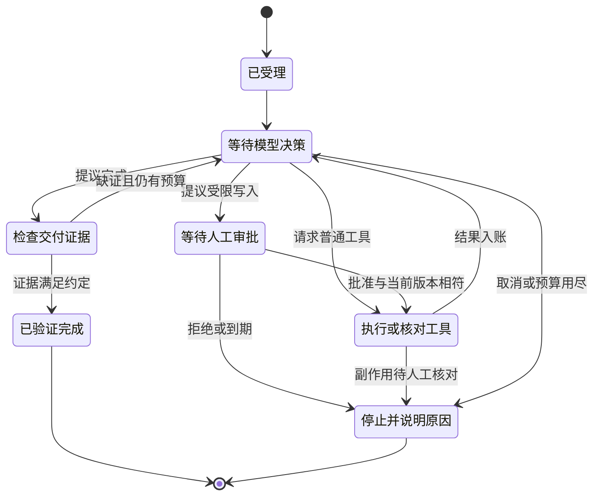
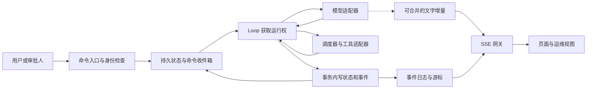
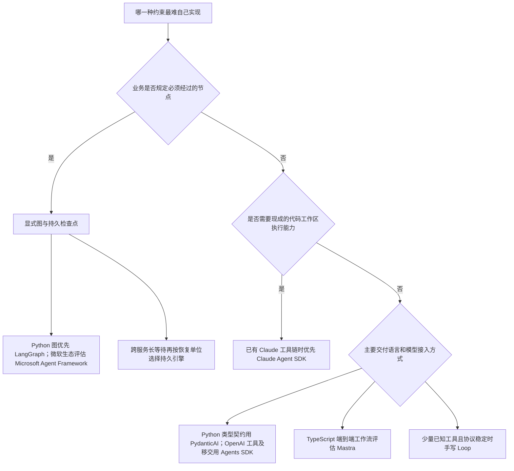

# 模块 03 · Agent Loop 底层原理与生产级 Runtime 工程实战

面试官问「Agent 不就是一个 `while` 循环吗」，可以先答「是，模型选下一步，程序去执行」，然后请他把进程停在**工具已经写入、回执还没保存**的那一刻。能从那里接着做，才算讲清了生产级运行时。

## 一张发布单，看懂谁有权决定下一步

设想一个内部发布助手。用户要它「检查候选版本，测试通过后申请发布，等负责人批准再登记」。助手可以读测试、整理变更、解释失败。它还可以提议登记，却无权自己批准。假如用户关掉网页，发布单仍然存在。假如两天后用户点了同意，这次批准只对应当时看到的版本。这几句产品需求已经规定了系统里谁掌握事实、谁可以改变事实、哪些动作必须留下证据。

玩具版本只要保留一段消息。如果模型返回工具调用，执行工具，把结果追加到消息里，再问一次模型，如果返回文本，就交给用户。把同一段逻辑放进一个 HTTP handler，第一个倒霉的用户刷新页面，就可能丢进度或者启动第二份相同工作。运行时要为一次任务分配稳定的 `run_id`。HTTP 请求只负责提交命令或订阅结果。进程、浏览器和模型会话都可以换，业务仍能用这个编号找到同一张单。



区分三个时钟很有用。**模型轮次**按决策次数走，一轮可能提议三个工具。**执行尝试**按实际调用走，同一步受限流影响可能试三次。**业务版本**只在事实变化时前进，比如候选从 A 换成 B。把三者都叫作「第 5 步」，一次重试就可能耗尽用户的规划步数，一次方案变更又可能无意中延用旧批准。事件里应分别记录 `turn_id`、`call_id/attempt` 和 `revision`。



图中实线决定业务能否继续，虚线让界面更快显示文字。页面可以少看到几个打字动画，却不能漏掉「已提交，等待审批」。把完成态从执行记录投影成页面，刷新就只是重建视图。OpenAI 对 Codex 的拆解也从一次模型请求、工具输出、追加上下文讲起。那是理解循环的好入口，工程上还要单独回答这轮观察发生在哪个环境版本上。[OpenAI 对 Codex 循环的拆解](https://openai.com/index/unrolling-the-codex-agent-loop/)

## 五种循环，把额外的一次模型调用花在哪里

### ReAct · 下一次观察真的能改变决定吗

发布助手先查构建状态。看到失败才读日志，看到通过才查制品。这个分支在发出第一次查询前还没有答案。ReAct 把对问题的推理、行动与环境返回的观察交错起来，前一步真的能改变后一步。原论文用带 `Thought`、`Action`、`Observation` 的轨迹示范这个节奏。在今天的工具接口上，保留节奏即可。应用接收结构化调用，按调用 ID 返回观察，模型再决定查什么。工具把外部事实带回来的这一跳，无法靠模型在同一次生成里多写几段思考替代。[ReAct 原论文](https://arxiv.org/abs/2210.03629)

原生推理模型在内部完成推理。要求它逐行输出私有思考，会把易变的自然语言变成应用协议，还让展示、存储和解析平白多出负担。给模型说清任务、验收条件、工具语义即可。应用要保存的是调用参数、结果、证据和公开给用户的简短说明。使用 OpenAI Responses 手动组装历史时，还要按照模型和接口规则回传相关 reasoning items 与工具输出，它们属于协议状态，不能把 UI 显示的摘要重新拼成替代品。调试发现「工具结果回去了，模型却当没看见」，先核对 ID 配对和历史裁剪边界。[OpenAI 推理模型使用建议](https://developers.openai.com/api/docs/guides/reasoning-best-practices)

ReAct 容易在本来已知的道路上多收过路费。如果每次都要获取构建、测试和签名三份互不依赖的报告，代码一次派发三份读取即可。只有第四步确实依赖观察，才值得再买一轮模型决策。量一下每次工具返回后，下一步工具类别实际变化的比例。几乎从不变化的那段轨迹，是改成普通函数的好候选。

**把模型接回真正的循环。** 下面是可独立运行的 Python 适配器，按 Responses API 的字段形状展示一轮里最容易丢的两样东西，模型返回的完整输出项，以及每个工具调用自己的 `call_id`。`create` 接受普通字典、返回普通字典。接真实客户端时，用 `client.responses.create(**request).model_dump(exclude_none=True)` 实现它，并在适配器中固定 `model`、`instructions` 和工具定义。示例的查询工具只读，测试使用脚本化模型，刻意让它先说一次「完成」再补查证据。[OpenAI 推理与函数调用规则](https://developers.openai.com/api/docs/guides/reasoning-best-practices)

```python
import json

def run(create, limit=4):
    history = [{"role": "user", "content": "检查候选 A 的测试结果"}]
    receipt = None
    for _ in range(limit):
        response = create(input=list(history))
        if response["status"] != "completed":
            return "模型请求未完整结束"
        history.extend(response["output"])   # 保留协议输出项的次序
        calls = [item for item in response["output"] if item["type"] == "function_call"]
        if not calls:
            if receipt == {"candidate": "A", "tests": "passed"}:
                return "已核对 A 的测试通过"
            history.append({"role": "developer", "content": "缺少候选 A 的 CI 回执，请查询。"})
            continue
        for call in calls:
            try:
                args = json.loads(call["arguments"])
                if call["name"] != "read_ci" or args != {"candidate": "A"}:
                    raise ValueError("工具或参数不符合本次只读范围")
                receipt = {"candidate": "A", "tests": "passed"}  # 本机模拟可信 CI
                output = receipt
            except ValueError as err:
                output = {"error": str(err)}
            history.append({"type": "function_call_output", "call_id": call["call_id"],
                            "output": json.dumps(output)})
    return "步数用尽，未验证完成"

def message(text):
    return {"type": "message", "role": "assistant", "content": [
        {"type": "output_text", "text": text, "annotations": []}]}

turns = iter([[message("已经完成")],
              [{"type": "function_call", "name": "read_ci", "call_id": "c7",
                "arguments": '{"candidate":"A"}'}],
              [message("已查到测试结果")]])
def fixture(*, input):
    items = next(turns)
    if input[-1].get("type") == "function_call_output":
        assert input[-1]["call_id"] == "c7"
    return {"status": "completed", "output": items}

assert run(fixture) == "已核对 A 的测试通过"
```

这段适配器的工具回执由程序生成，若模型只反复输出「完成」，用完步数也不会得到成功。接入并发调度时，用后文调度器替换逐个执行调用的部分，仍按各自 ID 回填。接入可恢复工作流时，把完整模型响应和工具结果分别落入可重放步骤，避免进程重启后再问一次模型，得到另一组调用却沿用上一轮的回执。

### Plan-and-Solve 与 Plan-and-Execute · 计划什么时候作废

经理请你规划一次迁移，与请你明天按计划搬数据库，是两件事。Plan-and-Solve 原论文在提示中先拆解再求解，以减少遗漏步骤等错误。它不自带任务队列、执行器或重启恢复。Plan-and-Execute 把计划变成运行对象，规划器产出子目标，执行器逐个取证，必要时再规划。可以让昂贵模型生成结构，让便宜模型或固定函数负责容易核验的步骤。[Plan-and-Solve 原论文](https://arxiv.org/abs/2305.04091) · [LangChain 对规划型 Agent 的实现比较](https://www.langchain.com/blog/planning-agents)

计划项至少记目标、依赖、需要的输入版本和验收证据。假设原计划先测 A 再测 B，执行 A 时发现 B 已经撤回。这时只重建受影响的后续步骤，把已验证的 A 保留下来。若用户换了整套候选，A 的证据也应标成过期。重规划应该有触发器，如依赖失效、同一阻塞反馈重复、用户修改约束，每个节点后都让规划器重写全图，会让延迟和任务身份一起漂移。规划器只能提议增删，执行器按稳定步骤 ID 记账，已提交的写操作不能靠删除计划项抹去。

### Reflexion 与 Evaluator-Optimizer · 反馈能指出哪一步错了吗

代码没过测试时，一句「再仔细想想」几乎没给新信息。「输入空列表时第 17 行越界，必须返回空结果」，下一轮才有地方下手。Reflexion 把尝试、环境评价和语言反思连起来，把教训保存在跨尝试可读的记忆里。它不要求更新模型权重。Evaluator-Optimizer 更像编辑改稿，评审按标准指出缺口，生成器改作品，这条流水线并不要求保留跨任务经验。两者都取决于反馈的区分能力。[Reflexion 原论文](https://arxiv.org/abs/2303.11366) · [Anthropic 的工作流模式](https://www.anthropic.com/research/building-effective-agents)

一个可落地的评语有四项，哪条标准失败、在哪里、证据是什么、下一次检查怎么过。把测试器输出作为事实，将评审意见作为待验证假设。对发布说明，可以让模型找「用户可能误解的改动」，再由程序检查版本号与清单逐项一致。保留历史最佳版本，本轮修好一个错却新引入两个，回退到最佳版本。两轮没有新证据就把未决项交给人。让同一个模型反复给自己的措辞打分，容易奖励更像答案的文字，最后一轮也未必最好。

### CodeAct · 让机器就地算完再报告

手里有两百条测试记录，需要找出只在一个平台失败的用例。逐条 JSON 调用会把重复劳动塞进模型上下文。CodeAct 让模型写一段可执行代码，在受控环境中循环、过滤、连接数据，一次返回少量证据。代码可以存中间变量，按中间结果决定后续调用，表达力来自程序组合。原论文研究的是这种行动表示，一次代码行动内部仍可能触发很多次服务请求，模型轮数下降不等于下游负载下降。[CodeAct 原论文](https://arxiv.org/abs/2402.01030)

给代码执行器一份只读快照、限定的程序接口和输出目录。把 CPU 时间、内存、磁盘、出站访问、可调用服务次数都计入预算。使用隔离进程或沙箱，硬超时后回收整个进程组，仅在同一个解释器里删几个内置函数并不能实现隔离。结果过大时保存制品，返回路径、记录数和内容摘要。能产生发布登记的能力单独放在有审批的工具里。一次代码执行里可能先成功三次再因第四次异常退出，若允许它直接写业务，重跑整段就很难解释哪些写入会重复。

### Tree Search、LATS 与 Best-of-N · 回溯要有可还原的世界

如果要找出让一组测试全部通过的补丁，可以在不同临时副本里尝试不同改法。Best-of-N 从同一起点采样 N 个完整候选，用同一把尺挑最好的一份。树搜索可以保留中间状态，较早淘汰坏路，把预算挪给有希望的分支。LATS 把搜索和环境反馈结合到蒙特卡洛树搜索中，经历选择、扩展、评估与回传，后续探索能借用已经得到的价值估计。Tree of Thoughts 则给出在中间思路上搜索和回溯的较早形式。[Tree of Thoughts](https://arxiv.org/abs/2305.10601) · [LATS](https://arxiv.org/abs/2310.04406)

搜索节点应携带父节点、动作、快照指针、估值和已用预算。可复用的前缀与可复原的工具世界，使回溯有意义。若分支一已经发出客户通知，切回根节点不会收回通知。把所有候选停在模拟、预览或隔离工作区，由单一提交者选中一份再执行。评价器也会被「挑最好」放大偏差，分支越多，碰巧拿到高分的错误候选也越多。用没参与搜索的测试再验获胜候选，同时保留对简单任务只采一个样本的基线。[推理期计算与验证器实验](https://arxiv.org/abs/2408.03314)

| 做法 | 用户要等多久 | Token 主要花在哪里 | 可控性和合适的业务 |
|---|---|---|---|
| ReAct | 串行等待依赖链上的每次观察 | 后一轮重复携带前缀和近期结果 | 工具权限好收口，路线难预先确定，适合交互排障 |
| 规划后执行 | 首个动作变慢，独立步骤可并行 | 初始规划、局部重规划，以及执行节点 | 计划可展示，依赖要验证，适合分阶段迁移 |
| 反思或生成评审 | 至少再加一次反馈，返工轮数决定尾延迟 | 候选、评语和修改稿 | 有稳定量尺时有效，适合报告与补丁质检 |
| CodeAct | 少几次模型往返，增加沙箱启动和程序执行时间 | 程序文本和小结果，原始数据留在本地 | 需要强隔离，适合表格计算和批量只读转换 |
| Best-of-N / LATS | 资源充足时并行候选，树的逐层依赖仍存在 | 多份样本、分支探索以及打分 | 搜索可限宽限深，可逆且价值高的求解任务优先 |

同一任务要比的是**每份通过验收的交付成本**。便宜模型重试六次可能比贵模型一次更贵。报表同时记录首次可见反馈、首次有效工具结果和通过验收的总耗时，别把流式吐出第一个字当作交付提速。下文所有容量和阈值都是教学示例，业务得用自己的任务分布和下游限额定数。

## 八道运行时关口，从并发工具到验收交付

### ① 并发调度 · 哪几个动作能一起做

同时读两份测试日志，可以省一次等待。同时改两份同名发布单，后返回的写入可能覆盖先返回的批准。先给工具登记效果类型、资源键、超时、可重试条件和所需能力。工具是否只读由可信注册表决定，不能让模型把一个写工具自己标成只读。参数要先校验，再将同租户、同项目、同一资源归一成稳定资源键，否则 `project/07` 和 `project/7` 可能各拿一把锁。

并发有两种约束。数据依赖决定「拿到制品 ID 后才能查签名」，冲突约束决定「写入之前的读取必须看到同一份候选」。简单实现采用写屏障，两次写之间只并发互相独立的读，一次写独占本批。吞吐不够时再按资源加锁，跨资源同时持锁要有固定顺序，跨进程租约还需要栅栏令牌，让存储拒绝过期持有者。即使同批都是读，若要做强一致判断，也需携带同一快照版本或在提交时重新验证。

下面的 `schedule.mts` 可直接用 Node.js 24 的 `node schedule.mts` 运行。模型适配器已经把依赖转为引用较早调用的 ID。先验完整批，再执行，避免一半已提交才发现重复 ID。教学工具都实现了协作取消。换成 HTTP 客户端时要把同一个 signal 交给 `fetch`，换成不听取消的外部工作进程时则要有单独的终止和核对机制。

```typescript
import assert from "node:assert/strict";
import { setTimeout as sleep } from "node:timers/promises";

type Mode = "read" | "write";
type Tool = {
  mode: Mode;
  run: (signal: AbortSignal, inputs: string[]) => Promise<string>;
};
type Call = { id: string; name: string; after: string[] };
type Result = { status: "ok" | "skipped" | "failed" | "unknown"; value: string };
const tools = new Map<string, Tool>([
  ["build", { mode: "read", run: async s => {
    await sleep(5, undefined, { signal: s }); return "build-A";
  }}],
  ["tests", { mode: "read", run: async s => {
    await sleep(5, undefined, { signal: s }); return "green";
  }}],
  ["record", { mode: "write", run: async (s, inputs) => {
    s.throwIfAborted(); return inputs.join("/"); // 演示写回执
  }}],
]);

async function schedule(calls: Call[], stop: AbortSignal, limit = 2) {
  if (!Number.isInteger(limit) || limit < 1) throw Error("并发数无效");
  const seen = new Set<string>();
  for (const c of calls) {
    if (!tools.has(c.name) || seen.has(c.id) || c.after.some(id => !seen.has(id)))
      throw Error("未知工具、重复 ID 或依赖未在前面定义");
    seen.add(c.id);
  }
  const results = new Map<string, Result>();
  let offset = 0;
  let reconcile = false;
  while (offset < calls.length) {
    const wave = [calls[offset++]];
    // 写独占。读遇到本波尚未交付的依赖时，先收齐这一波。
    if (tools.get(wave[0].name)!.mode === "read") {
      while (offset < calls.length && wave.length < limit) {
        const next = calls[offset];
        if (tools.get(next.name)!.mode === "write" ||
            next.after.some(id => !results.has(id))) break;
        wave.push(next); offset++;
      }
    }
    await Promise.all(wave.map(async c => {
      const tool = tools.get(c.name)!;
      if (reconcile || stop.aborted || c.after.some(id => results.get(id)?.status !== "ok")) {
        results.set(c.id, { status: "skipped", value: "已停止或前置条件未满足" });
        return;
      }
      const signal = AbortSignal.any([stop, AbortSignal.timeout(1000)]);
      try {
        const value = await tool.run(signal, c.after.map(id => results.get(id)!.value));
        results.set(c.id, { status: "ok", value });
      } catch (err) {
        // 写已派发，异常不能证明远端撤销。保守地阻止后续调用。
        reconcile = tool.mode === "write";
        results.set(c.id, { status: reconcile ? "unknown" : "failed", value: String(err) });
      }
    }));
  }
  // 按模型原请求次序回填，每个调用恰有一个结果槽。
  return calls.map(c => ({ id: c.id, ...results.get(c.id)! }));
}

const batch = [
  { id: "a", name: "build", after: [] },
  { id: "b", name: "tests", after: [] },
  { id: "c", name: "record", after: ["a", "b"] },
];
assert.equal((await schedule(batch, new AbortController().signal))[2].value, "build-A/green");
assert.deepEqual((await schedule(batch, AbortSignal.abort())).map(r => r.status),
                 ["skipped", "skipped", "skipped"]);
```

这段代码保守地只扫描连续的就绪读，可能少用一个空闲槽，换来可预测的顺序。生产中若有十几个独立资源，改成就绪队列和入度计数，每个完成的调用只唤醒自己的后继。调度指标至少区分「排队等槽」「下游执行」「等同批最慢成员」，否则看到并行耗时很长时，容易为已经很快的工具继续扩容。模型仅给一组平级调用、又无法从契约判断独立性时，按顺序执行或退回补全依赖。

### ② 流式事件 · 一行文字、一个回执和一个状态各走哪条路

网页上先出现「正在登记」，并不说明数据库里有了登记。将模型返回的文字片段映射为 `text.delta`，把工具生命周期映射为 `tool.started/progress/ended`，将持久变更映射为 `state.changed`。稳定事件带 `run_id`、单调序号、业务版本、调用 ID 和尝试号，文字片段另带消息与块 ID。在并发批里，工具 B 可以先于 A 结束，客户端按各自调用 ID 更新进度，不能把最后一条进度覆盖到最后创建的卡片上。[OpenAI Agents SDK 流事件](https://openai.github.io/openai-agents-python/streaming/) · [Vercel AI SDK 的数据流协议](https://ai-sdk.dev/docs/ai-sdk-ui/stream-protocol)

可以把 Pi 的消息更新、工具开始与执行更新接到同一适配层。OpenAI Agents SDK 区分原始模型流、运行项事件和 Agent 更新，Vercel 面向 UI 的消息流用 SSE 承载类型化的块。三者的事件名与保证各不相同。自家协议最好只选业务真正依赖的语义，再写对应适配器。以 `tool-input` 的增量为例，这时的 JSON 可能只有半个引号，前端可展示「正在准备参数」，调度器必须等待完整调用并验证参数后才能发出请求。[Pi SDK](https://docs.pi.dev/latest/sdk) · [Pi 的循环源码](https://github.com/earendil-works/pi/blob/main/packages/agent/src/agent-loop.ts)

SSE 是从服务器流向浏览器的文本格式。持久事件写为 `id: 42`、`event: state.changed` 和单行 JSON `data`，以空行结束。浏览器重连可送回 `Last-Event-ID`，服务器按运行编号查出大于游标的事件。游标只放已持久化的事件，临时 token 合并或丢弃后，通过最终文本快照补齐。若游标已过保留期，先发带基线序号的快照，再补其后的增量。SSE 没有替系统保存历史，把连接保活也不能替代事件日志。[WHATWG 的 SSE 标准](https://html.spec.whatwg.org/multipage/server-sent-events.html)

慢客户端不能拖住工具提交。执行器先在同一事务内写状态和待发事件，发布器再转发，客户端消化不动时，合并文字、丢弃重复进度，必要时断开让它按游标重连。事件收到两次，按序号去重，突然跳号，请求重放。若要向多个网关广播，数据库分配序号应保证同一运行的提交顺序，例如在运行行锁内递增。单纯先领序号再用不同事务提交，会出现客户端已确认 42，却永远跳过迟到的 41。

### ③ 中途插话 · 用户说「停」以后，哪个动作还能发生

第 5 步正在读日志时，用户说「停，改查 B」。产品可以立刻显示「已收到」，服务端需要把这句话当命令持久化。给命令生成唯一 ID，记录针对哪个 `run_id`、基于哪个 `revision`。收到命令不等于已经停止。正在 CPU 中忙循环、等待 HTTP 返回、以及已被远端接受的写请求，能响应取消的时点完全不同。

把入口分为三种语义。**Steer** 要求在下一安全边界应用新约束。**Follow-up** 等当前目标收尾再接新任务，用于「做完 A 再看 B」。**Cancel** 要求停止派发并尝试中断进行中的可取消工作。Pi 源码有内层工具循环、外层 follow-up 检查，项目还专门修正过「steer 会跳过本轮剩余调用」的旧说明。查到的实现会在本轮工具批之后取 steering。若产品承诺「余下的写不再派发」，必须自己在派发关口实现这个承诺。[Pi 循环源码](https://github.com/earendil-works/pi/blob/main/packages/agent/src/agent-loop.ts) · [Pi 关于插话时点的修订记录](https://github.com/earendil-works/pi/issues/2330)

一次可恢复的转向按这个顺序走。入口落下命令并提高目标版本，禁止旧版本再领取写许可，执行器向在途只读请求发取消信号，收齐完整或已取消的工具结果，随后在模型历史里先配齐旧调用的结果，再追加用户原话，下一轮从新版本重新读业务状态。如果已经写了 A，就如实报告回执，再询问或执行有权限的补偿。删除旧聊天内容只会让下一轮误以为 A 从未发生。

想象运行线程刚查完「是否取消」，另一台服务器此刻才收到用户的新方案。两者之间仍有竞态。对本地事务写入，在同一事务内按版本比较并提交即可，对远端写入，先用事务创建出站意图，把意图被发送的边界展示给用户。远端若也接受版本令牌，可以在远端拒绝旧请求，若不支持，界面应区分「尚未提交」「已派发，正在核对」。用户随后又改口时，也要把两条命令有序保存，不能把界面上最后一段输入当作完整授权历史。

### ④ 持久执行 · 把哪件事写下来，决定了重启后能相信什么

服务器运行两小时后重启。把最后一条聊天保存下来，最多知道助手曾说「准备登记」。要继续，还要知道候选版本、哪些检查已通过、有没有发出登记、是否拿到回执、哪张批准对应这一动作。检查点保存可恢复的状态，执行日志记录每个持久步骤做过什么，业务系统中的唯一键约束实际写入。三层各能回答一个问题，任意一层的成功都不能独自证明另外两层成功。

| 引擎与恢复单位 | 两小时任务或三天审批怎样继续 | 最容易答错的边界 |
|---|---|---|
| LangGraph，按 thread 与图的 super-step 保存检查点 | 用同一 `thread_id` 找到状态。`interrupt()` 挂起，`Command(resume=...)` 供恢复时使用。同一 super-step 的成功节点可留下 pending writes。 | 中断节点从头执行，打断点以前的副作用必须可重入。选持久存储后，`sync` 在下一步前落盘，`async` 边执行边写，`exit` 等本次运行退出才存，中途宕机的恢复窗口各不相同。[检查点与写入模式](https://docs.langchain.com/oss/python/langgraph/checkpointers) · [中断](https://docs.langchain.com/oss/python/langgraph/interrupts) |
| Temporal，Workflow 按事件历史重放，Activity 做外部工作 | Worker 恢复时重建确定性的编排状态。可用持久计时器和 Signal 等批准，长 Activity 用 heartbeat 表达进度并配套超时。 | Workflow 代码中不能任意读时钟、随机数或网络。Activity 已写远端、完成回执丢失，仍可能重试。[Workflow](https://docs.temporal.io/workflows) · [Activity](https://docs.temporal.io/activity-definition) · [消息传递](https://docs.temporal.io/encyclopedia/workflow-message-passing) |
| Restate，服务调用的 journal | 把不确定操作放进 `ctx.run`，恢复时已入 journal 的结果可复用。用 durable promise 等待批准，由另一请求交付决定。按键管理对象状态适合「一个发布单一个所有者」。 | 下游完成而步骤结果还没记入 journal 时仍需对账。只有通过运行时接口发生的操作才有相应重放语义。[工作流示例](https://github.com/restatedev/docs-restate/blob/main/docs/tour/workflows.mdx) · [工程讲解](https://restate.dev/blog/a-remote-control-for-your-agents) · [官方 Agent 实现](https://github.com/restatedev/agent) |
| Inngest，带 ID 的 step | 编排函数可再次进入，`step.run` 的完成结果按步骤复用，`step.waitForEvent` 等待匹配事件并设超时。适合已有事件入口的应用。 | 步骤外的普通代码可能重复执行。过滤条件要关联具体运行和审批代次，还要处理批准早于等待注册的业务竞态。[执行模型](https://www.inngest.com/docs/durable-execution/durable-workflows) · [事件等待](https://www.inngest.com/docs/reference/typescript/functions/step-wait-for-event) |
| DBOS，以数据库持久化工作流的操作结果，区分 step 与事务 | 已完成的操作可在恢复时复用。把数据库内写入放进受支持的事务，将外部网络动作放在独立 step。 | 受支持数据库事务的提交保证有明确边界。外部 HTTP 写入不在同一个数据库事务里，仍需幂等键或人工核对。[事务](https://docs.dbos.dev/python/tutorials/transaction-tutorial) · [步骤](https://docs.dbos.dev/python/tutorials/step-tutorial) |

选择时可以问值班同事一句，「把 worker 杀掉后，谁负责叫醒它？」只有快照、没有调度者的系统需要自己补扫描器或消息投递。只有消息重投、没有结果账本的系统需要自己补去重。工作负载以图状态与人机交互为中心，先用 LangGraph 加数据库，跨多个服务、要接管长计时器与重试生命周期，团队已有 Temporal 时直接把不确定动作放 Activity。事件驱动的无服务器团队可先评估 Inngest，需要服务按键串行和可恢复调用则试 Restate。业务数据和运行状态都能就近落入受支持的关系数据库，DBOS 减少了跨系统的接缝。别为同一步建立两个各自为政的重试循环。

最危险的重启点有三个。调用前尚未持久化意图，可以重新规划，有意图但无回执，只能按幂等键查询或用同键重送，有回执且状态已提交，应直接推进下一步。幂等键来自稳定业务动作，如租户、发布单、目标版本、操作类型，同一步的多次 attempt 共用一键。如果随机新造键，远端看到的将是多份新订单。运行时代码升级也要记录版本，旧事件应交给兼容的工作流定义或显式迁移。把旧快照直接塞进更改过字段含义的新图，比一次普通进程崩溃更难发现。

### ⑤ 故障恢复与熔断 · 一次失败由谁再试一次

先分清错误的主人。查到「这个仓库没有你请求的分支」，模型可以选择现有分支，工具应回传结构化错误码、允许的下一步与必要证据。遭遇短暂限流时，应该由适配器尊重 `Retry-After`，在剩余期限内退避并加入随机抖动，无需模型改写同样的参数。权限不足或已拒绝的审批属于策略结果，循环不得换个工具偷偷重试。远端写入超时属于结果未知，要走对账路径。只看 HTTP 状态码还不够，代理层的超时并不说明上游是否执行过请求。

一次工具重试需要单次超时、最多尝试次数、总截止时间三样东西。重试第 n 次可等一个从零到 `min(cap, base × 2^n)` 之间的随机时长，服务端指定允许重试的最早时间时不能提前。若等待后连一次请求的合理期限都不剩，就释放资源并返回可解释的状态。需要长时间等待时用持久计时器，别让占着并发槽的 worker 睡上半小时。对某个依赖持续失败，可以临时打开服务级熔断，只放少量探测流量，这与单次任务的预算耗尽是两个不同层级。

检测死循环时，对规范化参数、工具名、目标版本和结果摘要做指纹。相同失败、同一状态、连续出现几次，先要求换策略，仍无新证据则停止。不能简单禁止重复工具名，轮询构建恰恰需要反复读取，轮询应有可识别的业务进度、下次检查时间和总期限。反过来，只防完全相同参数会被毫无意义的换词绕开，所以还要看是否获得新证据或缩小未决集合。

硬预算必须在派发前预留。例如某次请求最多输入 6,000、输出 2,000 Token，按模型价目、可能计费的推理用量和工具费用算出保守上界。在共享账本里原子检查「已用 + 已预留 + 本次上界」是否超过总限额，成功才发请求，同时设置供应商支持的输出上限。结算时按真实 usage 释放差额。若供应商断线而用量未知，先保留预留额再对账。并发子调用各自看到「还剩一块钱」并不能同时花那一块钱。若外部服务根本不给可强制的单次上界，应用就不能承诺绝对金额硬封顶，只能缩小权限或把承诺改成可实现的额度。

下面的 Python 例子可单独运行，演示两个 worker 同时争抢最后一份预算。三种额度在一条带条件的更新中预留，单位分别为决策步数、Token 和微货币单位。示例用一次性本地数据库，额度行在商用系统中还要配 `reservation_id` 唯一账本，以便重投命令时复用预留、结算时防止重复释放。

```python
import sqlite3
import tempfile
from concurrent.futures import ThreadPoolExecutor
from pathlib import Path

def reserve(path, tokens, micros):
    if tokens < 0 or micros < 0:
        raise ValueError("预算不能为负数")
    db = sqlite3.connect(path, timeout=5)
    try:
        with db:
            changed = db.execute("""
                UPDATE wallet SET steps=steps-1, tokens=tokens-?, micros=micros-?
                WHERE id=1 AND steps>=1 AND tokens>=? AND micros>=?
            """, (tokens, micros, tokens, micros)).rowcount
        return bool(changed)
    finally:
        db.close()

with tempfile.TemporaryDirectory() as tmp:
    path = Path(tmp) / "budget.db"
    db = sqlite3.connect(path)
    with db:
        db.execute("CREATE TABLE wallet(id PRIMARY KEY, steps INT, tokens INT, micros INT)")
        db.execute("INSERT INTO wallet VALUES (1, 4, 900, 100)")
    db.close()
    with ThreadPoolExecutor(max_workers=2) as pool:
        grants = list(pool.map(lambda _: reserve(path, 600, 60), range(2)))
    assert sorted(grants) == [False, True]   # 第二个预留看得到第一个提交
```

### ⑥ 人工审批 · 等三天也能知道人当时批准的是什么

审批页面应能回答「谁，要对哪个版本，做哪件事，有什么后果」。把规范化动作的摘要、业务修订号、租户、过期时间和允许审批的身份一并保存。批准回调在服务端重新鉴权，检查对象版本，以原子比较更新完成 `waiting → ready`。用户双击只消费一次。拒绝、过期、被新方案替换，都要有显式状态，同意后参数变化应重新生成审批。模型从另一条消息里读到「批准了」没有授权效力。[OpenAI Agents SDK 的中断与 RunState 恢复](https://openai.github.io/openai-agents-python/human_in_the_loop/)

下面的 `release.py` 只依赖 Python 标准库。它把发布账本和模拟下游放进**两个独立的 SQLite 文件**，故意留下一个崩溃窗口。为了让读者在本机复现，只处理一个固定演示发布单，`approve` 代表已经由网关认证的审批请求，`work` 代表后台恢复作业。两者属于不同进程，在不同日期执行也共享同一份证据。代码不接受外部网络请求。

```python
import hashlib
import json
import sqlite3
import sys
import time

local = sqlite3.connect("run.db", timeout=5)
remote = sqlite3.connect("registry.db", timeout=5)
local.row_factory = sqlite3.Row
local.executescript("""
CREATE TABLE IF NOT EXISTS run(
 id TEXT PRIMARY KEY, rev INTEGER, candidate TEXT, phase TEXT,
 action_key TEXT, deadline INTEGER, approved_by TEXT, receipt TEXT);
CREATE TABLE IF NOT EXISTS event(seq INTEGER PRIMARY KEY AUTOINCREMENT, body TEXT);
""")
remote.executescript("""
CREATE TABLE IF NOT EXISTS registry(k TEXT PRIMARY KEY, candidate TEXT, receipt TEXT);
CREATE TABLE IF NOT EXISTS ci(candidate TEXT PRIMARY KEY, passed INTEGER);
""")

def key(candidate, rev):
    args = ["demo-tenant", "release-7", rev, "register", candidate]
    return hashlib.sha256(json.dumps(args).encode()).hexdigest()

def event(phase):
    local.execute("INSERT INTO event(body) VALUES(?)",
                  (json.dumps({"run": "release-7", "phase": phase}),))

def row():
    return local.execute("SELECT * FROM run WHERE id='release-7'").fetchone()

def start(candidate):
    # 这里模拟 CI 报告。真实服务只允许 CI 身份写入测试结果。
    with remote:
        remote.execute("INSERT OR IGNORE INTO ci VALUES(?,1)", (candidate,))
    with local:
        local.execute("BEGIN IMMEDIATE")
        if row() is None:
            local.execute("INSERT INTO run VALUES(?,?,?,?,?,?,NULL,NULL)",
                          ("release-7", 1, candidate, "waiting", key(candidate, 1),
                           int(time.time()) + 3 * 86400))
            event("waiting")
        if row()["candidate"] != candidate:
            raise ValueError("发布单已绑定其他版本")

def decide(expected_key, accepted):
    with local:
        local.execute("BEGIN IMMEDIATE")
        r = row()
        if not r or r["action_key"] != expected_key:
            raise ValueError("动作摘要不匹配")
        if r["phase"] != "waiting":
            # 相同决定重投返回已有结果，矛盾决定报冲突。
            prior = r["phase"]
            if (accepted and prior in {"ready", "done"}) or (not accepted and prior == "denied"):
                return
            raise ValueError("该审批已失效或已被另一决定消费")
        phase = "ready" if accepted else "denied"
        if time.time() >= r["deadline"]:
            phase = "expired"
        local.execute("UPDATE run SET phase=?, approved_by=? WHERE id=?",
                      (phase, "demo-reviewer", r["id"]))
        event(phase)

def work(crash):
    r = row()
    if r is None or r["phase"] != "ready":
        return
    k, candidate = r["action_key"], r["candidate"]
    with remote:
        # 服务端把幂等键、实际效果和可查询回执在同一事务里提交。
        remote.execute("""INSERT OR IGNORE INTO registry
                          SELECT ?,?,? FROM ci WHERE candidate=? AND passed=1""",
                       (k, candidate, "receipt-" + k[:16], candidate))
    if crash:
        raise SystemExit("模拟下游已提交、调用方还没记回执时退出")
    applied = remote.execute("SELECT candidate,receipt FROM registry WHERE k=?", (k,)).fetchone()
    ci = remote.execute("SELECT passed FROM ci WHERE candidate=?", (candidate,)).fetchone()
    if not applied or applied[0] != candidate or ci != (1,):
        raise ValueError("外部验收未通过，保留证据供核对")
    with local:
        # 两个恢复 worker 即使同时进来，也只写一次完成事件。
        changed = local.execute("""
            UPDATE run SET phase='done',receipt=?
            WHERE id=? AND phase='ready' AND rev=? AND action_key=?
        """, (applied[1], r["id"], r["rev"], k)).rowcount
        if changed:
            event("done")

if __name__ == "__main__":
    cmd, *args = sys.argv[1:]
    if cmd == "start":
        start(args[0])
    elif cmd in {"approve", "deny"}:
        decide(args[0], cmd == "approve")
    elif cmd in {"work", "crash"}:
        work(cmd == "crash")
    elif cmd == "events":
        for seq, body in local.execute("SELECT seq,body FROM event WHERE seq>? ORDER BY seq",
                                       (int(args[0]) if args else 0,)):
            print(f"id: {seq}\nevent: state.changed\ndata: {body}\n")
    else:
        raise SystemExit("使用 start、approve、deny、work、crash 或 events")
    if cmd != "events" and row():
        print(row()["phase"], row()["action_key"], row()["receipt"])
```

在空目录执行 `python3 release.py start build-A`，复制输出的动作摘要作为 `python3 release.py approve 摘要` 的最后一个参数。执行 `python3 release.py crash` 会按设计退出，随后两次执行 `python3 release.py work`，应看到同一张回执。用 `python3 release.py events 1` 模拟客户端从第一条事件后断线重连，只会收到 `ready` 和 `done`。另开空目录，把 `approve` 换成 `deny`，后续 `work` 不应登记。示例里 `ready` 包含「可安全用同一个键补发」的含义，接不支持幂等的下游时，需要显式的 `reconciling` 人工核对分支。

把它接进 HTTP 服务时，创建入口返回 `202` 和 `run_id`。审批入口携带 `approval_id`、动作摘要和决定，将认证主体传入事务，成功后投递恢复作业，可用事务发件箱或扫描 `ready` 行，消除「已批准但唤醒消息丢失」的缝隙。事件入口读 `Last-Event-ID`，先返回已提交事件，再继续等通知并按序号补读。三个请求之间无需保持原始连接。恢复时还应重新检查发布窗口与操作者权限。对拒绝和过期，要能在没人再次打开页面的情况下由持久计时器或扫描器推进到终态。

**在两个 HTTP 请求之间恢复同一张发布单。** 将下一段保存为 `release_http.py`，与 `release.py` 放在同一目录。用一枚自选的本地演示令牌启动，例如 `DEMO_TOKEN=local-demo python3 release_http.py`。这个网关只处理样例租户的一张单，先后接受创建、订阅和批准。为让事件游标可直接观察，它在一次 SSE 响应中发送积压事件，然后提示客户端稍后重连。长连接版本沿用相同游标，在空闲时发送心跳即可。

```python
import hmac
import json
import os
from http.server import BaseHTTPRequestHandler, HTTPServer
from release import decide, local, row, start

TOKEN = os.environ["DEMO_TOKEN"]
if not TOKEN:
    raise ValueError("本地演示令牌不能为空")

class Handler(BaseHTTPRequestHandler):
    def reply(self, code, data=b"", kind="application/json"):
        self.send_response(code)
        self.send_header("Content-Type", kind)
        self.send_header("Cache-Control", "no-store")
        self.send_header("Content-Length", str(len(data)))
        self.end_headers()
        self.wfile.write(data)

    def authorized(self):
        supplied = self.headers.get("Authorization", "").encode()
        if hmac.compare_digest(supplied, ("Bearer " + TOKEN).encode()):
            return True
        self.reply(403)
        return False

    def do_POST(self):
        if not self.authorized():
            return
        try:
            size = int(self.headers.get("Content-Length", "0"))
            if not 0 < size <= 4096:
                raise ValueError("请求大小无效")
            body = json.loads(self.rfile.read(size))
            if self.path == "/runs" and isinstance(body.get("candidate"), str) and body["candidate"]:
                start(body["candidate"])
            elif self.path == "/decision" and type(body.get("accepted")) is bool:
                decide(body["key"], body["accepted"])
            else:
                raise ValueError("请求路径或字段无效")
            r = row()
            self.reply(202, json.dumps(dict(r)).encode())
        except (AttributeError, KeyError, TypeError, ValueError) as err:
            self.reply(400, json.dumps({"error": str(err)}).encode())

    def do_GET(self):
        if not self.authorized():
            return
        if self.path != "/events":
            self.reply(404)
            return
        try:
            cursor = int(self.headers.get("Last-Event-ID", "0"))
            if not 0 <= cursor <= 2**63 - 1:
                raise ValueError("游标越界")
        except ValueError:
            self.reply(400)
            return
        events = local.execute("SELECT seq,body FROM event WHERE seq>? ORDER BY seq",
                               (cursor,)).fetchall()
        parts = ["retry: 1000\n\n"]
        for seq, body in events:
            parts.append(f"id: {seq}\nevent: state.changed\ndata: {body}\n\n")
        self.reply(200, "".join(parts).encode(), "text/event-stream; charset=utf-8")

if __name__ == "__main__":
    port = int(os.environ.get("DEMO_PORT", "8077"))
    HTTPServer(("127.0.0.1", port), Handler).serve_forever()
```

以 `Authorization: Bearer local-demo` 访问本机 8077 端口。第一次 `POST /runs` 发送 `{"candidate":"build-A"}`，记下响应里的 `action_key`，此时甚至可以关掉再重启网关。第二次 `POST /decision` 发送 `{"key":"替换为上一步的摘要","accepted":true}`。在同一目录另起进程执行 `python3 release.py work`，它从数据库领取已批准的工作。此后 `GET /events` 携带 `Last-Event-ID: 1`，响应里应只有 `ready` 和 `done` 两个业务事件。浏览器原生 EventSource 不支持自定义 Authorization 头，这个本地演示可用 HTTP 客户端或带请求头的 fetch 来读，使用浏览器原生组件的服务通常以同源会话鉴权。

网关示例把执行任务留给独立进程，避免让审批人的网络连接拥有任务生命期。部署时将演示令牌换成可验证的用户身份，按租户和运行编号授权，用持久队列或扫描器自动领取 `ready` 行，把过期冲突返回明确的业务错误。目标系统已经写入而 worker 重启时，仍走前一段代码的同键对账路径。这样换网关实例、换浏览器、换执行器都不会改变批准的是哪一项动作。

### ⑦ 终止条件 · 模型说「完成」后还差哪一次读

模型的最终文本只是一个停止提议。产品上线前就要约定「完成」可以从哪份与模型独立的证据推出。发布助手要在可信的登记系统里查到对应候选和动作键的回执，还要有绑定同一提交的 CI 结果，写出合法 JSON 只证明字段合规。代码助手要在目标提交上运行指定测试，报告助手要核对证据指针能打开、数值与来源对应。若目标本身带审美判断，把可自动验证的部分先验掉，再由人决定是否交付。[Anthropic 对 Agent 验收器与任务结果的分析](https://www.anthropic.com/research/demystifying-evals-for-ai-agents)

把模型返回「无工具调用」、文本流结束和业务成功拆开。用户中途关闭页面是订阅结束，达到最大轮数是资源耗尽，缺权限是阻塞，明确取消是取消，只有验收器通过才记成功。验收失败时返回缺少的证据和允许的修复动作，工具不可用或费用耗尽时，将已完成内容与待办交还给用户。否则系统很容易在「必须输出成功」的单一路径上训练出编造回执的行为。

验收也有竞态。若测试针对提交 A、登记记录针对提交 B，两条都是真的却拼不出一次成功。检查键要同时包含对象、版本、验收标准版本，能冻结的证据就读取不可变制品。做权限撤销等时效性检查时，在最终提交处重新读或使用条件写入。示例中候选和 CI 演示行均视为不可变，若真实 CI 允许同一个名字重复指向不同构建，就必须换成提交哈希和具体测试运行编号。把最终答复从验收报告生成，页面就能向用户说明「哪一张回执，哪个版本，哪组测试」。

### ⑧ 状态管理 · 聊天能讲故事，系统需要可核对的账

历史里先有「请发布 A」，后有「换成 B」，还有工具引用了旧工单中的「A 已批准」。把整段历史丢给模型，要求它每轮重新推算授权，会让成本和失误概率一起上升。结构化状态只保留决定下一步所需的字段，消息保留意图、上下文与解释，制品存储放大对象，证据登记表指向不可变版本。每轮只投影模型此时需要的字段。运行时执行权限检查时读权威状态，多轮摘要不能成为写权限来源。

| 信息 | 持有者与更新规则 | 什么时候交给模型 |
|---|---|---|
| 用户原话、近几轮观察 | 消息日志追加，工具调用与工具结果成对保存 | 决策时提供必要原文，压缩时保留悬而未决的问题 |
| 发布单版本、状态、权限、余额 | 权威数据库，条件更新与事务约束 | 生成只读快照，实际执行前再核验 |
| 计划、证据索引、待处理命令 | 运行状态，有版本、已处理游标和唯一命令 ID | 按本次子目标选择，未消费的转向优先 |
| 测试日志、构建产物、引用原件 | 制品存储，内容哈希、租户权限与保留期限 | 先给指针和摘要，需要时按范围读取 |

在长会话里，稳定前缀和小而准确的模型输入有助于降低延迟，频繁改写整个系统提示会损失前缀复用机会。更重要的是，不要为了命中缓存继续发送失效授权。将规则和工具定义稳定排列，将运行版本与新观察放在变化区。一次上下文压缩后可以做小型回放，问系统当前候选、未完成条件和禁止的动作，再与权威状态比对。若恢复执行必须重新阅读一小时聊天才能知道要不要写，说明状态模式还缺字段。


## 把事件、插话和安全边界接成一轮

这一段 `turn.mts` 同样用 `node turn.mts` 运行。用固定决策与短计时器代替付费模型和远端工具，复现「读 A 时插话，下一轮改读 B，收尾后才执行跟进」。`emit` 是模型流与工具流的共同出口，接 SSE 时沿用前文的事件编码。这个内存例子负责解释顺序，跨进程的命令收件箱和状态账本应放在数据库里。

```typescript
import assert from "node:assert/strict";
import { setTimeout as delay } from "node:timers/promises";

const events: { type: string; item: string; data: string }[] = [];
const steer: string[] = [], follow: string[] = [];
let active: AbortController | undefined;
function emit(type: string, item: string, data: string) {
  events.push({ type, item, data });
}
function change(target: string) {
  steer.push(target);
  active?.abort(); // 本例唯一在途工具是可取消的读
}
async function turn(target: string) {
  const ctrl = new AbortController();
  active = ctrl;
  try {
    emit("text.delta", target, "正在检查");
    emit("tool.started", target, "read");
    emit("tool.progress", target, "等待构建报告");
    await delay(20, undefined, { signal: ctrl.signal });
    emit("tool.ended", target, "verified");
    return true;
  } catch (err) {
    if (!ctrl.signal.aborted) throw err;
    emit("tool.ended", target, "cancelled");
    return false;
  } finally {
    active = undefined;
  }
}
follow.push("汇总回执");
setTimeout(() => change("B"), 2);
let target: string | undefined = "A";
while (target) {
  const verified = await turn(target);
  emit("state.changed", target, verified ? "done" : "interrupted");
  target = steer.shift() ?? (verified ? follow.shift() : undefined);
}
const ends = events.filter(e => e.type === "tool.ended").map(e => [e.item, e.data]);
assert.deepEqual(ends, [["A", "cancelled"], ["B", "verified"], ["汇总回执", "verified"]]);
console.log(ends);
```

把服务在四个关口分别断掉，往往比再造一个友好演示更早看出错误。冻结模拟工具后插话，应有与原调用配对的取消结果，丢弃登记响应后重启，应只查到一个外部效果，在批准前更改候选，旧批准应失败，在最终文字流结束时断开客户端，重新订阅仍应看到最终状态。每次先写下期望看到的账本行数、事件顺序和用户可见结果，再运行故障注入。只验证「程序最后没抛异常」很难发现重复提交。

## 2026 年框架怎么选，先确定最难替换的那层



| 入口 | 我会为哪项能力选它 | 哪条成本要团队自己接住 |
|---|---|---|
| 手写原生 Loop | 工具少、权限固定，已经有任务队列、幂等服务和事件流，可精确控制协议与延迟 | 必须负责调用配对、上下文兼容、取消、恢复和所有故障测试。缺持久基础设施时，几十行循环省下的时间很快会还回去 |
| LangGraph | 状态有清晰字段，路由、分支、并行归并和人工节点要画得出、查得到 | reducer、检查点粒度、节点重入和数据库运维要有人负责。只有一两个工具就引入图，调试反而多一层。[持久化模型](https://docs.langchain.com/oss/python/langgraph/persistence) |
| OpenAI Agents SDK | OpenAI 栈里要快速获得工具、handoff、流事件和审批中断 | 能序列化 RunState 解决了暂停点的保存，持久存哪、谁重启任务、外部写入如何去重仍是应用契约。[审批恢复](https://openai.github.io/openai-agents-python/human_in_the_loop/) |
| Claude Agent SDK | 任务主要发生在文件和工作区里，想复用 Claude Code 的工具执行、会话及权限能力 | 需要为运行环境、工具权限和工作区寿命负责。核心业务是固定审批图时，先把规则写成图更直接。[Claude Agent SDK](https://code.claude.com/docs/en/agent-sdk/overview) |
| PydanticAI | Python 团队已有 Pydantic 模型，需要输入输出契约、依赖注入和多模型适配 | 类型正确仍可能业务错误。长程恢复可接 Temporal、DBOS、Prefect 或 Restate 等后端，团队仍要确定哪些调用可以重放。[持久执行集成](https://ai.pydantic.dev/durable_execution/) |
| Mastra | TypeScript 团队想在同一运行栈接 Agent、工作流和流式前端，长任务可用 durable agent 包装 | 节点崩溃后，普通 durable agent 的运行可能仍标为 running，需要部署方发现并重新驱动。跨进程还要验证存储与 PubSub 的投递保证。[Mastra Durable Agents](https://mastra.ai/docs/harness/durable-agents) |
| CrewAI | 业务团队确实以角色和任务交付物沟通，按 Flow 收束关键步骤，再调用 Crew | 角色越多越要测重复工作。关键状态显式写进 Flow，并验证所选 persistence 后端的恢复行为。[CrewAI Flows](https://docs.crewai.com/en/concepts/flows) |
| AutoGen / Microsoft Agent Framework | AutoGen 适合阅读历史模式、维护存量或做迁移对照。微软栈的新生产项目优先 Microsoft Agent Framework，核对执行器边界与工作流检查点 | AutoGen 官方仓库于 2026 年 11 月 20 日归档，并声明停止维护。迁移要重新验证消息顺序、工具可见性和终止条件，不能只换包名。[AutoGen 仓库](https://github.com/microsoft/autogen) · [迁移指南](https://learn.microsoft.com/en-us/agent-framework/migration-guide/from-autogen/) · [工作流检查点](https://learn.microsoft.com/en-us/agent-framework/workflows/checkpoints) |

评估候选框架时，可以给每个实现一张完全相同的发布单，用同一个模拟下游制造回执丢失。让不参与开发的同事只看数据库、日志和页面，回答「是否已经登记，能否放心重试」。测每份成功交付的费用、最长恢复延迟、重复效果数，以及需要几次人工核对。框架样例通常展示成功路径，而团队长期付维护费的恰恰是这些边界。只有出现跨边界需求时才组合两套框架，并指定唯一的重试所有者与业务状态所有者。

## 七道面试深挖，沿着事故讲清取舍

**1．给你十行循环，明天能不能接生产发布？**  
**考察**　能否从模型协议走到业务承诺。**回答**　先说清只读还是写、失败是否可重试、谁定义成功。给运行与动作稳定编号，持久化意图，高风险动作走批准，在目标系统核对回执，再公开最终状态。**追问**　明天只做只读查询能砍什么？可以暂时省审批和写对账。仍保留超时、预算、工具调用配对和明确的失败返回，否则一次慢查询就会拖垮服务。

**2．五个工具调用里有一个失败，要回滚全部吗？**  
**考察**　是否理解并发、依赖与原子性的区别。**回答**　先看依赖图和效果类型。互不依赖的成功读取可复用，失败读取按性质退避或让模型修正，依赖它的工作不派发。已经成功的远端写需要收据，业务确实规定全有或全无时，设计事务或显式补偿。**追问**　用了 `Promise.all` 就能一起取消吗？某个 Promise 拒绝只会影响聚合结果，其他请求仍可能在跑，向适配器发信号、收齐结果、核对副作用才有业务意义。

**3．用户关闭页面，Agent 应不应该停？**  
**考察**　订阅生命周期与任务所有权。**回答**　看产品契约。长任务允许离线，断开只回收订阅者，运行继续，重连按游标补读。交互式任务若约定断开即停，发送持久取消命令，等待执行器确认。**追问**　手机从无线网切到蜂窝网怎么办？短断线与主动停止发出的事实不同。网络抖动可以用宽限期和会话恢复处理，主动停止要有独立按钮和状态。

**4．流程引擎提供可靠重放，为什么还会登记两次？**  
**考察**　能否准确指出两个提交之间的时间窗。**回答**　远端已经提交，worker 在记录完成前死亡。恢复只看到未完成意图，于是再次调用。给同一业务动作稳定键，由下游把效果与键原子提交，恢复读回执或同键重送。**追问**　老系统没有幂等接口，也不让按业务编号查怎么办？把单据标为结果未知并请求人工核对。外部系统不提供必要信息时，没有足够证据安全自动再发一次。

**5．三天后的批准到达，模型、提示词和候选都升级过，怎么办？**  
**考察**　跨版本恢复与授权绑定。**回答**　取回原运行定义版本、待批准动作摘要、业务版本和到期时间。身份与当前策略检查通过后，仅恢复仍匹配的动作，候选变化时产生新审批。**追问**　老模型下线呢？能用确定性步骤完成的已批准动作可直接执行，其余任务显式迁移并重新核对权限与验收条件，保留旧事件用于解释。

**6．账单突然翻了三倍，怎么找出是哪一层在烧钱？**  
**考察**　会不会只盯平均 Token。**回答**　按完成任务聚合，把模型决策轮次、输入前缀、推理和输出、工具重试、无进展回合各自拆开。比较相同任务分布的前后版本，再检查是否有两层重试相乘、客户端重连新建任务、并发预留超卖。**追问**　只限制轮数够吗？同样一轮可能发出十次调用，长输入和计费工具都可远超预算，需要调用前的多维预留与调用后的实际结算。

**7．模型说交付了，用户说什么也没收到，你信谁？**  
**考察**　能否设计独立验收和准确的产品状态。**回答**　先查与目标业务版本绑定的回执，再看产品承诺的是「已提交」「已送达」还是「对方已确认」。三者需要不同证据，可能都和模型输出无关。**追问**　第三方只给异步受理号怎么办？先返回已受理，保存编号，用回调或有期限的状态查询推进，等到契约规定的最终证据再记完成。监控里把超时和失败单独计数。

## 一手参考资料与延伸阅读

资料核对日期为 2026 年 11 月 24 日。论文用于追溯方法，SDK 文档和源码用于判断接口行为，上文发布单与故障注入是教学实现。

- 想复原最初的工具循环，先看交错推理与观察的实验，再对读现代工具上下文的协议要求。[ReAct](https://arxiv.org/abs/2210.03629) · [OpenAI 推理指南](https://developers.openai.com/api/docs/guides/reasoning-best-practices)
- 想判断预算应该用来写计划、记教训、跑程序还是搜分支，可分别读作者的实验设定，尤其注意反馈从哪里来。[Plan-and-Solve](https://arxiv.org/abs/2305.04091) · [Reflexion](https://arxiv.org/abs/2303.11366) · [CodeAct](https://arxiv.org/abs/2402.01030) · [LATS](https://arxiv.org/abs/2310.04406)
- 想核验「插话何时生效」，对照源码轮次边界与维护者修订记录，想自定义 UI，再看流式协议如何编码消息块。[Pi 源码](https://github.com/earendil-works/pi/blob/main/packages/agent/src/agent-loop.ts) · [Pi issue 2330](https://github.com/earendil-works/pi/issues/2330) · [Vercel 消息流](https://ai-sdk.dev/docs/ai-sdk-ui/stream-protocol)
- 想验证恢复语义，把同一个「已写但丢回执」故障套在图节点、Activity、journal、step 和数据库事务上，对照各自的责任边界。[LangGraph](https://docs.langchain.com/oss/python/langgraph/interrupts) · [Temporal](https://docs.temporal.io/activity-definition) · [Restate](https://github.com/restatedev/agent) · [Inngest](https://www.inngest.com/docs/durable-execution/durable-workflows) · [DBOS](https://docs.dbos.dev/python/tutorials/transaction-tutorial)
- 想给终止条件写验收，先区分任务轨迹与环境最终结果，再决定使用代码、人还是模型来打分。[Anthropic 的 Agent 评测实践](https://www.anthropic.com/research/demystifying-evals-for-ai-agents)

