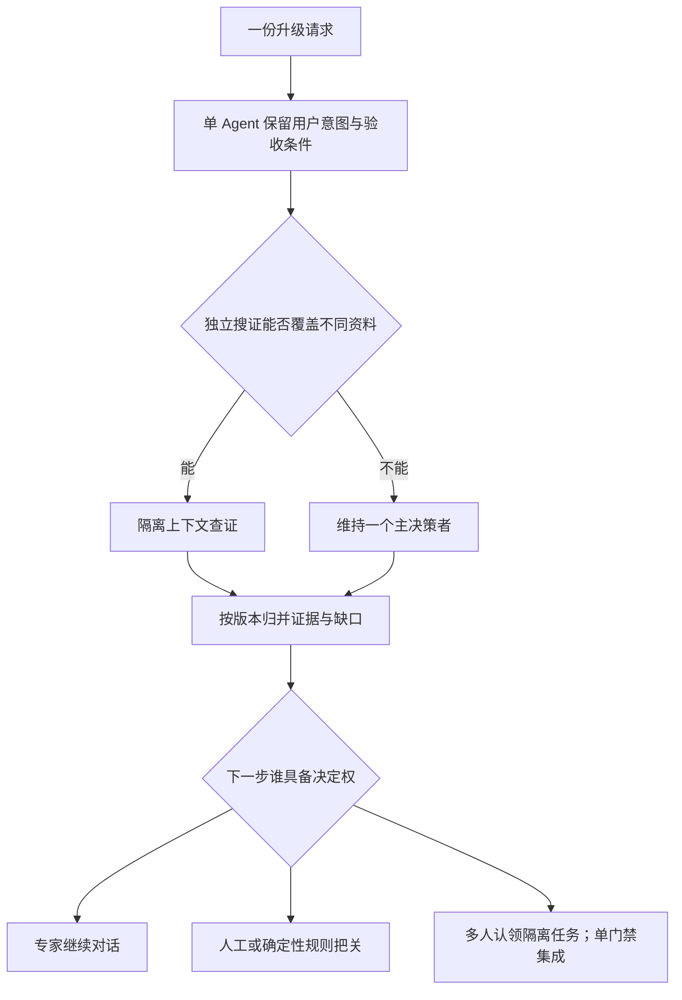
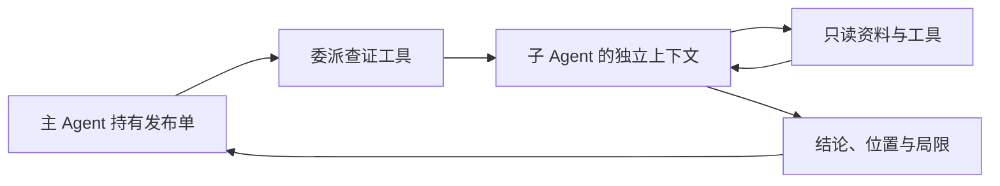
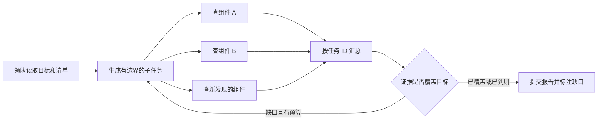
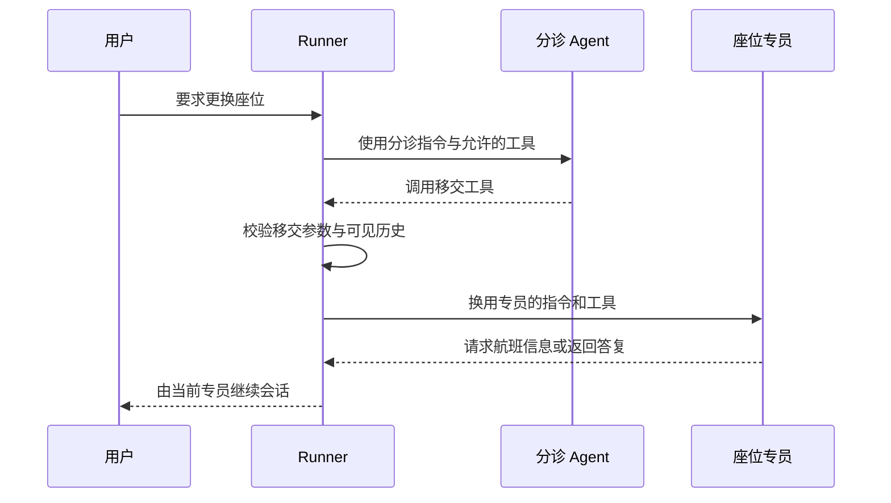
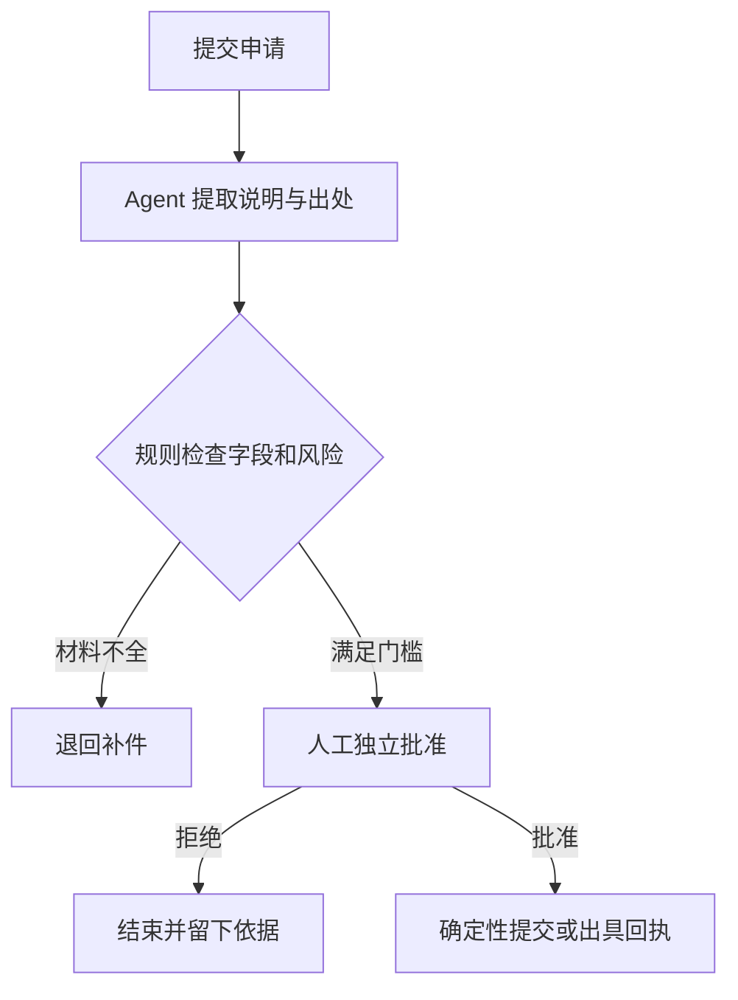
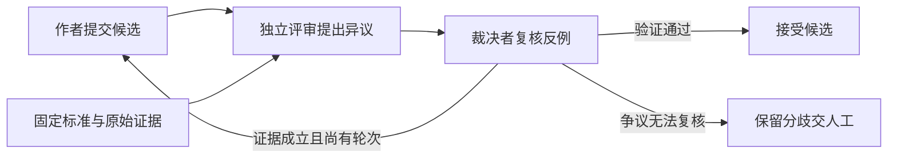
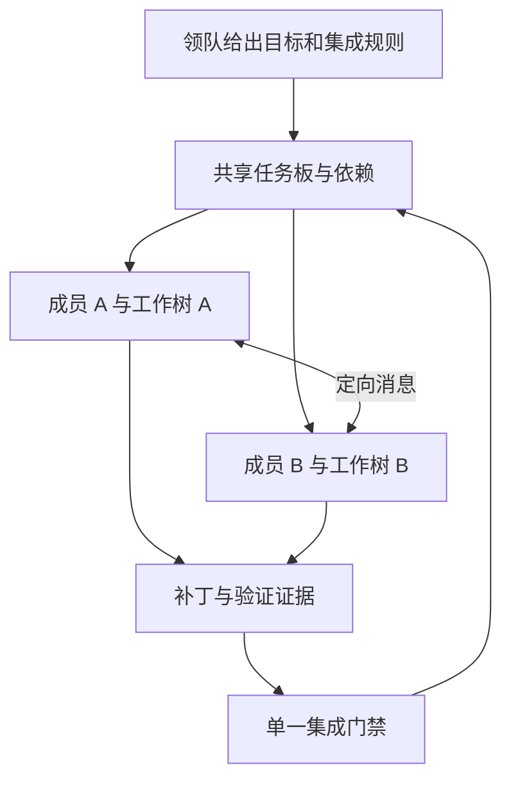
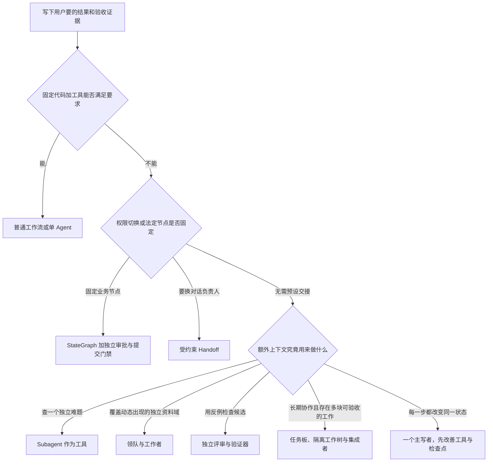

# 模块 03 · 多 Agent 编排架构，从 Single Agent 到 Subagent 与 Agent Teams

同样是多找几个人帮忙，三个人分头查三份档案可能快很多，三个人同时改一张发布单却会互相覆盖。做系统设计和回答面试题，都可以先画出**谁读哪些事实、谁有权写入、最后谁签字**，再决定需要几个 Agent。

## 先画工作怎么交接，再画有几个角色

产品让助手检查「这次升级能不能按期发布」。它可以搜三个独立组件的兼容声明，也可以替发布负责人批准上线。这两项听起来都像「协作」，对基础设施的要求完全不同。前一项可以把原文分别交给三个上下文，并行拿回引用，后一项必须确定当前版本、审批人及唯一的写入者。给三个助手都加一句「请保持一致」，无法解决它们在不同时间读到不同版本的问题。



这里的 Agent 指能根据观察选择下一动作的运行单元。一个循环同时调用五个查表函数，仍然可以是单 Agent。两次固定模型调用，比如先翻译再格式化，也可以只是普通工作流。判断架构复杂度的好办法是数**独立决策者**，再数这些决策者之间必须同步的事实。决定权能分出去，最后责任仍要有人接住。

### Cognition 担心什么，Anthropic 买到了什么

Cognition 在 2025 年描述了分工如何改变实现。一个面向用户的任务拆开后，各子 Agent 会自行决定实现细节。上游看见过用户为什么这样选，分支可能只看见一句提炼过的目标。即使同时发去同一份任务说明，它们也可能在没写进说明的边界上做出互相冲突的选择。等到最后才交流，修补的代价往往比一开始让一个主 Agent 连续做决定更高。只转述「上下文太长」会漏掉更难的问题，**每次写入都可能把一个隐含决定固化在环境里**。[Cognition 2025 年原文](https://cognition.com/blog/dont-build-multi-agents)

换一个任务，要从多家机构的一手来源找兼容性证据。搜索 A 不会修改 B 的网站，一名研究员把几十页材料读完后，只需交回结论、出处和不确定项，其他研究员不必同步每次翻页。这是 Anthropic Research 系统的优势区间。它在**内部研究评测**上，用 Opus 4 担任领队、Sonnet 4 担任子 Agent，相对单个 Opus 4 的表现提升 **90.2%**。这里没有给出可以外推到你家业务的成功率，更不能写成提高 90.2 个百分点。作者给出的另一组数据以**普通聊天**为基线，Agent 通常约耗 4 倍 Token，多 Agent 系统约耗 15 倍。这两个数字衡量不同问题。[Anthropic 多 Agent 研究系统复盘](https://www.anthropic.com/research/multi-agent-research-system)

收益有三个来源。并行搜索缩短用户等待，每个研究员的上下文可容纳各自的长资料，领队动态调整精力，把算力集中给没查清的子问题。一次对比同时改变了模型组合、计算量与编排方式，不能把全部提升都归因于「多了几个角色」。作者还报告过按批等待最慢成员造成的瓶颈。把这套架构照搬到共享状态高频写的任务，可能只买到更多 Token 和更长的归并时间。[Anthropic 研究系统的并行与同步限制](https://www.anthropic.com/research/multi-agent-research-system)

也别把 Cognition 的 2025 年文章当作永久禁令。作者在 2026 年 4 月复盘了实际工作的组合，独立上下文的 Devin Review 提供第二双眼睛，写代码的一方凭掌握的用户约束判断哪些意见应采纳。作者还讨论过让主模型在需要时请教更强模型，传递的背景太少，专家也只能猜。分界线从来不在「公司支持几个人」，而在具体接口能否传过足够的决策上下文、把写权限留给适合的一方。[Cognition 2026 年后续实战](https://cognition.com/blog/multi-agents-working)

### 哪些情况直接否决，哪些情况确实有必要

先给任务画读写集合。假设兼容表、供应商发布说明和内部测试报告都已经冻结，读同一快照的三条支路可以放心并行。若三个子任务都要改同一个配置项，彼此结果还会改变对方下一步该做什么，优先一个主 Agent 顺序推进，把能写成函数的查询并发执行。高频写只是表象，真正要问的是「一个分支刚作出的决定，会不会让另一个分支已经完成的工作失效」。只读人员若必须先就同一模糊口径达成一致，盲目拆分照样会查出三份互不相干的答案。

谈「必须用」要给出成立条件。例如服务承诺在有限时间内覆盖数个独立资料库，每个库都要多轮动态探索，单个上下文既塞不下原始材料也赶不上截止时间，压缩后又会丢关键证据。这时需要并行、隔离的决策上下文。另一种硬约束来自制度，如果规定编制和独立复核要使用隔离视图和不同权限，编制者不能自己代演审核者，复核确实需要判断时可以单设 Agent，最终签字仍由制度认可的主体完成。若固定程序能完成复核，直接用程序就能满足分工。

上线前先做一组便宜实验。给单 Agent 配上和多 Agent 相同的搜索工具、相同可访问源、相同验收器，再分别比较相同费用和相同截止时间下的结果。收录覆盖面、引用正确率、交付耗时、返工次数，以及总费用除以通过验收的交付数。按宽搜、串行诊断、共享写入分桶，数据混在一起时，宽搜的大幅改善可能掩盖共享写入变差。若并发普通工具就能兑现服务承诺，多加一个会决策的上下文只会多一个需要调试的接口。

## 六种拓扑，先认控制权和返回值

| 拓扑 | 谁选下一步 | 调用者究竟等什么 | 最先暴露的瓶颈 |
|---|---|---|---|
| Subagent-as-a-Tool | 父 Agent | 某个独立问题的有据结论 | 把隐含约束漏在父上下文 |
| Orchestrator-Workers | 领队决定分工和归并 | 多个子任务覆盖了哪些缺口 | 最慢分支、重复搜索和归并成本 |
| Handoff / Swarm | 切换后的当前 Agent | 新负责人接手对话和后续动作 | 历史误传、权限和来回转接 |
| DAG / StateGraph | 图的边与条件谓词 | 节点返回合法状态增量 | 字段合并冲突、旧节点重入 |
| Debate / Critic | 评审给意见，裁决者选证据 | 可核验的异议或反例 | 意见相关、评审无限返工 |
| Teams / Shared Board | 有权限的成员异步认领 | 任务、消息、制品最终收敛 | 租约过期、共享环境与集成队列 |

以下六个例子都能离线运行。没有外部模型的地方用固定资料或固定选择复现决策边界，便于观察失败归谁处理。第三、四例会调用真实的 OpenAI Agents SDK 和 LangGraph 接口，只需安装依赖，无需模型密钥。

### 一、Subagent-as-a-Tool · 派人查一件事，主线程保留决定权

主 Agent 想知道新版客户端是否仍支持某个配置。给调查员一段清晰任务和只读资料，后者可以翻手册、追出处，再交回一段带行号的结论。主 Agent 把它当作一次工具结果，继续处理原始发布单。用户仍然只和主 Agent 说话。适合委派的是证据搜集、代码导航、长文件比对，把最终发布决定一起委派，结果就超出了这个接口的能力。



Claude Code 的自定义 subagent 有独立上下文，可配置系统指令、工具和权限，适合让大量调查日志留在子会话里。Hermes 的 `delegate_task` 会创建子 AIAgent，文档说明其独立对话、终端会话以及向父级返回最终摘要的方式。Codex 也支持委派子任务，继承多少上下文和是否隔离工作目录要看具体入口与配置。**独立上下文不会自动复制文件系统**，要隔离代码改动仍需明确选择工作区。三者共同点是父级收结果，不代表它们都只允许返回固定长度的摘要。[Claude Code subagents](https://code.claude.com/docs/en/sub-agents) · [Hermes 委派](https://hermes-agent.nousresearch.com/docs/user-guide/features/delegation) · [Codex subagents](https://developers.openai.com/codex/subagents) · [Codex worktrees](https://developers.openai.com/codex/app/worktrees)

下面给子任务一份明确的读权限，返回的出处由父级再次检查。资料为教学数据。真正接模型时，将 `investigate` 内的逐行扫描换成受限的查证循环，其余输入输出契约仍然适用。

```python
from dataclasses import dataclass

DOCS = {"guide@a1": ("旧配置允许省略区域。", "新版必须显式填写区域。")}

@dataclass(frozen=True)
class Finding:
    ref: str
    line: int
    quote: str

def investigate(ref, question, read):
    # 子任务只得到这一次允许的读取接口和问题。
    for line, text in enumerate(read(ref), start=1):
        if question in text:
            return Finding(ref, line, text)
    return None

def delegate(ref, keyword):
    def scoped_read(request):
        if request != ref:
            raise PermissionError(request)
        return DOCS[request]
    result = investigate(ref, keyword, scoped_read)
    if result is None:
        return "证据不足"
    lines = scoped_read(result.ref)
    assert 1 <= result.line <= len(lines) and lines[result.line - 1] == result.quote
    return f"{result.ref} 第 {result.line} 行：{result.quote}"

assert delegate("guide@a1", "新版") == "guide@a1 第 2 行：新版必须显式填写区域。"
assert delegate("guide@a1", "退款") == "证据不足"
```

判断摘要够不够，用一个反问。「如果父级不同意，能否只凭回传内容打开原证据并复核？」只回「兼容，放心发」不能。只回整本手册也不行，父级不得不重新调查一遍。更好的契约是建议、证据位置、适用版本和未确认项。父级可以选择少量争议证据展开，其他原始日志只保留指针。真实隔离需由受限工具服务或沙箱实施，示例中的 Python 函数参数只展示能力如何传递。

### 二、Orchestrator-Workers · 谁来决定开几条支路，又怎样收齐

产品经理问「哪些组件会挡住升级」，事先并不知道有几个组件，也不知道哪家有新政策。领队先读清单，依据缺口生成任务，再分派给各自的研究员。这比固定并行多了一层动态决策。任务单应写明搜索范围、禁止重复的范围、交付证据、截止时间和预算。两名研究员搜索同一主站的相近词，再由领队去重，花的是两份费用，得到的可能仍只有一份覆盖。



Anthropic 的 Research 系统用 lead agent 做动态分解与合成，子 Agent 各自在独立窗口搜索，引用也有专门处理。可以借用它的分工，又按自己业务的交付合同决定是否允许部分成果。扫描监管必填项时，漏掉一项必须阻止提交，探索性研究遇到一个资料库宕机，则可以交付其余来源，并把空白明确列出。别让最慢的可选任务决定整个系统是否能回答用户。[Anthropic 研究系统的领队与工作者](https://www.anthropic.com/research/multi-agent-research-system)

```python
import asyncio

REPORTS = {"api": "已覆盖变化", "cli": "配置项已迁移", "plugin": "待核查"}

async def inspect(component):
    await asyncio.sleep(0.001)  # 教学假源，不访问网络
    return REPORTS[component]

async def research(manifest, slots=2, quota=3):
    if slots < 1 or quota < 0:
        raise ValueError("并发数或预算无效")
    plan = list(dict.fromkeys(manifest))  # 领队根据输入形成工作清单
    gate = asyncio.Semaphore(slots)
    async def one(name):
        async with gate:
            try:
                value = await asyncio.wait_for(inspect(name), timeout=0.5)
                return name, {"finding": value}
            except (KeyError, asyncio.TimeoutError) as err:
                return name, {"gap": type(err).__name__}
    pairs = await asyncio.gather(*(one(name) for name in plan[:quota]))
    result = dict(pairs)
    result.update({name: {"gap": "未分配预算"} for name in plan[quota:]})
    return result

out = asyncio.run(research(["api", "cli", "api", "unknown", "plugin"]))
assert out["api"]["finding"] and out["unknown"]["gap"] == "KeyError"
assert out["plugin"]["gap"] == "未分配预算"
```

示例里 `slots` 控制同时在跑的数量，`quota` 控制能开出的任务总数。只设前者，领队照样能串行派出一百个无用任务。动态重规划时记录已覆盖的查询范围、快照版本和上一批的缺口，下一批只领取新增范围。汇总器按任务 ID 收结果，拒绝来自旧计划代次的迟到包。若多个子任务共用一个服务配额，再叠一个全局限速器，单个运行的信号量看不到同一时刻另外五十个用户启动的搜索。

### 三、Handoff / Swarm · 下一句话归谁说

客服接到「我想改座位」，分诊员把会话交给座位专员。从这一步起，是专员继续问航班号、选择自己的工具并最终答复。若分诊员只是询问专员「还有哪些座位」再自己回答，仍是上一节的工具式委派。最短的辨认方法是追问，「专家完成以后，控制权会自动回到哪里？」



OpenAI Agents SDK 将 handoff 暴露为可被模型选择的工具。选择某个 handoff 后，Runner 更新当前 Agent，下一轮按目标 Agent 的 instructions 和工具集构造请求。默认可见历史可能包括之前对话，`input_filter` 等设置可改变传入的历史。`input_type` 约束的是移交工具的参数，例如原因或优先级，不会独自替换接手者看到的整个模型输入。权限最终应在工具端依据登录身份和对象再判断。历史中出现过的权限说明不会替接手者创造操作能力。[SDK Handoffs](https://openai.github.io/openai-agents-python/handoffs/) · [OpenAI 航空客服示例源码](https://github.com/openai/openai-agents-python/blob/main/examples/customer_service/main.py)

早期 Swarm 给出了轻量的 Agent 切换与函数调用实验，仓库明确定位为教学探索。新项目应从受维护的 Agents SDK 接口入手。下面用 `python -m pip install openai-agents` 安装 SDK。示例从真实的 `Runner.run` 入口连续跑两轮，只把模型替换为固定输出。第一轮断言分诊员可发起移交，第二轮断言专员的指令和座位工具已生效，最终再检查谁回答了用户。本文离线核验使用 Python 3.12 和 openai-agents 0.26.0。[Swarm 项目说明](https://github.com/openai/swarm) · [Agents SDK 移交接口](https://openai.github.io/openai-agents-python/handoffs/)

```python
import asyncio
from typing import Literal
from agents import Agent, Model, ModelResponse, Runner, RunConfig, Usage, function_tool, handoff
from openai.types.responses import ResponseFunctionToolCall, ResponseOutputMessage, ResponseOutputText
from pydantic import BaseModel

class Transfer(BaseModel):
    reason: Literal["seat_change"]

async def mark(ctx, data: Transfer):
    ctx.context["reason"] = data.reason

@function_tool
def lookup_seats(ticket: str) -> str:
    """读取工单对应的座位信息。"""
    return "需补充航班号"

class LocalModel(Model):
    async def get_response(self, system_instructions, input, model_settings, tools,
                           output_schema, handoffs, tracing, **options):
        if handoffs:
            assert system_instructions == "识别问题并转接。" and not tools
            item = ResponseFunctionToolCall(type="function_call", call_id="h1",
                       name=handoffs[0].tool_name, arguments='{"reason":"seat_change"}')
        else:
            # 这是同一个 Runner 的下一轮；目标 Agent 的工具和指令已经生效。
            assert system_instructions == "负责改座。"
            assert [tool.name for tool in tools] == ["lookup_seats"]
            item = ResponseOutputMessage(type="message", id="m2", role="assistant",
                       status="completed", content=[ResponseOutputText(type="output_text",
                       text="请提供航班号。", annotations=[])])
        return ModelResponse(output=[item], usage=Usage(), response_id=None)

    def stream_response(self, *args, **kwargs):
        raise NotImplementedError("此离线模型只实现非流式请求")

async def demo():
    model = LocalModel()
    seat = Agent(name="seat", instructions="负责改座。", model=model, tools=[lookup_seats])
    edge = handoff(agent=seat, input_type=Transfer, on_handoff=mark)
    front = Agent(name="front", instructions="识别问题并转接。", model=model, handoffs=[edge])
    ctx = {"ticket": "T7"}
    result = await Runner.run(front, "我要改座位", context=ctx, max_turns=2,
                              run_config=RunConfig(tracing_disabled=True))
    assert result.last_agent is seat and result.final_output == "请提供航班号。"
    assert ctx["reason"] == "seat_change"

asyncio.run(demo())
```

正式客服还要在对话记录里保存 `active_agent` 和移交代次。否则用户补完航班号发起下一次 HTTP 请求时，服务端又从分诊员开局，在「您有什么问题」与「请提供航班号」之间打转。把已核实事实、缺的字段、允许的后继角色随移交保存。若分诊员有权看到内部标注而外包专员没有，先筛选源历史再做摘要，并在执行端独立校验数据范围。只把 `instructions` 换成「你现在是专员」不能完成这些工作。

### 四、DAG / StateGraph · 明天换个模型，谁仍然能挡住违规放行

升级涉及审批时，流程里有两类问题。「这段材料在说什么」需要模型理解，「申请的人能否批准自己的变更」应由明确规则作答。把这些节点混在一段聊天里，模型一句「负责人已同意」就可能绕过门禁。图让必经节点、允许回路和最终条件一眼可见。DAG 严格无环，StateGraph 可以有条件回边，形成有限次补件。讨论二者时要把是否允许循环说清。



一个真实的金融数据案例是 Kensho 的 Grounding 系统。它利用 LangGraph 路由到不同数据团队的检索 Agent，再把答案落回可信数据。这印证了金融数据检索可把专业节点组合进显式编排。下面的审批图是教学设计，Kensho 的案例并未声称使用它来放行资金或执行本文的审批规则。[Kensho 与 LangChain 的工程案例](https://www.langchain.com/blog/customers-kensho) · [LangGraph 工作流和 Agent](https://docs.langchain.com/oss/python/langgraph/workflows-agents)

用 `python -m pip install langgraph` 安装依赖，本文验证版本为 1.2.24。`extract` 是模型提取节点的固定输出，用它可在没有模型服务时检查边是否正确。程序先停在 `interrupt`，再以同一 thread 恢复。缺工单号时走拒绝边，压根到不了人工批准。内存检查点仅用于同进程演示，跨天审批须换持久后端并绑定动作版本和身份。

```python
from typing import TypedDict
from langgraph.graph import StateGraph, START, END
from langgraph.types import Command, interrupt
from langgraph.checkpoint.memory import InMemorySaver

class Request(TypedDict, total=False):
    ticket: str
    evidence: str
    approved: bool
    outcome: str

def extract(state):
    return {"evidence": "冻结的测试报告 R7" if state.get("ticket") == "T7" else ""}

def review(state):
    answer = interrupt({"ticket": state["ticket"], "evidence": state["evidence"]})
    return {"approved": answer is True}

builder = StateGraph(Request)
builder.add_node("extract", extract)
builder.add_node("review", review)
builder.add_node("accept", lambda s: {"outcome": "通过"})
builder.add_node("reject", lambda s: {"outcome": "未放行"})
builder.add_edge(START, "extract")
builder.add_conditional_edges("extract", lambda s: "review" if s["evidence"] else "reject",
                              ["review", "reject"])
builder.add_conditional_edges("review", lambda s: "accept" if s["approved"] else "reject",
                              ["accept", "reject"])
for name in ("accept", "reject"):
    builder.add_edge(name, END)

app = builder.compile(checkpointer=InMemorySaver())
config = {"configurable": {"thread_id": "demo-7"}}
assert app.invoke({"ticket": "T7"}, config)["__interrupt__"]
assert app.invoke(Command(resume=True), config)["outcome"] == "通过"
other = {"configurable": {"thread_id": "missing"}}
assert app.invoke({"ticket": "T8"}, other)["outcome"] == "未放行"
```

图的确定性来自固定的控制边和可验证的谓词。模型节点本身仍可能生成不同提取结果，故应保留原始材料版本，检查字段与出处能否对上。并行节点写状态也有约束，两个节点同时给 `outcome` 赋值时，不能靠「最后回来者赢」决定资金或权限。让各节点写各自命名的证据字段，由一个归并节点按确定规则算结论。若要补件，把退回原因、最大次数和原申请 ID 记在状态里，防止绕一圈就重新领到全额预算。[LangGraph 中断与节点重新进入规则](https://docs.langchain.com/oss/python/langgraph/interrupts)

### 五、Debate / Critic · 怎样让第二双眼睛真能找出错

让撰稿者和评审者分别读用户要求和待交付物。评审给出具体异议、位置、反例和严重度，裁决者逐条复核。这里的「红蓝」表示有人挑战结论、有人补证，代码审查或防御性检查可以围绕缺少权限校验、日志泄露、失败后状态错误等问题，使用静态检查与回归用例核实。报告质检同样适用，只需把「哪行代码」换成「哪一页来源」。



微软 AutoGen 的 Multi-Agent Debate 示例用消息订阅让多个解题者交换意见并汇总答案，适合观察回合和路由，Cognition 的 Devin Review 则展示独立评审在真实代码任务中的作用。两者的裁决标准可以完全不同。投票可汇总主观偏好，代码是否在空输入时崩溃有可执行反例，应直接跑验证。一个具体反例的证明力可能超过四份「我也认为没问题」。[AutoGen 辩论示例](https://microsoft.github.io/autogen/stable/user-guide/core-user-guide/design-patterns/multi-agent-debate.html) · [Cognition 的独立代码评审](https://cognition.com/blog/multi-agents-working)

```python
# 三个角色看不同输入。把作者与评审替换为模型，对照样例仍由程序独立执行。
def author(feedback):
    if feedback:
        return lambda amounts: sum(amounts)
    return lambda amounts: sum(set(amounts))

def critic():
    return {"case": [10, 10], "expected": 20, "reason": "相同金额可能是不同记录"}

def decide():
    feedback = None
    for _ in range(2):
        candidate = author(feedback)
        objection = critic()
        got = candidate(objection["case"])
        if got != objection["expected"]:
            feedback = {**objection, "actual": got}
            continue
        held_out = [([], 0), ([5, 5, -3], 7)]
        if all(candidate(xs) == total for xs, total in held_out):
            return "通过复核"
    return "预算到期，转人工"

assert decide() == "通过复核"
```

评审接收适用的用户约束，但先不读作者的整套辩护，减少同一思路诱导出的相关错误。随后给作者一次用新证据澄清的机会。若反对者只说「可以更优雅」，要求指出违反了哪条交付标准，否则不消费返工轮次。模型裁判也要校准，可以用人工标注的已知缺陷测误报与漏报，并打乱候选顺序检测位置偏好。若两人都没有读到原始政策，认真辩论十轮也只是把同一份误读包装得更漂亮。

### 六、Agent Teams / Shared Board · 大家不在一个线程里，工作怎样接得上

领队去开会，负责测试的人仍能认领一个独立故障，做完后提交补丁，通知维护接口的同事，后者根据新证据更新自己的任务。这要求团队有共享任务表、独立工作上下文、可寻址的消息通道和可查的制品。成员可以直接沟通，主 Agent 不必转发每一句话。成员发一条「我做完了」仍不足以推动发布，任务验收和集成门禁要有单独的状态。



截至本次核对，Claude Code 文档将 Agent Teams 标为实验功能、默认关闭。成员有各自的上下文，通过共享任务列表和直接消息协作，会话恢复、任务协调和关闭均有产品边界。单独的 Git worktree 是可选择的文件隔离手段，开启团队不表示每个成员已经自动获得一个隔离资源栈。另一个一手案例是 Anthropic 的 C 编译器实验，每名成员用独立容器与本地 clone，经共享仓库提交任务锁，作者明确说原型没有专职编排 Agent。共享黑板可以是数据库，也可以是有冲突检测的仓库。[Claude Code Agent Teams](https://code.claude.com/docs/en/agent-teams) · [Anthropic 的并行编译器实验](https://www.anthropic.com/research/building-c-compiler)

下面用一个内存数据库展示领任务、过期再领、拒绝旧成员提交、并在完成时给同事留信。逻辑时钟让超时可重复测试，示例的 `RETURNING` 需要 SQLite 3.35 或以上。真实团队用共享数据库及其时钟，多个连接的竞争由条件更新裁决。任务状态和消息落在同一个事务，旧持有者即使晚回来了，也不能凭旧租约完成任务。

```python
import sqlite3

db = sqlite3.connect(":memory:")
db.executescript("""
CREATE TABLE task(id PRIMARY KEY, state, owner, epoch INTEGER, until_t INTEGER);
CREATE TABLE mailbox(recipient, task_id, epoch INTEGER, message,
                     UNIQUE(recipient,task_id,epoch));
INSERT INTO task VALUES('parser','open','',0,0);
""")

def claim(owner, now, ttl=10):
    with db:
        row = db.execute("""
            UPDATE task SET state='busy',owner=?,epoch=epoch+1,until_t=?
            WHERE id='parser' AND (state='open' OR (state='busy' AND until_t<=?))
            RETURNING epoch
        """, (owner, now + ttl, now)).fetchone()
    return row[0] if row else None

def finish(owner, epoch, now, artifact):
    with db:
        changed = db.execute("""
            UPDATE task SET state='review'
            WHERE id='parser' AND state='busy' AND owner=? AND epoch=? AND until_t>?
        """, (owner, epoch, now)).rowcount
        if changed:
            db.execute("INSERT INTO mailbox VALUES('integrator','parser',?,?)",
                       (epoch, artifact))
        return bool(changed)

first = claim("甲", 0)
assert claim("乙", 1) is None
second = claim("乙", 11)
assert not finish("甲", first, 12, "old-commit")
assert finish("乙", second, 12, "new-commit")
assert db.execute("SELECT message FROM mailbox").fetchone()[0] == "new-commit"
```

`epoch` 是每次重新认领就递增的代次。它在任务表上能挡住迟交，也要传到有权写共享资源的门禁，若旧成员可以绕过门禁直接推主分支，任务表再严也没有用。成员应在隔离区工作，把补丁、基线提交和测试证据交给集成人。协调者只在依赖完成、证据齐全时产生合并任务。消息用来提醒，状态用来定案，消息掉了一条还能扫描任务表恢复。成员宕机后先确认它有没有已经提交的制品，再决定复用、回收或重新认领。

## 五个最贵的故障，从第一条坏消息追到最终交付

### ① 上下文传递黑洞 · 「客户同意」这四个字省掉了什么

一名客服把「客户同意」交给后继，聊天原文其实是「如果旧订单先撤销，我同意新方案」。交接时删掉条件，接手者会把有条件的意愿理解成已经可以执行。把历史全部复制也解决不了所有问题。接手者可能在几万字中找到三种旧方案，挑中最详细但已经失效的一份。上下文传递的技术目标是让人或模型能**恢复当前决定及依据**，单纯减少字数没有这个保证。

把交接拆成信封与制品。信封中放谁交给谁、用户原始目标、硬约束、已核对事实、尚未解决的问题、允许的下一步、预算、当前业务版本。大的日志、文件、调查轨迹放制品库，给出带版本的指针、页码或行号、内容哈希、可访问范围。用普通共享文件也可以，但最好在写完后转为不可变版本，让两个成员都编辑 `latest.md`，昨天批准的证据今天可能就指向另一段文本。

例如领队要求确认「仅对首次安装生效」，worker 回传「支持新版配置」。一个结构化交接应该能指出，证据覆盖的是升级机器，首次安装仍缺样本。接手方遇到结论缺适用范围时应返回补证请求，不能把缺字段当作默认允许。确定性校验可以检查指针存在、内容摘要匹配、证据快照和请求属于同一租户，语义校验再判断引用是否真的支持主张。通过第一层只能说明「引的确有其文」，还不能说明「这一句足以推出结论」。

| 交接包的一项 | 一个可用的值 | 接收方用它做什么 |
|---|---|---|
| `goal` 与 `constraints` | 核验首次安装，只查 `release-7` 冻结资料 | 防止把升级测试错当新装测试 |
| `claim` 与 `evidence_ref` | 现有节点可升级，`ci/R7@hash` 第 41 行 | 定位原句，判断样本属于谁 |
| `open_questions` | 尚无首次安装样本 | 阻止把半份证据升级为最终批准 |
| `handoff_id`、`revision`、`schema_version` | 本次移交、业务版本、字段格式版本 | 去重、拒绝迟到包，以及兼容升级 |
| `allowed_next` 与 `expires_at` | 仅可申请补测，日落前有效 | 验证可行动范围和时效，权限从服务端读取 |

把原件放在文件里，还要处理「文件能不能一直打开」。临时签名链接可能在三天审批期间失效，保留制品 ID，由受权服务在读取时签发新地址。引用被删除或保留期已过时，状态显示证据失效，要求重新取得依据。向权限更窄的专家委派时，按接收方身份选择可见片段，把无关的工单备注留在源系统，访问控制由数据层执行。否则一次成功的摘要压缩，可能把本来不可见的内容嵌进了所有人都可读的结果。

有些任务适合完整分叉上下文。专家需要从主 Agent 哪里开始犯错进行诊断时，精简过的摘要可能已经把错误前提擦去了。此时可以限定目标、分叉一份只读快照，不把专家的探索日志再全量倒回主线程。两种做法可以做对照实验，给子任务一份摘要和一次按需读原文的配额，记录补读次数、错误归因与质量变化。补读极少而错误长期集中在同一个决策字段，往往是交接模式该加字段，而非所有任务都得传全量。

### ② 误差级联 · 三个各有 85% 把握的人，结果有多稳

假设分类、检索、归纳必须全部正确才算成功，每一关在前面都正确的条件下成功率都是 85%，整条链是 `0.85 × 0.85 × 0.85 = 0.614125`，约 **61.4%**。这一计算用的是条件概率的连乘，如果给出的只是三次单独测试得到的边际准确率，只有在独立等假设成立时才能直接相乘。现实中检索员很容易继承分类员选错的行业，归纳员再把错误材料组织得更顺。也有后继能纠正前一步的情况，此时「每一关都正确」甚至不再是最终成功的必要条件。

怎样发现上游在拖累谁？保留一批带真值的任务，分别运行三遍。第一遍完整运行，得到用户实际成功率，第二遍把分类结果换成人工真值，观察检索和归纳的恢复幅度，第三遍直接给正确材料，只看归纳。若第三遍仍经常错，把分类模型升级没有意义。反过来，正确分类一旦注入整体就大幅好转，应优先提升路由，或在路由低置信时让两个资料域都查，再由同一口径归并。这里测的是干预前后的行为，不能只根据哪一层产出最多错误日志来归责。

降低级联还有一个不花模型费用的办法，把可验证的不变量尽量提前。例如工单里写的是「上海区域」，第一份证据却标着另一区域。先用程序拒绝版本和区域不匹配的材料，就无需再等评审员在最终一万字报告里找到错误。对语义模糊的地方，要求子任务明确写「未知」，并给接收者一个补查来源。程序不得把空值偷偷转换为默认肯定，这条小规则往往比多加一位评论员更能保住准确率。

并行意见也可能级联。五个研究员引用同一份二手转述，会产生五票一致的错觉。汇总时按**原始证据来源**聚类，两篇转载自同一个公告的报道算一条证据链，只有真正独立的观察才提高可信度。对最终不可逆的动作，可让程序或有资质的人复核原始证据，并保留为什么接受或拒绝这条结论的记录。研究多 Agent 失败的工作也把任务规格、角色对齐及任务验证列为可区分的故障来源，单纯换模型只能影响其中一部分。[Why Do Multi-Agent LLM Systems Fail?](https://arxiv.org/abs/2503.13657)

### ③ 死锁、踢皮球与成本失控 · 没有新事实，还要继续转吗

死锁可能非常安静。A 占着最后一个 worker 槽等待 B，B 在同一个池里排队，系统没抛异常，两个任务都没有进度。也可能 A 持有仓库锁等 B 的审批，B 要先读同一锁保护的工作区才能审批。追踪等待关系时，边要指向具体资源与持有者，才能看出环。父任务等待子任务时释放执行槽，协调线程与工作池分开，持久挂起释放 worker，跨资源按固定顺序领取，持锁期间避免等待人和模型。实在需要跨长等待保住所有权，就用可过期、可收回的租约与代次检查。

踢皮球则相反，日志很热闹。分诊说「这是账务问题」，账务说「请补产品信息」又转回去，用户看了六条转接通知却没得到一个问题。检查键应包括「来源、目的地、原因、业务版本、证据版本」。同一条边在同一组事实下再次出现，就停止转接，向用户提出缺的那个问题或交人。若用户补上了发票号，原路返回就合理。只有全局 hop 上限会误伤正常多阶段流程，只有证据指纹又可能被无关措辞变化绕开，两者应配合。

费用如何失控也有具体算式。若领队派三名研究员，每名又能派三名助手，仅两层就有一名领队、三名研究员和九名助手。如果每一层都独立设置「最多四轮」，上层重试还可能再次创建整棵子树。将 `root_run_id` 作为唯一预算所有者，派发前从同一账本原子预留，每个子任务另设可消费上限、最大深度和截止时间，取消后回收未使用预留。超时的请求可能已经计费，应等用量对账后释放相应余额。配额耗尽时，交付经验证的部分和缺口，避免继续花钱写一段流畅的失败解释。

给业务设一条可读的降级路径。例如资料源超过截止时间，一次自动补查后仍不可用，就将它标成未覆盖，并让领队仅在核心来源齐全时出结论。队列挤压时先减少可选分支，保留合成与核查的预算，否则子 Agent 搜出一堆证据，最后连把证据交给用户的钱都没有。看监控时同时画「每分钟动作数」与「每分钟新增的可验收成果数」，前者上升而后者停滞，是活锁、重复委派或无效讨论的早期信号。

### ④ 共享环境写冲突 · Git 能合并文本，谁来合并决定

两个 Coding Agent 分别修改解析器与命令行，Git 可能一行冲突也没有，但解析器把空值定义为「使用默认值」，命令行却把空值当作「不启用」。两个分支的单元测试都绿了，用户仍拿到行为矛盾的产品。隔离工作目录能避免覆盖未保存的编辑，**接口契约和最终集成测试**才能发现这种语义冲突。先决定哪些边界可以并行，让一个负责人维护公共接口，再决定开几个 worktree。[Git worktree 官方手册](https://git-scm.com/docs/git-worktree)

操作上，记录起始提交哈希，给每个成员从同一基线创建独立工作树和分支。把路径所有权、禁止修改的接口与允许依赖列在任务单里。成员提交时回传 `base_commit`、`head_commit`、改动清单和测试证据。集成队列按顺序生成合并候选，在候选提交上跑契约测试和端到端测试，若另一个候选先进入主线，旧绿灯失效，基于最新主线重算合并结果。仅检查两个分支各自通过，无法覆盖两个新实现之间的交互。

worktree 会隔离检出文件和索引，仓库的对象与许多引用仍共享。它也不会隔离数据库表、测试端口、云端环境或队列消费者。每个成员若都在同一个测试租户内跑「清空并重建」，文件没有冲突，数据却照样被覆盖。给测试数据库独立 schema 或临时实例，给消息队列独立前缀，给网络服务分配独立端口，需要访问真实共享测试环境时只允许一个集成作业写入。完成后回收环境要按任务标识，避免旧任务的清理命令删掉接班人的新资源。

Anthropic 的编译器实验遇到一个比文本冲突更深的障碍。还有许多独立失败用例时，成员很容易分工，最后卡在编译同一个内核时，多个成员去修同一个问题，人数优势消失。团队借助已知可用的 GCC 混合编译，把整项失败定位到可独立诊断的子集。当所有人都卡在同一个红灯前，先改测试夹具，让它能告诉每个人「你负责的那一块是否正确」，再决定要不要继续并行。[Anthropic 的编译器实验与测试拆分](https://www.anthropic.com/research/building-c-compiler)

可以在本机亲手制造一次「无文本冲突、合并候选不合格」。下面是完整的 Bash 实验，只在新建的临时仓库里操作。基线规定空区域要显示 `default`。解析器成员把空字符串归一成 `None`，界面成员改成只把空字符串视作缺省值。两份修改各自与旧代码配合都成立，放在一起时却会尝试对 `None` 调用字符串方法。

```bash
set -eu
box=$(mktemp -d)
trap 'rm -rf "$box"' EXIT
repo="$box/base"
git init -q "$repo"
git -C "$repo" config user.name "Local review"
git -C "$repo" config user.email "review@example.invalid"
git -C "$repo" config commit.gpgSign false
printf '%s\n' 'def normalize(raw): return raw' > "$repo/model.py"
printf '%s\n' 'def label(value): return value or "default"' > "$repo/view.py"
printf '%s\n' 'from model import normalize' 'from view import label' \
  'assert label(normalize("")) == "default"' > "$repo/test_contract.py"
git -C "$repo" add .
git -C "$repo" commit -qm base
git -C "$repo" worktree add -qb parser "$box/parser" HEAD
git -C "$repo" worktree add -qb display "$box/display" HEAD

printf '%s\n' 'def normalize(raw): return raw or None' > "$box/parser/model.py"
printf '%s\n' 'def label(value): return "default" if value == "" else value.upper()' \
  > "$box/display/view.py"
for branch in parser display; do
  (cd "$box/$branch" && python3 -B test_contract.py)
  git -C "$box/$branch" commit -qam "$branch"
done

git -C "$repo" merge -q --ff-only parser
git -C "$repo" merge -q --no-commit --no-ff display
if (cd "$repo" && python3 -B test_contract.py); then
  echo "应当失败的契约测试通过了，请检查实验输入"
  exit 1
fi
echo "两个分支各自通过，集成门禁拒绝当前合并候选"
```

在 CI 中，最后一次测试失败就应阻止合并。实验为了显示预期现象，把观察到的失败打印出来。修复责任也很明确，先由接口负责人确定空值的表示，再让两个成员在同一契约上修改，绿灯只绑定重新生成的合并候选。

### ⑤ 追踪调试 · 十个人都说成功，谁漏掉了用户的问题

工单显示「本次报告没有核查首次安装」，每个子任务却都绿了。需要看见的第一件事是领队是否创建过这个子任务。若没有，查计划映射，若创建了却没执行，查预算或队列，若已执行，查产物和最终合成是否遗漏。这条诊断路线依赖一条贯穿主任务、子任务、工具调用和汇总的因果链。只给每个模型请求打印一段提示词，既难以串起并发工作，也会存入大量与故障无关的内容。

入口创建 `trace_id`，每次委派创建子 span，记录父 span、业务任务 ID、尝试号、模型、输入版本、预算与结果制品。经消息队列分派时，把 trace context 和任务信封一起传递，在消费者端恢复上下文并开启处理 span。跨度跨越数天时，也可以为后续异步运行开新 trace，用 span link 和持久业务 ID 关联。一次归并可能消费多个来源，各 worker 仍有清晰的父子关系，归并 span 再链接它消费的那批产物。OpenTelemetry 的父子关系与 links 正好能表达这种差别。[OpenTelemetry Traces](https://opentelemetry.io/docs/concepts/signals/traces/)

要把任务身份与一次执行身份分开。`task_id` 在重试时不变，`attempt` 增加，span 标识相应的这次处理。否则在报表里，同一个 worker 超时三次就会被误算为三份独立覆盖。模型用量按实际尝试求和，业务产物则按成功任务和版本去重。父 span 上如果已经记录聚合用量，计算总成本时只加叶节点，或者只取根级结算账本，两者同时相加就会平白翻倍。执行日志可以采样，账单、审批和关键效果记录必须有自己的完整持久路径。

定位故障时先按业务编号取事件树，找出最后一个被证明正确的边界。比如研究员的制品里明确说「首次安装缺样本」，汇总包里却变成「全部通过」，就把原制品重新喂给同版本汇总器复现，没必要重跑全部搜索。回放外部工具时使用已保存的响应或只读快照，禁止重新触发真实副作用。对用户可见的排障结果也应具体，告诉他哪个来源确实查过、哪个环节误判、报告如何改正，而非只显示一次内部调用报错。

## 选型决策树，把最后一票交给能验收的人



**第一次上线怎么拆。** 以「本周能否升级」为例，先把最终答案写成四项，目标版本、覆盖哪些组件、证据在哪里、还缺哪项批准。一个主 Agent 获得只读资料和申请补测的能力，最终批准留在原有系统。把同一套工单作为回放集，让它先独跑，如果时间都花在等待三个固定 API，上并发工具就行。如果耗在翻三套不同手册、每套都需要多轮探索，再拆研究员，让它们各自报告负面证据。只有用户需要直接与特定专员反复对话，才引入控制权移交。这几次演进每次都能用相同验收器检验收益。

**用一个算得出来的截止时间做决定。** 假定三个独立调查实测分别需要 20、30、50 秒，规划 4 秒，核对和归并 12 秒。先后执行约需 116 秒，三个槽都可用且没有相互限流时，并发约需 `4 + 50 + 12 = 66` 秒。若用户要求一分钟内拿结论，继续增加第四个空槽不会让 50 秒的支路变快，要减少最长支路的工作，提前建索引，或者把不影响结论的工作移出关键路径。若最慢的来源恰恰是必须验收的那一项，提早返回就只能叫进度更新。以上是给定耗时的算例，线上应取同批次并发实测分位数，不能把每个单项的平均数拼成服务承诺。

**让合并成本也进账。** 对一次成功交付，把所有分支的模型费、工具费、重复工作、人审耗时和集成队列等待放在一起。设一次方案的平均尝试成本是 2 元，通过率为 80%，长期平均每份成功交付摊到约 2.5 元，另一个方案要 3 元、通过率 90%，摊到约 3.33 元。后者是否值得，取决于它是否提高高价值任务的覆盖或满足原有方案达不到的时限。遇到人工只能每天集中审一次的业务，就算模型从两分钟缩到十秒也未必改变真实交付时间。应把人的等待和实际复核劳动分开统计。

**每次扩容都设退出条件。** 试点时留一部分同类任务走原架构，对相同资料快照做盲评，让评价人看不到是一个还是五个 Agent 写的。观察覆盖率、引用与结论的一致性、人工推翻率、每份通过交付的费用和高分位延迟。若研究团队只在长尾宽搜上明显提高，就只对这一类工单启用动态派发。若编码团队产出的补丁越来越多，集成队列却越积越长，应暂时减少并行写入并改善契约测试。停止一个表现差的分支时，原来的主 Agent 应能接收已取得的证据并交付剩余工作。

### 把同一个错误放到六种拓扑里演练

值班演练可以固定一个触发事件，「发布负责人把候选从 A 换成 B」。工具式委派要拒收仍引用 A 的调查结果，并把同一问题放到 B 的指针上重新问。领队模式要标记哪些子结果与版本无关，保留通用背景，重新派发与版本绑定的分支。Handoff 要让当前负责人读到新约束，若专员只能处理 A，完整交回责任。图流程让绑定 A 的批准失效，沿规定的节点回到核对阶段。评审模式把对 A 的评语挂在旧候选上，不得算成 B 已通过复核。黑板团队停止接收基于旧代次的合并请求，让成员声明哪些制品可以重新验证。

六种反应都可以用最终产物检查。顺着引用往回查，应该能找到对应版本的原始事实和当时有权作决定的人。能从最终回执走回工单、再走回原文的系统，重启、换人或追加评审后仍有机会解释发生了什么。若唯一证据是某条聊天里的「应该已经处理」，团队需要优先补交付协议，再考虑加成员。

## 七道面试深挖，给出能经得起追问的回答

**1．两篇大厂文章结论相反，你站哪边？**  
**考察**　能否解释实验适用范围和比较基线。**回答**　先问任务之间共享哪些决定、是否写同一资源、能否独立验收。Cognition 揭示隐含决策冲突，Anthropic 在内部宽搜评测里得到相对提升。分别说明单 Opus 4 和普通聊天两个分母，再用本业务相同预算、相同截止时间做对照。**追问**　所有工具都是只读，是否直接开十个 Agent？读到的证据可能高度重复，路线也可能互相依赖。先测来源覆盖和最长依赖链，并发工具能完成时保留单主控。

**2．`agent.as_tool()` 和 handoff 都能找专家，为什么要有两个接口？**  
**考察**　是否理解控制权、会话身份与权限。**回答**　工具式委派让专家交回结果，主 Agent 决定下一步，handoff 切换当前 Agent，下一轮使用目标指令和工具，用户可以继续与接手者互动。历史范围和实际权限分别校验。**追问**　专家答完该回到分诊吗？由业务决定。委派天然回到调用者，移交要有允许的返回边、原因和交接事实。无条件回分诊会让用户重复描述问题。

**3．一个研究系统加到十个 worker，为什么反而更慢？**  
**考察**　是否会读关键路径并区分等待与计算。**回答**　按委派、排队、工具耗时、最慢分支、合成和核验分解时间。先查共用下游是否限流，是否等所有可选分支，是否有重复搜索，以及合成窗口是否被相似结果填满。**追问**　能不能谁先回来就用谁？若要求完整覆盖，最先返回的一份只够做进度。若目标是找一个可证实反例，首个通过验证的反例就足以终止，其余任务可以取消并对账。

**4．三个 85% 的 Agent 串起来，老板说成功率至少也有 85%，你怎样解释？**  
**考察**　会不会把边际概率和条件概率混为一谈。**回答**　若每一关在前序正确时都有 85% 成功，且三关全过才算完成，连乘约为 61.4%。只有边际分数不足以计算整链成功率。做端到端评测，再用真值替换某一级的输出定位损失。**追问**　增加第四个复核员一定更差吗？若它能识别并纠正既有错误，任务成功事件已改变。应测修复了多少真错、引入多少新错，而非往原公式里再乘一个 85%。

**5．两个成员各自测试全绿，合并后却出了事故，怎么改？**  
**考察**　对工作区隔离、版本与语义冲突的理解。**回答**　先固定基线与接口契约，分工作树，产出明确补丁。集成者在实际合并候选上跑契约与端到端测试，把结果绑定候选哈希。主线变化时重验。**追问**　如果两个补丁连同一行都没改呢？一个改空值含义，一个仍按旧含义消费，文本能合并，业务会错，再查共享数据库、端口和环境变量是否导致跨任务污染。

**6．转接客服在两个角色间循环，限制最多五次够吗？**  
**考察**　能否在熔断之前识别无进展，给用户可行动的出口。**回答**　设全局跳数、费用与期限，同时把目标、原因、缺失字段和证据版本写进交接包。同一事实下重复出现相同边就发起具体澄清或升级给人。**追问**　用户补了材料，原路返回会不会被错杀？证据版本变化允许再走这条边，但不能重置根预算。界面告诉用户现在缺什么，避免用一连串转接提示掩盖停滞。

**7．让四个成员跑两天，中间领队掉线，如何保证交付一次？**  
**考察**　能否同时处理恢复、过期所有者与对外副作用。**回答**　共享任务板持久化目标、依赖、认领代次和制品。替代领队先重建待审列表，核对已有制品，所有写经过唯一集成门禁，外部提交有稳定业务键和可查回执。全链路用业务 ID 与 trace 串联。**追问**　旧领队突然恢复呢？租约到期后旧代次的条件提交必须失败。远端若不支持幂等或代次，隔离写权限，只让受控出站服务核对未知结果，无证据的重复登记需要人工裁决。

## 一手参考资料与延伸阅读

资料核对日期为 2026 年 11 月 24 日。上文的升级工单、概率与延迟算例用于说明取舍，厂商评测数字保留原文的任务与基线。

- 对读 Cognition 的两篇文章，先看上下文断裂怎样产生冲突，再看独立评审与按需请教专家在什么条件下有效。[2025 年原文](https://cognition.com/blog/dont-build-multi-agents) · [2026 年复盘](https://cognition.com/blog/multi-agents-working)
- 研究并行宽搜的受益面、Token 分母、分批等待以及引用归并时，优先读产品团队对运行中的问题所作的记录。[Anthropic Research 系统](https://www.anthropic.com/research/multi-agent-research-system)
- 核对子任务上下文、工具和终端的隔离边界时，对照三个产品各自的委派契约，核对共享任务与成员通信时另看 Teams 文档。[Claude Code subagents](https://code.claude.com/docs/en/sub-agents) · [Hermes](https://hermes-agent.nousresearch.com/docs/user-guide/features/delegation) · [Codex](https://developers.openai.com/codex/subagents) · [Claude Code Teams](https://code.claude.com/docs/en/agent-teams)
- 追踪一张航空客服工单如何换负责人，和一项金融数据请求如何路由到不同检索者，有助于比较控制权移交与显式编排。[OpenAI 客服源代码](https://github.com/openai/openai-agents-python/blob/main/examples/customer_service/main.py) · [LangGraph 工作流](https://docs.langchain.com/oss/python/langgraph/workflows-agents) · [Kensho 案例](https://www.langchain.com/blog/customers-kensho)
- 要验证并行编码有没有加速，读编译器实验里从独立用例转向内核集成的过程，分析失败类型和追踪关系时，可分别对照实证研究与链路规范。[Anthropic 编译器实验](https://www.anthropic.com/research/building-c-compiler) · [多 Agent 故障研究](https://arxiv.org/abs/2503.13657) · [OpenTelemetry Traces](https://opentelemetry.io/docs/concepts/signals/traces/)

