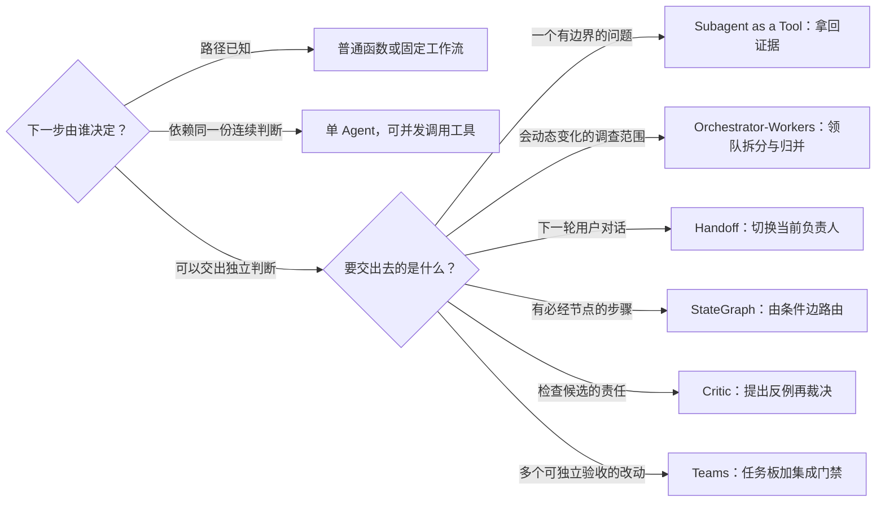

# 模块 03 · 多 Agent 编排：什么时候分工，谁来收结果？

> 一个 Agent 查五个 API，仍然只有一个决策者。要不要再加一个 Agent，先问：它能独立决定什么？做完交回什么？如果两个成员意见冲突，最终谁有权写入？

## 用一张图选分工方式



先翻译再格式化，两次固定模型调用就能做。查五个已知接口，单 Agent 加并发工具就能做。只有分支要根据观察持续选择下一步，才需要给它自己的决策循环。架构图里该数的是独立决策者，以及他们必须同步的事实。

### Cognition：两个成员同时改代码，哪里会出错？

解析器作者把空字符串归一成 `None`，命令行作者把空字符串当作「使用默认值」。两人都完成了局部任务，甚至没改同一个文件，合起来却可能对 `None` 调用字符串方法。一次写入就能把未讨论的约定固化成代码。

Cognition 在 2025 年指出，用户为什么选某个方案往往只存在于主对话。任务拆开后，每个分支都要自行补齐边界条件。共享字段的含义还没定，增加并行写者只会增加需要重新对齐的决定。[Cognition 的原文](https://cognition.com/blog/dont-build-multi-agents)

到 2026 年 4 月，Cognition 给出了能用的组合：Devin Review 在独立上下文里找问题，掌握用户意图的写者决定采纳哪些意见。主模型也可按需请教更强的模型，但得把问题背景交代够。读和质疑可以分出去，写仍有一个负责人。[Cognition 的后续实战](https://cognition.com/blog/multi-agents-working)

### Anthropic：为什么并行查资料能赚回来？

三个资料库各自要多轮搜索。一个研究员往深处追，不会改掉另一个研究员的输入；几十页阅读记录最后能压缩成带引用的结论。收益来自三处：并行缩短等待，独立窗口容纳长资料，领队可以把余下预算分给还没查清的问题。

Anthropic 的内部研究评测里，Opus 4 领队加 Sonnet 4 子 Agent，相对单个 Opus 4 **表现提升 90.2%**。Token 的分母另算：以普通聊天为基线，单 Agent 约耗 **4 倍**，多 Agent 约耗 **15 倍**。[Anthropic Research 工程复盘](https://www.anthropic.com/research/multi-agent-research-system)

这组结果同时换了模型组合、算力和编排方式。移植到自己的系统，先测任务有没有可分的证据域。两名研究员都去读同一个公告，再让领队合并两份摘要，增加的是重复搜索、同步和归并。按批等最慢成员还会拉长尾延迟。

| 先问什么 | 倾向单 Agent | 值得独立上下文 |
|---|---|---|
| A 的发现会让 B 白做吗？ | 同一故障要沿连续观察诊断，或双方频繁改同一状态 | 各读冻结资料，各自的结论能单独复核 |
| 分支为什么要自己决策？ | 输入和调用清单已知，代码即可并发 | 每个资料域要多轮追线索，范围会随观察改变 |
| 多一份上下文买来什么？ | 仍要逐字同步历史，或连搜索口径都没定 | 单窗口装不下原文，截止前要覆盖多域，能用证据指针归并 |
| 必须隔离谁的权限？ | 固定校验规则能完成复核 | 编制和独立复核必须分权，复核确需判断；最终签字交有权主体 |

**怎么做公平的对照？** 给单 Agent 相同的工具、可见来源、快照和验收器。分别固定费用、固定截止时间跑两轮。把宽搜、串行诊断、共享写入分桶，看来源覆盖、引用正确率、返工、耗时以及每份通过交付的费用。

## 六种编排拓扑：看控制权，也看返回值

| 拓扑 | 接下来谁说了算 | 分支完成时交什么 |
|---|---|---|
| Subagent-as-a-Tool | 父 Agent | 一个有出处的回答 |
| Orchestrator-Workers | 领队动态分工并合成 | 按任务编号归并的发现与缺口 |
| Handoff / Swarm | 接手对话的专家 | 新负责人、可见历史、待补字段 |
| DAG / StateGraph | 图的边和条件谓词 | 节点状态增量、门禁决定 |
| Debate / Critic | 裁决者按照标准验异议 | 可运行反例、证据或保留的争议 |
| Teams / Shared Board | 成员自行认领，集成人控制提交 | 带基线、代次和测试证据的制品 |

### 1. Subagent-as-a-Tool：专家查完，控制权回到谁？

主 Agent 请专家查「哪个调用点还在使用旧参数」，专家在独立窗口浏览代码，只回文件、提交哈希、行号和局限。原始用户仍与主 Agent 对话。父级能打开有争议的几行复核，其他几十页搜索过程留在子会话。

- **委派输入**：写清问题、允许的只读范围、源版本和退出条件。读接口按租户与对象授权，进程内传一个 Python 函数只能示意接口，真实隔离靠服务或沙箱。
- **返回契约**：交回主张、适用版本、证据位置、未确认项。父级能验证行号存在、引文匹配；子级找不到就返回「证据不足」。仅返回「放心用」会迫使父级重新查一遍。
- **产品差异**：Claude Code subagent 可独立配置指令、上下文、工具和权限。Hermes 的 `delegate_task` 新建子 AIAgent，有独立对话和终端会话，最终摘要回父级。Codex 的上下文继承与工作区隔离取决于入口和配置。

隔离上下文只隔开模型能读的历史。两个子 Agent 即使各有一个终端，也可能在改同一目录。只读委派给窄工具；真正要写代码时再显式分工作树，给父级补丁和验证结果。

### 2. Orchestrator-Workers：领队根据缺口决定再派谁

和固定并发的差别在于，启动前还不知道有哪些子任务。领队读第一批线索，划出互不重叠的资料域，收回证据后再决定要不要扩查。Anthropic Research 把动态分解、并行搜索、答案合成和引用处理分开。

**派任务前写下五项**：搜索范围、排除范围、应交证据、截止时间、费用上限。每份任务有稳定 ID、快照版本和计划代次。领队重新规划后，旧代次迟到的结果进存档，不能悄悄覆盖新结论。

| 两个很容易混的旋钮 | 限的是什么 | 漏掉会怎样 |
|---|---|---|
| 并发槽 `slots` | 同时运行的 worker 数 | 下游突发限流，排队拖累整批 |
| 总量 `quota` | 本次最多能派多少任务 | 并发只有 2，也能轮流派出 100 次重复搜索 |

实现时先对清单去重，只派额度内的任务。用信号量限并发，每个分支设工具超时，按 ID 回传 finding 或 gap。未派发的任务标「缺预算」。多用户共用一个服务时，在单次运行信号量外再加全局限流。

**何时可以提前合成？** 找一个可证实反例，首份验证通过就够；要求覆盖全部必填项，最快的结果只够更新进度。可选源超时可以带缺口交付，必需源缺失就不能签字。给最后的合成和核查留出独立预算。

### 3. Handoff / Swarm：下一句由接手者回答

航空客服里，分诊员问专家「还有哪些座位」再自己回答，这是工具式委派。分诊员把会话交给改座专员，由专员追问航班号、使用座位工具并答复用户，这才发生了 handoff。

OpenAI Agents SDK 把 handoff 暴露为模型可选的工具。模型选中后，Runner 切换当前 Agent，下一轮换用目标的指令与工具。`input_type` 校验移交参数，`input_filter` 等设置控制传入的历史；工具端仍须按用户身份和对象授权。

下面保留 SDK 接线部分。运行时用 `Runner.run` 从分诊进入，传入已认证会话的 context；模型选择移交时，回调记录结构化原因，专员继续接手。示例接口对应 Python 3.12、openai-agents 0.26.0。

```python
from typing import Literal
from agents import Agent, RunContextWrapper, Runner, function_tool, handoff
from pydantic import BaseModel

class Transfer(BaseModel):
    reason: Literal["seat_change"]

async def remember(ctx: RunContextWrapper[dict], data: Transfer):
    ctx.context["reason"] = data.reason

@function_tool
def seat_help() -> str:
    """读取改座流程中下一项必需的信息。"""
    return "需要乘客提供航班号。"

seat = Agent(name="seat", instructions="负责改座，先确认航班号。", tools=[seat_help])
front = Agent(
    name="front",
    instructions="识别改座请求后，移交给座位专员。",
    handoffs=[handoff(agent=seat, input_type=Transfer, on_handoff=remember)],
)

async def first_request(message, session):
    result = await Runner.run(front, message, context=session, max_turns=4)
    # 调用方一起保存负责人和历史，供下一次用户请求恢复。
    return result.last_agent.name, result.to_input_list(), result.final_output
```

接下一次 HTTP 请求时，取回 `active_agent` 和移交代次，选择允许的角色、加载其可见历史，再追加用户刚补的航班号。从分诊重新开局会让用户来回重复问题。若专员权限更窄，先从源历史筛掉不可见片段，再做摘要。

离线测试可以把模型换成固定输出：第一轮返回移交工具调用，第二轮断言专员指令和座位工具已生效，最后看 `last_agent` 和回调原因。这样能单测控制权交接。早期 Swarm 是教学实验，新项目看受维护的 Agents SDK。

### 4. DAG / StateGraph：哪些节点必须经过？

模型适合从材料里提取声明，程序适合回答「证据是否齐全、申请人能否自己批准」。把确定性规则放到图的边上，换模型也绕不过门禁。DAG 严格无环；StateGraph 可以有条件回边，适合有限次数的补件。

Kensho 的 Grounding 系统用 LangGraph 把金融数据请求路由到不同数据团队的检索 Agent，再落回可信来源。下面换一个更小的例子，只看怎样强制「有证据才可送审」。代码使用 LangGraph 1.2.24。

```python
from typing import TypedDict
from langgraph.checkpoint.memory import InMemorySaver
from langgraph.graph import END, START, StateGraph
from langgraph.types import Command, interrupt

class Review(TypedDict, total=False):
    commit: str
    evidence: str
    approved: bool
    outcome: str

def lookup(state):
    reports = {"abc": "CI run 42"}
    return {"evidence": reports.get(state["commit"], "")}

def review(state):
    decision = interrupt({"commit": state["commit"], "evidence": state["evidence"]})
    return {"approved": decision is True}

graph = StateGraph(Review)
graph.add_node("lookup", lookup)
graph.add_node("review", review)
graph.add_node("accept", lambda s: {"outcome": "通过"})
graph.add_node("reject", lambda s: {"outcome": "未放行"})
graph.add_edge(START, "lookup")
graph.add_conditional_edges("lookup", lambda s: "review" if s["evidence"] else "reject",
                            ["review", "reject"])
graph.add_conditional_edges("review", lambda s: "accept" if s["approved"] else "reject",
                            ["accept", "reject"])
for terminal in ("accept", "reject"):
    graph.add_edge(terminal, END)

app = graph.compile(checkpointer=InMemorySaver())
cfg = {"configurable": {"thread_id": "review-42"}}
assert app.invoke({"commit": "abc"}, cfg)["__interrupt__"]
assert app.invoke(Command(resume=True), cfg)["outcome"] == "通过"
```

这段代码在同一进程内挂起、用同一线程编号恢复。跨天审批要换持久后端，服务端将批准人、动作版本与授权绑定。`interrupt` 所在节点恢复时从头进入，别在中断前做无法去重的写入。

多节点并行时各写命名的证据字段，合并函数按明确规则生成结论。若不同节点同时写 `outcome`，「最后到达者赢」会让业务结果依赖网络延迟。补件要带原申请 ID、理由和次数，走回边时继承剩余预算。

### 5. Debate / Critic：一个反例值几票？

候选实现把金额列表转成集合再求和。评审只需给出 `[10, 10]`：两条真实记录应合计 20，候选却返回 10。裁决者运行反例，再用空输入和带负数的保留用例验修复。面对这种问题，多数票无法替代一次执行。

1. **作者**交候选和适用的用户约束。评审先看原始要求、标准和候选，晚一点再看作者的辩护，减少同一个错误前提对双方的影响。
2. **评审**指出位置、反例、违反的标准和严重度。代码可以交回归用例，报告可以交原文页码。「可以更优雅」不足以消耗一次返工预算。
3. **裁决者**验证异议，再给作者一次用新证据澄清的机会。保留最佳版本，限制轮数；证据不足时保留分歧交人。若用模型裁判，用已标注缺陷测误报漏报，并打乱候选顺序检查位置偏好。

AutoGen Debate 展示多个求解者如何用消息订阅交换意见并汇总答案，Devin Review 则用独立视角查代码。主观偏好可以投票；涉及金额、权限或程序行为，先找能独立核实的证据。

### 6. Teams / Shared Board：谁有资格交最后一个补丁？

长期并行修多个可独立验收的缺陷，需要共享任务表、独立上下文、可寻址的成员消息和制品库。成员可以直接沟通，不必让领队当传话员。消息通知集成人「有补丁」，任务状态和集成测试决定这份补丁能否进入主线。

Claude Code 的 Agent Teams 在 2026 年 11 月的文档中标为实验功能，默认关闭。共享任务、直接消息、会话恢复与关闭各有产品边界。Anthropic 的 C 编译器实验用了独立容器、本地 clone 和共享仓库里的任务锁，原型没有专职编排 Agent。

**租约过期后，怎样挡住旧成员？** 每次认领都递增 `epoch`。下面用 SQLite 3.35+ 的条件更新演示：甲领走任务后离线，乙接手；甲后来带着旧补丁回来，只能看到提交被拒绝。

```python
import sqlite3

db = sqlite3.connect(":memory:")
db.executescript("""
CREATE TABLE task(id PRIMARY KEY, state, owner, epoch INTEGER, expires INTEGER);
CREATE TABLE mail(task_id, epoch INTEGER, artifact, UNIQUE(task_id, epoch));
INSERT INTO task VALUES ('parser', 'open', '', 0, 0);
""")

def claim(owner, now):
    with db:
        row = db.execute("""
            UPDATE task SET state='busy', owner=?, epoch=epoch+1, expires=?
            WHERE id='parser' AND (state='open' OR (state='busy' AND expires<=?))
            RETURNING epoch
        """, (owner, now + 10, now)).fetchone()
        return row[0] if row else None

def submit(owner, epoch, now, artifact):
    with db:
        changed = db.execute("""
            UPDATE task SET state='review'
            WHERE id='parser' AND state='busy' AND owner=? AND epoch=? AND expires>?
        """, (owner, epoch, now)).rowcount
        if changed:
            db.execute("INSERT INTO mail VALUES ('parser', ?, ?)", (epoch, artifact))
        return bool(changed)

old = claim("甲", 0)
assert claim("乙", 1) is None
new = claim("乙", 11)
assert not submit("甲", old, 12, "old.patch")
assert submit("乙", new, 12, "new.patch")
assert db.execute("SELECT artifact FROM mail").fetchall() == [("new.patch",)]
```

任务转待审与留下通知在同一事务提交。生产用共享库时钟，把代次一路带到资源写入门禁；如果旧成员能直接推主分支，任务表上的检查就失效。领队重启后扫描待审任务，先检查已有制品，再决定复用、释放或重新派工。

## 五个线上深坑：先看坏结果，再找坏在哪次交接

### ① 上下文丢条件：一句准确的摘要也可能误导

用户原话是「旧订单撤销后，我同意新方案」。交接包只剩「用户同意」，专家读到的每个字都来自原话，却会提前执行。反过来，全量复制十万字历史，新成员也可能捡起已撤销的旧方案。要交的是**当前决定及其成立条件**。

| 交接包字段 | 接收方具体查什么 |
|---|---|
| 来源、目的地、`goal`、`constraints` | 要核验首次安装，还是已有机器升级？用户原始限制在哪儿？ |
| `claim`、`evidence_ref` | 引文适用哪个版本？能否沿制品 ID、内容哈希和行号打开原句？ |
| `open_questions`、`allowed_next` | 还差新装样本，只能申请补测；缺字段不能当成默认通过 |
| `handoff_id`、`revision`、`schema_version` | 是否重投、已过期、或需要按旧格式解析？ |
| 剩余预算、期限、访问范围 | 还允许查多久？接手者能否按自己的身份读取原件？ |

- **信封短，原件可取**：大日志存不可变制品，别用两个人都能覆写的 `latest.md` 作依据。短期签名链接失效时凭制品 ID 重新鉴权取地址；原件已过保留期就标证据失效。
- **分两次校验**：程序先验同租户、版本、哈希和位置，再检查句子能否支持主张。「旧版本升级通过」即便引文完全准确，也推不出「首次安装通过」。
- **什么时候给全文**：专家要追查主 Agent 最早在哪儿误判时，可以分叉只读快照，给按需补读额度。先按接手者权限过滤，摘要也要遵守相同可见范围，调查日志留在子线程。

拿「仅发摘要」和「摘要加按需读取」对照，记录补读次数和错误归因。若接手者很少补读，却总在同一条适用条件上出错，应该把这项条件加进契约。把全文复制给每个角色，反而会埋没真正缺的字段。

### ② 误差级联：每关 85%，整条链能过多少？

假设分类、检索、归纳必须全对，而且每关在前序正确的条件下都有 85% 成功率，整链成功率就是 **0.85³ ≈ 61.4%**。如果手里只有三份单项测试的边际准确率，就缺少直接相乘的依据。

最容易漏的错误在上游：分类选错资料域，下游可能忠实地检索、准确地总结了一套无关材料。也可能后继发现并纠正前一步；这时「每关都对」已经不是交付成功的必要条件。要测整链，还要能定位哪一步拖了后腿。

1. **原样跑**：固定一批带真值的任务，记录端到端成功率，保留每次交接的输入和产物。
2. **只换分类**：给检索员正确分类，其他照旧。提升大就先改路由，低置信时可并查两个域，再按同一标准归并。
3. **再换材料**：直接给归纳员正确原件。如果还是常错，升级分类器救不了归纳质量。

能机器核验的条件尽早查：区域、版本、对象对不上，直接退回补证。语义不明要允许写「未知」。并行结论按**原始来源**聚类，五篇报道转述同一公告只算一条证据链。不可逆动作交确定性校验或有权的人复核。

多 Agent 故障研究把任务规格、角色对齐和任务验证区分开。定位时也这样问：任务有没有派对？成员有没有理解成同一件事？交付物有没有被真正检查？分别修任务描述、交接协议和验收器，才能改到出错的那一层。

### ③ 死锁、空转、费用失控：三种「没进展」怎么区分？

| 现象 | 先看哪里 | 处理方式 |
|---|---|---|
| 日志几乎不动 | A 占最后一个槽等 B，B 在同池排队；或两人互等对方的锁 | 画资源与持有者的等待图，父级等待时释放槽，协调器与执行池分开 |
| 转接记录很多，缺口原封不动 | 相同来源、目的地、原因、业务版本和证据版本反复出现 | 同事实重走同边就问具体缺项或交人，保留全局 hop 上限 |
| 并发不高，账单却不停涨 | 每层都能再派助手，父级重试还会重建子树 | 根任务统一预留费用，限制子支上限、深度、总任务量和截止时间 |

一名领队派三名研究员，每人再派三个助手，两层已是 **1＋3＋9＝13** 个决策者。每层写「最多四轮」，整棵树仍可能很贵。用 `root_run_id` 找同一份账本，派发前原子预留，取消时按实际消耗释放，超时计费未知先对账。

锁要固定领取顺序，别持锁等人、等模型。确需跨长等待维持所有权，用有期限、可收回的租约及代次检查。客服得到新的发票号后，证据版本变了，可以再走原边；根预算和总期限继续沿用。

队列积压先减可选分支，保留核查与合成费用。必需源到期仍缺，就交已验证部分并点名缺口。监控把「每分钟动作数」和「每分钟新增可验收成果」画在一起：前者持续上升而后者停住，优先查重复委派、活锁和空转讨论。

### ④ 共享环境写冲突：两个绿分支能合出一个红提交

看一个可以手算的用例：基线约定空区域显示 `default`，旧解析器原样返回输入，旧界面用 `value or "default"` 显示。给解析器和界面各开一棵从同一提交起步的 worktree。

| 在哪份代码上跑 `label(normalize(""))` | 实际发生什么 |
|---|---|
| 新解析器＋旧界面 | 新解析器返回 `None`，旧界面兜底，绿 |
| 旧解析器＋新界面 | 得到空串，新界面按空串返回默认值，绿 |
| 新解析器＋新界面 | 新界面只对空串兜底，尝试执行 `None.upper()`，红 |

这次没有文本冲突。要挡住它，先指定公共接口负责人，约定空值语义、成员可改路径和允许依赖。每人从相同基线开独立分支与工作树，交回 `base_commit`、`head_commit`、改动清单及测试证据。

集成队列按顺序生成实际合并候选，在候选上跑契约测试和端到端测试，绿灯绑定候选哈希。另一个提交先进主线，就重新生成、重新验。旧租约的补丁要过同一道门，不能绕过去写主分支。

**工作树隔开了什么？** 检出文件、索引各自独立，仓库对象和许多引用仍共享。数据库分独立 schema 或临时实例，队列分前缀，服务分端口，共享测试环境只留一个写者。清理资源按任务和代次匹配，防止旧任务清掉新成员的环境。

Anthropic 的编译器实验后期，多个成员都卡在同一个内核构建。团队用可工作的 GCC 混合编译，把整项失败切为可独立诊断的子集。所有人盯着同一盏红灯时，先改测试夹具，让每个成员能判断自己负责的部分，再增加人数。

### ⑤ 追踪调试：所有 worker 都绿了，用户为什么还缺一项？

报告漏了首次安装。先查计划里有没有这项：没创建就查拆分；创建却没运行就查预算和队列；跑过就打开制品；制品写着「缺样本」，报告却写「全部通过」，就用原制品重放合成器。这样能找到最后一个可证明正确的边界。

- **串因果**：入口建 `trace_id`，委派建子 span，记父 span、业务任务 ID、attempt、模型、输入版本、费用和制品。经队列传递 trace context，消费者恢复上下文后再建处理 span。
- **连异步**：跨天可以另开 trace，以 span link 和持久业务 ID 指回原任务。归并 span 链接它实际消费的多个产物；单一父子关系表达不了多个输入。
- **算账**：重试保留 `task_id`、增加 attempt。业务覆盖按成功任务和版本去重，费用按实际尝试求和。取叶节点费用或根账本结算，别把父级汇总又加一遍。
- **回放**：读取已保存的工具响应或只读快照，关掉真实副作用。普通执行日志可采样；账单、批准和关键写入需要完整持久记录。向用户说明哪项查过、哪项误判、纠正依据在哪儿。

## 实战选型：算一次等待，再算一次交付

**关键路径怎么算？** 三个独立调查分别要 20、30、50 秒，规划 4 秒，归并验收 12 秒。串行要 **116 秒**，三个槽没有相互限流时并发要 **66 秒**。若目标是一分钟，再开第四个空槽也救不了那条 50 秒的必经支路。

拆分耗时看派发、等槽、下游、最慢分支和归并。瓶颈在检索可建索引，在可选项可提前返回，在必需项只能优化关键路径。线上取同批并发实测的高分位延迟；平均工具耗时或首字时间都不能代替最终交付时间。

**成本除以什么？** 平均一次尝试 2 元、通过率 80%，每份通过交付约 2.50 元；另一方案 3 元、通过率 90%，约 3.33 元。把各分支模型费、工具费和重复劳动算全，人审排队与实际复核工时分开记。

试点保留单 Agent 对照，对同一快照做盲评，比较覆盖率、引用与结论的一致性、人工推翻率、返工和尾延迟。只在宽搜获益，就只对宽搜派 worker；补丁越多而集成队列越长，就收紧并行写入，先修契约测试。

**最后做一次换版本演练。** 运行中把目标提交从 A 换成 B，看不同拓扑怎样处理手里那份旧证据：

| 拓扑 | 换成 B 后，什么必须重做？ |
|---|---|
| 工具式委派 | 拒收仍绑定 A 的结论，换 B 的指针再查 |
| 领队与工作者 | 保留仍适用的通用材料，只重派依赖版本的分支 |
| Handoff | 当前负责人读入新约束；超出其权限或能力时沿允许的边交回 |
| StateGraph | 让绑定 A 的批准失效，回到规定的核对节点 |
| Critic | 对 A 的评语留在旧候选，B 单独复验 |
| Teams | 拦住旧基线和旧代次的提交，在新基线重验可复用制品 |


## 一手资料

- **何时值得分工**：[Cognition 2025](https://cognition.com/blog/dont-build-multi-agents) · [Anthropic Research](https://www.anthropic.com/research/multi-agent-research-system) · [Cognition 2026](https://cognition.com/blog/multi-agents-working)
- **委派与工作区**：[Claude Code subagents](https://code.claude.com/docs/en/sub-agents) · [Hermes 委派](https://hermes-agent.nousresearch.com/docs/user-guide/features/delegation) · [Codex subagents](https://developers.openai.com/codex/subagents) · [Codex worktrees](https://developers.openai.com/codex/app/worktrees)
- **控制权移交**：[Agents SDK Handoffs](https://openai.github.io/openai-agents-python/handoffs/) · [航空客服源码](https://github.com/openai/openai-agents-python/blob/main/examples/customer_service/main.py) · [Swarm](https://github.com/openai/swarm)
- **显式图与评审**：[Kensho Grounding](https://www.langchain.com/blog/customers-kensho) · [LangGraph 工作流](https://docs.langchain.com/oss/python/langgraph/workflows-agents) · [中断恢复](https://docs.langchain.com/oss/python/langgraph/interrupts) · [AutoGen Debate](https://microsoft.github.io/autogen/stable/user-guide/core-user-guide/design-patterns/multi-agent-debate.html)
- **团队与排障**：[Claude Code Teams](https://code.claude.com/docs/en/agent-teams) · [并行 C 编译器](https://www.anthropic.com/research/building-c-compiler) · [多 Agent 故障研究](https://arxiv.org/abs/2503.13657) · [Git worktree](https://git-scm.com/docs/git-worktree) · [OpenTelemetry Traces](https://opentelemetry.io/docs/concepts/signals/traces/)

## 六道高频面试题

### 1. Cognition 劝你少拆，Anthropic 却说效果好，你听谁的？

**考察点：** 判断任务能否分解，能否独立验收。

1. 我先画读写集合。两个成员会改同一契约，而且一方的新决定会让另一方白做，就保留一个主写者。
2. 多个资料域各自需要动态探索，返回几条带引用的发现就能归并，可以试领队加研究员。
3. Anthropic 的 90.2% 比的是单 Opus 4，15 倍 Token 比的是普通聊天。我会用自己的任务做等费用和等时限对照。

**追问：** 只读任务能直接拆十份吗？还得查口径、来源重复度和关键路径。三个已知 API 用并发函数就够。

### 2. `as_tool()` 和 handoff 都能找专家，到底差在哪？

**考察点：** 下一轮由哪个 Agent 接、使用谁的工具。

1. 当工具调用，专家交回结论，父级继续决策，用户仍在原对话里。
2. 发生 handoff，Runner 换当前 Agent，专家可以直接追问用户。服务端保存负责人和可见历史，下次请求从这里接。
3. 移交参数、历史过滤和工具端授权分开校验。用户补上新证据时，专员再决定是否沿允许的边交回。

**追问：** 两个角色互相转怎么办？记录来源、目的地、原因和证据版本；同一事实重走同边就澄清或交人，再加全局跳数和预算上限。

### 3. 研究系统从三个 worker 加到十个，怎么反而慢了？

**考察点：** 区分并发度、覆盖范围和同步等待。

1. 我先拆出派工、排队、下游耗时、最慢分支和归并时间，查共用服务有没有被限流。
2. 再看大家是不是重复查同一来源，领队是不是等全部可选分支，合成时是不是又把原文读了一遍。
3. 必需项全部收齐才验收。可选项按期限交缺口，找到一个反例就足够的任务则允许提前结束。

**追问：** 父级占满 worker 槽等子级呢？那是资源死锁，挂起父级释放执行槽，把协调器与工作池分开。

### 4. 三个准确率 85% 的 Agent 串起来，结果还有 85% 吗？

**考察点：** 条件概率和真值替换实验。

1. 我先确认这三个数是单项成绩，还是在前序正确条件下测的。只有边际分数，算不出整链通过率。
2. 若每关条件成功率都是 85%，并且必须全部正确，连乘约 61.4%。
3. 我会测端到端，然后依次喂正确分类、正确材料，看错误从哪一关开始消失。

**追问：** 加独立评审怎么算？它有机会修复前面的错。要实测修复了多少真错、误改了多少正确答案。

### 5. 两个成员的测试都绿，合并以后却红了，门禁放在哪？

**考察点：** 文本隔离、语义冲突和验证版本。

1. 我先统一接口契约，比如空值到底是空串还是 None。成员从同一基线分工作树，各交补丁和测试证据。
2. 集成队列生成真实合并候选，在它上面跑契约和端到端测试。主线一变，旧候选的绿灯作废。
3. 除了文件，还查共享数据库、端口和队列。环境按任务隔离，清理时核对代次。

**追问：** 都在修同一个失败用例怎么办？先拆测试夹具，让每个成员能独立判定负责的子集，再决定并行度。

### 6. 领队掉线了一天，旧成员又突然回来，怎么接着交付？

**考察点：** 待办能恢复、过期写者能拦住、外部效果能查清。

1. 新领队扫描持久任务表，按依赖、认领代次和已交制品重建待审列表，保留能复验的工作。
2. 租约重领就递增代次，集成门禁拒绝旧持有者。外部写入复用稳定业务键，先查回执。
3. 用业务 ID 和 trace 串起计划、子任务、工具和合成。哪个边界丢了结果，就用保存的输入重放那一段。

**追问：** 远端既不支持代次也无法幂等呢？把写权限收在受控出站服务里，结果未知时保留请求证据交人核对。

