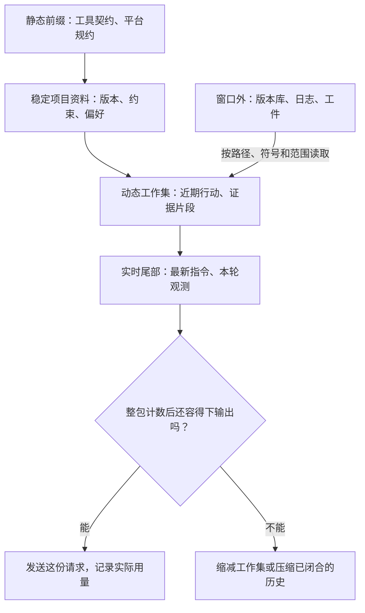
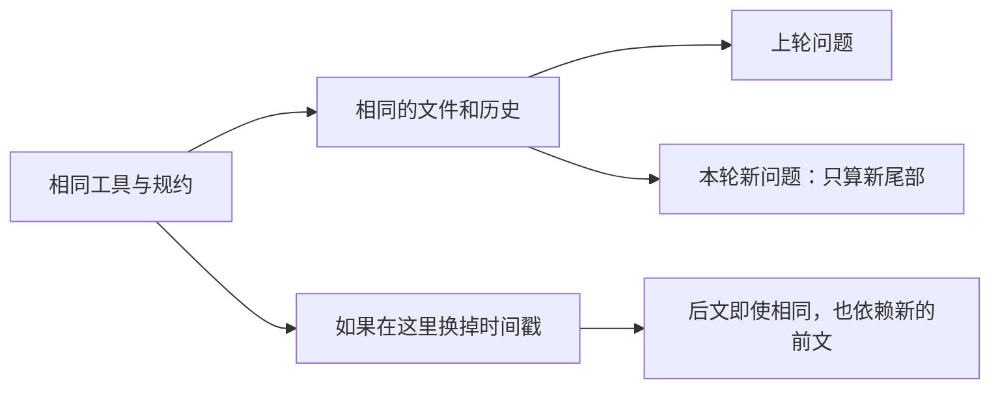

# 04.1 上下文工程与 KV-Cache：一个时间戳为什么能打掉几万 token 的缓存？

> 把当前时间写在提示词第一行，明明只改了几位数字，GPU 却可能要从那里一路重算到末尾。设计一次 Agent 调用，要同时答好两个问题：模型这一步该读什么，哪些计算下轮还用得上？

## 一次请求里，什么放前面，什么留在外面？



四层描述的是**材料的有效期**。落到 Claude Messages，服务端按 `tools → system → messages` 渲染。工具定义天然排在系统规约前面；项目文件即使十轮都用，也仍是项目资料，别给它换成平台指令的身份。[Claude 缓存规则][1]

### Context Rot：答案明明在窗口里，怎么还会答错？

做个只改一个变量的实验：给模型同一个问题、同样的二十份文档，只挪动含答案的那一份。要是“放得下”就等于“用得好”，正确率应该差不多。

| 《Lost in the Middle》多文档问答 | 第 1 份 | 第 10 份 | 第 20 份 |
| --- | ---: | ---: | ---: |
| GPT-3.5-Turbo 正确率 | 75.8% | 53.8% | 63.2% |

从第一份挪到第十份，正确率就掉了 **22 个百分点**。再看另一种干扰：Chroma 的 Context Rot 研究覆盖 18 种模型，在子实验里改变问题与证据的措辞，再加入一个、四个似是而非的答案。干扰越多，找对证据越难。[原论文表 6][2] · [Chroma 实验][3]

工程上最常见的是几份材料**都像真的**：旧接口示例还能运行，新规约却已经改了默认值。模型逐字搜到函数名，只证明它能定位；让它挑对当前版本，并在生成的调用里用对参数，才测到了你关心的能力。

Anthropic 把这种取舍叫作 *attention budget*。稠密注意力会在 token 位置间计算关联，序列越长，候选关联越多。这个直觉能指导选材，复杂度公式却算不出正确率，API 也没有“注意力余额”可读。[Anthropic 上下文工程][4]

**自己复现**：固定模型快照、代码和评分脚本，把同一条硬约束轮流放首、中、尾，再加一份已废弃的相似规约。看生成的补丁是否通过兼容测试，顺手记录它引用了哪一版。这样能区分“没读到”和“读到了却信错了”。

### 先看谁在反复收费

一次工具调用返回 3,000 token，如果后面六轮都回放原文，仅这份结果就累计提交了 21,000 token。热读能打折，它在每轮窗口里仍占 3,000 个位置。要腾出位置，得把原文换成可回读的引用。

| 从哪里长出来 | 具体数什么 | 容易数错的地方 |
| --- | --- | --- |
| 系统规约和工具 | 模板渲染后的文本、实际可见的 schema、枚举和参数说明 | 注册表里有五百个函数，这次可能只给模型看了八个 |
| 对话历史 | 用户原话、助手的计划、工具实参和旧补丁 | 用户撤回的要求与助手自己的猜测要能分开 |
| 日志和文件 | 按工具调用 ID 区分新读入与历史回放，再按路径、版本、范围细分 | 文件由工具读入就已记过一次，文件分类不能再加进总数 |
| 推理与协议 | 原始消息块、工具包装、输出里的推理用量 | 界面显示的推理摘要不能代表全部输出用量 |

有些模型让推理与可见答复共用输出额度，工具循环还可能要求原样回传带签名的思考块。让适配器保存协议对象；把界面上的摘要复制成普通消息，既占位置，也改变了模型下次看到的内容。[Claude 窗口][5] · [OpenAI 推理指南][6]

算笔容易漏掉的账：系统 2K、工具 18K、项目 3K、任务历史 9K、文件和日志 53K、最新要求 1K，首轮共 **86K**。先砍几句系统提示，对最大头的 53K 几乎没有影响。

如果此后每轮净增 5K，十轮累计输入是 `10 × 86K + 5K × (0 + … + 9) = 1,085K`。Manus 披露过其 Agent 的平均输入与输出约为 **100∶1**。衡量一次任务时，要把反复提交的历史也算进去。[Manus 工程复盘][7]

## 四层预算：先给下一次输出留座位

假设窗口 128K，模型支持本轮输出最多 12K，再留 4K 给计数误差和协议增量，可发输入上限就是 **112K**。上轮只回了一个“好”，这轮可能要输出整份补丁，预算得按接下来要做的动作留。

| 层 | 配额示例 | 优先保什么 | 紧张时从哪里省 |
| --- | ---: | --- | --- |
| 静态前缀 | 16K | 已启用的工具契约、平台规约 | 发布前检查重复描述、大枚举和多余工具 |
| 稳定项目资料 | 8K | 生效的仓库规则、适用的用户偏好 | 高频约束留原文，罕用手册留索引 |
| 动态工作集 | 80K | 未完事务、当前文件、能证实或推翻假设的片段 | 先去掉可重取的副本，再压缩已结束的回合 |
| 实时尾部 | 8K | 最新用户指令、必要的环境变化 | 附件外置，减少机器提醒，完整保留指令 |

四层合计 112K，另外的 16K 已经留出。某层用不满时可以把空位借给工作集；前提是必选内容已经放进请求。若只剩不可丢的材料还超限，就返回明确的压缩信号，别从最新用户消息尾部截掉几个字。

- **项目资料怎么选**：适合进 `AGENTS.md` 的是多次任务都会用到的约定。个人偏好要带来源、适用范围和替代关系；下一条用户修正到来时，能找到被覆盖的那一条。
- **证据怎么选**：调试时先放失败断言、调用点和当前版本的最小输入。读过三版同一个文件，就显示与工作树匹配的版本，把旧版行号和提交留在轨迹里。
- **尾部怎么写**：保留用户原话，把“当前提交已从 A 变为 B”标为环境观测。若正在等工具结果，先按协议回完整批次，再放本轮状态。[工具批次与安全切点](./02-context-compaction-and-offloading.md)

## KV-Cache：GPU 究竟记住了什么？

第一次读输入叫 **prefill**。模型在每一层给各个位置算出键 K 和值 V。开始逐 token 生成之后，新位置用查询 Q 读取已有的 K、V，再把自己的 K、V 接到末尾，这一步叫 **decode**。

一次生成内部就会复用先前位置的状态。跨请求复用多了一步：推理服务得在相同模型、输入表示和相关配置下，找到上一轮留下的那段公共前缀。命中后，新问题仍要计算，回答也仍要逐步生成。



原因在**因果注意力**：第七个 token 一变，第八个位置开始就可能读到不同的前文。能复用的部分停在第一次分歧之前。诊断时比较渲染后的模型输入；HTTP 信封里一个无关字段变了，不一定会改变分词结果。

**自建服务里能看到这件事怎样落地**。vLLM 给填满的 KV 块建索引，标识包括父块哈希、本块 token 和额外区分项，例如适配器、图像或隔离盐。两条请求可以共用祖先块，从分歧处各自分配后续块。[vLLM 前缀缓存设计][8]

共享块仍被活跃请求引用时要保留。请求退出先减少引用，空闲块才可以回收。把冷前缀一直留在 GPU 上会挤掉热点数据，所以自建时还要看可用块数和淘汰情况；托管 API 则看供应商公布的复用条件。

### 一段 32K 的上下文，要占多少显存？

| 原始 KV 显存的因子 | 例子 | 为什么要乘它 |
| --- | ---: | --- |
| K 和 V | 2 | 每个位置两份状态 |
| 层数 | 32 | 每层都保存自己的表示 |
| KV 头数 × 头维数 | 8 × 128 | 分组查询时用 KV 头数，不能拿查询头数代入 |
| 每元素字节数 | 2 | 此例按 16 位存储 |

每 token 是 `2 × 32 × 8 × 128 × 2 = 131,072` 字节，即 **128 KiB**。乘以 32,768 个位置，单序列就有 **4 GiB** 原始 KV。估一台机器能同时跑几个会话，还要算权重、临时张量、分页碎片、量化、滑窗和分片布局。

**首字为什么先变快**：命中省的是重复 prefill。客户端的 TTFT 还包含上传、排队、路由、缓存查找、首步解码和流式传输。若测的是“屏幕上出现第一个字”，隐藏推理和前端缓冲也要计时。

Anthropic 在十万 token 的图书问答里把首 token 从 **11.5 秒降到 2.4 秒**；OpenAI 的早期 Cookbook 给出过万 token 长提示延迟最多改善 80% 的例子。要比较自己的两种方案，用同样长的前缀、同样的回答，分别测冷写和热读。[Anthropic 实测][9] · [OpenAI Cookbook][13]

## 断点与计费：先看模型代际，再算折扣

以下按 2026 年 11 月 24 日的标准 API 规则算账。切换模型快照时，连同最低缓存长度、读写单价和保留选项一起核对。[Claude 定价][1] · [OpenAI 代际表][10]

断点标记的是“到这里为止的前缀”。一份通用手册后面接十个不同的问题，希望复用的是手册结尾。只在第一个随机问题之后写缓存，下次换问题时，服务端未必有手册结尾那份可读状态。

| 接口与代际 | 谁决定边界 | 写入怎么收 | 读取怎么收 |
| --- | --- | --- | --- |
| Claude Messages 显式缓存 | 在合格内容块末尾设 `cache_control` | 5 分钟 1.25 倍，1 小时 2 倍 | 常规 0.1 倍；Opus/Sonnet 5.5 为 0.05 倍，部分 Fable/Mythos 为 0.025 倍 |
| Claude Messages 自动缓存 | 顶层 `cache_control` 移到最后一个合格块 | 同 TTL 的显式写价 | 同模型的显式读价 |
| OpenAI 早于 GPT-5.6 | 隐式断点，间隔依模型与配置；稳定 key 有助路由 | 无额外写溢价 | 按型号计价，例如 GPT-4.1 标准输入每百万 2 美元，缓存读 0.50 美元 |
| OpenAI 从 GPT-5.6 起 | 合格消息末尾的隐式断点，或显式 `prompt_cache_breakpoint` | 默认 30 分钟 1.25 倍，Responses 的 12 小时 2.5 倍 | 多数 0.1 倍，含 GPT-6.2 Astra、Sol 在内的部分型号 0.05 倍 |

表中倍数以同模型普通输入为 1。Claude 有模型和平台各自的起缓存长度，最多四处断点，自动位置通常占一个。它从断点向前找约二十个内容块里的已写边界；追加大量小块时，要让旧边界仍落在查找范围内。[Claude 定价与断点][1]

**OpenAI 的两个“128”容易讲错**：早期发布说明写过 1,024 起步、128 递增。旧模型的用量会向下取整到 128 的倍数；实际断点间距随模型而变，GPT-5.5 系列就是 2,048。查命中时应区分断点位置、最低长度和报告精度。[首发说明][12] · [现行代际表][10]

从 GPT-5.6 起要有至少 1,024 个可见输入 token，可用 `prompt_cache_options.mode` 选模式。路由自动完成，key 可用于分组记账。到 GPT-6.2，Responses 把顶层 `instructions` 接在 `input` 后，每次按普通输入收；常驻规约放开头的 developer 消息。[OpenAI 缓存指南][10]

### 拿十轮请求验算一次

每轮带 20,000 个公共 token、2,000 个新 token。用 Claude 五分钟缓存、常规读价，第一次写公共段，后九次都在有效期内命中。下表把钱折算成同价普通输入 token，便于心算。

| 哪一笔 | 算式 | 普通输入等价量 |
| --- | --- | ---: |
| 十轮都以普通价发送 | 10 × 22,000 | 220,000 |
| 首次写公共段 | 20,000 × 1.25 | 25,000 |
| 后九轮读公共段 | 9 × 20,000 × 0.1 | 18,000 |
| 十个新尾部 | 10 × 2,000 | 20,000 |
| 使用缓存后合计 | 25,000 + 18,000 + 20,000 | **63,000** |

同一件事有三个正确答案：**公共段读价省 90%，单个热轮输入省 81.8%，十轮全部输入省 71.4%**。把输出、工具执行和总结器都加上，才是完成任务的账。缓存读价符合条件，也不保证每轮都在物理上复用 KV 或缩短延迟。

**几次回来才回本**：同一公共段发 n 次，比较 `写价 + (n−1) × 读价` 和 n。五分钟方案用两次花 1.35，已经划算；一小时方案用两次花 2.1，用三次才降到 2.2 对 3。每次过期重建都要另算一笔写入。

## 六个缓存击穿坑：从第一处分歧往后查

### 1. 第一行塞了毫秒时间戳

打开相邻两次渲染后的请求，找**第一个不同的内容块**。如果时间戳在 system 开头，Claude 前面的工具仍可能命中，后面的项目规约和历史却得重算。因此“已有一点缓存读取量”也可能掩盖这个问题。

**改法**：把时间和消费它的观测一起追加到尾部。业务只需要“今天”，就按业务时区取日期；超时判断需要秒，就保留秒。修完用同样两次请求重测读取量和 TTFT，别靠删掉有意义的精度换曲线好看。

### 2. 工具没变，发出去的顺序却变了

并发发现 MCP 工具时，谁先返回谁排第一，重启后同一目录就能变样。固定名称、版本和工具排序，对象键稳定序列化，有业务顺序的数组保持原样。再查是不是每个阶段都在增删最前面的工具定义。

**工具小而固定**：Manus 用状态机决定下一步可选动作。自托管可在解码时屏蔽不允许的名称路径；名称可能横跨多个 token，要沿完整合法前缀约束。托管接口用支持的工具子集或 `tool_choice`，实测缓存影响。执行器仍要按身份和状态核权。[Manus][7]

**工具多而分散**：几百个定义即使次次命中，仍会占窗。让发现入口常驻，按需加载候选，再在小集合里限制本步动作。观察“目标工具找得到吗”和“找到了能填对吗”，分别定位检索与契约问题。

### 3. 为了纠错，回头改了第四轮消息

模型第十轮才发现文件已更新，回头覆盖第四轮，既改变后缀的共同祖先，也让旧决策看起来像基于新代码做出。追加一条带版本的新观察，留下当时读到什么、现在哪条结论已过期。

**确实要清理时**：Claude Context Editing 能设触发量、近期保留数和 `clear_at_least`。清理位置后的缓存要重建，删一百 token 却弄冷六万 token 往往吃亏。批量切一次新视图，固定摘要版本，然后继续追加。[Claude Context Editing][14]

### 4. 租户名字排在公共手册前

同一份两万 token 手册，开头换个昵称就从头分叉。把公共规约、获准使用的项目资料、个人偏好按作用域排列。装包前先过滤权限，别为了共享前缀把另一租户的文件带进来。

**验证范围**：Claude 直连与云渠道要看各自的工作区或组织隔离，OpenAI 有组织和区域边界，自建 vLLM 可以按信任域加盐。重放要选同一授权域；缓存 key 负责分组，读取文件的权力由业务层决定。[Claude][1] · [OpenAI][10] · [vLLM][8]

### 5. 所有人都用同一个 TTL

Claude 的五分钟缓存命中后会刷新。自动循环每十秒访问一次，短 TTL 就能一路续下去；人工确认每隔十五分钟才回来，短 TTL 会反复冷写。看同一前缀的**相邻到访间隔**，也统计第一次之后再没回来的请求。

**算给自己看**：第 0、15、30 分钟分别访问一次，短方案三次写花 3.75；一小时方案一写两读花 2.2。长短混用时，Claude 要求长 TTL 在前。主动发保温请求也要入账；缓存过期后的业务恢复依靠应用保存的资料。[Claude TTL 规则][1]

### 6. 子代理一出发就改系统角色

两条分支都需要父会话读过的材料，就冻结父节点，在尾部追加各自的分工。同模型、同配置、同授权域且祖先断点可读，才有机会共享计算。把“你是测试专家”写回第一段，分歧会提早到开头。

**并发有先后**：Claude 首次缓存要等首个响应开始返回，其他请求才能用。可以让有实际工作的父请求先建边界，再放出分支。若子任务只要一个符号和一条断言，直接给它短证据包，往往连共享那八万 token 都省了。[Claude 并发规则][1]

## Progressive Disclosure：先给入口，用到再展开

看到一条失败断言时，开发者通常先跳函数定义，只在需要时才翻整本手册。给 Agent 也留这种入口：流程、工具、事实各有各的取法。

| 想延后加载什么 | 开始给什么 | 需要时怎么拿 |
| --- | --- | --- |
| Skill 的工作方法 | 名称、用途和足够具体的触发条件 | 打开 `SKILL.md`，遇到分支再读参考；确定性检查交给已授权脚本 |
| 大工具库的函数契约 | 常用工具、搜索入口 | 搜少量候选，加载匹配版本的 schema，再调用 |
| 代码、文档、数据库事实 | 仓库路径、符号、表名、访问范围 | 搜索匹配处，只读相关行、字段或过滤后的样例 |

**Skills**：描述写“打包发布时核对版本和产物”，Agent 才知道何时读发布手册。用“帮助开发”当描述，几乎什么任务都可能误触。把相似但无关的任务也放进回放集，检查没用到技能的首轮是否真的缩短。[Anthropic Agent Skills][15]

**Tool Search**：Anthropic 示例里，全量工具说明约 77K token，换成搜索与少数契约后约 **8.7K**。用 `defer_loading` 推迟加载，让协议适配层挂载返回的工具引用。展示一段参数说明，还不足以让后端执行该工具。[Anthropic Advanced Tool Use][16]

Cursor 把说明同步到文件系统，让 Agent 按需查找。其 A/B 实验里，**实际调用了 MCP 工具的运行**平均总 token 降低 **46.9%**。判断自己的搜索值不值，把首轮省下的输入与新增往返、漏找和重复读取放在同一任务里比较。[Cursor 动态发现][17]

**Just-in-Time Context**：已知符号时，先用 `rg -n 'count_tokens' src tests` 找调用点，再按范围读取。提交号能定位仓库历史，有未提交改动时还要记内容指纹。Claude Code 会提前读项目规约，再用搜索补具体文件；两种时机可以搭配。[Anthropic 上下文工程][4]

## ContextAssembler：发出去的就是算过的那一包

下面只留组包骨架。入口用于**新用户回合**：上游已校验历史完整、上一批工具已闭合。工具按名去重排序，对象键规范化；传入的项目序言是冻结的 user 内容，历史里只存它之后的事件。

```python
class ContextAssembler:
    def __init__(self, render, count, output=12_000, window=128_000, guard=4_000):
        self.render = render
        self.count = count
        self.output = output
        self.limit = window - output - guard

    def assemble(self, base, project, history, instruction, state, evidence):
        if not instruction.strip():
            raise ValueError("缺少本轮用户指令")
        tail = [{"type": "text", "text": instruction}]
        if state:
            tail.append({"type": "text", "text": "环境观测：" + state})

        # render 组装同一协议的合法请求；探针只用于分层归因。
        probe = [{"type": "text", "text": "."}]
        blank = self.count(self.render(base, [], [], probe))
        prefix = self.count(self.render(base, project, [], probe))
        latest = self.count(self.render(base, project, [], tail))
        if blank > 16_000 or prefix - blank > 8_000 or latest - prefix > 8_000:
            raise ValueError("规约、项目或实时尾部超额，请检查对应层")

        ranked = sorted(evidence, key=lambda part: (part.priority, part.ref))
        def measure(k):
            blocks = [part.block for part in ranked[:k]] + tail
            body = self.render(base, project, history, blocks)
            return body, self.count(body)

        best, used = measure(0)
        if used > self.limit:
            raise ValueError("必选历史超限，先做安全压缩")
        low, high = 0, len(ranked)
        while low < high:
            mid = (low + high + 1) // 2
            trial, size = measure(mid)
            if size <= self.limit:
                low, best, used = mid, trial, size
            else:
                high = mid - 1
        return {**best, "max_tokens": self.output}, used, ranked[low:]
```

接 Claude 时，`count(body)` 取 `client.messages.count_tokens(**body).input_tokens`。`render` 每次创建独立请求，把项目序言与相邻 user 内容合并，证据块带路径、版本和行段。返回的三项是实发请求、预估输入、延后加载的材料。[Claude Token Counting][18]

**断点在哪里加**：在传输副本上标系统规约末尾、冻结的项目序言末尾，以及最近已闭合助手回合的合格文本块。存事件时去掉这些移动标记。下一轮若把已合并的 user 消息连同序言再存一遍，项目说明就会越长越多。

渲染器里最容易出错的几行如下。这里约定 `base` 含模型、已规范化的工具和已标断点的系统规约，`project` 是带来源的项目文本块。上一轮历史以普通助手回复结束；工具结果续跑用下一篇的批次入口。

```python
from copy import deepcopy

def render(base, project, history, tail):
    mark = {"type": "ephemeral", "ttl": "5m"}
    messages = deepcopy(history)
    if messages:
        if messages[-1]["role"] != "assistant":
            raise ValueError("新用户回合前必须结束上一轮")
        for msg in messages:
            if isinstance(msg["content"], str):
                msg["content"] = [{"type": "text", "text": msg["content"]}]
        last = messages[-1]["content"]
        if any(block["type"] == "tool_use" for block in last):
            raise ValueError("优先回填工具结果")
        if last and last[-1]["type"] == "text":
            last[-1]["cache_control"] = mark

    messages.append({"role": "user", "content": deepcopy(tail)})
    if project:
        intro = deepcopy(project)
        intro[-1]["cache_control"] = mark
        if messages[0]["role"] != "user":
            raise ValueError("项目资料后应接完整的用户回合")
        messages[0]["content"] = intro + messages[0]["content"]
    return {**base, "messages": messages}
```

**为什么用整包计数**：字符数除以四会漏掉中文分词、工具包装和模型差异。探针差值只做归因，硬门槛看最终候选整包加余量。计数失败要重试或停发；若中间件随后又加了提醒，必须重新计数。

**这个选择器的代价**：二分取优先级前缀，最前面一个巨型文件会挡住后面的小片段。检索时先按符号切块、按版本与范围去重。高吞吐时可按模型、规约、工具和项目版本缓存探针，最终请求仍过整包检查。

## 实战速查：这次到底该改哪一层？

| 看到什么 | 第一处检查 | 用什么验收 |
| --- | --- | --- |
| 首轮输入就很长 | 分开数工具和系统规约，试延迟加载 | 目标工具的召回率、额外往返、首轮输入 |
| 每轮都长几千 token | 按调用 ID 查回放，外置重复日志 | 实际总输入、回读次数、测试通过率 |
| 热读很多，仍用错规范 | 对照版本、位置和相似干扰项 | 硬约束遵守率、引用错版本的次数 |
| 输入稳定，首字却慢 | 分开看冷写、缓存读量、排队、流式缓冲 | 同类任务冷/热的 TTFT P50、P95 |
| 首字快了，任务依旧很慢 | 对齐工具开始、结束、最后一个输出的时间 | 端到端耗时、每个成功任务的成本 |

两家的用量字段有个细小但昂贵的区别。Claude 普通 `input_tokens`、缓存创建量、缓存读取量要**相加**；分 TTL 的写入明细只是创建量的拆分。OpenAI Responses 的 `input_tokens` **已含** `cached_tokens`，新代写入按明细核价。

十个请求每个都读到一千 token，按请求数算命中率是 100%；目标公共段若有两万，绝大部分仍在冷算。把读取 token 占比也画出来，按模型、模板版本和任务类型分桶，再回到同一组仓库快照跑验收。

## 一手资料

- 实验与实现：[论文正式版][19] · [表 6 原始数据][2] · [Chroma][3] · [vLLM][8]。
- Claude：[上下文工程][4] · [窗口][5] · [缓存规则][1] · [延迟实测][9] · [清理][14] · [计数][18]。
- OpenAI：[代际对照][10] · [GPT-4.1 定价][11] · [首发说明][12] · [Cookbook][13] · [推理用量][6] · [更新记录][20]。
- 渐进加载：[Agent Skills][15] · [Tool Search][16] · [Manus][7] · [Cursor][17]。

## 面试：六个问题，怎么用自己的话讲？

### 1. 有百万窗口了，为什么还要选材料？

- **考察点**：容量、证据位置、多轮回放。
- **我会这样讲**：① 一百万说的是能装下多少。② 同样二十份文档，只挪答案的位置，正确率就能掉 22 个点。③ 我会保留本轮硬约束和当前证据，把旧版留个能打开的引用，再看测试是否通过。
- **追问：怎么证明有效？** 固定模型和题目，调换证据位置、加入旧版干扰，同时测正确率与实际输入。

### 2. 只动了时间戳，为什么缓存读量掉了一大截？

- **考察点**：因果前缀和可读断点。
- **我会这样讲**：① GPU 存的是各位置看过前文后算出的 K、V。② 时间戳一变，从那里起前文就不同了。③ 我会把时间放回观测事件，再查早于分歧的公共段有没有写过断点。
- **追问：前缀相同还冷呢？** 顺序发两次，核对模型、最小长度、隔离域、TTL 和首写是否完成。

### 3. 缓存读价便宜九成，为什么整单只省一部分？

- **考察点**：能否说清优惠的分母。
- **我会这样讲**：① 公共段首次写还要付溢价。② 每轮的新尾部和输出各有自己的价格。③ 以两万公共加两千尾部为例，十轮输入从 22 万降到 6.3 万普通 token 等价量，整任务还得加工具费。
- **追问：该买一小时吗？** 拿同一前缀的到访间隔回放，算上第一次用完就走的人。

### 4. 工具会随阶段变化，怎样既管住动作又保住前缀？

- **考察点**：工具可见、模型可选、执行获准。
- **我会这样讲**：① 小目录固定名称、顺序和契约。② 状态机限制当前允许的动作，执行器再查权限。③ 如果库太大，我只常驻搜索和高频工具，用到才展开契约。
- **追问：怎么找瓶颈？** 先看目标有没有出现在候选里，再看模型是否填对参数。

### 5. 两个子代理要查同一仓库，值得复制父会话吗？

- **考察点**：分支共享与最小证据包的取舍。
- **我会这样讲**：① 先查它们到底需要哪些文件、有没有权限。② 真需要同一长前缀，就冻结父节点，等首写可读，在尾部追加分工。③ 只需一处符号的子任务，我直接传版本、位置和验收条件。
- **追问：如何验证共享？** 同模型、同长度做冷热对照，一起看缓存读量和首字时间。

### 6. 怎么知道自己真的缩短了上下文？

- **考察点**：读折扣、窗口占用和任务质量。
- **我会这样讲**：① 我先还原整包实际输入，热读也算占窗。② 再记回读、总结、冷写和端到端耗时。③ 最后跑同一组验收，用每个成功任务的总成本比较。
- **追问：摘要每轮更新呢？** 我会固定一版摘要，平时追加增量，到安全切点再批量重建，单独记这次冷写。

[1]: https://platform.claude.com/docs/en/build-with-claude/prompt-caching
[2]: https://arxiv.org/pdf/2307.03172
[3]: https://www.trychroma.com/research/context-rot
[4]: https://www.anthropic.com/research/effective-context-engineering-for-ai-agents
[5]: https://platform.claude.com/docs/en/build-with-claude/context-windows
[6]: https://developers.openai.com/api/docs/guides/reasoning
[7]: https://www.manus.im/blog/Context-Engineering-for-AI-Agents-Lessons-from-Building-Manus
[8]: https://docs.vllm.ai/en/latest/design/prefix_caching/
[9]: https://www.anthropic.com/news/prompt-caching
[10]: https://developers.openai.com/api/docs/guides/prompt-caching
[11]: https://developers.openai.com/api/docs/models/gpt-4.1
[12]: https://openai.com/index/api-prompt-caching/
[13]: https://developers.openai.com/cookbook/examples/prompt_caching101
[14]: https://platform.claude.com/docs/en/build-with-claude/context-editing
[15]: https://www.anthropic.com/research/equipping-agents-for-the-real-world-with-agent-skills
[16]: https://www.anthropic.com/research/advanced-tool-use
[17]: https://cursor.com/blog/dynamic-context-discovery
[18]: https://platform.claude.com/docs/en/build-with-claude/token-counting
[19]: https://aclanthology.org/2024.tacl-1.9/
[20]: https://developers.openai.com/api/docs/changelog
