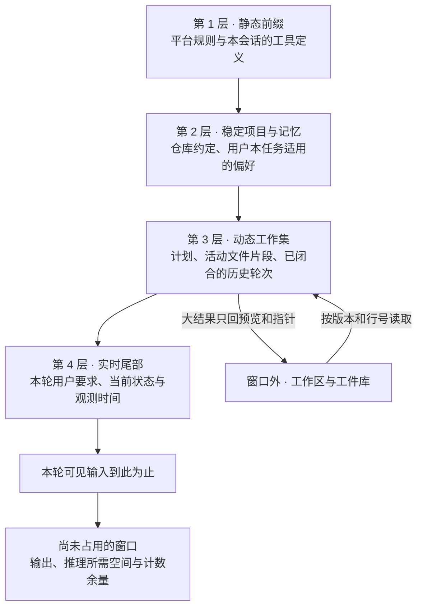
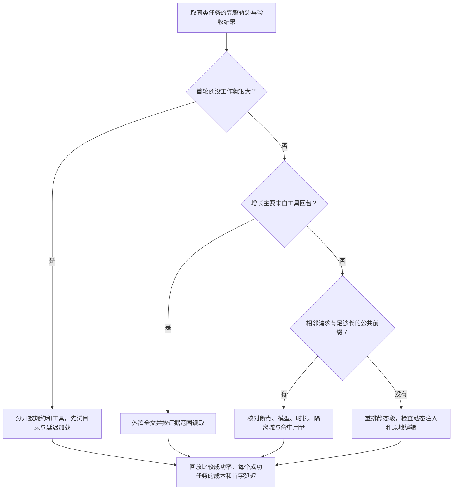

# 04.1 上下文工程与 KV-Cache：让 Agent 每轮都读对材料

用户只问了一句“修好导入器，旧日期格式也要能读”，到了第十轮，模型已经看过三版源码、两份测试报告和几十页工具说明。它改对了新格式，却把第一轮的兼容要求忘了。本文沿着这次修复，从工作台上的证据一直追到推理服务器的缓存块，解决实战和系统设计面试里的同一个问题：**下一次调用，哪些东西值得再读，哪些计算值得再付一次钱？**

资料核对至 **2026 年 11 月 24 日**。下文的导入器、容量预算和成本演算是教学案例；涉及真实效果的数字都注明了模型、任务或样本范围。

## 先把一次调用摊开看



把这张图想成一次值班交接。墙上贴着长期有效的操作规程，桌上放着今天的工单，最新电话记录压在最上面，原始日志则留在能查阅的地方。墙上写得越多，人越难在打电话时找到需要的一条。模型也有类似的使用成本，而且每轮都要处理重新送来的材料。图里的四层是应用安排信息的顺序，具体到 Claude Messages，服务端按 **tools → system → messages** 建立前缀。可复用的项目说明适合靠前，用户补充的意见仍然要保留其原本的消息角色。[Anthropic 缓存文档](https://platform.claude.com/docs/en/build-with-claude/prompt-caching)

### 窗口有多大，模型能把里面的东西用得多好，是两次测量

一百万 token 告诉你一次最多能带多少行李。能否在一堆相似的小票里挑出**这一单最后批准的日期格式**，是另一项能力。Context Rot 指输入变长或干扰增多时，模型使用已有信息的效果可能下降。它可以发生在请求完全合法、毫无截断、甚至绝大部分输入都命中缓存的一轮。此时扩容能让请求通过，却不能替你判定旧版本和现行版本哪个有效。

Liu 等人的多文档问答实验里，作者固定二十份检索文档，改变含答案文档的位置。GPT‑3.5‑Turbo 的准确率在第一份是 **75.8%**，第十份是 **53.8%**，第二十份是 **63.2%**。第一与第十差了二十二个百分点；连问题和候选证据都没变。其他模型曲线并不完全相同，不能拿这三点预测今天的 Claude 或 GPT。它给工程师一个便宜的对照实验：同一条约束轮流放首、中、尾，用业务验收测试打分，再做扩窗决策。[Lost in the Middle，原论文附录 G.2 表 6](https://arxiv.org/pdf/2307.03172)

Chroma 的 Context Rot 研究覆盖十八种模型，各子实验按模型能力选取子集。传统“大海捞针”常让题目与答案共享关键词；他们还改变语义相似度，加入一条或四条看似也能回答问题的干扰项。仅加入一条就能使表现比无干扰时差，四条进一步加剧退化。对导入器来说，文件里真有 `parse_date` 很好找，“必须保留老客户上传的日月顺序”却可能需要连起需求、测试夹具和提交记录。能逐字找到一个名字，只覆盖了后者的一小步。作者也明确说这些实验没有识别退化的唯一内部机制。[Chroma 实验设计、结果与局限](https://www.trychroma.com/research/context-rot)

Anthropic 用 **attention budget（注意力预算）** 描述这种取舍。直觉上，每多塞一份几乎正确的规范，就多给了模型一个足以解释现象的候选。机制上，标准稠密自注意力要计算位置间的关联，序列变长会增加关联数量；具体实现可能采用分组查询、滑窗或其他结构。注意力预算是设计语言，并没有一个能从 API 读取的“注意力余额”，更不能从复杂度公式推出准确率会下降几个点。上线时量的是硬约束遵守率、用错版本率和任务成功率。[Anthropic 的上下文工程方法](https://www.anthropic.com/research/effective-context-engineering-for-ai-agents)

### 同一份文件，为什么在账单上出现了七次

聊天界面只显示一句“我再跑一次测试”。服务端收到的请求还带着系统提示、工具定义、前几轮的消息以及刚刚读过的测试输出。只要整份历史继续回放，一段首次只花三千 token 的文件，会在余下六轮里继续占三千个位置。历史输入被折价和历史输入占用窗口是两笔账；压到只剩一条精确文件引用，才真正腾出位置。

| 从请求哪里查 | 导入器会话里会出现什么 | 应怎样记账 |
| --- | --- | --- |
| System prompt | 行为边界、答复格式、几轮前临时加进模板的工单号 | 模板本体和运行时注入各带版本，找出谁让所有会话一起变长 |
| Tools 与 MCP | 参数说明、嵌套 schema、长枚举，以及当前任务从没调用的连接器 | 统计渲染进模型的定义，另记发现服务可访问的总数，两者可能差很远 |
| 用户和助手历史 | 目标、后来撤回的猜想、计划、工具实参、几版补丁 | 把用户原话和助手推断分开，找出还在生效的用户修正 |
| 工具结果 | 测试输出、重复搜索结果、目录树、整页网页 | 按调用 ID 对账，按来源统计本轮新产生和历史回放的量 |
| 文件内容 | 读一次文件得到一个快照，修改后再读又多一个快照 | 归属工具结果就不再加到总数；用路径、版本、范围做二级分析 |
| 推理与协议开销 | 可见计划、供应商要求回传的思考块、消息和工具包装 | 遵循该模型规则，分别记输入用量、输出中推理用量及回传的块 |

一个容易误判的地方是“我没看见模型思考，怎么还会用掉输出预算”。有的模型把推理 token 算进输出，有的协议要求在工具循环中原样带回签名块；接口也可能在后续轮次过滤部分历史。把界面上展示的推理摘要转成普通文本追加一遍，会多付钱，还可能引入另一种表述。保存供应商要求的原始对象，仪表盘按供应商对 usage 的定义统计，知识库里只持久化用户需要的决定、证据和后续动作。[Claude 上下文窗口](https://platform.claude.com/docs/en/build-with-claude/context-windows) [OpenAI 推理指南](https://developers.openai.com/api/docs/guides/reasoning)

用一个有意取整的例子拆账。系统规则二千，工具定义一万八，项目约定三千，任务历史九千，历史日志与文件五万三，最新要求一千，合计八万六千输入。日志与文件占六成以上，先改提示词那几句，省不了多少。若每轮又新增五千、总共跑十轮，忽略输出，提交的输入累计为 `10 × 86,000 + 5,000 × (0 + … + 9) = 1,085,000`。一次能装下与十次累计要付多少是两个容量问题。Manus 公布过其 Agent 平均输入与输出约 **100∶1**，说明循环回放确实值得单列成本；这个比值属于那一套产品流量。[Manus 的生产经验](https://www.manus.im/blog/Context-Engineering-for-AI-Agents-Lessons-from-Building-Manus)

## 分四层装包，先给下一步行动留出空间

考虑一个总窗口按 128,000 token 配置的服务。假设模型允许单次输出 12,000，另留 4,000 给计数差、协议变化和突发增量，本轮可承诺的输入最多 **112,000**。即使上一轮只输出了一行 `OK`，这次仍可能要写补丁并解释失败路径，不能按平均输出倒推这一次的上限。开启推理的模型还要核对推理是否消耗同一输出额度；选错端点或把单次最大输出设得超过模型上限，算术再正确也会被拒绝。

| 层 | 这次设计的预算 | 不能丢的内容 | 压力来时的处理 |
| --- | ---: | --- | --- |
| 静态前缀 | 16,000 | 平台规则、已启用的工具契约 | 版本发布时削减重复描述，超额拒绝发布，避免运行中默默改工具 |
| 稳定项目与记忆 | 8,000 | 当前版本的项目硬约束、适用的用户要求 | 保留约束正文，将罕用手册改为可读索引 |
| 动态工作集 | 80,000 | 未完事务、近期闭合轮次、当前修改位置 | 先丢可重取的重复片段，再触发历史压缩 |
| 实时尾部 | 8,000 | 用户最新指令、必要状态和引用 | 减少机器生成的提醒，大附件走工件，永不静默裁掉指令 |
| 输出与余量 | 16,000 | 保证还答得出来并留有估计误差空间 | 在送出请求前从总窗扣掉，不参与工作集竞争 |

这是一份配额合同。静态前缀可以在版本上线时计数一次，项目层按仓库版本与访问域选择，工作集按本轮证据价值装填，最后再把待发的完整请求送去计数。占不满的配额可以借给工作集，前提是用户指令已经入账，输出已预留。若四千 token 的余量在回放里经常不够，首先要看具体模型的计数误差或工具突发大小，再调整数字。盲目从最新轮次里再切四千，代价往往落在用户身上。

`CLAUDE.md` 或 `AGENTS.md` 适合写能影响许多任务的约定，例如“公开解析函数必须接受旧 CSV”；不适合长期堆放昨天诊断到一半的失败输出。将一段用户偏好装入稳定层之前，应当能答出三个问题：它由谁给出、适用于哪一类任务、后来的指令有没有覆盖它。这三个字段可以保留在业务存储中，只把有效的两行呈现给模型。资料来自用户可编辑的仓库时，继续用合适的信任级别呈现；把内容挪到稳定层并不赋予它平台权限。

动态工作集的挑选也有先后。保留当前工单、待验证假设和能推翻假设的证据，然后才轮到可能有用的邻近代码。举例说，错误只在带引号的日期列出现，最值钱的是一行原始夹具、对应调用点和一个失败断言。如果已经把同一份夹具读了三遍，展示最后一次可验证的快照，并把前两次的版本与位置保存在轨迹中。发生行为回归时仍然能够对照，而模型不必自行比较三份几乎一样的文本。

尾部的任务状态要能指出“什么发生了变化”。给出“仓库版本从 A 变为 B，老行号待核实”，比每轮重复整份目录好用。把用户修正“日期按上海时区解释”作为本轮原话保留；把服务时钟放在单独标明来源的文本块，避免伪装成用户意图。工具的回复有协议顺序，当模型正在等并行调用的结果时，应先返回整批结果，再放可以跟在结果后面的信息，或等下一个用户轮次。靠近尾部不能成为插断工具调用的理由。

## GPU 在首个 token 出来前忙什么

想象编译器刚编完五十个没改过的源文件，新提交只改了最后一个。复用中间产物可以省掉前面的大部分工作。语言模型收到输入会先做 **prefill**：把已有 token 一次送入网络，在各层算出每个位置的键和值（K、V）。生成下一字时，用新位置的查询 Q 去读这些已有位置的 K、V，再把新位置的 K、V 接在后面。后一步常叫 **decode**。即使只有一条请求，逐字生成也能复用已有状态；跨请求的 prompt caching 则需要推理服务能找到上一次留下的同一段前缀。

因果注意力使一个位置只能依赖它自己和更早的位置。前一万个 token 完全相同，在相同模型、位置编码、输入表示和相关配置下，这一万个的中间结果可以复用。若第七个位置换了一个词，后面的字符哪怕一模一样，旧的内部表示也可能已经看过不同的世界。同义改写、把工具描述翻译成另一种语言、给 JSON 多加一段会被模型看到的空格，都可能提前结束公共前缀。HTTP 外层字段的任意字节变化则未必影响渲染给模型的序列。诊断时要区分传输、模板渲染、分词和供应商查找边界。

自建服务可以从 vLLM 的实现理解这条约束。它将已填满的 KV 块编入索引，块标识取决于父块的哈希、本块 token 和额外区分项，可能包括适配器、图像信息或用于隔离的盐。两个请求共享祖先块之后，各自在不同的尾部继续增长；活跃请求可以引用同一物理块。释放一个请求只减少引用，未被引用的块才有机会被回收。托管 API 对外给的是命中条件与定价契约，不能从 vLLM 的源码反推某家供应商用了同一块长、哈希函数或淘汰算法。[vLLM 前缀缓存设计](https://docs.vllm.ai/en/latest/design/prefix_caching/)

显存为什么会紧张？在一个便于心算的全尺寸、非量化 KV 例子里，每 token 大约占 `2 × 层数 × KV 头数 × 每头维数 × 每元素字节`。三十二层、八个 KV 头、每头一百二十八维、每元素两字节，得到 131,072 字节，即每 token 128 KiB，三万二千七百六十八个位置约四 GiB。这是所有层合计的原始缓存量，没计分页碎片、分片布局、滑窗裁减等。共享一段大前缀既可能省计算又可能省重复驻留；给很久没人回来的请求一直留缓存，也会挤走更热的块。应用看到的是命中概率和首字延迟的变化。

**TTFT** 可以从客户端发出请求算到第一个有意义的输出 token。排队、上传、路由、缓存查找、未命中的 prefill、首步解码和流式传输都在里面；若产品关心首个可见汉字，还要单记隐藏推理等候和 UI 刷新。相同一段长前缀命中时，主要省的是重复 prefill。之后生成很长的补丁仍然要解码，后续每一步也还要读取相关历史。长上下文配短回答常能显著改善体感，短提示配长报告则可能在首字变快后，整轮耗时只小幅改善。Anthropic 发布时的十万 token 图书问答案例中，首 token 从 **11.5 秒降到 2.4 秒**；这是一个具体工作负载，可用来理解量级。[Anthropic 首 token 对照实验](https://www.anthropic.com/news/prompt-caching)

### 读折扣、写溢价和首字延迟分别算

| 接口与代际 | 复用边界如何形成 | 普通输入单价取 1 时怎样收费 | 上线需要验证什么 |
| --- | --- | --- | --- |
| Claude Messages，显式断点 | 在合格内容块末尾加 `cache_control`，该处以前的连续输入均在覆盖范围内 | 5 分钟写 1.25，1 小时写 2；常规读 0.1，表列特定模型另有 0.05 或 0.025 | 具体模型与平台的最小长度、断点位置、租户隔离域 |
| Claude Messages，自动缓存 | 请求顶层设置 `cache_control`，随对话移动到最后一个可缓存块 | 与对应时长的显式缓存同价 | 自动位置和显式断点合计可用槽位，变化尾部前是否真的写过可复用边界 |
| OpenAI，较早的模型 | 按模型在前缀上隐式设置边界，部分模型可用稳定的 `prompt_cache_key` 帮助路由 | 没有额外的缓存写溢价，读价随模型。例如标准 GPT‑4.1 的输入和缓存输入为每百万 2 与 0.5 美元 | 读折扣在此例为 75%，不同快照、保留选项、阶梯价要重新核价 |
| OpenAI，GPT‑5.6 起 | 默认可在合格消息末尾隐式设置，也可用 `prompt_cache_breakpoint`，用 `prompt_cache_options.mode` 选机制 | 默认 30 分钟写 1.25；Responses 的 12 小时写 2.5；大多数本代模型读 0.1，部分型号读 0.05 | 可见输入至少 1,024 token；这代的 key 可作分组，路由已自动化 |

OpenAI 首发时提到的 1,024 起步、128 递增，适合解释当年的产品行为；现行文档把早期模型的边界间隔、报告精度和最小可缓存输入列成不同项。GPT‑5.6 之后默认隐式断点和手动边界也能结合；同一份长说明后面接不同问题时，最好在分歧处之前专设边界。GPT‑6.2 起的 Responses 还把顶层 `instructions` 渲染到 `input` 之后并以普通输入收费；要复用的开发者规约应放到 `input` 开头的 developer 消息。光在应用代码里把赋值语句挪到前面不会改变服务端的排序。[OpenAI 当前指南与代际对照](https://developers.openai.com/api/docs/guides/prompt-caching) [GPT‑4.1 标准价](https://developers.openai.com/api/docs/models/gpt-4.1) [OpenAI 首发说明](https://openai.com/index/api-prompt-caching/)

Claude 显式断点可以固定在规约末尾，自动断点用于稳步追加的对话。文档给出的上限是四处，自动位置通常占一处；查找向前看的范围约二十个内容块。**查找某处已经写过的前缀和替此前每一块都写一份缓存是两件事。** 第一次只给含随机尾巴的整段做标记，第二次换尾巴，服务端不能凭空找到从未写过的公共边界。连续追加很多小块还可能把历史命中点挤出查找范围。按结构划块，在项目约定和历史边界分别留标记，比在每个句号后都加标记更可控。[Claude 自动缓存、显式边界与查找](https://platform.claude.com/docs/en/build-with-claude/prompt-caching)

OpenAI 较早的 Cookbook 报告过，一万 token 以上的长提示，延迟改善最高可达 80%。它与前面的图书问答案例来自不同模型、负载与计时方法，无法据此给两家排出固定的 TTFT 快慢。现行 OpenAI 指南还区分缓存读价资格和物理 KV 是否实际复用，最低保留时长不保证每一轮延迟都下降。做选型时在同输入长度、同流式口径、冷写后再热读的条件下测自己的 P50 和 P95。[OpenAI Prompt Caching 101](https://developers.openai.com/cookbook/examples/prompt_caching101) [OpenAI 当前缓存指南](https://developers.openai.com/api/docs/guides/prompt-caching)

算一笔会跨越首轮的账。假设十个请求各有二万公共 token 和二千普通尾部，全部在有效期内、断点只标公共段，沿用 Claude 的五分钟价。完全冷读的输入费用相当于二十二万普通 token。使用缓存时，首轮公共写入是二万五千，后九轮公共读取合计一万八千，十个尾部合计二万，总共六万三千个普通 token 等价费用，**十轮输入共省约 71.4%**。一轮已热的输入从二万二千降至四千，省约 81.8%；只有被读出的公共段享受 90% 的单价降幅。加入输出、工具运行和推理后，整项任务还会得出另一个百分比。

同一算盘也能算写入是否划得来。以公共段为单位，发送 `n` 次，始终热命中，要比较的是 `写价 + (n−1)×读价` 与 `n×普通价`。五分钟首次写加一次读为 1.35，低于两次普通读；一小时首次写加一次读为 2.1，高于两次普通读，三次用完共 2.2 才低于三次普通读。若中间有过期、分叉、路由变化，把每一次重新创建都算作一次写。这解释了为什么“缓存命中率上升”与“总账单更低”有时会朝不同方向走。

## 六种常见的断点事故，沿着最早分歧排查

### 一、每轮在开头播报精确时间

某个客服 Agent 需要知道“今天”来解释相对日期，工程师在系统模板第一行插入当前时间，毫秒也保留了。两次请求之间只有几百毫秒，业务资料完全相同，模型看到的第一行却每次不同。若工具定义在系统文本之前，仍有机会命中工具那一段；其后的项目规范和长历史会被这点变化连带影响。看见缓存读取量没有归零，也不能就此排除时间戳。

把时间作为本次 user 消息末尾的独立环境数据，或者将一次观测连同观测时间作为事件写入历史，后续原样回放。业务只按交易日决策时可以按**业务时区的日期**归一，并预期跨日会形成新前缀。需要审计到秒的行情或调度工作，应保留那一秒，放到消费它的事件旁。把整段往上取整为当天零点来省钱，反而会让模型错判工单是否逾期。验证动作是把两轮送入同一渲染器，比较第一个不同块的位置，再对比 `cache_read_input_tokens` 和 TTFT。

### 二、工具目录跟着状态跳动，序列化又不稳定

有些系统每轮只向模型列出当前获准调用的工具。计划阶段有五项，执行阶段有七项，验证阶段又退到四项。这样既会改变最靠前的定义，还可能让随后回放的历史工具名在当前目录里找不到解释。另一类事故更隐蔽：启动时从多个连接器并发收集工具，谁先回来就排在前面。即使二十个工具一字未改，重启后顺序也可能改变。入库时按稳定标识排序，参数字典以一致方式输出，数组若表达参数或示例顺序则保留其顺序，并为工具契约建立版本。

Manus 披露的做法是让一个状态机约束下一步允许的行动。例如刚收到用户输入时先回应，执行阶段才允许调用某一组动作。在可控制的解码端，可以把不可选工具名对应的候选 token 的 logit 屏蔽掉，或用受约束的工具调用前缀只开放某组名称。工具名可能由多个 token 组成，约束解码需要沿完整名称的合法前缀推进，简单封禁一个常用词片很容易误伤别的函数。固定的工具定义仍在前面，当前状态在动作选择时生效。托管接口只支持指定 `tool_choice` 或允许子集时，要实测相应参数是否参与缓存失效；执行器仍应独立核验当前状态和授权。[Manus 状态机与动作掩码](https://www.manus.im/blog/Context-Engineering-for-AI-Agents-Lessons-from-Building-Manus)

当注册表有上千个函数，把它们全放进前缀再做掩码，首轮的容量和注意力成本仍然很高。此时固定一个小而可复用的发现入口，按任务加载少量工具更合算。在已经发现的十几个候选内再约束动作，可以同时控制可见定义数和执行阶段。MCP 提供连接器协议，最终有多少定义露给模型由客户端和服务端工具机制共同决定，不能把每次膨胀都归咎于协议本身。

### 三、在历史中间纠错，改掉了后面所有计算的祖先

第十二轮发现第四轮的文件读取过期，有人把第四轮的内容替换成最新版。后续每次模型决策看上去像建立在新代码上，事实却是当时读的旧版本。除了缓存从第一个变更处断开，连事故回放也失真。更稳妥的做法是在第十二轮追加一条“当前版本已变，旧观察适用于提交 A”的新观察，把日志事实和当下结论分开。存储里的事件日志只追加，本轮投给模型的视图可以在必要时切换到新一代。

当旧输出把窗口顶满，就值得主动付一次重建费。Claude Context Editing 的工具结果清理可以设触发量、保留近几次工具使用，再用 `clear_at_least` 设最小清理收益。它在清理处也会使缓存失效。假如删掉一百 token 就重写六万 token 的后缀，每圈循环都做一次，很可能更贵。先在原始事件中落好路径和版本，再批量清掉足量结果；下一轮使用同一份新视图，避免不断修改摘要措辞。如何选择安全切点见本模块第二篇。[Claude Context Editing 的缓存交互](https://platform.claude.com/docs/en/build-with-claude/context-editing)

### 四、把租户昵称排在所有共用规约之前

一个 SaaS 给每个用户开头都写“你正在为某某服务”，后面跟着完全相同的两万 token 规程。若该服务在允许共享的域内提供缓存，规程本可多次复用；现在不同名字从开头就分叉。把经审核的公共规程放最前，租户配置与项目规则紧接其后，用户身份和本次偏好放到各自作用域。个人偏好反复变化时作为消息追加。凡是跨租户无权读取的字段，必须在组装前就过滤；即使两人输入完全相同，也要尊重服务端实际提供的隔离边界。

Claude 直连 API 区分组织和工作区，其他云渠道的隔离粒度要看各自说明。OpenAI 支持的模型可以用不同缓存 key 分组，自建 vLLM 可给不同信任域分配不同盐。公共段越长越有机会复用，然而同一模板、同一组 key 都不能当作账户访问控制。业务加密、检索权限、工件所属关系需要另行判断。排查某个租户的低命中时，应在同一隔离域里重放；跨域实验即使全冷，也可能正好说明隔离在工作。[Claude 缓存隔离](https://platform.claude.com/docs/en/build-with-claude/prompt-caching) [OpenAI 缓存分组](https://developers.openai.com/api/docs/guides/prompt-caching)

### 五、把五分钟和一小时当成两个固定套餐

十秒一轮的自动修复会不断读同一段前缀。Claude 的五分钟缓存命中后可刷新寿命，通常没必要为相同轨迹一开始就付一小时写价。人工验收可能让每步间隔十五分钟，短缓存几乎次次重写。举例，一段材料在第零、十五、三十分钟各读一次，且满足一小时命中条件；五分钟方案三次写花 3.75，一小时一次写加两次读花 2.2。若用户第一次查看后就走了，相同选择要多付 0.75。先看同一前缀的相邻到访间隔分布，再决定每个区段用何种时长。

若同一请求既有跨工单复用的规则，又有仅在短循环使用的历史，Claude 允许混用时长，但长 TTL 要在短 TTL 前面。暂停回来时还能从应用存的规范和历史重建；缓存过期只意味着需要重新计算。给所有空闲用户定时发请求保温会占额度和队列，测试这件事要把额外调用也计入每个完成任务的成本。供应商的缓存保留时长与应用数据的保留、删除责任分别配置，不能把“五分钟冷了”当作业务数据清除的凭证。

### 六、分叉复制了一整条父会话，却改写了开头

父 Agent 已经读完规则和夹具，要让两个子任务分别查解析器和文档。如果两个请求有相同模型、相同设置、相同隔离域和可命中的祖先边界，把角色分工附在末尾，就有机会共享父段的计算。如果每个子任务都把“你是文档专家”覆盖到第一段系统提示，分叉提前到了根上。另一种设计让子任务只带短任务说明、必要文件指针和验收条件。对子任务完全用不着的八万 token，后者可能即使冷启动也更便宜，还减少无关材料干扰。

并发也有时序。Claude 文档说明，首次缓存条目要等第一个响应开始返回才可供并发请求使用。十个子请求同时冷启动，不能指望第一个已替另外九个写好。确有公共长段时，可先让有实际工作的父请求建立边界，再放出只追加不同任务的分支，观察读取量。子代理持有的文档权限可能比父代理窄，这时只传获准看的证据。缓存共享是服务的机会，分支之间自动共享文件、记忆或执行权则是另一个设计决定。[Claude 并发请求缓存说明](https://platform.claude.com/docs/en/build-with-claude/prompt-caching)

## 三种渐进式披露，分别推迟三样东西

一个新同事第一天只需要知道“遇到旧版日期去看导入迁移手册”，不需要背下手册所有章节。给模型一个好索引也有同样效果。这里有三个不同的时机：何时教它一种**流程**，何时让它看清一个**函数契约**，何时去取一份**事实证据**。选错了对象，所谓“按需加载”就会变成多花一轮去重新读取本来只要一句话的信息。

| 待披露的东西 | 启动时给模型 | 使用时补什么 | 怎样判断确实赚到了 |
| --- | --- | --- | --- |
| Skill 中的工作方法 | 名称、用途、适用条件和入口 | `SKILL.md`，再按里面的具体分支读参考或执行脚本 | 命中该技能的任务仍能完成，不相关任务首轮明显缩短 |
| 大工具库的能力 | 小发现工具、少数常用工具 | 少量匹配函数的完整参数与输出契约 | 目标工具能被找到，发现额外往返低于全量装载的代价 |
| 代码、文档与数据库事实 | 路径、表名、符号、版本等定位信息 | 精确行段、字段说明、过滤后的样本 | 决策所用证据可核验；搜索和重复阅读的轮数可控 |

**Skills。** 给 `legacy-import` 一个能区分触发条件的短描述，例如“迁移导入器或解释旧 CSV 日期规则时使用”。当用户要改日期解析，Agent 才打开 `SKILL.md`，获知先读旧夹具、再跑对应测试。手册中另有罕见的编码转换章节，遇到非 UTF‑8 文件再读。需要确定性地验格式时，让已审核脚本执行并回传结果即可，没必要把脚本源码塞进对话让模型模仿执行。索引中的模糊描述“帮助开发”会导致过度触发，可以用一组相似但不相关的工单测误触率。脚本的执行权限仍由运行环境控制。[Anthropic 的 Agent Skills 设计](https://www.anthropic.com/research/equipping-agents-for-the-real-world-with-agent-skills)

**Tool Search。** Anthropic 展示过一个工具库示例，传统方式启动时总占用约 77K token，使用发现工具并只加载少量匹配定义后约 8.7K。实际接入时，注册表里可以存在所有工具，给支持该机制的工具设置 `defer_loading`，请求中保留搜索入口，模型通过搜索结果拿到相关契约再发起调用。这里省的是模型眼前的描述量；应用仍要管理注册、鉴权、版本和调用错误。自行实现发现时，常用做法是返回少量带版本的工具引用，让适配层按供应商支持的工具消息协议挂载，不要把一段工具说明冒充已经注册的可调用函数。[Anthropic 的工具搜索示例](https://www.anthropic.com/research/advanced-tool-use)

把“导入”作为检索词可能同时命中导入客户名单和导入财务流水。索引应包含业务实体、可执行动作、输入对象和少量反例，返回工具身份时附带发布版本。若第一次没找到，允许用语义近词或按命名空间缩小范围，再次搜索。监控“应该选的工具是否出现在返回的前几项”和“出现后模型能否填对参数”；两项分开才能区分检索失败与 schema 不清楚。Cursor 的另一条实现是将工具说明同步到目录，Agent 可从文件系统发现。其 A/B 测试中，**实际调用 MCP 工具的运行**平均总 token 下降 46.9%，安装工具数会造成较大方差。[Cursor 的动态上下文发现](https://cursor.com/blog/dynamic-context-discovery)

**Just-in-Time Context。** 先给出 `src/importer/date.py`、夹具目录和测试入口，Agent 用 `rg -n 'parse_date|legacy_date' src tests` 找到符号，再用 `read_file` 只取匹配处上下若干行。数据库可以先给表名和访问范围，遇到字段歧义才拉表结构，需要样例时按授权键过滤。定位信息太弱会造成来回翻目录，过强又会把结论预先写死。路径可能已改名，就保留符号名和版本作为第二种线索；工作树有未提交改动时，Git 提交号之外还应记录实际内容摘要。

Anthropic 描述了 Claude Code 的混合策略，提前读项目规约，同时用搜索与读取工具即时找文件。对低延迟交互，几乎每轮都要用的三条硬约束值得常驻；只在一次迁移才用的手册适合留指针。比较两者时，把一个文件预加载到十轮的成本，与一次发现、一次读取及可能重复查找的成本放到同一个任务上。若用户问的本来就是“这个文件第十行是什么”，已知路径直接读比多做一次语义检索更直接。[Anthropic 的静态加载与即时探索](https://www.anthropic.com/research/effective-context-engineering-for-ai-agents)

## 一份能接进请求链路的 ContextAssembler

下面的 Python 代码实现 **Claude Messages 的文本工单入口**。静态层只接受应用已审核的系统规约和已授权工具。项目层放冻结的项目材料和用户偏好，作为带来源标记的 user 数据保留在会话开头。历史由事务日志提供，调用此入口的时刻是新用户轮次，前一轮已经正常结束；正在等待工具结果的续跑走第二篇的协议适配。候选片段属于当前工单，随本轮一并持久化。示例的配额是可调的，缺少必须内容时返回明确错误，调用方可以换小工具集或走压缩流程。

```python
from copy import deepcopy
from dataclasses import dataclass
import json


class BudgetError(ValueError):
    pass


def canonical(value):
    # 保留数组次序，只固定对象键；拒绝 NaN 等非 JSON 数字。
    return json.dumps(value, ensure_ascii=False, sort_keys=True,
                      separators=(",", ":"), allow_nan=False)


def text_block(value, cached=False):
    block = {"type": "text", "text": value}
    if cached:
        block["cache_control"] = {"type": "ephemeral", "ttl": "5m"}
    return block


@dataclass(frozen=True)
class Budget:
    window: int = 128000
    output: int = 12000
    guard: int = 4000
    static: int = 16000
    project: int = 8000
    tail: int = 8000

    def __post_init__(self):
        sizes = (self.window, self.output, self.static, self.project, self.tail)
        if min(sizes) <= 0 or self.guard < 0:
            raise ValueError("额度必须有效")
        if self.static + self.project + self.tail > self.limit:
            raise ValueError("各层配额之和超过可用输入")

    @property
    def limit(self):
        return self.window - self.output - self.guard


@dataclass(frozen=True)
class Slice:
    source: str          # 带版本的路径或工件号，不能只给相对行号
    priority: int        # 数字越小，越值得先读
    body: str


class ContextAssembler:
    def __init__(self, model, count_request, budget=Budget()):
        self.model = model
        self.count = count_request
        self.budget = budget

    def assemble(self, rules, tools, project, history, instruction, state, evidence):
        if not rules.strip() or not instruction.strip():
            raise ValueError("系统规约和本轮指令不能为空")
        if history and history[-1]["role"] != "assistant":
            raise ValueError("此入口要求上一用户轮次已经结束")
        if history:
            last = history[-1]["content"]
            if isinstance(last, list) and any(b["type"] == "tool_use" for b in last):
                raise ValueError("先回填工具结果，再开启新用户轮次")
        stable_tools = sorted(tools, key=lambda item: item["name"])
        if len({t["name"] for t in stable_tools}) != len(stable_tools):
            raise ValueError("重复工具名")
        base = {"model": self.model, "system": [text_block(rules, True)]}
        if stable_tools:
            base["tools"] = json.loads(canonical(stable_tools))

        intro = ([text_block("项目资料与用户偏好\n" + canonical(project), True)]
                 if project else [])
        tail = [text_block(instruction)]
        if state:
            tail.append(text_block("环境观测\n" + canonical(state)))

        def make(prefix, prior, latest):
            # 合并相邻 user 的内容块，既保留逻辑前缀又避免捏造助手回复。
            msgs = []
            if prefix:
                msgs.append({"role": "user", "content": list(prefix)})
            for index, m in enumerate([*prior, {"role": "user", "content": latest}]):
                msg = deepcopy(m)
                blocks = msg["content"]
                if isinstance(blocks, str):
                    blocks = [text_block(blocks)]
                # 第三个显式断点随已闭合历史前移，只在副本上标普通文本。
                if (index == len(prior) - 1 and msg["role"] == "assistant"
                        and blocks and blocks[-1]["type"] == "text"):
                    blocks[-1]["cache_control"] = {"type": "ephemeral", "ttl": "5m"}
                if msgs and msgs[-1]["role"] == msg["role"] == "user":
                    msgs[-1]["content"].extend(blocks)
                else:
                    msgs.append({"role": msg["role"], "content": blocks})
            return {**base, "messages": msgs}

        # 用同一个极短的探针构成有效请求。差分用于分层归因。
        probe = [text_block(".")]
        static_n = self.count(make([], [], probe))
        project_n = self.count(make(intro, [], probe))
        tail_n = self.count(make(intro, [], tail))
        if static_n > self.budget.static:
            raise BudgetError("规约和工具超过静态配额")
        if project_n - static_n > self.budget.project:
            raise BudgetError("有效项目资料超过配额")
        if tail_n - project_n > self.budget.tail:
            raise BudgetError("最新指令或机器提醒过大，请外置附件并保留原指令")
        candidates = sorted(evidence, key=lambda x: (x.priority, x.source))
        if len({x.source for x in candidates}) != len(candidates):
            raise ValueError("请先按版本与范围去重")
        extra = [text_block("证据材料\n" + canonical({"ref": x.source, "text": x.body}))
                 for x in candidates]
        # 必选历史原样携带。只收下能装下的优先级前缀，不截半个证据块。
        def measure(k):
            request = make(intro, history, extra[:k] + tail)
            return request, self.count(request)

        best, used = measure(0)
        if used > self.budget.limit:
            raise BudgetError("保留历史已超预算，进入安全压缩")
        low, high = 0, len(extra)
        while low < high:
            mid = (low + high + 1) // 2
            trial, n = measure(mid)
            if n <= self.budget.limit:
                low, best, used = mid, trial, n
            else:
                high = mid - 1
        best["max_tokens"] = self.budget.output
        return best, {"estimated_input": used, "accepted": low,
                      "deferred": [x.source for x in candidates[low:]]}


def claude_counter(client):
    # client 为 anthropic.Anthropic()；同模型、同协议，对完整请求计数。
    def count(request):
        return client.messages.count_tokens(**request).input_tokens
    return count
```

接入时，`project` 是会话启动时已筛好的快照，例如 `{"rev":"r7","contract":"旧 CSV 仍可导入"}`；工具定义传真实字典，`history` 只含项目序言之后的既往轮次。调用 `body, audit = assembler.assemble(...)` 后把 `body` 交给 `client.messages.create(**body)`。第一次发出后，存储本轮的证据、指令和环境块，以及助手原始回复；下次由同一冻结项目序言加上这些历史重建。规约和项目各有一处固定断点，第三处随已闭合的助手轮次前移；这些标记只属于传输视图。业务事件里保存无断点的原始内容，避免旧标记累积超过供应商上限。若把返回的第一条合并 user 消息当作历史里的普通消息再加一次序言，就会逐轮复制项目说明。可在持久层分别存“项目快照 ID”和“实际选入的本轮块”，从结构上消除这种重复。

为什么不对每段做一次 `len(text) / 4`？中文、日期、代码标点、图片、工具定义的分词代价不同，消息包装也占位置。`count_tokens` 用完整请求按模型计数，官方明确定位为**预估**，与实际输入可能有小幅差异。分层差值还会受到包装和归一化影响，所以只用来找膨胀来源；硬门槛以最终候选的整包计数加余量判断。服务端 usage 负责事后校准。供应商计数出错时沿可重试错误策略处理，不能把未知计数当成零继续发送。[Claude Token Counting](https://platform.claude.com/docs/en/build-with-claude/token-counting)

高吞吐部署可以按模型快照、工具版本、规约摘要和项目版本缓存探针结果，在同一调用中复用重复的完整计数。片段很多时，先用本地分词器粗排并合并窄行段，剩余候选再走整包计数。示例按优先级前缀二分，头一个超大的必查文件可能挡住后面很多小片段；应在检索端把文件按符号切成可独立解释的小块，或改用能跳过大块的选择策略。整个工作集无论如何排列，都要把已验算过的那个请求发出去，发送前的中间件若又注入提醒，就要重新计数。

## 从哪一层动手：用一次会话回放做决策



拿到一条慢请求，先把“慢”定位到用户的时钟上。记录请求开始、收到响应头、首个有效 token、工具开始和结束、最终结果可用五类时间。发现首字快了一半而总耗时没变，可能是数据库读表才是瓶颈；发现服务端首 token 指标很漂亮而界面迟迟没显示，可能是流被中间代理缓冲。每类任务分冷热统计中位与长尾，再按模型版本、前缀模板版本和工具注册表版本分桶。长报告和短工具选择混在一个延迟直方图里，版本差异容易被请求构成掩盖。

再用供应商的 usage 对账。Claude 的普通 `input_tokens`、`cache_creation_input_tokens` 和 `cache_read_input_tokens` 在常规 Messages 账里分开，输入总量要相加；存在分时长的写入明细时，用它拆分写入，不要再加一次写入总量。OpenAI Responses 的 `usage.input_tokens` 已包括 `input_tokens_details.cached_tokens`；面对有写入溢价的新模型还要依其创建明细核算。报表分开显示“有任何命中的请求比例”和“被读取的 token 占全部输入比例”。十个请求都只命中首部一千，共享两万的目标仍然失败，前一个指标却会是百分之百。[Claude usage 字段](https://platform.claude.com/docs/en/build-with-claude/prompt-caching) [OpenAI 缓存用量与计费](https://developers.openai.com/api/docs/guides/prompt-caching)

最后要把模型输出放回工单验证。做一组固定的仓库初始状态、输入夹具和验收命令，分开测工具少的短任务、历史长的返工、必须找旧约束的兼容修改。控模型快照和输出策略，多次运行，记录查错文件次数与测试通过率。热缓存实验先做一次有效冷写，把命中的组和冷组分别计费；质量实验调整资料时以同样的约束核验。缓存能让坏输入便宜，无法让错误合同变正确。任务成功率下降时退回旧装包策略，保留同一组事件以复现实验。

## 面试里最值得追问的七件事

### 1. 已经有百万窗口，为什么还要花人做上下文管理？

**考什么。** 能否把服务接收上限、证据可用性和多轮成本分别量化。**可以这样答。** 先用二十文档的位置实验说明“存在”与“用对”之间有可测差距，再举业务例子，把旧合同与新合同放在不同位置。锁定模型、证据、任务和评分器，比较正确条款引用率、工具轮数和最终通过率。最后用回放次数计算累计输入，说明扩容只能直接解决哪一项。**追问：究竟保留什么？** 把删掉后会违反硬约束的内容列为必选，把可随时重读的材料变成有版本的指针，把错误假设附上反证，避免重复试错。

### 2. 为何只是把日期从周一换成周二，缓存输入就少了几万？

**考什么。** 是否理解因果前缀和实际断点。**可以这样答。** 找第一处不同的已渲染 token，说明它之后的 K、V 可能依赖这一改变；再看前面有无达到最小长度且已经写入的边界。把时间放回本次事件，让不会变化的模板继续复用。**追问：前一万个 token 一模一样为什么仍然全冷？** 核对模型、工作区、路由、TTL、并发首写和断点可查范围。先用一对顺序发出的同模型请求复现，隔离并发因素，再放大到真实流量。

### 3. 产品宣称读缓存省九成，财务为什么只看见三成？

**考什么。** 能否定义分母并还原账单。**可以这样答。** 拆冷输入、写入、读取、输出和工具费，为公共段算首次创建和后续复用次数，再将尾部变化和输出计入。用十轮示例说明单段折扣、热轮节省和整个任务的节省分别是多少。**追问：要加长 TTL 吗？** 对同一前缀按到访间隔回放两种费率；把首次写后从未回来的人也算进样本，避免只观察成功复用的会话。

### 4. 既想锁定 Agent 当前可用动作，又想保持工具前缀稳定，如何设计？

**考什么。** 能否分清工具可见、解码时可选、执行时获准这三道关。**可以这样答。** 保持当前任务的小工具目录有序、版本固定，状态机提供本步的允许动作，后端在执行时再按身份和最新状态核验。自托管可做受约束解码，托管方案检查原生的工具选择是否改变缓存键。**追问：库里有五百项？** 把发现入口和少数高频能力常驻，其余按任务搜索。实测命中目标工具的比例和额外搜索轮数，再决定预加载多少。

### 5. 两个子代理如何共享父代理已读的材料？

**考什么。** 能否同时说明缓存边界、访问边界和分支继承成本。**可以这样答。** 先决定子任务是否需要共享材料。需要时冻结父节点，沿同一授权作用域、相同模型配置和断点复用共同部分，差异放后面；启动前观察父请求首写是否已经可读。若子任务只需一道结论，用最小证据包更合适。**追问：怎么验证是共享而非巧合地更快？** 对相同父段比较冷分支、热分支的缓存读取量、有效输入长度和 TTFT，同步检查后台排队。

### 6. 怎样证明真正缩短了上下文，而不只是换了计费字段？

**考什么。** 能否用数字与最终质量共同验收。**可以这样答。** 对每轮记录供应商计数、实际使用的总输入、其中的读写分布、输出和工件重读。输入缓存命中时仍占窗口；外置和裁选才会改变输入总量。最后算完成一个通过验收的任务付了多少钱、花了多久。**追问：发现阶段增加一次调用怎么办？** 把额外调用计入端到端时间与成本，对高频且很短的工具恢复预加载，继续给罕用的保留检索入口。

### 7. 能否一边不断改摘要，一边保住长历史缓存？

**考什么。** 是否理解变更位置和摘要更新频率之间的关系。**可以这样答。** 给摘要加版本并冻结一段时间，平时追加增量。超过阈值时在工具事务闭合处切换视图，让静态规约仍可复用，历史后缀承担一次重新预填。从压缩完成到下一次命中之间的花费应单列。**追问：有时重新预填值得吗？** 若旧前缀包含相互冲突的历史，或者剩余输出空间不足，先算重建后能完成多少步，并用兼容测试确认保留关键约束。不能为了漂亮的命中曲线让任务做错。

## 一手资料与延伸阅读

- 对照多文档答案位置实验和加入干扰项的实验，可以自己搭一套能暴露上下文退化的回放集。[Liu 等人的原论文](https://aclanthology.org/2024.tacl-1.9/) [Chroma Research 报告](https://www.trychroma.com/research/context-rot)
- 从上下文选择、混合探索一路读到技能分级加载和延迟工具契约，三者适合解决不同的首轮膨胀。[Anthropic 上下文工程](https://www.anthropic.com/research/effective-context-engineering-for-ai-agents) [Agent Skills](https://www.anthropic.com/research/equipping-agents-for-the-real-world-with-agent-skills) [Advanced Tool Use](https://www.anthropic.com/research/advanced-tool-use)
- 看产品团队如何处理动作空间、文件系统和长工具说明，留意各自实验的样本范围。[Manus 工程复盘](https://www.manus.im/blog/Context-Engineering-for-AI-Agents-Lessons-from-Building-Manus) [Cursor 工程实验](https://cursor.com/blog/dynamic-context-discovery)
- 对照 API 的计价、自动与显式机制、清理边界和历史版本；变更模型前重读这些表格。[Claude 缓存](https://platform.claude.com/docs/en/build-with-claude/prompt-caching) [Claude Context Editing](https://platform.claude.com/docs/en/build-with-claude/context-editing) [OpenAI 缓存](https://developers.openai.com/api/docs/guides/prompt-caching) [OpenAI 更新记录](https://developers.openai.com/api/docs/changelog)
- 从实现侧检查块标识、共享、释放和隔离，再与托管接口的可观测字段对照。[vLLM 设计文档](https://docs.vllm.ai/en/latest/design/prefix_caching/)

当主要成本已经从“每轮重复读什么”转移到“老记录怎样清掉还能找回”，下一步是把模型窗口与原始记录分开维护。[04.2 长程会话的压缩、卸载与上下文树](./02-context-compaction-and-offloading.md)

