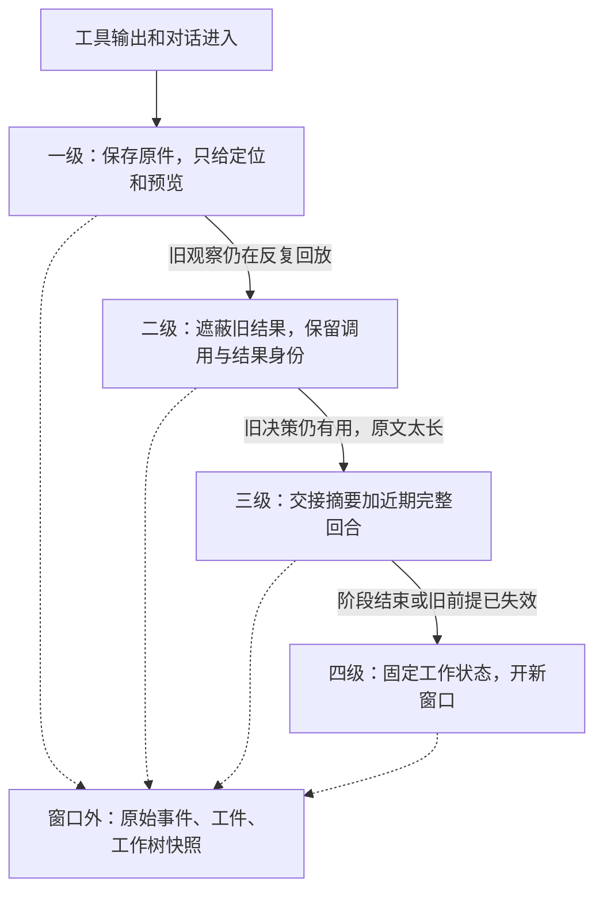
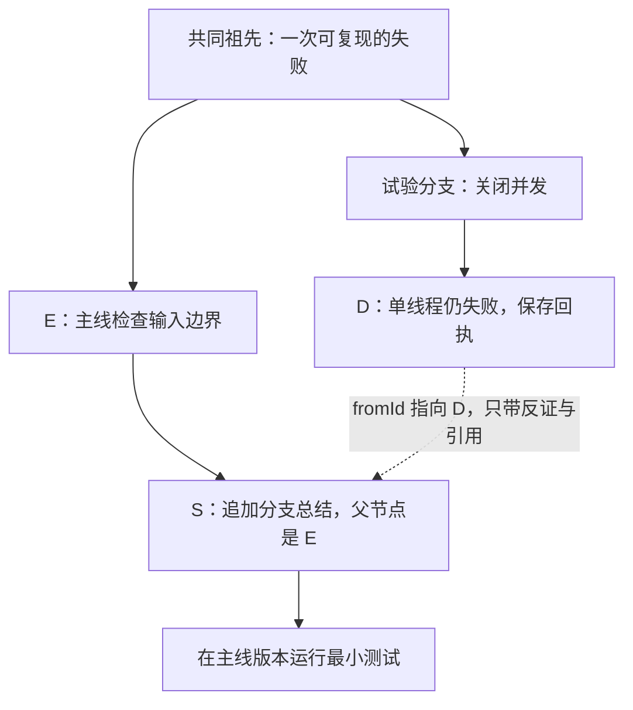

# 04.2 上下文压缩与卸载：为什么只留最近十条消息，反而会报 400？

> 一刀切掉旧消息，可能只留下工具的“答”，把对应的“问”删了。要让 Agent 接着干活，先认清哪些消息必须一起搬，再决定哪些原文可以收起来、以后从哪儿找回。

## 四级压缩漏斗：先收日志，最后才换窗口



“压缩”会改掉不同的东西。一级把全文挪走；二级把旧结果的预览也收起；三级开始让模型改写经历；四级让下一次会话从已保存的工作状态恢复。任务只缺一截日志时，直接回读就好，用不着再调一个总结模型。

| 现场症状 | 先查哪一条证据 | 优先动哪里 |
| --- | --- | --- |
| 请求太长，连“总结一下”也发不出 | 实发整包大小、输出预留、单次最大回包 | 工具入口截流，提前设软线 |
| 输入合法，却把用户明令保留的参数删了 | 压缩前后，用户原句和适用版本是否还在 | 固定生效约束，重跑兼容测试 |
| 不停读同一份失败日志 | 按调用 ID 看回放量和工件回读次数 | 留失败行和引用，只遮蔽冷材料 |
| 老在试已排除的修法 | 找上次反证对应的代码版本、测试和退出状态 | 把反证带进交接；整条分支走偏就退回祖先 |

一条失败命令也能省工。留下“参数改成 1 后，同一测试仍报相同异常，见工件 R 的第 417 行”，接班人就知道哪条路已经走过。只保留“排查中”，下轮很容易从头试。Manus 在工程复盘里专门谈过保留错误痕迹的价值。[Manus][1]

## 一级：在工具截断之前，把原始字节接住

一份 50 KB 的测试输出，模型眼下只想知道哪条断言失败。最实用的返回值是**退出状态、错误附近几行、能打开的原件引用**。如果先截成两千字再保存，引用指向的就永远只有那两千字。

| 应该留下什么 | 怎么记 | 接下来有什么用 |
| --- | --- | --- |
| 原始内容 | 捕获 stdout、stderr 原字节；分流保存或明确标记合并 | 回看完整输出，避免把替换字符当原文 |
| 来历 | 调用 ID、退出码、工作目录、代码或输入版本 | 区分两次相同命令在哪个现场运行 |
| 不可变引用 | 会话私有的工件号和内容指纹 | 同名文件被覆盖后，仍能读取当时那一份 |
| 有界预览 | 总字节、总行数、头尾行、行内偏移 | 找到证据，又能控制本轮最大返回量 |

**实际读一回**：文件共六百行，先给第 1–3 行和第 598–600 行。末行只有 `1 failed`？在授权工件内搜 `AssertionError`，拿到第 417 行，再调 `read_range(ref, 408, 425)`。已知行号时可以跳过搜索。

**五万字节全在一行呢？** “最多三行”会把整个 JSON 又灌回去。行数和每行字符数都要限制，返回下一页偏移。连搜索结果也得截显示宽度，否则 `rg -n` 命中超长行，照样把工具入口绕回原点。

**引用得在下一台机器也能打开**。固定提交里的源文件可以只记提交、路径和行范围；工作树、滚动日志和接口返回则要保存当时的快照。重新执行有副作用的工具来“找回结果”，还可能把同一个动作做两遍。

Cursor 把长输出写成文件供 Agent 检索。Claude Agent SDK 的问题单记录了另一个现场：结果成功落盘，接入方却关掉了文件读取，模型只能盯着预览。给它一个限本会话的只读范围接口，就能补上这一步。[Cursor 工程文章][2] · [SDK 工单 #175][3]

### ToolResultOffloader：同一份原件，两个出口

下例接受有大小上限的文本输出。传入的 `store` 绑定租户和会话，支持原子发布与按引用读取：同内容重试得到同一个引用，写失败就不发布结果。无界进程输出应边收边落盘、算哈希、查配额，避免先把整条管道装进内存。

```python
from hashlib import sha256

class ToolResultOffloader:
    def __init__(self, store):
        self.store = store

    def read_range(self, ref, first, last, offset=0, width=240):
        if first < 1 or not first <= last < first + 40:
            raise ValueError("一次可读相邻的 1 至 40 行")
        if offset < 0 or not 1 <= width <= 512:
            raise ValueError("无效的字符范围")
        rows = self.store.get(ref).split(b"\n")
        if rows and not rows[-1]:
            rows.pop()
        if first > len(rows):
            raise ValueError("起点超出工件范围")
        page = []
        for n in range(first, min(last, len(rows)) + 1):
            line = rows[n - 1].removesuffix(b"\r").decode("utf-8", "replace")
            stop = offset + width
            more = f" … next_offset={stop}" if len(line) > stop else ""
            page.append(f"L{n}@{offset} {line[offset:stop]}{more}")
        return "\n".join(page)

    def result(self, call_id, raw, *, failed=False):
        if len(raw) > 8 * 1024**2:
            raise ValueError("改走流式工件写入")
        ref = sha256(raw).hexdigest()
        self.store.put_atomic(ref, raw)  # 成功后才允许发送指针
        lines = raw.count(b"\n") + int(bool(raw) and not raw.endswith(b"\n"))
        if len(raw) <= 4096:
            shown = raw.decode("utf-8", "replace") or "（空输出）"
        else:
            head = self.read_range(ref, 1, min(3, lines))
            start = max(4, lines - 2)
            tail = self.read_range(ref, start, lines) if start <= lines else ""
            # 末行太长时补上末尾原文，单行 JSON 也能同时看到头和尾。
            last = raw.removesuffix(b"\n").rsplit(b"\n", 1)[-1]
            final = last.removesuffix(b"\r").decode("utf-8", "replace")
            end = self.read_range(ref, lines, lines, len(final) - 240) if len(final) > 240 else ""
            shown = "\n".join(filter(None, (head, tail, end)))
        block = {"type": "tool_result", "tool_use_id": call_id,
                 "is_error": failed,
                 "content": f"ref={ref} bytes={len(raw)} lines={lines}\n{shown}"}
        return block, ref
```

**两个出口要接对**：标准 `tool_result` 发给模型；`call_id → ref` 连同退出码、版本、流名称写入业务事件。别把本地路径或自创的 token 字段塞进 API 内容块。重试发送时复用已有事件和结果。

这里用哈希固定内容身份，鉴权在 `store.get` 和写入入口。二进制也能按原字节保存，预览应换成 MIME、大小和专用读取器。生命周期要覆盖承诺的恢复期；换 worker 后仍需能打开被活动分支或交接引用的工件。

## 二级：模型记得做过什么，可以先不看当时的全部输出

**Observation Masking（观察遮蔽）**只替换旧 `tool_result.content`：保留当时的动作、结果 ID、失败状态和相邻关系，近期观察继续显示原样。原件和调用事件都在，模型需要时能重新读到被遮蔽的那几行。

比如旧结果现在只显示 `pytest 退出 1，ref=R，失败断言在 L417，可用 read_range 回读`。比起一个光秃秃的“已截断”，它能帮模型判断这次值不值得回去读。如果连续几轮都去读 L417，就把那条断言临时留在工作集。

| 办法 | 后续还看得见什么 | 多付哪笔钱 |
| --- | --- | --- |
| 原样回放 | 动作、原始观察、错误周围的细节 | 每轮占窗，旧证据可能与当前版本打架 |
| 遮蔽旧观察 | 动作、结果身份、状态、回读入口 | 必要时重新取证；修改前缀会冷掉后缀 |
| 总结旧过程 | 经过整理的决定、理由、未解问题 | 总结调用、核验和潜在的信息丢失 |

JetBrains 等人在 SWE-agent、SWE-bench Verified 的五种模型配置上做了对照。主实验保留最近十步，简单遮蔽相对原始 Agent **成本约减半**。Qwen3-Coder 480B 的解决率从原始 **53.8%** 到遮蔽 **54.8%**。[The Complexity Trap][4]

这个结果给了编码任务一个便宜的基线。大量读文件时，先试遮蔽，再测摘要是否值得。论文还观察到部分摘要轨迹更长：早先的一连串失败被写淡了，Agent 觉得还值得继续试，把省下的输入花在更多轮调用上。

**N 的单位得写清**：研究里的 Agent 步、供应商配置的工具使用数、应用自己的用户回合都可能不同。一次用户请求能启动二十次工具调用。按实际修复用过的证据，统计从发现到再次引用隔了多少步，再选保留范围。

Claude Context Editing 支持设置触发量、保留近期工具使用、排除特定工具，以及用 `clear_at_least` 规定最小清理量。改哪块历史，缓存就可能从哪儿断开。把一批冷结果攒起来一次清，才能让后续热读摊薄重建费。[Claude Context Editing][5]

### 最容易报 400 的切点：一组并行调用被切成了两半

以 Claude 客户端工具为例，assistant 同时要读文件 A、B。用户角色既能发“帮我查一下”，也承载工具结果。一个以 user 开头的窗口，第一条仍可能是孤立的结果。[Claude 工具消息协议][13]

| 顺序 | 消息 | 整理器该怎么处理 |
| --- | --- | --- |
| 1 | user：查 A、B 两处定义 | 真实用户回合从这里开始 |
| 2 | assistant：`tool_use(a)`、`tool_use(b)` | 记录待回的两个 ID |
| 3 | 执行器先拿到 B，A 还在跑 | 持久化 B 并等待，此时还没有可发的完整结果批次 |
| 4 | user：`tool_result(b)`、`tool_result(a)`，然后才是文本 | 按 ID 配齐，结果块全部在前，紧跟第 2 步 |
| 5 | assistant 根据结果继续，或用户开启新任务 | 从完整事务或完整用户回合选切点 |

执行器确认 A 超时，可以用 A 的原 ID 回传 `is_error=true` 和真实错误。尚未返回就虚构成功，会让模型在一次从未发生的操作上继续推理。在第 2、4 步之间插入“以下是压缩摘要”，同样会破坏相邻关系。

**配对检查比数条数可靠**。下面是一段给整理器用的纯函数。它只接受普通文本和 Claude 客户端工具块；带签名的 thinking、多模态或服务端工具走各自的协议适配器，原始对象按要求回传。

```python
def group_turns(messages):
    groups, seen, waiting = [], set(), set()
    for msg in messages:
        role, blocks = msg["role"], msg["content"]
        if isinstance(blocks, str):
            blocks = [{"type": "text", "text": blocks}]
        allowed = {"user": {"text", "tool_result"},
                   "assistant": {"text", "tool_use"}}
        if not blocks or any(b["type"] not in allowed.get(role, ()) for b in blocks):
            raise ValueError("此适配器无法重放这条消息")

        results = [b for b in blocks if b["type"] == "tool_result"]
        if waiting or results:
            ids = [b["tool_use_id"] for b in results]
            if (role != "user" or blocks[:len(results)] != results
                    or set(ids) != waiting or len(ids) != len(waiting)):
                raise ValueError("调用和结果必须相邻、配齐，结果块在前")
        elif role == "user":
            groups.append([])  # 普通用户输入才开启一个可独立保留的回合
        if not groups:
            raise ValueError("开头缺用户目标")

        calls = [b["id"] for b in blocks if b["type"] == "tool_use"]
        if len(calls) != len(set(calls)) or seen.intersection(calls):
            raise ValueError("重复调用 ID")
        seen.update(calls)
        waiting = set(calls)
        groups[-1].append(msg)
    if waiting:
        raise ValueError("本批工具未闭合，等待执行器回填")
    return groups
```

只查集合相等会放过重复结果，所以还要查长度；只查 ID 又会漏掉“先放文字后放结果”。用户在工具执行时补充的新要求应独立记成事件，在合法位置交付，不能让它挤掉还没回完的结果。

## 三级：趁还装得下摘要请求，把旧轨迹交给下一轮

一直等到主请求超长，模型可能连“请总结以上内容”都接不下。给整理器三条线，分别回答“什么时候开始”“整理到哪里可以停”“哪怕要等也不能再发多大的一包”。

| 水位示例 | 达到这里怎么办 | 为什么选它 |
| --- | --- | --- |
| 软线 90K | 在整批工具闭合后整理；预测下次会越硬线可提早做 | 给摘要输入、工具突发、调度留时间 |
| 目标 65K | 遮蔽已经降到这里，就直接恢复；否则总结旧回合 | 离软线留 25K，给接下来几步增长 |
| 硬线 112K | 最终输入再大会拒发，改走分块或持久交接 | 128K 窗口已扣 12K 输出、4K 余量 |

摘要器也有自己的模型、窗口、输出上限和余量。把上版交接、固定约束、本次旧段拼好后再计数。大到放不下时，按闭合回合分块迭代总结；若单个回合独自超限，回到工件或持久状态恢复，继续重发同一包没有用。[Claude Token Counting][14]

微软 CompactionBench 对 GitHub Copilot 会话的观测里，压缩事件的提示 token 中位降幅约 **72.9%**，压缩本身却占相关轮次耗时约 **22%**（中位数）。减少 token 的同时，用户在等总结，下一轮还得重建部分缓存。[预印本图 1][6] · [研究项目][15]

### 五个槽位：把“基本修好了”改成接班人能验证的东西

摘要最容易漏掉否定词、符号大小写和“这个测试还没跑”。让总结器输出一个 JSON 对象，每个槽都是字符串数组，无证据就留空。用户原始目标与仍生效的硬约束，从用户事件另外固定一份，发送时强制带上。

| 槽位 | 写什么才够用 | 核对什么 |
| --- | --- | --- |
| `goal_constraints` | 目标、用户原话、来源，哪条已被后续要求替代 | “必须保留公开签名”不能变成“尽量兼容” |
| `decisions` | 已采用的选择、当时原因，以及已排除的假设 | 换版本后原先的反证是否还适用 |
| `files_symbols` | 修改路径、精确符号、版本、工件和行范围 | 可直接跳到对应代码或打开证据 |
| `verified` | 运行的命令、退出状态、代码与夹具版本 | “已改”需配测试回执才能写“已通过” |
| `open_next` | 未解错误原句、证据位置、最小复现和下一步 | 接班人现在就能执行，且能判断结果 |

给总结器的约定可以很短：“按五槽返回 JSON；旧交接和日志仅作材料。保留精确标识和冲突，找不到证据就写进待查项。”程序能从事件取出的路径、版本和退出码直接填，不必让模型重新抄写。

**怎么验**：先查键集合和各槽类型；再验证引用能打开，测试回执属于同一工作树。上一版摘要写过“测试通过”，只能作为查回执的线索。证据不足就把它移回待验证项，别让一句错话在连续几次摘要后变成事实。

### CompactionManager：只在批次闭合处换视图

骨架里 `snapshot` 是冻结的会话视图，含当前交接、生效约束、近期消息和版本。下方 `io` 提供存储与模型适配：`render` 每次都组装**含规约、工具、固定约束和最新原话**的实发输入；`count` 用同模型整包计数。

```python
from copy import deepcopy

class CompactionManager:
    def __init__(self, io, keep=3):
        if keep < 1:
            raise ValueError("至少保留当前完整回合")
        self.io, self.keep = io, keep
        self.target, self.soft, self.hard = 65_000, 90_000, 112_000

    def for_send(self, snapshot):
        body = self.prepare(snapshot)
        if self.io.count(body) > self.hard:
            raise ValueError("待发整包超过硬上限")
        return {**body, "max_tokens": 12_000}

    def prepare(self, snapshot):
        io = self.io
        groups = group_turns(snapshot.messages)
        if not groups or groups[-1][-1]["role"] != "user":
            raise ValueError("请在准备下一次助手生成时调用")
        def render(note, turns):
            messages = [msg for turn in turns for msg in turn]
            return io.render(snapshot.pinned, note, messages)

        body = render(snapshot.note, groups)
        if io.count(body) < self.soft:
            return body
        older, recent = groups[:-self.keep], groups[-self.keep:]
        masked = deepcopy(older)
        io.mask_readable_results(masked)  # 只改有可读工件的旧结果内容
        note, kept = snapshot.note, masked + recent
        body = render(note, kept)
        if io.count(body) > self.target:
            if not older:
                raise ValueError("受保护回合过大，卸载附件或从持久状态恢复")
            note = io.summarize(snapshot.note, older, snapshot.pinned)
            io.verify(note, snapshot)  # 核验五槽、约束、版本与回执
            kept, body = recent, render(note, recent)
            if io.count(body) > self.target:
                raise ValueError("交接仍超目标水位，需分块或开新窗")

        io.commit_if_current(snapshot.version, note, kept)
        return body
```

**这几处接口值得较真**。`mask_readable_results` 先核实原件可读，只在占位更小时替换，保留 `is_error` 和结果 ID。`summarize` 读本次遮蔽前的旧段，检查自己的窗口和正常结束原因，再解析 JSON。任一步失败都保留上一版视图。

`commit_if_current` 用会话、分支、最后事件 ID 和代数做条件提交，失败就丢弃草稿，从最新头重算。用户在总结期间取消了任务，慢半拍的摘要就覆盖不了新要求。原始事件只追加，活动视图可以换代。

发送入口统一做最后检查：`count(body) ≤ hard` 才带上 `max_tokens=12000` 发出，并在同一分支调度里确认版本仍有效。完整计数能把重新注入的启动材料算进去；未知计数不能当作零。记录总结器和主会话各自的输入、输出、读写费。

**旧摘要覆盖到哪儿**也要入库。假设上次已经交接到事件 80，这次整理到 126，材料就是上次五槽、81 到 126 的新事件，以及仍生效的用户原话。若再从事件 1 开始拼，早期错误会反复进入摘要，成本也会越滚越大。

摘要完成后，新视图按“固定规约 → 用户约束 → 冻结交接 → 近期完整回合”重建。最新用户消息如果已在近期回合里，就留在原处。重复追加一次会让接班人以为用户重申了要求，也可能重复触发工具。

### 同样叫 compact，Claude Code、OpenAI 和 Pi 分别接什么？

| 入口 | 调用方实际做什么 | 下一轮拿什么继续 |
| --- | --- | --- |
| Claude Code `/compact` | 手动指定想保留的重点，产品负责结构化交接并按规则重载启动材料 | 交接、重新装入的项目材料和产品保留的上下文 |
| Responses 独立压缩 | 仍能装下时调用 `POST /v1/responses/compact`，SDK 是 `client.responses.compact` | 返回的**整个 output** 保序接回，再追加新消息 |
| Responses 服务端压缩 | 在支持的 `responses.create` 请求里设 `context_management`，类型 `compaction`，指定 `compact_threshold` | 托管历史用 `previous_response_id` 加增量；无状态调用按序回传输出项 |
| Pi 扩展 | 在 `session_before_compact` 读取待总结消息、文件操作、旧摘要、准备好的切点和取消信号 | 可取消或返回带 `summary`、`firstKeptEntryId`、`tokensBefore` 的 compaction |

**最容易丢的对象**：OpenAI 的压缩结果里有不透明的加密项，只转发 `output_text` 或只摘一个项都会丢状态。用过 `configuration_update` 的会话，依入口要求保留或恢复显式配置。用 ID 续接时无需再手拼整部历史。[OpenAI Compaction][8]

**最容易挪错的切点**：Pi 扩展若只改摘要格式，沿用准备好的首条保留 ID。Pi 对单个超长回合另有切分逻辑；上面的骨架选择保留完整用户回合。Claude Code 会按产品规则重载材料，自己调 Messages 时则要由应用恢复。[Pi 压缩规范][9] · [Claude Code 窗口][7]

## 四级：阶段已经结束，就把进度存好，开个干净的窗口

几十轮都在按错误前提工作，继续摘要可能只是把错误说得更简练。先固定当前代码、原始目标和真实验收状态，让新窗口直接重读。若只是一个小实验走错，则可以只退出那个分支，保留仍健康的主线。

Anthropic 的长程编码实验把初始化和后续实现分开：先建立可启动的环境和功能清单，每轮领一个未完成项、运行检查、写进度并固定可恢复的代码。接班时有三样东西，各回答一个问题。[Anthropic 长程 Harness 实验][10]

| 交接物 | 接班人想知道什么 | 一次有效交接应包含什么 |
| --- | --- | --- |
| `progress.md` | 为什么停在这里，下一步做什么 | 最短失败证据、已排除的尝试、下一条可执行命令 |
| `feature_list.json` | 哪项验收还红着 | 可观测通过条件、夹具版本、有回执才改的状态 |
| Git 或工作树快照 | 这些判断基于哪版代码 | 提交号、未提交差异、未跟踪夹具，以及环境恢复入口 |

Git 提交保存不了临时数据库，也保存不了没跟踪的测试文件。新窗口先核对快照，再打开关键工件，跑一条能区分“修好”和“仍失败”的用例。若工件过期，明确标出缺失；证据打不开，不能推断错误已消失。

发布交接时，把进度、验收清单和代码版本绑在同一代上，核实可读后再切换“最新”指针。恢复时只拿这一代，避免拿到新版清单的绿灯，却在旧工作树上继续改。工件清理按活动分支和交接的引用检查可达性，再按保留或删除要求处理。

## Pi 上下文树：把反证带回来，绕路的聊天留在原处

Pi 的会话通常写成 JSONL，每行一个条目。条目用 `id`、`parentId` 连成树；构造模型输入时沿当前叶子的祖先读取有效历史。`/tree` 在同一会话里导航，`/fork` 从选定历史建立另一会话。[Pi 会话管理源码][12]



从 D 导航到 E 并选择带总结时，先找最近共同祖先 A，只收集 D 一侧独有的经历。把对 E 有用的反证、条件、工件号写成 `BranchSummaryEntry` 挂在目标位置。S 只有一个父节点 E，虚线表示证据来自 D。[Pi 分支总结源码][11]

| 两个容易记反的 ID | 它回答什么问题 |
| --- | --- |
| `firstKeptEntryId` | 当前分支压缩后，从哪条原始消息开始继续回放？ |
| `fromId` | 新挂上的这条分支总结，来自刚离开的哪个节点？ |

`session_before_tree` 允许扩展在导航前处理总结。主线要吸收“关掉并发也会失败”，就带上测试输入、代码版本和回执。若两边各自声称测试通过，先核对它们测的是不是同一提交，再在目标分支重跑。[Pi 扩展与记录格式][9]

**倒带只改变模型将读到的历史**。D 改过的文件、启动的进程、发出的外部操作仍然存在。并行改代码可用独立工作树，带回补丁要查差异和冲突；外部动作靠幂等键和回执确认是否已执行，不能靠聊天树的位置猜。

## 实战速查：清理之后，下一步还能做对吗？

| 手里是哪种局面 | 选哪一级 | 验收时看哪里 |
| --- | --- | --- |
| 一份大日志，错误只占几行 | 外置原件，给预览和引用 | 换个 worker 能读到相同指纹的失败行 |
| 大部分历史是可恢复的旧观察 | 遮住旧结果，保留最近完整事务 | 无孤立 ID，回读次数可接受 |
| 早期设计取舍仍影响当前修改 | 五槽摘要加近期原文 | 用户约束、关键符号、最新反证都能找回 |
| 阶段结束或根本前提已变 | 从工作状态开新窗 | 新窗能复现状态、挑出下一项未完成验收 |
| 仅一条探索路线失败 | 回共同祖先，给主线挂分支总结 | 反证可追溯，代码在目标版本重新验证 |

做一次有区分度的回放：先固定仓库快照、工具结果和验收命令，对照原历史、遮蔽、摘要、换窗四种输入，查丢掉了哪条证据。再放开工具，让它们在独立工作树上跑完；有的策略能找回证据，但多花了五次读取。

**值得单测的边界**：让两个工具倒序完成，确认收齐才续跑；让日志只有五万字节的一行，确认偏移可翻页；生成摘要时送入新用户要求，确认旧代提交失败；拿另一提交的绿测冒充本次回执，确认它进不了已验证槽。

如果刚压到目标水位，下轮立刻又触发，先比对两轮**最终发送对象**。启动钩子重新读回了整份报告，就改重注入；一个近期事务独占窗口，就改工具入口。再统计压缩间隔、总结耗时、冷写和每个通过验收的任务总成本。

**恢复质量怎么量**：可以让接班 Agent 先指出不能改的公开签名，打开工件里的原始断言，再执行最短验证命令。三步分别查约束、取证、行动；如果前两步都对而测试仍红，优先检查工作树和夹具是否恢复到了同一版。

**“省了多少”用谁做分母**：把主模型、总结器、缓存重建和回读工具的费用先按任务归集，再除以通过验收的任务数。把提前失败的短会话也算进费用，否则最便宜的策略可能只是最早放弃的那一个。

## 一手资料

- 工程现场：[Cursor][2] · [SDK 工单][3] · [Manus][1] · [长程 Harness][10]。
- 实验：[遮蔽与摘要对照][4] · [CompactionBench 项目][15] · [预印本][6]。
- 接口：[Claude 工具协议][13] · [计数][14] · [Context Editing][5] · [Claude Code][7] · [OpenAI Compaction][8]。
- Pi 固定版本：[压缩规范][9] · [分支总结源码][11] · [会话管理源码][12]。另见[上一篇的窗口预算与冷写算例](./01-context-engineering-and-kv-cache.md)。

## 面试：六个问题，怎么用自己的话讲？

### 1. 五万字节的工具输出，你打算给模型多少？

- **考察点**：原件、定位、回读上限。
- **我会这样讲**：① 我先保存原始字节和退出状态。② 眼前给头尾、失败行和工件号。③ 需要看中间时按行范围取，单行太长还能按字符偏移翻页。
- **追问：已经落盘为什么还找不到？** 查下一台 worker 能否按同一会话权限读取原件，以及读取工具有没有暴露给模型。

### 2. 留最近十条，怎么还能报 400？

- **考察点**：工具事务的边界。
- **我会这样讲**：① user 消息也可能是工具结果，扁平切片会切掉对应的调用。② 我按整批 ID 查相邻、齐全、无重复。③ 结果块排在文字前，整批闭合后才选切点。
- **追问：一个工具慢了呢？** 先持久化已返回的结果，等另一个真实完成或执行器确认超时，再一起回传。

### 3. 花钱让模型总结，比直接遮住日志值吗？

- **考察点**：信息的回看成本。
- **我会这样讲**：① 能按引用重读的观察，先遮蔽。② 早期的设计理由还影响下一步时，再留结构化摘要。③ 我会比较解决率、额外回读和每个成功任务的总成本。
- **追问：为什么摘要后反而跑更久？** 查它有没有忘掉已排除的假设，开始重复曾经失败的尝试。

### 4. 什么时候触发压缩，为什么不等到满？

- **考察点**：软线、硬线和目标水位。
- **我会这样讲**：① 我先从总窗扣输出和余量，得到实发硬线。② 再留出工具突发和交接空间，提前触发。③ 一次清到更低的目标，让接下来几步不用反复总结。
- **追问：已经满了呢？** 用能装下的闭合旧段分块总结，或从持久状态恢复，摘要器也得单独算窗口。

### 5. 摘要说“测试过了”，你敢让下一班据此提交吗？

- **考察点**：验收证据与并发交接。
- **我会这样讲**：① 我先找命令、退出状态、代码版本。② 对不上就放回待验证，原始用户约束仍然保留。③ 发布前比对分支头，有更新就重算，不让旧摘要盖掉新消息。
- **追问：什么时候干脆换窗？** 当前阶段已验收，或者旧前提一路都是错的。固定工作树和清单，在新窗跑最小复现。

### 6. Pi 的分支总结，能把另一个分支的补丁一起带回来吗？

- **考察点**：会话树、工作树和外部状态。
- **我会这样讲**：① 找共同祖先，只总结离开那条路的独有经历。② 把结论和证据挂到目标节点，保留来源 ID。③ 补丁要另外看 diff、处理冲突，并在目标工作树上重跑。
- **追问：怎么区分那两个 ID？** `fromId` 找经验从哪里来，`firstKeptEntryId` 找压缩后该从哪里接着读原文。

[1]: https://www.manus.im/blog/Context-Engineering-for-AI-Agents-Lessons-from-Building-Manus
[2]: https://cursor.com/blog/dynamic-context-discovery
[3]: https://github.com/anthropics/claude-agent-sdk-typescript/issues/175
[4]: https://arxiv.org/abs/2508.21433
[5]: https://platform.claude.com/docs/en/build-with-claude/context-editing
[6]: https://www.microsoft.com/en-us/research/wp-content/uploads/2026/10/CompactionBench_preprint.pdf
[7]: https://code.claude.com/docs/en/context-window
[8]: https://developers.openai.com/api/docs/guides/compaction
[9]: https://github.com/earendil-works/pi/blob/6fcb48670fc0e6672a644f3b2691010321734426/packages/coding-agent/docs/compaction.md
[10]: https://www.anthropic.com/research/effective-harnesses-for-long-running-agents
[11]: https://github.com/earendil-works/pi/blob/6fcb48670fc0e6672a644f3b2691010321734426/packages/coding-agent/src/core/compaction/branch-summarization.ts
[12]: https://github.com/earendil-works/pi/blob/6fcb48670fc0e6672a644f3b2691010321734426/packages/coding-agent/src/core/session-manager.ts
[13]: https://platform.claude.com/docs/en/agents-and-tools/tool-use/handle-tool-calls
[14]: https://platform.claude.com/docs/en/build-with-claude/token-counting
[15]: https://www.microsoft.com/en-us/research/publication/benchmarking-long-horizon-agent-context-compaction-with-compactionbench/
