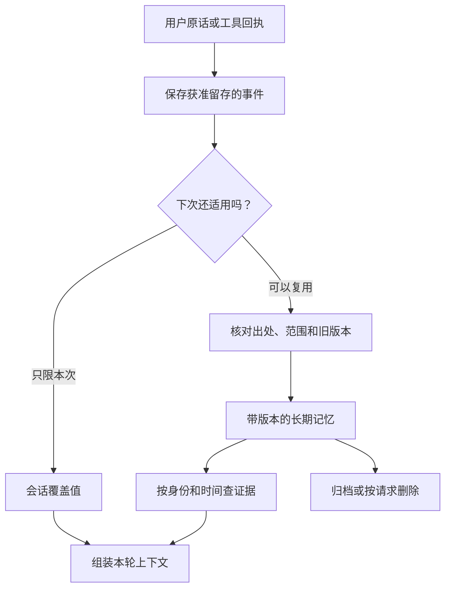

# Agent 记忆：让 Coding 助手记住偏好，也听得懂「只限这次」

> 「以后示例用 TypeScript」值得带进下次会话，「这次用 Python」只管眼前。沿着这两句话走一遍，面试里就能讲清记忆怎么写、怎么找、什么时候该失效。



## 从一次代码修改，分清四种容易混用的东西

让助手「按我平时用的语言改这个示例，再开个草稿 PR」。第一次调用时，它读选区、查偏好、对照 SDK 文档。第二次调用前网络断了。重启后，哪几样东西得找回来？

| 名称 | 在这个请求里是什么 | 去哪儿确认 |
|---|---|---|
| Context：上下文 | 模型此刻看到的选区、问题、工具返回 | 看这次实际发出的消息，下一轮可能已经裁掉 |
| Memory：记忆 | 我曾明确说过「默认用 TypeScript」 | 查带用户身份、适用范围和原话的偏好 |
| Knowledge：知识 | 当前 SDK 版本接受哪些参数 | 读该版本的文档或源码，必要时编译验证 |
| State：运行状态 | 草稿是否创建、PR 编号是多少 | 查操作记录和工具回执，用幂等键恢复任务 |

PR 编号读进提示后，也是上下文的一部分。可要决定是否再开一个 PR，得查真实回执。若只看助手上轮说的「我准备好了」，断线重试就可能开出两个一样的 PR。

### 四类认知记忆，按下次怎么用来分

CoALA 的分类拿来调试很顺手。比如升级 SDK 后，一条旧样例编译失败。把这次工作的产物摊开看，同一次失败能留下四种不同的材料。

| 认知类型 | 代码助手里放什么 | 下次拿来干什么 |
|---|---|---|
| 工作记忆 Working | 当前 diff、错误行、待跑的测试 | 继续眼前这次修改，换任务就可以清走 |
| 情景记忆 Episodic | 哪版样例报错、试过什么、哪次编译通过 | 遇到相似报错，回看当时的条件和尝试 |
| 语义记忆 Semantic | 这个项目默认 TypeScript，旧样例依赖 v2 参数 | 按项目、版本查一个能被纠正的事实 |
| 程序记忆 Procedural | 升级 SDK 时，先编译新旧样例，再跑兼容性测试 | 条件满足就照步骤执行，用结果判断是否完成 |

**从事件到规则，中间要补一次验证**：一次回退成功，可以写进复盘。想把它变成 `SKILL.md` 的常规步骤，就拿以前的升级任务重放，核对触发条件、例外和退出条件。维护者看过差异再发布，坏规则还能回滚。

LangMem 把长期内容按事实、情景示例和程序规则分别更新。工作台上的便笺只要写「已跑哪些命令、结果在哪、接下来要查什么」。要跨进程续做，就把清单另存为检查点。

一个常驻记忆块既能放偏好也能放操作步骤：「常驻」说的是加载位置，「程序记忆」说的是内容用途。

## 四条技术路线：同一句「你还记得吗」，谁去翻资料？

### Letta / MemGPT：让助手决定什么时候翻页

有时你只问「上次为什么没选接口 B？」。助手眼前只有一句「项目默认用 A」。MemGPT 借用了操作系统的分层存储思路：让模型在有限窗口里工作，给它读写外部材料的工具，缺依据时再取回来。

| 经典 MemGPT / Letta V1 分层 | 这次该怎么读 |
|---|---|
| Core Memory：每轮带入的块 | 先看到项目默认值，能直接用。块太长，每轮都要付输入成本 |
| Recall Memory：会话历史 | 搜到当时讨论 B 的原话，确认谁提过什么 |
| Archival Memory：显式归档 | 取回设计笔记或实验记录，核对否掉 B 的条件 |

这里没有硬件替你触发缺页。查不到理由时，看调用轨迹就能把问题拆开：助手想过要查吗？查的是历史还是归档？读到原文后，有没有把「在旧 SDK 上失败」讲成「永远不能用」？三种错法要改的地方不同。

**接入前先看 SDK 代际**：截至 2026 年 11 月，Letta 的文档用 MemFS 描述由 Git 管理的可编辑记忆，支持后台 dreaming 整理。V1 文档适合读懂块模型。若自己同时开放交互编辑和后台整理，要比较双方读到的基础版本，免得旧摘要盖掉刚改的偏好。

### Mem0 / OpenMemory：把跨应用的偏好收在一处

在终端告诉助手「默认用 TypeScript」，希望编辑器里的助手也能接着用。专用记忆服务把接收事件、提取事实和按身份查询放到共同入口。三个客户端只要认得同一个获授权的用户，就不用各自猜一遍。

**跟一遍论文里的写入过程**：提取器读新消息、近期历史和已有摘要，提出候选。向量检索先找相近的旧记忆，再让更新器结合旧项 ID、原话和范围，判断两条话是什么关系。

| 候选和旧项的关系 | 论文里的动作 |
|---|---|
| 以前没有提过示例语言 | `ADD`：建一条带出处的新记录 |
| 用户把原先的偏好说得更准确 | `UPDATE`：修订匹配项 |
| 用户明确否定旧项，需要移除 | `DELETE`：移除对应旧项 |
| 重复表达，没有新内容 | `NOOP`：保留原样 |

「这次培训用 Python」和「以后用 TypeScript」在向量空间里很近。比较时丢了「这次培训」，更新器就会误改个人默认值。给候选带上项目、受众和持续时间，比来回调相似度阈值更能解决这类错。

**OSS v3 的接口差异**：v3 自动提取改成单次模型调用，`add()` 只返回 ADD。检索结合语义、BM25 和实体匹配。要维护唯一的当前值，应用需显式处理更正、撤回和旧消费者的迁移，别等一个不会来的 UPDATE。

论文里的 Mem0ᵍ 会抽取实体和关系。外部图存储集成已移出这一代 OSS，图记忆由 Platform 提供。

**OpenMemory 的两个用途**：早期 OpenMemory 是自托管 MCP 记忆服务和管理面板，现在保存在归档目录。同名主仓做的是编码会话迁移 CLI/TUI。

### Zep / Graphiti：给关系加上两只钟

3 月 10 日，你告诉助手：「我从 3 月 1 日就转到工具组了。」查「3 月 5 日我属于哪个组」时，今天回看应答工具组。要复现助手在 3 月 5 日为什么还找原组评审，又得答原组。当时系统还没收到转组消息。

Graphiti 从一条带参考时间的 episode 提取实体和关系，把同一个人对齐到同一个节点，再比较相关旧边。Zep 用四个字段区分两种时间。读源码时，把它们两两放在一起就好理解了。

| 看哪只钟 | 边上对应的字段 | 这次转组怎么记 |
|---|---|---|
| 现实里何时成立 | `valid_at / invalid_at` | 原组关系在 3 月 1 日结束，新组关系从这天开始 |
| 系统何时知道 | `created_at / expired_at` | 3 月 10 日才记入新关系、发现旧关系已经结束 |

**先弄清哪种关系互斥。** 主归属组可以规定同一时刻只有一个。「也给工具组做评审」却允许两条关系并存。按实体 ID、关系类型、范围和有效区间判断，再决定要不要关闭旧边。同名的人先消歧。

「上周」要按消息发生时刻和原时区解释，再统一存 UTC。只知道月份就保留月份精度。想严格复盘旧答案，还得留修订前的版本，否则今天回填的结束日期，会被误当成上周就知道的信息。

**什么时候值得建图？** 从一个人追到他当时所在组，再追到该组维护的仓库，每跳都要使用同一时间截面。如果只是查询一个仓库的默认语言，一张版本表就够了，下节会把查询写出来。

Cognee 也把图和向量结合起来，基本入口是 `add → cognify → search`。它的时段测试从构造好的提取结果出发，验证时间范围和邻域检索。选型时再补一条自然语言的迟到消息，分别测时间抽取和旧答案回放。

### Markdown + SQLite FTS5：原件留给人，索引留给机器

个人 Coding 助手最省心的一点，是能打开文件回答「你从哪儿学来的」。我会让入口页只放常用偏好和主题指针，把调试现场放回会话历史。三款工具都用文件，但排查「记了怎么还不用」时要看不同地方。

| 工具 | 先打开哪里 | 哪种情况会让记忆看不见 |
|---|---|---|
| Claude Code | 人维护 `CLAUDE.md`，启用 auto memory 后由助手维护 `MEMORY.md` 和主题页 | 自动入口只加载前 200 行或 25KB，先到者为准。长笔记要能从入口找到 |
| OpenClaw | `MEMORY.md` 放长期决定，`USER.md` 可放偏好，按日期留工作笔记 | 启动预算会截短注入副本，磁盘原件仍在。`memory_search` 找片段，`memory_get` 读原文 |
| Hermes Agent | 会话开头取 `MEMORY.md` 与 `USER.md` 快照，`session_search` 用 SQLite FTS5 搜旧会话 | 两个文件默认上限分别为 2,200 和 1,375 字符。写满会报错，当前会话看到的还是冻结快照 |

OpenClaw 在裸 `/new` 或 `/reset` 时可读今天与昨天的笔记，压缩前可先 flush，后台再整理。Hermes 的两个限额按字符算。拿 token 估算文件字节数，或只看磁盘上有没有那行字，都容易查错方向。

**本地试一次检索**：对几十份 Markdown，`rg -n '兼容性测试'` 就能定位。要按段落排名、带出来源并翻页，再给一个授权空间建 FTS5 表。返回片段 ID 后读回对应版本的原件。

```sql
CREATE VIRTUAL TABLE notes USING fts5(
    evidence_id UNINDEXED, body, tokenize='trigram'
);
INSERT INTO notes VALUES ('build-17', '升级 SDK 后要重跑兼容性测试');
SELECT evidence_id, body FROM notes
WHERE notes MATCH '"兼容性测试"'
ORDER BY bm25(notes) LIMIT 3;
```

FTS5 的 `bm25()` 越小越靠前。中文可先分词，也可像上面这样用连续三个字符建索引。只有两个字符的查询词凑不出一个 trigram，短代号宜另建精确字段。写下正文版本和哈希，文件一改就能知道哪些命中需要重建。

## 写入和更新：给一句偏好留下能查回去的证据

用户亲口说「这个仓库以后用 TypeScript」，可以生成下面的候选。换成「这次用 Python」就写到当前会话。助手自己提议「你大概喜欢 Go」，用户没确认，长期候选可以返回空数组。

```yaml
subject: user-42
scope: repo/cli
slot: example_language
value: TypeScript
duration: durable
event_id: msg-18
quote: "这个仓库以后用 TypeScript"
```

**写入前的核对**：从已登录身份取得可写范围，验证来源确由用户发出、允许留存、引文与原消息的字符区间吻合。若是用户点击确认，还要核对他确认的事件、范围、字段和值。消息里的自称不能给写入者加权限。

候选还可以带确定程度。两次在一个项目要求同种语言，足以提示「可能是项目习惯」，不能直接扩成所有项目的默认值。密钥和验证码在送抽取器前过滤。连原话都无权保留时，也不能换个措辞把它存成摘要。

| 在什么时候写 | 适合哪件事 | 中途失败怎么办 |
|---|---|---|
| 当场写 | 「记住」「更正」「忘掉」，用户下一步就依赖它 | 等事务提交再确认。异步处理则显示待处理 |
| 会后抽取 | 从长调试会话里挑可复用的片段 | 事件和任务先持久化，按空闲时间、游标续跑 |
| 空闲时整理 | 用后续测试结果解释早先的失败，合并重复笔记 | 提案记下来源和基础版本，提交时检查用户是否已手改或撤回 |

Anthropic 在 2026 年 11 月把原始轨迹、记笔记、后台整理和预加载拆开评测。自己的助手也能这样查错：保留同一批获准事件，关掉后台整理重跑，看究竟少了哪些可复用步骤。

### 同一条事实为什么需要三行？

用仓库偏好再做一次双时态实验。1 月 1 日助手得知默认 TypeScript，3 月 10 日才得知「3 月 1 日起改为 Go」。只把 `value` 改成 Go，连二月份用什么都查不回。给旧值补一个结束日，又会丢掉系统何时才知道这个结束日。

| 值 | 现实有效区间 | 系统相信这个版本的区间 |
|---|---|---|
| TypeScript | 1 月 1 日起，结束日当时未知 | 修订 1 到修订 2 之前 |
| TypeScript | 1 月 1 日到 3 月 1 日之前 | 修订 2 起 |
| Go | 3 月 1 日起 | 修订 2 起 |

下面是单值属性的核心 Schema。`space` 由宿主绑定到用户和项目，`source` 指回原事件。现实时间统一用 UTC，系统修订号在事务里分配，并在修订日志中记录对应时刻。

```sql
CREATE TABLE fact (
    space TEXT NOT NULL, slot TEXT NOT NULL, value TEXT NOT NULL,
    valid_from INTEGER NOT NULL, valid_to INTEGER,
    known_from INTEGER NOT NULL, known_to INTEGER,
    source TEXT NOT NULL,
    PRIMARY KEY (space, slot, valid_from, known_from),
    CHECK (valid_to IS NULL OR valid_from < valid_to),
    CHECK (known_to IS NULL OR known_from < known_to)
);
CREATE UNIQUE INDEX one_open_value ON fact(space, slot)
WHERE valid_to IS NULL AND known_to IS NULL;

SELECT value, source FROM fact
WHERE space = :space AND slot = :slot
  AND valid_from <= :day AND (valid_to IS NULL OR :day < valid_to)
  AND known_from <= :rev AND (known_to IS NULL OR :rev < known_to);
```

把 `:day` 固定在 3 月 5 日，`:rev` 填 1 得 TypeScript，填 2 得 Go。两个区间都左闭右开，所以 3 月 1 日当天只算进新区间。唯一索引管住末端那条开放记录。历史区间有没有重叠，还要由写入事务检查。

想看这三行是怎样长出来的，可以在刚建好的空表上跑下面两笔事务。为了直接看懂结果，这里用同一年的月日整数模拟现实日期，1 和 2 表示系统提交修订的先后。

```sql
-- 1 月 1 日第一次确认，当时还不知道何时会改用别的语言。
BEGIN IMMEDIATE;
INSERT INTO fact VALUES ('cli', 'lang', 'TypeScript', 101, NULL, 1, NULL, 'msg-1');
COMMIT;

-- 3 月 10 日收到 msg-2：从 3 月 1 日开始改用 Go。
BEGIN IMMEDIATE;
UPDATE fact SET known_to = 2
WHERE space = 'cli' AND slot = 'lang' AND known_from = 1 AND known_to IS NULL;
INSERT INTO fact VALUES
    ('cli', 'lang', 'TypeScript', 101, 301, 2, NULL, 'msg-1'),
    ('cli', 'lang', 'Go',         301, NULL, 2, NULL, 'msg-2');
COMMIT;
```

在上面的查询绑定 `:space='cli'`、`:slot='lang'`、`:day=305`，只切换 `:rev`。若两次都得到 Go，优先看读取时有没有漏掉知情区间。这比测试「查今天的默认值」更容易抓住覆盖历史的错误。

**一次更正怎样落盘？**

1. 用 `(space, event_id)` 认领事件并比较载荷。同一请求重投就返回上次结果。另一天用户独立确认同一个值，要多留一份证据，事实值可以不动。
2. 在一个写事务里关闭原行的 `known_to`，插入带结束日的旧值修订和新值。旧值保留原始出处，另记是谁依据哪条新消息把区间关掉。
3. 收到更早的补报，重算这个字段前后的相邻区间，验证后整体发布。不要让到达顺序代替生效顺序。夜间整理用旧基础版本提交时，退回重读。

「今天起改 Go」是一次变更。「我以前就没用过 Go」是对历史的更正。前者保留过去有效的值，后者修订过去的判断，连带找出引用错误结论的摘要。旧回答为什么出现，仍能沿系统修订号查回去。

一条消息可能抽出多个字段。把事件、候选 ID、提取器版本和标准化载荷一起记到账本。升级提取器时，对同一来源比较新旧差异再写。如果只把重放当新消息，改一次抽取规则就会再造一批「独立证据」。

## 读出来以后：模型这一次到底看见了什么？

先由服务端定可读范围，再检索和排序。Session 放本次覆盖值，User 放个人默认，Agent 放特定助手在授权项目里的经验，Org 放经发布的组织规则。会话可以临时换示例语言，但个人偏好不能改掉仓库强制的构建要求。

**把一次召回拆成三步**：

1. 在获准空间和目标时点内找候选。错误码、函数名走关键词，换个说法的故障描述走语义检索。多跳题给互补证据留位置，十个重复片段只算一个来源。
2. 两路分值尺度不同，可以用倒数排名融合 RRF：每一路按名次贡献 `1 / (k + rank)`，同一证据的贡献相加。保留分路名次，才查得出是哪个检索器漏了。
3. Generative Agents 把相关性、新近程度和重要性一起用于召回。普通当前任务可以沿用这三项。问历史时先取正确的有效区间。离今天更近的材料，有可能正好是错误答案。

**热度和真假各管一件事。** 借用艾宾浩斯遗忘曲线的直觉，若半衰期为 14 天，一条 28 天没用的记录热度乘 ¼。它仍可能是真的，只是这次不值得占窗口。独立确认或实际解决过问题可以延长半衰期，后台扫描不算使用。

例如把相关性、热度、重要性都标定到 0～1，以 0.65、0.20、0.15 加权。两周前的兼容性笔记取 0.9、0.5、0.8，得 0.805。今天的新闲聊取 0.3、1、0.2，只得 0.425。权重可以用真实错例调，过期或无权材料在评分前就应排除。

### 一次搜对了，为什么助手还是答错？

在检索日志里看见 Go，回答却用了 TypeScript。先看组好的请求：常驻画像里是不是还写着旧值？截断时是不是只剩「以前用 TypeScript」，把后半句「现在换 Go」挤掉了？从模型收到的字面材料查起，比改提示词快得多。

- **每轮都需要的少量约定**可预加载。给冷门复盘留一行入口和一个搜索工具，需要时再花一次往返去取。授权范围变化时，丢弃旧会话快照。
- **为问题和证据一起留预算。** 输入额度 12,000 token，固定规则、近期对话各用 4,000，再给长回执留 2,000，问题和记忆合计只剩 2,000。按目标模型计数，输出还要另留空间。
- **稳定内容放前面。** 工具定义和规则固定顺序，会话快照居中，问题、新证据和本轮更正放后面。支持缓存断点的接口，把断点放在可复用前缀末尾。外部笔记始终按有来源的数据装入。

前缀缓存复用一致前缀的计算。把日期或随机顺序的工具列表放在最前面，后续相同的几千个 token 也可能得重算。排查变慢时，分别看缓存读写量、首 token 延迟、工具往返和实际注入量，才知道耗时花在哪儿。

### 归档、过期、删除，是三个不同的动作

| 用户意图 | 该做的操作 | 回归时怎么查 |
|---|---|---|
| 很久没用，先收起来 | 清走热索引里的冷条目，保留可恢复的来源。固定项和活动任务先跳过 | 正常对话不再带入，主动查旧事仍可取回 |
| 从某天起不再适用 | 关闭有效区间，纠正当前画像及依赖摘要 | 今天取新值，限定历史日期仍能取旧值 |
| 「忘掉这条」 | 立即拒读并阻止排队任务再写，然后清事件、事实、摘要、索引和缓存副本 | 旧会话、索引重建、备份恢复后都查不到 |

读权限覆盖整条链。缓存键要含租户、主体或授权集合、权限版本、索引版本和问题。取原件及发送给模型前再校验。两人恰好问同一句话，也不能共享私有结果。恢复备份时先重放删除清单，再开放读路径。

## 我的选型顺序：先拿错误样本说话

| 手里的问题 | 起步方案 | 最先做的验证 |
|---|---|---|
| 一个人维护少量编码约定 | Markdown 入口，历史用 rg 或 FTS5 | 手改偏好后新会话能读到，旧副本不会抢答 |
| 对话很长，什么时候翻历史取决于任务 | Letta 式分层和主动检索 | 抽几道缺依据的问题，看助手会不会主动查对集合 |
| 终端、编辑器、日程助手要共享个人事实 | Mem0 式记忆服务 | 跨入口重放「确认、临时覆盖、更正、撤回」 |
| 要复盘历史关系，常要跨人、组和仓库 | 版本表起步，多跳密集再比较 Graphiti | 固定原件、时点和证据预算，比较查全率、写入成本和延迟 |

**答错时先喂一次标准证据**：同一批题，依次给最近会话、真实检索结果、人工挑出的必要原话。给足证据仍错，查生成与日期判断。人工证据能答而真实检索不能，沿抽取、归并、召回、注入逐段找断点。短历史还可以整段直读作对照。

LoCoMo 适合多会话人物、事件、时间和对抗式问答。LongMemEval 原版 500 题覆盖抽取、更新、跨会话推理、时序和拒答，比较时注明 S/M 历史配置。V2 换成多模态网页 Agent 工作轨迹，还看工作经验复用和查询延迟。

记录「应记事实中有多少范围写对」「前 k 条是否找齐整组证据」「引用能否支持答案」。另测误存临时要求、撤权到首次拒读的时间、每千条写入成本和冷热 P95。历史题只让系统看当时有权看到的材料。

最后放两个同文不同 ID 的测试用户，分别搜索，在候选、重排输入、引用和日志里查对方 ID。再撤销权限、恢复备份重测。对公开且反复使用的技术经验，可以走下一篇的 Wiki 审稿流程。[LLM Wiki 实战笔记](./02-llm-wiki-and-knowledge-compounding.md)

## 一手资料：按正在调试的部件查

- **分类与调度**：[CoALA](https://arxiv.org/abs/2309.02427) · [LangMem](https://langchain-ai.github.io/langmem/concepts/conceptual_guide/) · [Generative Agents](https://arxiv.org/abs/2304.03442)
- **分层记忆**：[MemGPT](https://arxiv.org/abs/2310.08560) · [Letta V1](https://docs.letta.com/v1-sdk/concepts/stateful-agents) · [Archival Memory](https://docs.letta.com/v1-sdk/memory/archival-memory) · [MemFS 与 dreaming](https://docs.letta.com/configuration/memory)
- **记忆服务**：[Mem0 / Mem0ᵍ 论文](https://arxiv.org/abs/2504.19413) · [OSS v3 迁移指南](https://github.com/mem0ai/mem0/blob/main/docs/migration/oss-v2-to-v3.mdx) · [OpenMemory 服务归档](https://github.com/mem0ai/openmemory/tree/main/openmemory-archive) · [现行主仓](https://github.com/mem0ai/openmemory)
- **时序关系**：[Zep 四个时间字段](https://help.getzep.com/facts) · [Graphiti 仓库](https://github.com/getzep/graphiti) · [边的定义](https://github.com/getzep/graphiti/blob/main/graphiti_core/edges.py) · [Cognee](https://github.com/topoteretes/cognee) · [时段检索测试](https://github.com/topoteretes/cognee/blob/main/cognee/tests/e2e/temporal/test_timestamp_range_lookup.py)
- **本地读写**：[Claude Code](https://code.claude.com/docs/en/memory) · [OpenClaw](https://docs.openclaw.ai/concepts/memory) · [Hermes](https://hermes-agent.nousresearch.com/docs/user-guide/features/memory) · [SQLite FTS5](https://sqlite.org/fts5.html)
- **注入与评测**：[Prompt Caching](https://platform.claude.com/docs/en/build-with-claude/prompt-caching) · [Anthropic 记忆实验](https://www.anthropic.com/research/components-of-agent-memory) · [LoCoMo 项目](https://snap-research.github.io/locomo/) · [数据与脚本](https://github.com/snap-research/LoCoMo) · [LongMemEval](https://github.com/xiaowu0162/LongMemEval) · [V2](https://github.com/xiaowu0162/LongMemEval-V2)

## 六道面试题：拿一个例子讲到底

### 1. 上下文窗口已经够大了，为什么还做记忆？

**考察点**：一次能读多少，和下周能恢复什么。

1. 「我会先用原文直读做基线。几十条消息能放下，就先看它答得对不对。」
2. 「换会话、换设备后，用户的偏好还得从某处恢复。用户改口，我也得知道哪条已经过期。」
3. 「长历史全读越来越贵，我才把稳定偏好提出来，保留能返回原话的入口。」

**连环追问**：怎么证明提取有收益？同一批题比较直读和提取后的答案、证据命中、每问 token，再查有没有把一次性要求误存下来。

### 2. 为什么助手总把「这次用 Python」当成永久偏好？

**考察点**：定位写入范围和读取优先级。

1. 「我先找来源，看提取结果有没有吃掉『这次』。如果丢了，补一个只返回会话覆盖值的例子。」
2. 「如果存得对，就看查询是否把别的项目或上一轮会话的值也捞进来了。」
3. 「最后看模型收到的消息。本轮例外要带范围，会话结束后得回到用户确认的默认值。」

**连环追问**：以前写坏的画像怎么办？按证据 ID 找到受影响的事实和摘要，从原话重新生成，拿新会话再测。

### 3. 三月才知道用户二月转组了，怎么查才不穿越？

**考察点**：现实有效时间与系统知情时间。

1. 「我先确认说的是主归属组。临时帮忙评审，可以和原组关系同时成立。」
2. 「主归属从二月切换，三月才登记。查询指定业务日期，再指定用哪个修订版本看这一天。」
3. 「今天回看二月能答新组。复盘二月当时发的推荐，就用登记前的版本，仍答原组。」

**连环追问**：有四个时间字段就够吗？若行被原地覆盖，旧判断仍可能丢失。我会留修订历史，用这两道问法验收。

### 4. 两个窗口同时改偏好，后台还在整理，最后听谁的？

**考察点**：写入、重试和冲突处理。

1. 「每次明确确认都有事件 ID，重投先对载荷。同一条消息发两遍只生效一次。」
2. 「后台提案带基础版本，提交前发现用户已经改过，就重读最新原话，再决定该合并什么。」
3. 「我在一个事务里关旧区间、写新修订。两句话的实际生效顺序不清楚时，先留待确认。」

**连环追问**：写成功了，回复断线呢？用同一幂等键查提交结果，再给用户回执。

### 5. 检索明明命中了，助手为什么还用旧值？

**考察点**：能否从搜索一路查到模型输入。

1. 「我拿同一请求的候选 ID、排序、入窗片段对一下，看新值在哪一步掉了。」
2. 「如果都在，查常驻画像、会话快照和截断边界，尤其看旧值有没有被当成当前默认。」
3. 「修完我再给模型两条互补证据测一次。两条都进窗口，才有资格判断生成器哪里出了错。」

**连环追问**：这样更新会不会打掉缓存？普通更正放在稳定前缀后面。撤权要立即重建上下文，旧快照不再复用。

### 6. 用户点「忘掉」，怎样证明助手真的忘了？

**考察点**：删除能否覆盖派生副本和恢复路径。

1. 「我先拒绝后续读取，也让排队中的抽取任务认得这次删除。」
2. 「沿来源 ID 清掉原话、画像、向量、摘要和缓存。清理能重试，回执不带被删正文。」
3. 「最后用旧会话搜一次，重建索引搜一次，再从备份恢复。每条路径都该遵守同一份删除清单。」

**连环追问**：低热度归档能代替这一步吗？归档是留着以后还能找回来。用户要求删除时，验收条件恰好是恢复后也读不到。
