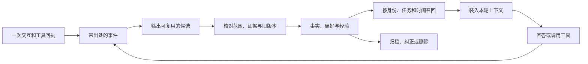
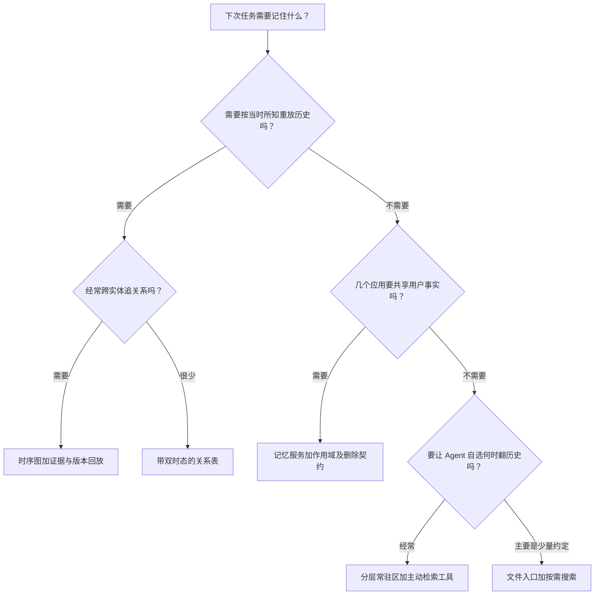

# Agent 记忆系统架构全解：认知模型、主流技术栈与全生命周期

用户周一说「以后示例用 TypeScript」，周五换了设备，助手仍该用 TypeScript。同一个人说「这次给客户演示，用 Python」，下周的默认值又该回到 TypeScript。本文借这两个几乎一样的请求，讲清长期 Agent 该保存什么、谁能改、什么时候取，以及面试里如何证明它真的记对了。

## 全景：跟着一条偏好走一圈

把记忆想成同事的交接本。桌上摊着的是他此刻看得见的东西，柜子里还存着原始记录。交接做得好，下位同事翻一页就能开工。交接做得差，柜子越大，他越可能找到一份过期答案。系统既要有写入路径，也要让读者看出一条记录为何在今天仍然适用。



### Context、Memory、Knowledge、State 放在哪里

假设小林让研发助手「把我的 SDK 示例改成平时用的语言，提交一个草稿」。可以给四样东西分别断电做实验。关掉当前请求，模型就看不见光标选区了。开一个新会话，长期偏好还可以查到。换一个授权用户，SDK 文档里的参数含义相同。工作进程重启，草稿若已创建，恢复程序必须知道它的编号。

| 概念 | 它替谁回答什么问题 | 本例中存的东西 | 典型的权威来源与寿命 |
|---|---|---|---|
| Context 上下文 | 模型这一次能看见什么 | 选区、任务、刚检索到的偏好、工具返回值 | Harness 组装的本次输入，下一轮可能被裁剪 |
| Memory 记忆 | 从过去的交互里学到了什么 | 小林明确说平时用 TypeScript，保留原话出处 | 经授权的用户记忆，可纠正、撤回，跨会话读取 |
| Knowledge 知识 | 有什么可查证的领域资料 | SDK v3 的方法签名、示例支持的语言 | 发布文档及其版本。RAG 是取资料并辅助生成的办法 |
| State 运行状态 | 已执行到哪一步，再做一次会怎样 | 草稿号、提交幂等键、等待审核的状态 | 事务库、检查点和工具回执，按业务状态机迁移 |

同一条信息可以扮演几个角色。草稿号从事务库读入提示时也属于 Context。上个月建草稿的失败复盘可以进入 Memory。一份公开的排错手册可以进入 Knowledge。决定谁说了算，要看后果。询问「我通常喜欢哪种语言」可以引用偏好。询问「这笔任务已经提交了吗」要查操作记录。误把一段聊天摘要当提交回执，重试就可能重复创建草稿。这条边界与采用文件、Redis 或数据库无关。

### 四类记忆对应四种读法

CoALA 把语言 Agent 放进一个会观察、行动、读写记忆的循环里，给出的分类适合拿来问「这段东西下次怎么用」。它并未要求部署四个数据库。LangMem 再把长期记忆落实为事实、经验示例和会随反馈修订的程序规则，分别适合不同的更新频率。[CoALA 论文](https://arxiv.org/abs/2309.02427) · [LangMem 概念指南](https://langchain-ai.github.io/langmem/concepts/conceptual_guide/)

| 认知名称 | Agent 里看得见的工程对象 | 一次事故能留下什么 | 读写约束 |
|---|---|---|---|
| 工作记忆 Working | 当前窗口、工具结果、短期 scratchpad | 正在比对的两个 SDK 版本、尚待检查的文件 | 空间很贵。任务完成后清理，断点可单独持久化 |
| 情景记忆 Episodic | 带时刻和来源的事件或完整示例 | 9 月 3 日升级后样例失败，切回旧接口才通过 | 保留前提、尝试与观察，让后来者能判断是否相似 |
| 语义记忆 Semantic | 从事件提炼出的事实或画像，可用字段或小文档表达 | 小林习惯 TypeScript，避免只有一处调用的抽象 | 标明谁说的、适用场合、何时生效。冲突时回看事件 |
| 程序记忆 Procedural | 工具调用套路、工作流、经过验证的 Skill 或规则 | 升级 SDK 时先编译固定样例，再运行兼容性检查 | 步骤要有触发条件、退出条件、测试和可回滚版本 |

同一次踩坑可以产生三份有用东西。复盘保留完整事件。「旧示例依赖 v2 的参数名」是一条带版本的事实。「升级时对两套样例做回归」是下次可以执行的步骤。直接把三者揉成一句「以后用 v2」会把临时绕行固化为规范。工作区的 scratchpad 适合记可观察的输入、已试步骤和待办，写长篇思考过程既耗窗口，也难以核验。

把经验升级为程序规则，相当于修改以后每次工作的控制逻辑。做 Self-Evolving Rules 时，Agent 可以 提议给某个 `SKILL.md` 加一条触发条件，在旧任务上重放，维护者看差异，再合入指定版本。同一条规则若让另一个项目的构建失败，就把范围缩小。用户口头偏好可以由用户直接改。能改变组织工作流的规则需要相应发布权限。Letta 的常驻块则是放置信息的位置，一块可以承载画像，也可以承载步骤，「常驻」和「语义」回答的是两个维度。[Letta V1 状态模型](https://docs.letta.com/v1-sdk/concepts/stateful-agents)

## 四种技术路线：找出成本落在哪一端

### A．Letta 与 MemGPT，把有限的窗口当工作台

假设助手陪你调试了半天。此刻生成下一条命令只需错误码和当前假设，早晨试过的五个版本仍得找得回来。MemGPT 借用了操作系统分层存储的直觉，让模型通过工具把重要信息写进可见区，并在需要时把外部材料读回工作窗口。真正触发这次「翻页」的是模型的判断或宿主策略，没人能靠地址缺页异常自动知道哪份笔记与任务有关。[MemGPT 论文](https://arxiv.org/abs/2310.08560)

在经典 MemGPT／Letta V1 模型里，**Core Memory** 是随提示带入的块，应用可设置角色说明、用户偏好等，Agent 用编辑工具修改可写块。**Recall Memory** 保存对话历史。长对话离开当前窗口后，旧消息仍可经历史检索读回。**Archival Memory** 放显式写入的外部知识、经验段落等，通过搜索找到，再把命中的部分带入当前上下文。对话中的原话要先找历史，用户整理过的几十页设计笔记更适合放归档。开发者要给工具说明写清这两个搜索入口各自覆盖的集合。[Letta V1 状态模型](https://docs.letta.com/v1-sdk/concepts/stateful-agents) · [Archival Memory](https://docs.letta.com/v1-sdk/memory/archival-memory)

例如用户问「上次否掉接口 B 的原因是什么」，助手看到常驻块只有「默认 A」，先查历史找到会议日期，再查归档取设计依据，最后把稳定结论和出处压回核心块。一次读取带来模型选工具、存储检索、工具结果回传和下一轮推理几段耗时。结果选错还会多翻几页。调优时分别记「有证据却没发起检索」「发起后搜错集合」「找到材料仍答错」的比例。调大窗口只能改善其中一部分。核心块越大，每轮携带的字数越多，错误总结也会随每次调用重复出现。

截至 2026 年 11 月，Letta 当前产品文档的主线已经用 **MemFS** 描述可编辑、由 Git 支撑的记忆文件系统，并提供后台 dreaming 整理。V1 的块模型仍有独立文档。面试解释经典分页思想可以用三分法。为新应用写适配层时要先选 SDK 代际，并明确常驻内容如何编译、读写调用由谁触发。后台整理与交互中的即时纠正可能同时写一个文件，提交基础版本、检查差异、必要时重算，是由应用管理共享写入时需要补上的工作。[Letta 当前记忆与 Dreaming 文档](https://docs.letta.com/configuration/memory)

### B．Mem0 与 OpenMemory，把“从聊天里记住东西”拆成一项服务

做客服、邮件和日程三个入口时，分别教三个 Agent 整理画像，很容易得到三个版本的「小林」。独立记忆服务让各入口递交有身份、有来源的交互，再从同一作用域查询。它最难的工作是回答「哪句话有资格改画像」，其次才是让相近的句子彼此找到。

2025 年 Mem0 论文给出了一个可以复述的写入过程。提取器参考新消息、近期历史和已有摘要，得到候选，例如「默认 TypeScript」。逐条候选用 embedding 找到相似旧记忆，把候选、旧文本及标识交给更新器。遇到首次出现的事实用 `ADD`。得到更准确的版本用 `UPDATE`。旧项被明确否定且应移除时用 `DELETE`。内容已有或没有可采纳增量时用 `NOOP`。候选为空可直接结束。向量负责缩小比较范围，最终合并动作取决于证据、逻辑关系和更新策略。[Mem0 与 Mem0ᵍ 论文](https://arxiv.org/abs/2504.19413)

如果「给培训班的代码用 Python」在语义上离「默认 TypeScript」最近，更新器却没看见「给培训班」这个限定词，它就会把两个都成立的事实合成一个错事实。给记录加 `project` 或 `audience`，候选按适用条件比较，保留证据片段，比调高余弦阈值更有效。Mem0ᵍ 在论文中把实体和关系也存进图，让「这个人参与的项目依赖哪个团队」可以依关系取证。图增强增加了实体归一、关系抽取和维护成本，未自动解决事实的有效期。

**版本边界会改变集成代码。** 官方 OSS v2→v3 迁移指南将自动抽取改成单次模型调用、只追加 ADD，检索合并语义、BM25 关键词和实体匹配。外部图存储集成已从这一代 OSS 移到 Platform。依赖 `add()` 返回 UPDATE 或 DELETE 去刷新用户画像的消费者，升级后会错过更新。应用可保留自己的当前值投影，用显式更正或删除流程处理撤回。接入前先录一段「偏好→更正→撤回」并核对实际事件形状。[Mem0 官方 OSS 迁移指南](https://github.com/mem0ai/mem0/blob/main/docs/migration/oss-v2-to-v3.mdx)

名字也会复用。Mem0 团队早期 OpenMemory 把自托管 MCP 服务和可查看、管理记忆的面板放在一起，让多个客户端读同一份个人记忆。原实现现收在只读归档。同一组织当前 OpenMemory 主仓描述的是在 Claude Code、Codex、OpenCode 等之间迁移编码会话的 CLI/TUI。采购或做技术验证时，明确自己要跨客户端共享事实，还是把整个任务交接过去，两者的权限、费用和验收问题完全不同。[早期 OpenMemory 服务归档](https://github.com/mem0ai/openmemory/tree/main/openmemory-archive) · [当前 OpenMemory 仓库](https://github.com/mem0ai/openmemory)

### C．Zep、Graphiti 与 Cognee，给关系加上时间和出处

「去年我在字节，今年换到阿里」，搜「我的雇主」会得到两个都很像的答案。向量能辨认它们都在说工作，却无法仅靠距离决定哪天该选哪一个。最小的补救是给单一关系建有效期。当问题升级为「换工作前最后一次评审由哪个团队负责」，还要沿着人、任职、评审和团队几条边走，并让每一步使用同一个时间截面。

Graphiti 是开源时序图引擎，Zep 将这类图用于 Agent 上下文服务。原始 episode 可以是一次带参考时间的消息。抽取后得到实体节点和带断言的边，做实体对齐，比较相关旧边。若新证据使一条旧关系结束，就设置失效信息并保留旧边。Zep 文档把 `valid_at / invalid_at` 用于世界里的起止，把 `created_at / expired_at` 用于系统创建或判失效的时刻。这四项是推导和记录的边界，某些值允许未知。两个“时钟”都写 UTC，另保留原时区和原话中日期的精度。[Zep 的四个时间戳](https://help.getzep.com/facts) · [Graphiti 边的数据结构](https://github.com/getzep/graphiti/blob/main/graphiti_core/edges.py)

举个有迟到消息的例子。3 月 1 日入职阿里，3 月 10 日才告诉助手。若此前字节是已知的唯一主雇主，按这条新证据，旧边的现实结束时刻是 3 月 1 日，系统在 3 月 10 日记下失效。问「按今天掌握的材料，3 月 5 日在哪」应答阿里。问「复现 3 月 5 日给出的推荐，当时系统以为在哪」应答字节。第二问关乎问责。实现严格历史回放要保留每次修订前的记录，下文给出版本表。只用当前旧边上的四个值做一次过滤，未必能复原当时未知的结束日期。

「离开字节」可让旧的主雇佣关系失效。「也为阿里做顾问」可以和旧关系并存。先约定主雇主是否单值，再用实体 ID、谓词、适用范围和有效期收窄参与冲突判断的边。抽取模型可以提示矛盾，决定是否写关闭时间要看业务约束。遇到「去年」先用消息发生时刻解读，不能拿后台任务今天运行的时间硬算。材料只支持到月份，就保留月份和不确定性，不凭空补某天零点。

Cognee 也是图与向量结合的路线，公开用法先用 `add` 收材料，`cognify` 组织成图，再通过 `search` 针对任务检索。它的源码另有 temporal hybrid 检索与时间范围测试。评估它时，可以实测「在给定时间窗内找事件」，再单独测「复现后来才被更正的旧判断」。例如其端到端测试用手工构造的提取结果写入真实图存储，检查时间范围查询及邻域读取。这验证了检索路径，抽取模型能否理解「上周离职」要用自然语言事件另测。能过前题的产品并不必然提供后题所需的事务版本。不要把 Graphiti 的四个字段复制到 Cognee 的产品说明里。[Cognee 主仓](https://github.com/topoteretes/cognee) · [Cognee 时段查询测试](https://github.com/topoteretes/cognee/blob/main/cognee/tests/e2e/temporal/test_timestamp_range_lookup.py)

### D．文件与 SQLite，把能一眼检查的原件留下来

用户说「你怎么还记着这个」，最短的解释往往是打开一页笔记，指出原话并让他改掉。文件适合个人工作区，因为人、编辑器和 Agent 都能读写，同一份内容可做差异比较，也好搬家。项目逐渐长大时，文件继续做原件，关键词索引、向量和时间线做可重建的加速层。这几种工具在本地可以共存。

| 产品与入口 | 每次先看到什么 | 细节如何找回来 | 膨胀时的具体行为 |
|---|---|---|---|
| Claude Code | 人维护的项目指令 `CLAUDE.md` 与工具自己写的 auto memory 分开。启用后加载 `MEMORY.md` 的开头 | 长笔记放主题文件，模型按需读。路径规则可限定适用文件 | 自动记忆入口最多前 200 行或 25KB，先到者为准。项目指令的建议篇幅另算 |
| OpenClaw | 工作区 `MEMORY.md` 放耐久决策，可用 `USER.md` 放偏好。裸 `/new` 或 `/reset` 可读今昨日期笔记 | `memory/YYYY-MM-DD.md` 保留细节。`memory_search` 找片段，`memory_get` 读原文。内置 SQLite，可用混合检索 | 引导预算截断注入副本，磁盘文件留存。压缩前可做 flush，后台 dreaming 再整理 |
| Hermes Agent | 会话开头冻结 `MEMORY.md` 和 `USER.md` 快照 | `session_search` 在 SQLite 的会话记录上用 FTS5 搜原话。背景资料与可执行 Skill 分收 | 官方记忆页列出的两个默认容量分别为 2,200、1,375 字符。写超限返回错误，由 Agent 合并或删减 |

三家的「写满」会导致不同的可见结果。排查 Claude Code 的某条偏好时，先看它是否落在下次加载的入口边界以内。排查 OpenClaw 时，辨别原文件、启动注入副本和检索结果。排查 Hermes 时，先看写工具有没有报超限，以及你查的是本轮冻结快照还是下次会话。字符数、字节数、行数、token 分属不同单位，中文和代码混排时更不能互换。上表描述官方文档可确认的入口，无须假定三家都在内部运行同一套模糊搜索。[Claude Code 记忆](https://code.claude.com/docs/en/memory) · [OpenClaw 记忆](https://docs.openclaw.ai/concepts/memory) · [Hermes 持久记忆](https://hermes-agent.nousresearch.com/docs/user-guide/features/memory)

自己搭建时，二十个文件和唯一的错误码可以直接用 ripgrep 定位。要分页、按租户分库、按词排名、频繁查历史，就给段落分配稳定 ID，并把正文和行区间送入 SQLite FTS5。索引项记正文版本和内容哈希，命中后读回原件校验。新增「撤回申请」与「取消工单」这类近义词漏检，再引入向量召回，和关键词结果合并。汉字连续书写时默认分词可能得出很长的词项，可比较预分词和 trigram。三元切分对一两个字的搜索有先天限制，短代号另建精确字段。[SQLite FTS5 与分词器](https://sqlite.org/fts5.html)

| 路线 | 最能说明它值钱的一问 | 主要付费位置 | 上线前最该拆穿的失败 |
|---|---|---|---|
| Agent 自管分层 | 能否自己发现缺资料并去历史里找 | 多轮推理、常驻块、翻页延迟 | 没想到搜索，直接编出理由 |
| 专用中间件 | 三个应用能否复用同一偏好 | 写入抽取、历史迁移、权限契约 | 相似的一次性要求改了默认画像 |
| 时序图或版本关系表 | 能否解释过去某天、某人和某系统的关系 | 实体消歧、时间推断、关系维护 | 两个同名实体被合并，或兼职被判离职 |
| 文件与本地索引 | 用户能否看懂、修正、移走自己的记录 | 索引维护、注入预算、多写者协调 | 搜得到旧副本，启动时却读不到新原件 |

## 全生命周期：从一句话到一条可撤回的事实

下面实现一个范围明确的小系统。小林在某工作区亲口确认了默认语言，系统要能持久化、检索、还原判断并撤销。图引擎并非前置条件，我们先用 SQLite 表达语义。SQL、Python、数值与业务策略均是本文教学设计。产品行为以上文各自的文档为准。

### 一、抽取先决定什么值得写

一条合格候选至少能回答「谁、针对什么、在什么条件下说了什么」。用户明确说「以后默认 TypeScript」有跨会话价值。「今天用 Python 给客户做演示」用会话覆盖值就够。「同事说小林爱用 Rust」属于转述。助手自己问「你可能喜欢 Go？」连用户断言都没有。把发言人和证据区间交给写入器，能挡住「助手天然相信自己的猜测」这类污染。把密钥、验证码或整段个人材料送给抽取模型之前，先执行数据范围与保留策略。

抽取提示可要求返回 `subject / predicate / value / scope / duration / source_event / quote / certainty`，以及空数组。把「他说」「如果」「仅这次」「取消之前的偏好」列成带输出的反例。宿主核对引文确实存在、来源角色正确、范围没有扩大。标为“长期”的模型输出只是一项提议，确认范围的证据仍需保留。一个人两次要求这个项目用 TypeScript 支持项目默认值，却不足以推出他所有私人项目都用该语言。重复频率帮你发现候选，不能代替授权。

| 抽取时机 | 什么时候值得花这笔钱 | 读者会撞上的问题 | 宿主如何接住 |
|---|---|---|---|
| 本轮热路径 | 用户说「记住」「更正」「忘掉」，下一步就会用到 | 等模型抽取拖慢回复。服务超时，助手却声称已记住 | 等事实事务提交再确认，或明确显示待处理。当前轮用局部覆盖 |
| 会话后异步 | 长对话里提到的普通习惯，不必立即可见 | 用户马上另开窗口。没有可靠的“会话结束”信号 | 先落事件和任务，用空闲超时加游标消费，支持读自己的已确认写入 |
| 空闲时整理 | 多次失败归纳成步骤，或合并重复条目 | 整理任务读到旧画像，又把用户刚改掉的内容写回 | 以源事件集合和版本生成提案，提交时校验版本及删除标记 |

即时确认可以做成一个很小的工具契约。下面是接在模型提取器之后的一道写闸。宿主接收用户亲自点击或确认的字段、值和范围，抽取模型只提供带字符偏移的候选。偏移按 Python 字符索引计算，两端都使用同一份未改写文本。这样用户点“保存这项偏好”时，后台任务不能顺手把另一项推测也写进画像。

```python
def admit(event, candidate, confirmed):
    # event 由消息服务提供，confirmed 由已认证的确认动作提供
    if event["role"] != "user" or not event["retention_allowed"]:
        return False
    start, stop = candidate["span"]
    text = event["text"]
    if not (0 <= start < stop <= len(text)) or text[start:stop] != candidate["quote"]:
        return False
    proposed = (event["id"], event["space"], candidate["slot"], candidate["value"])
    return (candidate["duration"] == "durable"
            and candidate["space"] == event["space"]
            and proposed == confirmed)
```

这道闸服务于显式确认通道。普通非敏感习惯若采用隐式学习，可以在后台另走有来源的候选表，经跨会话佐证或人工审核再提升。临时要求在会话结束时过期。原话匹配能证明“用户说过这串字”，并不能自动识别反讽或决定适用范围，所以把用户确认的信息与模型候选分开传入。

后台“睡一觉”的价值是用后来的结果判断早先哪些细节重要。例如当场仅知某次测试变绿，第二天复盘才发现真正有效的是切到旧解析器。聚合多个会话以后，才适合提议一条步骤。Anthropic 在 2026 年 11 月把记笔记、利用原始轨迹、后台整理与预加载分开做实验。这种分解也适合自己的消融测试。可以先保留获准的事件，仅在可复用性明确时提炼，控制每个租户每晚的整理调用和处理进度。[Anthropic 记忆组件实验](https://www.anthropic.com/research/components-of-agent-memory)

### 二、给归并写一份可执行的契约

一次提取失败可以重试，重试两次不能生成两条偏好。两个会话可以同时结束，后到的包不能仅凭到达顺序宣布自己更新。下面用事件表、事务序号表和事实表记录来源及断言版本。为便于读懂，示例只处理同一授权空间、单值属性、有效时刻递增、有明确引用的人工确认。现实有效时间用 UTC Unix 秒，系统知情时间用可映射到 UTC 的事务序号。空间键由服务端根据当前身份签发。一个空间可取细到“该用户在该项目的私有记忆”。

```sql
PRAGMA foreign_keys = ON;
CREATE TABLE event (
    space TEXT NOT NULL, eid TEXT NOT NULL, actor TEXT NOT NULL,
    occurred INTEGER NOT NULL, excerpt TEXT NOT NULL,
    slot TEXT NOT NULL, val TEXT NOT NULL,
    PRIMARY KEY (space, eid)
);
CREATE TABLE revision (
    seq INTEGER PRIMARY KEY AUTOINCREMENT,
    recorded_at TEXT NOT NULL DEFAULT (strftime('%Y-%m-%dT%H:%M:%fZ', 'now'))
);
CREATE TABLE fact (
    space TEXT NOT NULL, slot TEXT NOT NULL, val TEXT NOT NULL,
    valid_from INTEGER NOT NULL, valid_to INTEGER,
    known_from INTEGER NOT NULL, known_to INTEGER,
    eid TEXT NOT NULL,
    PRIMARY KEY (space, slot, valid_from, known_from),
    FOREIGN KEY (space, eid) REFERENCES event(space, eid),
    CHECK (valid_to IS NULL OR valid_from < valid_to),
    CHECK (known_to IS NULL OR known_from < known_to)
);
CREATE UNIQUE INDEX one_current ON fact(space, slot)
WHERE valid_to IS NULL AND known_to IS NULL;
CREATE INDEX as_of ON fact(space, slot, known_from, valid_from);
CREATE INDEX event_order ON event(space, slot, occurred);
```

设 1 月得到「TypeScript」，3 月 10 日得知「3 月 1 日起改用 Go」。事务关闭一月版本的“已知区间”，写一份带有三月结束日期的 TypeScript 修订，再写入新值。修订行保留旧值的来源。若用于正式审计，另记关闭动作的证据和操作者。另一个等价实现是只追加修订事件，在读取时投影有效区间。下面的 `known` 由数据库在写事务内分配，序号给并发提交一个确定次序。`recorded_at` 将序号落到系统的 UTC 时间线上，设备本地时钟只作为待核实的事件时间。

```python
def confirm(db, space, eid, actor, when, quote, slot, value):
    """输入是已经核过原文和身份的单条确认，每个事件只处理一个字段。"""
    db.execute("BEGIN IMMEDIATE")
    try:
        old_event = db.execute(
            "SELECT actor, occurred, excerpt, slot, val FROM event WHERE space=? AND eid=?",
            (space, eid)).fetchone()
        if old_event is not None:
            if tuple(old_event) != (actor, when, quote, slot, value):
                raise ValueError("重试事件内容不同")
            db.commit()
            return "已处理"

        latest = db.execute(
            "SELECT MAX(occurred) FROM event WHERE space=? AND slot=?",
            (space, slot)).fetchone()[0]
        if latest is not None and when <= latest:
            raise ValueError("迟到或同刻冲突，交给历史重算")
        active = db.execute(
            """SELECT val, valid_from, eid FROM fact
               WHERE space=? AND slot=? AND known_to IS NULL AND valid_to IS NULL""",
            (space, slot)).fetchone()
        db.execute("INSERT INTO event VALUES (?, ?, ?, ?, ?, ?, ?)",
                   (space, eid, actor, when, quote, slot, value))
        if active:
            old_value, start, source = active
            if old_value == value:
                db.commit()  # 事件作为补充证据留下，当前值不换版本
                return "再次确认"
        known = db.execute("INSERT INTO revision DEFAULT VALUES").lastrowid
        if active:
            db.execute("""UPDATE fact SET known_to=? WHERE space=? AND slot=?
                          AND valid_to IS NULL AND known_to IS NULL""",
                       (known, space, slot))
            db.execute("INSERT INTO fact VALUES (?, ?, ?, ?, ?, ?, NULL, ?)",
                       (space, slot, old_value, start, when, known, source))
        db.execute("INSERT INTO fact VALUES (?, ?, ?, ?, NULL, ?, NULL, ?)",
                   (space, slot, value, when, known, eid))
        db.commit()
        return "已生效"
    except Exception:
        db.rollback()
        raise
```

把一个事务提交序号和提交时刻写进日志，就能把「当时系统知道什么」换算为 `:revision`。其中 `:at` 表示问题关心的现实时间。两轴都采用左闭右开，恰逢换岗时刻只返回新任职。把查询跑在更正前后的两个版本上，可以验证历史是否被悄悄改写。

```sql
SELECT val, eid FROM fact
WHERE space = :space AND slot = :slot
  AND valid_from <= :at AND (valid_to IS NULL OR :at < valid_to)
  AND known_from <= :revision AND (known_to IS NULL OR :revision < known_to);
```

生产消费者先把事件原件及任务写入持久收件表，再由 worker 在事务里认领。上面抛出的迟到事件应进入待重算队列，保留到下次处理。重算时只重建该空间、该字段和相邻有效区间，检查前后边界互不重叠，再整体发布新版本。一条消息抽出多条候选时，将去重键扩为事件 ID、候选稳定 ID 和提取器版本，记录标准化载荷摘要。对同一事件升级提取器，应走差异重放，不能简单把新结果再追加一遍。

“相同值”也有两种成本。重复点击重试应静默吞掉。独立发生的第二次确认能提升可信度，应保留新证据并更新最近确认时刻。上例把这个字段和值随事件一起保留。若要让一个断言对应多次确认、一次交互对应多个字段，再加一张事实与证据的关联表。若用户说「我并没有喜欢过 Go，是你误会了」，这是追溯更正，需要修订早期断言及其派生摘要。若用户说「今天起改用 Go」，则保留过去真实成立的那一段。无法分清时，把两段原话交给用户确认，比猜一个看似干净的唯一值更便宜。

### 三、遗忘应当释放注意力，并让该消失的数据真正消失

人会忘记一次临时路线，却不会因为两个月没搬家就把住所判为错误。工程上分别保存有效性、检索热度和保留期限。有效性由证据更新。热度决定是否挤进有限窗口。期限和删除请求决定数据还能否留存。频率高的错误、被撤回的同意、已离职员工的权限，都不能靠高分继续生效。

艾宾浩斯的遗忘曲线描绘了刚学过的材料随时间变得更难回忆的现象。用于软件的指数函数是一种可调度的近似，具体参数要从业务回放估计。一个可核算的衰减是半衰期 `H` 天，距离可信确认或实际使用 `d` 天，热度乘 `2 ** (-d/H)`。H 为 14 时，28 天后剩四分之一。把某条稳定偏好的 H 调长能让它少打扰用户，而政策、权限、用药等严肃事项要回权威系统查最新状态。访问强化只统计被选中并用于完成任务、得到独立确认的次数，并封顶。每次后台扫描也加一分，会让夜间整理任务把冷数据全部“刷热”。

重要性可先用简单规则估计，考察用户是否主动固定、相关事故是否曾导致严重返工，以及有多少独立证据支持。保留原因与打分时间，供用户调整。夜间 GC 先找超过保留期限或低热度的条目，再排除固定项和有活动任务引用的条目。冷资料先移出热索引，归档清单保留来源以便恢复。用户主动删除时，立即阻断读取，随后清理原文、索引向量、缓存、摘要和队列副本。备份要有到期清理及恢复时重新应用删除的机制。归档可以找回，隐私删除要求另有可验证的完成条件。

### 四、检索先问能不能看，再问值不值得看

用户问「上次改生成器时踩了什么坑」，仅搜“生成器”，会找到几十份交接记录。先在授权空间内按请求的项目和有效时间筛选，再并行做关键词和语义召回。关键词适合错误码、类名、工单号。语义检索适合「发布之后老客户端读不了」这种复述。合并时可用倒数排名融合 RRF，同一候选在每条结果列表的贡献为 `1/(k+rank)`，再按同一证据 ID 去重。这样可避开两个引擎分数尺度不同的问题。若之后做标定，要保留每个引擎的原排名，方便解释和回归。

Generative Agents 的做法把相关性、新近程度和重要性结合起来。现代工程可以保留这三个独立信号，把新近程度与任务类型关联。下面的 `rel` 是已经标定到零到一之间的检索相关性，`salience` 也是同一范围的业务分。`uses` 只统计已确认有用的独立访问。此函数给普通当前任务排名，历史问题应先按目标日期找有效版本，且可以去掉“距今天越近越好”的偏置。[Generative Agents 论文](https://arxiv.org/abs/2304.03442)

```python
from math import log1p

def memory_score(rel, salience, age_days, uses, half_life=14):
    if half_life <= 0 or not (0 <= rel <= 1 and 0 <= salience <= 1):
        raise ValueError("请先标定分值并使用正半衰期")
    age = max(age_days, 0)
    reinforced_half_life = half_life * (1 + min(log1p(max(uses, 0)), 2))
    fresh = 2 ** (-age / reinforced_half_life)
    return 0.65 * rel + 0.20 * fresh + 0.15 * salience
```

例如相关性 0.9、重要性 0.8、十四天前首次使用的记录，取零次后续强化时得 0.805 分。一条今天的新闲聊即使重要性 0.2，相关性只有 0.3，也只得 0.425。这里的数值是演算起点。拿真实失败样本做两两排序，按错误类型调整权重。特别稀有的工单编号用确定性精确匹配，不必受同义词模型牵制。遇到候选全是同一段话的复述，按来源分组，每组留一段。跨会话因果题可为两段互补证据各留位置。最终要统计答案需要的证据有没有一起进入窗口，单条相关性很高仍可能答不出多跳问题。

给中文记忆建一个最小的本地索引，可以在每个授权空间独立的数据库内运行下列 SQL。示例查询选择至少有三个汉字的连续片段，验证汉字三元分词确实命中。FTS5 的 `bm25()` 数值越小排名越靠前。生产读取再以 `eid` 查当前有效版本，避免已撤回的旧片段混进提示。遇到几乎全是短 ID 的库，按完整 ID 建普通索引会更稳。

```sql
CREATE VIRTUAL TABLE memory_text USING fts5(eid UNINDEXED, body, tokenize='trigram');
INSERT INTO memory_text VALUES ('e-19', '升级生成器之后要重跑兼容性测试');
SELECT eid, body FROM memory_text
WHERE memory_text MATCH '"兼容性测试"'
ORDER BY bm25(memory_text) LIMIT 3;
```

### 五、注入给稳定前缀留出完整边界

预注入像把常用工具放在桌面。几乎每次写代码都要遵守的项目约定可以在启动时拿来，冷门事故则让模型看到一行目录或一个 `memory_search` 工具，等问题指向它再调用。后者少占平时的窗口，多了一次模型往返。把明确的小偏好预加载，再允许按需找依据，通常比每轮把相似度最高的十条全部塞入更易排错。

一次请求可按「稳定工具定义和开发者规则 → 有明确边界的稳定前缀 → 会话版本快照 → 本轮问题和动态检索结果」组装。供应商前缀缓存依赖前面一致的 token 序列或内容块。模型服务可重用相应的注意力键值计算，缓存命中仍受服务规则、最小长度及有效期影响。每轮在开头插入日期、乱序工具、即时画像会使变动点之后的前缀失去复用机会。在支持 cache breakpoint 的接口把标记放在可复用段末端。保持序列化顺序稳定。调整上下文顺序时还要保留消息的权限边界。系统或开发者块可以说明如何使用记忆，用户笔记、外部网页原句应作为带来源的数据装入适当的低信任内容块。[Anthropic Prompt Caching](https://platform.claude.com/docs/en/build-with-claude/prompt-caching)

例如一轮可用输入预算是一万二千 token，工具与稳定规则占四千，近期对话占四千，给本次长工具回执预留两千，就只剩两千给记忆和问题。先装本轮问题与固定偏好，再装必要的证据组。容不下完整的第二组时给一个可继续读取的引用和短摘录。预算计算要用目标模型的 tokenizer，并为实际输出另留窗口空间。把「每条最多多少」和「本轮总共多少」同时限制，避免一条很长的日志吃光全部上下文。

用户中途改了偏好，当前轮可把新确认作为消息尾部增量，下一次启动重新拍快照。若发生权限撤回，立即清除旧快照和可恢复的会话材料。宁可重新预填，也不能为了命中率把已经禁止读取的内容继续传给模型。观测面板把缓存读入 token、写入 token、实际注入字数、首 token 延迟和工具往返分别呈现。响应越来越慢但召回没变时，先比较头两个请求从哪个块开始不同。

### 六、隔离从入口延伸到回收站

同一个“小林”可以有私人偏好、代表供应商参与会议的身份，也可以是公司内部经理。检索时只传一个字符串姓名，等于让这些身份共用钥匙。服务端从已认证请求取组织、主体、代理和会话，构造允许读的命名空间，前置过滤所有召回通道。模型有权提议搜索关键词，没有权替自己新增一个租户。写请求再按同一主体可写范围校验，尤其不能把私聊推断自动发表为组织规则。

| 作用域 | 例子 | 谁通常可读写 |
|---|---|---|
| Session | 本次演示换 Python | 当前会话成员可见，可在结束后过期 |
| User | 小林个人默认 TypeScript | 用户本人及其获授权的 Agent。另一个同名用户不可见 |
| Agent | 这个代码助手在特定仓库维护的工具经验 | 绑定租户、Agent 身份与授权项目，必要时继续细分用户 |
| Org | 审核通过的 SDK 支持政策 | 明确授权的组织成员可读，发布者或审核流程可写 |

会话覆盖个人偏好是业务优先级。个人偏好不能覆盖组织的强制规则。把「是否有权看」与「多条可见记录选哪条」分成两次判断，否决读权限要先于排序。检索服务、向量库、全文索引、重排调用、日志和缓存都遵守同一边界。按用户分桶的索引若用只包含查询文本的共享结果缓存，两个用户问同一个词时仍可能串数据。缓存键至少包含租户、主体或授权集合指纹、权限版本、索引版本和问题。读取原文与生成答案前再检查授权，覆盖查询期间成员被移出的情况。

可以给隔离测试造一对内容完全相同、证据 ID 不同的记录，放在两个租户里。对一侧发起搜索，在候选、重排输入、引用和追踪日志四处查另一个 ID 是否出现。再让用户退出项目，保留原会话重试。最后模拟备份恢复，检查已删除记录会不会复活。遇到任何一次越界，哪怕最终回答恰好没有引用，都应视为失败。模型输出只看到了处理链尾端，故障可能早在重排或调试日志里就已经发生。

## 如何验收和选型

### 用基准定位丢的是记忆、证据还是判断

LoCoMo 提供跨多次会话的长程对话，作者的评测包括问答、事件摘要和多模态对话生成。问答里既有单跳、多跳和时间问题，也有对抗式问题。它适合检查「人物和事件能否连起来」。别让生成器碰到整段未来对话再去回答历史问题。LongMemEval 的原版用五百个问题检验信息抽取、跨会话推理、信息更新、时序推理和无证据时的拒答。S 和 M 的历史长度不同，比较时注明数据版本、历史配置、生成模型和裁判。2026 年的 V2 则转向多模态网页 Agent 轨迹，考察能否积累工作经验，并比较准确率和查询延迟。[LoCoMo 项目](https://snap-research.github.io/locomo/) · [LongMemEval](https://github.com/xiaowu0162/LongMemEval) · [LongMemEval-V2](https://github.com/xiaowu0162/LongMemEval-V2)

在同一批请求上做三组实验。第一组只给最近对话。第二组给系统实际检索的材料。第三组直接给标注员找出的必要原话。若第三组仍错，要查日期计算或生成器。第三组会答、第二组不会，沿抽取、归并、召回、注入逐段对照。第二组和第一组打平，可能是用户的问题本来就不依赖长期记忆。保留一组全历史直读作成本上界比较，别默认全历史一定更准。固定每次的模型和最大输入预算，每组都报样本数及失败类型。

| 验收面 | 分母和观察点 | 能定位的问题 |
|---|---|---|
| 写对 | 标注应保留的事实中，抽到且范围正确的比例。另算误存一次性要求的比例 | 模型把角色、临时要求或归属写错 |
| 找全 | 给定问题所需的证据组全部出现于前 k 条的比例 | 单跳成绩很好，多跳证据永远缺一半 |
| 答对且有据 | 按历史截止点作答，核对结论和引文。单列本应拒答的问题 | 编得顺但没依据，或用今天的知识冒充当时知道 |
| 可以负担 | 分开报每千条事件写入费用、每问检索与生成费用、冷启动和热缓存的 P95 | 写入很贵的系统凭一次廉价查询赢了演示 |
| 管得住 | 撤权后首次拒读时延、删除后重建测试、跨租户错误条数 | 分数很高但不能开放给第二个客户 |

### 选型决策树



一人一台机器，先拿可编辑笔记和会话搜索做基线。把“找不到足够的近义表达”量出来再补 embedding。企业产品的第一笔工程预算通常应花在身份、来源、撤销和回放上，然后用带版本的关系表比较图引擎。图的优势要由确实存在的多跳任务证明。需要同时维护大量项目制度、版本说明和对照分析时，可把经确认的经验发布成长期 Wiki，用户私有记忆仍在原作用域。[下一篇：LLM Wiki 与知识复利工程](./02-llm-wiki-and-knowledge-compounding.md)

## 面试深挖：七个能把系统问到底的问题

### 1．有百万 token 窗口，还要专门做记忆吗？

**考察点**是能否把可见性、持久性和正确性分开。

**回答思路**　先拿当前请求做预算，接着问第二次登录时从哪里恢复，再问用户更正或删除后谁负责传播。长窗口降低单次截断概率，合法范围、版本和保留仍由系统维护。对几十条短记录，可以直接读全，再把它作为复杂记忆系统必须超越的基线。

**连环追问**　「全读都能答，为何还要提取？」如果成本、授权和准确性都达标，就保留原文直读。只有当重复消耗、冲突或跨任务整理已成为可测问题时才引入提取。

### 2．用户说“我现在在阿里”，要不要删掉“在字节”？

**考察点**是能否区别岗位变更、兼职和纠错。

**回答思路**　检查两句说的是同一个人、同一种任职、同一适用范围。确定新岗位的有效起点，关掉旧区间并保留出处。未知的起点写成未知，必要时问清。

**连环追问**　「入职后十天才告诉你呢？」现实起点用入职日期，系统时刻用知情日期。演示两种截至日期的答案。若用更新一行的数据库，还得有修订历史，保证十天前的推荐可以复盘。

### 3．为什么助手总记住“一次性”的要求？

**考察点**是能否精确定位写坏还是读坏。

**回答思路**　抽查证据原句，看提取时是否丢掉“今天”“给客户”等条件。若是，增加带条件的负例和可为空的输出。若写入正确，检查检索是否把项目范围错误提升为个人默认，再检查新旧画像谁先注入。

**连环追问**　「有现成脏数据怎么办？」按来源重新提取，生成受影响集合，人工抽样后更新投影。将修正后的日期和原话保留，回归测试覆盖再次检索。

### 4．夜间整理和用户手改撞车，如何保证用户的话生效？

**考察点**是并发与故障一致性。

**回答思路**　整理任务记住读取时的版本，提交时事务比较。用户纠正一旦写入，基于旧版本的任务应重新读取并判断。写入从事件 ID 去重，事件和任务可靠持久化，索引异步生成但读取前核验版本。

**连环追问**　「写成功、回复失败怎么办？」同一请求带相同幂等键重试，返回原结果。对已经撤回的片段，重试不得通过新事件绕过删除标记。

### 5．搜索命中正确，模型为什么还是用了旧偏好？

**考察点**是能否从搜索结果一直追到生成请求。

**回答思路**　保存同一请求内的候选 ID、重排后名次、入窗片段和快照版本，查是否因预算丢掉新证据，或旧常驻区和新证据同时出现。按显式适用范围和版本挑出唯一现行项，再把历史标为“仅供回顾”。

**连环追问**　「这样频繁改提示会拖慢首 token 吗？」会话中把增量放到稳定前缀之后，比较缓存读入量和首 token 延迟，撤权时重新组装整段上下文。

### 6．如何向评审证明一套时序图比文件划算？

**考察点**是能否设计公平对照。

**回答思路**　从业务抽取带时间、迟到更正和跨实体的查询，加入精确词和拒答题。给两个系统相同来源、生成器和证据预算，同时计入写入、重建及运维成本。用证据组召回和按时点准确率解释收益落在哪一类题。

**连环追问**　「多跳题只占百分之一呢？」看这百分之一错答的业务代价，必要时只把高影响关系建图，其余沿用文件或表，不要求一次迁走全部存量。

### 7．用户点了“忘掉我”，怎么证明下一次真的忘了？

**考察点**是能否列出所有可读副本及恢复路径。

**回答思路**　先按身份阻断后续读取和后台任务，再用来源 ID 找事件、事实、索引、摘要和缓存，执行可重试的清理。记录不含原文的完成凭据，按保留政策处理备份。

**连环追问**　「怎样防止回放旧日志使记忆复活？」重放消费前先应用删除清单，撤销旧会话快照。用专门的测试用户做“删除→重建→查询”演练，核对每个系统的清理状态和延迟。

## 一手资料与延伸阅读

- 认知分类与记忆调度的源头，可以对照阅读论文模型和落在框架中的热路径、后台路径。[CoALA](https://arxiv.org/abs/2309.02427) · [LangMem](https://langchain-ai.github.io/langmem/concepts/conceptual_guide/) · [MemGPT](https://arxiv.org/abs/2310.08560)
- 追踪 Letta 产品代际，看固定块如何进入上下文，以及当前产品怎样做文件记忆和后台整理。[Letta V1](https://docs.letta.com/v1-sdk/concepts/stateful-agents) · [当前 Letta](https://docs.letta.com/configuration/memory)
- 复核 Mem0 的论文更新动作、现行开源接口和同名项目的变化，迁移方案应逐条对照破坏性变更。[Mem0 论文](https://arxiv.org/abs/2504.19413) · [迁移指南](https://github.com/mem0ai/mem0/blob/main/docs/migration/oss-v2-to-v3.mdx) · [OpenMemory 归档说明](https://github.com/mem0ai/openmemory/tree/main/openmemory-archive)
- 对读双时态断言、源码字段以及另一种图检索实现，重点检查失效的含义和可回答的历史问题。[Zep Facts](https://help.getzep.com/facts) · [Graphiti](https://github.com/getzep/graphiti) · [Cognee](https://github.com/topoteretes/cognee)
- 文件派的边界要看产品自己的加载和截断说明。衰减与预注入可以对照研究实验设计。[Claude Code](https://code.claude.com/docs/en/memory) · [OpenClaw](https://docs.openclaw.ai/concepts/memory) · [Hermes](https://hermes-agent.nousresearch.com/docs/user-guide/features/memory) · [Generative Agents](https://arxiv.org/abs/2304.03442) · [Anthropic 记忆实验](https://www.anthropic.com/research/components-of-agent-memory)
- 评测时从作者发布的数据和脚本确认任务、输入长度及评分方式，尤其留意原版聊天任务与新版工作轨迹的区别。[LoCoMo](https://github.com/snap-research/LoCoMo) · [LongMemEval](https://github.com/xiaowu0162/LongMemEval) · [LongMemEval-V2](https://github.com/xiaowu0162/LongMemEval-V2)
