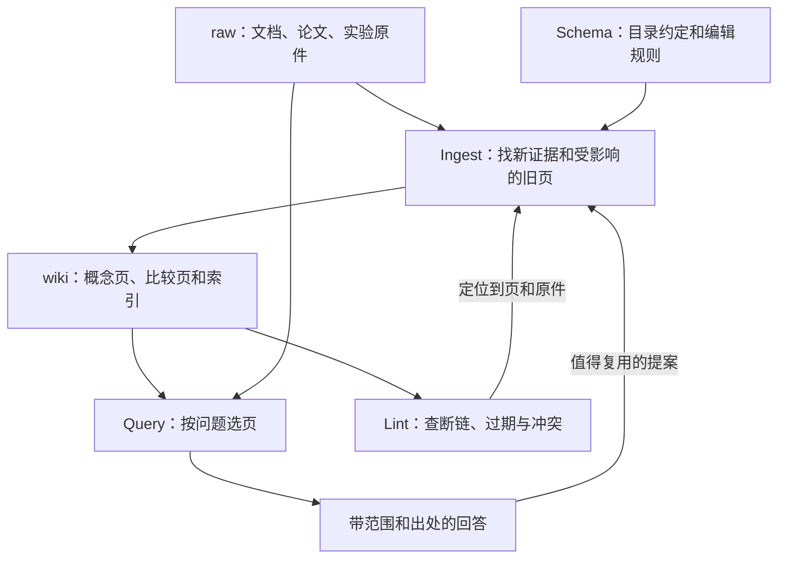

# LLM Wiki 实战：用 Obsidian、Markdown 和 Git 养一份技术笔记

> 昨天查清了「为什么 SQLite 搜得到『兼容性』，却搜不到『兼容』」，今天换个问法还得翻手册。把原文、实验和结论连成一页，再教助手随资料更新它，就有了 LLM Wiki。



## Karpathy 在 2026 年 4 月分享了什么？

4 月 2 日，Karpathy 在 X 发了《LLM Knowledge Bases》：他负责选资料、提问题，用 Obsidian 读笔记。LLM 负责把新材料整合进一批持续维护的 Markdown。[X 原帖](https://x.com/karpathy/status/2039805659525644595) · [官方嵌入记录](https://publish.twitter.com/oembed?url=https://twitter.com/karpathy/status/2039805659525644595)

4 月 4 日，他又把做法写成了一份 Gist。把它交给编码助手，就可以从自己的第一篇材料开始整理。[LLM Wiki Gist](https://gist.github.com/karpathy/442a6bf555914893e9891c11519de94f)

这里的「编译」可以看一眼 Git 差异就懂：导入论文，除了多出一张论文卡，已有的术语页补了定义，比较页多了适用条件，旧结论旁边多了反例。下次读者打开老页面，也能读到这次学习的成果。

**和按块 RAG 差在哪？** 普通 RAG 在提问时找片段、拼答案。Wiki 把反复要做的跨来源比较提前写成页，给它出处，资料变了还要维护。两者能一起用：先读编好的页理解问题，再搜原件补上没编进去的细节。

| 去看哪份实现 | 重点看什么 | 自己做什么时用得上 |
|---|---|---|
| Karpathy 的 Gist | 三层分工、Ingest / Query / Lint、目录与日志 | 先和自己的 Coding 助手约定协作方式 |
| Astro-Han 的 Skill | 用 `SKILL.md` 组织编辑步骤、页面和索引模板 | 想把同一套方法带到第二个笔记库 |
| biks2013-tools 的 CLI | 用 TypeScript 生成目录、记摄取账本、归档查询，运行结构和语义检查 | 想把重复且可判定的工作交给脚本 |

Gist 描述模式，具体文件名和命令可以自己定。作者举的规模约为百份来源、数百页 Wiki，先看目录再选页已很好用。个人笔记从这一步开始，就可以把时间花在看证据和修旧页上。[社区 Skill 原文](https://github.com/Astro-Han/karpathy-llm-wiki/blob/main/SKILL.md) · [社区 CLI 仓库](https://github.com/biks2013-tools/llm-wiki)

## 开一个 Obsidian 库，先把三层分清

我的起步题会选「给 Coding 助手的本地笔记做中文搜索」。只需要 SQLite 官方手册、一段能重跑的 SQL、一个能看到改动的 Git 仓库。用 Obsidian 打开根目录，编辑器和助手就能读同一批文件。

```text
notes/
├── AGENTS.md                       # Schema 层：编辑约定和写入边界
├── schema/page.yml                 # 页类型、必填字段和别名规则
├── raw/                            # 原料层：保留读到的版本
│   ├── docs/fts5-v1.md             # 手册快照，附原链接和段落 ID
│   └── runs/trigram-v1.md          # 版本、建表 SQL、输入和真实输出
└── wiki/                           # 知识层：助手维护、人可以审阅
    ├── index.md                    # 按内容导航
    ├── log.md                      # 按时间查改动
    ├── sources/fts5.md             # 这份手册覆盖什么
    ├── entities/sqlite.md          # SQLite 和相关扩展的入口
    ├── concepts/trigram.md         # 连续三个字符怎样形成索引项
    ├── comparisons/short-query.md  # 短查询用哪条检索路径
    └── topics/local-search.md      # 本地笔记搜索的完整设计
```

**原料层**：原件回答「谁说过什么」。网页会更新，同名 PDF 也可能换内容。每份原件记来源 ID、发布者、获取日、版本或哈希、可见范围。OCR 和清洗后的文本指回原件。下次出现更正，另存新版本，并建立取代关系。

定位要能让人重现发现。网页留章节和段落，PDF 留物理页及表格或脚注，会议录音留时间段，表格留工作表、主键与列名。只给一个网站首页，读者下周还得把整条推理重做一遍。

**知识层**：页面按问题分工。想知道 SQLite 是什么，打开实体页。想懂 trigram 的机制，打开概念页。正犹豫两字查询怎么做，直接查比较页。来源页负责导读，一百份来源摘要也替代不了一张比较表。

**规则层**：在 `AGENTS.md` 里写明允许改哪里、何时要回原件、遇到冲突留给谁。Schema 让脚本能检查同一套约定。索引和日志虽然在 `wiki/` 里，却各有读者：提问先读索引，排查「这句怎么变了」先翻日志。

| 写在规则文件里的约定 | 它能省掉哪种返工 |
|---|---|
| 页有稳定 ID，改显示标题或移动文件时保留 ID 和别名 | 「短查询」改叫「短词检索」时，不会出现两张主页面 |
| 目录给规范路径和一句能区分邻页的摘要 | 不必打开五张都叫「搜索相关」的笔记才能选对入口 |
| 日志按操作追加来源版本、受影响页、基础提交 | 回头能把一句错结论追到引入它的那次编辑 |
| 原件按来源权限保存，普通编译只改派生页 | 私有会话与个人偏好不会跟着公共技术笔记一起发布 |

## Ingest：拿一段真实 SQL，把旧笔记编对

用启用了 FTS5 且支持 trigram 的 SQLite 执行下面这段。记录 `sqlite_version()` 的结果、建表语句和每条查询的行数，把输出存到 `raw/runs/trigram-v1.md`。这份文件以后就是「在这个环境跑过」的依据。

```sql
SELECT sqlite_version();
CREATE VIRTUAL TABLE memo USING fts5(body, tokenize='trigram');
INSERT INTO memo VALUES ('升级后重跑兼容性测试');

SELECT count(*) FROM memo WHERE memo MATCH '"兼容性"';  -- 1
SELECT count(*) FROM memo WHERE memo MATCH '"兼容"';    -- 0
SELECT count(*) FROM memo WHERE body LIKE '%兼容%';     -- 1
```

**读结果时分清两件事**：文本里有「兼容」吗？有，所以 `LIKE` 能找到。能为这两个字产生一个三字符的全文查询项吗？不能，所以 `MATCH` 返回零。若 `LIKE` 模式没有连续三个非通配字符可用，trigram 索引帮不上忙，会退回扫描。[SQLite FTS5 手册](https://sqlite.org/fts5.html)

假设旧页写着「中文短词都可以走全文索引」。这次摄取该改的首先是这句旧话。只新建一页《今天学了 FTS5》，旧比较页还在给助手错误建议。用户下次问原问题，很可能再次撞上它。

**给编辑助手的一条摄取指令**：

```text
读 raw/docs/fts5-v1.md 的 trigram 段和 raw/runs/trigram-v1.md。
先列出手册明确保证的行为，再列出本次实验验证的输入和输出。
用 trigram、短词、MATCH 查目录、别名、正文和反向链接。
逐页判断：需要补充、需要限定范围、已被取代，还是两份来源确有冲突？
返回一份补丁，列出改哪句、凭哪段原件、还有哪些问题没有证据。
原件只读。遇到预算上限，列出没检查的页，留待下次继续。
```

最小补丁通常包含三种编辑：来源页指向手册，概念页补上短于三字符的条件，比较页给出短代号的精确查询路径。综合页已经链接到比较页就不用抄一遍。每多抄一处，下次改事实就多一个容易漏的角落。

### 一张能独立使用的概念页长什么样？

下面的 `trigram` 和 `match-cases` 是导入时给两个原件段落保留的标题锚点。人的阅读顺序很简单：开头看结论，接着看适用范围，需要复核时点到原文。程序可以用页 ID 和来源 ID 建反向索引。

```markdown
---
id: trigram
type: concept
aliases: [三元分词]
audience: personal
sources: [fts5-v1, trigram-v1]
---
# trigram 的短查询边界

FTS5 使用 trigram 分词时，少于三个 Unicode 字符的全文查询匹配不到行。
依据：[手册快照](../../raw/docs/fts5-v1.md#trigram)。

本地实验：同一行笔记，MATCH 查询「兼容性」命中，查「兼容」为空。
复现：[SQL 与输出](../../raw/runs/trigram-v1.md#match-cases)。

如何处理短项目名，见 [[wiki/comparisons/short-query|短查询选型]]。
```

Obsidian 可以从正向链接计算 backlinks。改概念页前看哪些比较页引用它，常比全文搜旧标题更快。根路径和别名要约定好。把文件标题从「Trigram」改成「三元分词」时，两者仍指向同一个概念。[Obsidian 内部链接](https://help.obsidian.md/links)

**证据强弱写在句子旁边。** 手册明示、实验观察、据此推导、仍有冲突，这四种话读者会用在不同地方。特别是「扫描能找到」推不出「大库扫描也足够快」。想写后一句，就得再存数据规模、查询条件和耗时。

来源生效日、页面编辑日、下次复查日也要分开。修个错字会改变编辑日，却不能证明几个月前的性能结论已重测。给需要重测的断言写 `review_by`，到期交给 Lint 找出来。

### Git 怎样避免两位编辑互相覆盖？

个人库可以从一份原件一个提交开始：先看 `git diff`，再一起提交改过的页面、目录和日志。两位助手都能写时，各自在隔离工作树准备补丁。查询只读已发布提交。这样打开目录的人不会撞见还没写完的正文。

| 发布的顺序 | 具体做什么 |
|---|---|
| 认领输入 | 用空间、来源 ID、来源版本和规则版本组成操作键。相同输入重投先查账本 |
| 准备整棵树 | 从提交 B 生成补丁，核对可写路径、引文、权限和大小。重建目录，追加日志和账本 |
| 一次发布 | 将整棵树提交，只有分支仍指向 B 才推进。查询开始时固定一个提交读到底 |
| 撞上别人先发布 | 在新版本查账本。已处理就返回，否则比较读依赖，重算被改动的部分再发布 |

在 Git 裸仓里，最后一步可以很短。`tree` 是发布服务已经验证的树对象，包含页、索引目录和处理账本。已配置提交者身份，`base` 是开始编辑时读到的已发布提交。

```sh
commit=$(git commit-tree "$tree" -p "$base" -m "更新短查询笔记") &&
  git update-ref refs/heads/wiki-published "$commit" "$base"
```

同事刚发布过，`update-ref` 就会拒绝旧基础版本。若只撞在目录排序上，重生成目录即可。若同事改了你引用的结论，就要重读原件。一个 Git 引用的原子更新只管这棵树，外部对象存储和检索服务仍须核对版本。

## Query：用成品页缩小范围，再回原件确认答案

现在问助手：「项目名只有两个汉字，做了 trigram 索引怎么还搜不到？」它应先读 `index.md`，打开短查询比较页，沿链接回到手册和实验。当问题带了「慢不慢」，还得分清对方是在问准确性还是性能。

> 可以直接给用户的回答：先看 SQL 用的是 `MATCH` 还是 `LIKE`。trigram 下，两字 `MATCH` 即使原文包含这两个字也不会命中。完整项目名可走精确字段。要在正文任意位置找两个字，`LIKE` 能匹配，但这个条件会扫描。

这段回答不需要它记得上次聊天。三字符边界引用手册，两字行为附本地复现实验。至于某个库扫一遍花几毫秒，现有材料答不了。把缺的证据说具体，下一步只需要补一次有代表性的测量。

**给查询助手的读页顺序**：

1. 绑定已发布提交、实时授权、目标版本和问题。从目录挑一两张入口页，把问题里的功能、版本和限制列出来。
2. 顺相关出链、入链读章节，同一章节只读一次。给跳数、读取次数和 token 都设上限，单独为底层原件预留额度。
3. 对关键数字、否定和版本差异打开原文。分别列结论、适用条件、来源版本和定位。遇到同等权威的矛盾就并列，不确定的地方保持未知。

例如限制两跳、最多读十二段，每段只扩三个最相关邻居。宿主用队列记 `(章节 ID, 深度)`，用集合去重。每次打开时重新查权限。一个有上百条出链的索引页就不会独占额度，图里有环也会停。

**哪些回答值得写回？** 如果只为一次拼错的搜索词排错，当场回答就够。如果反复有人把「精确项目名」「任意子串」「近义描述」混为一谈，值得把三者整理进现有比较页。先查标题和别名，避免每换一种问法就新建一页。

回写要注明「由哪个问题触发」，但证据仍是手册和实验。十个答案都转述同一份手册，就只有一个独立文献来源。原创比较可以留，只要把前提和推导分开写，复核者能从原件走到结论。

## Lint：链接都能点开，笔记也可能已经错了

先让脚本检查能判定的事，再让模型读需要理解的句子。我最想收到的提示是「比较页第二段还引用旧实验，点这里看差异」，这样打开编辑器就能动手。单报一个知识库健康分数，几乎找不到从哪儿改。

| 检查什么 | 怎样定位 | 谁来改 |
|---|---|---|
| 断链、目录漏页、锚点消失 | 从解析出的规范路径和章节 ID 查完整快照 | 唯一可确定的新路径可自动生成补丁 |
| 页面互链却无人能找到 | 从正式入口遍历，找出已发布但不可达的页 | 编辑决定补入口还是归档，草稿单列 |
| 旧来源被取代、断言到期 | 查「来源版本 → 断言 → 页面」反向映射 | 对照新原文，再决定保留、改写或标明过期 |
| 两页说法不一致 | 比主体、属性、适用版本和时间，再读两边证据 | 范围不同就补限定。真正冲突留给维护者裁定 |
| 常出现却没定义的术语 | 按独立来源计数，合并别名、拆开同名不同义 | 编辑确认是否值得新建概念页 |

### 一段遍历，能找出普通断链检查漏掉什么？

A 和 B 互相链接，都有一条入边，但目录不通向它们。只统计 backlinks 会说「两页都有人引用」。下面同时找无效目标和不可达页，输入是一个授权视图中已经解析的页 ID，`roots` 是允许读者进入的正式入口。

```python
def lint_links(pages, roots):
    # pages 包含所有应发布页。解析器已去掉别名、锚点和代码示例。
    broken = []
    for page, targets in pages.items():
        for target in targets:
            if target not in pages:
                broken.append((page, target))

    reachable = set()
    pending = list(roots)
    while pending:
        page = pending.pop()
        if page in reachable or page not in pages:
            continue
        reachable.add(page)
        pending.extend(pages[page])

    return broken, sorted(set(pages) - reachable)
```

目录里的悬空项、正文无入边、从入口不可达，是三种不同的问题。正文无入边可能只是一张刚建的入口页。按页类型区分、给豁免标原因和期限，会比让脚本给所有页面硬加一条链接更有用。

**语义检查要把问题问准。** 一页写「两字查不到」，另一页写「两字能查到」，请模型找出两句里的操作符和分词器，再核对原件。若分别讲 `MATCH` 和 `LIKE`，该修的是两页的限定词。同时改成「一般不支持中文」会产生更大的错。

个人库在每次摄取后查这次变更及引用它的页，定期再扫全库。用 Cron 或 Heartbeat 时保留租约、游标和未扫范围，避免上一轮还没完下一轮又启动。同一个发现沿用同一标识补证据，补丁发布并复查后再关掉。

## 笔记变多后，先看助手究竟卡在哪儿

五十页，每条目录按 30 token 算，整份约 1,500。五千页照搬，就成了 150,000。更早出现的症状是几十条摘要都写「搜索相关」，助手即使读完整个目录也常打开错页。先抽真实问题，记录读到第一份有效原件用了几步。

| 观察到的失败 | 先试什么 | 怎样知道改对了 |
|---|---|---|
| 总选错主题页 | 根目录只列领域，二级目录写不同问题的边界。跨主题用别名指向同一页 | 人工标注的正确入口能进前三 |
| 有错误码、旧参数名，却搜不到原句 | 用 rg 定位，给标题、别名和段落建 FTS5。短 ID 加精确字段 | 旧名、新名都能回到同一段和同一版本 |
| 换种口语问法就漏证据 | 保留词法检索，加入向量、查询扩展和重排，可试本地 qmd | 同一问题换三种说法，仍能找齐所需原件 |
| 已经给了正确原件还答错 | 修概念页的限定词，对照生成时看见的段落 | 直接给证据的对照组也能区分操作符和版本 |

根目录 30 条，子目录 50 条，按前面的估算一次读约 2,400 token。跨领域题允许多开一个子目录。确知函数名时直接搜原件，这个入口不用先过目录树。qmd 可把本地 BM25、向量、查询扩展和重排组合起来。[qmd 项目](https://github.com/tobi/qmd)

索引按章节保存页 ID、章节 ID、内容哈希、授权和发布版本。只改了一段，就只重算受影响的切片。更换 embedding 模型时，另建新索引，拿固定问题回放，再切换读入口。命中旧版本时回已发布 Git 树取原文。

**权限也是检索条件。** 某页从公开手册和团队私有跑分共同推出结论，默认读者取两份来源可见范围的交集。标题、日志、backlinks、向量片段同样可能泄露信息。按受众分开构建，或让整个读取路径检查同一权限。

可擦除的私聊留在私有存储。原件日常只增不改，遇到撤权或删除要清除派生页、索引和导出。有完整 Git 克隆的人能读历史对象，不能指望前端把 `raw/private/` 藏起来就实现隔离。

## 怎么知道这份 Wiki 值得一直养？

一个比较每周被问 40 次，每问少读 3,000 token，一周就少读 12 万。还要减掉首次编译、资料更新后的重编和人的审阅成本。只会读一次的长档案，留原文检索就很合适。反复讨论的 SDK 兼容边界，更值得维护成页。

**同题实验**：Anthropic 在约 35 万份内部文件上用 25 道题测评分要点满足率：只搜索是 53%，只读 Wiki 最好到 48%，后期 Wiki 加搜索达到 61%。Wiki 帮模型先选方向，原文搜索补回页面遗漏的细节。[Anthropic 记忆实验，图 10](https://www.anthropic.com/research/components-of-agent-memory)

Anthropic 的 Knowledge Wiki quickstart 还有一个很适合照做的例子：公开申报文件和两份合成内部材料里，财务指标口径不同。编译时得保留各自定义。仓库附带运行输出、编辑提示和费用计算，可以用来对照「只查原件」与「先查 Wiki」。[官方 quickstart](https://github.com/anthropics/claude-quickstarts/tree/main/managed-agents/knowledge-wiki)

**自己测时，用三组就够入门。** 固定来源、日期、权限、模型和回答预算，分别跑按块 RAG、只读 Wiki、Wiki 加原件检索。高频比较题看少翻几页。陌生问题看遗漏了哪些例外。答不了的问题看能否指出缺哪份证据。

把查询回写的时间和出题时间分开。若测试答案昨天已逐字编进 Wiki，今天考的是定位现成答案。另留一批新问法，记录正确且有据的结论、到第一份证据的时间、人工审稿时长、每次变更波及的页数，才知道省下的工作去了哪里。

### 四种方案，按读者的实际问题选

| 我手里的任务 | 起步选什么 | 要留心的代价 |
|---|---|---|
| 在大量长尾材料里找某句原话 | 按块 RAG，带来源、版本和授权过滤 | 跨文档综合会在提问时重新做 |
| 同一技术决策经常被问，而且条件会变 | LLM Wiki，摄取时维护概念与比较页 | 要有人处理冲突、检查引文，来源变更会牵动多页 |
| 想概括整批报告有哪些主题、它们有何联系 | Microsoft GraphRAG，用社区报告做全局搜索 | 实体关系抽取和社区摘要都要离线计算，细节仍需追到来源 |
| 团队资料已分散在 Notion 和已连接的 SaaS | Notion AI Enterprise Search，沿已有授权跨应用搜索 | 确认连接范围和同步延迟。需要逐行 Git 审稿时另设发布流程 |

GraphRAG 也会在建索引时提前做综合。选它还是 Wiki，看谁来消费产物：探索语料主题时，社区报告很合适。维护一个要逐条核准的接口迁移指南，开发者更容易审带来源的 Markdown 差异。[GraphRAG 全局搜索](https://microsoft.github.io/graphrag/query/global_search/) · [Notion 搜索说明](https://www.notion.com/help/enterprise-search) · [Notion 权限与连接器](https://www.notion.com/product/enterprise-search)

**把同一套方法用在不同地方**：

- **个人笔记**：先在 Obsidian 手动看一次完整差异。把反复用到的编辑规则收进 Skill，长模板按需读取。图视图适合发现没连上的主题，判断结论还得点回实验证据。
- **团队研发**：选一个维护者明确的主题，把提案、已批准 ADR、发布说明和测试结果分开。助手在工作分支改页，CI 查链接和固定问答，负责范围的人看完证据再合并。
- **和个人助手一起用**：公共 Wiki 查技术事实，私有记忆查个人习惯，当前权限查业务系统。宿主可以把 Memory tool 的 `/memories` 映射到私有草稿区，限制路径、软链接和配额，再把有公开依据的内容整理成提案。

试交付时故意断一次：在准备好 Git 树、还没推进分支时终止，再投同一来源。读者应看到完整旧版，重试后看到一次完整新版。再让搜索索引落后一版，检查答复能否回到正确原件。两次都过，才敢把维护交给定时任务。

## 一手资料：搭库时放手边的几份文档

- **原始设计和实现**：[Karpathy Gist](https://gist.github.com/karpathy/442a6bf555914893e9891c11519de94f) · [Astro-Han Skill](https://github.com/Astro-Han/karpathy-llm-wiki/blob/main/SKILL.md) · [biks2013-tools CLI](https://github.com/biks2013-tools/llm-wiki)
- **本地笔记与检索**：[Obsidian 内链](https://help.obsidian.md/links) · [SQLite FTS5 与 trigram](https://sqlite.org/fts5.html) · [qmd](https://github.com/tobi/qmd)
- **让助手按需读写**：[Anthropic Memory tool](https://platform.claude.com/docs/en/agents-and-tools/tool-use/memory-tool) · [Agent Skills](https://www.anthropic.com/engineering/equipping-agents-for-the-real-world-with-agent-skills) · [上下文工程](https://www.anthropic.com/engineering/effective-context-engineering-for-ai-agents) · [上一篇：Agent 记忆](./01-agent-memory-architecture.md)

## 六道面试题：从自己搭过的一页讲起

### 1. 已经有 RAG 了，维护 Wiki 到底省了什么？

**考察点**：能说清哪些工作从提问时移到了摄取时。

1. 「我用 RAG 能找到手册和实验，但每次都得重新比较两字查询为什么有的命中、有的为空。」
2. 「我把操作符、分词器和适用范围整理成一页。下次直接复用比较，只核对当前版本和证据。」
3. 「我让原件仍然可搜，再拿同一批题比较三组：只搜、只读 Wiki、两者一起用，算上编译和维护成本。」

**连环追问**：只问一次也编吗？如果下次没人复用这个判断，我留好原件和定位就够了。

### 2. 新手册和旧笔记说法相反，该改哪边？

**考察点**：能把看似冲突的自然语言还原成可核对的条件。

1. 「我先比两句话的组件、版本、操作符和生效时间。MATCH 和 LIKE 就可能对同一输入给出不同结果。」
2. 「再看旧笔记引的是什么。会议上的想法、手册保证、本机测得的耗时，各自只能支持一类结论。」
3. 「确实冲突就把两段原件和受影响的页列出来，标记未决，交给维护者复现和裁决。」

**连环追问**：新的发布日期能直接压过旧版吗？我会先看它描述的版本和发布状态。新提案不能自动改写旧稳定版的使用说明。

### 3. 助手把自己的答案写回去，会不会越编越自信？

**考察点**：能否识别循环引用，保留独立证据。

1. 「我允许查询产生回写提案，先查是否已有负责这个问题的页，再看下一个人能少做哪一步。」
2. 「每个断言追到底层原件和段落。十篇笔记都引用同一次实验，证据还是一次。」
3. 「新分析可以写清前提和推导。如果链接最后只在几张综合页之间绕圈，就先把这句标成待核实。」

**连环追问**：私聊启发了一个好结论呢？问题可以触发写作。能公开的部分要单靠可公开的原件支撑，私人的理由留在原范围。

### 4. 页数涨到五千，助手挑不对页，先改什么？

**考察点**：能按失败位置选择导航和检索方式。

1. 「我看它是选错目录，还是进对了目录却找不齐证据。先量到第一份有效原件读了多少段。」
2. 「固定主题用分层目录，函数名和错误码走精确搜索。换个问法就漏的，再加向量和重排。」
3. 「如果把正确原件直接喂给它仍答错，我就修页上的边界和答案生成，不继续加索引。」

**连环追问**：换 embedding 要停库吗？从已发布页另建索引，回放固定问题再切换，期间仍能按目录和原文搜索。

### 5. 两个 Agent 同时摄取，怎样保证读者看不到半成品？

**考察点**：能解释 Git 快照、并发检查和幂等各负责什么。

1. 「每个写者从同一个已知提交出发，在自己的工作树改正文、目录和日志。」
2. 「检查通过，把账本一起放进提交，只有分支还指向自己的基础版本才发布。读者固定提交读取。」
3. 「冲突就先查这份来源是否处理过，再看依赖变没变。目录可以重算，证据变了就要重新推导。」

**连环追问**：索引在另一台机器呢？命中要带发布版本。落后一版时，回已发布快照找证据，等新索引验证后再切换。

### 6. 怎么证明 Lint 真能发现问题，权限也守得住？

**考察点**：能用具体失败样本验收整条维护路径。

1. 「我先造一个断链，再造两张彼此相连、从目录却走不到的页。前者查目标，后者从入口遍历。」
2. 「我再放两条表面相反的结论，让模型拿双方原件解释条件。脚本能报差异，语义冲突要有证据再改。」
3. 「最后撤销一份私有来源的权限，用旧问题重查，从标题、日志、片段一直看到最终引文，确认没有旁路。」

**连环追问**：只把正文里的姓名删掉够吗？私有数据可能藏在组合条件和历史提交里。我会分开授权视图，检查派生页，能公开的结论单独走发布。
