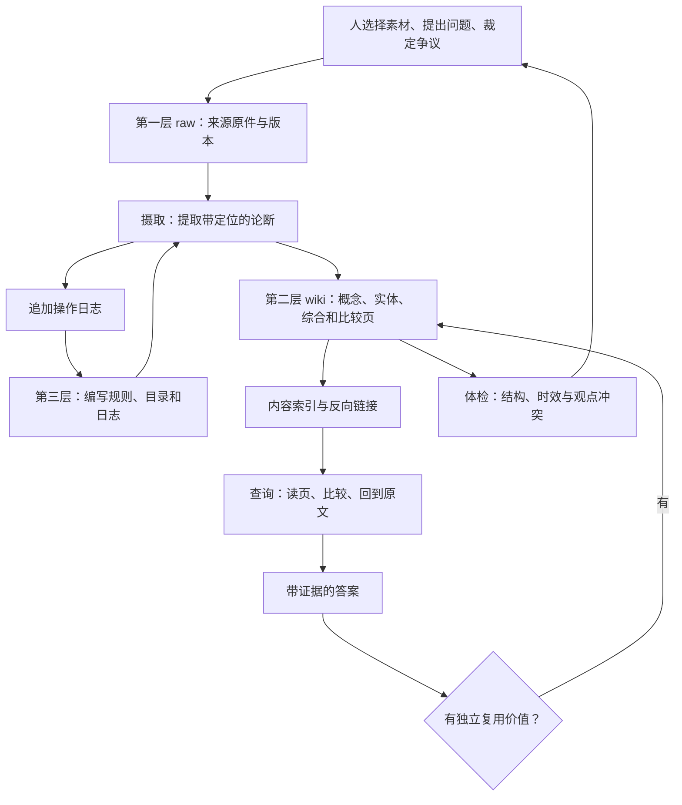
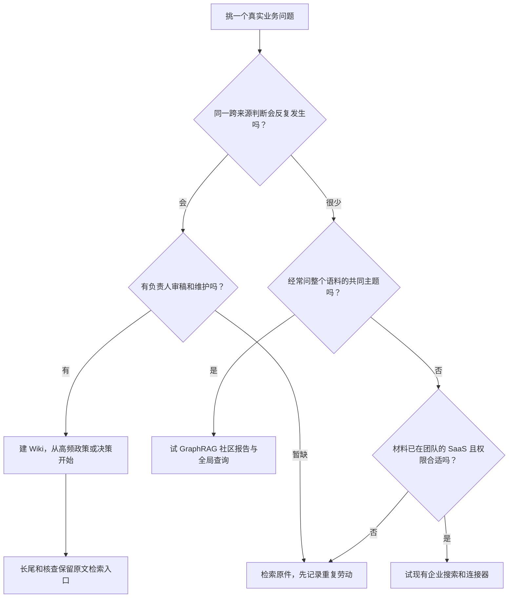

# LLM Wiki 与知识复利工程：从 Karpathy 的个人百科到 Agent 维护的团队知识库

客服周一问「新版导出文件能保留几天」，研发周二问「老客户迁移后要不要改通知文案」。两个问题需要读同一组发布说明、例外条款和迁移记录。本文教你把第一次查证留下来，让第二个人沿着证据接着做。这也是设计企业知识 Agent 时，区分“会找资料”和“会维护知识”的一道面试题。

## 全景：同一道题，资料要翻几次

想象每次考试都给你一箱乱纸。传统的按块检索 RAG 能很快挑出几张最像题目的纸，模型再根据它们作答。有人已经核对过正文、附录和补丁之间的分歧，下次换个问法，却可能还要再核对一遍。LLM Wiki 让原纸留在箱里，由编辑另外维护一本有目录、有脚注的活百科。看到新材料，他会改相关词条。读者顺着脚注能回到那一页原纸。



这里的传统 RAG 指「切块、建索引、查询时取若干块、生成」这条基线。它能做跨文档推理，也能配元数据和复杂检索。缺的通常是保存、审核并在下次更新跨文档结论的写路径。一份只被问一次的几千页档案，用检索找到原文可能最划算。某个概念反复被问、还涉及不同版本和例外，付一次编译费用，把共识、争议和出处放进可维护页面，更容易收回成本。两者可以共用同一套全文或向量索引。

### Karpathy 实际展示了什么

2026 年 4 月 2 日，Andrej Karpathy 在 X 发出《LLM Knowledge Bases》，讲他如何收集材料、让模型维护 Markdown，以及如何在 Obsidian 中阅读。4 月 4 日发布的 `llm-wiki.md` 把做法展开为一份可以交给 Agent 采用的想法说明。原帖身份、标题和日期可经 X 的官方嵌入返回核对。目录、工作流和规模观察可直接对照作者 Gist。Gist 写到约百份来源、数百页 Wiki 时，读索引再挑页面对他有效。这是作者的个人经验，不能由此承诺任意资料库都能在一秒内正确回答。[Karpathy 的 X 原帖](https://x.com/karpathy/status/2039805659525644595) · [X 官方嵌入记录](https://publish.twitter.com/oembed?url=https://twitter.com/karpathy/status/2039805659525644595) · [Karpathy 的 LLM Wiki Gist](https://gist.github.com/karpathy/442a6bf555914893e9891c11519de94f)

“编译”这个词有具体含义。导入一份新论文后，Agent 可以更新论文摘要页、文中实体页、与前人工作的比较页和索引，还能在已有结论旁边写下新反例。读者以后问相关问题，可以直接继承这次整理。程序编译器能保证某些形式性质。自然语言编译需要逐条核对证据，且两次运行可能得到不同措辞。Git 能显示哪几行改变，不能证明改过的政策是对的。把权威原文和派生论断分开，才有地方判断、纠正和重新编译。

已有两种可读的社区实现。Astro-Han 把流程写进一个 Agent Skill，给出原料、文章、目录和日志的模板，适合看“最少需要教 Agent 哪几件事”。biks2013-tools 的 TypeScript 工具把目录生成、摄取账本、查询归档以及结构与语义两类 lint 写进 CLI，适合看“哪些工作可交给确定性代码”。两者都是社区各自的工程选择。下面的逐断言引用、权限和版本事务是本文用于团队场景的设计。[Astro-Han 的 Skill 源文件](https://github.com/Astro-Han/karpathy-llm-wiki/blob/main/SKILL.md) · [TypeScript 社区实现](https://github.com/biks2013-tools/llm-wiki)

## 三层目录：原件、成品与编辑部的账本

下面是可直接照着搭建的目录样例。贯穿本文的“星舟导出服务”、政策编号、日期和数字均为虚构教学材料。示例约定 9 月起基础版新生成的导出文件保留七天，原来是三十天。旧合同是否享有例外，必须找到单独依据。这组材料能检验系统会不会拿正确的数字回答错误的客户。

```text
atlas/
├── AGENTS.md                          # 谁可改哪一层，怎样处理无证据的结论
├── schema/
│   ├── page.schema.json               # 页类型、必需元数据、引用格式
│   └── aliases.yml                    # 统一名称、别名、消歧规则
├── raw/
│   ├── releases/rel-0901-v1.md        # 发布说明原始快照，分节编号
│   ├── contracts/legacy-v2.pdf        # 合同附件原件，权限独立
│   ├── minutes/mig-0825.md            # 迁移会议原文
│   └── datasets/plan-matrix-v3.csv    # 指定版本的套餐表
└── wiki/
    ├── index.md                       # 现在有什么，按主题查
    ├── log.md                         # 何时因为什么改动，按时间查
    ├── sources/rel-0901.md            # 材料摘要，指回 raw
    ├── entities/export-service.md     # 实体身份及其关系
    ├── concepts/export-retention.md   # 保留期的含义与范围
    ├── topics/export-migration.md     # 综合迁移问题及未决项
    └── comparisons/plan-retention.md  # 套餐、日期、合同条件对照
```

### 第一层把哪份材料当作证据

网页会被覆盖，PDF 同名附件能换版本，一张表格改了筛选条件就可能少掉一半行。摄取时给每份原件分配稳定的来源 ID，记录获取时刻、发布者、发布日期、版本、可见范围和内容哈希。文件本体保留当时的字节。清洗后的网页正文、OCR、图片说明是可重建的派生物，要能指回原件。后来的更正另存新版本并标记其取代关系。这样审阅者点进脚注时，就能看到当日编辑读过的材料。

原件只增不改，约束的是日常编辑权限。团队若接到删除请求或失去授权，仍需按政策销毁原件、派生片段、索引及含其内容的导出。敏感原件可放访问受控的对象存储，Git 只收授权可公开的材料或不泄露内容的引用。须擦除的用户私聊尤其不宜直接写进长期共享 Git 历史。文中小目录用一个视图展示整体，真实混合权限部署可以让同名目录分别挂载各自的存储和凭据。

定位符的粒度决定回答能否被复核。网页记版本和稳定段落 ID。PDF 记原文件的物理页、印刷页码及表格或脚注。会议纪要记段落号或录音时间区间。表格记版本、工作表、主键及列名。页码和行号一旦因重新排版而变动，可以在导入时生成段落哈希映射，但同一句条款出现在两份合同里，仍要保留两份各自的身份和权限。原件是“谁说过什么”的证据，会议讨论中的猜测不因此变成已发布条款。

### 第二层让每个结论有家可回

一个概念页解释“保留期从什么时候算”，实体页解释“哪个服务负责生成和删除”，综合页串起“迁移是否影响已生成文件”，比较页给出“套餐、合同批次和生效日”的差异。按问题分工后，新材料影响哪些页可以推导。以来源为中心堆一千份摘要，仍然会让读者自己重新做横向比较。按概念组织，同时保留来源页，才能既方便理解又可回查。

下面是一页 Wiki 的最小成品。Frontmatter 给程序稳定字段，正文给人限定条件。示例统一使用从 vault 根起算且省略扩展名的 wikilink 路径，避免两个目录中存在同名页面。Obsidian 可从正向链接计算 backlinks，程序也可以反扫生成入边。双向可导航不要求双方正文各抄一遍链接。[Obsidian 内部链接说明](https://help.obsidian.md/links)

```markdown
---
id: export-retention
type: concept
title: 导出文件保留期
aliases: [导出有效期]
updated_at: 2026-09-03
review_by: 2026-10-01
audience: support-internal
sources: [rel-0901-v1]
confidence: documented
---
# 导出文件保留期

从 9 月 1 日起，基础版新生成文件保留七天，从生成成功起算。
依据为 rel-0901-v1 §2。原件见 [发布说明第二节](../../raw/releases/rel-0901-v1.md#term-2)。

这一段没有说明旧合同客户的期限。处理迁移工单时先查
[[wiki/comparisons/plan-retention|套餐与合同对照]]。
```

这里的 `confidence: documented` 表示能指向明确文档。复杂页面应把“原文明示、跨来源推得、来源相互矛盾、尚无依据”标在具体断言上。整页贴一个百分数很难告诉客服哪一句可以直接引用。分别记录来源的生效日、页面的编辑日和下次应复查的日期。某位同事今天纠正错字，不能因此把半年前的政策变成刚刚核验过。

### 第三层让 Agent 有便宜的入口，也给维护者留下去向

`AGENTS.md` 约定写入范围、术语、证据格式、争议升级和发布标准。`schema/` 让脚本能检查这些约定。目录和日志虽放在 `wiki/` 下，逻辑上是导航及维护层。`index.md` 每页给一个规范路径和一句能区分相邻主题的摘要，例如“导出保留期，按生成时间和套餐解释”与“删除任务延迟，解释物理清理何时完成”。模型先看目录就能挑对入口。摘要若全写“关于导出的相关信息”，目录越长，筛选越接近抽签。

`log.md` 只追加，回答的是「最近改了什么、为什么」。一条可查询记录至少带操作 ID、动作、来源 ID、触及的页和基础版本。上次发布后突然答错了，可以通过日志找摄取批次，再沿 Git 父提交比对具体行。日志会长，平时只读最近若干条或按日期、来源筛选。它改善追踪能力，目录缩短导航距离。一次完整问答还包括模型延迟、权限检查、打开原文和生成时间。若要声称秒级，先说明测的是本地路径检索、第一段证据返回还是用户最终拿到答案。

团队维护规则还得讲清页的身份。展示标题和规范路径可以改，页 ID 应保持稳定。别名表记录迁移前的称呼，索引从已解析的页元数据生成，禁止模型另造一个拼写相近的政策页。导航摘要由编辑写，路径与索引排序由代码算。两个人同时补同一主题时，这个小分工能省去大量关于目录顺序的合并冲突，也让目录漏项成为可自动发现的错误。

## 三条工作流：谁看原文，谁动文件，谁能发布

下面每个提示都是一个完整任务模板。宿主填入花括号内的数据，并授予该阶段需要的只读或提案工具。模型面对原始材料、Wiki 正文和工具输出时，均按待核对的数据阅读。只有宿主能决定真实的可见路径、提交权限和发布分支。“能读懂规则”与“系统能执行规则”要分别实现。

### Ingest：一份新材料，该让哪些旧页也跟着改

发布说明到了收件箱，直接写一份《九月新功能摘要》很容易。难的是让已经被客服收藏的旧页面也改口。先把新材料拆成最小可判断的断言，例如“基础版”“生成日大于等于九月一日”“保留七天”。用主体、概念、别名、旧来源的入边找相关页，再用关键词搜摘要里遗漏的旧表述。旧页原先写“全部文件三十天”，修订应将句子限定在有证据支持的时期和版本，同时写出尚未确定的客户类别。

**交给编译 Agent 的提示**

```text
角色：你是本知识库的责任编辑。目标是把一份材料的增量整合进现有 Wiki。
输入：source_id={source_id}，原件版本={digest}，基础提交={base_commit}，
允许的读写范围={scope}，页规范={schema}，本批上限={limits}。
工具：读授权原件、读页、查目录、查入边、搜索术语、提交候选变更。

1. 打开原件，列出可复核的断言、限定条件、原文定位与发布日期。
   分清发布决定、讨论意见、作者转述和你的推导。没有增量也允许结束。
2. 查目录与别名，再查相关页的引用和入边。列出应新建、应修订、
   已检查但无需变动的页面，以及判断理由。
3. 为每条新旧差异区分补充、取代、范围不同、仍有冲突。对取代注明生效日；
   对冲突保留双方出处，生成待决问题。引用不足的特殊情况保持未知。
4. 生成来源页与所有必要的概念、实体、综合或比较页变更。保留旧页中
   与本次无关的内容；给每条有业务影响的结论附可读取的原件定位。
5. 返回结构化提案：基础提交、来源及版本、拟改页与理由、来源定位清单、
   目录摘要变更、日志说明、未决问题、需审核原因。交给宿主统一校验发布。
停止：相关页均已核对或预算耗尽。后者明确列出未检查的范围，标为待续。
```

把流程想成一次小型代码提交。开始时读取已发布提交 `B`，按来源版本、目标空间、编译规则版本组成此次操作键。相同快照因网络故障被重复投递，可以根据这个键返回上次结果。如果换规则重编，应显式形成新任务，记录更换原因。对内容字节相同但发布主体、许可或适用范围不同的两份来源，必须各自保留来源身份。单纯按哈希全局丢重会把两份不同的授权合成一份。

模型提交候选页后，程序检查路径白名单、引用目标、来源片段、正文大小和权限继承。随后用变更后的整棵树生成目录、追加日志、写已处理账本。把这些文件和概念页放入同一个不可分割的发布单元。不这样做，服务在更新索引之后崩溃，读者就会看到目录列出的新页打不开。下面展示最后一步的真实 Git 操作，可用于单机、由发布服务独占写权限的裸仓。多人团队可以把同样的结果提交到审阅分支，经托管平台合并。

```python
import re
import subprocess

def publish_tree(repo, base, tree, operation):
    """tree 是宿主在隔离工作区生成并验证的 Git tree 对象，包含页、目录、日志与账本。"""
    if not re.fullmatch(r"[a-zA-Z0-9._-]{1,100}", operation):
        raise ValueError("操作编号格式错误")
    def git(*args, data=None):
        return subprocess.run(["git", "-C", repo, *args], input=data, text=True,
                              capture_output=True, check=True).stdout.strip()

    target = "refs/heads/wiki-published"
    # 发布服务预设作者身份。创建提交尚未改变任何读者可见的引用。
    commit = git("commit-tree", tree, "-p", base, data=f"Wiki update {operation}\n")
    # 仅当分支仍指向 base 才推进。其他写者先成功时，Git 会拒绝本次发布。
    git("update-ref", target, commit, base)
    return commit
```

引用更新失败时，取最新已发布版本，先查账本是否已含相同操作键，若有就返回那次发布。否则比较本批读取依赖的原件、概念页和规则版本。有交集就重新推导受影响的编辑，重新跑验证，再尝试发布。临时失去文件权限和同名并发更新需要分开处理，切勿无限重试。读者在查询开始时固定一个提交，再从里面取目录和正文，这样不会一半读旧版一半读新版。主分支、索引服务和对象存储之间还需记录各自版本。Git 提交原子性只覆盖这一个引用。

**看一次完整差异。** 在教学例里，九月摄取新增来源页，概念页增加“按生成时间计算”，套餐矩阵新增一行，迁移主题页挂出“旧合同条款待核实”。发布日志列这四页和仍缺的合同证据。若来源只说“计划九月切换”，四页都只能写成计划。后台任务读到日期已过也不能自行宣布上线。证据到齐后应新建一次确认，说明什么材料把“计划”变成“已生效”。这样既防止政策写早，也不会在一个月后把临时假设遗忘在长期页面里。

### Query：回答可以变成新页，但答案不能给自己作证

用户问「八月买基础版、九月生成的导出能留三十天吗」。问题里有购买日期、生成日期和版本三个维度。先读目录找保留期与套餐对照，再沿链接查合同例外和迁移说明，最后读原文中相应段落。若账号合同版本未知，答案可以先给普通规则，指出还需要哪一项信息，并说明在已读材料里是否找到例外。若连原件都无权读取，应清楚标出可核对范围，不要透露受限文件的标题或存在性。

**交给查询 Agent 的提示**

```text
角色：你是正在值班的知识库读者。回答 {question}，目标时间是 {as_of}。
输入：已发布快照={commit}，授权视图={view}，证据预算={budget}。
工具：读索引、搜索授权页、读页和入边、按定位读授权原件、提议沉淀。

先读该视图的 index.md，拆出问题中的对象、日期、例外和缺失条件。
按问题找入口，顺出边或入边追到相关页；同一页只读一次。对关键数字、
否定、版本差异打开原文。记录“断言—来源版本—段落”清单。
遇到互相冲突的来源，核对生效日、客户范围和发布权威。能消解就说明限定；
无法消解就分别说明可见依据与未决条件。证据不足时允许部分作答。
输出：直接回答、适用范围、逐项引用、仍缺什么。不得把当前用户的问题
当作事实来源。若比较或推导能跨工单复用，再输出一份独立的回写提案，
列出拟建或拟改页、派生结论、底层原件及适用条件；私有事实留在私有范围。
停止：各关键子问题有证据或已说明缺口，或达到预算。不要为了写页再扩题。
```

多跳检索可以用一个有界队列实现。以下 Python 是宿主的读页核心，索引和初始入口已由授权视图提供。每个展开对象是一个长度受限的章节切片。`view` 在固定提交读数据且每次检查实时权限。先按任务相关性排好入口及后继，给证据原件另留预算。实体链接很多的首页不会因此挤掉所有其他候选。

```python
from collections import deque

def gather(view, seeds, question, token_budget, max_hops=2, max_reads=12):
    queue = deque((key, 0) for key in seeds)
    visited, evidence = set(), []
    reads = 0
    while queue and reads < max_reads and token_budget > 0:
        key, depth = queue.popleft()
        if key in visited:
            continue
        visited.add(key)
        if not view.can_read(key):
            continue
        reads += 1
        part = view.read_section(key, question, limit=token_budget)
        if part is None or not 0 < part.tokens <= token_budget:
            continue
        evidence.append(part)
        token_budget -= part.tokens
        if depth < max_hops:
            queue.extend((n, depth + 1) for n in part.ranked_neighbors[:3])
    return evidence
```

数字和日期要回到底层证据。只读概念页，模型可能会把“生成后七天”复述成“购买后七天”。打开来源页也不够，来源页仍是模型编的。对影响客户承诺的断言，要求最终答案提供授权原件的版本和段落。遇到两个来源的数字不同，先检查说的是文件可下载期还是物理清理的完成时限。概念不同可以同时成立。若前提相同、值仍冲突，再按发布权威和有效时间判断。原件不支持的推导可以写，但要标明用到了哪些前提，以及哪一步需要人工确认。

在星舟案例里，一份合格的答复可以写成：“如果这次导出使用基础版标准条款，且生成日期为 9 月 1 日或之后，下载期限为生成成功后七天（rel-0901-v1 §2）。八月的购买日期本身不足以判断你是否适用例外。请提供可核对的套餐条款版本，我再确认这次导出的期限。”这段答复适用于有权看发布说明、暂时没有账号合同证据的客服。它告诉对方哪部分已查清、哪个缺口会改变结果，也没有泄露其他客户曾经得到的待遇。

**一次值得回写的回答**可以是一张“购买日期、生成日期、合同批次分别影响什么”的对照表。标题先在目录和别名里查重，若现有比较页已涵盖，就修订该页。用户个人订单、姓名、例外审批结果和聊天细节剥离，只保存有授权公开的通用判断方法。新页列出底层来源，另记由哪个查询触发。“查询触发”不能算作第二份独立证据。下次有人引用这张表，证据计数仍然只有最初那几份原件，避免同一条错误经十篇转引变成十票赞同。

回写之前，编辑先问自己，原始证据可复查吗？下一个人在相似问题里能少做哪一步？已有哪一页承担同一职责？缺证据时把问题加入待核实清单。只能帮当前工单时保留一次答复。有独立适用条件和可复用判断时走与摄取相同的验证、授权和发布流程。一问一页会把搜索结果淹没在近义重复项里，也会给每次政策更新增加清理成本。

### Lint：先让程序挑出可证伪的问题，再让模型做判断

知识库运行三个月，用户发现套餐名改了，目录还在推旧词。这个故障可以靠脚本确定。“旧页和新页是不是矛盾”则需要读证据。巡检可以分两轮。第一轮做确定性结构检查，包括链接和来源是否存在、索引与页是否一致、复查日是否过去。第二轮从结构变化、相同概念和到期条款中挑候选，交给模型核对语义。同一数字写在两页上并不必然有冲突，第一轮也不能用日期超限直接判定事实错误。

**交给维护 Agent 的提示**

```text
角色：你是 Wiki 的值班编辑。快照={commit}，巡检范围={scope}，
今天={today}，上次完成的游标={cursor}，工具预算={budget}。
输入：结构检查报告、变更来源清单、断言与来源的反向索引。
工具：在授权视图读页和原件、查引用、生成补丁或审阅意见。

先逐项确认断链、无入边、目录漏项、来源定位失效、到期待复查；区分
索引页、草稿、特意保留的入口页。报告范围内未发现和未检查是两种状态。
再找同一主体、属性、范围与有效时间相交的不同结论，打开双方原件。
检视反复出现但没有定义页的概念，以及引用了已被取代资料的页。
每个发现输出：类别、影响页、可复现位置、原件依据、建议动作及理由。
唯一匹配的路径更名和确定性目录修复可生成自动补丁；语义冲突、
权威变更或权限扩大只提审阅。没有依据时提出要找哪份资料。
提交前检查修复后结构与证据，记录游标及未完成范围。按同一发现的
稳定标识合并重复报告；只有全部指定分片完成才宣布本轮全量巡检完成。
```

可以从下面这个可运行的结构检查开始。输入是解析后的规范 ID。解析器先去掉 wikilink 的别名和锚点，另行校验锚点，Markdown 代码示例和原件中的示范链接不计入页面的关系。下面只检查一个完整授权视图。跨权限的源引用由持有相应权限的发布服务检查。通过目录能访问一页和“正文有人引用过它”是两个指标，在不同故障中都需要看。

```python
from collections import Counter
from datetime import date

def lint_structure(pages, catalog, roots, today):
    # pages[id] 有 links、mentions 和可选的 ISO 格式 review_by
    issues, inbound = [], Counter()
    for key, page in pages.items():
        for target in set(page["links"]):
            if target not in pages:
                issues.append(("断链", key, target))
            elif target != key:
                inbound[target] += 1
        due = page.get("review_by")
        if due and date.fromisoformat(due) < today:
            issues.append(("到期待复查", key, due))
    for key in sorted(set(pages) - set(catalog)):
        issues.append(("目录漏项", key, ""))
    for key in sorted(set(catalog) - set(pages)):
        issues.append(("目录悬空", key, ""))
    for key in sorted(set(pages) - set(roots)):
        if inbound[key] == 0:
            issues.append(("正文无入边", key, ""))
    return issues
```

新概念候选可以由术语表和显式标注的 `mentions` 统计，按独立来源数排序。几个都在转引同一份发布说明的页面只算一个来源。不同含义的“租户”需先消歧。两页互相链接会让上面算法认为两页均有入边，即使从根目录和主题入口走不到它们。再从正式入口做一次可达性遍历，从授权且应发布的页面全集里减掉已到达的页，就能找到这种孤立小群。对确实设计成入口的资料页允许豁免，记录原因和截止日，免得一次迁移的例外永久屏蔽事故。

Cron 或 Heartbeat 负责触发，宿主负责租约、防止任务重叠、超时续跑和预算。例行任务只扫上次游标后的差异和引用它们的页，每周另做一次全量结构巡检。语义复查优先扫影响客户承诺、支持政策和兼容性边界的段落。确定性的修复生成可复验补丁，争议项自动提 PR 给有发布权的人，审阅说明列双方原文和受影响答案。只有审阅通过、发布并复检后，发现项才算解决。反复发现同一问题时追加证据到原问题，比每天再开一张票更利于维护。

## 从五十页到五千页：什么时候加搜索，怎么迁移

### 先算目录的账

五十页时，每个条目写路径、题名和一句摘要，读一遍就能选页。假设实测每项平均花三十个 token，五十项约一千五百个，五千项则约十五万个。这里用的是演算参数，真实消耗应用目标模型对自己的目录分词。导航时还得辨别相似主题。如果五百行都带“迁移”，读完也很难区分数据库迁移、客户迁移和套餐迁移。即使窗口装得下，选择入口的错误率也会先变差。

第一步拆成主题索引树。根目录只列产品、研发、客服等领域及其边界，客服目录再按计费、迁移、交付展开。跨主题概念只有一个主页，其他目录给别名和链接，不复制正文。假设一个问题读取三十条顶级入口、一个含五十条的主题索引，仍按每项三十 token 算，导航耗费约两千四百。问题涉及几个领域时允许打开多个子树。观察用户从哪个主题反复折返，更换分类词比继续加深树更有效。

第二步保留全文倒排索引，让已知错误码、参数名、合同条号绕过目录。SQLite FTS5 适合单机维护标题、别名、段落与出处的映射。ripgrep 适合准确字符串、发现旧词遗漏和本地排错。面向中文客服可以给长文本预分词，另存原文用于引用，搜索时采用同一分词流程。套餐短码有两个字符的，用单独的普通索引做精确查询。连三个字符都没有的检索词很难靠 trigram 自己找回来。[SQLite FTS5 文档](https://sqlite.org/fts5.html)

第三步再为近义表达补语义检索。例如用户说「我的下载怎么消失了」，页面标题写“导出文件保留期”，词表可能完全不重合。qmd 的作者实现把本地 BM25、向量查询、查询扩展及重排组合起来。可以只用关键词路径，也可在较难问题上调用混合路径。检索结果应给出页 ID、区段与版本，再由宿主解析链接、按授权读原文。索引刷新有延迟时，可以在已发布 Git 树上兜底搜索最新变更页。快照与候选版本不一致时，不能直接把旧段落充作新证据。[qmd 项目与检索命令](https://github.com/tobi/qmd)

| 何时升级 | 一个便宜的诊断实验 | 保留什么，新增什么 |
|---|---|---|
| 找错入口 | 给模型读全目录，统计手工标注入口能否进前三 | 保留 Markdown，分层索引、补区别性摘要和别名 |
| 知道原句却搜不到 | 用稳定错误码、条款号、历史名做精确检索 | 保留主题目录，加字段索引、FTS5 和原文搜索 |
| 复述问题时漏掉证据 | 同一问题换三种口语表达，比较证据组召回 | 保留词法路径，加 embedding、合并候选再重排 |
| 找到正确页仍误答 | 直接给正确原件，看模型能否区分范围和版本 | 修复页结构、限定词、原文定位与生成步骤 |
| 越权或答出撤销政策 | 撤销一个权限再重放旧问题，按提交回查 | 分开授权视图、撤销缓存、对齐索引与发布版本 |

五千页规模下，重新嵌入的触发依据可以细到章节。页中只改一个链接标题，没必要重新计算其他十段的正文向量。若改了章节适用的版本或权限，即便正文没动，检索过滤也要随之更新。为每个切片保存页 ID、章节 ID、内容哈希、模型版本、发布版本和授权信息。生成新索引后跑固定查询，再原子切换读别名。索引服务缺席时继续走分层目录和精确查找。能从原件与已发布页面重建这些派生索引，迁移供应商时就不用重写整套知识库。

### 把维护成本算进“复利”

知识复利可以量出来。假设两个版本的同一条款每周有四十次比较需求，逐问读原材料多花三千 token，就是每周十二万额外输入 token。若新增一次编译和复核，后面每问仍需回看少量证据，节省的是被反复进行的比较工作。估算应使用“每问实际少读多少、少调几次工具”，扣掉资料更新引起的重编、人工审阅及垃圾清理。把一百篇只读一次的档案全编成精美词条，很可能一年也收不回来。

给查询记录“到第一份有效原文的时间”“所需原文是否齐全”“答案的每项关键断言能否被引文支持”。给写侧记录“每份来源触达多少页”“一天有多少页因来源变更而待复核”“追溯一个错答案需要多久”。如果命中页越来越快、客服纠错次数却持续上升，优先检查证据强度和生效日。若写放大太大，把在二十页重复的政策数字收回唯一权威概念页，其他页链接到这条定义，仅保存本页的特殊条件。这样下次换数字，待审范围才会真的变小。

做盲测时使用同一份原料，固定截止日期和授权身份，将常见问题和首次出现的问题混在一起，对比按块 RAG、只读 Wiki、Wiki 加原文检索。给三组相同的模型、输出格式和权限，分别统计正确且有据的回答、恰当拒答、过期答案、冷启动成本以及人工编辑时长。在“常见问题”上找重复劳动节省，在“首次问题”上查编译有没有漏掉少数例外。把查询反哺题按时间分割。如果测试问题的答案已经被提前写成页面，成绩衡量的是查现成答案，体现不出真正的知识综合能力。

Anthropic 在 2026 年 11 月给出了一个同题对照。研究者在约三十五万份内部文件上出二十五道题，用评分要点的满足比例衡量表现。仅提供搜索取得 53%，只读逐步维护的 Wiki 最好到 48%，搜索加上维护到后期的 Wiki 达到 61%。这是特定语料和题量上的结果。对产品设计的启发是，可以让 Wiki 指向问题和证据，也给模型留一条直接查找未被编入页面的例外条款的路。[Anthropic 记忆实验，图 10](https://www.anthropic.com/research/components-of-agent-memory)

Anthropic 的 Knowledge Wiki quickstart 演示了怎样把对照做得更具体。案例把公开申报文件和两份明确标注为合成的内部材料放在一起，其中一个财务指标使用了不同计算口径。编译时保留各自的出处和口径，查询时以只读方式访问 Wiki，并与直接查原件的基线比较。仓库提供已含输出的 notebook、分析与整理提示、费用核算代码。把它迁移到客服系统，可以把这里的两个财务口径换成“可下载期限”和“后台彻底清理期限”，就能检验编辑是否抹掉了一个决定答案的差别。[Anthropic Knowledge Wiki 官方示例](https://github.com/anthropics/claude-quickstarts/tree/main/managed-agents/knowledge-wiki)

### 同一批材料的四种架构选择

| 方案 | 持久产物与主要工作发生处 | 更新、溯源与权限 | 最匹配的任务及需要付出的代价 |
|---|---|---|---|
| 按块的向量 RAG | 原件、片段、向量索引。跨页解释多在读时生成 | 按来源版本局部重建。可做段落引用和检索前 ACL | 长尾一次性查询，尽快找到原话。每逢跨文档综合，要重新付推理成本 |
| LLM Wiki | 可审阅的概念、实体、比较与综合页。摄取时先合成 | 可看 Git 差异，逐断言回原文。须维护派生页权限、过期依赖 | 研发决策与客服政策反复被问。人工处理冲突、写放大和回归测试有固定开销 |
| Microsoft GraphRAG | 抽取实体关系、构建社区及报告。某些综合已在索引时完成 | 本地查询与全局查询走不同路径。跨社区主题可由报告聚合，回原文仍需保留映射 | 问“大量报告里有哪些主要主题、彼此如何关联”。图抽取和社区摘要消耗离线预算 |
| Notion AI Enterprise Search | 在已有工作区及连接的应用中搜索、综合并指向来源 | 沿工作区和连接器的可见范围组织搜索，需了解连接范围及同步延迟 | 团队资料已在 Notion 和多个 SaaS，优先快速接入。若要逐条 Git 审稿与重编，需另设流程 |

GraphRAG 已经把部分综合提前到写入端，因此“只有 Wiki 才能积累知识”说得太满。从最终读者的工作来选。分析师探索海量文本里的全局主题，可以直接利用社区报告。客服负责人逐行批准会影响用户承诺的政策，更需要一页带原始证据、限定条件和审批轨迹的文档。Notion AI 也能协助编辑内容，上表比较的是其企业搜索入口。产品现有权限与索引新鲜度需要在自己的连接器上验证。[Microsoft GraphRAG 全局搜索](https://microsoft.github.io/graphrag/query/global_search/) · [Notion Enterprise Search](https://www.notion.com/help/enterprise-search) · [Notion 企业搜索与权限](https://www.notion.com/product/enterprise-search)



### 三种部署把“谁能改”落到具体的人和进程

**个人研究库。** 用 Obsidian 打开同一个目录，剪藏时保存原链接、抓取日期、图片和原始版本。从一篇论文手动跟着 Agent 做一次摄取，逐项看它更新了哪些既有概念，再决定哪些动作值得批处理。Git 的小提交适合对比新旧观点，图视图适合发现断开的主题，可信度仍需回论文的方法、样本和限制。用 Skill 把摄取、查询和体检规则装成可重用入口，把模板和长规范作为按需读取的资源，避免每个普通问答都加载整个维护手册。[Obsidian 内链](https://help.obsidian.md/links) · [Anthropic Agent Skills](https://www.anthropic.com/engineering/equipping-agents-for-the-real-world-with-agent-skills)

**团队研发库。** 先选一个经常引发争论的主题，例如 SDK 兼容边界。把 ADR、发布说明、可重放实验和维护者批准的例外列为不同来源类型。开发者提问可以产生新对照页。编译服务在工作分支改页，领域负责人看证据后合并，CI 检查链接、范围、证据和固定问答。每次发布保留稿件与索引版本。多人共同维护时，一页可以有多个审阅者，最终负责“这个版本对哪些产品生效”必须落在有发布权的团队上。

**客服与 Personal Agent 共同工作。** 客服公共 Wiki 负责解释条款，私有记忆负责“这位用户自己的套餐、工单和获批例外”，实时业务系统负责订单和权限状态。Agent 回答时在读路径临时结合三方，回写公共页时只接受可向该读者群公开的证据。Anthropic 的 Memory tool 提供客户端执行的文件操作，`/memories` 是宿主可映射的逻辑前缀。可以让它写个人草稿区，再调用有审批的动作生成 Wiki 提案。主机对路径、租户、软链接、配额和删除做约束，工具本身并不会提供企业知识编辑部所需的审阅、发布与索引一致性。[Anthropic Memory tool](https://platform.claude.com/docs/en/agents-and-tools/tool-use/memory-tool) · [Agent 记忆系统架构](./01-agent-memory-architecture.md)

混合权限最容易在派生页上出问题。一份所有客服可读的发布说明与一份仅合同组可读的附件共同推导出结论，如果要保留这个推导，默认读者集合取两份来源授权集合的交集。要对客服公开，需要具有发布权的人批准一份可公开的新原件。私有合同页的标题、日志摘要、向量片段和 backlinks 也可能间接透露内容，因此不同受众要用独立编译视图，或在整条查询链上做等价的访问控制。拥有完整 Git 克隆的人能看到其中的历史对象，前端隐藏目录无法替代仓库和存储层隔离。

### 拿一张工单走完交付演练

| 时刻 | 读写路径 | 应看见的结果 |
|---|---|---|
| 摄取前 | 对旧版快照问既有基础版文件保留期 | 可引用旧政策，明确当时有效范围，不预知新发布 |
| 9 月 1 日摄取 | 读新发布 §2，修概念和比较页，同时发布目录、日志 | 对 9 月新生成普通基础版文件答七天，旧文件不被顺带改判 |
| 9 月 3 日查询 | 问购买日、生成日、旧合同三者如何影响答案 | 引用明确的两项。对合同细节按权限查询或要求提供可核验信息 |
| 回写后 | 用完全不同的问法再问相同交叉问题 | 能复用比较页，引用仍落回原件，回答不带上个客户的身份 |
| 更正后 | 假设发布方补充“仅适用于特定地区”，重新摄取并巡检 | 找到所有受影响断言。新回答带地区，旧快照仍能定位原来的错误 |

故障演练可以直接对准表里的断点。故意让一次摄取在构造 Git 树之后、发布之前终止，再重投同一事件，已发布分支应只多一次逻辑操作。故意让索引滞后一版，查询应能识别引用版本并回原件。故意撤销合同读取权，旧书签不应再吐出正文。最后抽一条曾答错的结论，请没有参与项目的同事在限定时间内找到原句、变更原因和责任页。如果只能找到形式正确的脚注，点开却没人能解释为何适用于该用户，这次验收还没有通过。

## 面试深挖：七道迁移设计题

### 1．每次做 RAG 都能搜到，为何还要维护 Wiki？

**考察点**是知道哪一部分劳动可以复用。

**回答思路**　拿一对真实问题算账，分开计入找原文、识别例外、跨版本比较和核验成本。若多个角色重复做同一比较，就把结果与依据存为受审阅页面，下次只核对适用条件和最近变动。

**连环追问**　「用户都只问一次呢？」区分用户相同和判断相同。若判断也没有复用，就直接搜原料，保留可升级为 Wiki 的来源定位即可。

### 2．两份研发文档写着相反结论，编译器该相信哪份？

**考察点**是能否把文本冲突还原为产品条件。

**回答思路**　先比对组件、版本、平台和生效日期，再看谁有发布权。会议提案与正式 ADR 可以分别标“拟议”和“已批准”。两份同等权威、适用范围重叠时，保留冲突、引文和负责裁决的团队。

**连环追问**　「新版文档发布日期更近呢？」发布日期只是线索，若新版讲的是下一代实验分支，老版本线上指引仍然有效。把适用版本写在断言边上再更新索引摘要。

### 3．模型把自己的旧答案反复引用，怎么发现？

**考察点**是证据的独立性。

**回答思路**　把答案、Wiki 断言和原件连成来源链，逐条追到有定位的原始记录，用原件版本做证据去重。若只在几篇综合页间成环，就没有足够依据。

**连环追问**　「新分析本来就没有一句原文能概括呢？」把可查的前提分开引用，明确哪一步是推导及其限制。可以保存原创比较，审阅时检验推导能否由前提推出，不给模型自己的文字添加权威票数。

### 4．五千页目录太大，直接上向量库行吗？

**考察点**是能诊断瓶颈并安全迁移。

**回答思路**　测目录 token、入口命中率和所需证据组召回。先用层级目录和精确搜索解决常见代号和固定主题，再对复述与跨主题问题加入语义召回，用一套问答比较前后效果。

**连环追问**　「更换 embedding 怎么不停服？」保留规范页和旧索引，影子构建并回放查询，按版本切换读入口。遇到索引落后或失败，仍能沿目录读已发布快照。

### 5．客服 Wiki 怎么用私有工单学到东西，又不泄露客户信息？

**考察点**是能否跨越来源、推导、发布三层做权限控制。

**回答思路**　工单本体与个人记忆保持在私有域，先判断经验可否由可公开政策独立证明。有依据时写通用步骤并引公开来源。只能从特定合同得出的例外保留私有，需公开则请有权发布的人制定正式说明。

**连环追问**　「删掉人名就行吗？」金额、地区和日期组合也能识别客户，且合同条款本身可能受限。同样检查目录标题、日志、检索结果和快照。

### 6．两个 Agent 同时摄取，还要允许查询，怎样避免半成品？

**考察点**是并发发布的最小单位。

**回答思路**　查询固定提交，写者各自在隔离树准备补丁，验证页、来源、索引及日志后一次推进引用。用基础版本比较捕获并发写。

**连环追问**　「两者改的是不同页面，也要重跑模型吗？」先核对各自依赖集合，若只在可重新生成的目录和日志交汇，按新基础版本重新生成这些产物，通过校验即可。若读到的源断言已变，需对相关页重新推导。

### 7．怎样证明知识库半年后真的比第一天更有用？

**考察点**是能否把“复利”变成可反驳的判断。

**回答思路**　保存时间切片和固定问题族，给每个切片只提供当时合法可见的材料。衡量常见综合任务减少的读页数、人工核查时间、引用正确率，同时计入整理成本及新问题漏答。

**连环追问**　「新库知道半年后的事实，胜出很自然吧？」同一时点让两个系统读相同原料，只改变是否拥有已审综合页。用尚未问过的变体检验迁移，用已被取代的政策检验纠正能力，再区分资料增长与编辑积累的贡献。

## 一手资料与延伸阅读

- 从作者原帖确认动机、时间和个人工作台，从随后发布的 Gist 读三层、三条工作流和小规模导航经验。[Karpathy 的 X 原帖](https://x.com/karpathy/status/2039805659525644595) · [官方嵌入记录](https://publish.twitter.com/oembed?url=https://twitter.com/karpathy/status/2039805659525644595) · [LLM Wiki Gist](https://gist.github.com/karpathy/442a6bf555914893e9891c11519de94f)
- 对照两种社区落地方式，一种用 Skill 组织编辑行为，另一种实现 CLI、索引、回写与巡检。[Astro-Han](https://github.com/Astro-Han/karpathy-llm-wiki/blob/main/SKILL.md) · [biks2013-tools](https://github.com/biks2013-tools/llm-wiki)
- 了解人工阅读界面和按需检索的实际能力，包括链接语法、全文分词及本地混合查询。[Obsidian](https://help.obsidian.md/links) · [SQLite FTS5](https://sqlite.org/fts5.html) · [qmd](https://github.com/tobi/qmd)
- 看研究团队怎样把“只搜、只读 Wiki、两者共用”放在同一批问题上实测，再读有真实运行输出的知识库构建示例。[记忆组件研究](https://www.anthropic.com/research/components-of-agent-memory) · [Knowledge Wiki quickstart](https://github.com/anthropics/claude-quickstarts/tree/main/managed-agents/knowledge-wiki)
- 对照 Anthropic 的客户端记忆存储、渐进加载 Skills 和上下文选择原则，区分宿主责任与模型能力。[Memory tool](https://platform.claude.com/docs/en/agents-and-tools/tool-use/memory-tool) · [Agent Skills](https://www.anthropic.com/engineering/equipping-agents-for-the-real-world-with-agent-skills) · [上下文工程实践](https://www.anthropic.com/engineering/effective-context-engineering-for-ai-agents)
- 用已有方案的官方说明校正选型预期，前者讲如何从社区报告回答全局性问题，后者讲跨工作区及连接应用查询时能选哪些来源。[GraphRAG 全局搜索](https://microsoft.github.io/graphrag/query/global_search/) · [Notion Enterprise Search](https://www.notion.com/help/enterprise-search)
