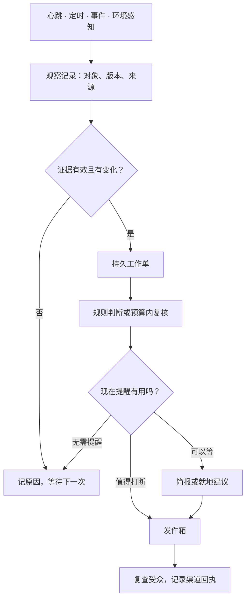

# 主动式 Agent：四种触发引擎、打扰控制与后台执行

> 搭一个能自己发现变化的助手，要回答三个问题：凭什么启动、值得花多少算力、什么时候联系用户？面试里可以拿一条真实订阅，从触发一直讲到送达回执。

## 一张图看懂一次后台工作



用户点“查一下”是 **Reactive**，用户约定“九点查”是 **Scheduled**，用户交代“帮我盯着”，由系统发现哪次变化值得行动，这就是 **Proactive**。三种模式可以调用同一个查询工具，区别在于谁定启动条件、谁判行动时机。

我会先建四种记录。这样用户换手机、作业重启、通知失败时，都能找到该从哪一步继续。

| 记录 | 保存什么 | 用它回答什么 |
| --- | --- | --- |
| 订阅 | 主体、对象范围、许可工具、目的地、有效期 | 用户到底让我盯什么？ |
| 观察 | 来源账户、对象、版本、采样时间、证据引用 | 这次和上次有什么变化？ |
| 工作单 | 根任务、预算、截止时间、执行状态、检查点 | 还有什么要核实？ |
| 投递单 | 受众、内容版本、渠道、尝试与回执 | 谁应该收到，实际送到哪儿？ |

允许夜间跑分析、允许夜间响铃、允许改线上配置，是三份不同的授权。工作队列可以一直消费，通知队列照样遵守勿扰。把这两条队列拆开，夜间算好的结果才能安静地等到早晨。

## 触发引擎怎么选

| 你能拿到的信号 | 选什么 | 第一件要做的事 | 最容易踩的坑 |
| --- | --- | --- | --- |
| 老系统只给查询接口 | 心跳巡检 | 存上次成功读取的游标 | 每轮都让模型读全量 |
| 用户给了确切时间 | Cron 或一次性定时器 | 存墙钟规则、时区、原始计划槽 | 重启后漏跑，改点后双发 |
| 上游有回调或目录有变动 | Webhook 或文件监听 | 持久入箱，再读取权威状态 | 重送、乱序、事件丢失 |
| 意图只在当前操作中显现 | 环境感知 | 先取应用事件，再考虑采屏 | 焦点切换后还在采旧窗口 |

### 心跳：花一次便宜的读取，决定要不要推理

每轮先问一个能用程序回答的问题：待办的修订号变了吗，邮箱游标前进了吗，后台进程退出了吗？读到相同版本就结束。发现差量，再交给规则或轻量模型筛查。需要跨日志解释的候选才值得用强模型。

**先算清成本**：每 15 分钟检查一次，一天 96 轮。每轮灌 2,000 个输入 token，一天就是 192,000 个，即使用户一条消息都没收到。把版本比较放到模型前，95 轮没变化就省下 95 次调用。

**再算发现延迟**：变化均匀到达时，15 分钟巡检平均要等 7.5 分钟，最迟接近一个周期，还要加排队和执行。要求一分钟内发现的事件应接回调，巡检留作漏报对账。

**OpenClaw Heartbeat 的版本差异**：排查“以前能用，现在怎么没跑”时，先确认本机执行的是哪一版巡检。

| 核对项 | 3 月版 v2026.3.8 | 11 月 21 日固定提交 |
| --- | --- | --- |
| 谁执行 | 主会话周期性发起 Agent turn，可读工作区的 `HEARTBEAT.md` | 普通 automation job 持有日程、提示、模型、scratch 和运行历史 |
| 如何保持安静 | 投递层识别约定位置的 `HEARTBEAT_OK` 并抑制空提醒 | 没有可见更新返回 `NO_REPLY`。用 `record_result` 记 `no_change` 可以留痕并抑制投递 |
| 安装与迁移 | 默认周期通常是 30 分钟，投递目标默认是 `none` | 新装按需启用。旧安装用 `openclaw doctor --fix` 转换，再用 `openclaw automations list --all` 查全部作业 |

新安装为默认所有者建立一个禁用的 Proactive check，启用后通常每 30 分钟检查一次。它可以使用主会话。作业拥有独立日程与历史，并不意味着每次都要开新会话。

迁移会导入支持的旧清单和任务块。此后直接编辑作业。检查启用状态、目标会话、投递目的地和去重设置。再重启一次，确认 Telegram 里不会冒出静默控制字。这个现象有真实的历史反馈。[3 月版文档][old-heartbeat] · [11 月迁移文档][new-heartbeat] · [重启问题记录][heartbeat-issue]

我会让巡检器返回结构化状态：成功且无变化、发现候选、读取失败。日志正文恰好出现 `HEARTBEAT_OK`，不能吞掉整条结果。来源超时则保留旧游标，展示上次成功时间，下一轮还能从原位置补读。

每个来源各存游标。保存候选与推进游标放进同一事务，数据库提交前断电，两步会一起回滚。上一轮还没结束时只记一次“需要再查”。机器从睡眠恢复后重新看持久到期时间，避免几十轮积压同时抢同一个游标。

### 定时：先解释“九点”，再把它排进队列

“九点提醒我”和“九点前准备好摘要”有不同的交付时刻。前者九点触发，后者要提前抓取，九点投递时注明数据时间。创建时回显日期、城市、对象、动作和渠道。目标仓库有歧义就先存草案。

- **一次性提醒**：把原始意图、解析日期、当地时间、IANA 时区和 UTC 一起存下。2026 年 11 月 24 日在上海说“明早九点”，对应次日 `01:00Z`。
- **周期任务**：保存“工作日 09:00”和时区，从上一个计划时刻推下一个槽。每天加 86,400 秒会在夏令时换挡后错一小时。涉及交易日或调休再接业务日历。
- **时钟歧义**：春季跳过的当地时刻要明确顺延还是跳过，秋季重复时刻记录选第几次。用当地时间转 UTC 再转回去可发现不存在的时刻，用 `fold` 区分回拨的两次。
- **错峰与重复执行**：槽键用任务 ID、规则版本、原始计划时刻。对键做稳定散列生成准备阶段的 jitter，重启仍得到同一偏移。用户承诺的闹钟点保持不动。

下面把墙钟时间换算和错峰写在同一个函数里。返回值分开保存：第一项用于幂等，第二项是实际到期点。硬性闹钟传零抖动。有准备窗口的任务传窗口起点和允许延后的秒数。

```python
from datetime import timedelta, timezone
from hashlib import blake2s
from zoneinfo import ZoneInfo

def schedule_slot(job_id, rule_version, wall_time, zone_name,
                  jitter_seconds=0, fold=0):
    if wall_time.tzinfo is not None or jitter_seconds < 0:
        raise ValueError("请输入当地墙钟时间和非负错峰秒数")
    if fold not in (0, 1):
        raise ValueError("重复时刻需要选择第一次或第二次")

    zone = ZoneInfo(zone_name)
    local = wall_time.replace(tzinfo=zone, fold=fold)
    due = local.astimezone(timezone.utc)
    # 跳钟日有些墙钟时刻根本不存在，交给订阅的补跑策略。
    if due.astimezone(zone).replace(tzinfo=None) != wall_time:
        raise ValueError("当地时刻不存在")

    # 数据库把这三个字段作为联合唯一键，不含工作器 ID 或重试时间。
    slot = (job_id, rule_version, due.isoformat())
    if jitter_seconds == 0:
        return slot, due
    seed = repr(slot).encode("utf-8")
    digest = blake2s(seed, digest_size=4).digest()
    offset = int.from_bytes(digest, "big") % (jitter_seconds + 1)
    return slot, due + timedelta(seconds=offset)
```

领取到期槽时，在一笔事务里插入工作单并推进 `next_due`，唯一约束挡住重复领取。编辑规则要使未来旧槽失效，在途结果投递前再核对版本。否则把九点改成十点，两个提醒都可能按自己的计划送达。

**漏跑后的处理**：“查最新状态”合并补一次，“开场前提醒”过期就跳过，“每天收盘快照”只用对应日期的历史数据补齐。Kubernetes CronJob 的时区、并发策略和错过启动窗口值得对照，尤其是对作业幂等性的要求。[Kubernetes CronJob][k8s]

### 事件：Webhook 是线索，业务状态要再读一次

入口只做能快速完成的工作：限制正文大小、验签、核对安装账户与事件类型，用 `(租户, 来源账户, delivery_id)` 唯一键写入持久收件箱，提交成功再应答。慢查询交给工作器。若数据库写失败，入口要留下可识别的失败响应。

**平台约定各有不同**：GitHub 要求 10 秒内应答，用 `X-GitHub-Delivery` 辨认投递，失败回调要安排补送。Slack Events API 通常要求 3 秒内应答，有自己的事件 ID 与重试策略。适配器负责把这些差异收在入口。[GitHub Webhook][github-hooks] · [Slack Events API][slack]

同一个投递送两遍，收件箱应只有一行。不同投递也可能描述同一个业务变化：十个矩阵测试都指向同一提交。按仓库、对象、运行尝试和故障签名归并，再从权威 API 核对当前结论。旧失败晚于重跑成功到达，也应展示已恢复。

| 来源 | 收到通知后实际读取什么 | 恢复要点 |
| --- | --- | --- |
| Gmail | 用落盘的游标调用 `history.list`，分页写入变更 | `watch` 至少每 7 天续订，官方建议每日续订。低频同步补延迟和丢失 |
| Google Calendar | 完成一轮增量分页才保存新的 `nextSyncToken` | 遇 `410 Gone` 重建全量基线，把初始化与新增提醒分开 |
| macOS FSEvents | 标记受影响的目录，防抖后读稳定文件并比较内容修订 | 系统要求重扫时扫描子树。排除临时文件、下载中的文件和自己的输出 |

编辑器常用“写临时文件再重命名”保存内容，只盯一个文件句柄容易跟丢。监听目录并保留扫描摘要，重启后按基线补差量。助手生成报告时带上来源标记，避免生成、重读、再生成的循环。[Gmail Push][gmail] · [Calendar 增量同步][calendar] · [Apple FSEvents][fsevents]

### 环境感知：优先问应用，最后才看像素

IDE 的构建事件已经给出项目、错误类别和时间，可以直接在本地统计“五分钟内同类错误出现三次”，然后在侧栏提供排查入口。用户修好问题就撤卡。这里没有任何一步需要上传整张桌面。

- **授权与采样**：同时满足系统许可和用户选定的窗口。只在本机比较相邻帧，有变化才对目标区域做 OCR 和脱敏。切窗、投屏、撤权时停止采集并丢弃临时帧。[Apple ScreenCaptureKit][screen]
- **资源与反馈**：静止画面拉长间隔，低电量或高温时退回应用事件。记录每小时唤醒次数、活跃计算时间、上传字节和建议命中数。把“用户关了观察”与“采集器坏了”区分开。
- **时机评测**：ProAssist 用连续第一人称视频构造主动指导对话。回放时从问题出现前开始，允许模型一路保持沉默。只给错误最明显的截图，会跳过最难判断的“现在该开口吗”。[ProAssist][proassist]

ProAgentBench 把时机判断和建议内容分别评测，保留了 500 多小时真实会话中 28,000 多个事件的密集与空闲时段。Coco 则把观察器放到设备上，选择性保留长期信息，利用展开、忽略等反馈调整介入。其规模化评测使用合成轨迹。[ProAgentBench][probench] · [Coco][coco]

## 两段式打扰控制：先查证据，再算打断值不值

**第一关，筛证据**：订阅有效吗，来源和对象对得上吗，版本是否已过期，是否来自助手自己的输出，同一状态是否处理过？结构化字段能判就用规则。只对确实需要理解的差量做语义复核。邮件正文写了“紧急”，仍要查责任人和实际期限。

**第二关，选投递方式**：重要性看影响和责任，紧急性看下次简报前会损失什么，打扰成本看专注状态、渠道与最近提醒次数。有影响却轮不到用户处理，就转给有授权的责任人或进简报。用户明确订的闹钟和系统推断的建议分别配置。

我会固定一个参照点：“如果等到下一次简报，用户还来得及做什么？”再估算强提醒的净收益：

**净收益 = 事实可信度 × 用户能行动的概率 × 提前行动多挽回的损失 − 打断成本 − 误报概率 × 误报代价。**

例如，提前行动最多省 20 个损失单位，可信度 0.9，负责人能行动的概率 0.8，打断成本 8，误报代价 4。净收益是 6。换成只有一成机会能处理的人，就变成负数。严格勿扰有硬约束，值班例外要预先绑定服务、时段和收件人。

| 时间窗 | 按什么归并 | 哪些变化还要放行 |
| --- | --- | --- |
| 去重窗口 | 同一主体、对象和证据修订 | 旧故障恢复后又出现的新一代故障 |
| 冷却窗口 | 同一事故的强提醒 | 经可信规则确认的影响扩散，可走单独的升级策略 |
| 简报窗口 | 同一受众、同一期交付 | 生成时重查状态，删去失效项，重大更正另行记录 |

### 核心代码：并发复核前，原子预留预算

下面截取单机调度器最容易写错的路径。连接使用 Python SQLite 默认事务模式，每个工作器独占连接。工作表以 `(owner, id)` 为主键，日预算表以 `(owner, day)` 为主键，`used` 是已预留的 token。

```python
from datetime import datetime, timezone

def claim_review(db, owner, event_id, now, daily_limit, reserve=384):
    """输入已通过证据筛查。返回 review 的调用方才能请求模型。"""
    if reserve <= 0 or daily_limit < 0:
        raise ValueError("预算参数无效")
    day = datetime.fromtimestamp(now, timezone.utc).date().isoformat()
    key = (owner, event_id)
    with db:
        db.execute("BEGIN IMMEDIATE")
        work = db.execute(
            "SELECT state, expires FROM work WHERE owner=? AND id=?", key
        ).fetchone()
        if work is None or work[0] != "ready":
            return "skip"
        if now >= work[1]:
            db.execute("UPDATE work SET state='expired' WHERE owner=? AND id=?", key)
            return "expired"

        db.execute("INSERT OR IGNORE INTO budget(owner,day,used) VALUES(?,?,0)",
                   (owner, day))
        charged = db.execute(
            "UPDATE budget SET used=used+? WHERE owner=? AND day=? AND used+?<=?",
            (reserve, owner, day, reserve, daily_limit),
        ).rowcount
        # 熔断也落盘，简报工作器可以捞出尚未核实的事项。
        state = "reviewing" if charged else "digest_pending"
        db.execute("UPDATE work SET state=?, lease_until=? WHERE owner=? AND id=?",
                   (state, now + 60 if charged else None, *key))
    return "review" if charged else "digest"

def choose_channel(scores, quiet, cooling):
    # scores 由适配器校验：影响和紧迫度各取 0～3，缺证据用 None。
    if scores is None:
        return "digest"
    impact, urgency = scores
    if impact == 0:
        return "log"
    if min(impact, urgency) < 2 or quiet or cooling:
        return "digest"
    return "push"
```

两个工作器都看见“还剩 384”，若等调用结束再扣费，就可能同时花掉最后一份。这里的条件更新与认领属于同一事务，任一步出错一起回滚。模型请求在提交后发出，适配器限制输入、最大输出和超时，关闭隐式重试。

**复核超时**：工作器在租约内凭当前状态提交结果，过期的 `reviewing` 由恢复器转为待核实简报。超时可能已计费，先保留上限。拿到供应商唯一请求号和可信用量回执才结算一次差额。重复收到回执也只结算一次。

- **哪些调用记账**：轻量筛选、强模型诊断、子任务都走同一个根任务预算代理。推理、缓存、图片和工具按供应商计价分别记费用，另设货币硬上限。
- **何时熔断**：日桶按 UTC 请求起点划分，再加短时并发、滚动窗口或月桶。各层都够用才放行，避免午夜前后连花两天额度。
- **熔断后怎么交付**：可信规则仍可发现明确故障。语义不明的条目标“待核实”。队列长度、磁盘、候选数量也要限流，否则便宜的入站事件照样能把机器塞满。

### 从决定推送，到知道用户收到了什么

工作器把决策、原因、冷却起点与发件箱记录一起提交。发送器领取投递单，再核对订阅、当前责任人、勿扰和有效期。取消订阅后排队中的消息应当停止。只在订阅创建时查一次权限，几小时后的目标可能已经换人。

渠道支持幂等键时，同一投递单的重试沿用同一个键，保存平台消息 ID。请求发出后断线，先查渠道历史或回执。查不到就标“结果未知”。本地数据库可以保证只出一张单，远端是否交付还要看对方的协议。

**简报也要有边界**：按当前权威状态合并事故，冻结本期事件集合与内容摘要，迟到项归下一期。每条只写变化、影响、最晚处理时间和证据入口。用户选了只报异常，空批次记回执即可。

先开影子模式，只记录“本来打算怎么发”。同时抽查强推项和静默项，按当时可见的信息回放整段事故，不能偷看后来才知道的恢复结果。在相同强推次数下比较有效窗口内送达率，再看错叫率、过期率、延迟分位数和用户明确反馈。

用户在锁屏上读完便能行动，点击率为零也可能是成功。AutoBuddy-Bench 进一步在模拟工作区里让 Agent 自己发现待办，用最终系统状态验证执行。评估时把“发现对了”“事情办成了”“提醒及时”分别计数。[AutoBuddy-Bench][autobuddy]

## 长程自治：下一位工作器凭什么接着做

手机断网，后台任务应该还能交付。创建工作单时就写清交付物与验收条件：固定哪个提交、运行哪些检查、结果放在哪里。会话结束时，把下一位工作器能独立验证的材料存下来。

Anthropic 用初始化、逐步实施和进度文件交班。异步 Codex 按任务提供仓库沙箱并交回改动与测试证据。[长程 Harness][harness] · [异步 Codex][codex]

| 断在哪一步 | 重启后检查什么 | 接下来做什么 |
| --- | --- | --- |
| 领取后还没完成计算 | 工作单的租约、代次、取消状态 | 到期后原子加一代，旧工作器写回必须匹配原代次 |
| 大文件写到一半 | 检查点引用的大小、摘要、对象可读性 | 临时对象校验成功后才登记步骤完成，残件可回收 |
| 本地结果已验证 | 固定提交、依赖锁文件、镜像摘要、复测输出 | 从最近的完整证据继续，只补缺少的步骤 |
| 外部动作已发出 | 稳定幂等键、远端请求号、接收方回执 | 先对账，再决定是否补投。报告发送失败无需重跑测试 |

**租约和代次各管一件事**：租约到期让别人可以接班。代次随每次接班递增，拒绝上一任迟到的写入。续约也要带代次，由数据库时钟判断。第三方看不懂本地代次，已经发出的请求仍要走投递幂等和对账。

**隔离与取消**：工作树固定在指定提交，输入只读、临时输出可写，限制运行时间、内存、进程、网络和磁盘。仓库测试本身会执行代码，分析器用不到部署凭据。取消时先撤销工具能力，再让运行时终止卡住的子进程。

**重试有出口**：网络抖动可在期限内退避加抖动。同一测试确定失败就交付失败证据。权限失效等授权。副作用未知等对账。连续两轮工具输入和证据摘要都没变，触发无进展上限，别给同一个问题无限续费。

Hermes 的定时任务在新的运行会话中执行，并对递归调度设约束。自己的调度器也应让子任务继承根任务剩余预算、子任务数、最晚截止时间和工具范围。需要延期，交回已有成果并请求新的授权。[Hermes Cron 内部设计][hermes-cron]

**看板怎么查**：费用涨却没通知，查来源最后成功时间、游标滞后、最老工作年龄和每轮模型预留。用户收到两份，查同一投递单的尝试与回执。

单机可用 SQLite WAL 加短事务。扩大规模后按租户公平领取，索引就绪状态和到期时间，去重记录至少留到上游重放期结束。

最终报告写清已验证的版本、通过与失败的检查、剩余阻塞和下一步。详细内容放私有产物，锁屏只显示授权范围内的摘要。跨端如何接这个任务，以及本地工具究竟拿到什么权限，接着看[个人 Agent 全栈架构](./02-personal-agent-fullstack-architecture.md)。

### 上线验收：用四条输入查整条管线

| 输入 | 该留下什么证据 | 发现问题回哪儿查 |
| --- | --- | --- |
| 空闲半小时，所有修订号相同 | 观察器有成功记录，模型调用为零 | 把版本比较移到模型调用前 |
| 同一来源先发恢复，再补送旧故障 | 收件箱保留两份投递，当前状态仍是恢复 | 比较业务版本，或回权威系统重读 |
| 只有一份复核额度，两个不同事件同时到达 | 一个进入复核，另一个出现在待核实列表 | 查看两次认领是否共用持久预算桶 |
| 报告写完后发送器掉线 | 任务保持已完成，投递单等待回执 | 从原投递单对账，保留已有测试产物 |

这四次验收可以用同一个可控时钟跑。记录每步用到的订阅版本、证据修订和决策原因，把时钟拨过冷却边界再跑一次。这样能发现“事件已经升级，但旧冷却还在压制提醒”之类的错误。

## 一手资料速查

- 心跳迁移与调度：[OpenClaw 旧版][old-heartbeat] · [新版迁移][new-heartbeat] · [Kubernetes CronJob][k8s] · [Hermes Cron][hermes-cron]
- 主动性评测：[ProAssist][proassist] · [ProAgentBench][probench] · [Coco][coco] · [AutoBuddy-Bench][autobuddy]

## 六道高频面试题

### 1. 一万个人都要助手盯状态，要开一万个常驻模型吗？

**考察点**：调度规模与实际推理量。

1. “我让一个调度器按到期索引领取订阅，用小批次和稳定抖动把读取错开。”
2. “先比对象版本，没变就结束。同一授权范围里的同一份状态可以共用一次读取。”
3. “发生变化才叫模型。每个人是否负责、是否勿扰、应该发到哪里，还是单独计算。”

**连环追问**：助手能自己加下一轮吗？可以给有限次数的复查权，沿用根任务的截止时间和总预算，并过滤自己的输出。

### 2. 用户出差以后，“早上九点”该听哪边的钟？

**考察点**：墙钟规则、时区与幂等。

1. “我先确认是固定城市的九点、跟随用户的九点，还是从现在起过几个小时。”
2. “建任务时回显日期和时区，存下夏令时歧义策略。周期任务按墙钟算下一槽。”
3. “改时区只更新未来槽。重试认原始计划时刻，已经发过的那次有独立记录。”

**连环追问**：怎么测回拨？选当地确实会重复的 01:30，把两个 UTC 时刻都走一遍，检查约定只发一次。

### 3. Webhook 返回成功，用户却没收到，怎么查？

**考察点**：入口、业务处理与投递分段定位。

1. “我拿平台投递 ID 找收件箱，先确认成功应答前确实落过盘。”
2. “接着查工作器读到哪个对象版本，有没有被去重、预算、过期或勿扰分走。”
3. “最后查发件箱和远端消息 ID。找到最后一个有证据的步骤，只补后面的工作。”

**连环追问**：重放旧事件会把新状态盖掉吗？有单调版本就比较版本，没有就重读当前对象，让旧事件只触发核对。

### 4. 提醒少了八成，怎么知道关键的也没漏？

**考察点**：给静默决策找真值。

1. “先并行跑影子策略，请用户同时标注推送和静默样本，特别看能不能及时采取行动。”
2. “按原来的时序重放，把去重、会议和冷却一起算进去，在相同打扰预算下比较。”
3. “上线盯有效期内送达率、误报和明确负反馈。点开消息只是其中一个行为。”

**连环追问**：全程静音的模型准确率很高呢？单独看已知紧急事件的召回率，它会直接暴露漏报。

### 5. 两个工作器都想花最后一份额度，调用还超时了，怎么算？

**考察点**：并发预留和未知用量。

1. “请求发出前先按最大花费做条件更新，扣预算和领工作在同一个事务里。”
2. “只有领到的工作器能出网，超时保留预留值，用唯一请求号查实际账单。”
3. “没有新额度就让模糊项进待核实简报，明确故障仍然能走预授权的规则通道。”

**连环追问**：供应商回执来了两遍呢？按请求号只结算一次，把可确认的差额退回原来的预算桶。

### 6. 旧工作器卡住，新工作器接班后，谁的结果算数？

**考察点**：租约、检查点和外部副作用。

1. “新工作器等租约到期，领取时增加代次。谁提交结果都要带自己领到的代次。”
2. “我先验上一个检查点里的文件和摘要，从最后确认成功的步骤继续。”
3. “对外发送单独查回执，重试复用原幂等键。对方状态不明，就把未知摆在任务上。”

**连环追问**：能取消一半吗？先撤销后续动作的能力，再停工作器。已经发出的请求另行对账。

[old-heartbeat]: https://github.com/openclaw/openclaw/blob/v2026.3.8/docs/gateway/heartbeat.md
[new-heartbeat]: https://github.com/openclaw/openclaw/blob/47616078315b1a1c503194612cdf6b40fce4e86f/docs/gateway/heartbeat.md
[heartbeat-issue]: https://github.com/openclaw/openclaw/issues/15263
[k8s]: https://kubernetes.io/docs/concepts/workloads/controllers/cron-jobs/
[hermes-cron]: https://hermes-agent.nousresearch.com/docs/developer-guide/cron-internals
[github-hooks]: https://docs.github.com/en/webhooks/using-webhooks/best-practices-for-using-webhooks
[slack]: https://docs.slack.dev/apis/events-api/
[gmail]: https://developers.google.com/workspace/gmail/api/guides/push
[calendar]: https://developers.google.com/workspace/calendar/api/guides/sync
[fsevents]: https://developer.apple.com/library/archive/documentation/Darwin/Conceptual/FSEvents_ProgGuide/UsingtheFSEventsFramework/UsingtheFSEventsFramework.html
[screen]: https://developer.apple.com/documentation/screencapturekit
[proassist]: https://aclanthology.org/2025.emnlp-main.605/
[probench]: https://arxiv.org/abs/2602.04482
[coco]: https://arxiv.org/abs/2611.13457
[autobuddy]: https://arxiv.org/abs/2611.12393
[harness]: https://www.anthropic.com/research/effective-harnesses-for-long-running-agents
[codex]: https://openai.com/index/introducing-codex/
