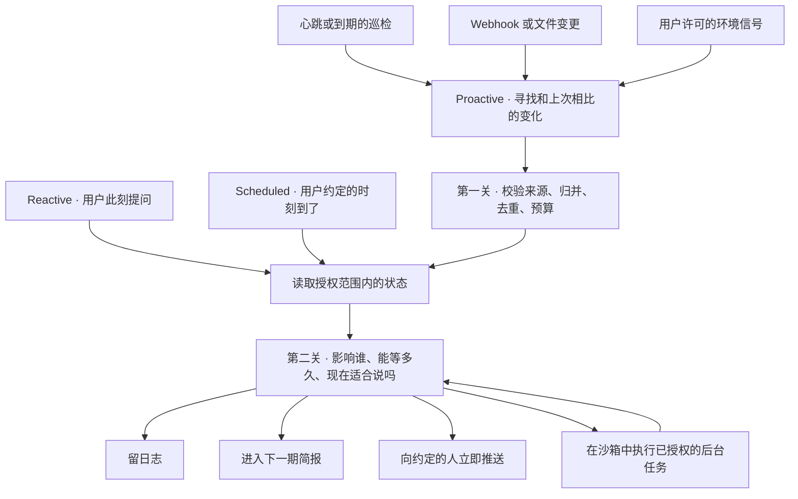
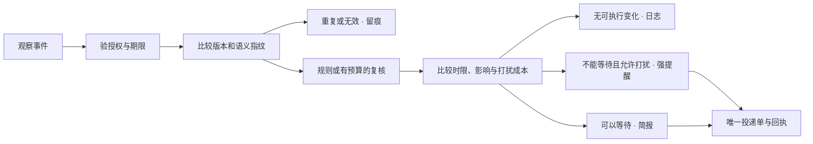
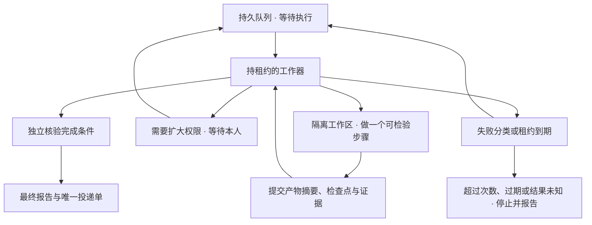
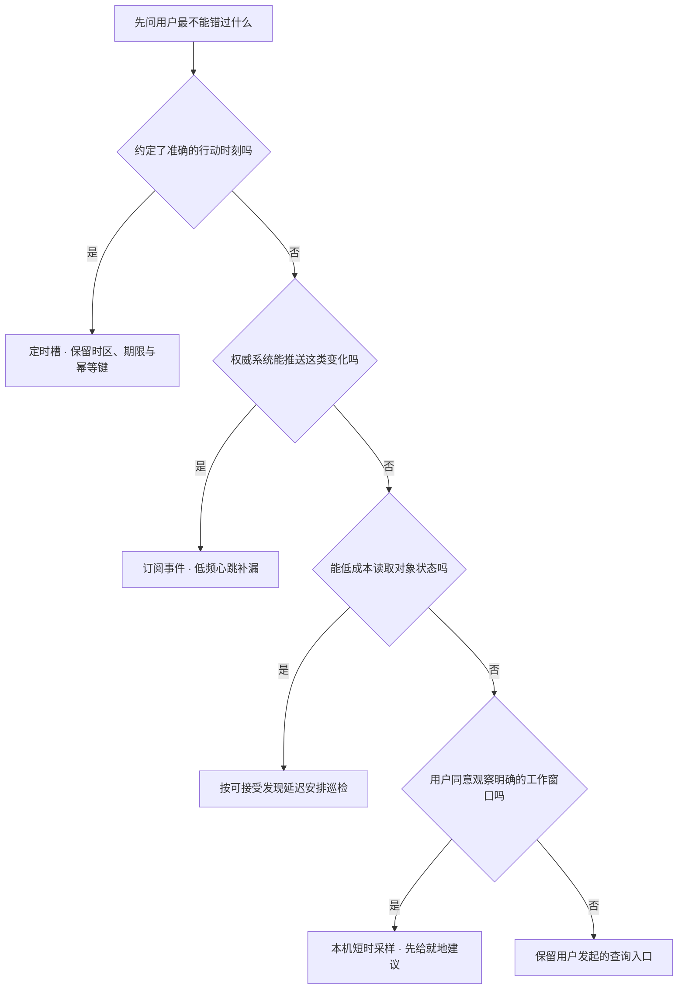

# 凌晨的 CI 红了，该不该叫醒你？从一次告警看主动性 Agent 架构

同一次构建失败，可能只值一条日志，也可能值得叫醒值班人。沿着这条告警从发现走到交付，可以搭出一套可恢复、有预算、知道何时闭嘴的后台助手，也能在系统设计面试里解释每一次唤醒的代价。

本文的项目与论文资料核对至 2026 年 11 月 24 日。

## 谁决定开始工作，谁决定打扰人

周一你问“那个 PR 能合吗”，助手去查，这是 **Reactive**。你临走交代“明早九点再查”，九点到了它去查，这是 **Scheduled**。你只交代“帮我盯住这次发布”，它发现主分支变红，核实影响与值班表，才决定要不要联系你，这是 **Proactive**。三者可以共用同一个查 PR 工具。区别在于谁提供启动条件，以及谁负责判断此刻行动的价值。



把一次唤醒当作一次**观察机会**。调度器可以在九点零一分检查一百项任务，最终只给一个人发一条消息。也可以在凌晨发现故障，先保存证据、分析失败测试，等早晨交付。任务优先级和通知优先级各有一条队列。用户允许助手夜间分析构建，表达的是算力授权。值班轮换、谁可以被叫醒，以及助手能否代为发布，都要分别记录。

工程上先画出四个持久对象。订阅保存“替谁盯什么、允许用哪些工具、何时失效”。观察保存“来自哪个账户的哪个对象、看见哪个版本”。工作单保存“要验证的变化、执行尝试、截止时间”。投递单保存“发给哪个受众、通过哪个渠道、回执如何”。把它们揉成一份聊天记录，取消订阅就找不到正在排队的工作，换手机又可能重发全部旧提醒。下面默认用户只授权查看项目状态、生成私人简报，外部协作动作另行确认。

## 四种唤醒方式，四种不同的失败

### 用心跳巡检（Heartbeat）发现没有回调的变化

一台渲染机挂了没有回调，评审人被卡住也不会主动报告。做法是让守护进程每隔一段时间醒来，读一页很短的巡检单。每项检查先问“证据变了吗”。例如读取待办的修订号、邮件的历史游标、监控的告警代次、子进程的退出记录。无变化就回到等待。看见新证据才把少量上下文交给轻量模型判断。有明确规则的“进程退出码非零”可以直接立案，强模型只接手需要跨日志或跨仓库解释的异常。

OpenClaw 很适合用来理解这个设计，但要认准版本。2026 年 3 月的实现会在主会话周期性运行 Agent，可从工作区的 `HEARTBEAT.md` 读取简短指令。没有事情需要关注时，`HEARTBEAT_OK` 由投递层识别并抑制。把一份日志文本里的同名字符串当成控制消息，会吞掉真正的告警。本文骨架里的静默结果由受信任的巡检代码产生，外部文本不参与解析。[OpenClaw 3 月版心跳说明][old-heartbeat]

到 11 月 21 日的官方源码文档，旧巡检已迁为普通 automation job。迁移工具把受支持的旧配置转成带日程、独立 scratch 和运行历史的作业，运行时不再按旧方式读取 `HEARTBEAT.md`。新安装要主动选择启用巡检。没有可见更新可返回 `NO_REPLY`，有意义但无需投递的结果可记录为 `no_change`。迁移时尤其要检查目的地和重复抑制策略。这段演变说明“定期检查且可静默”是一个可迁移的产品约定，具体文件名和控制字会变。历史 issue 中已经有人观察到重启后静默标记出现在 Telegram 聊天里，很适合作为升级回归用例。[11 月的迁移文档][new-heartbeat] · [重启后的实际反馈][heartbeat-issue]

```python
def heartbeat(last_revision, read_revision, read_delta, screen):
    """一次只读巡检。screen 是带调用上限的轻量分类器。"""
    revision = read_revision()
    if revision == last_revision:
        return revision, "HEARTBEAT_OK", None
    delta = read_delta(last_revision, revision)
    if not delta:
        return revision, "HEARTBEAT_OK", None
    finding = screen(delta)
    if finding is None:
        return revision, "HEARTBEAT_OK", None
    return revision, "investigate", finding
```

这里的状态机是 `等待 → 探测 → 无变化 / 轻量复核 → 有候选 / 静默 → 等待`。探测失败走另一条边，进入“来源暂不可用”，保留旧游标。如果把超时翻译成“没有异常”，连续一周看不到数据也会给出绿色健康状态。提交新游标与保存候选必须属于同一个事务。先保存新游标再写候选，中间一旦掉电，重启会越过唯一的异常。检查项多时分别推进游标，一个邮箱失联不该阻止本机进程退出被记录。

“静默”省下的是注意力。省 token 要看模型有没有真的被调用。假设每十五分钟一轮，一天九十六次，每次都塞两千输入 token，光输入就是十九万二千 token，哪怕手机一声没响。先比较版本号，九十五轮没有变化，才真能少做九十五次推理。检查周期可以按可接受发现延迟反推。均匀到达、巡检正常时，十五分钟周期的平均等待约七分半，最坏还要加上排队和执行时间。短于这个窗口的发布故障应该接事件流，心跳继续承担漏报对账。

守护进程由系统服务托管，崩溃可以拉起，睡眠时进程没有执行机会。重新唤醒后按持久的到期时间重建计划。同一账户上一轮还在跑时，给下一轮设置一个“需要再检查”的位，结束后合并检查一次。累计四十个并发巡检会争抢同一份游标，恢复联网的瞬间也会放大上游故障。观察器的健康指标至少要让使用者知道“上次成功读取是什么时候”，监控通道本身也需要独立探针。

### Cron 与一次性定时器（One-shot Timer）怎样兑现“明早九点”

“明天上午九点提醒我并帮我拉取最新 PR 状态”包含两个时刻。用户承诺的九点是通知目标，拉取结果还有执行耗时。产品可以约定九点启动，结果随任务完成交付。也可以提早一分钟抓取，九点推送并注明数据时间。创建时回显“上海时间 11 月 25 日 09:00，查项目 A 的待合并 PR，结果发本私聊”，用户才知道系统理解了哪一种。若仓库仍无从确定，只保存草案，补齐目标才激活。自然语言解析器只产生结构化草案，连接器从已授权的仓库列表中解析目标。

一次性提醒保存解析日、用户的 IANA 时区、当地日期时间、换算后的 UTC 和原始意图。例子若在 2026 年 11 月 24 日上海发出，触发点是次日 `01:00Z`。反复执行的“每个工作日上午九点”应保存墙钟规则与时区，在上次计划时刻的基础上求下一次。如果每次加八万六千四百秒，夏令时地区会偏一小时。当地时钟向前跳过某个时刻时，可以事先约定顺延到下一个有效时刻。向后拨使某时刻出现两次时，约定只选第一次并保存选择。交易所假期或调休日还需要业务日历，周一到周五只解决了最简单的一类“工作日”。

```python
from datetime import datetime, timedelta
from hashlib import blake2s
from zoneinfo import ZoneInfo

def schedule_slot(job_id, local_due, zone_name, jitter_seconds=0, fold=0):
    # local_due 是尚未附加时区的墙钟时间。拒绝不存在的时间，交给上层处理。
    if local_due.tzinfo is not None or jitter_seconds < 0 or fold not in (0, 1):
        raise ValueError("请提供当地墙钟时间与有效的抖动范围")
    zone = ZoneInfo(zone_name)
    aware = local_due.replace(tzinfo=zone, fold=fold)
    utc = aware.astimezone(ZoneInfo("UTC"))
    if utc.astimezone(zone).replace(tzinfo=None) != local_due:
        raise ValueError("该当地时间不存在，需要按排程策略顺延")
    key = f"{job_id}/{utc.isoformat()}"
    digest = blake2s(key.encode(), digest_size=4).digest()
    offset = int.from_bytes(digest, "big") % (jitter_seconds + 1)
    return key, utc + timedelta(seconds=offset)
```

这里使用确定性 jitter。同一个计划槽在重启前后算出相同的偏移，作业之间又能错开。给一万份晨报五分钟准备窗口，可以把昂贵的读取错峰到窗口内。明确承诺九点的提醒使用零抖动，或只在九点之前错开准备。计算槽标识用**原始计划时刻**。重试时刻、真正醒来的时刻和机器编号都不应进入幂等键。编辑规则时给配置加版本，撤销尚未执行的旧槽，确认在途结果还能否投递。否则用户从九点改到十点，会在九点和十点各收到一次。

定时器从 `已登记 → 到期 → 已入队 → 已完成`。取到期槽时，把工作插入队列与推进 `next_due` 放在同一事务。唯一约束守住 `(订阅, 计划槽)`。到期后错过多久仍有意义是产品属性。睡醒后“检查最新 PR”通常只补一次最新状态，“直播开始前五分钟提醒”在直播结束后可以标过期，“保存每日末的账面快照”则要逐日用可还原的历史值补齐。拿今天的值连写七天会制造七条假历史。Kubernetes CronJob 的时区、并发策略、错过启动窗口和幂等建议是很好的工程对照，其他调度器的默认补跑策略需要单独核对。[Kubernetes CronJob][k8s]

### 收到事件或文件变更后，怎样核实发生了什么

监听 GitHub 的工作流完成事件，十组矩阵测试在几秒内先后失败。若每次回调都启动分析，十个模型会重复下载同一构建日志。入口只验签、核对安装账户和允许的事件类型，持久写入原始收件箱后尽快应答。GitHub 要求十秒内返回成功响应，提供 `X-GitHub-Delivery` 辨识投递，失败投递的补送要由接收方安排。Slack 的事件接口有自己的应答期限、事件 ID 和重试行为。把来源账户、平台、事件 ID 合起来做唯一键，允许一个平台重复叫门，数据库里只领一次活。[GitHub Webhook 实务][github-hooks] · [Slack Events API][slack]

```sql
-- 在同一数据库事务里接收一份已经过认证的通知。
CREATE TABLE IF NOT EXISTS inbox (
    tenant TEXT NOT NULL, source TEXT NOT NULL, delivery_id TEXT NOT NULL,
    object_key TEXT NOT NULL, revision TEXT NOT NULL, received_at INTEGER NOT NULL,
    PRIMARY KEY (tenant, source, delivery_id)
);
-- 绑定参数由适配器提供。事务提交后才返回成功，工作器轮询这张收件箱。
INSERT INTO inbox VALUES (?, ?, ?, ?, ?, ?)
ON CONFLICT(tenant, source, delivery_id) DO NOTHING;
```

一个具体入口可以写成下面这样。HTTP 层先限制正文大小、核验平台签名，确认安装身份和仓库属于该租户，再把可信的归属与已解码事件交进来。这个函数只接 GitHub 已完成的工作流通知，连接使用普通 SQLite 事务模式，收件箱结构沿用上表。CI 分析工作器再从该仓库按运行 ID 取有限的失败日志，并核对运行尝试与最新结论。这样一次入口重送不会反复启动昂贵的分析。

```python
def accept_workflow(db, tenant, delivery_id, verified_repo_id, event, now):
    if event.get("action") != "completed":
        return 204
    if event["repository"]["id"] != verified_repo_id:
        return 403
    run = event["workflow_run"]
    obj = f"{verified_repo_id}/{run['id']}"
    rev = f"{run['run_attempt']}/{run['updated_at']}/{run['conclusion']}"
    with db:
        db.execute("""
            INSERT INTO inbox VALUES(?,?,?,?,?,?)
            ON CONFLICT(tenant,source,delivery_id) DO NOTHING
        """, (tenant, "github", delivery_id, obj, rev, now))
    return 202
```

对这个入口做两个最有区分度的测试。同一个投递 ID 发送两次，队列行数应保持不变。两个不同投递 ID 分别代表“旧尝试失败”和“新尝试恢复”，把抵达次序反过来，最终展示也应是已恢复。前一种结果可以靠唯一约束得到，后一种必须在领取工作后比较权威状态。两种去重各有自己的落点。

收件箱做到传输去重，业务归并还差一层。`delivery_id` 不同也可能指向同一提交、同一测试套件、同一次故障。把仓库、分支、提交、运行尝试和故障签名拆开存，按事件的权威版本处理状态。晚到的第一次失败不能盖过第二次重跑通过。上游没有可比较的单调版本，就按对象重新读取当前状态，用回调查找对象。状态机是 `收到线索 → 入箱 → 读取权威状态 → 合并同一变化 → 生成候选 → 已对账`。当值班表显示责任已转移，目标收件人也要重算。

Gmail 发到 Cloud Pub/Sub 的通知给出邮箱与 `historyId`。连接器用上次落盘的游标调用 `history.list`，分页落变更，最后提交新游标。`watch` 有有效期，Google 要求至少每七天续订一次并建议每日续订。文档还要求考虑延迟或通知丢失。Google Calendar 用自己的 `nextSyncToken` 做增量同步，收到 `410 Gone` 要重建该订阅的同步状态。重新做全量时，把基线重建与“发现新事”分开，否则初次授权或凭据续期之后会把整个收件箱、整本日历当成刚发生的变化。[Gmail 推送指南][gmail] · [Calendar 增量同步][calendar]

本地 watcher 也只是门铃。编辑器常先写临时文件，再通过重命名替换目标。下载文件会逐块增长。对目录监听，短暂防抖后再读稳定对象，排除输出与临时目录，按相对路径与内容修订归并，持久记录上次扫描摘要。macOS 的 FSEvents 可把多个变化合在一起，并会在特定标志下要求重新扫描子树。目录量大时先标脏、分批对账，避免每次事件都扫整个磁盘。系统重启后的第一次扫描应能从持久基线恢复。助手写出的汇总报告应带自身来源标记，否则写报告会触发重读，重读又生成报告。[Apple FSEvents 编程指南][fsevents]

### 环境感知（Ambient / Screen-Aware）应该观察哪一个窗口

在获准观察的 IDE 里，同一个项目连续出现同类编译错误，助手可以在侧栏放一张可展开的排查卡。用户正在投屏时，弹出带源码的系统横幅就会把私人内容分享给整间会议室。同样的上下文既提供了帮忙的理由，也提供了保持安静的理由。早期验证可只收集编译结果、应用前后台、用户主动打开的工作区和短时重复计数。能从构建事件拿到错误类别，就省掉一条屏幕采集链路。

用 `关闭 → 已授权观察 → 短时采样 → 候选 → 静默或侧栏 → 冷却` 管住传感器。切到未允许的应用、开启屏幕分享或撤销权限时，走回关闭态，丢弃临时帧。屏幕录制授权常常宽于产品约定，系统许可与用户在产品里选中的窗口必须同时满足。先在本机按窗口过滤，比较相邻帧的变化，只在有意义变化时做区域 OCR，再将可能包含秘密的字符串去掉。用户能看见当前观察范围、有一个随手能关的开关，并能删除已提取的特征。日志里写“构建错误连续三次”通常比保留三张桌面截图更适合复盘。[Apple ScreenCaptureKit][screen]

```python
def observe(sample, consent, recent):
    # recent 由本地采集器按用户、获准窗口和项目分别维护，条目带过期时间。
    if not consent or sample.window_id != consent.window_id or sample.sharing:
        recent.clear()
        return None
    if sample.kind != "build_failed":
        return None
    count = recent.add_and_count(sample.error_family, within_seconds=300)
    if count == 3:
        return ("offer_in_sidebar", sample.project_id, sample.error_family)
    return None
```

持续观察还会抢电、抢 GPU 和抢用户前台应用的内存。把观察器放在低优先级队列，热机或低电量只接收应用事件，画面静止时拉长采样间隔。监控每小时唤醒次数、平均活跃计算时间、上传字节和候选命中数，并把“权限关闭”从“采集器损坏”中分开。两路信号都给空数据，前者应保持沉默，后者需要运维能看见。低置信度的报错只出现一次就放过，连续变化要保留撤回能力，用户修复的下一刻那张卡应该消失。

2025 年 EMNLP 的 ProAssist 工作从带标注的第一人称视频构造主动指导对话，让助手在连续画面中决定何时说话、说什么。映射到 IDE，一个重要测试是把错误出现前后的画面按自然时间喂给观察器，允许它在多数时刻什么也不说。只截下报错最清楚的一帧再问“你建议做什么”，已经替观察器完成了最难的时机选择。该论文研究的是视频指导，迁移到桌面协作时还要单独验证用户对打断的容忍度。[EMNLP 2025 论文][proassist]

两项研究给出了很不同的观察窗口。ProAgentBench 把“什么时候帮”和“帮什么”拆开，用五百多小时真实会话里的两万八千多个事件考察时机与内容。2026 年 11 月的 Coco 预印本探索本地观察器、选择性记忆与反馈调节，规模化评估使用带角色标签的合成轨迹。前者提醒评估要保留事件扎堆的节奏，后者提供一种减少原始活动外传的途径。合成轨迹上的分数提高，仍需用实际使用者的接受与撤回行为验证。[ProAgentBench][probench] · [Coco 预印本][coco]

## 现在打断用户，能挽回什么损失？

用户会关掉一个“每条消息都是真的”的机器人。测试的十次失败都是真的，邮件确实到了，PR 也确实在等评审。但用户正在主持会议，既无权限修复测试，也没有临近的评审期限。每条提醒都让他付出解锁、重新理解上下文、切回原任务的成本，却没有改变他此刻能做的决定。真正要估计的是**提前得知这件事，能避免多少可避免的损失**。

### 两段式 Gatekeeper 如何估算打扰成本

通知分流（Notification Triage）先处理证据，再评估打扰成本（Interruption Cost）。第一关适合做能写成单元测试的判断。订阅还有效吗？来源经过验证吗？对象在授权范围内吗？是不是旧版本？是不是机器人刚刚自己生成的结果？同一故障的重复通知是否已见？有结构化严重级别就直接用，对难于归类的短文本才预算内调用轻量模型。无论正文多么激动，不能靠“紧急”二字拿到值班优先权。预算耗尽的明确故障仍可走规则通道。规则也判不清的进入待核实简报，用户能看见哪些调查没有做。

第二关评估三个可分开核对的量。**重要性**看影响面、责任人和可逆性，例如发布负责人能否在发布前叫停。**紧急性**看动作窗口和等待损失，例如距离截单五分钟还是两天。**打扰成本**看投递方式、当前专注状态、最近打扰次数和用户明确设置的勿扰例外。今天重要的十件事，不需要在今天早上八点一齐响铃。另一边，一份原本普通的提醒，因为用户明确约定到点提醒，就拥有不同的投递合同。显式闹钟和被动推断的建议分别配置，助手才能兑现两类预期。

一个可校准的做法是先固定“下一次用户会看到简报”的时间，再计算强提醒相对于等到简报的增量收益。设证据为真的概率是 `p`，现在行动能省下的损失为 `L_now`，读完简报再行动能省下的是 `L_later`，用户能采取行动的概率为 `a`。在同一套产品效用单位下，`p × a × (L_now − L_later) − 打断成本 − 误报成本` 为正才考虑强提醒。误报成本可以写成 `(1−p) × 一次误报的代价`。这是设计方法。真实用户的价值很少能精确换算成钱。下面骨架把公式压成离散阈值，便于逐条解释与回放。

算一笔教学用的账。某个发布窗口再过十分钟关闭，若现在通知，最多挽回二十个损失单位。等到晨报就挽回不了。证据置信度九成，轮到的值班人能行动的概率八成，会议中打断成本八，假警报另损失四。净收益是 `0.9 × 0.8 × 20 − 8 − 0.1 × 4 = 6`。改成抄送一位没有权限处理的经理，行动概率降为一成，同一条事实就只适合留档。若在执行用户明确的严格勿扰策略，分数再高也无权突破。值班例外必须事先限定来源、服务、接收人和时间范围。



三个容易混淆的时间窗各有自己的键。**去重窗口**拦截同一状态指纹反复出现，例如同一个提交的同一种失败。**冷却时间**拦截同一事故的不同噪声，例如换了测试名字又报一次。**简报窗口**决定何时把尚有效的多条消息一起送出。事故第一次失败、影响面扩大、完全恢复都可能拥有不同指纹。若团队约定扩散到生产就必须另行升级，给这个升级单独的可信事故级别和频率策略。简单地对整个人加五分钟静音，反而会压掉无关项目的真报警。

### 用 Python 和 SQLite 实现有预算的主动调度器

下面是一整个 Python 3.9+ 程序，只用标准库。它演示从已验证事件进入单机调度器，到持久生成通知决定这一段。普通用户推送、早报和模型服务都是外部边界。示例的 `review` 使用固定评分，换成真实模型时，适配器必须实际限制输入、输出和内部调用次数。所有时间都是 UTC Unix 秒，进入系统的 `now` 只能来自服务端时钟。评分范围为零至三，空值表示需要一次复核。主体和指纹来自已经完成授权检查的连接器，程序不接收外网原始请求。

```python
from __future__ import annotations

import json
import sqlite3
from contextlib import contextmanager
from dataclasses import asdict, dataclass
from datetime import datetime, timezone
from tempfile import TemporaryDirectory
from pathlib import Path

@dataclass(frozen=True)
class Event:
    owner: str
    event_id: str          # 来源账户和传输 ID 已编码在内
    topic: str             # 项目范围内的一次事故
    revision: str          # 包含可信状态转换或证据版本
    expires: int
    scores: tuple | None   # 只有可信连接器可以直接给分

class NotificationTriage:
    @staticmethod
    def decide(scores, quiet, cooling):
        if scores is None:
            return "digest", "等待核实"
        importance, urgency = scores
        if importance == 0:
            return "log", "没有可执行影响"
        if importance < 2 or urgency < 2:
            return "digest", "可等到简报"
        if quiet:
            return "digest", "用户处于勿扰状态"
        if cooling:
            return "digest", "同一事故仍在冷却"
        return "push", "有影响且动作窗口短"

class ProactiveScheduler:
    WINDOW = 600
    COOLDOWN = 1800
    RESERVE = 384       # 一次调用的输入加最大输出总上限
    LEASE = 60          # 复核适配器应有更短的硬超时

    def __init__(self, path, daily_limit=1536):
        self.db = sqlite3.connect(path, isolation_level=None, timeout=5)
        self.db.row_factory = sqlite3.Row
        self.daily_limit = daily_limit
        self.db.executescript("""
          PRAGMA journal_mode=WAL;
          CREATE TABLE IF NOT EXISTS work(
            owner TEXT, id TEXT, payload TEXT, state TEXT, until_at INTEGER,
            PRIMARY KEY(owner,id));
          CREATE TABLE IF NOT EXISTS seen(
            owner TEXT, topic TEXT, revision TEXT, ts INTEGER,
            PRIMARY KEY(owner,topic,revision));
          CREATE TABLE IF NOT EXISTS budget(
            owner TEXT, day TEXT, used INTEGER, PRIMARY KEY(owner,day));
          CREATE TABLE IF NOT EXISTS cooldown(
            owner TEXT, topic TEXT, ts INTEGER, PRIMARY KEY(owner,topic));
          CREATE TABLE IF NOT EXISTS decision(
            owner TEXT, id TEXT, channel TEXT, reason TEXT, ts INTEGER,
            PRIMARY KEY(owner,id));
        """)

    @contextmanager
    def transaction(self):
        self.db.execute("BEGIN IMMEDIATE")
        try:
            yield
            self.db.commit()
        except BaseException:
            self.db.rollback()
            raise

    def submit(self, event):
        if event.scores is not None and not self.valid_scores(event.scores):
            raise ValueError("结构化评分超出范围")
        self.db.execute("INSERT OR IGNORE INTO work VALUES(?,?,?,'ready',0)",
                        (event.owner, event.event_id, json.dumps(asdict(event))))

    @staticmethod
    def valid_scores(scores):
        return (isinstance(scores, (list, tuple)) and len(scores) == 2
                and all(type(n) is int and 0 <= n <= 3 for n in scores))

    def finish(self, e, channel, reason, now):
        # 调用方持有事务。每个事件只产生一条投递意图或静默记录。
        key = (e.owner, e.event_id)
        self.db.execute("INSERT INTO decision VALUES(?,?,?,?,?)",
                        (*key, channel, reason, now))
        self.db.execute("UPDATE work SET state='done' WHERE owner=? AND id=?", key)
        if channel == "push":
            self.db.execute("INSERT OR REPLACE INTO cooldown VALUES(?,?,?)",
                            (e.owner, e.topic, now))

    def route(self, e, scores, now, quiet, reason=None):
        if e.expires <= now:
            self.finish(e, "log", "已过期", now)
            return
        last = self.db.execute("SELECT ts FROM cooldown WHERE owner=? AND topic=?",
                               (e.owner, e.topic)).fetchone()
        cooling = last is not None and now - last["ts"] < self.COOLDOWN
        channel, basis = NotificationTriage.decide(scores, quiet, cooling)
        self.finish(e, channel, reason or basis, now)

    def tick(self, clock, is_quiet, review):
        now = int(clock())
        with self.transaction():
            row = self.db.execute("""
              SELECT * FROM work WHERE state='ready'
                 OR (state='reviewing' AND until_at<=?)
              ORDER BY rowid LIMIT 1
            """, (now,)).fetchone()
            if row is None:
                return False
            e = Event(**json.loads(row["payload"]))
            if row["state"] == "reviewing":
                # 调用可能已被计费。租约到期就降级，绝不再调用一次。
                self.route(e, None, now, is_quiet(e.owner), "复核结果未知")
                return True
            if e.expires <= now:
                self.finish(e, "log", "已过期", now)
                return True
            fingerprint = (e.owner, e.topic, e.revision)
            prior = self.db.execute("""
              SELECT ts FROM seen WHERE owner=? AND topic=? AND revision=?
            """, fingerprint).fetchone()
            if prior is not None and now - prior["ts"] < self.WINDOW:
                self.finish(e, "log", "窗口内重复", now)
                return True
            self.db.execute("INSERT OR REPLACE INTO seen VALUES(?,?,?,?)",
                            (*fingerprint, now))
            if e.scores is not None:
                self.route(e, e.scores, now, is_quiet(e.owner))
                return True
            day = datetime.fromtimestamp(now, timezone.utc).date().isoformat()
            self.db.execute("INSERT OR IGNORE INTO budget VALUES(?,?,0)", (e.owner, day))
            changed = self.db.execute("""
              UPDATE budget SET used=used+? WHERE owner=? AND day=? AND used+?<=?
            """, (self.RESERVE, e.owner, day, self.RESERVE, self.daily_limit))
            if not changed.rowcount:
                self.route(e, None, now, is_quiet(e.owner), "当日预算熔断")
                return True
            self.db.execute("UPDATE work SET state='reviewing',until_at=? WHERE owner=? AND id=?",
                            (now + self.LEASE, e.owner, e.event_id))

        # 网络调用在事务外。已预留的额度整笔记账，超时也不返还。
        try:
            answer = review(e, self.RESERVE)
            scores = answer if self.valid_scores(answer) else None
        except (TimeoutError, ConnectionError):
            scores = None
        now = int(clock())
        with self.transaction():
            row = self.db.execute("SELECT state,until_at FROM work WHERE owner=? AND id=?",
                                  (e.owner, e.event_id)).fetchone()
            if row["state"] == "reviewing":
                valid = scores if now < row["until_at"] else None
                self.route(e, valid, now, is_quiet(e.owner))
        return True

if __name__ == "__main__":
    with TemporaryDirectory() as tmp:
        s = ProactiveScheduler(Path(tmp) / "agent.db", daily_limit=384)
        for ident, rev, value in [("a","v1",(3,3)), ("b","v1",(3,3)),
                                  ("c","v2",(2,3)), ("d","v3",None),
                                  ("e","v4",None)]:
            s.submit(Event("lin", ident, "release-42", rev, 2000, value))
        while s.tick(lambda: 1000, lambda owner: False, lambda event, cap: (1,1)):
            pass
        print([tuple(r) for r in s.db.execute(
            "SELECT id,channel,reason FROM decision ORDER BY id")])
        s.db.close()
```

运行后 `a` 强推，`b` 是另一次投递的相同证据，只记日志。`c` 的证据变了，但同一事故尚在冷却，进简报。`d` 用完唯一一份复核额度，`e` 走预算熔断进入简报。对同一 `event_id` 再提交一次不会创建新工作。判断“用户是否勿扰”的回调应读取本地同步的偏好快照，避免在数据库写事务内访问网络。这个示例把勿扰设为硬约束，值班呼叫应走用户单独开通的事故策略。

为什么把额度在调用**之前**整笔记账？两个工作器同时看到“还剩三百八十四”，都等模型返回后才扣，实际就可能用了两倍。这里额度更新和认领同一工作属于一笔事务，重启不会把“可能已经花掉”的额度重新拿出来。代价是有时额度算多了。供应商有可信使用量回执时，可用唯一计费请求号做一次结算，释放未用差额。对结果未知的调用保留上限，等完成对账再处理。若供应商按不同模型、输入输出、工具或图片分别计价，还需另设货币预算。仅有每天 token 数无法承诺最高账单。

完整接入时让同一预算代理包办轻量筛查、强模型诊断和子任务调用，可按阶段划小额度，但总账各阶段共享。先用对应模型的计数方法限制输入，再设最大输出，推理 token 和缓存计费按供应商口径计入。适配器关闭隐式重试，任何新请求都要先预留。示例每天按 UTC 换桶，跨日长任务按每次请求起点入账。另设短时并发和滚动窗口，避免午夜前后连续用掉两个满桶。如果用户要求每月限额，再加月桶与账户级硬上限。层级额度要在同一批事务内共同通过，才放行请求。

这份骨架允许多个进程用各自连接争用同一台机器上的数据库。对单用户常驻设备，短事务加 WAL 很容易排查。规模扩大后，按租户分片、公平领取，给 `state`、租约到期列和收件箱加适合工作集的索引。保留传输去重记录的期限至少覆盖上游可重放的时间，过期前不要把同一个 ID 当新事件。`seen` 可以按窗口回收。最终投递账和审批证据按审计与隐私要求保存。真实多租户服务还要限制候选数量、队列长度与磁盘占用。只限模型预算，仍可能被一夜数百万条廉价事件填满磁盘。

### 从投递决定到用户收到消息

`decision` 是事务内的发件箱。冷却在作出强推决定时开始，避免对方还没回执就又发第二份。渠道持续失败时监控未送达的原投递单，允许在同一投递单下补送。渠道发送器消费 `push` 行，写独立的尝试、平台消息 ID 和回执。收件人从订阅绑定的可信目的地加载。发送前重新检查订阅是否禁用、责任人是否变更、用户是否静音、事件是否过期。规则已变化就取消或转简报。若渠道支持幂等键，把账户、事件和投递目的组合作为稳定键传过去。若消息已发而回执丢了，查询历史或按渠道回执对账，无法确认就标“未知”。本地唯一键能避免重复出单，单凭它不能保证外部世界恰好收到一次。

晨报可在用户当地工作日的时间窗内生成。先按事故聚合、剔除已解决项、用最后一次权威状态更新尚存问题，再冻结本期的事件 ID 集合与输出摘要。晚到事件归下一期，可追溯的重大更正单独记录。有人凌晨被叫醒并处理完同一事件，早报可以只给一行“已恢复”，不用重播报警正文。读完一条晨报，用户应该能说出什么变了、和自己有什么关系、最晚何时处理，以及点到哪里能核实。没有新事且用户选择只报异常，这期就记一张空批次回执，继续保持安静。

如何知道压得是否过狠？先在影子模式只记“本来会怎么判”，不投递。按人、来源、勿扰状态抽样标注，同时抽取一批被静默的事件，否则只看得到误报，看不到漏报。上线后统计每活跃用户每天强打扰数、已知紧急事件中在有效窗口内送达的比例、错误叫醒率和内容过期率，并跟踪延迟分布。用户点开可能只是想关掉，用户没点也可能在锁屏已经读完。因此“有帮助”“晚点提醒”“这个项目不归我”比点击率更能区分错误原因。反馈落到具体主题，今日忽略一次不应变成永久静音。

离线验证要保持时间因果。告警发出时用户并不知道二十分钟后会恢复，回放程序也只能读当时可见的字段。按时间切分训练与测试，完整回放同一事故的一串状态与冷却，比较同等叫醒次数下哪个策略少漏关键事件。把打扰控制做成分类准确率排行榜，会奖励在平静的一百小时里一直说“没事”的系统。2026 年 11 月的 AutoBuddy-Bench 还提出从模拟工作空间先发现隐含任务，再用系统最终状态验证执行结果。发现对、执行对、说得正是时候，各有自己的分母。[AutoBuddy-Bench 预印本][autobuddy]

## 后台长程自治如何从上一步的证据接班

故障需要跑半小时测试。把聊天连接一直开着，手机切后台就有可能丢掉进度。更可靠的产品是先交一张工作单，列出范围、预算、交付物和完成标准。用户关掉客户端，服务器继续执行。用户重新打开时，看见上一个已验证步骤和当前状态。对于例子里的构建失败，验收可以是“在指定提交重现失败，定位第一个失败测试，给出最小修订草案和重跑结果”。“我认真检查过”无法充当完成条件。

Anthropic 的长程 Agent 工程文章把初始化与逐步实施分开。首次运行设置环境、功能清单和进度记录。后续每次从已有状态开始，只推进一小段，运行验证，把能接手的材料留在仓库里。对话压缩能腾出上下文，外部产物才能让下一次会话独立确认前面究竟做完了什么。OpenAI 在 2025 年介绍异步 Codex 时，描述的是按任务提供带仓库的独立云沙箱，交付修改和测试证据。这两项实践支持“每段用环境结果交接”的设计。下面的租约、事务和对账协议是把这种模式接到通知系统时的工程设计。[Anthropic 长程 Harness][harness] · [OpenAI 异步任务的原始设计][codex]



持久队列的一行应回答“这件事还值不值得做”。保存 `job_id`、创建者、领域对象、授权快照的引用、截止时间、剩余重试、取消代次、当前步骤和租约代次。领取工作时用数据库时间比较租约，原子加一代，把代次发给工作器。续约只允许同代次持有人成功。若旧工作器在网络分区期间继续运行，新工作器已经接班，旧者写回时必须带代次条件，更新零行就立刻停手。第三方系统通常不会理解你的租约代次，外部动作仍须走发件箱、幂等请求或人审。只在本地做 fencing 无法撤回已经发出的网络包。

检查点选在能够重放与验证的边界。例如第一步固定仓库提交、依赖锁文件与沙箱镜像摘要。第二步存最小失败测试的名字、输出摘要与受保护的原始日志位置。第三步存补丁或临时提交。第四步存同一环境复测的结果。大件产物先上传临时对象、验散列，再在短事务里登记引用和步骤完成。写到一半掉电只留下可回收的临时件。检查点引用的对象消失，恢复器应从最近一个完整步骤重做。仅仅记下“已经尝试修复”会让后继工作器误以为产生了可执行补丁。

执行器在受限工作区保留必要文件，可写临时目录，给进程、内存、磁盘、网络出口和运行时间设上限。分析 PR 时工作树固定在特定提交，即使分支后来前进，报告也能解释“这次测的是哪一版”。分析外部提交本身可能执行仓库提供的测试代码，所以只挂最少数据，默认没有部署和外发凭据。读日志和跑测试的作业可以彻夜完成，合并 PR 或处理生产仍需另一个有主体验证的流程。用户取消后先撤销工具能力，再通知工作器退出。卡死的子进程由外层运行时终止，只有最终核对过的产物可以归档。

失败自愈要看失败的性质。连接超时、依赖镜像暂不可用，适合在截止前指数退避，增加抖动和最大尝试。测试确定失败，重复运行相同提交一般只会重复花钱，应转入诊断或交付失败证据。工具权限被撤销，应进入等待授权。外部动作结果未知，应进入对账。连续两轮工具输入和证据摘要完全相同，说明没有取得新观察，触发“没有进展”上限。再设最大步骤、总墙钟时长、调用预算和子任务数，工作器失联时由调度器回收。递归生成后续任务需消耗同一个根任务额度，否则每一层都看似遵守预算，整棵树仍能无限长大。Hermes 的工程文档将定时任务放入新的运行会话，并描述了递归调度的约束，可用来核对隔离和状态继承的具体语义。[Hermes Cron 内部设计][hermes-cron]

报告也有验收标准。一份能交班的报告可以写“提交 `a17` 的支付模拟测试失败。在固定镜像复现两次。草案修改时区解析，在同一测试集复测通过。全量测试因依赖镜像超时未完成。发布前由负责人选择是否重跑”。这里既有已证实的事实，也有尚未验证的范围。把指向补丁、测试和失败日志的授权链接放在私有报告里，通知预览只显示项目、状态和下一步。工作表与报告发件箱原子提交，发送失败只补投报告，不必重跑半小时测试。若用户已关闭订阅或移出项目，产物的访问控制与通知的目的地都要重新检查。

对需要跨端审批、只许读取本地目录的工作单，运行器还要核实手机上的批准来自谁、能作用在哪个工作区。具体实现见[下一篇的会话路由与执行边界](./02-personal-agent-fullstack-architecture.md)。

### 从一次断电倒推验收用例

假想周五二十三点四十分发现发布失败，轻量检查只给出“提交和错误签名已变”。工作器用三分钟收集日志，写好摘要后断电。周六早上值班用户切换，机器一启动先恢复租约，发现补丁尚未登记，便从已有日志继续。若旧临时工作树还在，核对其提交和依赖后再利用。若不存在，创建新工作树，用检查点重建。此时“昨夜负责人”和“今早接班人”都是合法用户，但实际收到消息的人应由此刻有效的订阅与值班表决定。

把断电位置分别挪到付款级动作前后，可以看出后台系统最昂贵的歧义。提交前尚未发请求，工作可安全恢复。请求发出后却没有回执，服务器无法仅凭一条本地超时区分“别人已经做了”和“对方根本没收到”。所以应为每种外部动作登记能否查状态、是否提供幂等键、最长对账时间，以及谁有权人工裁决。将这种未知状态诚实地呈现给用户，比让他凌晨收到“已成功”和“重试失败”两封互相矛盾的邮件更容易建立信任。

运行看板分两列才读得懂。左列看观察与执行，包括各来源最后成功时间、游标滞后、最老未处理工作年龄、尝试次数、未对账动作和剩余预算。右列看人的体验，包括过期前送达比例、每位用户强推分位数、简报合并比例、撤回率与明确投诉。两列用同一个事件 ID 串起来。若半夜费用暴涨而通知为零，顺着观察列查模型预留和重复唤醒。若费用正常而用户收到三封同一报告，跳到投递列查渠道回执。记录结构化原因与证据引用够用，默认保留完整邮件或屏幕录像会把调试平台变成另一个敏感数据仓库。

## 从用户最不能接受的失败倒推选型



| 用户的约定 | 首选触发 | 主要故障与补偿 | 可接受的打扰 |
| --- | --- | --- | --- |
| 九点单独提醒我看 PR | 时区明确的一次性定时器 | 休眠后依据宽限期补一次，按原槽去重 | 约定的私聊、一次可追踪投递 |
| 发布期间盯 CI | Webhook 加慢速核对 | 重送、矩阵并发、乱序，按权威版本归并 | 负责人可行动且窗口很短才强推 |
| 每天看一眼没有回调的老系统 | 周期心跳 | 只拉差量，来源超时保留旧游标 | 默认简报，与上期一致就静默 |
| 帮我留意当前 IDE 卡在哪里 | 许可窗口内的环境观察 | 误判任务、采集过量，先用本地事件，允许关闭 | 就地建议卡，用户主动展开 |
| 隔夜跑完测试并给证据 | 独立队列、沙箱工作器 | 机器回收，从已验证的检查点重建 | 一份终态报告，阻塞授权单独提示 |

如果承诺写得出一个准确时刻，先做定时器。如果权威系统能可靠发出状态变化，先收事件，同时保留低频对账。如果业务状态埋在没有回调的系统里，先巡检结构化差量。前三种都看不到意图且用户主动选择观察，才增加环境感知。确定触发以后再问“这件事可否等待”和“我获准执行到哪里”。在轻量用户测试中，先允许运行到“准备草案、等我决定”，再根据真实漏报与误报开放细分例外。这个次序让每种新增权限或新增打扰都有可验证的理由。

## 面试中七个会改变架构的问题

### 1. 给一万个用户每五分钟醒一次，需要一万个模型常驻吗？

**考察点** 能否把守时、收集证据和推理分开核算。

**回答思路** 用持久订阅和到期索引找到本批工作，按租户错峰。相同公共状态一次读取，多用户在授权范围内复用。先比对象版本，再估真正有变化的比例，模型调用量由这个比例决定。

**连环追问** 一万用户恰好同时关注同一私有仓库怎么办？只有同一授权边界内才能复用读取结果，每人自己的责任关系与投递策略仍需独立计算。缓存命中不能替代用户访问检查。

### 2. 用户旅行后，“上午九点”应该跟谁的钟？

**考察点** 时间语义与用户合同能否保留。

**回答思路** 区分固定城市时间、跟随用户当前时区、绝对延迟三种意图。创建时回显地点、日期和时刻，写入 IANA 时区与歧义策略。更新未来规则，已执行槽保留原标识。

**连环追问** 秋季回拨的两个九点如何测试？选择一个当地确实重复的时刻做测试，例如北美某些地区回拨日的一点半。验证两种 `fold` 对应不同 UTC，产品约定只产生一个槽，并检查跨日简报边界。

### 3. Webhook 成功响应了，为什么过了一晚还是漏报？

**考察点** 能否区分 HTTP 成功、入箱成功、执行业务成功。

**回答思路** 从平台投递 ID 查收件箱事务、消费状态、业务游标、去重原因、发件箱和外部回执。找出最后一条可证明的事实，再从上游权威状态重建。

**连环追问** 重放期间业务还在变化呢？固定一个读取边界，先用旧游标消费到边界，后续分页与新游标持久提交。缺乏快照能力时重新比较版本，旧事件只触发对账，不直接改当前状态。

### 4. 关掉八成提醒后，怎样证明没有变笨？

**考察点** 是否会为沉默的决策寻找真值。

**回答思路** 对影子策略同时采样推送项和静默项，请目标用户标记可行动性、有效窗口与打扰程度。固定打扰预算比较关键事件送达率，再按时段、值班角色和来源查看误差。

**连环追问** 点击率下降如何解释？若锁屏已经完整传递了信息，用户省了一次点击。看有没有及时采取行动、是否重复问同一问题、负反馈有无增加，不能简单以更吸引点击的措辞优化产品。

### 5. 调用超时，预算该不该退？

**考察点** 能否处理并发和未知结果。

**回答思路** 发送前原子预留足额 token 与费用，超时先记结果未知，用供应商回执和唯一请求号结算。账本在进程外持久化，重启继续有效。

**连环追问** 预算打满是不是完全失明？已验证的紧急规则不依赖模型，可走预授权的值班通道。需要语义理解的工作标“待核实”，进入简报。为每个用户显示哪一类判断降级，便于区分一切正常与缺少证据。

### 6. 上一台工作器半死不活，下一台怎样安全接班？

**考察点** 租约、代次和外部副作用的边界。

**回答思路** 用租约判断何时可接手，用代次保护所有后续写入，用检查点避免重复计算。对外动作从独立投递单执行，复用稳定幂等键。

**连环追问** 渠道不支持幂等键，又查不到消息历史呢？网络超时只能记录结果未知。对低价值简报可选择不补投，对不可逆动作暂停并显示证据，要求人确认真实状态。产品必须事先选择可承受的损失。

### 7. 让助手自己决定下一次何时检查，会不会一直检查自己？

**考察点** 是否识别调度反馈回路与授权扩张。

**回答思路** 把“安排新工作”本身做成能力，默认给当前任务有限次、有限时间的复查权限。子工作继承剩余预算和截止时间。归因到同一根事件，过滤自身输出与无进展的重复步骤。

**连环追问** 有时工作确实需要延长怎么办？让当前任务交付已有证据，列明尚待完成的工作、预估成本和新的到期时间，操作者可延长授权。延长产生新的授权记录，凌晨卡住的一个子进程不能代表用户不断续费。

## 一手参考与延伸阅读

- 对照同一项目两代巡检合同，重点读静默标记、投递和旧任务迁移，再用真实重启反馈设计回归场景。[早期 OpenClaw][old-heartbeat] · [11 月源码文档][new-heartbeat] · [项目 issue][heartbeat-issue]
- 查持久调度、错过窗口与会话隔离的实际语义。一套系统的默认重试与另一套可能不同。[Kubernetes CronJob][k8s] · [Hermes 定时运行内部设计][hermes-cron]
- 核对入口协议的确认期限、事件标识、增量游标与续订责任。[GitHub][github-hooks] · [Slack][slack] · [Gmail][gmail] · [Google Calendar][calendar]
- 了解本地事件何时必须重扫，采集屏幕时可从哪里限定观察范围。[Apple 文件系统事件][fsevents] · [ScreenCaptureKit][screen]
- 比较第一人称视频指导、真实连续轨迹上的时机判断、合成角色上的本地个性化，以及模拟工作场景里的发现与执行。[ProAssist，EMNLP 2025][proassist] · [ProAgentBench，2026 年 2 月][probench] · [Coco，2026 年 11 月][coco] · [AutoBuddy-Bench，2026 年 11 月][autobuddy]
- 看工程团队怎样跨会话交接、通过环境结果证明任务完成，再对照异步编程产品如何交付沙箱证据。[Anthropic 工程原文][harness] · [OpenAI 2025 年发布说明][codex]

[old-heartbeat]: https://github.com/openclaw/openclaw/blob/v2026.3.8/docs/gateway/heartbeat.md
[new-heartbeat]: https://github.com/openclaw/openclaw/blob/47616078315b1a1c503194612cdf6b40fce4e86f/docs/gateway/heartbeat.md
[heartbeat-issue]: https://github.com/openclaw/openclaw/issues/15263
[k8s]: https://kubernetes.io/docs/concepts/workloads/controllers/cron-jobs/
[hermes-cron]: https://hermes-agent.nousresearch.com/docs/developer-guide/cron-internals
[github-hooks]: https://docs.github.com/en/webhooks/using-webhooks/best-practices-for-using-webhooks
[slack]: https://docs.slack.dev/apis/events-api/
[gmail]: https://developers.google.com/workspace/gmail/api/guides/push
[calendar]: https://developers.google.com/workspace/calendar/api/guides/sync
[fsevents]: https://developer.apple.com/library/archive/documentation/Darwin/Conceptual/FSEvents_ProgGuide/UsingtheFSEventsFramework/UsingtheFSEventsFramework.html
[screen]: https://developer.apple.com/documentation/screencapturekit
[proassist]: https://aclanthology.org/2025.emnlp-main.605/
[probench]: https://arxiv.org/abs/2602.04482
[coco]: https://arxiv.org/abs/2611.13457
[autobuddy]: https://arxiv.org/abs/2611.12393
[harness]: https://www.anthropic.com/research/effective-harnesses-for-long-running-agents
[codex]: https://openai.com/index/introducing-codex/
