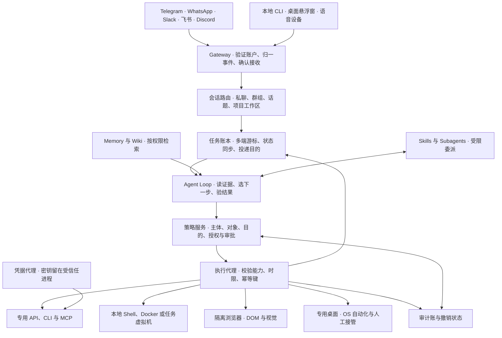
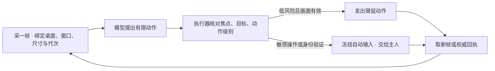
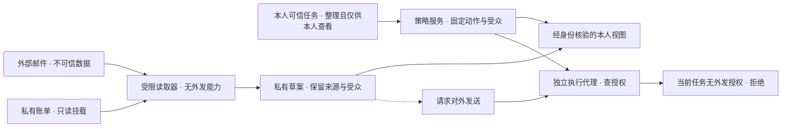
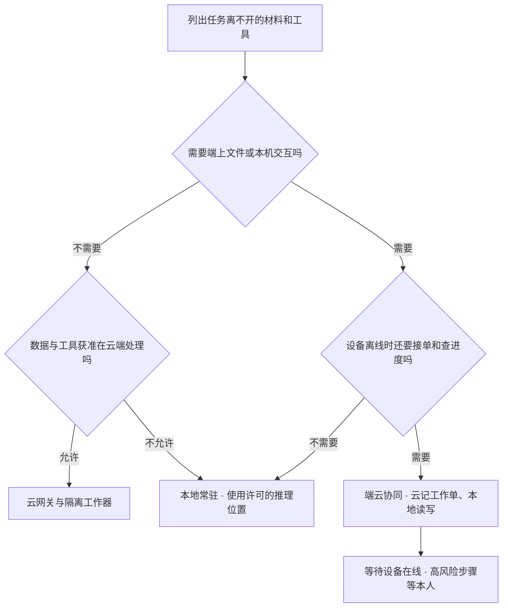

# 手机上交代的事，谁有权在你的电脑上做？Personal Agent 全栈架构

你在地铁上说“把这月的云账单按项目整理好，给我看一眼”，电脑上的助手可以读账单、做表，把草案送到手机。系统设计面试最值得追问的是，怎样让它一路记得“我”是谁、“这月”是哪段时间、“给我看”究竟授权到了哪一步。

本文的产品文档、安全披露与论文核对至 2026 年 11 月 24 日。

## 一份账单经过哪些层

手机接到语音，语音转写出需求。网关验证发件账户，路由器把工作归到这个人的财务工作区。模型拿到任务、可见证据和一小组工具。执行器读取授权账单，生成一份私有草案，网关确认目标仍是本人私聊再通知。此时同事在项目群里说“也发一份到这里”。这是一次新的请求、新的受众和一次新的外发决定。若系统只维护一个叫“我的助手”的聊天历史，就可能连问都不问，把私有附件原样发进群。



图里有两个容易被画错的箭头。第一，模型只能提出动作，真正握着邮件发送权、目录写权或桌面输入权的是执行代理。第二，工具结果先变成有来源、有访问范围的证据，再供模型阅读。把外部返回的整段文字插进系统指令，或把所有结果写到一个人人可查的长期记忆里，会把前面辛苦建立的边界一次打通。下文的账单流程和字段是参考设计。各产品已经实现的部分标有具体出处，示例假定账单中含项目级私有信息。

### 接入层怎样确认来信的人

接一个平台的第一天只有“收到文本”四个字。接第五个平台时，同一条业务请求可能来自转发、引用、按钮回调、语音转写、文件附件或消息编辑。每个渠道适配器要保留租户、平台账户、稳定的发送者 ID、聊天类型、房间、线程、消息 ID、事件版本和接收时间。昵称、头像、语音里自称的名字都不足以把平台身份绑定到本地账户。先核验平台签名、设备身份或经过授权的连接，再把平台 ID 映射为内部主体。送达技术上成功，只能证明入口收到了事件。具体写权限还在后面核对。

Telegram 私聊与群组是不同受众，Slack 和飞书的工作区可能属于不同公司，Discord 服务器中两个频道的成员范围也可能不同。WhatsApp 设备重新绑定、消息编辑或被转发后，接收端尤其要保留当前来源。群主身份不能代表账单所有者发布授权。桌面悬浮窗和 CLI 也应有已配对设备身份，来自本机某个进程的请求未必等于当前主人主动发话。语音设备在共享客厅里时，转写服务只能提出草案，付款或外发不能靠声纹或一句“是我”完成。

网关收到消息后先写持久收件箱，回复平台的确认，然后异步派发。流式答复与任务终态分别投递。手机断网重连后按游标补齐任务变化。每个渠道有自己的文本长度、附件限制、编辑消息能力和按钮有效期。投递层可以把同一份草案映射成手机通知、私聊详情和桌面文件链接，但不能把“这个私聊发不出去”自动改为“发到最近活动群”。目标无效时，工作单留在私有收件箱，等本人换一个经过验证的去处。OpenClaw 官方的 Gateway 架构可以对照设备配对、长连接控制平面和有副作用请求的幂等处理。[OpenClaw Gateway][gateway]

### 会话路由怎样兼顾多端连续和受众隔离

一个人可以同时扮演采购员、开源维护者和家庭成员。手机与电脑可以看见同一笔采购任务，不代表三个身份都能检索采购文件。定义会话键时先问“谁有权看到这段对话”，再问“谁为哪一件事工作”。实际可用结构化元组保存 `tenant_id / agent_id / workspace_id / audience_kind / audience_id / thread_id`。在私聊里，受众 ID 对应绑定后的人或本渠道的账户对。在群聊里，它绑定房间与适用的成员范围。跨平台 ID 只有经过账户绑定才能映射为同一人，访客和陌生群默认各自隔离。

任务 ID、会话键和交付目的地要有三种生命周期。任务会活到交付，聊天可能已归档，群成员可能刚好变化。把三者绑在一行并永久信任创建时的频道，就无法在“老板从群里退了、附件仍在生成”时收紧受众。OpenClaw 文档给出多种私聊隔离策略，例如 `per-account-channel-peer` 同时考虑平台账户、渠道与对方身份。是否共享会话取决于配置与信任关系。会话隔离解决串话，磁盘挂载、网络策略和工具凭据还要独立决定。[OpenClaw 会话管理][session] · [OpenClaw 安全模型][security]

```python
from dataclasses import dataclass

@dataclass(frozen=True)
class Envelope:
    tenant: str
    install: str           # 平台与安装账户的内部稳定标识
    sender: str            # 经过该平台身份校验的 ID
    kind: str
    room: str
    thread: str

def conversation_key(msg, workspace, bindings):
    # workspace 由上游 ACL 解析。只有用户完成双端绑定才会有 bindings 条目。
    if msg.kind == "dm":
        person = bindings.get((msg.tenant, msg.install, msg.sender))
        audience = ("person", person) if person else ("peer", msg.install, msg.sender)
    elif msg.kind == "group" and msg.room:
        audience = ("room", msg.install, msg.room)
    else:
        raise ValueError("无法确定对话受众")
    return (msg.tenant, workspace, audience, msg.thread)
```

实际落库时使用结构字段或无歧义编码，并加入代理 ID。已绑定的两端私聊若要共享任务，最好从“我的任务”视图订阅同一个 `job_id`。聊天记录是否合并由用户选择。私聊中的线程号是平台局部编号，跨端绑定时还应先映射成内部线程 ID 或保留渠道前缀。上例中的 `thread` 已由适配器归一化。账户解绑时撤销订阅与令牌，重新计算将来交付的去处。解绑前生成的下载链接也要能失效，单靠隐藏聊天记录收不回一个仍然可打开的文件。

多端同步最容易出错的动作是取消与批准。手机点“取消”的同一秒，桌面可能还展示“确认发布”。让服务器给任务事件分配单调递增的序号，客户端保存最后一个确认的序号，发现空洞就补拉。变更命令携带预期版本。若任务版本已从七升到八，桌面针对版本七的批准返回冲突并重新展示。终端离线时可以缓存“用户正在编辑的草案”，不能把离线按钮点击当作未来任何版本都适用的批准。服务器是状态权威，每个已配对端只是它的一张视图。

### 认知层怎样使用记忆、技能与子任务

账单任务交给 Agent Loop 后，先从工具目录选“列出本期账单”“按项目读用量”“生成本地表格”，再逐步读结果、做计算和检验。模型适合解释费用异常、识别还缺哪个项目归属。金额汇总、币种和账期边界交给确定性程序，保留原始行 ID、单位与舍入规则。两种货币不要直接相加，退款和跨月抵扣要明确归属。这样一来，“财务表格有错”就能追到哪一条输入或哪个转换有问题，而不用翻十几万 token 的对话猜模型做了什么。

长期记忆记用户稳定偏好，例如“私人费用按自然月显示”。项目 Wiki 记组织知识，例如“成本中心 A 的负责人是财务组”。两者都保存来源、适用身份、可见范围、更新时间和过期或删除状态。检索时先在有权范围内选候选，再做向量或全文搜索。结果缓存键带租户、主体、权限版本和查询范围。缓存输出给另一个群之前必须重新核对接收方权限。一条私人记忆形成的摘要也可能保留敏感事实，写入公共 Wiki 前要走显式发布流程。错误记忆能被查看、更正和撤销，才适合跨会话复用。

Skill 是可版本化的工作方法，例如如何核对账期、怎样计算差额、最终输出包含哪几列。它可以建议用什么工具，不能通过文档给自己增加写权限。安装时记录来源、版本与需要的能力，运行时仍由执行器验证。子 Agent 可以分别做发票归类与用量汇总，只给各自输入切片和临时目录。由父任务分配剩余 token、截止时间与工具集合，子任务返回带证据引用的结构化结果。一个只负责分类的工作器没理由持有完整邮箱登录态。任务失败时能重跑某一份切片，也能知道谁接触过哪份原始材料。

这套划分还决定了故障怎么报。模型请求超时，可以重试不产生副作用的归类。生成表格失败，从上一份已验证的中间产物重做。文件可能已发布，就要停下来对账。通过工作单记录预算、哪个模型读了哪些已脱敏字段、哪一个工具触发了外部动作。工具的进度输出回到任务账本，模型只取决策需要的摘要。把每次完整命令输出送回模型，会增加费用、泄漏面与响应时间，也让第二天接班的人更难核对关键事实。

## 三条端侧操作路线怎样选？以下载账单为例

| 路线 | 模型看见什么 | 稳定的成功证据 | 主要成本或故障 | 账单任务里的用途 |
| --- | --- | --- | --- | --- |
| API、受限 CLI、MCP | 结构化对象、字段和错误码 | 版本号、对象 ID、校验值、服务端回执 | 授权、限流、字段与版本变化 | 优先拉取账期与用量 |
| Browser Use | DOM、可访问性树或局部截图 | 下载记录、页面状态、账户与对象复核 | 登录过期、界面重绘、上下文漂移 | 只有交互网页能下载时使用 |
| Computer Use | 受限桌面的像素、焦点与动作结果 | 选中对象、文件属性或应用回执 | 多轮视觉延迟、缩放、误点、焦点被抢 | 最后处理无接口的桌面软件 |

选路先看能否限定对象与验收结果。限定得到，先用 API 或经过约束的 CLI。能取得结构化网页语义，就围绕语义做浏览器操作。当应用确实只留下可见界面时，再启用专用桌面。选用备用路径时保留相同的权限约束。若一次 API 写入因为权限不足而被拒绝，不能改用已登录网页去完成同一个写入。平台要求真人验证时，各条路径都应尊重这个决定。路由器可以替换实现同一已授权效果的工具，不能借换工具扩大授权。

### 用 API、CLI 和 MCP 限定可以操作的对象

“下载七月账单”只需要某个租户、某个账期、某种文件类型。一个窄工具可要求这些字段，拒绝跨租户对象，并返回固定的文件句柄与摘要。API 错误码区分令牌过期、请求太快、对象不存在与服务故障。工作器据此刷新授权、退避或请用户选一个正确项目。从原始响应用字段选择器保留金额、币种与账期，在本地聚合后只让模型看异常行。与看每一页表格截图相比，少了图像编码和来回猜列名的费用，故障也更容易复现。

已有 CLI 的工具可通过固定可执行文件、结构化参数数组、允许的子命令与受限工作目录调用。用机器可读输出做解析，限定输出字节、执行时间和文件写入位置。工作区文件名属于数据，不能当作一段可执行的命令文本。支持参数终止符的命令也应正确处理以连字符开头的文件名。CLI 常会沿用机器上的默认账户与配置。一台同时登录个人和公司的 Mac 上，执行前先读取目标账户的稳定标识，必须与工作单绑定的身份一致，再继续读数据。给助手一套独立配置比猜当前默认账户可靠。

MCP 提供工具发现与调用协议，服务端可以在背后用 API、浏览器或 Shell。接入时展开看每个工具的实际副作用、可能返回的敏感字段、网络目的地、权限要求及是否可重试。一个名字叫“预览”的工具如果会写共享文件，就要按共享写处理。客户端拿到工具列表后按任务能力过滤，服务端每次调用再次执法。远程服务核对令牌受众，避免把别家发的令牌顺手转给下游。涉及第三方授权的代理需要核对用户同意与请求关联。MCP 的官方安全实践明确讨论了令牌透传和代理方代办导致的权限混淆。[MCP 安全实践][mcp]

设计一份可复用的工具合同，可从失败反推必要字段。读账单返回结构应包含资源所属租户、账期、修订号及资料分级，让后继工作器能核对归属。写草案则返回草案 ID、版本和尺寸，接受条件更新与幂等键。跨组织发送另设专门能力，字段必须能表达准确收件人和最终附件摘要。不要把三个动作揉成一个“整理并分享”开关，否则一次只读授权很难安全地用在中间一步。与供应商 API 适配时，也应区分“授权到期，请重新登录”与“没有这个权限”，只有前一种错误有资格触发已授权的续期流程。

### Browser Use 怎样定位网页上正确的按钮

网页上有五个“下载”按钮。只用文字匹配，模型很可能点到上个月。浏览器里的 DOM 描述元素，Accessibility Tree 从中提炼角色、可访问名称与层级，例如某个命名行下有一个名为“下载”的按钮。Playwright 可以先定位账期所在行，再按角色定位该行的按钮。执行动作时检查可见、稳定、可接收事件等条件。浏览器代理把本次可操作节点压缩成短表，可减少整页 HTML 的 token 消耗，也能将“歧义匹配到两项”变成明确错误。[Playwright 定位器][locator] · [可操作性检查][actionability]

在 Chromium 中实现这层观察，可以通过 Chrome DevTools Protocol（CDP）的 Accessibility 域读取整棵或部分可访问性树。可映射的节点带有后端 DOM 节点标识，运行时再结合所属框架、当前视口和布局筛出本次候选，给模型发送角色、名称、状态和短引用。有些辅助节点没有可点击的 DOM 对象，有些有名称的控件暂时被对话框遮住。真正执行时仍要检查所属框架、可见性、遮挡与可操作性。只有缩短发给模型的表，而未缩小宿主采集与保存的数据，隐私开销并没有同步下降。[Chromium 可访问性协议][cdp]

Playwright MCP 将结构化可访问性快照作为主要观察方式，模型可以通过元素引用操作。Browser-Use 的开源实现提供 DOM 处理与浏览器交互，可把结构信息与视觉观察组合起来。具体字段和编号随版本变化。Stagehand 提供 `observe`、`act`、`extract` 等接口，适合把“找到目标”“执行动作”“取回结构化结果”嵌进普通代码。对于重复使用的稳定页面，可以先写确定性脚本，仅为变化部分调用模型。自由浏览的长尾场景才值得付多轮探索成本。不要把三个项目讲成采用同一个截图坐标算法。[Playwright MCP 仓库][pwmcp] · [Browser-Use 仓库][browseruse] · [Stagehand 官方文档][stagehand]

给节点发一个 `ref` 和把数字画在截图上是两个可以配合的动作。前者是“这次观察中的第十七个节点”，工具可将它映射回受限浏览器对象。后者是 Set-of-Mark 思路，让模型看见图中哪个区域与哪个编号对应。在画布、无名称图标或视觉上才显著的区域，局部截图能补足语义。标记可能遮字，过多编号又会让模型在密集表格中看花眼。只给当前视口、目标面板里的候选编号，同时保留截图与节点表的同一观察代次。访问树引用即使是数字，也并不自动具有像素区域含义。[Set-of-Mark 原始研究][som]

一个 SPA 点击月份后，地址栏也许没有变化，表格却会异步重绘。不要睡两秒赌它加载完了。监听目标响应或页面暴露的状态，等待期望月份出现且忙碌标记消失，然后重新取目标行。若发生导航、切框架、打开新标签页或内容修订，丢弃旧编号，用角色、名称和上下文重新定位。页面上同时出现两个符合条件的行时停下澄清或按已知对象 ID 查证，避免让模型自行猜第一个就是正确的。点击成功只能证明发出了鼠标事件，从磁盘读到可解析的目标文件、账期吻合，才能标记任务完成。

```python
async def download_statement(page, period, target_path):
    # 这是界面合同示例。调用者已验证来源、账户并为每件任务分配独立目标路径。
    from playwright.async_api import expect
    from re import escape, compile

    row = page.get_by_role("row").filter(
        has=page.get_by_role("cell", name=compile("^" + escape(period) + "$")))
    await expect(row).to_have_count(1)
    button = row.get_by_role("button", name="下载账单", exact=True)
    async with page.expect_download() as pending:
        await button.click(timeout=5000)
    download = await pending.value
    await download.save_as(target_path)
    # 调用方随后解析下载文件并复核租户、账期和文件格式，再登记完成。
    return target_path
```

登录态很值钱，它经常可以代替密码执行真实操作。让用户在独立浏览器上下文中登录，由宿主管理与保护持久状态。按租户、主体、用途与有效期分开存储。Playwright 的 `storageState` 可以包含足以冒用账户的 cookie 等材料，官方明确提醒不要提交到仓库。重用状态前确认仍是预期组织，撤销时清理本地状态并尽可能使服务端会话失效。短信码、通行密钥或验证码要求真人参与时，把对应窗口交给主人，暂停动作与敏感画面采集，交回后从新快照继续。站点限制自动访问时尊重限流、等待或切到正式授权的集成，必要时把剩余动作交给用户。[Playwright 登录态说明][auth]

浏览器预算要按完整业务动作记。首次导航、拿快照、选中行、验证下载各自记耗时、模型调用和读取字节。命中的定位器可缓存为“这一版页面的建议”，下次仍做唯一性与预期账户校验。缓存失效后重新观察一次，持续失败应停止并记录页面版本。若十页报表需要几十次截图与视觉推理，数据导出接口的一次集成成本往往能很快摊平。另一方面，一个季度才使用一次的内部网页，先用限定页面与人工登录的浏览器流程，可能比长期维护专用连接器划算。用实际每次成功交付的时间和成本决定投入。

### Computer Use 能看见哪张桌面，又能按下哪些键

旧财务软件只给一个原生窗口，既没有 API，也拿不到稳定的控件树。这时可以给模型一张受限桌面截图，让它预测下一步应点哪个位置或输入什么，再由执行器发出键鼠动作。模型读取动作后的新画面，核对是否到达预期界面，然后决定下一步。Anthropic 的 Computer Use 工具文档和 OpenAI 的 CUA 原始说明都能看到这条“观察、动作、再观察”的循环。不同模型对坐标空间、支持动作和返回结构的合同各异，宿主需要按所用工具版本适配。[Anthropic Computer Use][claude-cu] · [OpenAI CUA 研究说明][cua]



确定坐标时，要区分截图像素、操作系统逻辑点和缩放后的模型输入像素。宿主要记录裁剪区域、原点、各轴比例和显示器编号。假设桌面区域左上角是逻辑点 `(200,100)`，其宽高以逻辑点计为 `800×600`，送给模型的这片截图是 `1600×1200`，模型给出相对像素 `(600,400)`，映射后得到桌面逻辑点 `(500,300)`。如果桌面被移动、系统缩放改了或窗口所属屏幕变了，废弃这张帧，重新测量。不要把昨天保存的坐标“导出”硬套到今天的确认对话框。

动作模型的不确定性会叠加。即使假设每一步独立且有九成九成功率，五十步全对的概率也只有约六成。真实界面里的错误还会相互影响。第一次点错页签后，后面所有坐标仍然可能看似合理。把长链切成带业务后置条件的小段，例如“当前已进入七月报表”“预览总额与结构化账务值相同”“导出目录出现新文件”。读一帧、做少量安全动作、检验再继续，挥发性的界面每步都重新观察。已知不会改变页面语义的低风险操作可适度成组，但若中途出现系统弹窗就应失效整组。

可用的性能公式是各轮的截图、图像处理、模型推理、输入执行与应用稳定耗时之和。用较小的目标窗口、局部截图或本机可访问性接口读标题能减少往返。图片缩得太小又会误看按钮，盲目提高帧率也不能让后端早返回。记录每次任务的往返轮数、每轮的延迟分位数、误点后恢复次数和人工介入时长。对于协同使用的主桌面，人的手一碰鼠标就可能改变焦点。更稳的是专用虚拟桌面和单一输入租约，用户要求接管则立刻让出租约。

付款、发邮件、删除数据库或覆盖批量文件都有独立的最终提交点。专用执行器应让模型准备可核对的预览，付款人与收款方、币种金额、附件与收件人、删除对象与范围都在可信界面展示。最终动作给人亲自执行，或对限定且可验证的写入走绑定具体内容的一次性审批。若纯视觉控制器根本分辨不出哪个按钮会造成外部副作用，就只能在受限账户或只读副本上工作，临近敏感应用把整个编辑阶段移交。靠模型读按钮文案来拦所有危险点击是不可靠的。OpenAI 的 Computer Use 指南也把受限运行环境与高影响动作的人工参与作为部署边界。[OpenAI Computer Use 工具指南][oa-cu]

## 为什么能读账单的助手还需要独立的出口管控

想象助手可以读私人账单，又读到供应商发来的外部邮件，同时还能发送附件。即使你的真实要求仅有“整理”，第三方内容也进了同一个能行动的决策过程。Simon Willison 在 2025 年把**接触私人数据、读取不可信内容、具备对外通信能力**的组合称作 *lethal trifecta*。间接 Prompt Injection 的“间接”指第三方把影响模型的内容放在它会读取的材料里，可能是网页、邮件、群消息、工具返回，也可能是图片或后续检索出来的旧笔记。[Willison 的原文][trifecta]

第三个角在原文专指**外部通信**。通用 Shell 可能带网络，浏览器可能带上传能力，写入一个同步共享目录也会让数据移出原受众，这些都可能充当出口。拿到本地写权限的助手即使断网也可能误删文件，这涉及数据的完整性。给它禁网保护的是一部分保密性，给它只读挂载、版本化输出和可恢复快照保护的是完整性。做威胁建模时分别画“哪些材料会进入决策”“哪些读写和对外效果可达”，两张图合起来才知道该切断哪条路径。



### 真实案例教给工程团队的两条测试

2025 年披露的 EchoLeak 对应微软记录的 `CVE-2025-32711`。微软把它归为 Microsoft 365 Copilot 的信息披露问题，涉及 AI 指令注入使未经授权者可经网络获知信息。发现者 Aim Labs 的报告给出了这条因果链。外部邮件进入助手可读取的资料，助手在用户已有权限下接触组织内部信息，信息又有机会经网络离开原有受众。研究人员演示这个结果时，无须诱导用户点击一条恶意链接。团队在披露时表示当时没有获知客户受影响的案例。产品团队应分别验证助手读取这份文件的权限，以及本次接收人的资格。设计回归时给测试租户放入虚构的私有账单，再提供一封普通外部来信，在禁止外发的会话里核对代理层没有产生任何外部传输。把判断落在网络出口的实际记录上，即使模型给出错误提案也要守住私有数据。[Aim Labs 发现者报告][echo] · [微软安全公告][msrc] · [微软提交的 CVE 记录][cverec]

另一个案例来自 Anthropic 对 Claude Cowork 的工程复盘。初版把循环与代码执行放在桌面侧虚拟机中，用户选择的工作区可挂载，凭据留在宿主。虚拟机启动故障会连解释问题的助手也一起拖住。团队后来把循环移到虚拟机外，代码仍在虚拟机内执行，也说明了本地 MCP 服务为什么需要另外审计。隔离后的客体依旧能修改用户明确挂进去的可写目录。把“只能写批准的目录”验证一遍后，还要验证在这个目录里出错能否恢复。如果给共享同步目录开了写权限，则连“产物只有用户自己可见”的假设也要重审。[Anthropic 跨产品隔离复盘][containment]

### 不可信输入怎样保留来源

把邮件正文装进 `untrusted_content`，写上来源、所有者、访问范围、提取时间和一次性证据 ID。系统指令、用户在可信界面明确下达的任务、来自工具的资料分槽传给模型。来源标签由网关生成，外部文本只能成为某个字段的值。标签有助于模型正确理解内容，安全属性由运行时执行。即使模型把邮件里的话误认为任务，策略器仍找不到用户授予的发送权限，只有“提出草案”这条路径能走。

再往前一步，读取器可以看含外部文字的私有文档，却只有受限的结构化输出通道。下游执行器只拿经过校验的账期、类别、金额和证据句柄，按受信任的用户任务选择动作。严格校验结构与值域，避免名为“建议类别”的自由文本转眼又成了下个 Agent 的指令。结构化也不能消除所有信息泄漏，敏感字段仍需保留受众标签和出口限制。2025 年 CaMeL 将来自可信请求的控制流与不可信数据区分，并在工具调用处执行能力策略。论文报告在其 AgentDojo 设置下，带证明安全保证时完成了 77% 的任务，未防护基线为 84%。这个差距提醒团队评估因保护机制被阻断的正常任务，并为其安排可审查的人工路径。[CaMeL 原论文][camel]

项目 Wiki 与子 Agent 同样需要传递来源。上游摘要来自私有邮件，子 Agent 不会因为“这是另一个内部助手发的”就获得新的发布权限。2026 年 10 月的 *Can CaMeLs Talk?* 预印本研究多 Agent 组合，指出单体的保证不能自动跨过委派边界，提出将可信指令与不可信数据分通道并保留来源。对账单应用，可以让汇总子任务返回 `artifact_id` 与若干已验证数字，管理员设定哪些字段允许出现在团队看板。格式变化、翻译或摘要只改变表示，默认保留最严格的可见范围。[多 Agent 来源传播研究][multicamel]

### 如何把最小权限落实到执行环境

给执行器一张短期能力票据，写清主体、工作区、对象、允许动作、接收方、过期时间和授权版本。任务入口把私聊主体与员工账户绑定，只发针对费用项目的只读票。整理器无外发工具也无任意网络。生成表格只写任务临时目录。给本人看走私有产物浏览器。工具列表过滤只是减少模型选错的机会。即使模型请求了隐藏工具，服务端也要再核对操作、对象、最新身份和数据出口。每项请求都须落在用户授权、当前租户政策、任务目的与后端实际权限的交集内。

Shell 是可组合的通用工具，很难在任意脚本文本上预先判定所有效果。把真正的边界下沉到进程和网络。以独立低权限身份运行，按任务挂载输入为只读、临时输出可写，不传宿主家目录、管理员套接字和账户配置。控制网络出口、进程数、磁盘与 CPU，任务结束丢弃临时环境，只向私有存储提升达标产物。Docker 适合依赖一致、快速创建的任务，在同一内核上的容器共享内核风险。对互不信任的租户、未经审查的扩展或需要完整桌面的任务，可用独立虚拟机把内核边界也隔开。挂载与连接器仍要逐一授权。[OpenClaw 沙箱边界][sandbox] · [Anthropic 托管执行架构][managed]

对浏览器同样要同时管读与出。只允许预定来源，禁用通用外传、公共分享与无关扩展。不向执行器开放任意远程调试端点。浏览器携带会话本身就是能力，哪怕模型永远看不到 cookie，也可能通过已登录页面替人行动。对报表下载只给只读角色，隔离下载目录，返回应用内文件句柄。外发控制也应覆盖模型工具之外的环节，例如网页加载的远程资源、富文本预览、渲染外部内容的邮件客户端和自动同步目录。若输出显示器会主动取第三方资源，摘要展示本身就可能成为跨边界网络动作。

### 如何只批准眼前这一次、这份内容

按效果分层便于与用户约定。**范围内只读**可自动通过，要同时核对受众、对象与读取目的。**改变用户可见状态的写入**先出差异预览，用户确认后用预期版本提交。**对外发送、付款、生产删除**交由本人在可信端最后操作。助手可以先生成私有的临时草案，这类内部产物必须限定可见范围与保存期限。一旦生成共享链接，新受众就能读到资料。产品哪怕称之为“只读分享”，仍须按高风险写入处理。

确认页写清“从什么账户、把哪个版本、交给哪位收件人、会改变什么”，人能根据业务含义判断。审批票绑定主体、任务、动作、对象版本、数据摘要、目的地、时效和策略版本。批准后文档被重新生成，或收件组成员发生变化，审批要失效。服务端消费票据与写入投递意图在同一事务完成，保持一次性与可审计。确认来自独立受信界面，例如已配对桌面的原生确认窗口。网页自己画出来的“用户已批准”对运行时没有效力。

下面把动作分流写成一个纯函数，便于拿真实策略逐条回放。字段来自已验证的会话、资源目录、能力服务和审批服务。模型只能提交动作提案。返回值供控制器决定下一步，最终工具代理还要在落地时原子消费有效票据。账单示例采取严格策略，任何外发都切换为人工接管，连最“贴心”的快捷按钮也不能替主人按下发送。

```python
from dataclasses import dataclass

@dataclass(frozen=True)
class Request:
    workspace: str
    resource_id: str
    operation: str
    version: str
    content_hash: str
    destination: str

@dataclass(frozen=True)
class Authority:
    # 这些值由受信任的控制平面提供。执行时重新读取撤销与过期状态。
    workspace: str
    resources: frozenset
    operations: frozenset
    active: bool

def check_action(req, grant, approved_request=None):
    if not grant.active or req.workspace != grant.workspace:
        return "deny"
    if req.resource_id not in grant.resources or req.operation not in grant.operations:
        return "deny"
    # 接管入口另验身份。返回 handoff 不会向外部系统发送请求。
    if req.operation in {"send", "pay", "delete_production"}:
        return "handoff"
    if req.operation == "read" and req.destination == "private_workspace":
        return "allow"
    if req.operation == "edit" and req.destination == "private_workspace":
        if approved_request == req:
            return "allow_once"
        return "show_diff"
    return "deny"
```

在生产实现里，不能让调用者自己提供 `Authority` 或 `approved_request`。服务端先从认证链取出主体和设备，根据该主体的工作单检索资源与批准记录。即使两个用户的请求字段完全相同，也只有批准记录绑定的那个人能消费。签名只能证明票据来源与完整性，一次性还需要服务端记录消费状态。执行前用对象版本条件避免“看的是旧文件，改的是新文件”。只要这个目标系统不支持条件更新，又不能获得可靠的独占写入，暂停在准备阶段，交给所有者处理并发冲突。

### 凭据代理怎样代办请求

把密钥藏进环境变量，模型聊天界面确实不会显示它，但模型获准启动的子进程可能继承它，日志和错误报告也可能带出其值。将长效凭据放在操作系统钥匙串或受管理的密钥服务中，由独立代理保管。工作器只提交“为租户 A 读取账期 B”的结构化请求和短期工作票。代理核对工作票、主体、资源、HTTP 方法与目标服务，向上游发请求时在自己的进程内临时注入凭据。返回前筛掉认证头、无关字段和上游诊断文本。Shell、模型上下文和任务目录都拿不到明文密钥。

代理必须真正约束请求。如果对任意 URL 都能代签、可跨目的地自动跟随重定向，或给工作器提供任意请求体的万能接口，它仍然相当于一把能远程使用的总钥匙。固定服务端点与允许的操作，按租户选择最窄作用域令牌，必要时在服务端验证实际目的地或重新授权跳转。设置短寿命、频率限制、轮换与撤销，审计只写票据标识和服务返回的请求号。OAuth 刷新令牌仅留在代理，用户关闭连接器后既终止新签发，也设法让既有上游令牌失效。无法即时撤销的短期能力必须有明确的最长存活时间。

代理凭据与身份接管要分开。网站要求重新登录时，助手只能打开可信登录入口、暂停自动输入和采集，让用户与身份提供方直接交互。返回时校验回调归属和账户 ID，新建可撤销的会话句柄。浏览器若必须自己保存短期会话材料，就将其限制在专门的浏览器进程和加密的用户状态中，让模型侧 Shell 无法读取浏览器提供的认证档案。浏览器仍然具有相应操作能力，之前的动作分级继续适用。用户最终看到的是“这项授权可读哪些账单、什么时候到期”，而不会被要求把密码粘贴到聊天框。

### 从审计还原谁读过哪一版、数据去了哪里

一次决策记录任务、真实主体、会话受众、证据来源、操作类别、资源摘要、运行后端、策略版本、审批票、允许或拒绝原因和上游回执。策略修改与管理员操作也要进入独立受控的审计存储。把每个阶段用关联 ID 串起来，记录时剥离授权头、正文、文件内容和可重放的下载地址。截屏录像只在明确授权的诊断期短时保留。审计员能看审计元数据，不应因此自动获得整家公司的账单正文。对低熵敏感值，普通散列也可能被猜出，可用受控的带密钥摘要，或只记录与受保护对象表关联的随机标识。

发现权限配置错误后先冻结对应出口和仍在执行的任务，撤销短期工作票、关联浏览器状态与待批准动作，再核对哪些数据可能到达哪个受众。保留必要证据，按用户与组织协议通知受影响主体。可恢复操作从版本化快照还原，外部收件人已经看过的材料不能靠删除本机文件收回。恢复权限前，用虚构数据跑一遍同样的流程。群请求能否看到私人账单标题？过期票能否再用？执行器实际启动的是哪个沙箱？即使模型在每种情况下都产生错误提案，服务端也应给出可预期的拒绝或接管结果。

## 部署选型取决于哪些步骤必须在线、哪些必须在场

用户说“二十四小时在线”，可能指手机消息随时有人接，可能指夜里能完成分析，也可能指助手随时能替自己操作桌面。三种承诺需要的硬件、登录状态和权限不同。在日常数据流上标出只能留在家或公司的信息、只能内网访问的接口、允许延迟的任务，以及必须有真人在场的时刻。再决定买一台常驻小主机、租云资源，还是把控制层与执行层放在两个地方。



| 方案 | 谁接消息，谁做事 | 适用条件 | 先验证的失效方式 |
| --- | --- | --- | --- |
| 单机 Mac mini 常驻 | 本机系统服务接入，专用账户或虚拟机执行 | 单一信任域，本地文件、原生应用和个人偏好占主要价值 | 睡眠、重启未登录、权限撤销、家庭网络离线 |
| 云端容器托管 | 云网关接入，按任务分配隔离工作器 | 数据有获准的云 API，队列有突发，团队需集中审计 | 令牌撤销、租户串读、卷丢失、没有交互桌面 |
| 端云协同 | 云端登记工作与回执，本地节点拉取受限任务 | 手机要随时查进度，原始文件或最后一步必须留在设备 | 节点离线、授权过期、状态冲突、双方版本不兼容 |

**单机本地优先。** 一位独立开发者想整理本地票据、项目日志和日历，固定小主机可以让读取发生在同一设备上。网关以独立服务账户运行，数据目录有备份。需要 GUI 的作业只在专门的已解锁交互会话里领取。机器在线、用户已登录、屏幕录制获准和当前允许模拟输入应是不同的健康状态。升级系统后若屏幕权限被收回，明确显示“可收消息，桌面操作待授权”，仍然交付已完成的 API 部分。远程控制不应要求把无保护的管理界面暴露在公网，设备配对与受保护的链路仍然必要。[OpenClaw 远程接入][remote]

“本地优先”也要看模型请求发到了哪里。原始 PDF 留在磁盘，不代表发给云模型的 OCR 摘要没有敏感金额。把材料按处理位置分级，受限账单本地提取与计算，只有许可的汇总字段可进入云推理。有时直接用本地程序生成报表就能完成任务，省去了传输授权。一台机器上的两个家庭成员如果互不信任，给他们不同会话名仍不足以隔离文件、浏览器与凭据。根据访问风险选择独立系统账户、独立网关和更强执行隔离，并检查备份与日志是否仍然混放。

**云端托管。** 如果工作主要是查项目 API、跑测试、定时做团队简报，云端网关和隔离工作器容易维持可达性，突发时也能扩容。任务队列和加密产物存储独立于临时容器，重建容器不会丢失任务。按租户设执行身份、队列配额与资源边界。将真正需要的归档卷按任务挂载，以便一次性工作器无法浏览其他人的产物。只在控制平面持有凭据代理，与模型工作器隔离。云端没有用户本机私有应用的原生会话，为了下载一份资料而复制整个浏览器用户目录，代价往往超出这项授权。

**端云协同。** 一位顾问出差时需要手机发起分析，但客户合同要求文件留在本地。云端持有任务号、进度与经批准的摘要，本地节点主动建立认证连接领取任务，验证签名、用途、到期时间、设备绑定与撤销代次，再本地读取和执行。结果可以只是“草案已生成”的状态与本地句柄。若用户需要手机看全文，还须选择一条明确授权的私有传输路径。云端能同步进度本身不能授权上传附件。设备离线时状态显示等待节点，获得新租约后才启动，不能把云端排队期间的旧批准用在已经换版的文件上。

### OpenClaw、Hermes 与 Cowork 分别提供哪块参考

已有多渠道入口、要跨设备路由和长期运行，先看 OpenClaw 的网关、会话与远端节点设计。重点核实默认私聊隔离、工具在哪台主机执行、哪些路径绕开运行沙箱，以及谁可信任为操作者。若产品面向相互不信任的客户，按租户建独立信任边界，别把一个个人助手网关直接当成多人共享的安全容器。试运行时让两个无关账号分别请求“恢复我的上次任务”，检查返回哪份资料、点击链接用哪个身份，以及失败时机器人向哪里投递。[OpenClaw 架构][gateway] · [项目安全模型][security]

希望每个长期助手拥有自己的配置、记忆、定时工作与工具习惯，可以看 Hermes。官方文档说明，profile 管理配置、会话、日志等状态。选用本地终端后端时，它仍可能看见运行账户可访问的其他目录。选择 Docker 等后端后要在真实入口核验，不能只看配置文本。2026 年 7 月项目有一条现已关闭的问题报告，描述多 profile 网关路由到目标 profile 时，终端后端曾沿用启动方的设置。这条历史记录适合用来设计回归测试，当前安装的行为应在其固定版本上实测。[Hermes 官方项目][hermes] · [Profiles 文档][profiles] · [多配置路由问题记录][profile-issue]

希望把“帮我处理这一个文件夹”的权限讲给普通用户听，可以参考 Cowork 按文件夹授予访问、将代码执行与宿主隔离的做法。用户能实际判断“这是我愿意给它看的目录”，很难每次都阅读一长串底层命令。官方复盘也指出，一旦接入连接器或让本地扩展在宿主执行，新增通道就有自己的信任边界。以此为依据，可以让产品的权限页按材料、接收方、可做动作和有效时间展示。复杂命令细节留在可展开的审计记录中。把可信选择放在用户能够理解的位置，后台执行才有可靠的授权依据。[Anthropic 的设计取舍][containment]

### 用一笔月账验收整个系统

先创建虚构的两家公司、两个私聊、一个共享群和两份同名账单。让第一位用户在手机发起整理，到桌面继续查看。移除群内一名成员，再让离线手机补同步。预期是私有任务在绑定设备上连续可见，另一个租户看不到任务标题，共享群不出现附件，失去权限的人连既有链接也不能继续打开。然后让同一回调被投递两次，确认任务账本只追加一次命令效果，客户端重连后按游标恢复终态。这个用例同时验证入口身份、会话键、对象授权、幂等和投递受众。

把同一任务故意停在三个地方。下载后断开浏览器，恢复器应能验证文件摘要，继续算表。审批后替换草案，提交应因版本变化停止。点击第三方发送后拔掉网络，应展示结果未知，等待查询对方回执。最后让本地节点离线。云端应继续接单并显示等待，任务继续等待原设备，不能改派给权限更大的机器。记录端到端交付时间、实际模型费用、人工接管次数和越界提案被阻断的原因。这样才知道下次该优化连接器、用户确认界面、模型选择，还是干脆把一段高频 GUI 操作换成 API。

## 面试中七个能检验权限边界的追问

### 1. 手机和电脑要保持连续，群聊和私聊又不能串，怎么同时做到？

**考察点** 能否把身份绑定、会话范围和任务可见性区分开。

**回答思路** 在两个渠道明确绑定同一主体，通过带访问控制的任务视图共享进度，群聊按平台账户、房间、线程与工作区隔离。检索前按身份缩小候选，附件下载再验当前权限。

**连环追问** 群里的人转发了私聊任务链接呢？链接只携带任务引用，打开时重新核验，默认不预览私人标题。需要分享则由主人选择受众和内容，生成范围与期限明确的新授权。

### 2. 用户批准过“读七月账单”，为什么还要拦一条成功的 API 调用？

**考察点** 授权、身份与工具可用性是否分开。

**回答思路** API 成功可能只是机器所用令牌权限很宽。请求仍需匹配主体、租户、账期、读取目的和输出受众。无法确定目标归属就先解析对象。

**连环追问** 若同一 MCP 工具既能读又能写？在受信任适配器按实际动作拆分能力，读令牌无法写。无法可靠拆分时就不给只读任务使用这个工具。模型工具描述与按钮名称不能承担安全边界。

### 3. 已有截图点击模型，为什么还花时间维护浏览器结构化定位？

**考察点** 能否用失败成本和验证能力比较三条路线。

**回答思路** 有接口走接口。网页语义完整时，角色、名称和行上下文可唯一定位，等待业务状态后能可靠回放。画布或视觉信息缺失时，加局部截图与同代次标记。桌面软件才升级到受限的系统级操控。

**连环追问** 页面只在点完才换账户怎么办？为下一步增加实际租户校验，发现变化就暂停。若最终写入无法验证目标，转交用户，不用旧快照强行继续。

### 4. 模型从没有看到密码，为何还能把私人信息带出去？

**考察点** 能否识别间接使用凭据与隐蔽出口。

**回答思路** 登录态、代签代理、共享文件夹和网页渲染都可能具备出网效果。列出私有数据源、不可信来源与所有出口，为工具代理核对接收方、范围、用途和上游服务端点，必要时把读私有数据的组件完全断开外网。

**连环追问** 沙箱断网为何还担心数据丢失？对可写挂载的误删仍能破坏完整性，因此输入只读、产物分区、版本化备份与回滚各有独立作用。

### 5. 一个子 Agent 读外部文档，另一个只负责发信，是否已经切断致命三角？

**考察点** 能否跨组件推导信息流。

**回答思路** 还要看下游会否把上游返回的文本当作新的可信任务，以及外部收件人从哪里来。分别传控制与数据，保留材料来源，子任务继承更窄能力，最终发送绑定主人的目的地与确认。

**连环追问** 工作器只返回 JSON 会怎样？自由字符串仍可能影响下游决策，数值也可能本身保密。用字段约束、受众标签、显式的数据披露授权以及外部出口检查共同限制可达效果。

### 6. 用户愿意对每封邮件点“同意”，如何证明最后发的是他看到的那封？

**考察点** 批准与执行之间的状态漂移。

**回答思路** 在可信界面展示发件账户、收件人集合、附件、正文与版本，将摘要和目标绑定到一次性短期批准。提交时核对当前版本和撤销状态，原子消费批准。高风险策略下由用户亲自执行最后一步。

**连环追问** 平台提示超时，点第二次会不会发两次？复用同一幂等键，有消息 ID 先查询。无可靠结果就标未知并说明对账路径。按当地数据库里的“未成功”直接重发并不安全。

### 7. 家里小主机断电两天，云端还敢承诺什么？

**考察点** 能否按组件的实际可达性定义服务承诺。

**回答思路** 云端仍能接入、验证身份、持久排队与展示最新进度。本地文件读取、用户在场的登录和桌面输入都显示等待。任务有到期时间和撤销代次，重新连线先查目标是否仍有效、凭据是否可用，再重新领取。

**连环追问** 要提高可用性，能否把账单与浏览器登录态每天拷贝上云？先看数据驻留与用户授权。只需要知道进度时同步最小元数据，把需要真人或本地机密的阶段留给设备，才兑现了原来的隐私约定。

## 一手参考与延伸阅读

- 对照渠道连接、设备配对、会话隔离和宿主与沙箱的不同责任。[OpenClaw 架构][gateway] · [会话管理][session] · [沙箱][sandbox] · [安全模型][security] · [远程部署][remote]
- 查清 profile 保存哪些状态，用项目上已关闭的问题验证真实路由与终端后端是否一致。[Nous Research 仓库][hermes] · [Profiles][profiles] · [2026 年 7 月问题记录][profile-issue]
- 读浏览器工具自己声称的能力，再核对定位、等待、认证状态与视觉编号的来源。[Chromium CDP][cdp] · [Playwright MCP][pwmcp] · [定位器][locator] · [动作等待][actionability] · [认证][auth] · [Browser-Use][browseruse] · [Stagehand][stagehand] · [Set-of-Mark 论文][som]
- 对比视觉操控研究、实际工具循环与高影响动作的交接位置。[OpenAI CUA][cua] · [OpenAI 工具文档][oa-cu] · [Anthropic 工具文档][claude-cu]
- 从真实产品与披露记录学习如何设置可达边界，核对致命三角最初的表述。[Willison 原文][trifecta] · [Aim Labs 发现者报告][echo] · [微软安全公告][msrc] · [CVE 原始记录][cverec] · [Anthropic 隔离复盘][containment] · [托管 Agent 工程设计][managed]
- 研究可信控制流与数据如何分开、为何还要把来源跨子 Agent 传递，并与真实协议的令牌约束对照。[CaMeL，2025][camel] · [多 Agent 扩展预印本，2026][multicamel] · [MCP 安全实践][mcp]

[gateway]: https://docs.openclaw.ai/concepts/architecture
[session]: https://docs.openclaw.ai/concepts/session
[security]: https://docs.openclaw.ai/gateway/security
[sandbox]: https://docs.openclaw.ai/gateway/sandboxing
[remote]: https://docs.openclaw.ai/gateway/remote
[hermes]: https://github.com/NousResearch/hermes-agent
[profiles]: https://hermes-agent.nousresearch.com/docs/user-guide/profiles
[profile-issue]: https://github.com/NousResearch/hermes-agent/issues/68559
[pwmcp]: https://github.com/microsoft/playwright-mcp
[browseruse]: https://github.com/browser-use/browser-use
[stagehand]: https://docs.stagehand.dev/v4/first-steps/introduction
[locator]: https://playwright.dev/docs/locators
[actionability]: https://playwright.dev/docs/actionability
[auth]: https://playwright.dev/docs/auth
[cdp]: https://chromedevtools.github.io/devtools-protocol/tot/Accessibility/
[som]: https://arxiv.org/abs/2310.11441
[claude-cu]: https://platform.claude.com/docs/en/agents-and-tools/tool-use/computer-use-tool
[oa-cu]: https://developers.openai.com/api/docs/guides/tools-computer-use
[cua]: https://openai.com/index/computer-using-agent/
[mcp]: https://modelcontextprotocol.io/docs/2025-11-25/tutorials/security/security_best_practices
[trifecta]: https://simonwillison.net/2025/Jun/16/the-lethal-trifecta/
[echo]: https://www.catonetworks.com/blog/breaking-down-echoleak/
[msrc]: https://msrc.microsoft.com/update-guide/vulnerability/CVE-2025-32711
[cverec]: https://github.com/CVEProject/cvelistV5/blob/main/cves/2025/32xxx/CVE-2025-32711.json
[containment]: https://www.anthropic.com/research/how-we-contain-claude
[managed]: https://www.anthropic.com/research/managed-agents
[camel]: https://arxiv.org/abs/2503.18813
[multicamel]: https://arxiv.org/abs/2610.05640
