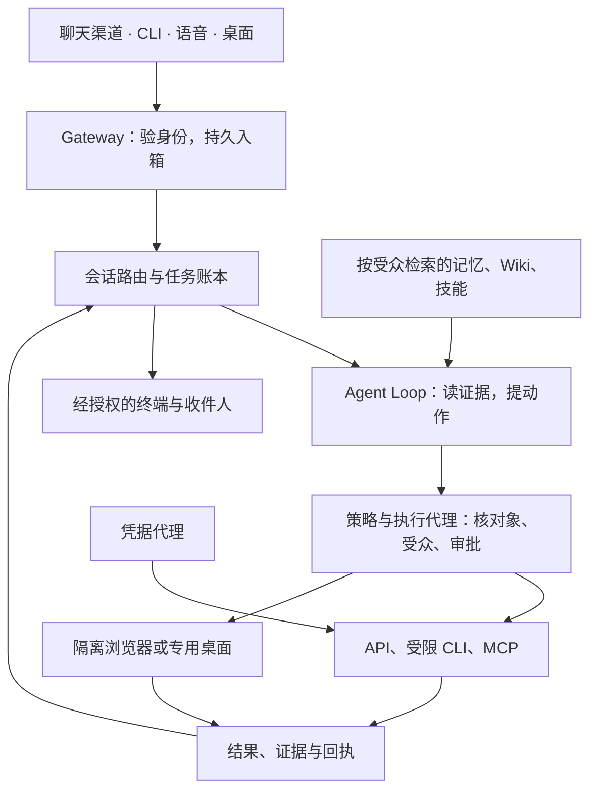

# 个人 Agent 全栈架构：多端 Gateway、工具执行与权限边界

> 手机发起任务，电脑继续执行，结果该回到哪里？从一条消息画到一次工具调用，再画回执。面试里最容易被追问的，是这条路上谁认人、谁保管密钥、谁有权按下最后一个按钮。

## 一张图看懂控制与执行



**Gateway 负责接入，Agent Loop 决定下一步，执行代理决定这一步能不能做。** 工具读回的网页、消息和文件先成为带来源的证据。真正能操作邮箱、文件和鼠标的组件，需要能独立拒绝模型提出的动作。

## 多端 Gateway：共享任务进度，隔开不同受众

OpenClaw 的 Gateway 是常驻控制平面。聊天渠道、CLI、桌面客户端和设备节点都能接入。设备配对、长连接和有副作用操作的幂等处理集中在这一层。接一个新渠道，先把它的身份和投递语义翻译清楚。[OpenClaw Gateway][gateway]

| 入口 | 必须保留的身份与范围 | 特别容易认错什么 |
| --- | --- | --- |
| Telegram、WhatsApp 私聊 | 平台、安装账户、对端稳定 ID | 同名用户、转发者和原作者 |
| Slack、飞书、Discord 群聊 | 租户、工作区、房间、线程、发送者 | 同一个人在私聊、项目群和外部群的可见范围 |
| 本地 CLI、桌面悬浮窗 | 已配对设备、会话主体、目标工作区 | 本机另一个进程或另一个登录账户 |
| 共享语音设备 | 设备身份、会话受众、转写来源 | 把一句“是我”当作付款人的确认 |

渠道适配器验签或核对设备身份，记录消息 ID、事件版本和接收时间。转发、编辑、按钮回调都保留当下的来源。持久写入收件箱后再应答，重复回调靠唯一键归并。平台收到 ACK 只说明消息已接收，任务完成另有回执。

**路由时要保存三项信息**：会话键决定谁能看到这段对话。任务号指向可恢复的工作。投递目的地决定结果发到哪里。群成员会变，私聊会归档，工作可能过几个小时才完成，三个名字必须可以分别失效。

- **会话键**：用结构化元组组合租户、Agent、工作区、受众类型、受众 ID 和线程。私聊按安装账户与对端隔离，群聊按房间与线程隔离。OpenClaw 提供 `per-account-channel-peer` 等私聊策略。[会话管理][session]
- **跨端续办**：用户明确绑定两个账户后，让两个终端订阅有访问控制的同一 `job_id`。平台线程号带上渠道前缀或映射到内部 ID。私聊历史是否合并，单独给用户选择。
- **结果投递**：发送前确认受众仍然有效。私聊投递失败就留在私有收件箱。群链接打开时重新验权，连标题预览也要受控。解绑账户要撤销订阅、令牌和旧下载链接。

手机刚取消，电脑恰好还停在“确认”页怎么办？服务端为任务事件分配递增序号，重连时客户端按游标补缺。取消和批准都带预期版本，旧版本返回冲突并刷新。离线可以改草稿，重新联网后再对具体版本签发批准。

长输出和最终结果也要分开。把“已读取 3 个文件”当进度事件，把“草案第 4 版已生成”当终态。手机可以只看状态，桌面按权限打开产物。若某渠道不支持附件，返回私有详情入口，避免静默切换到另一个有上传能力的房间。

### Agent Loop 需要哪些上下文

一次循环只取任务目标、当前可见证据和这一阶段可用的工具。模型解释异常和选择下一步，确定性程序负责金额、币种、单位、时间边界和舍入。保存源行 ID 与产物版本，才能从一项错误汇总查回原始记录。

| 组件 | 值得长期保存的东西 | 读取或执行时查什么 |
| --- | --- | --- |
| Memory | 本人确认的稳定偏好、适用身份和期限 | 用户能否查看、更正、撤回 |
| 项目 Wiki | 知识条目、来源、责任人、更新时间 | 先按工作区和受众过滤，再做关键词或向量检索 |
| Skill | 可版本化的步骤、依赖和所需能力 | 加载工作方法后，执行器仍按原工作票验权 |
| 子 Agent | 一片输入、临时目录、证据引用 | 工具集合、预算、截止时间都从父任务向下收窄 |

检索缓存也有读者。缓存键带主体、租户、范围和权限版本。私有摘要要发布到团队 Wiki，须另行批准。子任务只返回必要字段和受控产物句柄，大段命令输出留在任务存储，便于局部重跑并控制上下文成本。

## API、Browser Use、Computer Use 怎么选

| 路线 | 操作对象 | 能交付的成功证据 | 什么时候值得用 |
| --- | --- | --- | --- |
| API、受限 CLI、MCP 工具 | 资源 ID、参数、版本 | 对象版本、校验值、服务端回执 | 接口能覆盖目标，有重复调用需求 |
| Browser Use | DOM、可访问性树、必要的局部截图 | 唯一目标行、下载记录、可解析产物 | 操作只在网页提供，页面语义足够 |
| Computer Use | 专用桌面的窗口、像素和焦点 | 新帧中的业务状态、文件属性或应用回执 | 原生应用、画布等缺乏稳定结构 |

我选工具时先问：“我怎么知道它动了正确账户里的正确对象？”能用稳定 ID 和业务回执就优先走接口。有网页语义就按页面结构定位。只能看见桌面时，才付多轮视觉推理的成本。换执行路径时仍要复用同一份授权。

### 接口：把模型能做的事收进参数里

**API**：一个“导出用量”工具只接受工作区、期间和格式，服务端从工作票解析账户，返回产物句柄、修订号和数据分级。写草案另用带预期版本和幂等键的工具。读、写、共享各有清楚的动作，错误才好处理。

认证过期可走已授权的刷新流程，权限不足就停在当前步骤。遇到限流按上游约定退避，对象不存在则重新解析目标。用上游返回的租户和对象 ID 实际核对归属，不能因为 HTTP 200 就判定用户有权拿走结果。

**CLI**：固定可执行文件、允许的子命令、参数数组、工作目录与配置，限制超时、输出字节和写入位置。机器可读输出方便校验。文件名是数据，支持的命令用参数终止符处理以连字符开头的路径。先查当前账户 ID，避免沿用宿主默认身份。

**MCP**：协议负责发现和调用工具，服务端背后仍可能是 API、浏览器或 Shell。“预览”若会生成共享文件，就按共享写入审查。客户端筛选工具，服务端按实际动作验权。远程服务核对令牌受众，下游授权另办，避免令牌透传和代理混淆。[MCP 安全实践][mcp]

### 浏览器：把“点这里”翻译成可验证的业务动作

网页里有五个“下载”。稳定的定位是“目标项目那一行里的下载按钮”。DOM 提供页面节点，可访问性树提炼角色、名称和层级。Playwright locator 在动作时重新定位，并检查可见性、稳定性和能否接收事件。[定位器][locator] · [可操作性检查][actionability]

在 Chromium 里可通过 CDP Accessibility 域读取整树或子树。能映射的节点带后端 DOM 标识，运行时结合 frame、视口和布局筛候选，只把短引用交给模型。辅助节点未必能点击，被弹窗遮挡的元素也不能硬点。[CDP Accessibility][cdp]

| 方案 | 可复用的能力 | 适合放在哪一步 |
| --- | --- | --- |
| Playwright MCP | 结构化可访问性快照与元素引用 | 已知页面上按语义选控件 [项目仓库][pwmcp] |
| Browser-Use | DOM 处理结合浏览器交互与视觉观察 | 结构和外观都影响判断的页面 [项目仓库][browseruse] |
| Stagehand | `observe`、`act`、`extract` | 在普通程序里只让变化的部分交给模型 [官方文档][stagehand] |

**节点引用与图上编号**：`ref` 指向本次快照里的节点。Set-of-Mark 把编号画到截图的可见区域。无名称图标可结合两者，只标当前面板，图与节点表共用一次观察代次。页面重绘、换 frame 或切标签后丢弃旧编号。[Set-of-Mark 论文][som]

下面是一个只读导出的页面适配器。调用方已限定来源与工作区，并给本次任务分配私有目录。页面侧检查解决“点谁”，文件侧检查解决“拿到什么”。两边都对得上才登记完成。

```python
from pathlib import Path
from tempfile import TemporaryDirectory
from playwright.async_api import expect

async def fetch_export(page, workspace, period, task_dir, parse_header):
    # workspace-id 是这个应用提供的业务标识，locator 需按站点适配。
    workspace_label = page.get_by_test_id("workspace-id")
    await expect(workspace_label).to_have_text(workspace)
    await expect(page.get_by_test_id("active-period")).to_have_text(period)
    await expect(page.get_by_test_id("report-table")).to_have_attribute("aria-busy", "false")
    period_cell = page.get_by_role("cell", name=period, exact=True)
    row = page.get_by_role("row").filter(has=period_cell)
    await expect(row).to_have_count(1)
    button = row.get_by_role("button", name="下载报表", exact=True)

    # 输入和下载名都不参与拼路径。临时文件与最终产物在同一文件系统。
    task_dir = Path(task_dir)
    with TemporaryDirectory(dir=task_dir) as scratch:
        pending_file = Path(scratch) / "download"
        async with page.expect_download() as pending:
            await button.click(timeout=5000)
        download = await pending.value
        await download.save_as(pending_file)

        # 解析器校验文件类型、大小和字段。目录为本任务独占。
        header = parse_header(pending_file)
        if (header.workspace, header.period) != (workspace, period):
            raise ValueError("下载内容与任务不符")
        output = task_dir / "verified-report"
        pending_file.replace(output)
    return output
```

SPA 筛选后 URL 可能没变，但表格仍在加载。等待目标期间和加载完成的业务信号，再取唯一行。出现两个匹配项就查对象 ID。缓存 locator 可以省探索成本，每次执行仍查唯一性与账户。每次成功导出的轮数、耗时和费用，能帮你决定要不要改接 API。

**登录态单独管**：按租户、主体、用途隔离浏览器上下文。`storageState` 可能包含可冒用账户的 cookie，保存在受保护位置。撤权时清除本地状态，并尽可能撤销上游会话。

真人处理通行密钥、验证码或重新登录时暂停输入和采集，交回后验证账户并重新观察。[Playwright 认证][auth]

### 桌面：每次输入前后都确认窗口

Computer Use 的循环是“取帧 → 模型提动作 → 执行器核焦点并输入 → 再取帧验证”。每帧绑定桌面、显示器、窗口、尺寸和代次。专用虚拟桌面只给一个输入租约，真人接管时立刻冻结自动输入。[Anthropic 工具文档][claude-cu] · [OpenAI CUA][cua]

- **坐标换算**：区域原点为逻辑点 `(200,100)`，逻辑尺寸为 `800×600`，截图为 `1600×1200`。图上 `(600,400)` 对应桌面 `(500,300)`。窗口移动、缩放或跨屏后重新测量。
- **多步误差**：若每步独立且成功率为 99%，50 步全对只有约 61%。把长链切在“已打开目标项目”“产物可解析”等业务状态上。新弹窗或焦点异常就中止当前动作组。
- **性能与验收**：每轮分别计截图、图像处理、推理、输入和应用稳定耗时。局部截图和本机可访问性接口能减少往返。记录恢复次数、人工接管时间和每次成功任务总成本。
- **最后一次点击**：涉及付款、发送、生产删除，先在可信界面展示账户、对象、金额或收件人，由本人提交。若宿主无法可靠识别写操作，就在只读账户或副本上工作，提前移交。[OpenAI Computer Use 指南][oa-cu]

## EchoLeak：为什么“读得到”不能决定“发给谁”

**致命三角（lethal trifecta）**指三种能力相遇：接触私有数据、读取不可信内容、向外通信。外部邮件、网页、工具结果、截图和旧记忆都可能影响模型。用户只授权了阅读时，模型仍可能被其中的文字引向另一项任务。[Simon Willison 原文][trifecta]

2025 年 6 月披露的 **EchoLeak（CVE-2025-32711）** 是 Microsoft 365 Copilot 信息披露漏洞。[微软公告][msrc] · [CVE 记录][cverec]

Aim Labs 演示了外部邮件影响助手处理组织内资料、导致信息可经网络离开原受众的风险，用户无需点击恶意链接。发现者在披露时表示未获知客户受影响案例。[发现者报告][echo]

防守时我会把这三个条件逐一画到实际组件上。只看工具清单容易漏掉出口：富文本预览可能加载远程资源，已登录的浏览器可以上传，共享同步目录会把新文件送给其他人。连摘要的显示器也得算进数据流。

| 检查点 | 控制落在哪里 | 验收看什么 |
| --- | --- | --- |
| 外部内容进入上下文 | 网关把外部正文放进数据字段，保存来源与受众 | 文本不能获得用户指令的身份 |
| 工具读取私有材料 | 以工作票核租户、对象、用途，输入只读 | 同名跨租户文档无法读取 |
| 结果跨受众流动 | 出口代理核目的地，预览器限制远程资源 | 私有任务只产生许可的网络请求和私有产物 |

用虚构私有记录和普通外部来信做回归，检查实际网络记录与存储受众。即使模型提出了越界动作，也要能在代理日志里看见拒绝原因。另做一次误写恢复：断网能限制外传，可写挂载上的误删仍需靠只读输入、版本化产物和快照恢复。

### CaMeL：让可信任务决定控制流

用户说“总结这份文档”，这里已确定动作和受众。CaMeL 从可信请求抽取控制流与数据流，让受限组件解释不可信材料，在调用工具时依能力策略核对数据能流向哪里。文档可以提供待总结的内容，却没有权限重新指定接收人。

原论文在 AgentDojo 上，有可证明安全保证时完成 **77%** 的任务，未防护基线为 **84%**。设计人工路径时要看哪些正常任务被拦下，以及用户能否在可信界面明确补上原来缺少的授权。[CaMeL 原论文][camel]

多 Agent 的坑在交接处：上游摘要一旦被下游当作新指令，原来的控制流边界就丢了。2026 年的 *Can CaMeLs Talk?* 专门研究了这个组合问题。委派时分通道传控制和数据，摘要、翻译、JSON 字段都保留来源与受众，子任务只继承更窄的能力。[多 Agent 研究][multicamel]

### 把审批绑到具体内容，把密钥留在代理里

授权的交集由四项决定：当前用户权限、租户政策、任务目的、后端可用能力。短期工作票绑定主体、租户、工作区、对象、允许动作、接收方、期限和撤销代次。模型提供提案。可信执行器从认证链和资源目录取实际值。

| 动作 | 可信界面要展示什么 | 提交时再查什么 |
| --- | --- | --- |
| 范围内只读 | 已授权材料、用途、结果受众 | 对象当前归属，是否允许向该受众展示 |
| 修改私有草案 | 当前内容、差异、目标版本 | 一次性批准、预期版本、内容摘要 |
| 对外发送、付款、生产删除 | 发件账户与最终收件人、金额或删除范围 | 交还本人在可信端完成最后一步 |

下面的纯函数可以回放策略。控制器传入已经认证的票据和审批记录，字段绑定在同一个不可变请求上。资源版本、内容摘要、收件人集合有一项变化，就得重新展示差异。

```python
from dataclasses import dataclass

@dataclass(frozen=True)
class Action:
    subject: str
    job: str
    workspace: str
    resource: str
    operation: str
    version: str
    digest: str
    audience: tuple
    policy_version: str

def decide(action, grant, approved_action=None):
    # grant 来自服务端查询，active 包含到期与撤销检查。
    if not grant.active or action.policy_version != grant.policy_version:
        return "deny"
    scope = (action.subject, action.job, action.workspace)
    if scope != (grant.subject, grant.job, grant.workspace):
        return "deny"
    if (action.resource, action.operation) not in grant.permissions:
        return "deny"
    if action.audience not in grant.audiences:
        return "deny"
    if action.operation in {"send", "pay", "delete_production"}:
        return "handoff"
    if action.audience != (action.subject,):
        return "deny"
    if action.operation == "read":
        return "allow"
    if action.operation == "edit":
        return "allow_once" if approved_action == action else "show_diff"
    return "deny"
```

**消费批准**：`allow_once` 只表示匹配。执行器在一笔事务里复查票据、消费批准、写入唯一执行意图。落地用目标系统的版本条件与稳定幂等键。缺少条件更新且拿不到独占写权，就把冲突交给主人处理。

**凭据代理**：长效密钥和 OAuth 刷新令牌放在钥匙串或密钥服务里。工作器只交工作票和结构化请求。代理核对主体、资源、HTTP 方法和目的服务，在自己的进程里注入凭据。返回前过滤认证头、无关字段和诊断文本。

代理只接受预定端点和操作，对重定向按新目的地重新验权。按租户使用窄作用域令牌，设置寿命、频率与撤销。执行器、子进程和日志都不继承长效密钥。用户断开连接要停发新票，撤销既有会话，并给无法即时撤销的票据设最长有效期。

**执行环境**：浏览器已登录就能替账户操作，Shell 能触及挂载目录和网络。让任务用独立低权限身份，只挂所需输入与临时输出，限进程、磁盘、CPU 和出口。

不同信任域或完整桌面可用独立虚拟机。容器共享宿主内核，profile 也不会自动隔离文件系统。[OpenClaw 沙箱][sandbox] · [Anthropic 托管执行架构][managed]

审计串起主体、会话受众、证据来源、实际后端、资源版本、策略版本、审批 ID、目的地和远端回执。只存可关联元数据，低熵敏感值用受控带密钥摘要或随机句柄。不要把正文、认证头、可重放下载链接写进审计库。

发现配置越权，先冻结对应出口和在途任务，撤销票据、浏览器状态与待批动作。沿回执查哪些受众可能收到数据，按约定通知并恢复可恢复的写入。复开前用模拟数据从实际入口走一遍，查代理日志和产物 ACL。

## 部署选型：哪些步骤必须在线，哪些必须在场

| 方案 | 适合什么任务 | 掉线或重启后先查什么 |
| --- | --- | --- |
| 本地常驻 Mac mini | 文件、内网或原生应用必须留在本机 | 服务在线、用户登录、采屏许可、输入许可分别探测 |
| 云端 Gateway 与容器工作器 | 已有获准云 API、突发队列、集中审计 | 队列和产物独立持久化，按租户隔开身份、卷和配额 |
| 端云协同 | 手机随时接单，原始数据或最后一步留在设备 | 节点主动认证领单，重连时复查到期、撤销代次和文件版本 |

本地存文件也要检查推理位置：整页 OCR 发给云模型，敏感数据已经离开设备。限定可上传字段，必要时本地算出结果。端云协同只同步任务号、状态和许可的摘要。手机要看原件，再走有授权的私有传输。[OpenClaw 远程接入][remote]

- **OpenClaw**：适合对照网关、会话和远端节点。面向互不信任的用户时，要逐一隔开宿主身份、工具凭据和存储。用两个账户实际打开同一任务引用，检查可见性和失败后的投递目的地。[项目安全模型][security]
- **Hermes**：profile 管配置、会话、日志等状态。2026 年 7 月一条已关闭的 issue 记录过多 profile 路由沿用启动方终端后端的问题。升级后从真实渠道领任务，检查实际后端与挂载，别只读配置文件。[项目仓库][hermes] · [Profiles][profiles] · [问题记录][profile-issue]
- **Cowork**：早期循环和代码都在桌面侧虚拟机，启动失败会连解释故障的助手一起拖住。后来循环移出，代码仍在虚拟机内。宿主侧连接器、本地 MCP 和可写共享目录仍有各自的权限边界。[Anthropic 工程复盘][containment]

交付前可以做三次故障演练：下载后断线，检查能否从验证过的文件恢复。审批后替换内容，旧票应失效。提交后丢回执，任务应显示结果未知。再让节点离线，云端可接单和展示状态，本地步骤应等待原设备重新领取。

**接管也要能恢复**：用户在可信登录窗口完成验证后，检查回调所属会话、实际组织和账户 ID，签发新的可撤销句柄。换了账号时回到选择工作区这一步，避免用新登录态继续原用户的任务。

检查跨端授权时，可以把两个工作区的测试文件取成相同名字，再让离线终端补同步。期望看到的是当前主体可访问的版本。已经退群的成员即使保留旧链接，也打不开文件或标题预览。这样一次就能查到检索、缓存和下载是否各自验权。

## 一手资料速查

- 执行与隔离：[OpenClaw Gateway][gateway] · [Playwright 定位][locator] · [OpenAI Computer Use][oa-cu] · [Cowork 隔离复盘][containment]
- 信息流与授权：[微软 CVE 记录][cverec] · [CaMeL][camel] · [多 Agent 委派][multicamel] · [MCP 安全实践][mcp]

## 六道高频面试题

### 1. 手机和电脑怎么续同一件事，又不把私聊带进群里？

**考察点**：身份绑定、会话范围、任务可见性。

1. “两个设备先绑定到同一主体，通过任务号共享进度，各端按游标补事件。”
2. “群聊按租户、安装账户、房间和线程隔开，检索前就过滤能看的资料。”
3. “发消息和点开链接时再查受众，私有任务标题也要保护。”

**连环追问**：一端取消，另一端还显示批准怎么办？让批准携带预期版本，冲突时刷新，旧按钮失效。

### 2. API、浏览器和桌面都能完成任务，你先用哪个？

**考察点**：对象能否限定，结果能否验证。

1. “先找能按对象 ID 操作、有业务回执的接口。已有 CLI 也可以包成窄工具。”
2. “网页独有的操作就按角色和行上下文定位，下载后检查实际文件。”
3. “只有像素可用才上专用桌面，每段操作都看新状态，敏感提交交给人。”

**连环追问**：API 拒绝写入，可以改点网页吗？先看拒绝原因。权限不足就停下，切换工具沿用原来的授权范围。

### 3. 模型看不到密码，EchoLeak 这类泄漏怎么还会发生？

**考察点**：致命三角与真实出口。

1. “助手可以借已登录的身份读私有资料，同时也会读到外部内容。”
2. “只要它还有外部通信路径，错误提案就可能把内容交给未经授权的受众。”
3. “我会在执行代理核数据和目的地，也查预览器、同步目录和登录浏览器的实际出网。”

**连环追问**：断网就够了吗？还要限制可写挂载，保留版本和恢复路径，否则本地文件仍可能被破坏。

### 4. 拆一个 Agent 读文档、另一个发信，能解决注入吗？

**考察点**：CaMeL 的控制流与委派边界。

1. “先问发信的任务和收件人是谁定的。可信用户请求才有权决定它们。”
2. “读取器返回有类型、有来源、有受众的字段，下游继续把它们当数据。”
3. “最终出口按授权核接收人和披露字段，子任务不能给自己增加工具。”

**连环追问**：只传 JSON 行不行？自由文本仍可能影响决定，单个数值也可能保密。字段校验和受众检查都要做。

### 5. 用户点过同意，如何保证执行的真是他看到的版本？

**考察点**：审批绑定与幂等执行。

1. “可信端展示账户、对象版本、内容差异和最终受众，把它们绑定到短期批准。”
2. “我在执行前查撤销状态，原子消费批准并写唯一执行意图，再用预期版本提交。”
3. “内容或成员集合变了就重新确认。付款等高风险提交交回本人。”

**连环追问**：提交时断网能再按一次吗？先用同一幂等键或请求号对账。无法确认就显示未知，保留人工核对入口。

### 6. 本地节点断电，云端还能答应用户什么？

**考察点**：拆开接单、执行和交付的可用性。

1. “云端能验身份、持久排队，手机可以查最近一次可信状态。”
2. “本地文件、桌面输入和真人登录这些步骤显示等待，重连后重新验票领单。”
3. “恢复时先核产物、账户和授权版本。有变化就重新准备或等待确认。”

**连环追问**：为了随时可用，能每天把浏览器档案复制上云吗？进度同步只需少量元数据。迁移资料和登录能力要有单独授权。

[gateway]: https://docs.openclaw.ai/concepts/architecture
[session]: https://docs.openclaw.ai/concepts/session
[security]: https://docs.openclaw.ai/gateway/security
[sandbox]: https://docs.openclaw.ai/gateway/sandboxing
[remote]: https://docs.openclaw.ai/gateway/remote
[hermes]: https://github.com/NousResearch/hermes-agent
[profiles]: https://hermes-agent.nousresearch.com/docs/user-guide/profiles
[profile-issue]: https://github.com/NousResearch/hermes-agent/issues/68559
[pwmcp]: https://github.com/microsoft/playwright-mcp
[browseruse]: https://github.com/browser-use/browser-use
[stagehand]: https://docs.stagehand.dev/v4/first-steps/introduction
[locator]: https://playwright.dev/docs/locators
[actionability]: https://playwright.dev/docs/actionability
[auth]: https://playwright.dev/docs/auth
[cdp]: https://chromedevtools.github.io/devtools-protocol/tot/Accessibility/
[som]: https://arxiv.org/abs/2310.11441
[claude-cu]: https://platform.claude.com/docs/en/agents-and-tools/tool-use/computer-use-tool
[oa-cu]: https://developers.openai.com/api/docs/guides/tools-computer-use
[cua]: https://openai.com/index/computer-using-agent/
[mcp]: https://modelcontextprotocol.io/docs/2025-11-25/tutorials/security/security_best_practices
[trifecta]: https://simonwillison.net/2025/Jun/16/the-lethal-trifecta/
[echo]: https://www.catonetworks.com/blog/breaking-down-echoleak/
[msrc]: https://msrc.microsoft.com/update-guide/vulnerability/CVE-2025-32711
[cverec]: https://github.com/CVEProject/cvelistV5/blob/main/cves/2025/32xxx/CVE-2025-32711.json
[containment]: https://www.anthropic.com/research/how-we-contain-claude
[managed]: https://www.anthropic.com/research/managed-agents
[camel]: https://arxiv.org/abs/2503.18813
[multicamel]: https://arxiv.org/abs/2610.05640
