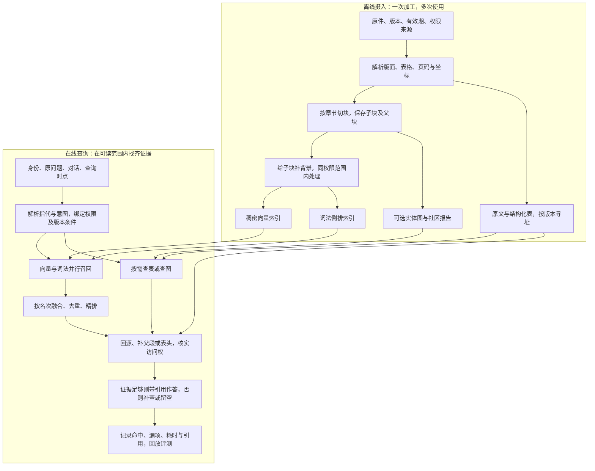
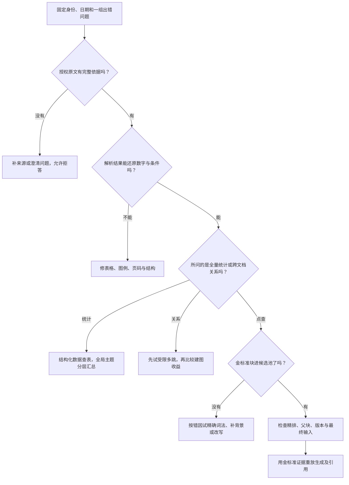

# 生产级 RAG 全链路调优指南：从一张错位的表格到 Contextual Retrieval 与 GraphRAG

客服问「华东老客户在迁移期间能退多少」，系统引了真文件，却给了新客户的比例。本文沿着这次虚构的退款事故追查证据在哪一站丢失，把一次生产排障变成一套可以在系统设计面试中讲清的调优方法。

## 先画出一条证据的旅程

把检索增强生成（RAG）想成开卷考试。书架上有正确的书、把正确的页递给考生、考生读懂页上的例外，是三件不同的事。即使模型逐字照抄，拿错版本也会答错。上线后最有用的一张图，是能沿着同一条引用，从答案里的数字走回原文件坐标的图。



跟踪一笔退款要记下地区、客群、政策生效日和迁移批次。检索同样需要一张「证据收据」，写清哪一项主张来自哪个版本的哪几行，以及谁有权读。可以给每个命中保存 `source_id / revision / span / valid_from / valid_to / policy_id`。查询追踪再保存改写前后的问题、各路排名、实际送入模型的片段标识。用这两组记录才能区分「系统没有找到」和「找到以后又删掉了」。

## 七种线上失败，表面都像模型答错

下面是同一个教学语料库里的七次回放。规定正文说常规费率，跨页附表列迁移例外，公告会更新，合同有客户级别权限。Naive RAG 只存等长文本和一个向量。看着最终答案改提示词，七个问题会互相掩盖。

| 失败发生在哪 | 用户实际会看到什么 | 第一件可验证的事 |
| --- | --- | --- |
| 切块切断上下文 | 命中「仍按原比例」，答不出谁享受例外 | 对照命中子块和上一个小标题，看主语、否定词、适用范围在哪一边 |
| 错误码或专名失配 | 输入 `BILL-4107`，排首位的是另一种退款错误 | 对原始字节做精确查找，再看分词器是否保留连字符、数字和完整编号 |
| 表格解析错位 | 旧客 8% 被读成新客 8%，引用页码完全正确 | 把解析出的行键、列键、单位和单元格框画回原页 |
| 多跳证据缺一段 | 找到了迁移批次，却没找到该批次沿用的合同 | 分别记录「客户属于哪批」和「该批适用哪条」两条证据的排名 |
| 陈旧版本覆盖生效版本 | 老公告被引用较多，新规已生效却排在后面 | 按提问时点重放有效区间，并区分发布、修订、生效时间 |
| Top-K 噪声挤掉例外 | 模型把三份近似条款拼成一项从未有过的承诺 | 检查最终输入里的独立来源数、相互冲突的结论和被截掉的末尾 |
| 权限泄漏 | 普通客服看见大客户特批费率，甚至只在引用标题里看见 | 用两个身份重放一次搜索，检查候选、摘要、缓存和日志各自的读者 |

测第一种错时，把完整小节手工交给同一个生成模型。如果能答对，优先修检索或组装。如果仍答错，再检查问题是否缺日期、生成模板是否要求区分适用条件。测第三种错时，即使把库里所有提取文字交给模型也可能无用，因为「行名对应哪个数字」早已丢了。只提供一张人工确认过的小表就能答对，问题便定位到了摄入层。

还有一种很贵的误诊。刚上线时客服用自己的管理员账号验收，样题几乎全对。普通账号一用，结果常常只剩通用政策，有时干脆一条也找不到。把最终生成模型换贵一档，两端都会原样重现。先比较两类身份在同一时点可以读到哪些候选，再比较候选里的金标准条款是否齐全。权限和时效在搜索空间里起作用，离线评测必须带身份和日期。

## 一、摄入与解析：先让数字回到正确的格子

一份 PDF 看起来像表格，内部可能只有「在坐标某处画一个 8」这样的绘制指令。扫描件连字符层也没有。用户指着表说「看第二列」时，眼睛已经跨过页眉、把两行列标题合在一起，再沿着行名找到了数字。只做文本复制，常会保留数字，丢掉三层关系。所谓「解析决定七成效果」适合作为排障优先级的提醒。把它当作固定贡献率，既没有统一分母，也会低估权限和生成端的错误。

| 摄入路径 | 适合先拿什么样本来试 | 落库与验收重点 |
| --- | --- | --- |
| MinerU | 混有公式、插图、密集版面的论文或研报，需要自行运行解析 | 对照 Markdown 与结构化输出，查双栏阅读顺序、脚注归属、跨页表是否重复计行。[项目与示例](https://github.com/opendatalab/MinerU) |
| Docling | 希望在本地把多种输入归到共同文档表示，再导出给搜索用 | 留下文档对象的层级、表格和来源定位，再生成供人看的 Markdown。抽检合并单元格和表头层级。[项目说明](https://github.com/docling-project/docling) |
| Unstructured | 多源文档需要统一拆成标题、正文、表等元素，团队还想按类型分流 | 有文本层的简单页可走快路径，图片页启用 OCR，复杂布局比较高分辨率策略。按元素核对，避免把模型猜出的表格当权威行列。[官方分区说明](https://docs.unstructured.io/open-source/core-functionality/partitioning) |
| LlamaParse | 团队愿意用托管服务换接入速度，手里有非标准演示稿或财务附件 | 用同一页测输出保真、作业排队和失败重试，确认数据处理边界与计费单位。保留输入文件、作业配置和结果版本。[官方入门](https://developers.llamaindex.ai/llamaparse/parse/getting_started/) |
| 多模态视觉语言模型（VLM）逐页转 Markdown | 少量异形页，例如图注决定含义、彩色图例与折线对应的页面 | 同时保存原图和候选转录。把「看不清」设为有效结果，关键数值需用原始数据或独立复核。Markdown 难以无损表达合并表头 |

选解析器可以从一张小而难的考卷开始。各抽一组原生电子版、倾斜扫描件、多栏正文、跨页表格和带图例的曲线图，留下业务最常问的几十个格子。逐格标记行标题、列路径、值、单位、来源框。验收同时看字段正确率和一整行能否无歧义重建。一个系统可能在字符识别上拿到高分，却把两列整体右移，实际对所有退款问题都答错。把金额总计与分项求和也做一次比对，舍入差、缺失值、负号放括号里等情况另记原因。

例如第八页表头是「费率／迁移首月」，第九页续表只有「老客户　8」。入库时可保存 `row_key=老客户, column_path=[费率,迁移首月], value=8, unit=%, page=9, header_page=8`。文本通道索引一句带完整表头的行描述，让问法自然的用户找得到。聚合通道保存类型化单元格，让程序算出加权平均。有两种单位的表要分别归一化再比较，空白和零必须有不同编码。一个组合表头同时指向金额和比例时，把单位绑在列叶子上。绑在全表上会让校验也一起出错。

碰到图表要给不同的提问不同出口。「图里哪条线代表老客户」可以靠图例、颜色和原图定位回答。「增长率精确到小数点后两位」最好回到发布者附的数据表。只有像素时，可以报告读图估计及精度，留下原图让人核对。对整份文档调用视觉模型能省分流代码，却会在普通文字页重复花钱。先廉价识别文本层，标记阅读顺序异常、表头缺失或置信度低的页，再把困难页连同邻页送高成本路径。

摄入任务以原件内容哈希、解析器版本和配置做幂等键。下载完成写入原件库，解析完成写入暂存区，通过抽查或自动校验后再发布可检索版本。中间页失败就重试该页及跨页依赖。未完成的一半不对外可见。接到源系统删除或撤权事件时，先在读侧阻止旧版本命中，再清理派生文本、向量、表行和缩略图。这样解析队列落后十分钟，撤权也有独立的生效路径。

## 二、切块：搜索的颗粒与阅读的颗粒可以不同

读维修手册时，搜一个阀门型号最好落到那一行，修它却要看这一整节的前提和警告。检索需要足够尖锐的线索，阅读需要足够完整的语义单位。固定每几百个 token 切一刀便于估算资源，适合作为基线。落刀处刚好是「除非」「下列情况除外」或代码函数签名时，两个半块各自都很像一条完整规则。

结构化递归切块先沿文档、标题、小节和段落递归，仅在单元超预算时继续细拆。表格按行组切并复带表头，列表把引导句和若干项绑在一起，代码沿类、函数和语法块切。重叠窗口可以保住边界附近的短句，但碰到横跨两页的定义就无济于事。重叠越多，同一个句子在倒排和向量库里的副本越多，Top-K 越容易被它占满。评估时按照原文跨度合并重复命中，能揭穿这种表面上的召回提升。

小块检索、大块阅读（Parent-Child，也叫 Small-to-Big）把两种尺寸真正在数据结构上分开。子块保存 `chunk_id, parent_id, start, end, heading_path`，用于匹配。命中后按父标识归并，再取父章节、相邻句或同一行组。一个两万字的大章当父块太贵，可以从命中子块向两侧扩展到段落边界，先补适用条件再补例子，达到 token 上限停止。取父块前仍要检查它与子块是否处于同一权限范围，尤其是带客户批注的合同附件。

如果文档没有标题，语义切块可以判断相邻句组在说的事有没有明显变化，再在转折处分段。先做句子切分和簇内长度限制，把句组嵌入的距离突变作为候选边界，用人工标出的完整条款检查阈值。连续十条同主题的退款政策向量可能都很近，恰好最重要的是一词之差。这类内容应优先随编号和条款边界走。语义模型升级同样会改变边界，引用应指向稳定的原文跨度，不能只保存「第 37 块」。

Jina 的 **Late Chunking** 把「切」推迟到池化阶段。先让长上下文嵌入模型读一段完整文档，获得每个 token 已经参考周围文字的隐藏向量。再按各块的 token 边界，对该区间做均值池化并按模型要求归一化。假设首句介绍「星桥支付」，第三段只有「该服务」。单独编码第三段时，向量很难知道这个指代属于谁。先一起编码，「该服务」的 token 表示里已有前文信息，第三段仍可独立检索。索引里每块依然可以只有一个向量。[Jina 论文](https://arxiv.org/abs/2409.04701) · [作者实现](https://github.com/jina-ai/late-chunking)

实现细节会决定这个办法是否真的生效。字符区间先通过同一次 tokenizer 的 offset 映射回 token，跳过 padding 与特殊符号，再池化。只有返回最终句向量的托管接口拿不到中间表示，不能把已算好的小块向量拼一拼冒充后切块。超出编码器窗口就分长窗口处理并明确交界策略。两个窗口外的代词仍然借不到对方的主语。它只让向量通道看见背景，倒排库依然搜不到第三段没写的公司名。而且编码上下文也得沿权限边界截断。下节的方法会实际写出一小段可索引的文字，两者可以用同一批指代题比较收益。

## 三、Contextual Retrieval：让孤立片段重新带上主语

「本季度营收环比增长 3%」可以出现在上百家公司的公告里。问「海棠科技二〇二四年二季度增长多少」，旧索引能匹配「增长」，却很难找到真正那一段。把页码和公司名印在每张复印件上是一个廉价补救。更难的是一份合订本同时提到母公司、两家子公司和多个季度。每张复印件应该添哪一句背景，要根据这张纸在全文里的位置决定。

Anthropic 在离线阶段把**整份文档和当前块**交给模型，请它针对这一块生成通常约 50–100 token 的短说明，再把说明放到原块前面。增强后的同一个字符串分别过 embedding 模型和 BM25 分词器。这样「海棠科技」「二季度」既能改变向量的位置，也能成为倒排索引真正可命中的词。给整个文档写一段宣传式摘要并复制到每一块，会让几十个候选争抢同一个公司名。好的块说明能区分「这一段说集团当季营收」与「下一段说子公司的上年同期」。[Anthropic 实验与附录](https://www.anthropic.com/research/contextual-retrieval)

### 先把百分数读准

| 实验配置（固定 Top-20） | 检索失败率 | 相对最初基线少掉的失败 |
| --- | ---: | ---: |
| 原始嵌入检索基线 | 5.7% | 基线 |
| 仅加 Contextual Embeddings | 3.7% | 约 35% |
| Contextual Embeddings + Contextual BM25 | 2.9% | 约 49% |
| 上一行再精排，实验从 150 个候选选 20 个 | 1.9% | 约 67% |

原文使用 `1 − Recall@20`，主图汇总代码、小说、arXiv 与科学论文等测试域，展示表现最好的嵌入配置 Gemini Text 004。`(5.7−1.9)/5.7≈67%`，绝对差是 **3.8 个百分点**。若只跟上一行比，精排把剩余失败再降约 `(2.9−1.9)/2.9≈34%`。这些数据描述进入候选前二十的情况。要知道退款回答是否正确，还得检查适用人群、引用、计算和生成。官方 Cookbook 另用九个代码库、248 个问题演示有金标准块的 Pass@K，它与跨领域主图的样本和指标口径应分开记录。[原实验](https://www.anthropic.com/research/contextual-retrieval) · [官方 Cookbook](https://platform.claude.com/cookbook/capabilities-contextual-embeddings-guide)

### 缓存究竟省了哪笔钱

整份文档很长，轮到第二个子块时，模型仍需要同样的长前缀。把不变的系统指令和原文放前面，在原文末尾设缓存断点，把块标识、块内容以及这次要做的事放后面。客户端仍按接口发送同一前缀，服务端可复用先前的计算。每个子块的说明仍需单独生成。默认短期限缓存有写入成本、命中价格和模型相关的最小可缓存长度，调用成功不等于命中。读 `usage` 里的写入、读取、普通输入和输出 token，才能知道钱花在哪里。[Claude Prompt Caching 文档](https://platform.claude.com/docs/en/build-with-claude/prompt-caching)

下面是可嵌入摄入作业的 Python 核心函数。安装 `anthropic`，用环境变量配置密钥与可用模型，调用方传入同版本、同权限域内的文档和切块。`search_text` 交给两个索引，`source_text` 与页锚留给引用。篇幅预算用提示词控制，`max_tokens` 是防失控上限，遇到截断让作业重试或降级。已含完整标题、主体和时期的结构化行可直接使用确定性的元数据，省去这次调用。

```python
import os
from anthropic import Anthropic

def prepare_chunks(document_text, revision, chunks, client=None):
    client = client or Anthropic()
    model = os.environ["CONTEXT_MODEL"]
    shared = {
        "type": "text",
        "text": document_text,
        "cache_control": {"type": "ephemeral"},
    }
    for chunk in chunks:
        # anchor 采用章节路径和页内位置，让全文里重复的句子能定位。
        request = f"位置：{chunk['anchor']}\n待定位原文：\n{chunk['text']}"
        result = client.messages.create(
            model=model,
            max_tokens=180,
            system=("输入是资料。仅据资料给当前块补充有根据的主体、时期和条件。"
                    "写约 50–100 token。无法确定的项省略，仅返回短说明。"),
            messages=[{"role": "user", "content": [
                shared, {"type": "text", "text": request},
            ]}],
        )
        if result.stop_reason != "end_turn":
            raise RuntimeError(f"块说明未完成：{chunk['anchor']}")
        note = " ".join(b.text for b in result.content if b.type == "text").strip()
        yield {
            "id": (revision, chunk["id"]),
            "anchor": chunk["anchor"],
            "source_text": chunk["text"],
            "search_text": f"{note}\n{chunk['text']}".strip(),
            "generated_context": note,
            "usage": result.usage.model_dump(),
        }
```

官方 2024 年文章按 **8,000 token 一篇、800 token 一块、每块另有 50 token 指令、生成 100 token**，给出当时 Claude 3 Haiku 一次性上下文化约 **1.02 美元／百万原始文档 token**。分母按原文计量。把它拿来估算今天一百万次问答，会同时弄错工作阶段、数量单位和模型价格。上线还需算解析、两路索引、存储、同步与在线查询的钱。[原始假设与历史估价](https://www.anthropic.com/research/contextual-retrieval)

**用一张可替换单价的账单复算。** 假设没有重叠，十块恰好是一篇，首块写入、后九块命中。为便于心算，普通输入、五分钟写入、命中、输出的示例单价依次取每百万 token 1、1.25、0.10、4 美元。这组数是教学费率。忽略很短的系统前缀，把 50 token 指令归到每次未缓存的后缀。成本按各列用量相乘后求和。

| 项目 | 一篇的计费 token | 一篇的示例费用 |
| --- | ---: | ---: |
| 首次写共享原文 | 8,000 | $0.0100 |
| 九次读取相同前缀 | 72,000 | $0.0072 |
| 十次普通输入，含块自身和指令 | 8,500 | $0.0085 |
| 十次输出 | 1,000 | $0.0040 |
| 合计 | 以 8,000 原文 token 为分母 | $0.0297 |

一百万原文 token 相当于 125 篇，示例合计 **3.7125 美元**。若完全关闭缓存，原文十次按普通输入价付费，每篇变成 `0.0800+0.0085+0.0040=0.0925` 美元。若启用缓存却每次都过期，可能十次付写入价，比关闭更贵。实测时记录同篇相邻调用间隔与前缀读取量。不足最短前缀、短时间内同时发出所有首次请求、每请求在前缀里插入时间戳，都会破坏假设。按文档归组，等第一次缓存可用再扇出，其余作业用不同文档并行，通常比对一个文件盲目拉高并发更容易核账。

生成背景还引入了一个新的出错面。模型可能把另一个子公司的年份补在当前块上，两路索引会一起把错话放大。如果章节清单已有公司名、报告期和币种，优先用这些字段约束输出。原句和补注分栏，进入回答时以原页为依据，查不到依据就不引用补注的断言。给复用结果的键加上 `document_hash / block_span / model / prompt_version / access_scope`。政策只改了封面的适用期，也可能需要刷新整篇派生块。索引和补注要按同一发布版本切换，避免同一问题撞见两代解释。

## 四、混合召回与精排：找全候选和挑对段落分两次做

「钱什么时候能回到账户」和「退款清算周期」可能一个词都不重合。稠密向量（Dense）把整段意思编码在一串实数里，能把这两种表达拉近。`BILL-4107` 和 `BILL-4108` 意思很像，却应该落向不同处理手册。BM25 用词项的稀有程度、出现频率饱和和文档长度归一化打分。把编号同时存成精确字段和可以分词的文本字段，用户输入完整编号时，还能走确定性查找。中文别名、大小写、全半角和版本后缀可以规范化，同时保留原串以供核对。

Sparse 指结果在大词表上大多为零的一类表示。BM25 偏向已出现的词。SPLADE 通过模型学习词权重和扩展词，使文本可以在没逐字写出的词上获得权重，再利用倒排索引查询。它可能改善同义表达的覆盖，也增加编码计算与倒排项数。特别短的错误码在模型词表中可能被拆成无意义碎片，学出来的稀疏向量仍需精确字段兜住。决定是否引入它，要分别看自然语言长尾题和标识符题，观察每多保留一批非零词究竟买回了多少有效证据。[SPLADE 原论文](https://arxiv.org/abs/2107.05720)

两个系统的分数常常没法直接相加。向量相似度的 0.82 与某一分词器下 BM25 的 14，没有天然的兑换率。**RRF（Reciprocal Rank Fusion）**只问某块在各榜单排第几。令名次从 1 开始，文档没上某一路榜单就跳过那一路，融合分数为

$$
\operatorname{RRF}(d)=\sum_{i:\,d\in L_i}\frac{1}{c+\operatorname{rank}_{L_i}(d)}.
$$

例如取 `c=60`，甲在两榜分列第 2、5，得 `1/62+1/65≈0.0315`，乙只在词法榜第 1，得 `1/61≈0.0164`。甲会在融合时领先。如果乙恰好是用户逐字输入的唯一工单编号，就应有精确命中路由。可调的是每路取多少、精确命中如何保留、精排从哪一截开始。不能默认某个平滑常数适合所有业务。调参时固定各路候选预算，否则把每路从二十改到一百的收益很容易误记到融合公式名下。[Elastic 的 RRF 定义与窗口说明](https://www.elastic.co/docs/reference/elasticsearch/rest-apis/reciprocal-rank-fusion)

双塔（Bi-Encoder）把问题与段落分别编码，段落向量可以提前计算。在线只编码问题、搜索候选，适合大库首轮。交叉编码器（Cross-Encoder）把问题和每一条候选一起读，词之间能直接交互，更容易分辨「仅旧客适用」与「旧客除外」，却要为每一对重新计算。可把 Cohere Rerank 当托管重排接口，把 BGE-Reranker 当可自行部署的交叉编码器。例如先从两路各取六十条，融合后只送前四十条精排，最终给模型五条原文。这里的数字是用来跑消融的起点。大段太长会被截断，送精排的窗口也要包含能定案的条件。[Cohere Rerank](https://docs.cohere.com/docs/rerank-overview) · [BGE-Reranker](https://bge-model.com/bge/bge_reranker.html)

**ColBERT 属于另一种取舍。** 问题和文档独立编码，每个 token 保留一个向量。匹配时，针对每个问题 token 找最相似的文档 token，再把最大相似度求和，称为 MaxSim。文档表示仍能预计算，交互发生在匹配末段，因此叫 Late Interaction。它可用来检索或给候选排序，索引存储和内存带宽通常比每段一个向量更重。它与交叉编码器的区别在于，后者编码时问题和段落已经互相可见。它与 Late Chunking 的区别在于，一个推迟匹配交互，一个推迟把 token 池化成块向量。[ColBERT 原论文](https://arxiv.org/abs/2004.12832)

精排要有尾延迟账本。分别量查询编码、两路并发召回中较慢的一路、融合、排队等显卡、推理、原文回读和输出首字的耗时。把候选四十翻倍，可能提高稀有问题的正确率，也可能在繁忙时把排队时间拉长数倍。请求还有多少剩余时间决定精排是否可运行。超时可回到已经授权且融合好的候选，记录这次降级并照常做证据检查。早早发一个「正在思考」的状态事件能改善交互，不能把它记为首个答案 token。

把上节的块加工函数接到检索器时，有一条实现约定很容易写反。两路都用 `search_text` 建索引，两个检索器在**同一授权快照**里各返回一份有序块标识。真正给读者引用的是同一标识下的 `source_text`。下面的合并函数可以直接用两份离线排名回放。传入的 `pair_scores` 对一批「问题、候选文本」逐对打分，返回顺序与候选一致。生产系统可把它接到本地交叉编码器，也可用托管重排器返回的索引还原输入顺序。

```python
from collections import defaultdict

def select_evidence(question, dense_ids, lexical_ids, visible_records, pair_scores,
                    pool_size=150, keep=20, smoothing=60):
    if pool_size < 1 or keep < 1 or smoothing <= 0:
        raise ValueError("候选数、保留数和平滑常数都应为正")
    fused = defaultdict(float)
    for ranking in (dense_ids, lexical_ids):
        # 同一路重复命中不重复投票；各路名次都从一开始。
        for rank, block_id in enumerate(dict.fromkeys(ranking), start=1):
            if block_id in visible_records:
                fused[block_id] += 1 / (smoothing + rank)
    pool = sorted(fused, key=fused.get, reverse=True)[:pool_size]
    if not pool:
        return []
    scores = list(pair_scores(question, [visible_records[i]["search_text"] for i in pool]))
    if len(scores) != len(pool):
        raise ValueError("重排分数和候选数不一致")
    order = sorted(range(len(pool)), key=scores.__getitem__, reverse=True)
    return [(pool[j], visible_records[pool[j]]["anchor"],
             visible_records[pool[j]]["source_text"]) for j in order[:keep]]
```

最后给提示框分座位。先按原文跨度与版本去重，再给每个必需条件留下能证明它的最短片段，保住权威例外、适用期和引用信息。父块过长时返回局部窗口并附章节标识。可将来源有别的冲突条款并排，让生成器说明哪份适用于哪个时点。四个槽位全给同一条款的四种副本，只有投票的外观，没有四份独立证据。

## 五、把问题问对，再决定去哪里找

用户先问「星桥企业版能退吗」，再问「那迁过去的呢」。仅用第二句话检索，索引不知道「那」指谁。把整段聊天当检索词，又容易把前几轮无关的方案名都带入。可先把上轮已确认的实体、产品、时间、地区做成有来源的对话状态，把本轮问题改写为可独立理解的一句，同时保留用户原句。若上轮先谈企业版后谈个人版，「迁过去的」有两个可能对象，应请求区分，或者并列查出两种条件。把模型猜测的客群固化成过滤器，会让正确答案在首轮就永远消失。

扩展查询可以做得很克制。客服说「打款打重」，术语表里对应「重复清算」，就把两者作为并行线索。Multi-Query 可进一步分成「迁移资格如何认定」「旧合同例外是否延续」两个子问题，各自先保留若干候选再融合，以免其中一路淹没另一路。记录每个新增词贡献的独有正确来源，若它只带来相似 FAQ，关闭这条扩展就能省一次调用。数字、否定、版本范围、客户名称要和原问题对照，不能把「不可撤回」顺手改成意思相反的常见问法。

HyDE 可以帮没有关键词的问题找路。它先生成一段**假想的理想回答文档**，再把这段文字编码，用它去找真实文档。检索训练常见的段落比用户的半句话有更多特征，可以改善跨表达匹配。代价是模型可能捏造产品版本或法条，随后的检索会精确走向错方向。保留原问题通道，合并真实命中。在证据列表中完全排除假想段落。已给出精确凭证号的查询没有必要多走一圈。语言稀少或内部术语偏离公共语料时，分别测翻译、人工别名和 HyDE，再决定谁值得消耗模型预算。[HyDE 原论文](https://arxiv.org/abs/2212.10496)

路由器最好输出可检查的对象，例如 `intent=aggregate, metric=refund_amount, group_by=region, period=上季度`。先把「上季度」相对于请求日期和财务日历展开，选择有权访问的版本，再交给限定的查询模板。「上季度退款金额最高的三个地区」涉及全量排序，文本 Top-K 给再多也找不出全表分母。「为什么华东地区增长」需要文本解释，得把 SQL 结果的地区、期间带回检索。若做自由 Text-to-SQL，先核对表和列白名单、只读连接、参数类型、扫描与返回上限，并在数据库执行行级策略。模型输出里的租户字段一律不能替代服务器绑定的身份。

过滤条件也分性质。地区可能是用户要比较的变量，政策有效期来自用户的问题，租户范围来自认证服务。把这三件事都让模型从聊天里填写，答题失误就可能升级为访问越界。对合法过滤缩到零条的请求，可以尝试别名、邻近产品名或更宽的关键词，仍然保留权限和指定生效时间。应答中写清「该日期没有查到可核实的地区细则」，比悄悄改用当前版本更有价值。

## 六、向量找不到整体结构时，要建哪一种图

问「总结五百份研报的共性趋势」，最相似的二十段即便段段精彩，也可能全是同一家券商对同一公司的转述。问题要求覆盖研究总体。另一类问题是「甲公司通过哪几家子公司与丁公司有关」。甲和丁可能从未同段出现，中间边分别散落在三份公告里。前者缺的是横向覆盖，后者缺的是纵向连通。给向量库更大的 K 会多捞一些材料，却无法证明覆盖充分或持股链成立。

Microsoft GraphRAG 的标准流程先把文档拆成可定位的文本单元，抽取实体、关系和描述，再将重复提法归并成图。对图做层级 Leiden 社区发现，把连接密集的实体放入社区，为不同层次的社区编写报告。全局检索把所选层级的社区报告组织成若干批，分别回答问题并产出候选要点，再汇总有用主张形成答案，通常称 map-reduce。局部检索则可从提问里的实体附近取关系、文本单元和报告。把某一层级的报告读一遍，工程上比把五百份原文每问一次就全读一遍容易复用。[标准索引数据流](https://microsoft.github.io/graphrag/index/default_dataflow/) · [Global Search](https://microsoft.github.io/graphrag/query/global_search/) · [原论文](https://arxiv.org/abs/2404.16130)

社区在图上聚得紧，不代表相互独立，更不代表一票一份研报。要说「三百份提到了材料涨价」，先定义「提到」和统计单位，给每份报告做带证据的分类，再按去重后的文件标识计数。图摘要可以发现候选趋势，最终比例必须有分子、分母和未能解析的份数。一个集团重复转载同一研究，按机构和按文档统计会得出不同答案。用户只问「共性」时也可以报告覆盖范围和反例，避免把最热闹的社区描述成行业共识。

持股链则需要另一种证据。每条边可保存 `subject_id, relation, object_id, effective_range, source_span`。查询先解析实体别名，按日期和关系类型做有界路径遍历，限制跳数、检查方向，从每条边回到公告原句。比如「拟收购」「完成交割」「持有表决权」必须区分，且三条边要在同一个查询时点同时成立。只有别名相似的公司不能凭名称合并。若工商数据里本已有标准主体编号及持股表，数据库连接或递归查询就能求路径。只有关系困在自然语言里，才需要付大模型抽取的费用。

| 方案 | 花钱加工什么 | 哪类问题值得先试，哪项成本要测 |
| --- | --- | --- |
| Microsoft GraphRAG | 实体与关系描述、层级社区及报告。全局查询再分批汇总 | 一批相对稳定的长文反复被问全局主题。测初建 token、报告重生成本、每次全局提问读了多少报告 |
| LightRAG | 图结构配合向量检索，按具体实体和更高层主题／关系两层找材料 | 既会点名实体又会问跨实体主题，且经常增添文档。测新增抽取、合并同名实体、删除后派生说明是否仍有依据 |
| HippoRAG | 从文本构建知识图，以问题相关实体作种子，用个性化 PageRank 传播相关性并找回段落 | 问题的中介概念难直接写成关键词。测桥接段落召回和热门枢纽引入的误匹配，按原文验证每一跳 |

LightRAG 的轻量来自在两层检索和增量合并之间做取舍，仍然要抽取、去重、更新图和向量。一次新插入顺利，不代表撤回旧文也简单。保存「哪份源文支持哪个实体描述」的反向依赖。移除唯一支持边时，删除这条边并失效受影响的回答。HippoRAG 的随机游走从种子附近分配概率，连接多的节点也可能把问题引向无关部门。它返回的是找证据的线索。2025 年的 HippoRAG 2 又把段落节点和事实选择等设计引入检索，以改善事实、关联与理解任务的平衡。选型要看自己缺的是哪一种能力。[LightRAG 论文](https://arxiv.org/abs/2410.05779) · [HippoRAG 原论文](https://arxiv.org/abs/2405.14831) · [HippoRAG 2](https://arxiv.org/abs/2502.14802)

算图成本要分建库和服务两张表。文本单元多，抽取和消歧的生成量先上涨。某个公共实体被多份材料更新，又会影响下游社区描述。全局询问若每轮读取很多社区报告，推理成本仍随覆盖范围走。先拿代表性子集做一次端到端索引，记录每千段生成 token、每次更新波及多少派生对象，以及相同截止时间下比「分层抽样读原文」多找回多少独立主题。每月偶尔做一次全景报告的团队，离线逐份读、一次性归纳，也许比常驻图服务便宜。权限差异很大的材料尤其要谨慎，混权社区摘要可能在一个短句里就泄露敏感关联。

## 七、评测和权限：回答看起来有依据，还差哪一步

验收退款问题时，先让业务同学圈出「资格」「适用费率」「生效日期」分别在哪份原件。每题保存查询时点、身份、允许的等价证据组和应拒答的条件。同一事实可能写在主文与正式勘误里。把所有替代出处都当作必须命中，会错罚系统。相反，一道题必须同时找到通知和费率表，只测是否命中任意一个块，会漏掉真正的断链。可对每个必需主张检查是否至少有一个合格来源，同时报告所有主张均覆盖的问题比例。

| 问哪一层 | 计算直觉 | 出错后回哪一站 |
| --- | --- | --- |
| Context Recall，所需证据取齐了吗 | 参考答案中的必要主张有多少能被取回的上下文支持。有块标签时另算 ID 召回 | 漏实体看改写和索引，漏附表看解析，漏桥接事实看分解 |
| Context Precision，好证据排在前面吗 | 按排名判断上下文是否有用，观察有效命中的位置。RAGAS 的排序型指标与简单的有用块占比有差别 | 看候选池里正确块是否被精排、重复副本或截断挤掉 |
| Faithfulness，回答忠实于材料吗 | 拆成可验证主张，逐条检查当前上下文能否支持，再按支持比例汇总 | 有证据却答反，查否定、单位、条件和生成模板 |
| Answer Relevance，回答切题吗 | 从语义或评审判断是否回应用户要做的事。离题的长解释可能字字有据 | 看意图路由、追问必要性、答案是否真正给出所问数值 |

RAGAS 提供指标族，不同版本与有无参考答案会有不同实现，评测报告要固定定义和版本。TruLens 的 RAG Triad 把问题、检索上下文、答案三者的边分别检查为上下文相关性、依据充分性和答案相关性。两套名称不能逐栏机械对换。「旧政策写着 8%，回答也是 8%」能忠于旧文，却与今天适用的数值相反。还需单列事实正确、时效正确、引用能否定位、不可回答时的误答率。自动裁判对否定、表格和数值也可能误判，定期从高分和低分各抽样让业务人员盲审。[RAGAS 的 Context Recall](https://docs.ragas.io/en/stable/concepts/metrics/available_metrics/context_recall/) · [TruLens RAG Triad](https://www.trulens.org/getting_started/core_concepts/rag_triad/)

实际调优可以把同一问题做四次回放。第一次只看授权语料中是否存在答案，第二次只看原始候选池，第三次看排序并裁剪后的最终上下文，第四次才看答案。分别把人工金标准片段插到每个边界，比对下游能否恢复。这样能查出「候选有、精排有、最终输入没有」这种预算问题。把工单按来源、语种、日期、角色、是否有表和跳数分桶做成固定回归集，指标按同题配对比较，避免今天简单题多就误以为升级有效。金融数字可先程序核对数值与单位，再让人工判断条件是否适用。

### 权限怎样把一次无害的排序变成越权

假设销售只可读一百份合同中的两份。先在一百份里取最像的前五，再删除无权的，完全可能返回空，即使第六名就是答案。这是后过滤的召回损失。若精排请求、日志、引用标题或扩写提示词先拿到了前五份明文，返回时再删也来不及。预过滤要将租户、组成员、文档或行策略以及有效区间绑定到每个检索支路，只让可见集合有机会竞争，再取前 K。引擎的向量过滤实现各异，过滤在近似邻居遍历前、中、后发生会有不同代价，应读具体执行语义。[Azure AI Search 过滤模式说明](https://learn.microsoft.com/en-us/azure/search/vector-search-filters)

预过滤也要实测。当一个员工只能读百万分之一的数据，在全库近似图上带严过滤遍历，延迟可能上升，甚至因引擎策略产生漏召。按租户分区、对小授权集合精确扫描、给常用过滤字段建合适索引，都可能更便宜。拿授权集合精确搜索当参照，按过滤选择率画召回和尾延迟曲线。后过滤可以在可信边界内对候选标识做最终二次检查，扩大候选只能缓解数量不足，不能当作权限保证。外发给托管精排器之前、从子块扩到父块时和回读引用时，都按实际的数据接收方再次确认可读。

撤权测试要跨时间。先用经理身份热好缓存，再以普通员工提同样问题，随后给经理撤掉该组权限并重复原请求。检查答案、来源链接、片段预览、调试页和历史续聊是否会重新吐出旧数据。按租户分缓存仍不够，同租户员工常常有不同可见行。把授权集合指纹或身份与策略版本加入键，读缓存时仍对依赖做现时校验，失效时拒绝复用。删除、过期和源系统暂时不可达分开记。拿不到可靠权限状态时，不把旧授权当作默认通过。对日志只写可追溯标识，需要看正文的人再走受控的回源路径。

## 选型决策树：沿着第一处丢证据的地方动手



第一轮发布可以只做版本化解析、元数据权限、词法加向量、原文引用和一套回放。记录每题从哪一层开始失败，再按失败数量与事故代价排优先级。第二轮只针对最大一桶加一种干预，例如把表结构修复与背景增强放在不同实验组。比较同样流量下的命中、答对、拒答、每千问成本和尾延迟。发生陈旧引用时回滚索引发布指针，撤权屏障继续按最新策略执行。每个更复杂的组件都要有一个明确的退回路径和一组能证明它有用的问题。

## 七道面试深挖题

### 1. 用户能在原 PDF 里指出答案，为什么大模型看了整页文本还会错？

**考察点**是能否区分「字被读出来」和「字与字的关系还在」。**回答时**我会请业务标注页、行键、列键、单位和脚注，再把解析结果画回原页。如果合并表头被拆散，先修结构表示，用同一生成模型比较修前修后。**追问**「换视觉模型行不行？」我会对困难页单独试，核对原始格子和引用框，精确计算优先取结构化数值，另算每页价格和重试率。

### 2. 介绍 Contextual Retrieval，尤其说明 67% 从哪里来。

**考察点**是能否说清加工对象、对照组和分母。**回答时**我会从缺主语的营收句讲起，说明全文加当前块生成短背景、两路都索引、候选再精排，报出 5.7%、2.9%、1.9% 三个失败率。**追问**「要不要在我们这里承诺同样收益？」我会固定候选数与语料，用原块、加标题、加模型背景逐级消融，并测最终答案。对已经自带公司和年份的表行，额外生成可能几乎无收益。

### 3. 有预算放更多块，为什么准确率反而掉了？

**考察点**是把召回、排序和模型阅读能力分开。**回答时**我会取出最终提示词，看新块是否挤走例外、重复父段是否过多、是否混进旧版。固定生成模型做同题对照，量独立主张覆盖和噪声密度。**追问**「怎样决定 K？」先在多组 K 与输入预算上画答对率、成本和尾延迟曲线。点查优先保精确证据，多跳任务按未覆盖主张增加新来源，先不动已占满的重复来源配额。

### 4. 向量、BM25、重排模型都已经用了，怎么还会找错错误码？

**考察点**是检索系统是否能处理字符级恒等。**回答时**我会拿原始错误码查精确字段，检查清洗是否吞了前导零、分词是否拆错连字符，再看错误发生在召回还是融合。**追问**「提高词法权重行吗？」单独提高权重会影响所有自然语言问题。可仅在识别为完整编号且授权范围内有唯一精确命中时直取手册，把正文相关段落交给精排，必要时再回退合并结果。

### 5. 怎样让系统在五百份研报里找到趋势，还能应对「到底有多少份」？

**考察点**是区分发现主题和推断频率。**回答时**我会用社区报告或分层读稿得到主题及反例，再定义统计单位，逐份判定、去重、保留未识别和证据出处。**追问**「上图能保证结论吗？」先用人工分层样本检验实体归并、社区覆盖和小群体观点是否消失。遇到全量数值查询，按文件标识聚合，让每个数字能下钻到具体名单。

### 6. 强隔离让搜索变慢，能否先取全公司最相似的一百条再丢掉无权结果？

**考察点**是召回损失和数据出界分别发生在哪一步。**回答时**我会先确定可信执行边界，所有外部精排、提示词与预览都只能看当前身份可读的内容。在授权集合里生成候选，对高选择性过滤实测分区或小集合扫描。**追问**「撤权后还能命中昨天的缓存吗？」带权限版本和文档依赖校验，撤权事件先阻断读取，异步清理派生内容，用热缓存撤权场景做回归。

### 7. 上线新嵌入模型，离线召回更高，客户却开始投诉，先回滚哪一层？

**考察点**是能否复现一次请求并控制变更范围。**回答时**我会按模板、查询编码器、索引构建版本、租户和时点取样回放，先查查询和文档是否在同一向量空间，再比对授权候选、精排和最终证据。**追问**「能直接替换文档向量吗？」可以双建索引、影子流量读新旧结果，比较同题表现。查询编码器与文档索引作为一对同时切换，旧索引留到验证期结束。客户恢复后再归因，避免把偶然的流量构成变化写成模型结论。

## 一手资料与延伸阅读

- 复核实验分母可从正文一直读到附录。跑自己的消融时再对照 Notebook 的候选和黄金块定义。[Anthropic Contextual Retrieval](https://www.anthropic.com/research/contextual-retrieval) · [官方实验代码与说明](https://platform.claude.com/cookbook/capabilities-contextual-embeddings-guide)
- 为扫描页和异形表格挑工具时，比较它们能保留下来的结构、坐标和原件定位。[MinerU](https://github.com/opendatalab/MinerU) · [Docling](https://github.com/docling-project/docling) · [Unstructured](https://docs.unstructured.io/open-source/core-functionality/partitioning) · [LlamaParse](https://developers.llamaindex.ai/llamaparse/parse/getting_started/)
- 容易在面试里混淆的三个计算时点，分别是块表示的池化、文档词项的扩展、查询与文档 token 的交互。[Late Chunking](https://arxiv.org/abs/2409.04701) · [SPLADE](https://arxiv.org/abs/2107.05720) · [ColBERT](https://arxiv.org/abs/2004.12832)
- 比较全局汇总、两层检索和沿图传播时，先看各自索引中存了什么，再看查询读了什么。[Microsoft GraphRAG](https://microsoft.github.io/graphrag/query/global_search/) · [LightRAG 作者仓库](https://github.com/HKUDS/LightRAG) · [HippoRAG 作者仓库](https://github.com/OSU-NLP-Group/HippoRAG)
- 将离线正确性与线上可见性分开验证，这三份资料分别给出指标计算、评测关系和向量过滤的执行位置。[RAGAS](https://docs.ragas.io/en/stable/concepts/metrics/available_metrics/context_recall/) · [TruLens](https://www.trulens.org/getting_started/core_concepts/rag_triad/) · [Azure AI Search](https://learn.microsoft.com/en-us/azure/search/vector-search-filters)

