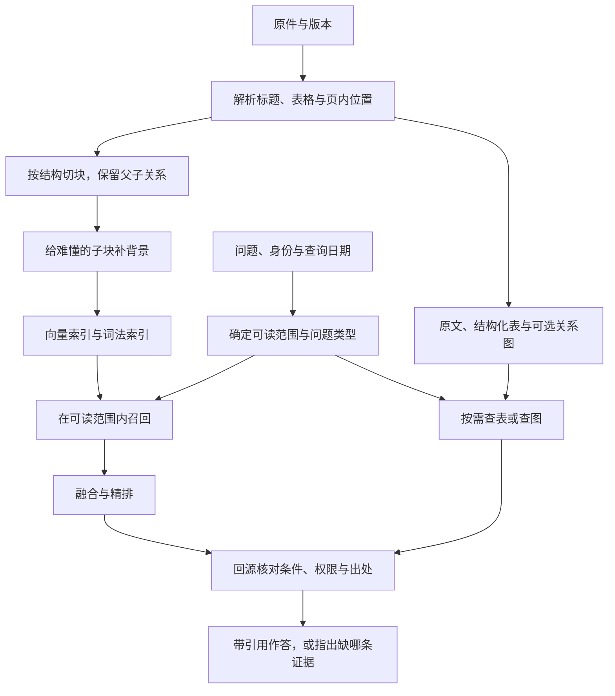

# 生产级 RAG：从 PDF 里的一个数字，追到答案里的那句引用

> 给模型一页写着「8%」的原文，它还是可能答错。做 RAG，我会沿着这个数字往回查：它属于哪一列、对谁生效、为什么排进前五、提问的人能不能看？这条线也能串起一场系统设计面试。

## 先看全貌：一条引用怎么走到用户面前



检索增强生成（RAG）就是先找资料，再请模型根据资料回答。最简版 Naive RAG 的做法是：把资料切成小段，每段算一个向量，提问时找最相近的 K 段，一起交给模型。用它做第一版很合适：出错时，你手里有一条很短、可以逐站检查的路线。

我会让每个块带上原件 ID、版本、页码或原文范围、生效区间、权限策略 ID。查询时再记下原问题、改写、各路名次和最终入窗的块。用户点开引用能看见原句，开发者也能找回那条原句曾经排第几。

### Naive RAG 的七个翻车点

| 哪一步坏了 | 在答案里是什么样 | 打开哪样东西最容易看懂 |
| --- | --- | --- |
| ① 切断上下文 | 命中「仍按原比例」，说不清谁适用 | 打开上一段，看小标题、主语和「除外」在哪一侧 |
| ② 错过精确词 | 查 `HTTP_401`，拿到另一种鉴权错误 | 查原串和分词结果，看下划线、大小写、数字是否保留 |
| ③ 表格错位 | 页码对、数字对，列名错 | 在原页上框出行名、列头、单位和格子 |
| ④ 多跳只找到一跳 | 找到版本说明，却没查到服务实际运行的版本 | 分开标记「部署版本」和「该版本的行为」 |
| ⑤ 命中过期版本 | 用户问上月的规则，回答引用今天的手册 | 回放提问时点，区分发布日期、修订日与生效日 |
| ⑥ Top-K 塞进太多近邻 | 五段话都说常规规则，唯一的例外被挤走 | 看模型实际收到的文本，按原文位置去重 |
| ⑦ 候选越过权限边界 | 正文没露，补全提示或引用标题先暴露了客户名 | 用两种身份查同一句，连缓存、日志、片段预览一起查 |

**最快的定位法**：手工把正确的段落和表头交给同一个模型。能答对，就去找检索链上第一处丢证据的地方。还答错，再看原文是否缺条件，模型有没有看反单位、否定词。换模型之前，这个实验就能缩小排查范围。

## 文档解析：先问这个 8 属于哪一列

PDF 把文字画在坐标上。人眼会自动跨过页眉，把「迁移首月」接到「费率」下面，再往左找这一行的客户类型。复制成纯文本后，数字还能搜到，三者之间的关系可能已经消失。扫描件还多一道 OCR。

| 手里的资料 | 我会先试什么 | 第一轮抽查 |
| --- | --- | --- |
| 双栏论文、公式、复杂版面 | MinerU | 阅读顺序、公式与图注、跨页表是否重复计行 |
| 格式混杂，需要本地统一解析 | Docling | 从文档对象导出标题树、表格、来源坐标，再导出 Markdown |
| 大量简单页夹少量难页 | Unstructured | 简单文本用快路径，图片页走 OCR，复杂版面试高分辨率策略 |
| 想快速接入托管解析 | LlamaParse | 用同一批难页比保真度、作业重试、数据去向与按页成本 |
| 图例、颜色或异形版面决定含义 | 视觉语言模型逐页读图 | 留原图，允许识别不出。要精确数值，优先找发布方数据表 |

拿跨页表做验收很直观：第八页有列头「费率／迁移首月」，第九页只有「老客户」和「8」。一条能用的记录要能同时回答下面三件事：

- **怎么搜**：生成带表头的行描述「老客户，迁移首月，费率 8%」，用户问「第一个月」也有机会找到。
- **怎么算**：保存行键、完整列路径、类型化数值和单位。空白与零分开编码，金额与比例各跟自己的列，汇总时检查分项、总计和舍入差。
- **怎么核对**：数值指向第九页的单元格，列名指向第八页的表头。读者从一条引用就能确认含义，无须猜测上一页写了什么。

验收时各挑几页双栏、扫描、跨页表和带图例的曲线，手标常问的格子。既比字符识别率，也逐行重建「谁、哪个指标、什么单位」。整列右移一格，字符识别可以满分，业务问题却会整列答错。

**更新也属于解析**：用原件哈希、解析器版本和配置标记一次加工。坏页连同依赖的跨页表头一起重试，整份校验通过后再切发布版本。收到撤权或删除事件，读侧立即拦截，派生行、向量与缩略图随后清理。

## 切块：搜的时候要小，读的时候要完整

我喜欢拿 API 文档试切块。搜 `timeout`，最好一下命中参数那一行。真要回答「能不能设成零」，却得连同参数所属的方法、单位和下面的例外一起读。搜索和阅读本来就需要两种尺寸。

| 切法 | 怎么切 | 最容易踩的坑 |
| --- | --- | --- |
| 固定窗口加重叠 | 每隔一段 token 切开，边界留一点重叠 | 适合做基线。重叠太大，同一句话会占好几个候选位 |
| 结构化递归 | 先按章、节、段切，超预算再拆小 | 表行带表头，列表带引导句，函数带签名，别把编号和例外拆散 |
| Parent-Child | 子块建索引，命中后沿 `parent_id` 补父段 | 整章太长就向两侧补到段落边界，取父段前复验可见范围 |
| 语义切块 | 比较相邻句组的向量，话题明显转折处作为候选边界 | 连续条款可能只差一个「不」，有编号时以条款结构为先 |

块上保存 `heading_path`、`parent_id` 和原文起止位置。以后换切分模型，「第 37 块」可能变了，原件某版本第几页的哪一句仍能找到。评估重叠窗口，也要按原文范围合并命中，否则重复找到同一句能让结果显得格外漂亮。

**Late Chunking 把哪一步推迟了？** Jina 先让长上下文嵌入模型读整段文字，得到每个 token 看过前文后的表示，再按子块范围做均值池化。第三段只写「该服务」，它的向量也带有首段服务名的线索。

实现时用同一个 tokenizer 把字符范围映射回 token，排除 padding 和特殊符号，按模型要求归一化。接口若只返回整段的最终向量，就拿不到这些中间表示。文档超窗时要分窗口，跨窗口指代和跨权限边界的内容都要单独处理。

这给了我们一个很实用的区分：Late Chunking 可以改善「该服务」的向量表示，倒排索引里仍然没有服务名。如果希望搜服务名也能命中第三段，就需要真正写出一点背景。

## Contextual Retrieval：给这一块补回它自己的主语

单看「营收环比增长 3%」，你我都没法确定是哪家公司、哪个季度。最便宜的做法是拼上可靠的章节标题和报告期。一份年报同时讲母公司与子公司时，整篇共用一个标题就不够了，这才轮到逐块生成背景。

1. **离线读全文和当前块**：让模型根据这块在全文里的位置，补约 50–100 token 的主体、时期和条件。每块有自己的说明。
2. **增强文本进两路索引**：把「短说明＋原块」同时交给 embedding 模型和 BM25。一个改善语义位置，一个让新增的公司名可以逐字匹配。
3. **引用回到原文**：补注、原句、原件位置分栏保存。补注猜错了子公司，恰好会让两路同时排错。最终答案里的数字要能在原页上圈出来。

### Anthropic 的 49% 和 67% 怎么算

| 同一组问题，取前 20 条 | 检索失败率 | 比最初基线少掉多少失败 |
| --- | ---: | ---: |
| 原块做向量检索 | 5.7% | 基线 |
| 给块补背景，再做向量检索 | 3.7% | 约 35% |
| 背景同时进入向量和 BM25 | 2.9% | 约 49% |
| 两路召回后，从 150 个候选精排出 20 个 | 1.9% | 约 67% |

指标是 `1 − Recall@20`。最后一行绝对下降 **3.8 个百分点**，相对下降 `(5.7 − 1.9) / 5.7 ≈ 67%`。

若单问「精排在上一行基础上又改善多少」，分母换成 2.9，答案约 **34%**。[Anthropic 原实验](https://www.anthropic.com/research/contextual-retrieval)

主图汇总代码、小说、arXiv 与科学论文，展示 Gemini Text 004 的配置。官方 Cookbook 另用九个代码库、248 道题演示 Pass@K。

自己复现时先记清评的是「正确块进了前二十」，还是「最终答案讲对了」。[实验 Notebook](https://platform.claude.com/cookbook/capabilities-contextual-embeddings-guide)

### 全文每块都要读，怎么省掉重复开销

整篇原文是共享前缀，当前块和位置是变化的后缀。在原文末尾放缓存断点，同篇后续调用就有机会复用前缀计算。客户端仍发完整输入，每块的说明仍要生成。下面的函数一次只处理同版本、同权限域的材料。

```python
def index_record(client, model, document, chunk):
    shared = {
        "type": "text",
        "text": document,
        "cache_control": {"type": "ephemeral"},
    }
    location = chunk["anchor"]
    original = chunk["text"]
    response = client.messages.create(
        model=model,
        max_tokens=180,
        system="只据原件写约 50–100 token 的背景。补主体、时期和适用条件，未知项省略。",
        messages=[{"role": "user", "content": [
            shared,
            {"type": "text", "text": f"位置：{location}\n当前块：{original}"},
        ]}],
    )
    if response.stop_reason != "end_turn":
        raise ValueError(f"说明未生成完整：{location}")
    note = " ".join(b.text for b in response.content if b.type == "text")
    return {
        "anchor": location, "source_text": original, "context": note,
        "search_text": f"{note}\n{original}", "usage": response.usage.model_dump(),
    }
```

- **看用量**：分开记普通输入、缓存写入、缓存读取和输出。按文档归组，等首块写好缓存再并发加工其余块。前缀太短、反复过期、前面插时间戳，都会影响命中。
- **看成本的分母**：Anthropic 在 2024 年按每篇 8,000 token、每块 800、另加 50 个指令 token、输出 100 个 token，估算用 Claude 3 Haiku 一次加工每百万**原文 token** 约 1.02 美元。
- **看复用边界**：生成结果按原件哈希、块范围、模型、提示词版本和权限域复用。封面适用期一改，正文没动的块也可能要重做。补注和两路索引应一起切版。

## Hybrid Search：谁能找到，谁来挑准

问「钱多久回到账上」，手册写「退款清算周期」，向量能把两句话拉近。换成 `E_CONN_001`，末尾一个数字就能改变处理方法。把标识符存成保留原串的精确字段，常常比调大向量维度管用。

| 工具 | 它按什么匹配 | 什么时候用 |
| --- | --- | --- |
| Dense／双塔 | 文档和问题各编码一次，比较向量距离 | 自然语言改写、同义词，文档向量可预计算 |
| BM25／倒排 | 看词有多稀有、出现几次，并校正文档长度 | 函数名、产品名、原句。中文分词、连字符与前导零得单测 |
| SPLADE | 学出词的权重和扩展词，再走稀疏倒排 | 想补同义表达又要保留词项匹配。多出的非零词会增加索引开销 |
| Cross-Encoder／精排 | 让问题和每一条候选一起编码，直接对照条件 | 找「旧客除外」这类微小差别。可用 Cohere Rerank 或自部署 BGE-Reranker |
| ColBERT／后期交互 | 文档保留 token 向量，每个查询 token 取最佳匹配再求和，即 MaxSim | 想保留细粒度匹配又能预编码文档，代价是存储与内存带宽 |

**RRF 用名次合并两张榜**。BM25 的 14 分和余弦相似度的 0.82 没有统一单位。RRF 让每一路为排第 `r` 名的块贡献 `1 / (c + r)`，名次从 1 开始，没出现就不加分，最后按总分排序。

取 `c=60`，甲在两榜排第 2、第 5，得 `1/62 + 1/65 ≈ 0.0315`。乙只在一路排第 1，得 `1/61 ≈ 0.0164`。甲会上浮。

这也解释了为什么要给唯一精确编号留直达入口：两张榜的共识，有时会压过一次完全匹配。

下面假设词法和向量**已经在同一授权集合里**各排好名。`records` 存同一快照的块，`score_pairs` 按输入顺序返回精排分数。示例使用 Python 3.10+，可以用同一批候选分别回放融合和精排。

```python
from collections import defaultdict


def fuse(rankings, limit=150, c=60):
    scores = defaultdict(float)
    for ranking in rankings:
        for rank, key in enumerate(dict.fromkeys(ranking), start=1):
            scores[key] += 1 / (c + rank)
    return sorted(scores, key=scores.get, reverse=True)[:limit]


def pick_passages(question, rankings, records, score_pairs, keep=20):
    pool = fuse(rankings)
    if not pool:
        return []
    passages = [records[key]["search_text"] for key in pool]
    scores = score_pairs(question, passages)
    # strict=True 让缺分或多分立即报错，方便回查候选批次。
    pairs = zip(pool, scores, strict=True)
    ordered = sorted(pairs, key=lambda item: item[1], reverse=True)
    return [(records[key]["anchor"], records[key]["source_text"])
            for key, _ in ordered[:keep]]
```

**候选数和阅读量分开调**：先固定各路召回深度，看正确块能否进池，再固定池大小，看精排能否把例外提到前面。最终按原文跨度去重，给每项必要条件留位置。精排看到的截断文本也要查，否定词可能恰好落在末尾。

延迟看一条完整请求：并行召回等较慢一路，之后还有精排排队、推理、回源和生成首字。给精排设截止时间，超时可退到已授权的融合结果，再检查证据是否够答。

ColBERT 延后的是问句与文档的交互，Late Chunking 延后的是把 token 压成块向量。

## 先弄清问法：有些题该查表，有些题得追第二跳

- **对话指代**：「那旧版呢？」先从上轮提取已确认的产品，补成独立查询，留下用户原句。前面聊过两个产品，就问清指哪一个。猜错的产品一旦变成硬过滤条件，后面排得再好也救不回来。
- **别名与 Multi-Query**：口语「打款打重」和手册里的「重复清算」可以并行搜。多条件问题拆开搜，每项先保留候选，再合并。逐路看它贡献了哪个独有来源，尤其核对数字、否定与版本范围。
- **HyDE**：没有入口词时，先生成一段假想答案，用它的向量找真实段落，同时保留原问通道。假想答案里可能凭空多出一个版本号，因此它只参与搜索，引用只给查回来的原文。
- **结构化路由**：「上季度金额最高的三个地区」要在全表分组排序。按财务日历展开日期，用只读 SQL 算结果。追问「为什么增长」时，再拿地区和期间去查解释性材料。

路由里有三种不同来源的条件：用户指定业务日期，术语表帮助识别产品，认证服务提供租户和可见行。只读查询模板绑定参数，限制可用表列、扫描量和返回量。搜空了可以换同义词，身份和指定日期仍跟着请求走。

## 问全局趋势，还是问一条关系链

「五百份研报都在讨论什么？」即使前二十段句句相关，也可能全来自一家机构。「甲公司通过谁持有丁公司？」则是另一道题：甲、丁未必同段出现，中间那家公司才是下一跳的入口。

| 方案 | 建库时做什么 | 提问时怎么找 |
| --- | --- | --- |
| Microsoft GraphRAG | 从可定位文本抽实体和关系，归并别名，用层级 Leiden 发现社区，为社区写报告 | 局部查询从实体邻域找原文。全局查询分批读某层社区报告，先提要点再汇总，即 map-reduce |
| LightRAG | 图结构配合向量索引，新资料增量抽取并合并 | 低层找具体实体，高层找主题和关系。兼有点查与跨实体问题时可以先试 |
| HippoRAG | 从文本建图，保留回到段落的联系 | 以问题相关实体为种子做个性化 PageRank。注意热门节点引来的无关段落。HippoRAG 2 又引入段落节点与事实选择 |

**查路径，逐边验证**：记录起点、关系类型、终点、生效区间、原文范围。限定方向和跳数，确认每条边在同一天成立。「拟收购」与「已交割」需要两种边。若已有可信主体 ID 和持股表，直接做连接或递归查询更省事。

**报比例，逐份计数**：社区报告帮人发现主题。「有多少份提到材料涨价」需要定义统计单位、逐份判定、按文件去重，留下命中名单、分母和未解析份数。转载同一篇研究，按文档数和按独立机构数会得出两个结果。

全局查询还要考虑读者能看到哪些原件。同一句社区摘要可能把公开公司名和私有客户关系连在一起。先在兼容的授权范围内建社区和报告，再从报告回到当前可读的原文。只在最终引用列表里隐藏私有文件，摘要本身已经透露了关系。

图的维护成本常藏在更新里。一条边可能由三篇公告共同支持。撤回一篇时，要知道还剩哪些依据、哪些实体描述和社区报告该重做。先拿一小批材料比较分层读原文与建图，量独立主题覆盖、每千段加工量和每次更新波及的报告数。

## 行级 ACL：在拿到前 K 条之前，谁有资格参选

一个人只能读一百份合同里的两份。若全公司一起排，前五份都没权限，事后删光，他会看到空结果。本该给他的那份正排第六。更麻烦的是，若前五份已经被送去外部精排，返回时再删也收不回明文。

| 在哪里拦 | 具体动作 |
| --- | --- |
| 召回前 | 服务端绑定身份、租户、组、有效期与行级访问控制列表（ACL），词法、向量、SQL 和图分支都在可见集合里查 |
| 扩大阅读范围时 | 子块能看，父段可能含私密批注。表格一行能看，相邻行可能属于其他客户。补上下文、生成摘要、外发精排都核对接收范围 |
| 引用和缓存 | 缓存键带可见范围指纹与策略版本，取出来还要按当前权限回源。日志只记标识，预览、标题、续聊也走读权限 |
| 撤权后 | 先阻止旧数据被读，再失效依赖它的缓存、社区摘要与索引。取不到可靠的授权状态就停止读取 |

过滤很严时，带条件的近邻遍历也会变慢。按租户分区、给过滤字段建索引，或者对很小的授权集合直接算精确相似度。拿可见集合的精确结果作参照，按可见数据比例比较召回与尾延迟。[Azure 向量过滤模式](https://learn.microsoft.com/en-us/azure/search/vector-search-filters)

我会专门留一道撤权回归题：先用经理身份把答案查热，再以普通员工发同一句话，最后撤掉经理权限重放旧请求。三次都追到候选、原文、缓存和预览，才能发现只在热路径上冒出来的泄漏。

## 排障速查：把同一道题回放四次

| 停在哪一站看 | 该问什么 | 怎么动手 |
| --- | --- | --- |
| 授权原文 | 对这个人、这个日期，有没有完整依据？ | 标必要主张及等价出处，原件就缺条件时澄清或只答已知部分 |
| 原始候选 | 每个必需条件至少找到一个来源了吗？ | 查 Context Recall。解析坏了修表，编号丢了修词法，少一跳就拆问 |
| 最终上下文 | 好证据排得靠前、完整入窗了吗？ | 查 Context Precision、去重和截断。把金标准块插回去再跑 |
| 最终答案 | 每个主张有据吗？回答了用户问的事吗？ | 分看 Faithfulness 与 Answer Relevance，另验数字、时效、引用和该拒答时是否乱答 |

RAGAS 的排序型精度会关心好证据的位置。TruLens 的 RAG Triad 则看问题与上下文、上下文与答案、问题与答案三者的关系。忠实复述过期政策也能拿到高忠实度，所以评测题要带身份、时点和适用对象。

**给回放题标答案时，我会留两种记号**：同一主张可以从主文或勘误找到，这是「任选其一」。回答同时需要资格和费率，这是「两项都要」。逐项看每个条件有没有出处，再数整题证据齐全的比例，多跳只找回一半就很容易看出来。

上线新 embedding 时，把查询编码器和对应版本的文档索引一起切换。保留旧索引，让相同请求并行读两版，按表格题、标识符、多跳、角色分别看差异。出现退化可以回切索引指针，权限仍按当前策略执行。

## 一手资料

- 文档解析：[MinerU](https://github.com/opendatalab/MinerU) · [Docling](https://github.com/docling-project/docling) · [Unstructured](https://docs.unstructured.io/open-source/core-functionality/partitioning) · [LlamaParse](https://developers.llamaindex.ai/llamaparse/parse/getting_started/)
- 块表示与上下文化：[Late Chunking 论文](https://arxiv.org/abs/2409.04701) · [Jina 实现](https://github.com/jina-ai/late-chunking) · [Anthropic 实验](https://www.anthropic.com/research/contextual-retrieval) · [Cookbook](https://platform.claude.com/cookbook/capabilities-contextual-embeddings-guide) · [前缀缓存](https://platform.claude.com/docs/en/build-with-claude/prompt-caching)
- 召回与精排：[SPLADE](https://arxiv.org/abs/2107.05720) · [Elastic RRF](https://www.elastic.co/docs/reference/elasticsearch/rest-apis/reciprocal-rank-fusion) · [ColBERT](https://arxiv.org/abs/2004.12832) · [Cohere Rerank](https://docs.cohere.com/docs/rerank-overview) · [BGE-Reranker](https://bge-model.com/bge/bge_reranker.html) · [HyDE](https://arxiv.org/abs/2212.10496)
- 图检索：[GraphRAG 论文](https://arxiv.org/abs/2404.16130) · [索引数据流](https://microsoft.github.io/graphrag/index/default_dataflow/) · [全局检索](https://microsoft.github.io/graphrag/query/global_search/) · [LightRAG 论文](https://arxiv.org/abs/2410.05779) 与 [实现](https://github.com/HKUDS/LightRAG) · [HippoRAG 论文](https://arxiv.org/abs/2405.14831) 与 [实现](https://github.com/OSU-NLP-Group/HippoRAG) · [HippoRAG 2](https://arxiv.org/abs/2502.14802)
- 评测与权限：[RAGAS](https://docs.ragas.io/en/stable/concepts/metrics/available_metrics/context_recall/) · [TruLens](https://www.trulens.org/getting_started/core_concepts/rag_triad/) · [Azure AI Search](https://learn.microsoft.com/en-us/azure/search/vector-search-filters)

## 六道高频面试题

### 1. PDF 引对了页，模型为什么还会报错数？

- **考察点**：一个数字和它的表头能否一起回到原件。
- **直接照着讲**：

  1. 我先在原页上圈出行、列、单位和脚注。
  2. 再看解析产物能否还原这个格子。
  3. 我把人工核对过的小表给同一个模型，若立刻答对，就先修解析。

- **连环追问**：跨页怎么办？我会同时保存表头页和数值页，检索时给续表的每一组行补回列头。

### 2. Anthropic 的 67% 到底指什么？

- **考察点**：工作发生在哪一步，百分比的分母是什么。
- **直接照着讲**：

  1. 离线拿全文给每一块补短背景。
  2. 两个索引都用增强文本，前二十条的检索失败率从 5.7% 到 2.9%，相对少约 49%。
  3. 加精排到 1.9%，相对最初基线少约 67%。

- **连环追问**：答案正确率提高多少？这张表回答不了。我会再核对最终答案的数值、条件和引用。

### 3. 向量、BM25 和精排各干什么？能不能只留一个？

- **考察点**：能否顺着候选讲清分工。
- **直接照着讲**：

  1. 用户说口语时靠向量找同义段，报函数名时靠词法找原串。
  2. 我用 RRF 合并两边名次，再让精排逐对读问题与候选。
  3. 最后去重，给例外条款留位置。

- **连环追问**：唯一错误码还排错？我先看清洗有没有吃掉前导零。授权范围内有唯一精确匹配，就直接定位对应手册。

### 4. 五百份研报要总结趋势，再问「多少份支持」，怎么答？

- **考察点**：主题覆盖和逐份计数需要什么证据。
- **直接照着讲**：

  1. 我会从 GraphRAG 社区报告找主题，也读小社区里的反例。
  2. 每个主题找到原文支撑。
  3. 要报比例就按同一标准逐份判定，给出文件名单、分母和未识别数。

- **连环追问**：一定要建图？如果偶尔才做一次汇总，我会先试分层读原文。经常跨实体追问，再比较建图和更新的成本。

### 5. 为什么行级权限不能等排完名再过滤？

- **考察点**：既要挡住越权，也要给可读的材料出线机会。
- **直接照着讲**：

  1. 全库前五可能全是别人的合同，第六才是我能看的答案。
  2. 我把行级权限下推给每路召回，让可见行自己排。
  3. 取父段、送精排和点引用时再查一次。

- **连环追问**：昨天热好的缓存呢？我只复用能按当前权限重新验证的证据，撤权先拦读，再清派生数据。

### 6. 离线召回涨了，用户却说新版更差，先看哪儿？

- **考察点**：能否还原用户实际看到的那次请求。
- **直接照着讲**：

  1. 我固定身份和日期，看两版候选。
  2. 正确段都在，就对比精排后的最终输入，看旧版或重复块是否挤掉例外。
  3. 输入也对，再让同一个模型读金标准材料，核对回答。

- **连环追问**：怎么回滚？查询编码器和文档索引按版本成对切换，撤权状态始终取最新。
