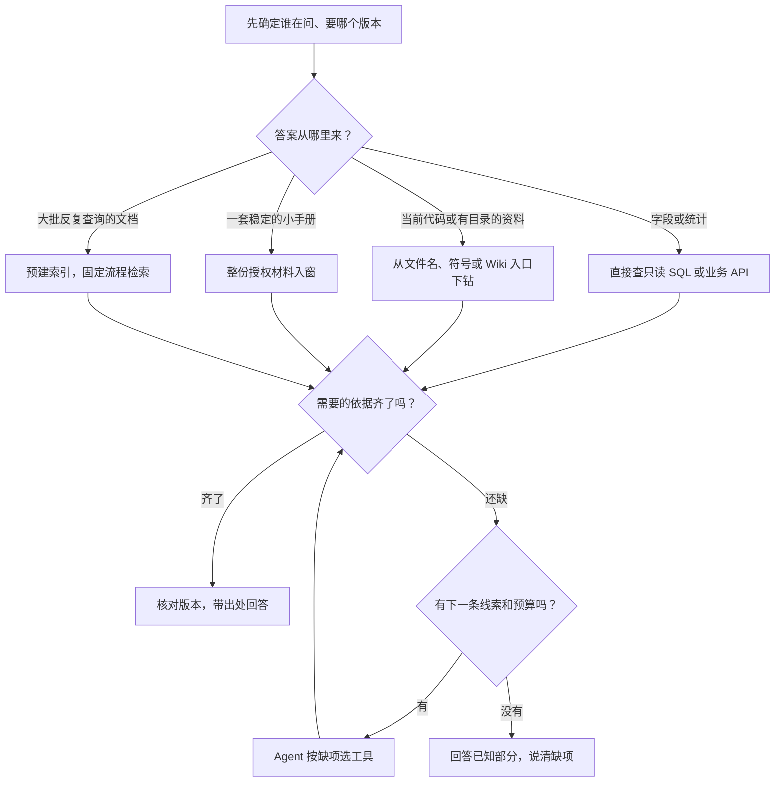
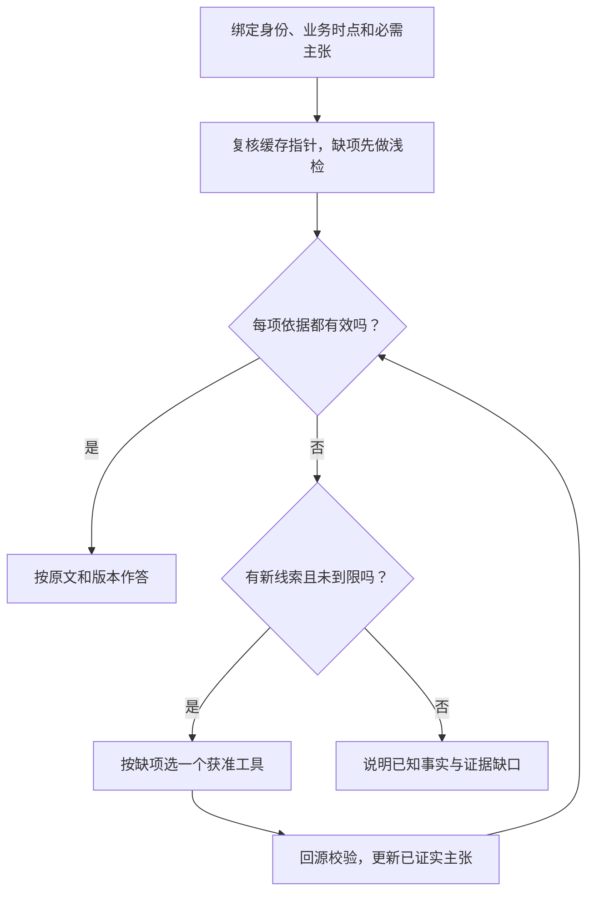

# 检索怎么选：读整本手册、建索引，还是让 Agent 自己找？

> 同一个问题「这段代码在哪里决定用哪个线程池」，程序员会顺着函数调用找，客服知识库可能只会递来五段相似的说明。面试里要讲清楚的，就是哪一步值得提前做，哪一步得等读到上文才能决定。

## 四种范式放到一张桌上



| 方案 | 先做什么 | 最顺手的题 | 什么时候吃亏 |
| --- | --- | --- | --- |
| 长上下文（Long Context） | 把这位读者能看的整套材料放进窗口 | 一份稳定手册，条款和附表散在几章 | 材料变化快，或模型老漏掉中段例外 |
| 固定管道（Pipeline RAG） | 提前解析建库，每次按相同步骤召回、精排、生成 | 百万文档里的高频点查，回答时间要稳 | 下一跳的对象藏在第一跳的结果里，预设流程没有覆盖 |
| Agentic RAG | 让模型读完这一跳，再决定问什么、用什么工具 | 跨源归因、追代码行为、找未知中间实体 | 同一批材料翻来覆去，首字要等好几轮 |
| 文件系统检索（Filesystem Search） | 保留工作树或 Wiki 的结构，按路径、正文和链接查 | 刚改过的代码、明确的函数名、有目录的笔记 | 只知道业务概念，猜不出仓库里用什么词 |

这里有个容易绕进去的地方：文件系统描述**在哪儿找**，Agentic 描述**谁来选下一步**。固定执行一次 `rg` 就回答，也是在搜文件。模型从输出里读出函数名，再决定去哪个文件查调用方，这时两种方法就用到了一起。

说「RAG 死了」会把两个问题混在一起。让回答有外部依据，可以靠查文件、读订单 API 或找索引。向量库解决的是大批材料里如何快速找相似段落。Anthropic 把预载少量入口、读到需要时再取详情的做法用在了 Agent 上。[上下文工程实践](https://www.anthropic.com/research/effective-context-engineering-for-ai-agents)

## Claude Code 为什么放弃早期的向量索引

早期内部版本会给仓库建向量索引，在 Claude 回答前替它挑一些片段。Boris Cherny 在 2025 年访谈里讲过这段尝试。

团队后来给模型搜索和读取工具，让它自己取上下文，省去了安装时建库、环境不一致和索引同步这条链。[当事人访谈](https://latent.space/p/claude-code/) · [工具设计复盘](https://claude.dev/blog/seeing-like-an-agent/)

拿 CPython 的真实函数走一遍。问题是「`asyncio.to_thread` 每次调用都会建一个线程池吗？」你甚至不用为了这个问题下载完整仓库，本机装有 CPython 3.9 或以上、能读标准库源码，就能顺着线索查。

```sh
# 找到这个 Python 实际加载的标准库，再搜入口。
lib=$(python3 -c 'import asyncio, pathlib; print(pathlib.Path(asyncio.__file__).parent)')
rg -n -A 16 'async def to_thread' "$lib/threads.py"

# 上一步读出 run_in_executor(None, ...)，现在去看 None 怎么处理。
rg -n -A 22 'def run_in_executor' "$lib/base_events.py"
```

1. **先看被调用方的输入**：`threads.py` 取当前事件循环、复制上下文，然后把待执行函数交给 `loop.run_in_executor(None, ...)`。到这里，能确认它委托执行，却还不知道谁创建线程池。
2. **拿刚读到的名字做下一次搜索**：标准事件循环遇到 `None` 会取自己的默认 executor。尚未配置时才建线程池，并存回循环，后续调用可以复用。查到赋值那一行，问题才答全。
3. **留住适用条件**：引用这两个文件和本机版本。若应用装了别的事件循环实现，就沿实际类型再查。若要证明某次请求真的走到这儿，就看运行配置或用小测试验证。

这解释了 Claude Code 的选择。新名字一保存就能搜到，未提交的修改也在当前工作树里。先列出命中的路径，排除夹具和示例，再打开实现附近几十行。两轮小读取，有时比一屏「也在谈线程」的片段更接近答案。

**认准工具做的动作**：查路径、搜正文、读原文。Claude Code 的读取工具叫 `Read`，专用 `Grep` 基于 ripgrep。

2026 年 11 月的工具文档写明，Windows 默认有 `Glob`。macOS、Linux、WSL 通过 `Bash` 的 `find`、`grep` 搜索，对应内置 bfs、ugrep。[工具参考](https://code.claude.com/docs/en/tools-reference)

现场搜能看见哪一版，也值得讲明白：

- **本地状态**：当前分支、已保存文件、挂载范围和忽略规则决定结果。远端更新没拉下来、编辑还在内存里，都要看工具实际读到的内容。
- **连续读取**：只读分析可以锁定提交。要查正在改的代码，记下基准提交和关键文件内容摘要，回答前复查，免得前后两次读到不同状态。
- **资料去向**：本地查找省去全仓上传建索引。使用托管推理时，被打开的片段仍可能随模型请求发送。[大仓库实践](https://claude.com/resources/articles/how-claude-code-works-in-large-codebases-best-practices-and-where-to-start) · [数据使用说明](https://code.claude.com/docs/en/data-usage)

## Cursor 为什么先做语义搜索，又转向 Instant Grep

把 Cursor 和 Claude Code 拿来比较，一定要带上年份。Cursor 自己做过两道不同的工程题：先让语义搜索对新工作区尽快可用，后来又让本地正则搜索快到足以成为 Agent 的主入口。

| 时间 | Cursor 当时在解决什么 | 值得记住的结果 |
| --- | --- | --- |
| 2025 年 11 月 | 在已有 grep 的 Agent 上增加语义搜索，看代码问答能否答得更好 | 官方报告准确率平均改善 12.5%，不同模型为 6.5%–23.5%。线上另看改动保留和用户反馈。[实验](https://cursor.com/blog/semsearch) |
| 2026 年 1 月 | 同事们的仓库高度相似，新工作区能否借用已有语义索引？ | 中位仓库从开始准备到**首次可查询**由 7.87 秒降至 525 毫秒。[索引复用设计](https://cursor.com/blog/secure-codebase-indexing) |
| 2026 年 3 月 | 大仓库每次跑正则都扫描全部文件，怎么少读磁盘？ | 本地索引先排除不可能匹配的文件，再在候选原文上验证完整正则。[工程实现](https://cursor.com/blog/fast-regex-search) |
| 2026 年 7–8 月 | 模型越来越会选搜索词，独立语义搜索还能多帮多少忙？ | 7 月团队说明工具更替，8 月 5 日确认当时新版使用 **Instant Grep＋读文件**，停止为搜索构建独立的服务端代码嵌入索引。[7 月说明](https://forum.cursor.com/t/what-do-you-think-about-cursor-removing-the-codebase-indexing-settings/165899) · [8 月确认](https://forum.cursor.com/t/codebase-indexing-not-working-in-v-3-12-onwards/167527/7) |

**一月的技术细节**：用相似性哈希找一份接近的队友索引，用 Merkle Tree 的内容哈希比较文件和目录。不同的子树往下查，一样的子树跳过。同步期间，客户端用本地文件的内容证明过滤结果，其他分支独有的代码不能借机露出来。

**三月的技术细节**：把文本拆成连续的三个字符（trigram），记住哪些文件出现过。查询里有必需的字面量，就能先缩小文件集合。几个片段分别出现，并不保证完整正则成立，所以最后仍要读候选原文做匹配。

回头看，两个选择各有用处。「哪里防止同一笔钱被扣两次」未必含有代码里的 `idempotency_key`，语义搜索能帮助发现第一条线索。一旦知道符号名，找它的定义、引用和刚改过的测试，精确搜索就很省力。[Cursor 搜索工具文档](https://cursor.com/docs/agent/tools/search)

## 长上下文：先量一本手册能不能读明白

一套手册不大、版本稳定、读者权限相近，又会被反复提问，我会先做整本入窗的基线。模型能一起看到正文、脚注和附录，也少了一道「检索器有没有挑中这段」的变量。Anthropic 曾用 200k token 以下的小语料说明这种做法。[原文](https://www.anthropic.com/research/contextual-retrieval)

窗口有三个数，写在白板上就不容易混：

1. **标称容量**：模型一次最多能容纳多少 token。
2. **这次实际可用**：扣掉系统指令、工具定义、历史、本轮问题和输出预留，才轮到资料。先裁出当前身份能看的版本，再算总量。
3. **实际读得好多少**：把同一句例外移到开头、中段、末尾，加上相似干扰条款，再问一次。另测定义在前、数值在附录时能否连得起来。

Lost in the Middle 展示过位置对检索式问答的影响。Self-Route 的实验里，长上下文在预算充足时平均表现好，检索有成本优势。

我的起点是拿自己那本手册做上述两道题，看模型能否引用正确页，而不只看它能不能找出一串随机口令。[位置实验](https://arxiv.org/abs/2307.03172) · [Self-Route](https://arxiv.org/abs/2407.16833)

**缓存要让不变的内容排在前面**：先放稳定工具和系统规则，再按固定顺序放授权材料，问题置后。动态日期插在最前面，会连累后面大段相同前缀。资料有勘误就发布一致版本，每份材料都带页锚，模型和读者才能对上出处。

算钱时也只要一个分式：同一前缀连续服务十问，平均前缀费用是 `(一次写入＋九次命中读取) / 10`，每问再加普通输入和输出。低频版本若总在过期后才有人问，会反复付写入费。按可共享前缀看热度，别把不同租户的请求量全加在一起。[缓存用量与期限](https://platform.claude.com/docs/en/build-with-claude/prompt-caching)

## 固定管道：把重复工作放到提问之前

客服问「这个错误码怎么办」，每天会出现许多次。解析、切块、建立词法和向量索引都可以提前完成。在线绑定身份与生效时间，两路并发找候选，融合后精排少量原文，答案附出处。这条路每次做多少事，基本能预判。

**容量题可以现场算**：百万份文档，每份十块，每块一个 768 维 float32 向量，裸向量就有 `1,000,000 × 10 × 768 × 4 = 30.72 GB`。

近邻索引、倒排、元数据、原文、副本和切版空间还要另留。每天更新 1% 文档，按整份重建算就是十万块。

**多跳也可以写成普通程序**：若部署 ID 总能查出版本，版本总能关联发布说明，就把两次查询固定下来。并发好控，失败也容易重试。只有读完上一份材料才知道要找哪条分支，才值得引入模型规划。

| 系统设计里常被混叫作「快」的量 | 从哪儿量到哪儿 |
| --- | --- |
| 冷启动／首次可查询 | 打开新工作区，到搜索功能就绪。Cursor 的 525 毫秒在这一栏 |
| 变更可见时间 | 原件或文件保存，到当前身份的查询能找到新版 |
| 首字延迟（TTFT） | 收到问题，到第一个实际答案 token，含排队、前置工具与模型预填充 |
| 整答耗时 | 收到问题，到最后一个答案 token。若输出 200 token、每秒 50 个，仅生成就约 4 秒 |

首字目标一秒，就用一个请求级截止时间给召回、精排和模型分配剩余时间。两路并发取较慢一路，再加串行步骤。算 P99 要测整条请求。若某一路超时，检查已经拿到的资料是否够答，缺强制引用的题交给深查。

## Agentic RAG：什么时候值得让模型决定下一跳

看完一条发布说明，你知道「新行为从 3.12 开始」，却还不知道用户用的是哪个版本。再搜十遍同一条说明也不会多出这个事实。下一步该读部署清单，还是去查在线实例？这取决于上一跳发现了什么，也取决于系统允许读什么。

我会给 Agent 留三类小记录，让它不用把整段聊天反复读给自己听：

- **待证主张**：例如「实例实际运行的版本」和「该版本的默认行为」。一个主张可以有等价出处，两个必需主张得分别有依据。
- **工具观察**：记工具、规范化参数、读取时点、来源标识与版本。模型猜的版本号放在待核线索里，直到配置或 API 证实。
- **已经核实的证据**：每项主张连到具体原文范围或字段。来源冲突时检查权威性、生效期与转载关系，三篇转述同一个旧公告仍然只有一个出处。

工具要能各答各的问题：文档库找规则，SQL 做连接和汇总，业务 API 查当前状态，获准的公开搜索查外部资料。工具参数由服务端绑定身份。若只需查公共日历，就只发公开日期与地区，客户标识留在内部。

Self-RAG 训练模型用反思 token 决定是否检索、材料是否相关、答案是否有支持。CRAG 用检索评估器触发补救，可以整理已有材料，也能转向其他来源。

工程上可借用「先检查还缺什么」这个动作，再选有权限的内部库或权威 API。[Self-RAG](https://arxiv.org/abs/2310.11511) · [CRAG](https://arxiv.org/abs/2401.15884)

### 怎样知道提升来自搜索的哪一步

BrowseComp-Plus 使用固定且经过人工核验的语料。

同用 BM25，Search-R1 的答案准确率是 3.86%，GPT-5 是 55.9%。GPT-5 改用 Qwen3-Embedding-8B 到了 70.1%。[BrowseComp-Plus](https://aclanthology.org/2026.acl-long.1023/)

Pi-Serini 在同一基准上用 GPT-5.5、调过的 BM25 和足够的检索深度，答对率达到 83.1%。想知道词法、向量或多步规划各自帮了多少，就固定模型、语料、权限与总预算，一次只换一个变量。[Pi-Serini](https://arxiv.org/abs/2605.10848)

尤其要看**新证据**。两次搜索词不同，却只带回同一段转述，就没有补上缺口。连续两轮没有新依据、重复调用同一工具同一参数，或再查就没时间生成答案，都是停下来的理由。缺哪项就说哪项，已经核实的部分仍然能答。

## 文件系统和 Wiki：入口词从哪里来

代码库的目录名、import、符号和测试天然可以导航。对于文章，作者也能主动留下这样的路标。Karpathy 的 LLM Wiki 保留原始材料，由模型维护主题页，用 `index.md` 做目录、`log.md` 记变更。

他描述的个人经验是约百份来源、数百页 Wiki，先读目录再下钻就已经有效。[原始 Gist](https://gist.github.com/karpathy/442a6bf555914893e9891c11519de94f)

我会把工具按它真正能回答的问题分开。下面假定 `wiki/` 与 `raw/` 都是当前读者获准查看的只读快照。清单以 JSON 行保存，SQLite 中的行也已按身份裁好。

```sh
# 业务叫法写在哪个主题页？先读目录，再列相关文件。
rg -n -F '版本' wiki/index.md
fd --type f 'release|版本' wiki

# 哪份原始公告改了默认值？保留命中附近的原句。
rg -n -C 2 -F '默认值' raw/notices

# 要出处和生效期时，直接读结构化字段。
jq -c 'select(.topic == "版本") | {source, rev}' raw/manifest.jsonl
sqlite3 -readonly raw/policy.db \
  'SELECT source_id, valid_from FROM policies ORDER BY valid_from DESC LIMIT 5'
```

- **精确名称已知**：直接 `rg -F`，先返回路径和少量上下文。对照实现、测试和说明，避免被同名示例带偏。
- **只有模糊概念**：先读项目地图、维护者术语或 Wiki 目录，找出仓库的实际叫法。几轮都猜不到名字，就用语义检索给一个起始文件，再回工作树追引用。
- **需要汇总**：`fd` 找名字，`jq` 读字段，SQLite 查全体记录。只读连接也要配合行级可见范围。把全库挂进来，再给命令加一个 `LIMIT` 并不能隔离客户。

Wiki 把成本从读者移给编辑。新公告发布时，主题页、目录、变更日志和原文锚点应一起更新。删除原件时沿反向引用找到受影响的页面。若目录标题本身就含敏感客户名，目录也要按权限生成，主题摘要继承其来源的可见范围。

文件系统搜索同样会用索引：Wiki 有目录，SQLite 有 B 树，Instant Grep 有本地正则索引。评估时记扫描字节、命中数、首次找到正确文件的时间，以及模型为了猜词读了多少无关内容。

## 把四种方法接起来：只给缺证据的问题加一轮

适合大多数客服请求的做法，是先给高频问题走固定管道。已经找到适用版本和原文，立即生成。若题目要解释某个实例，却还缺部署信息，就只为这一项开深查。这样模型每多跑一轮，都说得出在找什么。



**三种缓存别混用**：应用的证据缓存存原文指针，复用时重验权限和版本。Prompt Caching 复用相同前缀的计算，客户端仍组装文本。直接缓存整份答案更挑条件，意图、读者权限、业务数据和输出要求都得仍然一致。

下面是 Python 3.11+ 的路由核心。`req.required` 是回答这道题必须证实的主张。

`io.verify` 从权威源重新核对记录，返回按主张组织的证据。过期、撤权或相互矛盾的记录会留下缺口。`io.fetch` 在授权数据里查，只返回可回源的指针。

```python
import asyncio


async def retrieve(req, io):
    needed = set(req.required)
    if not needed:
        return {}, needed, "clarify"
    deadline = asyncio.get_running_loop().time() + req.retrieval_seconds
    seen, stalled = set(), 0
    try:
        async with asyncio.timeout_at(deadline):
            refs = list(await io.cached_refs(req))
            proof = await io.verify(req, refs)
            if needed - proof.keys() and "hybrid" in req.tools:
                seen.add(("hybrid", req.question.strip()))
                refs.extend(await io.fetch(req, "hybrid", req.question))
                proof = await io.verify(req, refs)

            reason = "round_limit"
            for turn in range(min(3, req.max_rounds)):
                missing = needed - proof.keys()
                if not missing:
                    break
                # 为规划和下一工具调用预留费用，给最终生成单独留时间。
                if not req.tools:
                    reason = "no_source"
                    break
                if not await io.reserve(req, turn):
                    reason = "budget"
                    break
                step = await io.plan(req, missing, proof)
                if step is None or step.tool not in req.tools:
                    reason = "no_source"
                    break
                key = (step.tool, step.query.strip())
                if key in seen:
                    reason = "repeated_step"
                    break
                seen.add(key)
                refs.extend(await io.fetch(req, *key))
                updated = await io.verify(req, refs)
                stalled = 0 if updated.keys() - proof.keys() else stalled + 1
                proof = updated
                if stalled >= 2:
                    reason = "no_progress"
                    break

            proof = await io.verify(req, refs)  # 发布前再查一次撤权与版本
            missing = needed - proof.keys()
            if not missing:
                io.offer_cache(req, refs)  # 尝试入队，写缓存不阻塞返回
            return proof, missing, reason if missing else "ready"
    except TimeoutError:
        return {}, needed, "deadline"
```

这里的停止条件有个取舍：有时找到的是**桥接线索**，还没有直接证明最终主张。例如从清单找出部署 ID，下一步才能查版本。把这条中间事实列进任务要验证的条件，或者让进展检查识别新的有效来源，就能给有意义的下一跳留机会。

配额按请求和轮次原子预留，用完结算、取消释放。浅检和生成另留固定额度。各工具也设超时和返回上限，这样外层超时后不会还在后台扫表。无法核实身份就停止读，待恢复的任务先重验权限与原件版本。

### 哪些问题真的值得升级

我会把同一批问题跑两遍：固定管道一次，有界深检一次。除了答对多少，还记「浅检错、深检对」和「浅检对、深检反而错」。深检救回 80 题又改错 10 题，净多答对 70 题，额外总花费除以 70 才是每多答对一题的代价。

再看谁在等：八成请求 0.6 秒出首字、两成要 4 秒，平均是 1.28 秒，那两成用户仍要等足 4 秒。深查用独立并发池并限制每租户占用，超长任务可以异步返回进度，首字计时以实际答案为准。

别只抽已经升级的难题。随机给少量直接答过的题跑影子深检，看看有没有本应升级的漏网题。再对升级过的题回放浅检，看有没有花了时间却毫无收益的调用。两边固定同一个身份和知识快照，才能解释差异。

## 选型速查：拿到题先定第一步

| 如果明天就要做 | 我会从哪里起步 | 什么信号让我换招 |
| --- | --- | --- |
| 一本常问的内部手册 | 授权全文入窗，稳定章节缓存，答案引用页码 | 中段例外常漏，就先按目录定位章节，再让模型细读 |
| 百万文档、多租户客服 | 行级 ACL 下推，混合召回并行，精排和生成各有时间上限 | 版本和主体能确定就固定连接，未知来源的缺项才进深检 |
| 大仓库重构 | 读项目地图，现场搜符号、注册表与测试，核实未提交改动 | 业务名与代码名差得远，就补术语表或语义搜索找入口 |
| 跨系统查原因 | 权威字段先查 SQL／API，再按查出的实体找文档解释 | 下一个查询对象取决于上一跳，就允许有限轮规划 |

算单问成本时，我会把钱分到实际干活的地方：长窗计前缀写入和读取，固定管道把解析、索引更新与存储按查询量摊开，Agent 累加每轮输入、输出和工具费。文件搜索还要记本机扫描和多次工具结果占用的模型输入。

比较方案时，我会固定读者、语料时点和一批能核对出处的问题。分别看正确且有据的比例、该拒答时的表现、首字和整答时间、更新多久可见、每个成功任务的成本。这几列能回答一个具体问题：某一类题值不值得多等下一轮？

## 一手资料

- Claude Code：[Boris Cherny 访谈](https://latent.space/p/claude-code/) · [工具设计者复盘](https://claude.dev/blog/seeing-like-an-agent/) · [大仓库实践](https://claude.com/resources/articles/how-claude-code-works-in-large-codebases-best-practices-and-where-to-start) · [工具参考](https://code.claude.com/docs/en/tools-reference) · [数据使用](https://code.claude.com/docs/en/data-usage) · [ripgrep](https://github.com/BurntSushi/ripgrep)
- Cursor：[语义搜索对照实验](https://cursor.com/blog/semsearch) · [索引复用](https://cursor.com/blog/secure-codebase-indexing) · [快速正则实现](https://cursor.com/blog/fast-regex-search) · [7 月团队说明](https://forum.cursor.com/t/what-do-you-think-about-cursor-removing-the-codebase-indexing-settings/165899) · [8 月确认](https://forum.cursor.com/t/codebase-indexing-not-working-in-v-3-12-onwards/167527/7) · [现行搜索文档](https://cursor.com/docs/agent/tools/search)
- 上下文与本地知识库：[上下文工程](https://www.anthropic.com/research/effective-context-engineering-for-ai-agents) · [小语料与长窗口](https://www.anthropic.com/research/contextual-retrieval) · [前缀缓存](https://platform.claude.com/docs/en/build-with-claude/prompt-caching) · [Lost in the Middle](https://arxiv.org/abs/2307.03172) · [Self-Route](https://arxiv.org/abs/2407.16833) · [LLM Wiki](https://gist.github.com/karpathy/442a6bf555914893e9891c11519de94f)
- 多步检索与评测：[Self-RAG](https://arxiv.org/abs/2310.11511) · [CRAG](https://arxiv.org/abs/2401.15884) · [BrowseComp-Plus](https://aclanthology.org/2026.acl-long.1023/) · [Pi-Serini](https://arxiv.org/abs/2605.10848)

## 六道高频面试题

### 1. Claude Code 放弃向量库，为什么现场搜代码反而好用？

- **考察点**：能否说清这一跳的结果怎样变成下一跳的输入。
- **直接照着讲**：

  1. 当前工作树里有最新保存的改动。
  2. 我先搜一个精确符号，从实现里读出调用目标，再查它的定义。
  3. 这条链短、出处清楚，还省去全仓切块与同步。

- **连环追问**：完全不知道符号名呢？我先读目录或项目地图，必要时用语义搜索找第一个文件，再沿实际代码核对。

### 2. Cursor 先说语义搜索有效，后来为什么又用 Instant Grep？

- **考察点**：能否把三个结论各自放回正确时间点。
- **直接照着讲**：

  1. 2025 年加语义工具，当时代码问答平均改善 12.5%。
  2. 2026 年 1 月的 525 毫秒说的是复用索引后多久可以开始查询。
  3. 到 8 月团队确认，新版靠本地 Instant Grep 和读文件，模型选词能力与工具速度都变了。

- **连环追问**：它还有索引吗？有，本机构建正则搜索索引，搜索用途的独立服务端代码 embedding 已经停用。

### 3. 十万 token 的手册塞得下，你还建库吗？

- **考察点**：模型容量、读懂程度和重复读取费用。
- **直接照着讲**：

  1. 我先扣掉历史、工具和输出预留，看可读材料实际多大。
  2. 同一条例外放在开头、中段、末尾各测一次，还要测跨章节引用。
  3. 若版本稳定、同一前缀常被复用，先用长上下文。

- **连环追问**：缓存很热就够了吗？缓存省预填充，读漏的例外还得靠目录、局部检索或更好的材料组织找回来。

### 4. 百万文档客服要求一秒出首字，多跳题怎么办？

- **考察点**：选得出默认路径，也说得清超时如何收尾。
- **直接照着讲**：

  1. 常见问题走权限内的固定检索，预留模型出首字的时间。
  2. 已知连接键就直接查 SQL 或 API。
  3. 确实缺证据才进单独的深检池，到限说明已知部分。

- **连环追问**：先发「正在查」算达标吗？那是状态更新。我会分别记处理进度、实际答案首字和整答时间。

### 5. Agent 已搜了五轮，怎么判断该停、该改，还是值得再查？

- **考察点**：能否区分新结果、新证据和真正的净收益。
- **直接照着讲**：

  1. 我看缺哪项主张，有没有新来源或桥接事实。
  2. 重复调用、连续无进展、到时间或费用上限就停。
  3. 回放时固定模型和总预算，对比固定两跳与自适应搜索各救回、改错了几题。

- **连环追问**：模型说它很确定呢？我请它指到有效版本的原句或字段。缺关键条件，信心再高也要把缺项写出来。

### 6. Wiki 一直在更新，为什么昨天能看的回答今天会泄漏？

- **考察点**：原件、摘要、目录和缓存是否一起遵守撤权。
- **直接照着讲**：

  1. 我先找主题页和目录用了哪些私有原件。
  2. 撤权时先拦读，再让派生摘要失效。
  3. 缓存只存可回源的指针，读前用当前身份和版本再查一次。

- **连环追问**：缓存键里有租户还不够？同一租户的两个人也可能只能看不同的行，昨天的组成员今天也可能已经调岗。
