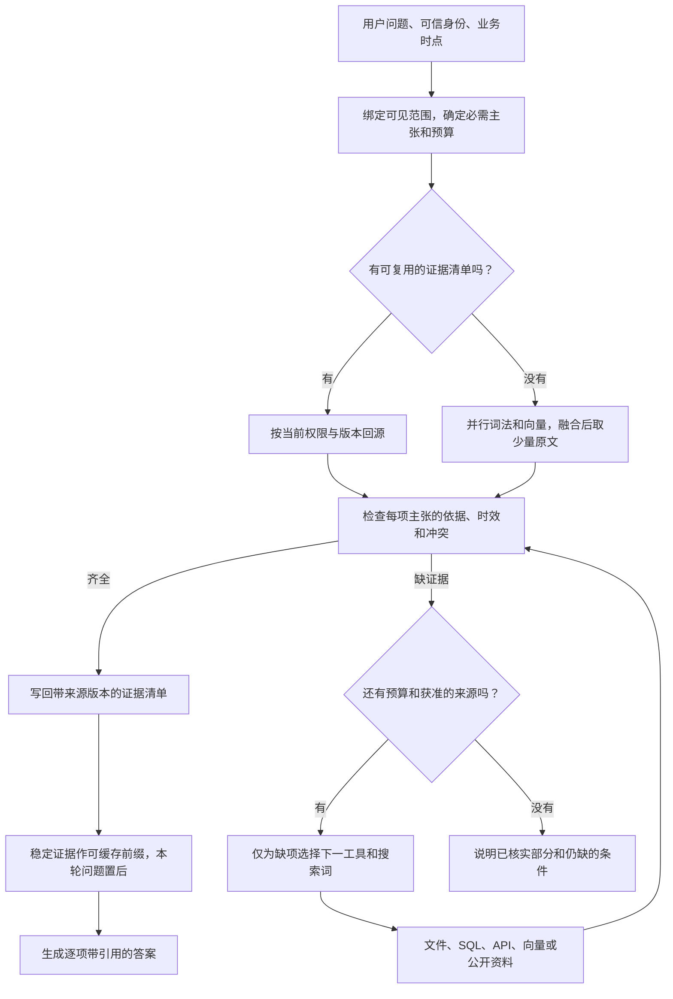
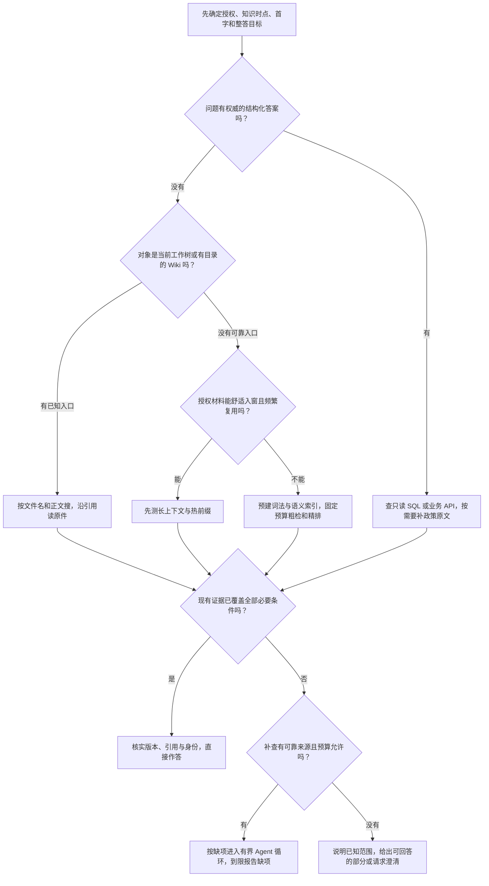

# 2026 年知识检索怎么选：传统 RAG、Agentic RAG、长上下文与文件系统搜索

面试官问「Claude Code 可以现场搜文件，你的客服系统为什么还要建索引」，真正要你解释的是同一道题该提前算什么、现场查什么，以及花掉这些时间和钱之后，用户能拿到什么证据。

## 先拿四个真实工作的动作认路

假设你刚接手支付系统。看一本稳定的小手册，可以整本摊在桌上。每天替几千个客服翻同一个资料库，就值得先做目录。查一笔异常退款，要先拿到订单所属批次，再用批次查适用规则。追踪代码里一个错误码，则可以从报错字符串出发，沿着定义和调用点走。四种办法的差别，在于**谁负责找到下一段证据、哪一步的费用可以让后来的查询分摊**。

| 从什么动作开始 | 一次问题如何走完 | 最该担心的失败 |
| --- | --- | --- |
| Long Context，把授权材料装进一个上下文窗口 | 同一模型读材料和问题，直接作答 | 能装下却读漏中间的例外，或缓存因频繁改版一直不命中 |
| Pipeline RAG，预先解析并建索引 | 走确定的召回、融合、精排、生成流程 | 第一轮缺少桥接事实，流程没有机会提出第二个问题 |
| Agentic RAG，让上一步结果决定下次查什么 | 可在向量、全文、SQL、API 和获准的 Web 之间切换，查齐或到预算就停 | 搜索循环越转越贵，找来的每条都相关，却没有补上缺口 |
| Filesystem Search，在文件或 Wiki 里现场导航 | 先列目录，再按词或正则搜内容，沿引用读原件 | 缺少入口词时反复空搜，或读到了错误分支的同名文件 |

这四行有交集。Agentic 描述控制流程，Filesystem 描述资料与工具的形态，长上下文描述一次模型调用能看多少。用 `rg` 搜一次就答是固定流程。模型读完第一段再决定搜哪个符号，才有自适应的下一步。一个模型完全可以先从向量索引拿到文件路径，再打开当前工作树核验。不要让产品名替你决定架构，先看用户真正要等哪一步。

「RAG 死了吗？」如果你关心的是回答能否以外部事实为依据，现场查文件和调订单 API 都还在做这件事。过去许多系统总由后台预先替模型选一批向量近邻。到了 2025–2026 年，越来越多工作负载有了别的选择。长窗口让小资料集可以整本阅读，模型的工具能力让下一跳可以等到读完上一跳再决定。与此同时，低延迟客服仍需要可预测的检索开销。Anthropic 在 2025 年的上下文工程文章里把预载少量线索、其余按需读取称为一种混合做法。比较四套方案时，可以先问它们分别会在何时把哪份证据送到模型手里。[Anthropic 的上下文工程实践](https://www.anthropic.com/research/effective-context-engineering-for-ai-agents)

## 一、Claude Code 从内部向量原型走到工作树搜索

### 一段今天刚改过的代码，应该向谁要答案？

假设开发者正把退款入口从 `scheduleRefund` 改名为 `enqueueRefund`，同时追问「这个接口失败后在哪里重试」。后台向量索引也许仍指向昨晚提交的旧函数，当前工作树却同时包含未提交的新实现、旧测试夹具和一份尚未改完的文档。靠问句和代码片段语义相似度，很难知道哪一个正在被调用。程序员更自然的起点是打开当前路由，沿 import 追到任务生产者，再去看注册表把任务交给了哪个消费者。

这段产品历史有一手记录。Boris Cherny 在 2025 年访谈中讲过早期尝试 RAG，后来改用多轮普通代码搜索。据 Anthropic 的工具设计复盘，早期内部版本先把仓库做向量索引，Harness 在回复前给 Claude 塞相关片段，安装与环境差异会使这条链变脆。引入搜索工具后，模型能自己决定读哪里，并用新读到的词发起下次查找。2026 年 5 月的大仓实践文章也明确写到 Claude Code 能现场遍历文件、读源码、追引用，无需预建或上传全仓索引。[Boris Cherny 一手访谈](https://latent.space/p/claude-code/) · [Anthropic 工具设计复盘](https://claude.dev/blog/seeing-like-an-agent/) · [大代码库实践](https://claude.com/resources/articles/how-claude-code-works-in-large-codebases-best-practices-and-where-to-start)

这里还有一个面试答得过于肯定就会错的细节。`glob + ripgrep + read_file` 是「找路径、搜正文、读原文」的常见表达。Claude Code 暴露的读工具叫 `Read`，专用 `Grep` 基于 ripgrep。按截至 2026 年 11 月核对的工具文档，Windows 默认提供 `Glob`，macOS、Linux、WSL 默认通过 `Bash` 调用 `find` 和 `grep`，在 Claude 的 shell 中对应嵌入的 `bfs` 与 `ugrep`。特定工具或权限配置可以恢复专用 `Glob`、`Grep`。因此下面用 `rg` 展示能在本地复现的搜索步骤，实际产品的调用名要结合平台与版本判断。[Claude Code 工具参考](https://code.claude.com/docs/en/tools-reference) · [ripgrep 项目](https://github.com/BurntSushi/ripgrep)

| 模型在这一步知道什么 | 下一次最小读取 | 读完如何缩小范围 |
| --- | --- | --- |
| 用户只给了一个报错 `REFUND_PENDING` | 在本工作树的源码目录做字面量搜索，先返回文件名 | 分开实现、测试、示例，先打开运行时入口 |
| 入口构造了 `RefundQueued` 事件 | 读相邻几十行，记录导入路径和实际发送的事件类型 | 先在消费端注册表搜完整事件名 |
| 注册表把事件映射到 `RefundWorker` | 用路径模式找实现与对应测试，读失败分支 | 区分业务拒绝、网络超时、重试耗尽 |
| 超时交给共享队列 | 沿配置引用找到退避参数，再看测试怎样驱动第二次尝试 | 引用当前版本的入口、消费端和测试，说明哪一跳仍缺运行时证据 |

这个过程容许第一步猜错。第一次搜到一堆测试时，工具可只返回路径、命中总数和「结果截断」，模型再缩目录。给每次读取加行数上限，保留文件路径、行号与版本指纹，能让后面精准补读。遇到别名导入、依赖注入、反射或运行时加载插件，文本链可能就此中断。此时查构建清单、语言服务的定义与引用、运行配置或一个小范围测试，通常比从头读完整个仓库更有价值。一个 `import` 只能证明声明依赖，声称运行时一定走到某分支还需条件与执行证据。

为什么现场搜在这个例子里胜出？本地文件一保存，下一次读取即可看见，省掉的是**索引同步延迟**，搜索扫描本身仍然要时间。在本地工作树中，错误码、路径和精确符号很好找，正则能表达一族命名变体。团队省下了向量管道、切块策略、嵌入模型迁移、分支隔离与未提交修改同步。也无需为了建索引把整个代码库的切片交给远端。使用托管推理时，模型要阅读的文件片段和工具结果仍可能随请求发送，具体处理受产品和账户设置约束。本地检索降低的是一条特定的数据流。[Claude Code 大仓实践](https://claude.com/resources/articles/how-claude-code-works-in-large-codebases-best-practices-and-where-to-start) · [Claude Code 数据使用说明](https://code.claude.com/docs/en/data-usage)

现场搜也有物理边界。开发者没拉取远端最新分支，本地实时只代表这份工作树。内存里尚未保存的编辑是否可见，取决于工具接入。搜索第三方依赖、生成代码或被忽略的目录，能否命中取决于挂载、忽略规则与权限。读取第二个文件之前另一个进程又改了第一个，答案可能混用两个状态。只读分析可以锁定提交快照。用户恰恰在问未提交修改，就记录基准提交与关键文件的实际内容摘要，回答前再次检查变动。把每一步都归到某个 Git 提交会漏掉最有价值的那份本地差异。

### Cursor 的「反例」有时间戳

**2025 年 11 月**，Cursor 给出了很好的反例。其 Agent 已经会用 grep，团队给一组配置额外开放语义搜索，在有标准答案的代码库问题上比较。官方报告的平均改善为 12.5%，不同模型的改善在 6.5%–23.5% 之间。它还单独做了线上实验，观察修改能否保留、用户是否需要表示不满并追问。这里的离线问题答对率、线上代码保留和用户满意度是三个不同指标。「项目里哪里保证同一笔钱不会退两次」未必出现“退款”或“幂等”的字样，语义路能先指向一个意外命名的目录，再用 grep 追精确引用。这解释了当时为何有动力付建库费用。[Cursor 语义搜索实验](https://cursor.com/blog/semsearch)

**2026 年 1 月**，Cursor 公开了让大型代码库快速复用语义索引的办法。文件内容有哈希，目录节点由子节点计算哈希，最终得到 Merkle Tree 根。根相同可判断这棵树对应的内容一致。不同时递归比较子树，定位变化的文件，只对有差异的部分补工作。团队成员的仓库副本往往高度重叠，新工作区可以先找相近的已有索引作为起点，同时后台同步差异。相似性哈希负责「找相近副本」，密码学内容哈希负责「这个文件确实在当前副本里」，两者承担的证明不同。[Cursor 的索引重用设计](https://cursor.com/blog/secure-codebase-indexing)

复用还得回答一个隐私问题。两个人检出不同分支，另一个分支的未发布实现即使语义上最匹配，也不能从借来的索引漏出来。官方描述的做法是在同步完成前用客户端树提供的内容证明过滤候选，只有本地拥有的匹配文件才可见。两边根一致后结束这段过渡。团队报告中位仓库从 7.87 秒降到 525 毫秒，指的是**首次可以发起查询的等待**。这个量叫 time-to-first-query，和用户发问后第一个答案 token 到达的 TTFT 有不同的起点和终点。把它写进聊天首字延迟表，会凭空替架构省下一大笔时间。[Cursor 的时间口径与数据](https://cursor.com/blog/secure-codebase-indexing)

**2026 年 3 月到下半年**，反例本身又变了。3 月 Cursor 发表本地快速正则搜索的实现，给出先用索引筛候选文件、再验证真实匹配的思路。7 月团队在论坛解释工具更替，8 月工作人员确认当时的新版本让 Agent 使用 Instant Grep 与文件读取，停用过去独立的服务器端语义代码索引。现行搜索文档明确写本机建和查 Instant Grep 索引，搜索用途不再在服务器保存代码库 embedding。对 11 月的面试题，准确回答应覆盖「为什么曾经保留」「为什么模型和本地搜索进步后改变了收益」「自己的语料是否具备相同条件」。[快速正则搜索工程文](https://cursor.com/blog/fast-regex-search) · [7 月团队答复](https://forum.cursor.com/t/what-do-you-think-about-cursor-removing-the-codebase-indexing-settings/165899) · [8 月版本说明](https://forum.cursor.com/t/codebase-indexing-not-working-in-v-3-12-onwards/167527/7) · [现行搜索文档](https://cursor.com/docs/agent/tools/search)

两段历史同时成立。陌生大仓、业务词与代码名相隔很远时，语义候选有机会省掉很多猜词轮次。已知函数、具体重构、验证影响面时，精确查找能把未提交改动和字面引用都纳入。模型更会从目录和上一步结果造搜索词、本地正则查找更快，给同一 Agent 额外配专用向量库的边际收益也会变。公开材料能证实产品路线和当时的实验，不能从中推出每个组织都该删索引。对一次完整代码任务，真正值得对照的是首个有效定位、最终修改能否通过验证以及人工返工。

## 二、给四种方案算同一笔账

先统一秒表。**TTFT** 从收到用户请求起计到第一个实际答案 token，包含排队、所有先行工具调用和模型预填充。**总耗时**计到最后一个答案 token。为使下表可以复算，假设最终答案 200 token，生成约每秒 50 token，首字之后约需 4 秒。统一虚拟价格为普通输入 1、缓存写入 1.25、命中 0.10、输出 4 美元／百万 token。它们是容量规划的演算假设，不是产品报价或厂商跑分。表中 TTFT 是给定负载的**示例预算**，要用真实文档、机器和并发压测替换。

| 维度 | 直接长上下文 | 固定 Pipeline RAG | Agentic RAG | Filesystem / Wiki + CLI |
| --- | --- | --- | --- | --- |
| TTFT／总耗时示例 | 预算冷 3 秒／7 秒，热 0.7 秒／4.7 秒，须验证长前缀命中 | 检索及组装 0.18 秒，加模型首字 0.42 秒，共 0.60 秒／4.60 秒 | 3 轮模型决策和工具各轮合计 1.2 秒，再等首字 0.42 秒，即 4.02 秒／8.02 秒 | 已知路径读一次 0.05 秒，加首字 0.42 秒，即 0.47 秒／4.47 秒。若要三轮选词，每轮 1 秒，变为约 3.47 秒／7.47 秒 |
| 单次模型费示例 | 100k 共享输入、1k 新输入，首写 $0.1268，命中 $0.0118 | 输入 4k，输出 200，$0.0048。另加索引、在线召回和精排 | 三次各 2k 入、100 出，加一次 4k 入、200 出，共 $0.0120，另加各工具费用 | 一次 3k 入、200 出，$0.0038。三次额外各 1k 入、100 出时合计 $0.0080，另计本地计算 |
| 可服务的知识规模 | 材料、指令、问题、输出预留必须同装一窗。可从小于约 100k–200k 的稳定语料开始试 | 容量由分片、复制、授权过滤与更新吞吐决定。百万份文档可设计，在线只给模型少量段落 | 背后可以是百万文档、多库与线上 API。单题实际上限是有限轮次能读到的证据 | 整个工作树可以远大于窗口。可读挂载、磁盘扫描范围、名称稀疏度和返回上限约束每轮 |
| 实时性与缓存 | 材料一改就要生成新前缀，固定版常问才好摊销 | 索引有摄入延迟，可给增量设水位。高频问题可复用获授权证据 | 查实时 API 能看当下状态，多源时间点需对齐。可缓存有依赖的中间结果 | 文件保存后即可读，本地加速索引仍需追踪变化。缓存路径比缓存片段更容易复核 |
| 多跳能力 | 同窗有完整证据链时可以直接关联，位置与干扰项影响实效 | 已知跳数与连接键可写成固定程序。未知中间实体容易漏 | 从一跳产出的实体或条件发起下一跳，适合缺口不可预知的问题 | 沿 import、目录、文档链接逐跳，开放语义发现依赖入口质量 |
| 运维与并发 | 服务端组件较少，压力移到输入吞吐、缓存命中和长文质量评测 | 需维护解析、索引、版本与权限。固定扇出便于做高并发预算 | 还需调度、工具超时、轨迹、限额和断点恢复，尾延迟最难控 | 单人仓库起步便宜，多人挂载、工作树一致性、文件权限和本地索引仍要维护 |

表里的「低于一秒」以首个真实答案 token 为目标。如果产品合同要求整句在一秒内到达，就得减少输出、改变解码速度或用已经验证且仍有权读取的缓存回答。以每秒五十个 token 输出两百个，单是生成就约四秒。分清首字目标、整答目标和「页面显示已开始处理」能避免系统设计讨论陷入假指标。

把调用频率也放进账本。上述 100k 前缀若在有效期内连续服务十个请求，平均模型费为 `(0.1268+9×0.0118)/10=0.0233` 美元。十次都付普通输入价则每次 `0.1018` 美元。反过来，每天才来一个人、每次都新写缓存，每次是 `0.1268` 美元，比普通价更贵。一天一万问也未必命中率高，如果每人可见材料不同、排序不稳定或分布在许多冷门版本，聚合后的热度会掩盖每个可复用前缀的实际频率。读服务端 usage 并按前缀、身份域和版本分桶，才能估算真实节省。[Claude 缓存价格、期限与用量](https://platform.claude.com/docs/en/build-with-claude/prompt-caching)

## 三、长上下文何时比建库更省事

有一份六十页的交付手册，售前一小时要回答二十个不同问题，所有读者看到的是同一版本。直接读全书能看到细则、脚注和跨章引用，工程上也只需维护一份按顺序排列的权威材料。用 Prompt Caching 复用固定前缀，问题放在最后，后面的请求能省去部分重复预填充费用。对这种小而热的知识集，先做长上下文基线，就能在还没投钱做解析索引前，量出「模型已经拿到全部材料时有多好」。[Anthropic 对小语料直接入窗的讨论](https://www.anthropic.com/research/contextual-retrieval)

窗口有三个数要分开量。模型标称能接收多少，减去系统指令、工具定义、历史和输出预留后还剩多少，加入干扰材料后能稳定用好多少。最后一个数要靠题目测出来。一份十万 token 的手册按租户拆分后只有四万可读，遇到多轮对话和长表又可能让输入膨胀。长文拆表时丢失列名，放进再大的窗口都不能把列名变回来。把 100k–200k 当成试验区间，分别测窗口占用百分比、首字延迟、引用是否命中正确页，不必把它当行业门槛。

测试长窗时，可以把同一条「迁移客户仍沿用旧费率」依次移到文首、中段和末尾，保留同数量的相似干扰条款，再测完整问答。另做一组把资格定义放在前面、数字表放在后面，看能否把两个证据连上。早期 Lost in the Middle 研究展示了相关信息所在位置能显著影响表现。现代模型的情况要在本地复测，尤其别用「能抽出一串随机口令」代替实际业务题。比较 RAG 与长上下文的 Self-Route 论文也发现，在其评测与充足预算下长上下文平均表现好，而检索有成本优势，并探索了按题路由。[Lost in the Middle](https://arxiv.org/abs/2307.03172) · [长上下文与 RAG 的对照实验](https://arxiv.org/abs/2407.16833)

可缓存前缀同样需要排版纪律。先放固定工具和系统规则，再放顺序稳定的授权材料，最后放本轮问题。每份材料有文档标识、版本和页锚，便于核对引用。若客户名单或动态日期插在最前，后面九万 token 即使不变也难复用。资料频繁局部更新时，可把稳定章节放较早的断点，变化部分留后。如果一条新勘误会改变早期章节含义，发布时仍要给整套输入一个一致的版本。缓存只省重复计算，不会替你把新勘误插进已经发出的请求。

## 四、固定管道为什么仍是高并发业务的起点

每天几十万次「如何开票」「错误码什么意思」的请求，路径高度重复。把主体、版号和权限在离线索引中准备好，在线并发做全文和向量检索，再批量精排、读几段原文，服务时间与资源相对可预测。高频稳定问题甚至可以直接读取有来源的标准答复。判断它适不适合，先量有多少问题能一次找齐所需证据，以及只有几十毫秒可用时哪一步还值得跑。一次就齐的题，要求模型先制定计划通常只会多出一次首字等待。

用百万份文档做一道容量题。若平均每份十块，每块一个 768 维、32 位浮点向量，原始向量约 `10,000,000×768×4=30.72 GB`，按十进制计算。近邻索引结构、元数据、倒排索引、原文、复制和双版本切换都还要留空间。每天更新 1% 文档约是一万份，按每份十块需处理十万块。如果每份改动都会让全文背景说明变化，不能只重嵌入改过的一行。公开售后文档与个性合同往往有不同更新频率和授权规模，应分开做容量和服务水位预算。

要做到低延迟，先把问答路径中并行和串行的部分画出来。两个召回器可以并发，合并要等两路。精排可以批处理，突发流量时等待凑批的时间也算用户等待。设置同一个绝对截止时间，某一路超时就用已返回的证据检查是否够答。如果缺的是强制引用，返回缺项或升级深检。用请求级追踪检查总耗时，不要把各模块独立测到的中位数相加后当作系统的第九十九百分位。首字要稳定在一秒内，给生成模型预留的时间往往比召回本身更多。

固定管道也能多跳。若工单号总能直接映射到产品版本，再映射到版本政策，这是两次确定的连接，写成普通程序更易测、更省钱。值得升级到 Agent 的信号是下一次要找的来源或实体**只有读过上一步才知道**，并且事先列举所有分支成本太高。客服管道可以先给实体、归档政策和订单状态各留一个固定查询入口。只有三者冲突或缺来源，才让模型决定怎样追查。

## 五、Agentic RAG 的本领在第二个问题

用户问「甲公司的这笔退款为什么没有按新规则到账」。第一轮搜到新规和一张工单，二者都写着“退款”，但还不知道工单发生在迁移前后。这时 Agent 可以提出一个有明确答案的子问题。该订单所属的迁移批次何时生效？它拿订单标识查只读 API，再以批次号查 SQL，得到的日期决定回到政策库找哪个版本。最终证据链有订单状态、批次生效日和例外条款。比一次捞二十段多出来的能力，是第二个检索词「批次号」由第一次结果提供。

一个实现可以把状态保存在几张很小的记录里。任务记录存授权范围、截止时间、模型预算和待证主张。观察记录存工具、规范化输入、读取时点、结果标识与来源版本。证据记录把具体主张与原文范围关联。每一轮做完先问「新得到哪个条件，剩哪个条件」，再允许计划下一次读取。只保存聊天文字会把「模型猜测它属于四月批次」和「数据库查出它属于四月批次」混在一起，压缩历史后尤其难还原。持久化少量结构化证据比保留一长串模型思考可靠。

工具分工要能解释。向量与全文适合「在文档中找可能相关的规定」，SQL 适合「在给定范围内汇总或连接」，业务 API 适合当前订单或账户状态，Web 适合权限允许的公开资料。例如内部订单状态不能让公共搜索引擎代查。若需查询公开的清算日历，先生成只含公开国家和日期的参数，再走获准的公共工具。外部页面给出的说法还要回到权威来源核定。一个接口返回失败，要区分网络超时、对象不存在和身份不可读，并在对用户的输出中保护其他租户对象的存在性。

《Self-RAG》让一个受训模型用反思 token 表达是否需要检索、段落是否相关、回答是否有支持等决定。《CRAG》设计检索评估器，据置信程度触发不同纠正路径，可以拆分重组资料，也可引入外部搜索。工程上可借两篇论文的思想，先评估证据覆盖，再决定接受、补查或搁置。用普通模型提示词问一声「你确定吗」并没有复现 Self-RAG 的训练。内部系统也不应照搬 CRAG 的开放 Web 兜底。可以用权威 API 或第二个批准的内部库当独立校验渠道，并把校验结果留到回答阶段。[Self-RAG 原论文](https://arxiv.org/abs/2310.11511) · [CRAG 原论文](https://arxiv.org/abs/2401.15884)

近两年的研究能说明为什么要同时评估模型、搜索工具和检索深度。BrowseComp-Plus 固定并人工核验语料，让不同 Agent 面对相同证据。在作者报告的设置里，同用 BM25，Search-R1 答对 3.86%，GPT-5 答对 55.9%，后者改配 Qwen3-Embedding-8B 达到 70.1%。2026 年 Pi-Serini 预印本又显示，在同一基准上，作者用更强的模型、调过的 BM25 和足够的检索深度，得到 83.1% 的答案准确率。后一项同时改变了多个条件，不能从两个跨论文数字推出词法比向量强。更有意义的实验是固定预算与模型，只换检索器。然后固定检索器，再换多步控制逻辑。[BrowseComp-Plus 正式论文](https://aclanthology.org/2026.acl-long.1023/) · [Pi-Serini 原论文](https://arxiv.org/abs/2605.10848)

多查的收益有停止线。已找到全部必需主张且来源有效就停止。连续两轮的查询不同却只命中同一批原件，就把缺口显式交给回退逻辑。接近截止时间时优先验证现有主张。高风险政策冲突不宜按「三比一」投票，三份转载可能来自同一处过期消息。查权威版本、核对生效范围，仍不能消解就把冲突和缺的证据写出来。对于拥塞的工具，限定每租户并行数、为已开始的请求保留收尾预算，比允许每个 Agent 尽兴追查更能保持可用性。

## 六、文件系统与 Wiki：索引可以是人写的目录

文件名、章节名、导入语句和链接是作者已经留下的导航线索。有一份维护良好的目录，Agent 可以先读「退款／迁移／例外」的入口，再下钻到政策页及原公告。Karpathy 在 2026 年 4 月的 LLM Wiki 构想中，把原始资料保留在原处，另由模型维护可链接的主题页、内容目录 `index.md` 和时间日志 `log.md`。其个人经验是在约百份来源、数百页 Wiki 时，先读目录再下钻已经很有效。这个规模描述适合做试点起点。每份材料的长度、更新方式和目录质量决定自家系统何时遇到瓶颈。[Karpathy 原始 Gist](https://gist.github.com/karpathy/442a6bf555914893e9891c11519de94f)

设想内部知识库已只读挂载当前用户可见的 `wiki/` 和 `raw/`。例如要核对「华东迁移首月退款」，下面是一条示意工具轨迹。前两步缩小文件范围，后两步只读取结构化数据中的必要字段。文件名与字段属于示例约定。生产工具可把每条命令封成带类型的只读调用，设置工作目录、参数、返回大小、超时和授权校验。

```sh
# 从目录拿到业务词的官方写法，再按文件名锁定同类来源。
rg -n -F '迁移' wiki/index.md
fd --type f '退款|refund' wiki/policies
# 在有限目录里读命中附近的原句，连同脚注和生效日一起核对。
rg -n -C 2 -F '迁移首月' raw/notices
# 原件清单是 JSON 行；保留命中项的出处和版号。
jq -c 'select(.region == "华东" and .topic == "退款") | {source,rev}' raw/manifest.jsonl
# 本例的 SQLite 只读快照已按身份裁剪，查出生效期以回查公告。
sqlite3 -readonly raw/policy.db "SELECT source_id,valid_from FROM policies WHERE region='华东' ORDER BY valid_from DESC LIMIT 5"
```

`fd` 找名字，`rg` 找内容，`jq` 读取明确的 JSON 字段，`sqlite3` 对结构化记录做过滤和连接。不要用全文检索在两千行文本里心算各地区总数，数据库能清楚说明空值与日期边界。文件系统也能有索引，Git 的目录、Wiki 的目录页、SQLite 的 B 树和 Cursor 的本地正则索引都算。这里省去的是从切片到远端向量库的维护链。有意义的问题是「加哪种索引能让这条查询更快、更准」，而非统称「零索引」。

Wiki 把读者的成本移给了编辑。每次导入新公告，要更新政策页、目录、引用和过时标记，最好在一个可验证的变更里发布。若主题页只写「通常退八成」却没保留哪份原件支持，Agent 会不断引用上一轮的模型摘要。可以把摘要视为线索，主张以带日期的原文为依据。加一项日常检查，尝试逐个打开当日新增的原文锚点，查依赖哪些已撤回原件。不同读者权限不同时要生成相容的目录或按权限定向构建，文件名和摘要本身也可能暴露客户关系。

遇到「我们哪里处理客户体验很差的情况」这种模糊问题，代码根本不含这些词。先读项目地图，把业务说法映射到工单升级、补偿和响应时限，取几个真实的目录名再搜。若仍无入口，语义索引或业务术语表能给一个廉价跳板。反过来，若用户已经给出精确类名或公告编号，直接 `rg -F` 通常更容易说明「为什么找到这里」。在 Linux 挂载上扫描一个大依赖树与在本地固态盘扫描业务目录差异很大。压测要记录扫描字节、命中数、首个可用文件、反复搜索轮数和总模型输入，不能只计一次命令的 CPU 时间。

## 七、一套能落地的混合架构：先便宜地找，再决定值不值得追

回到那笔退款。服务已经在一百多毫秒内找到了适用于华东的规则。此时检查现有证据能否覆盖问题，就能省下重复查同一条规则的费用。反过来，如果手里只有政策、没有订单批次，一条高度相关的政策也不足以定案。路由器要看的量是「必需主张还缺哪一个」，相似度只为找材料服务。



图中有两种常被混叫作「上下文缓存」的东西。应用缓存保存一份**可回源的证据清单**，例如三段原文的标识、版本、片段区间和支持哪项主张。模型供应商的 **Prompt Caching** 复用精确相同的提示词前缀计算。客户端仍需按接口组装并发送文本。把稳定且可共享的证据按固定顺序排列，后续相同材料配不同问题时有机会命中。不同订单每次取出的材料差异很大时，缓存稳定工具定义和规则更现实，证据清单仍可减少内部检索工作。回答缓存是第三件事，还必须保证意图、权限、数据更新和输出约束都一致才可使用。

下面给出 Python 3.11+ 的检索路由核心。例子让一个调用完成一次浅检，随后最多三轮深查。`request.required` 由业务模板或已经澄清的需求产生，例如退款归因需要「订单批次、适用条款、生效日期」。`io` 是接到实际存储和模型的适配器，`fetch` 下推授权条件，返回经验证的候选。`validate` 从权威源核对版本、作用域、主张支持及冲突，只将成立的记录标为证据。查询键、租户、时点、策略版本和工具预算来自服务端。这样可以用同一个路由函数接 HTTP 服务，也可以换成内存数据回放测试。

```python
import asyncio
from dataclasses import dataclass

@dataclass(frozen=True)
class Step:
    tool: str
    query: str

@dataclass(frozen=True)
class Proof:
    ref: str                 # 版本化原文范围，例如 policy@7#p3-row4
    claim: str               # 此范围足以支持的业务主张
    excerpt: str             # 仅含当前身份可见的原文

@dataclass(frozen=True)
class Outcome:
    proofs: tuple
    missing: frozenset
    reason: str

async def retrieve(request, io):
    loop = asyncio.get_running_loop()
    deadline = loop.time() + request.retrieval_seconds
    required = frozenset(request.required)
    if not required:
        return Outcome((), required, "clarify")
    if not request.allowed_tools:
        return Outcome((), required, "no_source")

    # 在同一绝对时限内，先看热证据，遇冷再浅检，最后才调用规划模型。
    reason, rows = "round_limit", []
    seen, stalled = set(), 0
    try:
        async with asyncio.timeout_at(deadline):
            refs = await io.cached_refs(request)
            rows = list(await io.validate(request, refs))
            missing = required.difference(p.claim for p in rows)
            if missing and "hybrid" in request.allowed_tools:
                extra = await io.fetch(request, Step("hybrid", request.question))
                rows = list(await io.validate(request, [*rows, *extra]))

            for _ in range(min(3, request.max_rounds)):
                missing = required.difference(p.claim for p in rows)
                if not missing:
                    break
                # reserve 将本轮规划和工具的最坏用量锁入共享配额。
                if not await io.reserve(request, missing):
                    reason = "budget"
                    break
                step = await io.plan(request, missing, tuple(rows))
                if step is None or step.tool not in request.allowed_tools:
                    reason = "no_source"
                    break
                key = (step.tool, step.query.strip())
                if key in seen:
                    reason = "repeated_step"
                    break
                seen.add(key)
                previous = {(p.claim, p.ref) for p in rows}
                extra = await io.fetch(request, step)
                rows = list(await io.validate(request, [*rows, *extra]))
                current = {(p.claim, p.ref) for p in rows}
                stalled = 0 if current - previous else stalled + 1
                if stalled >= 2:
                    reason = "no_new_evidence"
                    break

            # 发布前重新核验；版本冲突可能让先前“已填好”的槽位重新变空。
            rows = list(await io.validate(request, rows))
            missing = required.difference(p.claim for p in rows)
            if not missing:
                # 此处仅提交非阻塞缓存写入意图，写失败仍可返回已核实结果。
                io.offer_cache(request, tuple(p.ref for p in rows))
            return Outcome(tuple(rows), missing, reason if missing else "ready")
    except TimeoutError:
        # 最终核验未完成时不输出旧摘录，外层可返回资料核查超时。
        return Outcome((), required, "deadline")
```

对接适配器时有几处需要明定语义。`validate` 既接受缓存里的指针，也接受前一轮记录。它要重新解析并去重，已过期、已撤权、仍有冲突的主张都不能占用已完成槽位。若同一主张需要两份独立文件，把「合同归属」与「合同规定费率」设为两个必需条目。工具回传一个恰好与用户同名的客户不算支持，必须验证订单、租户和业务键一致。缓存只存指针，回源时重新生成摘录和主张归属，动态订单源给极短有效期，必要时每次直查。

`reserve` 应按请求标识和轮号原子预留，工具执行器强制输入、输出、超时及收费上限，结束或取消按实耗结算，未用预留按租约到期释放。初始浅检和最终生成另外预留固定预算，不能让追查轮把答案时间花光。`offer_cache` 可放进有容量上限的本地队列，队列满就放弃这次优化。若一个后端暂时离线，可由适配器标记不可用后尝试其他获准源。身份服务失败要终止读取。各工具请求也要有可取消的网络超时，避免外层返回了，远端查询仍在扫描全表。

举个能在白板上逐行走过的例子。已知 `required={订单批次, 生效日, 费率}`，浅检取回费率，首轮 API 查到批次号，第二轮 SQL 用此号取到生效日，所有记录通过版本核验后返回 `ready`。若第二轮之后只有当前规则，问的是半年前，应保留生效日缺口，即使第一轮模型对费率很有信心。用户马上发来另一个订单号，只能复用同版本政策的引用。前一订单的批次证据不能继承。用户问的是另一账期，还要重新判断旧凭证在新查询时点是否可用。

### 如何证明升级深检划算

先测容易题与难题各有多少能靠浅检一次答对。再看深检救回多少道题、把多少道原本答对的题改错，以及每次升级多花了多少秒、多少钱。假设一千问里八百题能浅检直答，两百题触发深检，多解决八十题，也把原可答的十题改错。全流量净增七十个正确答案。若额外花四美元，每个净新增正确答案约花 `4/70≈0.057` 美元。这个算法能和坐席节省的时间对齐，也能揭示「平均准确率只涨一点」是否值得。用户等待成本和错误带来的赔付还要按业务价值分别核算。

平均延迟则容易掩盖难题。假设八成请求 0.6 秒出首字，另两成要 4 秒，平均是 1.28 秒，至少有两成用户要等到约四秒。应按优先级设置独立的深检并发池与租户上限，避免一次全局分析拖慢普通客服。把深检改成异步作业时，区分处理状态和最终答案。作业恢复要重验权限与原件版本，再使用已有证据继续查。如果一个来源在等待期间发布新版，记录「原结果已过期」并只重跑受影响的那一项。

用对照实验调整升级门槛时，不能只看线上实际升级的样本。对少量浅检直接通过的题也做离线影子深查，由人工评估是否本该升级，以估算漏判。对深查题回放浅检输出，看有多少钱实际花在原本就能答对的题上。保持模型、可见文档和时间快照一致，记录新发现的独立来源，而非总工具调用数。发现不同用户看到的资料差距很大时，分别为新员工、资深客服和经理报告指标准确率，避免权限差异被误诊为规划器退化。

## 八、选型决策树：先找硬条件，再比较最便宜的合格方案



把这棵树用到三个立项会议里。**内部售前手册**先选长上下文，材料版本少、读者授权相近、每天反复查询。若中段例外频繁读漏，给模型一个目录或先检索对应小节。**多租户客服**先选强权限的混合检索流水线，依时点挑版本、精确编号直取、歧义问题再升级，首字和整答各设目标。**大型陌生仓库上的重构**先用项目地图和当前工作树找入口。若业务术语与代码命名落差太大，比较一次语义播种和多轮猜词的总成本，再沿当前分支的声明、实现和测试核实影响范围。

最后把选择落到一张上线评审单。抽取相同的一组用户任务，固定可读材料和答案截止时间，先做一个最简单的能工作的对照。给每个备选方案同等钱和工具机会，记录答对且有可核实引用的比例、应拒答时是否拒答、冷启动、热请求、变更可见时间、单个成功任务的总成本。把用户能接受的最差情况列在平均分前面。一条会混用客户合同的路径即使最快，也没有进入成本竞赛的资格。一套每次都读完整仓库才能答的路径，在高并发服务里也很难维持。

## 七道面试深挖题

### 1. Claude Code 为何放弃早期代码向量索引？你会照搬吗？

**考察点**是能否还原具体工作负载。**回答时**我会讲未提交改动、精确符号与沿引用追踪如何让现场搜索省去同步。再用陌生业务概念举出词法入口缺失的情况。对自己的仓库比较首次找到正确实现的时间和最终改动是否通过测试。**追问**「那代码是不是从不离开电脑？」本地搜索免去全仓上传建索引，送到托管模型阅读的片段有另一条数据路径，需要按使用方式分别说明。

### 2. 同事用 Cursor 的 525 毫秒证明向量检索比 grep 快，该怎么讨论？

**考察点**是产品时点、计时起点和对照对象。**回答时**我会指出这个数字来自 2026 年 1 月复用相近工作区索引后，中位仓库首次可开始查询的时间。当时的对照是建库等待。再给出 2025 年语义检索实验与 2026 年下半年本地 Instant Grep 的演变。**追问**「怎样做公平比较？」同一工作树、用户问题和模型下，分别测冷启动、一次查找、首字、完整任务以及未提交更改可见性。

### 3. 十万 token 塞得下，一定该用长上下文吗？

**考察点**是把容量、利用率和经济性拆开。**回答时**我会先算可读授权材料加输出预留，再看问题频率与精确前缀复用，最后拿中间位置、多文档冲突和跨章节表格做题。**追问**「缓存命中九成怎么算便宜？」用写、读、普通输入和输出分别乘单价，还要按各租户的前缀热度算。对不同身份生成不同材料时，不能把所有流量加起来估计一个虚高的命中率。

### 4. 百万文档客服首字预算只有一秒，如何让多跳题也有出路？

**考察点**是预算能否沿关键路径分配。**回答时**我会让高频明确问题走授权浅检和定长生成，预留查询编码、检索、排队和模型预填充的时间。能用订单号确定连接的步骤写成固定只读查询。证据缺口才进独立深检池，对这类题约定单独的响应形式和耗时目标。**追问**「能否先发一段正在检索，把达标率做高？」处理状态可以单独上报，首字必须取实际答案，整答也单独记。

### 5. Agent 已经搜了五次，每次看似都有新结果，怎样让它停？

**考察点**是「新网页」与「新证据」能否区分。**回答时**我会记录待证主张、已验证的来源与版本、规范化工具输入，追踪是否有新条件成立。重复命中、来源互相转载、超时或超预算都可终止。**追问**「为什么不由模型信心决定？」信心可做辅助特征，不能代替日期、主体、权限和来源校验。缺少关键证据时，把能够成立的范围和未查到的那一项明确给用户。

### 6. Wiki 被实时维护，为什么昨天的答案今天就泄露了？

**考察点**是派生数据是否继承了原件的权限。**回答时**我会检查目录、主题页和回答缓存是否曾把私有资料的内容固化到公共层，撤权后是否仍可按原路径读到。按作用域编译、维护依赖、缓存只存可重验的证据指针。**追问**「缓存键放租户就够吗？」同租户团队可见性会不同，职位也会变。读前仍核授权与版本，受影响的摘要失效，再按新可见集合生成。

### 7. 如何证明 Agentic Search 的提升来自会搜索，而不是因为它花钱更多？

**考察点**是系统实验能否拆出因果。**回答时**我会锁定语料快照、工具权限、模型和生成预算，在相同总 token 或费用下比较固定多查询、固定两跳和自适应多轮。然后再逐步放宽预算绘出收益曲线。按易题、跨源题、模糊代码定位和拒答题分别报告证据召回、正确答案、首字及总耗时。**追问**「如果浅检少答对两题，却便宜一半？」看错的是简单常见问还是高代价条款，按业务损失、净增正确答案和等待成本决定升级门槛。

## 一手资料与延伸阅读

- 追溯 Claude Code 为什么开始自己找上下文，可交叉读早期访谈、工具设计者复盘和当前平台工具清单。[Boris Cherny 访谈](https://latent.space/p/claude-code/) · [设计者复盘](https://claude.dev/blog/seeing-like-an-agent/) · [工具文档](https://code.claude.com/docs/en/tools-reference)
- 重建 Cursor 的路线变化，要分开读历史的语义检索实验、索引复用、正则加速与当前行为。[2025 年对照实验](https://cursor.com/blog/semsearch) · [2026 年 1 月索引重用](https://cursor.com/blog/secure-codebase-indexing) · [3 月正则搜索设计](https://cursor.com/blog/fast-regex-search) · [8 月团队确认](https://forum.cursor.com/t/codebase-indexing-not-working-in-v-3-12-onwards/167527/7) · [当前工具文档](https://cursor.com/docs/agent/tools/search)
- 设计小知识集与本地 Wiki 的基线时，查清前缀复用的条件和目录维护的工作量。[Prompt Caching](https://platform.claude.com/docs/en/build-with-claude/prompt-caching) · [Karpathy 的 Wiki 原案](https://gist.github.com/karpathy/442a6bf555914893e9891c11519de94f)
- 要区别「训练模型学会反思」与「控制器评价并纠正检索」，可以直接对照两篇方法论文。[Self-RAG](https://arxiv.org/abs/2310.11511) · [CRAG](https://arxiv.org/abs/2401.15884)
- 评估系统应固定读者、语料和花费，下面两项工作可分别帮助设计公平的深搜任务和词法检索消融。[BrowseComp-Plus](https://aclanthology.org/2026.acl-long.1023/) · [Pi-Serini](https://arxiv.org/abs/2605.10848)

