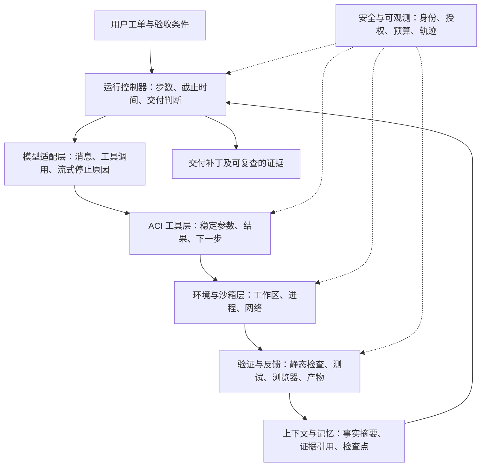
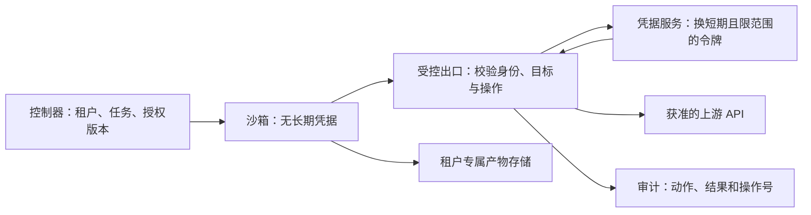
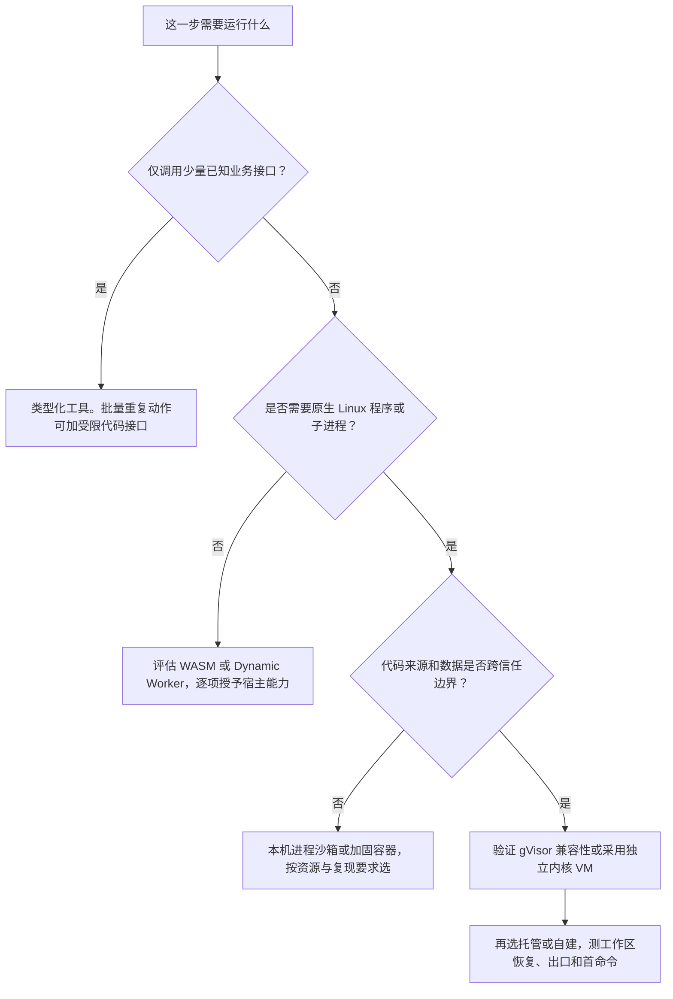

# 模块 08 · Harness Engineering：从一次工具调用到一个可以交付的沙箱

同一个模型修同一个缺陷，有时能交出可合并的补丁，有时只会交出一句「应该修好了」。面试 Agent 平台架构时，你会怎样让它在限定时间、权限和成本里，拿出别人可以独立复查的证据？

## 先走完一张工单

假设工单要求「修复导出功能漏掉最后一页的问题，提交改动与复现记录」。工程师会先拿一份刚好超过一页的样本，观察旧版本的导出，改完后再比对记录数。模型也能想出这个办法。可它能不能找到入口、能不能启动应用、是否拿得到合法的样本、服务没起来时还有几次机会、最后由谁检查导出的文件？这些条件都由模型外面的程序决定。**Harness Engineering 就是设计和改进这套工作环境，让一次决策能变成有边界的行动，再让行动的结果影响下一次决策。**

下面的六部分是拆系统用的视角。小团队可以把六部分写在同一个进程里。生产上最先需要物理分开的，通常是持有用户身份的控制面和执行生成代码的工作机。



沿着箭头走一遍。适配层把流式输出拼成完整调用，工具层检查参数，沙箱只收到这次任务所需的数据。验证器发现原有测试都绿了，但下载文件里只有五十行，便把「输入五十一行，实际五十行，文件在这里」交回模型。下一轮修的是一个具体的偏差。只保存「测试没过」会丢掉复现条件，只保存整份下载文件又会挤掉任务描述。**反馈要小到读得进，也要具体到可以推翻上一次判断。**

### 「换底盘多出十几分」究竟有哪些证据

OpenAI 的 Ryan Lopopolo 在 2026 年 2 月记录了团队用 Codex 从空仓库建设产品的经历。代码、文档和测试由 Agent 大量生成，人把架构约束做成可运行的检查，把开发服务和可观测数据变成 Agent 自己能访问的东西。原来要工程师念给它听的错误，现在下一轮就能读到。这个案例说明团队怎样重分配工程时间。它没有给出同一套题、同一模型的对照分数。[OpenAI 工程记录](https://openai.com/index/harness-engineering/)

Anthropic 在 2025 年的长任务案例里，让初始化会话留下功能清单，后续会话逐项实现、记录进度。2026 年 3 月的实验又把规划、实现和独立评价分开，评价者能在运行中的应用上操作。作者也记录了模型更新后取消特定上下文重置策略的经历。如果一个补丁是为某代模型容易提前收尾而加，换模型时应该试一次拿掉它，否则有可能把原来的救场机制变成新的阻力。[早期长任务实验](https://www.anthropic.com/research/effective-harnesses-for-long-running-agents) · [后续应用开发实验](https://www.anthropic.com/research/harness-design-long-running-apps)

| 实验或观察 | 原作者实际比较了什么 | 可以带走的结论 |
|---|---|---|
| LangChain 的 Deep Agents CLI | 固定 GPT-5.2-Codex，在 Terminal-Bench 2.0 从 52.8% 到 66.5%，相差 **13.7 个百分点**。改动涉及自查、环境信息、重复编辑提醒及推理预算 | 一次公开的同模型改造有这个量级。单个改动的独立贡献不能从总差值倒推。[实验记录](https://www.langchain.com/blog/improving-deep-agents-with-harness-engineering) |
| RHO 研究 | 作者固定使用高推理强度的 GPT-5.5。SWE-Bench Pro 按哈希分出一百道训练池任务和一百道留出测试题。在后者上对比原始 Codex 和通过历史轨迹优化的 Harness，报告一轮优化后从 59% 到 78%，相差 **19 个百分点** | 优化阶段也消耗并行采样和挑选方案的算力。引用数字时保留划分、基线和优化成本。[论文及表一](https://arxiv.org/html/2606.05922v2) |
| 跨模型、跨任务研究 | 作者比较两种 Harness、十个开放权重模型以及三种软件工程任务，另用可拆组件的 Harness 做对照 | 在修已有仓库和从头完成开放任务时，增加规划、压缩或子代理的收益可能方向相反。[研究原文](https://arxiv.org/abs/2609.32459) |

所以面试里如果听到「普遍拉开 10–30 个百分点」，可以追问两个数字的分母。前两组支持「有任务能拉开十几个点」，不能据此报出行业平均值或一般性的三十点上限。甚至不同团队说的「通过」都可能不一样。一个比较单次解决率，一个允许生成多个补丁再用测试选择。一个从依赖就绪开始计时，另一个包含下载依赖。生产上还要算每份**被接受**的补丁消耗了多少总时间和人工复核时间。

Philipp Schmid 在 2026 年 1 月的 X 讨论里提出，稳定的运行环境能把用户反馈带回工程迭代。他在同日文章里用操作系统管理工作内存和设备来比喻 Harness 对上下文、工具和会话启动的管理。Martin Fowler 网站上的作者 Birgitta Böckeler 则站在仓库维护者一侧，把做之前给方向的指南和做之后检测偏离的检查分开。社区里 Dex Horthy 在 X 上讨论的是另一种实际工作。使用现有编码 Agent 的人也能通过它开放的命令、钩子和技能改变交付效果。把三个视角放进一张工单，平台给它一个运行测试的入口，团队写清楚哪组测试算数，检测器在它准备收工前指出缺的证据。[Schmid 的 X 讨论](https://x.com/_philschmid/status/2008175408923959574) · [同日技术文章](https://www.philschmid.de/agent-harness-2026) · [Böckeler 原文](https://martinfowler.com/articles/harness-engineering.html) · [Horthy 的原帖](https://x.com/dexhorthy/status/1985699548153467120)

### 六部分各保存什么，出了故障找谁

**模型适配层**要保留调用 ID、有序的参数片段、真实停止原因和用量。一次回答可能先冒出工具名，过一会儿参数才完整，还可能并行请求两个读取。中途掉线时不能拿半段参数执行。给上层的事件应该区分「完整提案」「被截断」「供应商限流」。如果只是把几个 SDK 的文本字段统一命名，平台无法区分模型决定结束和输出预算用完，最后两种情况都会在界面上假装成功。

**工具层**规定一次动作的单位和失败语义。**环境层**则真正持有文件、进程、挂载和资源额度。比如编辑工具核对文件版本后写入补丁，运行测试的子进程只在该任务的工作目录活动。把两者分开，同一个编辑接口既能接本地工作树，也能接远程沙箱。反过来，给一个容器装上 Bash 并不能自动回答「编辑成功但回执丢了，再调一次会怎样」。这个契约要有人设计。

**上下文与记忆层**保存恢复所需的最小事实。一次检查点可以记录代码提交、未提交补丁对象、执行镜像摘要、最后确认的步骤、尚未核对的外部写入。下一轮优先读任务约束、最近一个反例和工作树摘要。大日志留在对象存储，模型按位置读取。上下文压缩时保留「测试用了五十一条数据、只返回五十条」。压成「分页有问题」等于又买一次定位成本。恢复时先确认工作树确实对应那份摘要，防止新进程按旧记忆去改另一份代码。

**验证层**从便宜的检查开始。静态规则发现越层调用，单测检查游标边界，集成测试确认数据库确有五十一条，浏览器检查点击导出按钮后的实际文件。检查结果写上提交摘要和数据版本。成功跑过旧提交的测试不能给新提交盖章。验证器与工作区分开管理验收规则，否则生成器为了让测试变绿而改掉断言，平台会把证据本身的变化错算成产品修好。遇到本来就不稳定的用例，保存失败样本和重跑次数，单列「无法判断」。

**安全与可观测层**贯穿全程。控制器据用户、租户、工具和资源做授权，执行层负责强制落实。每步记录等待模型、排队、进程执行和证据回传各花了多久。事件带上同一工单号，却分别标记工具调用和尝试编号。排队四十秒和测试跑四十秒需要两种修法。日志也有访问主体，租户甲不能凭一个可猜的轨迹号去读租户乙的编译输出。平台没有必要为了测延迟保存用户的全部源码。

## ACI 工具设计：让正确的一步更容易选中

把图形界面的「导出」按钮藏在八层菜单里，人会反复点错。模型用的按钮就是工具名、描述、参数和结果。SWE-agent 将这套交互面称为 Agent-Computer Interface。它研究的一个实际问题是怎样限制每次查看的范围并及时反馈编辑错误。Anthropic 后来把类似原则用到企业工具上，先用真实任务观察调用轨迹，再决定哪些接口值得提供。[SWE-agent 论文](https://arxiv.org/abs/2405.15793) · [Anthropic 工具工程实践](https://www.anthropic.com/research/writing-tools-for-agents)

### 一组 API 可以对应一个意图，也可以对应两个授权边界

为导出缺陷找相关工单，传统后端可能要列项目、列工单、取描述、查发布、查负责人。把五个 REST 端点一比一暴露，模型每一步都得猜连接键。它还可能拿了第一个项目的默认分页，就认定没有关联工单。更合适的工具叫 `find_export_regressions(project, release, cursor)`。后端做已知的联查，返回候选工单、匹配原因、稳定 ID 和下一页游标。模型只负责判断候选与当前缺陷是否相关。服务端仍然要逐个资源执行访问控制，联查不能扩大读权限。

合并也有停止线。「查出候选，顺便把它们全部关掉」把读和写绑进了一次推理。更清晰的设计是先返回带版本的候选集，再用 `apply_reviewed_labels(plan_id, expected_version)` 提交确认过的变更。前者可自由重试，后者需要独立授权、幂等键与逐项回执。判断工具该合还是该拆，看中间有没有需要模型解释的歧义、需要人决定的后果或不同的权限。接口频率只是线索。

工具命名也会影响选路。两个系统都有 `search`，用稳定命名空间区分工单搜索和源码搜索，把返回的数据类型写进描述。不要把工具取名为「万能搜索」却只索引最近一周。让描述回答「该在什么场景用，成功后能做什么，范围和权限在哪里」。用一组确实容易混淆的任务检验改名效果，比让同一个模型评价说明书是否好读更直接。

### 路径、补丁和版本共同决定编辑会不会落错地方

模型先运行测试，再进入子目录，下一步传入 `src/export.py`，到底从哪个目录算？Anthropic 早期的经验是让模型提供绝对路径，消除当前目录变化造成的歧义。在多租户平台，也可以给工具一个不可变的工作区根，只接受根内的相对路径。OpenAI Cookbook 的补丁示例就对绝对写路径有限制。两种设计都能清楚工作，最坏的是一个工具按仓库根解释，另一个按上次 shell 所在目录解释。把解析规则放进契约，返回规范化的工作区路径，最后由挂载与内核访问策略执行限制。[Anthropic 的 ACI 附录](https://www.anthropic.com/research/building-effective-agents) · [OpenAI 补丁示例源码](https://github.com/openai/openai-cookbook/blob/main/examples/gpt-5/apply_patch.py)

「删第 137 行」看起来精确，另一个编辑先插了一行，工具就会删错位置。可以传原文和新文，让 `str_replace` 要求原文唯一命中。零次命中就重读指定区域。多次命中就扩大前后文。需要跨多处改同一功能时，类似 `apply_patch` 的格式把文件名、上下文及增减行放在同一段补丁里，减少多次编辑的漂移和把引号再包进 JSON 的负担。两者是不同权衡，没有普遍的先后替代关系。大段生成文件、重复模板、换行规范不一致都可能让上下文匹配含糊。高并发工作区还要比较读时版本，避免唯一命中了一段内容却覆盖了别人刚改的语义。[Claude 文本编辑工具](https://platform.claude.com/docs/en/agents-and-tools/tool-use/text-editor-tool)

参数尽量让模型做一次选择就能填对。按发布标识查询时让它传一个不透明 ID，别要求它复制项目、组织和内部版本三层对象。必须表达多种动作时，分别给出清楚的字段约束与合法示例。日期显式带时区，单位写在字段名里，区分「没提供」和「设置为空」。服务端先校验再执行，返回错误定位到具体字段。不要给缺失的目标仓库默填最近使用的仓库，这种便利会把输入错误静默升级为跨项目写入。

### 错误返回也是下一轮的输入

下面是示例工具对并发编辑的回应。完整轨迹按权限存放在后端。模型收到的信息足以决定下一步，而且不会把底层实现、敏感值或两百行堆栈一股脑送进上下文。

```json
{
  "code": "REVISION_CONFLICT",
  "path": "src/export.py",
  "expected_revision": "r14",
  "current_revision": "r16",
  "effect": "no_write",
  "next": "重新读取 export_page 函数，基于 r16 生成补丁。",
  "trace_id": "edit-417"
}
```

这个设计还有一个常被忽略的分支。「没有写入」只适用于事前检查已明确拒绝的情况。如果调用发出后对端断线，只知道结果未知，应返回可查询的操作号，先查回执再决定。把未知一律写成「重试即可」，最容易让账目重复。错误修复指引也应由可信适配器生成。上游数据里的任意文本只作为带边界的诊断材料，不能自行指定下一步允许调用哪个工具。

输出预算按使用阶段分配。搜索时返回 `concise`，只给标识、命中片段、版本和续读方式。选中一条后才传 `detailed` 取完整说明。分页要说明截断、排序键与快照范围，保留下一页游标。否则模型会把「前五十条没有」读成「全库没有」。一个请求明确只要计数时，直接提供聚合接口。返回的数据缩到十行，也要留下过滤条件、样本总数及证据引用，供人查为何其中一项没被选中。

评估 ACI 可以拿一周内的典型工单，由同一模型分别使用老接口和新接口，执行顺序打乱，共用只读数据快照。除了成功率，记录第一次选对工具的比例、同一个错误要几轮能恢复、每个成功任务读了多少无关字节。在详细版里增加一个字段后，若看似成功的请求变多，却有更多越范围操作，应优先检查描述是不是让模型误以为自己拿到了额外权限。把错误轨迹留给接口作者，比盯着总调用量更有解释力。

## CodeAct 与 Programmatic Tool Calling：让循环发生在执行器里

想给本次发布中所有缺少验收记录的导出工单加一个「需复核」标签。最笨的做法是让模型每看完一页就再想一次，逐条复制 ID，逐次调用更新。在一个示例里，两页查询、一次详情核对、七次逐项写入，串行便有十次工具往返。若客户端支持并行，推理轮次会少于调用数。另一条路是让模型写一个小程序，解释器遍历分页、筛选、聚合，只把候选计划和结果送回来。业务服务收到的调用可能还是十次，节省的是夹在这些调用之间的模型等待和数据搬运。

CodeAct 论文把可执行 Python 当作模型表达动作的语言，循环、条件和库函数都能参与。Programmatic Tool Calling 更具体，程序可以在受控执行环境中调用一组已授权工具，宿主把工具结果返回给正在执行的程序。需要模型选择时才回到模型。Bash 是很好的文件与进程接口，代码模式也可以只有一个带类型的 JavaScript 函数而没有 shell。挑选动作语言，先看任务需要哪种组合能力。[CodeAct 原论文](https://arxiv.org/abs/2402.01030) · [Anthropic 的程序化调用说明](https://platform.claude.com/docs/en/agents-and-tools/tool-use/programmatic-tool-calling)

下面的示意程序为本次发布创建一份可以重放的待复核计划。这里的 `api` 是宿主注入的受限接口。它在第一页固定查询快照，游标绑定过滤条件。写入计划时服务端按发布、快照和内容摘要去重。真正改标签得经过另外的提交入口。

```python
def propose_review(api, release):
    snapshot = api.open_issue_snapshot(release=release)
    cursor = None
    candidates = {}
    seen_cursors = set()
    for _ in range(100):  # 本次预算只允许读一百页
        page = api.read_page(snapshot.id, cursor=cursor)
        for issue in page.items:
            if issue.component == "export" and issue.acceptance_record is None:
                candidates[issue.id] = issue.revision
        cursor = page.next_cursor
        if cursor is None:
            break
        if cursor in seen_cursors:
            raise ValueError("分页游标重复，未创建计划")
        seen_cursors.add(cursor)
    else:
        raise ValueError("超出页数预算，请缩小发布范围")
    plan = api.save_review_plan(release, snapshot.id, sorted(candidates.items()))
    return {"plan_id": plan.id, "count": len(candidates),
            "sample_ids": sorted(candidates)[:5]}
```

模型只需解释最终的数目和样例，人可以通过计划号展开全表。确认时，执行器拿冻结的计划逐项对版本，有变更的报告冲突。已经成功的项目可凭操作号核对，不必重新写。限页、去重和有界返回都改变可靠性。直接截到一百页就提交，会悄悄把超预算结果包装成完整计划。把失败和零条结果区分开，用户才知道「没有候选」值不值得信。

怎样估算收益？先分别记模型往返次数、输入输出 token、业务 RPC 数、返回字节和执行环境建立时间。假设模型每轮等待两秒，十轮串行约占二十秒。合并为写脚本与读结果两轮，就有约十六秒可用来覆盖启动和脚本开销。这里还没算业务服务的耗时，更没把这些示例数字当实测。长前缀缓存能降低部分重复输入的计费与预填充时间，无法让十次决策自动变成两次。脚本冷启动要几秒而任务只有一次读取时，普通工具往往更快。

精度的收益也有条件。整数求和、按明确定义的键去重、对已给定时区排序，用解释器执行后结果可复算。模型仍可能写错谓词，把「缺记录」理解成「记录为空字符串」，或把币种不同的整数直接相加。给脚本一组带边界的小样本，包括恰好满页、无结果、重复项目和部分失败，先检验业务语义，再让它处理大批数据。需要解释含混文字、涉及不可逆操作或每步都依赖用户选择时，保留显式工具与人工确认。单次代码调用里可以藏很多动作，授权、限额和审计应落到每个底层操作上。

## 把生成的代码交给谁执行

用户让系统修一个合法仓库，仓库里的测试仍然有能力启动子进程、读当前身份能读的文件、占满磁盘。设计沙箱时先画出**代码在哪里跑，谁处理它的系统调用，哪些东西即使代码出错也绝不能被它改掉**。后台要保存的补丁、控制器自己的密钥和另一个租户的工作树，各有不同的保护边界。

### 从进程到虚拟机，再到托管平台

下表中的启动从本地已有运行时、镜像或模板谈起。「毫秒级」只给量级直觉。厂商很少在同一台机器、同一镜像、同一个就绪探针下公布数据。没有可比测量的地方直接写出决定时间或内存的因素。表的最后一行单列服务层，购买服务和选择隔离原语是两次决定。

| 路线 | 谁提供隔离 | 启动和额外内存怎么看 | 文件、网络及适用任务 |
|---|---|---|---|
| OS 进程沙箱 | 共享内核，按进程树限制系统调用、路径或命名空间 | 接近启动本机子进程的量级，可到毫秒级。无需另养内核，但解释器与子进程照样付内存 | 显式开放工作目录和必要代理。在开发者笔记本执行常规编辑、测试 |
| 普通 Linux 容器 | namespaces、capabilities、cgroups 等配合，常见 runc 容器共享宿主 Linux 内核 | 缓存命中通常在毫秒至秒的范围。拉镜像、解压另计。每容器主要付应用与可写页 | 可以挂卷、建网络命名空间。可信内部构建需控制权限和挂载 |
| gVisor | 每个沙箱的 Sentry 在用户态实现 Linux 接口，下面仍然有宿主内核 | 启动需建立 Sentry 等运行时。每实例有用户态内核及缓存成本。密集系统调用可能更慢 | 兼容常用 Linux 用户态，部分系统调用、设备和文件系统有差异。适合验证过兼容性的多租户任务 |
| Firecracker 等 microVM | 利用 KVM 等硬件虚拟化，每台有独立来宾内核。宿主仍提供 VMM 和设备后端 | AWS 在 i3.metal 上按默认 microVM 大小测得精简启动低于 125 ms，VMM 的额外内存低于 5 MiB。另算来宾内核、应用和缓存 | 通常提供块设备、虚拟网卡、宿主通信通道。适合需要原生二进制和强租户边界的代码 |
| WASM / V8 Isolate | WASM 模块受线性内存与宿主导入约束。V8 隔离堆与执行上下文，平台再加进程等保护 | 已有运行时内创建轻实例通常是毫秒量级。引擎可共享，每份堆或线性内存另计。加载大型 Python 发行物会改变数字 | 文件、网络与时钟来自宿主授予的接口。适合计算和受控 API 编排 |
| 云端 Agent Sandbox | 由服务商或集群选择前面的一种或多种运行时 | 要测分配 API 到首条命令完成的分布，最低收费/预留内存也与物理开销不同 | 多提供模板、卷、快照、出站策略和租约。控制面需对接企业身份和证据存储 |

**进程沙箱适合本地，是因为它能保留原来的工作方式。** macOS 的 Seatbelt 可以用策略约束进程树的文件与网络访问，相关工具使用 `sandbox-exec` 启动受约束的命令。Linux 上的 bubblewrap 用命名空间与挂载构造子进程能看到的文件树。Landlock 是内核提供的自限权限机制，可按 ABI 支持的规则约束访问。seccomp-bpf 则在系统调用入口按调用号和可检查的参数作决定。用一个过滤器同时承担路径授权、网络目标识别和 CPU 计量，会很快碰到能力边界。进程可写范围、网络出口和资源额度应交给各自能强制执行的层。[Linux Landlock 文档](https://docs.kernel.org/userspace-api/landlock.html) · [Anthropic Sandbox Runtime](https://github.com/anthropics/sandbox-runtime)

Claude Code 的本地 shell 沙箱可借助 Anthropic 的运行时在 macOS 上用 Seatbelt、Linux 上用 bubblewrap，将网络请求引到受控代理。Codex CLI 也按操作系统选择实现。读当前 Linux helper 可以看到 bubblewrap 处理文件系统与命名空间，seccomp 限制系统调用。较早的实现和迁移期源码里会看到 Landlock。排查时记下 CLI 版本、实际启用的 sandbox 模式和宿主内核，别拿两年前的机制描述解释今天的拒绝日志。主进程持有的登录身份和 shell 子进程可用的身份也要分开审查。[Codex Linux helper](https://github.com/openai/codex/blob/main/codex-rs/linux-sandbox/README.md) · [Codex macOS 策略说明](https://github.com/openai/codex/blob/main/codex-rs/core/README.md)

**普通容器把发布和资源管理做得很方便。** Docker 负责镜像与开发体验，containerd 管理容器生命周期，具体运行时可以替换。在常见 Linux 宿主上用默认容器运行时启动十个环境，看到十份文件系统视图，并不等于有十份内核。恶意程序接触的内核接口和宿主授出的挂载仍构成风险。控制器要限制特权、设备、可写挂载以及宿主控制接口，配合只读基础层、非特权身份及资源配额。Docker Desktop 在宿主与 Linux 虚拟机之间还有一层，同一台 Linux VM 里的普通容器依然共享那台 VM 的内核。讨论「有没有隔离」时，先说清你站在哪两方之间。[Docker Engine 安全模型](https://docs.docker.com/engine/security/)

**gVisor 改的是系统调用的去向。** 应用以为自己调用 Linux，许多操作实际上由 Sentry 满足。需要真实宿主资源时，再通过受约束的路径访问。在 OCI 环境可以选择 `runsc`，运维人员还能沿用熟悉的镜像。做大量纯计算时，代价与做大量小文件元数据操作时差别明显。典型验收应包含真实项目的依赖安装、编译、文件监视、子进程和数据库临时目录，而除了跑通一条 Python 表达式，还应检查与生产相同的网络和存储方式。若某项必需的系统能力不受支持，业务适配成本可能比机器费更贵。[gVisor 架构说明](https://gvisor.dev/docs/architecture_guide/intro/)

**microVM 给需要完整操作系统的任务一个较清楚的边界。** Firecracker 通过缩减虚拟设备模型降低每台 VM 的开销，在 KVM 上运行来宾内核。来宾能运行常规 Linux 二进制，网络仍要宿主为虚拟网卡安排路由，文件通常先做成块设备或由工作区服务搬运。它不会自动把开发者的文件夹变成安全共享盘。AWS Lambda、E2B、Fly.io Machines 都有明确的 Firecracker 一手说明。读厂商性能表时，VMM 的额外内存不能当作一台可跑浏览器的沙箱总内存，内核启动时间也不能当作用户点击到首条测试通过的时间。[AWS 测量条件](https://aws.amazon.com/blogs/opensource/firecracker-open-source-secure-fast-microvm-serverless/) · [Firecracker 项目](https://firecracker-microvm.github.io/) · [E2B 隔离说明](https://e2b.dev/security) · [Fly Machines](https://fly.io/learn/firecracker-vm/)

**WASM 和 V8 适合把「整台电脑」缩成几个必要能力。** 对一组记录按日期聚合，只提供输入数组、时钟和输出接口即可。给动态脚本提供经过授权的工具函数，也不必向脚本开放宿主文件。V8 Isolate 是引擎内执行环境，WASM 是可以在这类环境或其他运行时内执行的模块格式，两者可以同时出现。Pyodide 把 CPython 和一批包编译到 WebAssembly，可用包、子进程及原生扩展都有环境约束。需要启动完整浏览器或未经移植的二进制时，改选 Linux 运行环境往往更直接。隔离强度也取决于宿主暴露了哪些导入和网络能力。[Cloudflare Workers 运行模型](https://developers.cloudflare.com/workers/reference/how-workers-works/) · [Pyodide 兼容性说明](https://pyodide.org/en/stable/usage/wasm-constraints.html)

### 采购或自建，先用同一份工作负载提问

| 平台或项目 | 实际购买、部署的东西 | 最容易影响选型的验收问题 |
|---|---|---|
| E2B | 每沙箱 Firecracker microVM，模板及可保存的文件系统、内存状态 | 用自己的解释器、依赖和区域测试首命令与恢复。区分模板启动、恢复某个租户的旧机和新建空机。[安全边界](https://e2b.dev/security) |
| Modal Sandboxes | 可选 gVisor 或带独立 Linux 内核的 VM。文档说明网络策略可用于两种运行时 | 需要 FUSE、嵌套容器等能力时在 VM 路径验证。默认出站能访问公网，应显式选择限制策略。[运行时](https://modal.com/docs/guide/sandboxes) · [出站与隔离](https://modal.com/docs/guide/sandbox-networking) |
| Daytona | Sandbox 提供内核、文件系统、网络栈及资源配额，Runner 承接计算。模板、快照等由平台管理 | 将 Runner 地域、镜像就绪和存储生命周期放进验收，核对自托管版本及部署配置怎样兑现托管产品所述边界。[沙箱说明](https://www.daytona.io/docs/en/sandboxes/) · [平台架构](https://www.daytona.io/docs/en/architecture/) |
| Cloudflare Sandboxes | Linux 路线用 Container。只需受控 JavaScript 时可用 Dynamic Worker，宿主 Worker 提供接口 | 需要 shell、生成 PDF 的原生库或子进程就测 Linux 路线。只做 API 编排时测 Dynamic Worker 的能力与出站配置。[平台选型文档](https://developers.cloudflare.com/sandbox/concepts/) |
| Kubernetes Agent Sandbox | SIG 项目的控制器、Sandbox 及模板、Claim、WarmPool 等资源，适于管理独立且有状态的工作负载 | 它解决供应与生命周期。具体是否有用户态内核或独立来宾内核，取决于集群配置的 RuntimeClass 与节点能力。还应测卷、网络策略与回收。[项目设计与资源](https://github.com/kubernetes-sigs/agent-sandbox) |

E2B 的运行时源码给出了「创建」这个词的一种具体解释。常用模板已预启动，创建沙箱时恢复 VM 状态，按缺页载入内存，根文件系统使用写时复制。纯文件系统模板没有内存快照，就要从磁盘启动。两个调用都叫创建，后端的关键路径可以完全不同。做 A/B 测试时把模板类型写进每条样本。否则新模板带来的加速，可能被误归因给新换的虚拟机运行时。[E2B 运行时架构](https://github.com/e2b-dev/runtime/blob/main/docs/ARCHITECTURE.md)

同一个企业可以混用几条路线。例如开发者在笔记本上通过进程沙箱改动，提交前把补丁交给远程独立 VM，在可重建的镜像里验收。两地运行结果不同时先比较镜像摘要、时区、文件名大小写处理、默认 locale 和工作树差异。在相同输入上复跑这两种环境，可定位补丁依赖了哪一项本机设置。若任务主要是 SQL 聚合或已知工具间搬运数据，并发预热大批 Linux 工作机可能只是为根本没用上的能力付费。

## 出站、密钥与恢复：一台隔离的机器仍能办错事

假设工作机只能看到本租户的合成测试数据，但里面有一个能改整个组织工单的长期令牌。机器的内核再独立，里面每个获准读取环境变量的程序都可能接触这个令牌。即使把输出里的令牌涂黑，凭据已经进了子进程和内存快照。更稳妥的生产设计，是只给工作机一个完成指定动作的入口，在可信代理到上游服务的最后一跳附加短期凭据。



在这个设计里默认切断直连公网的路径，必要请求经过代理。软件包经只读镜像源获取，业务调用按目标、方法、租户、对象和作用域匹配，禁止把凭据转附给新的目标。代理依据控制面签发的运行身份授权，不能相信脚本自己填的租户字段。给固定上游端点加凭据时，需要由可信组件理解并发起应用层请求。一个只转发加密字节的通用隧道没有这种语义。若需要通用联网测试，就把它放在不带业务数据和敏感凭据的不同执行配置中。

允许访问某个域名只是第一步。同一家 SaaS 上可能同时有本企业和外部用户的文档。合法目标也有只读搜索和对外发布两类动作。对高价值操作，通过窄接口校验资源归属和授权者，把请求大小、并发和响应范围也纳入策略。入口拒绝时只返回可操作的说明。审计保存批准范围和回执。代理故障时将任务挂起或报告缺少依赖，不能因为业务超时就给所有工作机临时开公网。这样把一个基础设施故障控制在可重试的范围内。

### 预热池怎样做到两百毫秒，又在哪些请求上做不到

用户感觉到的时间从「要一台机器」开始，到第一条有意义的命令成功结束。把它拆成排队、领租约、准备文件层、恢复内存、绑定身份与网络、运行探针、首命令。并发阶段按关键路径算，别把不相干的阶段均值硬加起来。进程启动很快，远程卷第一次读取却要从另一地区拉一百兆数据，用户仍然会看到白屏。Firecracker 的恢复需要 VM 状态、内存快照及相匹配的磁盘内容，块设备内容由平台另行管理。懒加载把部分代价推迟到首次触页，恢复 API 提前返回有可能只是挪动了秒表。[Firecracker 快照设计](https://github.com/firecracker-microvm/firecracker/blob/main/docs/snapshotting/snapshot-support.md)

共享模板应该只包含公共依赖。安装依赖、编译缓存并检查健康后，生成不可变模板，用摘要记录内核、基础盘、运行时和预装包。真正接单时，为某个租户取得一次性租约，挂上其专属可写层，分配新的运行身份，打开对应的出口策略，验证首条指令。带私人源码、会话随机状态、打开的外部连接或授权材料的快照，只能进入该租户授权的恢复流程。恢复后还要重新建立外部连接并更新短期身份。恢复内存不会让已经过期的远端事务重新有效。

温池里可以留一批从公共模板启动、还没接过用户数据的实例。领取要原子地从「可领取」改为「分配中」，成功后绑定唯一租约。超时的分配由回收器核对实际状态，再决定销毁或重新准备。任务结束后销毁私有状态，仅保留按约定导出的产物。高并发时常见的事故是两个调度器都以为自己领到了池子的最后一台，或者租约已转手，老工作进程仍能上报成功。让每次分配带递增的代次，控制面和产物服务拒绝旧代次的写入。

以 **P95 首命令小于 200 ms** 为示例目标，明确限定在同区域、小模板、短探针和健康池的工作负载上。假设命中池子的请求全在 120 ms，未命中都要 1200 ms，命中率只有 90%，总体 P95 就会落在慢的一组。要使整体指标过线，仅报告温池 P50 几乎没有意义。预热数量的起点可以取「峰值每秒领用数 × 补货所需秒数」，再按区域、模板和突发分布留余量。每秒十台、补货三秒，三十台只够覆盖稳定流量在补货窗口内的消耗，不能承诺突然来的五十个请求。

Kubernetes Agent Sandbox 项目给了可以核对的参照。其调优记录中，一个预置 3700 台的池在 12 秒突发里接下 3600 个 Claim，领取约每秒 300 个，P90 不超过 200 ms。这里测的是领取已就绪沙箱，首命令还没算进去。边领边补测到的单池持续吞吐约每秒 70–85 台。文档还指出，在该实现中，Claim 设置了自定义环境变量或卷申领模板会改走冷路径。即便温池仪表盘显示有空位，这类请求仍然慢。[项目的压测条件和调优记录](https://github.com/kubernetes-sigs/agent-sandbox/blob/main/docs/performance-tuning.md)

实际压测至少留四列，区分热命中、冷创建、有状态恢复和池耗尽排队。给每次样本记镜像大小、区域、并发、卷缓存状态，记录 P50、P95、P99 与失败率。再算维持温池每小时的空闲内存费、每个成功任务的摊销成本和租户配额。轻负载时宁可接受冷启动，也不该用整夜空转的浏览器替一次日间报表省半秒。若产品约定交互命令必须快，可把大仓库同步放进用户开工前的准备阶段，在界面上分别报告「机器可用」和「仓库就绪」。

### 崩溃后的三本账

假设上一进程在「补丁已改、测试已跑、标签可能已写」时被回收。平台应独立保存工作区版本、验证记录和外部操作回执。重启时先恢复工作区，核对验证记录的提交与工具版本，只有一致的结论才可复用。然后拿业务操作号询问工单服务。重启的进程拿到相同的文件，只证明文件相同。它看不见另一个服务在崩溃前最后几毫秒做了什么。

如果下游支持幂等键，在首次提交前把键及规范化参数摘要持久化，同一动作的重试沿用原键。用户修改目标或重新授权时产生新动作。如果下游只有查询而没有幂等写，尝试使用稳定业务键和读回核对。如果两者都没有，平台要显示「部分结果待核对」并保存已知回执。对已经可能产生副作用的操作，任何把超时直接当失败重做的方案，都会把一次网络问题变成两次真实操作。超时治理是整个 Harness 的职责，靠给模型加一句「小心重复」承担不了。

## 选型时，从最难承受的失败倒推



给团队上第一版时，我会先约定一份真实的验收合同。它写明补丁归属、成功必须看到的证据、时间预算和允许操作的资源，选二十个覆盖分页、依赖失败及恢复的真实任务录基线。一周后若主要失败是模型找不到测试入口，先改 ACI 和工作区指南。若已经找到测试但十次里八次在等镜像，先改镜像分层和供应。判因时对一批任务一次只改一项，保留旧 Harness 回放，用相同模型版本做配对比较。这比笼统争论是否「应该上更大的模型」更能直接改善交付。

## 七道面试追问

### 1．同一模型多做对十几个百分点，你怎样证明是 Harness 的贡献？

**考察点**是能否证明分数变化来自这次改动。

**回答示例**

锁定模型快照、题集划分、镜像、工具权限、超时、推理强度和重试规则，保留每题新旧两条轨迹。报告单次通过、按题配对的差异及波动，再做去掉各组件的消融。先引用 Terminal-Bench 的 13.7 个百分点，再说明这是特定设置。

**追问**　加多一次测试算作弊吗？

若目标是相同预算下交付，就把测试时间与费用计入预算。若目标是最高正确率，允许多测，同时公开额外投入。要把目标写在看分数之前。

### 2．给一个有几百个端点的内部系统做工具，怎么知道合并得对？

**考察点**是任务意图与权限是否对应。

**回答示例**

采样用户真正提的请求，找总是相邻、输入可从前一步确定、权限相同的读操作，把它们合成带分页和证据引用的业务工具。候选选择、跨系统身份和对外写入各自保留决策点。

**追问**　合并后查询慢了怎么办？

给联查设截止时间，报告覆盖范围和不完整来源。能用索引或服务端聚合的先优化，访问了五个系统却只有三个返回时别声称「查遍全库」。

### 3．为什么给模型一个执行器可能更省钱？什么情况下反而更贵？

**考察点**是分清模型往返、业务调用和机器启动三种成本。

**回答示例**

多页筛选适合把循环搬进程序，原始行留在执行器，输出计数和计划号。只查一条状态则直接调用类型化工具。算每个成功任务的全成本，包括失败脚本、冷启动、重试和审计。

**追问**　脚本算对了能直接发给所有人吗？

先确认筛选语义和收件范围，把待提交的目标版本冻结，走单独的写入权限，最后读回逐项回执。

### 4．为什么企业笔记本能用本地沙箱，面向陌生租户却可能需要 VM？

**考察点**是能描述谁在信任谁。

**回答示例**

笔记本常要复用本地工具链，限制子进程能写的目录和网络即可改善日常风险。托管多租户要考虑一个任务的代码对其他任务和宿主内核的影响。普通容器共享内核，gVisor 缩小直接接触的宿主接口，microVM 再加独立来宾内核。

**追问**　有 VM 是否就能挂所有卷？

宿主显式递给来宾的卷就是该任务可触达的资产。仍要按租户和操作模式挂载并核对备份权限。

### 5．供应商报百毫秒，线上 P99 却两秒半，从哪查？

**考察点**是读懂延迟分布与时间边界。

**回答示例**

同一条轨迹标出排队、租约、模板命中、恢复、网络绑定及第一条实际命令结束的时间，按区域、模板和新旧会话拆分。查看高分位是否由池耗尽或远程卷首次读取贡献。

**追问**　要不要把所有模板都预热？

看频率、补货时长、时段性和延迟承诺，高价值热模板按峰值供应，长尾模板接受冷路径，报整体指标及分组费用。

### 6．要访问私有仓库，又不希望令牌进入代码环境，如何设计？

**考察点**是秘密所在位置和上游动作权限。

**回答示例**

控制面绑定本次任务到指定仓库与只读身份，可信代理代取内容或只代理获准操作，短期凭据只出现在代理到上游的一跳。阻断没有代理的直连，审计请求目标而对敏感内容做最小化。

**追问**　代理允许访问代码托管域名就够了吗？

还要限制组织、仓库、动作和可写目的地，因为多个互不信任的资源共用同一域名。撤销授权时同时失效租约和代理权限。

### 7．模型说「修好了」，你会在哪个条件下拒绝结束任务？

**考察点**是能不能把成功定义为独立证据。

**回答示例**

让它交出对应当前提交的补丁、旧版本可复现的反例、修复后通过的回归、真实入口的浏览器或集成验证。若环境失败则记录阻塞及可复查的日志。达到预算时带事实停止。

**追问**　验证器也可能写错呢？

给验证器保留已知坏样本，检查能否把它判失败。让人定期抽看假阳性、假阴性。把验证规则的变更与业务补丁独立评审，防止一次改动同时移动了答案和评分线。

## 一手资料怎样继续读

核对日期为 **2026 年 11 月 24 日**。复盘自己团队的失败时，可以按问题选原文。

- 想知道「为什么要改环境」，先读同模型对照，再看生成器和评价者如何分工。前者有分数和预算，后者有真实应用的检查路径。[LangChain 实验](https://www.langchain.com/blog/improving-deep-agents-with-harness-engineering) · [Anthropic 长任务实验](https://www.anthropic.com/research/harness-design-long-running-apps)
- 想设计编辑工具，对照研究里的 ACI、工具工程里的任务评测和实际补丁解析器，可以看到工具描述、动作格式和错误处理分别在哪里生效。[SWE-agent](https://arxiv.org/abs/2405.15793) · [Anthropic 工具工程](https://www.anthropic.com/research/writing-tools-for-agents) · [补丁源码](https://github.com/openai/openai-cookbook/blob/main/examples/gpt-5/apply_patch.py)
- 想挑隔离后端，沿系统调用和快照恢复两条线读。前者解释应用与宿主之间的边界，后者交代虚拟机状态和磁盘分别由谁保存。[gVisor](https://gvisor.dev/docs/architecture_guide/intro/) · [Firecracker 快照说明](https://github.com/firecracker-microvm/firecracker/blob/main/docs/snapshotting/snapshot-support.md)
- 想在多租户集群上线，对照 WarmPool、Claim 的资源模型以及托管平台对网络和运行时的实际承诺，写出自己的租约时序和出站策略。[Kubernetes Agent Sandbox](https://github.com/kubernetes-sigs/agent-sandbox) · [Modal 网络与运行时](https://modal.com/docs/guide/sandbox-networking)
