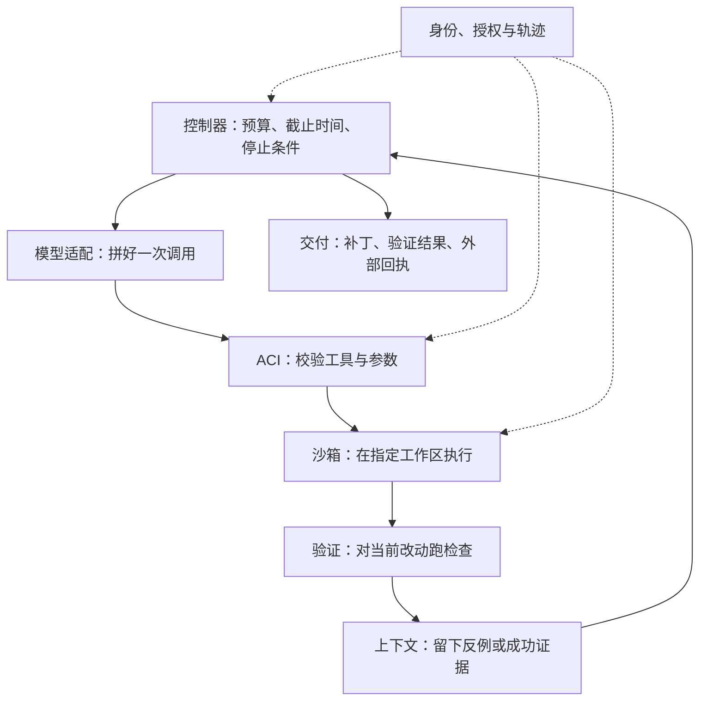
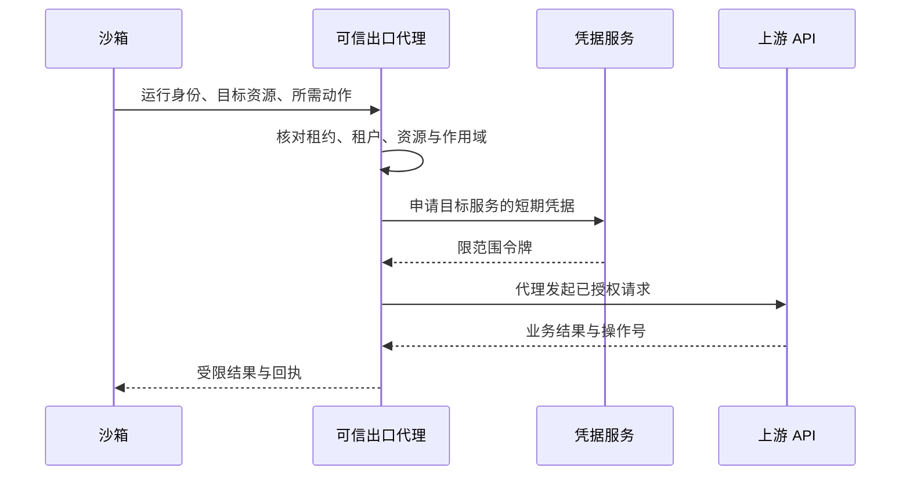

# 模块 08 · Harness Engineering：从模型提议到沙箱验收

> 模型可以提出补丁，Harness 要回答三个更具体的问题：这一步能不能执行，怎样知道改对了，进程中途消失后从哪里继续？面试讲架构，沿着一条工具调用回答就够了。



## 一、Harness 的六大支柱：沿着一次编辑找责任

模型请求修改文件时，有三个时刻容易被混为一谈：它说出了工具名，工具写入了文件，改后的程序通过了验收。这三件事分别由不同层确认。把它们拆开，看一条失败轨迹就能找到该改哪段程序。

| 支柱 | 它负责回答什么 | 实现时留下什么 |
|---|---|---|
| 模型适配 | 供应商送来的是完整调用、参数片段，还是被截断的回复？ | 按调用 ID 拼参数，分开并行调用，保留停止原因、用量与限流信息 |
| 工具接口（ACI） | 模型想改哪份文件，基于哪个版本，失败后该怎么做？ | 参数模式、版本条件、效果明确的回执和下一步可读的位置 |
| 环境与沙箱 | 命令在哪里跑，能看到什么，最多用多少资源？ | 工作区根、挂载、镜像摘要、进程树、网络策略与配额 |
| 上下文与记忆 | 换一个模型会话，它凭什么接着做？ | 任务约束、补丁引用、最近的反例、检查点和尚待核对的操作号 |
| 验证与反馈 | 什么证据足以说明这份改动有效？ | 绑定代码和数据版本的检查结果、失败样本、真实入口的产物 |
| 安全与可观测 | 谁授权了哪次操作，时间和钱花在哪里？ | 按租户隔离的轨迹，关联运行、调用与尝试编号，分段记录延迟 |

**流式适配的细节**：同一轮有两个读取请求，就按各自的调用 ID 缓冲片段。模型输出被截断时，丢弃尚未完成的提议，保留停止原因。把半截参数交给带默认值的工具，可能真的写错文件。

**控制器如何收尾**：适配层拼好参数才交给工具，工具报告写入成功才调验证器。模型提前说“完成了”，控制器仍可要求跑验收。到达步数或时间上限时，返回已有补丁、证据和阻塞原因，供下一次接手。

例如测试进程返回非零退出码，下一轮最值得读的是失败断言、期望值、实际值和命令。完整日志落盘，附按权限可读的定位信息。只留“测试失败”会让模型重新排查，把十万行都送回去又可能挤走原始约束。

### 验证怎样做到独立

1. **先确认用例能抓错**：同一条回归测试先跑旧版本，看到预期的失败，再跑补丁版。测试只断言“没有抛异常”，未必能抓住算错结果的问题。
2. **按代价安排检查**：静态规则查越层依赖，单测查函数边界，集成测试接真实依赖。按钮触发下载这类行为，最后经浏览器操作并检查文件内容。
3. **把评分条件放在生成器之外**：验收规则单独维护，结果绑定提交、未提交差异与测试数据版本。若用例时红时绿，留下样本和重跑次数，单列“尚不能判断”。

重复发生的失误值得进仓库：模块依赖方向写进 linter，容易漏掉的边界补回归测试，稳定的调试步骤收进技能。下次运行自动得到反馈，这就是 Compound Engineering 在编码环境中的具体做法。

### 同一个模型，换 Harness 能差多少

| 谁做的对比 | 改了什么 | 实际结果 |
|---|---|---|
| LangChain · Terminal-Bench 2.0 | 固定 GPT-5.2-Codex，补环境信息、自查循环、重复编辑提醒，调整各阶段推理预算 | Deep Agents CLI 从 **52.8% 到 66.5%**，提高 **13.7 个百分点**。[实验记录](https://www.langchain.com/blog/improving-deep-agents-with-harness-engineering) |
| RHO · SWE-Bench Pro | 固定高推理强度 GPT-5.5，按哈希划分 100 道训练池题和 100 道留出题，用历史轨迹生成、比较候选 Harness | 一轮优化后，留出集从原始 Codex 的 **59% 到 78%**。生成和挑选候选方案也消耗算力。[论文表一](https://arxiv.org/html/2606.05922v2) |
| 跨模型研究 | 用十个开放权重模型在三类任务上比较 mini-SWE-agent 与 OpenCode，再用 NanoHarness 拆解组件 | 生成仓库时，专用子代理能带来收益，通用子代理和上下文压缩反而可能拖累结果。[研究原文](https://arxiv.org/abs/2609.32459) |

OpenAI 用 Codex 从空仓库建设产品时，让 Agent 自己查日志、运行服务、检查架构约束。Anthropic 的长任务实验让初始化会话留下功能清单，后续会话逐项推进；后来的应用实验又拆出规划、实现和能操作应用的独立评价者。[OpenAI 工程记录](https://openai.com/index/harness-engineering/) · [长任务检查点](https://www.anthropic.com/research/effective-harnesses-for-long-running-agents) · [应用验收实验](https://www.anthropic.com/research/harness-design-long-running-apps)

自己测一次，可以固定仓库快照、模型版本、权限、超时和重试次数，让新旧 Harness 各跑同一批题。按题看哪些由错变对、哪些由对变错，再逐个撤掉新增组件。升级模型时也复测旧补丁：曾经必要的上下文重置可能已经多余。

定位收益时保留工具轨迹。例如新旧两版都找到了正确文件，旧版却在看到第一次测试通过后就停下，可以只改停止条件，再跑同一题。若后来多抓到一个失败断言，就能指出收益发生在哪一步。

**我会一起看的两个数**：单次交付通过率，以及每份通过验收的补丁花掉的总时间和费用。允许多次采样、选最佳补丁时，把失败尝试和人工复核一起计入。这样才能判断新机制究竟省了谁的时间。

## 二、ACI 怎么设计：让模型能选对、填对、改得动

SWE-agent 把模型操作计算机的接口称为 **Agent-Computer Interface**。人用编辑器时能看到文件、选区和报错位置，模型指望的是工具名、参数和返回值。设计接口时先找它在哪一步丢了这些信息。[SWE-agent](https://arxiv.org/abs/2405.15793) · [Anthropic 工具设计实践](https://www.anthropic.com/research/writing-tools-for-agents)

| 设计问题 | 我会怎么改 | 怎么知道起效 |
|---|---|---|
| 同名工具太多 | 用稳定命名空间，如 `code_search` 与 `issue_search`，写清检索对象、覆盖范围和返回类型 | 混入相似任务，看首次选对率 |
| 端点过碎 | 把总是相邻、权限相同的读取合成按意图命名的查询，后端逐资源鉴权 | 对比成功任务的往返次数，记录超时的子查询 |
| 参数容易猜错 | 用稳定 ID，单位写入字段名，日期带时区，区分缺省与清空 | 记录错在哪个字段，不替缺失目标填“最近使用的仓库” |
| 输出占满窗口 | 搜索先给 ID、版本、命中片段和续读方式，按需请求详细结果；只需计数就聚合 | 同看读入字节数、正确率和遗漏结果数 |
| 错误无法恢复 | 指明是否写入、当前版本、可重读的位置和操作号 | 统计同类错误要几轮才恢复，检查有没有重复写入 |

**合并操作的停止线**：读取 CI 状态和相应失败摘要可以合并。查出失败构建后是否重跑，需要新判断，也会消耗资源。把它做成单独的写入口，绑定目标版本、授权和幂等键，用户能看清自己同意了什么。

**路径与编辑格式**：一种契约要求绝对路径，另一种固定工作区根、只收根内相对路径。关键是每个工具都按同一条规则解析，shell 切换目录不影响下一次编辑。实际可写范围由挂载与内核策略落实。[ACI 附录](https://www.anthropic.com/research/building-effective-agents) · [OpenAI 补丁解析器](https://github.com/openai/openai-cookbook/blob/main/examples/gpt-5/apply_patch.py)

`str_replace` 可以要求旧文本唯一命中：零次就重读，多次就扩上下文。多处联动修改适合带文件名和上下文的 `apply_patch`。二者都比裸行号更能抵抗行号漂移；共用工作区时还要核对读时版本。[Claude 文本编辑工具](https://platform.claude.com/docs/en/agents-and-tools/tool-use/text-editor-tool)

一个可恢复的冲突回执可以很短。下面的版本检查发生在写入之前，所以工具能明确承诺 `no_write`：

```json
{
  "code": "REVISION_CONFLICT",
  "path": "src/parser.py",
  "expected_revision": "r14",
  "current_revision": "r16",
  "effect": "no_write",
  "next": "重新读取 parse 函数，再基于 r16 提交修改",
  "trace_id": "edit-417"
}
```

断线发生在提交之后，回执就得表达“结果未知”，并提供可查询的操作号。下一步建议由可信适配器生成。上游日志里的文字可以帮助定位故障，却没有资格给工具增加权限。

**检索结果也要交代边界**：一次只返回前二十条时，带回排序键、快照、截断标志和后续游标。部分数据源超时就列出缺席来源，否则“没看到匹配”很容易被模型解释成“全库都没有”。

## 三、CodeAct 与程序化工具调用：循环在哪里跑

普通工具调用让模型看一次结果再决定下一步。CodeAct 让模型用可执行 Python 表达动作，循环、条件、库函数都交给解释器。Programmatic Tool Calling 再提供一座桥：程序可以等待宿主执行已授权工具，拿回结果后继续运行。[CodeAct 论文](https://arxiv.org/abs/2402.01030) · [程序化工具调用](https://platform.claude.com/docs/en/agents-and-tools/tool-use/programmatic-tool-calling)

| 当前这一步 | 合适的接口 | 原因 |
|---|---|---|
| 查一个构建状态 | 单次类型化工具调用 | 参数明确，直接拿结果，省去解释器启动 |
| 同时读几份互不依赖的文件 | 并行读取工具 | 多个调用可以共用一轮模型决策 |
| 扫描构建记录，按规则筛选再汇总 | 受限执行器内的程序化调用 | 中间行留在程序中，模型只看计数、样例与证据 |
| 每一步都要判断含混文字或确认外部写入 | 把判断和提交留作显式步骤 | 用户能看到决策依据，授权可精确到这次动作 |

下面用宿主提供的 `ci` 接口生成复核清单。快照冻结查询范围，游标只在该快照内有效。程序读完才保存计划，避免把前一百页误报为全部结果。

```python
def plan_failed_runs(ci, commit):
    snapshot = ci.open_snapshot(commit=commit)
    cursor = None
    seen_cursors = set()
    failures = {}

    for _ in range(100):
        page = ci.read_runs(snapshot.id, cursor=cursor)
        for run in page.items:
            if run.status == "failed":
                failures[run.id] = run.revision

        cursor = page.next_cursor
        if cursor is None:
            break
        if cursor in seen_cursors:
            raise ValueError("游标重复，请检查查询接口")
        seen_cursors.add(cursor)
    else:
        raise ValueError("读取预算已用完，请缩小范围")

    # 宿主按快照与内容去重。保存清单本身不会重跑构建。
    rows = sorted(failures.items())
    plan = ci.save_plan(snapshot.id, rows)
    return {"plan_id": plan.id, "count": len(rows), "sample": rows[:5]}
```

提交时按计划逐项比较版本，已变化的构建单列冲突。先用空集、重复 ID、恰好满页和读取失败测脚本。解释器擅长精确计数，但“失败”是否包括被取消的构建，仍取决于业务谓词。

**算延迟时分三笔**：模型等待、业务 RPC、执行器启动。假设十轮串行推理每轮等两秒，收成两轮就省下约十六秒模型等待。下游可能照样有十次调用，授权、预算和审计也要逐次执行。前缀缓存能省部分输入成本，省不掉下一轮决策。

## 四、沙箱选型：谁处理系统调用，谁持有内核

运行仓库测试等于运行仓库里的代码。先写下它需要哪些能力：读写工作树、运行原生二进制、启动浏览器、访问指定服务。再决定由谁提供这些能力，以及一个任务出问题时，哪些资源必须隔开。

| 方案 | 隔离边界 | 启动与代价 | 适用场景 |
|---|---|---|---|
| Seatbelt（macOS） | 本机内核按策略限制子进程树的文件和网络访问 | 接近创建本机进程，沿用已安装工具链 | 笔记本上的编辑与测试 |
| bubblewrap / bwrap（Linux） | 用命名空间和挂载构造可见文件树，配合其他内核机制 | 不用另起内核，要写对绑定目录和可写路径 | 本地 CLI、受限工作区 |
| Docker / runc | namespaces 隔离视图，capabilities 限权，cgroups 管资源，共享 Linux 内核 | 本地已有镜像常在毫秒到秒级启动，冷拉取另算 | 可复现的内部构建 |
| gVisor / runsc | 用户态 Sentry 实现 Linux 接口，减少应用直接接触的宿主接口 | 每实例多一层运行时，小文件和密集系统调用要实测 | 已验证兼容性的多租户 Linux 工作负载 |
| Firecracker | KVM 上的轻量 VMM，每台 microVM 独立来宾内核 | 另付来宾内核、应用内存与磁盘准备成本 | 运行陌生租户的原生程序或完整工具链 |
| E2B | 托管的 Firecracker 沙箱，平台提供模板、快照、租约 | 看区域、模板命中、首命令及有状态恢复 | 希望直接通过 API 分配 Linux 环境 |
| WASM / V8 Isolate | WASM 约束线性内存及宿主导入，V8 隔离堆和执行上下文 | 共享引擎可快速建实例，大解释器与包仍有加载成本 | 有限数据计算、受控工具编排 |

**本机为什么要组合几种机制？** Landlock 让进程按内核支持的 ABI 收紧自身权限，seccomp-bpf 在系统调用入口过滤调用号及可检查的参数。文件路径、出口目的地、CPU 额度分别有更合适的执行层。[Landlock](https://docs.kernel.org/userspace-api/landlock.html) · [Anthropic Sandbox Runtime](https://github.com/anthropics/sandbox-runtime)

Claude Code 的本地运行时在 macOS 用 Seatbelt，在 Linux 用 bubblewrap，可把出站流量引向代理。看 Codex 的拒绝日志要对照版本：Linux helper 的 bubblewrap、seccomp 路径与早期 Landlock 实现有区别，macOS 则有自己的策略。[Linux helper](https://github.com/openai/codex/blob/main/codex-rs/linux-sandbox/README.md) · [macOS 策略](https://github.com/openai/codex/blob/main/codex-rs/core/README.md)

**容器的镜像格式与隔离强度可以分开选**。containerd 管生命周期，OCI 运行时可替换。Docker Desktop 即使先起一台 Linux VM，里面的普通容器仍共享那台 VM 的内核。审查非特权身份、设备、宿主控制接口、只读基础层和卷挂载。[Docker 安全模型](https://docs.docker.com/engine/security/)

换成 gVisor 后可继续使用容器镜像，但要跑一遍真实项目的安装、编译、文件监视、数据库临时目录及子进程。只测 Python 算术几乎碰不到 Sentry 的兼容性差异。把文件系统换成线上用的那一种再看耗时。[gVisor 架构](https://gvisor.dev/docs/architecture_guide/intro/)

**Firecracker 的两个常见数字**：AWS 在 i3.metal、默认配置的精简 microVM 上报告启动低于 **125 ms**，VMM 额外内存低于 **5 MiB**。浏览器、来宾内核和页面缓存还要另算。块设备、网卡路由、工作区搬运也由平台安排。[AWS 原测量](https://aws.amazon.com/blogs/opensource/firecracker-open-source-secure-fast-microvm-serverless/) · [Firecracker](https://firecracker-microvm.github.io/)

AWS Lambda、E2B 和 Fly Machines 都用到了 Firecracker，同一个底层并不保证相同的首命令体验。E2B 的预启动模板可恢复 VM、按缺页载入内存、对根盘写时复制；仅含文件系统的模板则从盘启动。[E2B 隔离](https://e2b.dev/security) · [Fly Machines](https://fly.io/learn/firecracker-vm/) · [E2B 运行时](https://github.com/e2b-dev/runtime/blob/main/docs/ARCHITECTURE.md)

**只做 API 组合时可以再轻一层**：V8 Isolate 是引擎内的执行环境，WASM 是模块格式，两者可组合。宿主显式提供文件、网络或时钟接口。Pyodide 能运行编译到 WASM 的 Python 及适配的包，所需原生扩展或子进程要逐项确认。[Workers 运行模型](https://developers.cloudflare.com/workers/reference/how-workers-works/) · [Pyodide 约束](https://pyodide.org/en/stable/usage/wasm-constraints.html)

### 选托管平台，还要看哪一层

| 平台 | 它代管什么 | 带什么工作负载去试 |
|---|---|---|
| Modal | 提供 gVisor 或独立内核 VM，两条路线均可配网络策略 | 测 FUSE、嵌套容器等必要能力，显式设置出站范围，默认出站可达公网。[运行时](https://modal.com/docs/guide/sandboxes) · [网络](https://modal.com/docs/guide/sandbox-networking) |
| Daytona | Runner 承接计算，平台管理沙箱、模板与快照 | 对照托管与自建配置，跨 Runner 重建时测镜像就绪、卷寿命和地域。[沙箱](https://www.daytona.io/docs/en/sandboxes/) · [架构](https://www.daytona.io/docs/en/architecture/) |
| Cloudflare | Linux Sandbox 使用 Container，受控 JS 可选 Dynamic Worker | 原生 PDF 库或 shell 测 Linux 路径，纯 API 编排测 Worker 的导入和出站能力。[平台选型](https://developers.cloudflare.com/sandbox/concepts/) |
| Kubernetes Agent Sandbox | Sandbox、Template、Claim、WarmPool 管供应和回收 | 用 RuntimeClass 确认实际运行时，再测卷、出口策略、突发领取与销毁。[控制器与资源](https://github.com/kubernetes-sigs/agent-sandbox) |

本地调试、远端验收也可以组合：把同一补丁交给固定镜像重跑。两边结果不同时，先比代码与镜像摘要，再比时区、locale、文件名大小写和未提交文件，通常比追模型这次“怎么想的”更快。

## 五、预热池：机器领到了，第一条命令何时能跑完

用户等待的是首条有意义的命令。拆开看，关键路径可能包含排队、领取租约、恢复内存和磁盘、绑定身份与网络、挂卷、探针及执行。懒加载能把恢复 API 变快，也可能把同样的等待移到第一次读文件。

1. **造公共模板**：预装公共依赖、跑健康检查，记录内核、基础盘及运行时摘要。Firecracker 快照要匹配 VM 状态、内存和另行管理的块设备内容。[快照设计](https://github.com/firecracker-microvm/firecracker/blob/main/docs/snapshotting/snapshot-support.md)
2. **从温池原子领取**：实例从可领取切到分配中，绑定唯一租约、租户私有可写层和新运行身份。分配超时由回收器核实，别让两个调度器同时拿走最后一台。
3. **给写入带上租约代次**：任务结束销毁私有状态。旧进程即使迟到上报，也写不进新租约的产物。含私有源码或会话状态的快照只在原租户授权内恢复，并重建外部连接。

**怎么估池子大小**：峰值每秒领取数乘以补货秒数，是稳定流量下的起点。每秒领十台、补货三秒，大约要三十台垫底，再按区域、模板、突发幅度留余量。长尾模板的空闲内存也要计费。

| 容易混淆的指标 | 数字该怎么读 |
|---|---|
| 温池命中与总体 P95 | 假设热请求 120 ms、冷请求 1,200 ms，命中率 90%，总体 P95 仍是 1,200 ms。若目标是首命令 200 ms，就要测到命令结束 |
| 突发领取与持续补货 | Kubernetes 项目预置 3,700 台，12 秒受理 3,600 个 Claim，约 300 次/秒，领取 P90 ≤ 200 ms。边领边补的单池持续吞吐约 70–85 台/秒。[压测记录](https://github.com/kubernetes-sigs/agent-sandbox/blob/main/docs/performance-tuning.md) |

排查慢请求时分开画热命中、冷创建、有状态恢复、池耗尽排队的 P50/P95/P99 和失败率。把区域、镜像大小、卷缓存及并发带进样本。上述项目中，Claim 自定义环境变量或卷申领模板可能走冷路径，即使池里还有空位。

## 六、Secret 代理与故障恢复：凭据在哪里，回执在哪里

把长期令牌塞进工作机的环境变量，它就可能随子进程、内存快照或诊断资料一起留下。需要读私有仓库时，让工作机持有本次运行的受限身份，由可信代理在访问固定上游的最后一跳使用短期凭据。



- **封住直连**：依赖安装走只读镜像源，业务请求经代理。需要任意联网测试时另用无敏感数据的执行配置。代理故障返回阻塞原因，保留原有出口限制。
- **检查具体动作**：同一 SaaS 域名可托管不同组织，也可同时提供读取与发布。代理核对目标、方法、对象归属、并发和响应范围，跨目标重定向时不能转附凭据。
- **让代理看得懂请求**：只转发加密字节的隧道无法核对应用层操作或代加令牌。用控制面签发的身份决定授权，脚本自报的租户名只当普通参数。

**崩溃后分三本账核对**：工作区账保存代码与补丁，验证账保存被测版本与结果，外部操作账保存规范化参数、幂等键和逐项回执。恢复文件不会撤销远端已经接受的写入。

首次提交前持久化幂等键，相同输入重试沿用原键。下游只有读回能力时，按稳定业务标识查结果；既无去重也查不到时，保留已知回执，把余项标成待核对。日志按租户限读，排障通常只需要阶段耗时、版本和引用。

**第一版怎么落地**：挑一批真实任务，先做一个清楚的编辑接口、一条独立验收命令和受限工作区。模型总找错入口就改 ACI；拿到入口却一直等镜像就优化供应；一断线便重复提交就先补操作账。每次修改都用旧轨迹对照。

## 一手资料速查

- **复现分数与定位组件**：[Terminal-Bench 2.0 同模型实验](https://www.langchain.com/blog/improving-deep-agents-with-harness-engineering) · [RHO 的留出集与消融](https://arxiv.org/html/2606.05922v2) · [跨模型研究](https://arxiv.org/abs/2609.32459)
- **对照运行时与性能**：[gVisor 的系统调用路径](https://gvisor.dev/docs/architecture_guide/intro/) · [E2B 的创建与恢复](https://github.com/e2b-dev/runtime/blob/main/docs/ARCHITECTURE.md) · [温池的持续吞吐](https://github.com/kubernetes-sigs/agent-sandbox/blob/main/docs/performance-tuning.md)
- **环境如何影响模型**：Schmid 讨论工作内存、工具和会话启动；Böckeler 区分事前指导与事后检查；Horthy 从已有 Agent 的命令、钩子和技能谈可改动的入口。[Schmid 讨论](https://x.com/_philschmid/status/2008175408923959574) · [技术文章](https://www.philschmid.de/agent-harness-2026) · [Böckeler 原文](https://martinfowler.com/articles/harness-engineering.html) · [Horthy 原帖](https://x.com/dexhorthy/status/1985699548153467120)

## 六道高频面试题

### 1. 同一个模型涨了十几个点，怎么知道是 Harness 起作用？

**考察点**：配对实验与独立验收。

1. 我会固定模型、仓库快照、题集和预算，同一道题跑新旧两版，看具体哪几题由失败变成通过。
2. 再撤掉自查或环境提示重跑。LangChain 的 13.7 个百分点是整套改造的差值，拆开测才知道哪项值得留。
3. 通过要有对应补丁的独立证据，我还会算每个成功任务用了几次采样、多少人工复核。

**连环追问**：如果验证器本身太松呢？给它已知坏样本，确认能判失败，验收规则的变更单独评审。

### 2. 后台有几百个端点，怎么挑出给模型的工具？

**考察点**：任务意图、错误恢复与权限边界。

1. 先看真实调用，把总是相邻、同权限、能确定联查的读取合起来，名字直接说它返回什么。
2. 遇到需要人选目标或产生写入的地方就拆开。写工具收版本和幂等键，回执交代到底改没改。
3. 我用容易混淆的任务测首次选对率、错误恢复轮数和无关输出量。

**连环追问**：联查只回了三个数据源怎么办？标出已查范围与缺失来源，用户才能判断结果是否够用。

### 3. 让模型写脚本调工具，钱省在哪里？

**考察点**：推理轮次、RPC 和冷启动的区别。

1. 筛几百条记录时，让解释器跑循环，中间结果留在沙箱，模型只读计数、样例和计划号。
2. 业务服务可能一条请求也没少。我要分别量模型等待、下游调用和解释器启动，再算成功任务的总成本。
3. 只有一次读取就直接调工具。批量写先冻结清单，再按每个底层动作授权、查回执。

**连环追问**：程序能保证筛得对吗？先用空集、重复项和边界状态检查谓词，尤其要对齐‘失败’的业务含义。

### 4. 本机 Agent 用 bwrap，托管多租户为什么常考虑 microVM？

**考察点**：代码来源、调用路径与内核归属。

1. 本机主要复用开发工具链。Seatbelt 或 bwrap 能收紧子进程可见路径，再配出口控制。
2. 陌生租户共用 Linux 宿主时，普通容器共享内核。gVisor 用 Sentry 承接接口，microVM 让每个租户环境运行独立来宾内核。
3. 我会拿真项目测系统调用兼容、卷权限和首命令耗时，再选运行时。

**连环追问**：VM 能随便挂宿主卷吗？挂给来宾的内容就在任务可达范围内，仍要限制租户和读写方式。

### 5. 温池宣称两百毫秒，为什么线上 P99 要几秒？

**考察点**：分位数和计时起止点。

1. 我先问各自从哪一刻计时、到哪一刻停。一边可能测领到实例，另一边测第一次测试结束，中间还有卷和身份要准备。
2. 再按区域、模板和冷热拆样本，找慢的是补货、排队还是第一次读取。少量冷请求就能决定 P99。
3. 按峰值领用速度和补货时间给热模板留容量，同时统计空闲费和绕过温池的 Claim。

**连环追问**：能把用过的机器直接还池吗？我会销毁私有层和旧身份，用干净模板补货，并拒绝旧租约代次的写入。

### 6. 沙箱要读私有仓库，调用一半断线，该怎么恢复？

**考察点**：Secret 代理与外部副作用。

1. 控制面给运行绑定仓库和动作，代理在最后一跳用短期令牌。沙箱拿到需要的内容和操作号。
2. 重启时先比工作区、补丁和测试版本，确认哪份结果还能用。请求若包含外部写入，再拿操作号去查。
3. 同一动作沿用首次提交前保存的幂等键。下游无法核实时，我会明确告诉用户哪些项待查。

**连环追问**：只允许代码托管域名够吗？同一域名下有很多组织，代理还要核对账户、仓库、资源和方法。
