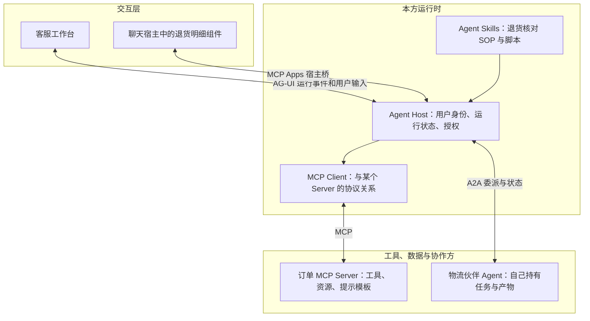
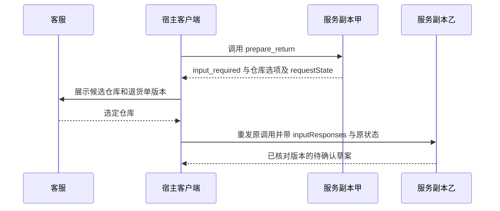
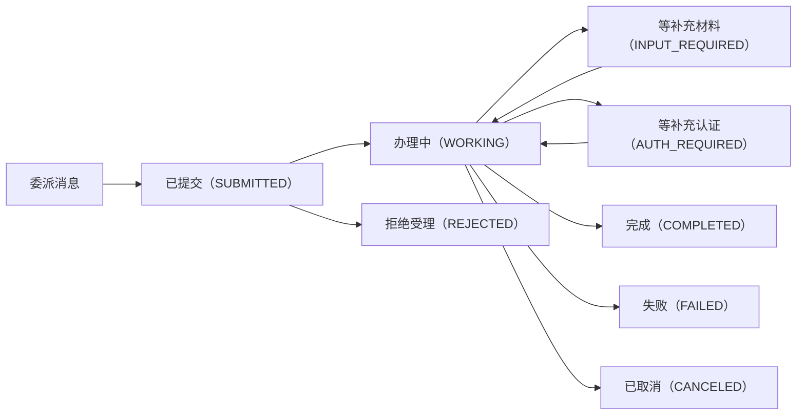

# 模块 08 · MCP、Agent Skills、A2A、AG-UI 与 MCP Apps：一张退货单怎样穿过五种接口

用户说「帮我核对退货，问仓库有没有收货，把差异列出来让我确认」。设计这套系统时，可以先问，谁提供事实，谁教 Agent 做事，谁接手一份可以隔天交还的工作，又是谁有权点下最后那个按钮？

## 先把协议放回一张业务图

查订单明细，是向一个系统要数据。照本公司的七天退货政策判断，是按一本操作手册做事。请物流伙伴独立调查丢失的包裹，是把一项工作交给另一个负责人。让客服勾选两件商品、复核差额，是让人参与决策。它们都可以出现在同一段聊天里。查不到可以再查，漏用新政策要重算，对方没接单需要核实，旧表格上的点击不能直接生成退款。



图里的几条线可以各自部署。你做一个内部工作台，用 AG-UI 把运行进度画出来，订单后端仍可用普通内部 API。你把查订单的工具交给多个兼容聊天宿主时，MCP Apps 可以把明细组件一起交付。公司自己的仓库函数若已经能查询签收记录，一次调用就够了。只有合作方要自己安排调查、等待补充材料并交付结果时，给它一个独立的任务编号才划算。

### 读规范先确定所说的「版本」

以下按 **2026 年 11 月 24 日** 核对。MCP 核心和 MCP Apps 扩展分别按日期发版。A2A 的规范仓库标签、线上协商的版本、供应商 Agent 自己的版本又各有含义。把 SDK 的 npm 版本号填进协议协商字段，是两边都「最新」却始终连不上的一种原因。

| 组件 | 本文采用的已发布基线 | 接入时的实际含义 |
|---|---|---|
| MCP 核心 | `2026-07-28`。维护者 11 月公布下一版目标日期为 2027-03-30 | 对新旧服务分别处理无状态请求与旧握手，按实际支持版本协商。未来日期只供排期。[发布说明](https://blog.modelcontextprotocol.io/posts/2026-07-28/) · [发布日程](https://blog.modelcontextprotocol.io/posts/mcp-release-cycle/) |
| Agent Skills | 2025 年 10 月公布方法，12 月开放标准，2026 年 10 月捐给 Agentic AI Foundation。以 agentskills.io 文件格式为准 | 规范页提供字段、目录与加载约定。技能作者的 `metadata.version` 是自己的包版本，载入文件无须网络握手。[治理移交公告](https://www.anthropic.com/news/donating-agent-skills-to-the-agentic-ai-foundation) · [格式规范](https://agentskills.io/specification) |
| A2A | 规范仓库最新发布标签 `v1.0.1`，对外协议系列为 1.0。9 月路线图仍把 1.1 列作后续工作 | 查看 Agent Card 中各接口的 `protocolVersion` 和绑定方式。实现与示例以所选标签为准。[发布标签](https://github.com/a2aproject/A2A/releases) · [迁移说明](https://a2a-protocol.org/v1.0.1/whats-new-v1/) · [路线图](https://a2a-protocol.org/latest/roadmap/) |
| AG-UI | 维护者于 2026 年 9 月宣布冻结 1.0 规范 | 同一请求返回有序且有类型的事件。按协议的事件约束消费，客户端依赖包单独升级。[维护者公告](https://github.com/ag-ui-protocol/ag-ui/discussions/2792) · [1.0 正式规范](https://docs.ag-ui.com/spec/1.0) |
| MCP Apps | 扩展仓库标记 `2026-01-26` 为 Stable，另设 draft | 宿主要支持 UI 扩展。基础 MCP 能连上，不代表一定能渲染组件。[扩展仓库与版本表](https://github.com/modelcontextprotocol/ext-apps) |

## MCP 怎样让工具接入宿主

原先每款助手接每一个数据系统都要定制一遍「列出能力、描述参数、调用、返回内容」。MCP 给这些操作定了共同语言。**Host** 是用户信任的应用，管理会话、向模型暴露什么、允许哪个主体调用什么。Host 为各 Server 维护逻辑上的 **Client**，负责发请求、解释结果和能力。**Server** 声明并实现具体能力。一个订单 Server 不应因为与物流 Server 同处一个 Host，就自动读到客服的全部聊天或另一个 Server 的凭据。在新版协议上，一对 Client/Server 也无需因此长期占用一条连接。[MCP 架构说明](https://modelcontextprotocol.io/docs/learn/architecture) · [版本与兼容性](https://modelcontextprotocol.io/specification/2026-07-28/basic/versioning)

### 六种原语要从控制权理解

| 能力与方向 | 放在退货案例里 | Host 和平台承担的工作 |
|---|---|---|
| Tools，Server 提供 | 用 `tools/list` 发现按订单号查明细的能力，`tools/call` 传入实参 | 模型可提议调用，执行前由系统校验授权、参数及资源归属。业务失败和协议故障分别表示 |
| Resources，Server 提供 | 退货政策、单据、已生成的只读报告，通过 URI 标识，用 `resources/read` 读取 | 应用选择哪些资源进入上下文。可以在界面先给链接，需要时取内容。读取本身也要有权限 |
| Prompts，Server 提供 | 通过 `prompts/get` 取一份可参数化的「比较签收记录」模板 | 可让用户在宿主主动选择。模板是输入材料，不能授予工具权限，也不应盖过宿主策略 |
| Sampling，Client 侧可提供 | Server 希望借宿主模型把一段备注归类 | 宿主控制允许的模型、数据和预算。此能力在七月版已弃用，已有实现须按版本兼容 |
| Elicitation，Client 侧可提供 | 在业务调用中请人选择缺失的仓库或给出非敏感补充信息 | 展示是谁在请求什么、处理同意或取消。敏感登录通过合适的外部授权流程完成 |
| Roots，Client 侧可提供 | 告知可供协作的工作目录范围 | 它表达工作位置。实际可读写的文件仍由运行环境和用户授权强制限制。七月版已弃用 |

旧版经双向连接由服务端发起的 Sampling、Elicitation、Roots，现代协议用多往返请求表达需要客户一侧参与的步骤。七月公告把 **Sampling、Roots、Logging** 列入弃用清单，保留迁移窗口。Elicitation 仍有用途。面试答「有哪些能力」与评审新系统时答「现在还要不要引入这个依赖」，结论可以不同。[MCP 维护者对变更的说明](https://blog.modelcontextprotocol.io/posts/2026-07-28/)

以一次订单查询为例，Server 可以给人可读的简短结果，同时提供 `structuredContent` 和相应的输出模式，让程序检查行数、币种和版本。JSON-RPC 的请求 ID 只为匹配本次响应。它没有给业务写入去重的语义。参数无法解析、方法不存在、工具执行时库存数据过期，是三个不同的位置。工具能接受输入但业务执行失败时，可返回带 `isError` 的工具结果，并说明如何刷新版本。网关和 JSON-RPC 层错误则要走相应错误路径。把所有错误都打成 HTTP 200 再让模型从字符串猜，告警和自动重试都会失去依据。[MCP 工具规范](https://modelcontextprotocol.io/specification/2026-07-28/server/tools)

### 从 stdio 到 Streamable HTTP，中间经历了两次不同的改变

**本地 stdio** 很像宿主启动一个专门回答问题的子进程。客户端写 stdin，读 stdout，逐行收发 UTF-8 的 JSON-RPC 消息，普通调试信息写 stderr。一个库在启动时向 stdout 打印彩色欢迎词，就可能在第一个 JSON 之前破坏协议。子进程意外退出时，有逻辑能力的客户端可以重建进程，但先前只存在内存里的句柄未必还在。环境变量和文件描述符也要按该 Server 所需最小范围传递，别让一个只读订单插件继承用户全部开发凭据。[标准传输说明](https://modelcontextprotocol.io/specification/2026-07-28/basic/transports)

**早期的 HTTP+SSE** 为远程沟通提供了通道，客户端先连服务端的 SSE 端点，收到另一个用于 POST 的地址，再把请求发过去。如何把这个 POST 的结果送回原来持有流的实例，成了负载均衡和运维问题。2025-03-26 引入 **Streamable HTTP**，允许单一 MCP 端点接收 POST，直接返回 JSON 或按需返回 SSE。以 2025-11-25 版本为例，还支持可选的协议会话、GET SSE 流和一定条件下按事件 ID 恢复。该代已经可以编写无状态服务，但采用了会话或事件恢复就要安排相应的路由、状态和保留期限。[2025 年版传输规范](https://modelcontextprotocol.io/specification/2025-11-25/basic/transports)

**2026-07-28 的同名传输**又走了一步。现代核心取消 `initialize` / `initialized` 握手与 `Mcp-Session-Id`，移除独立 GET 流。每个请求自己携带版本、客户端信息和能力，可先调用可选的发现步骤 `server/discover`。服务端必须实现它。每次 POST 的响应可以是一份 JSON，也可以是仅属于这次请求的 SSE。监听变化则用 `subscriptions/listen` 自己的响应流。网关可按头部路由，但必须确保规定的镜像字段和消息体一致。服务器能自由换副本，仅指处理协议请求不依赖原来的连接。订单和调查进度仍要落到共享的业务存储。[现代 Streamable HTTP](https://modelcontextprotocol.io/specification/2026-07-28/basic/transports/streamable-http)

下面是一次现代只读调用的报文示意。请求行和头部后面空一行再放消息体。鉴权材料和业务订单号在真实系统由宿主提供。这里特意把请求 ID、订单 ID 分开写，两者即使恰好都能当字符串比较，也绝不能用同一列归档。

```http
POST /mcp HTTP/1.1
Host: orders.example
Content-Type: application/json
Accept: application/json, text/event-stream
MCP-Protocol-Version: 2026-07-28
Mcp-Method: tools/call
Mcp-Name: get_return

{"jsonrpc":"2.0","id":41,"method":"tools/call","params":{"name":"get_return","arguments":{"return_id":"R-51"},"_meta":{"io.modelcontextprotocol/protocolVersion":"2026-07-28","io.modelcontextprotocol/clientInfo":{"name":"returns-desk","version":"2.4.0"},"io.modelcontextprotocol/clientCapabilities":{}}}}
```

头部 `Mcp-Method` 标出方法，`Mcp-Name` 在 `tools/call`、`resources/read`、`prompts/get` 这些有对应名称或 URI 的调用上必带。报文体才是协议事实源。实现可以在路由入口做粗粒度限流，到服务端再以已认证身份、参数和资源做最终授权。若指定版本不受支持，现代服务可给出带支持版本列表的 `UnsupportedProtocolVersionError`。区别「方法不存在」「端点是旧传输」「凭据过期」，才能安全地回退。把任何报错都切换到旧模式，容易把正常的拒绝误当成兼容问题。

**断线的意义也变了。** 旧版在服务端提供事件 ID、保留事件等条件下，可用 `Last-Event-ID` 尝试重接。七月版里，关闭某次 SSE 响应流表示取消该请求，服务端应尽快停止相应工作。通用客户端不能复用旧版「GET 后继续听同一条流」的实现。取消通知到达时，业务写入可能已经提交。要跨页面关闭或跨进程继续一项任务，就让业务返回持久操作号，或者协商使用 Tasks 扩展，用独立请求查询。七月版 Tasks 已移出实验性核心。取消等待、取消远端工作、撤销已发生的副作用，需要三个独立的产品语义。[HTTP 取消与兼容性](https://modelcontextprotocol.io/specification/2026-07-28/basic/transports/streamable-http) · [Tasks 扩展的发布说明](https://blog.modelcontextprotocol.io/posts/2026-07-28/)

### 无状态服务怎样中途问人

例如 `prepare_return` 查到两处签收仓库，必须让人选一处才能继续。长期挂着连接等客服吃完午饭，既浪费资源也使升级部署变得困难。现代 MCP 的 MRTR（Multi Round-Trip Requests）让服务端返回 `resultType: "input_required"` 与待回答的请求。客户端收集所需信息，再带上 `inputResponses` 重发原操作，服务端提供了不透明的 `requestState` 时，客户端原样回送。这样两个 HTTP 请求可以落在不同实例。服务端仍要验证补充信息来自本次调用和正确用户，不能只信屏幕传回一个仓库编号。[MRTR 发布说明](https://blog.modelcontextprotocol.io/posts/2026-07-28/)



对持久化有两种可选设计。服务端保存待确认的草案，给客户端短期句柄。或给客户端一个有完整性保护的延续值，回送时验证版本、作用域与过期时间。草案涉及个人信息或大型附件时，服务端持有数据更容易撤销和审计。无论选哪条路，都要在确认前冻结本次选项与业务版本。客服停留二十分钟后回来，仓库可能已经补录签收。服务端应返回版本冲突和新差异，接续人机对话也不能让旧事实绕过并发检查。

### 企业认证要解决两张通行证的问题

客服能登录公司工作台，不等于订单 MCP Server 应拿到他的通用登录票据。远程 MCP 的授权规范采用 OAuth 2.1 框架，把 Server 放在资源服务器的位置，客户按资源元数据找到授权服务器，给目标资源申请有限作用域的访问令牌。用户交互式授权使用授权码和 PKCE，客户端先生成一次性的 verifier，把其 S256 challenge 放进授权请求。换令牌时出示原 verifier。截获一次回调中的授权码不能单独完成交换。对于企业预注册客户端或其他经批准的凭证流，要按对应配置办理，不能把所有机器身份都伪装成一次人的点击。[现代 MCP 授权规范](https://modelcontextprotocol.io/specification/2026-07-28/basic/authorization) · [OAuth PKCE](https://www.rfc-editor.org/rfc/rfc7636)

一条常见链路从资源返回 401 开始。宿主验证受保护资源元数据与授权服务器元数据，选定 issuer，将其与本次授权流程、PKCE 校验材料等绑定，使用事先认可的重定向地址。回调时按规范校验发行者，再去正确的 token endpoint 换取目标资源的令牌。Server 验证令牌签发方、受众、有效期和必要权限。七月版加强了发行者验证，标记动态客户端注册 DCR 弃用，推动客户端 ID 元数据文档 CIMD。存量注册不能因为搬了 URL 就在另一发行者那里复用原凭据。部署时用短作用域和按用户隔离的令牌缓存，授权撤销后清理相关能力缓存。[授权变更](https://blog.modelcontextprotocol.io/posts/2026-07-28/) · [资源指标 RFC 8707](https://www.rfc-editor.org/rfc/rfc8707)

如果订单 Server 还要调用仓库系统，第二跳要取得面向仓库的合法凭据，并在仓库侧做对象授权。直接转发收到的 bearer token 既破坏受众约束，又让审计分不清是谁在代表谁办事。协议版本、客户端自报名称、会话号、UI 组件 ID 都不能替代主体认证。对于只在本机启动的 stdio 服务，重点转向启动来源、环境变量、可读文件和进程权限，不能照抄远程 OAuth 的浏览器回调流程就宣布本地也安全。

### 工具描述投毒与上线后换定义

模型需要读工具说明才能挑工具，因此说明书也进入它的决策输入。**Tool Poisoning** 指来自工具描述等不可信元数据的指令影响了模型的行为。**Rug Pull** 利用的是用户批准与实际执行之间的时间差。用户曾认可过一个工具，后来同名定义的描述、参数或行为变了。HTTPS 和有效 OAuth 可以证明连到预期服务，仍然无法证明今天展示的说明值得执行。这里的出发点是 Invariant Labs 的一手披露，防御重点落在宿主管理信任的方式。[研究团队通报](https://invariantlabs.ai/blog/mcp-security-notification-tool-poisoning-attacks)

落地时先构造可审阅的能力目录，把发布者、服务身份、工具名、描述、输入输出模式和应用范围一起展示并做版本摘要。在服务通知列表有变化、缓存到期或服务重新部署时重新取目录。检测到敏感变化，冻结旧批准并给管理员看差异。调用前把批准与版本、用户、资源和具体动作绑定。只钉工具名太弱，只钉描述也抓不到实现未改公开模式却扩大了后台行为的情况。还需配合可信发布、最小下游权限、受控出口和服务端审计。工具结果中的文档和意见按数据展示，宿主策略始终独立存在。

对用户而言，最有用的确认框会说「向哪个系统、以谁的身份、更改哪两件商品、影响多少」，而不会要求他鉴别数百行 JSON 的微妙差别。对平台而言，拦截后应能回溯是哪个目录版本、哪次授权、哪个工具结果引出了这项操作。日志只保留问题定位所需的字段，涉及客户明细的原始载荷另存并受限访问。实操可以用自己控制的测试服务变更一个无害的描述字段，核对目录是否失效、旧批准是否仍可提交、其他租户是否受干扰。这样检验的是防御契约，结果也可自动回归。

## 为什么「接通了十个 MCP」反而选错工具

把十本字典都摊在桌上，找一个词未必更快。MCP 规定如何列举工具，Host 决定是否把完整模式都注入模型。Anthropic 的示例配置接入五个 Server、五十八个工具，定义合计约 **55K token**。另有更大的实际开销观察。十个 Server 上百条定义确有可能跨过 50K，却没有按 Server 个数自动换算的公式。长描述、字段嵌套、重复名称，以及所用模型的分词器都会影响结果。错误选择尤其容易发生在「发给用户」与「发给频道」这类近义能力上。[原始配置及失败观察](https://www.anthropic.com/research/advanced-tool-use)

| 做法 | 模型在决策时看见什么 | 省掉什么、会付出什么 |
|---|---|---|
| CLI，Pi 作者实践 | 少量基础工具、可执行命令、必要时读取的帮助或示例 | 日常工程师已有 CLI 时接入轻。宿主要管理可执行版本、工作目录、输出及底层权限 |
| Tool Search，延迟载入 | 短检索入口，命中后才载入少量完整模式 | 适合很多系统、每次只用一两项。要衡量正确工具是否出现在候选里，并对真正执行再次授权 |
| MCP Code Mode | 沙箱里的类型化函数、搜索与执行接口，最终送回摘要 | 适合跨页聚合和组合多个工具。代价是脚本错误、执行配额、单步审计和故障恢复 |

Pi 作者 Mario Zechner 比较过针对同类任务的 CLI 与 MCP，也解释过为何在自己的极简编码 Agent 里保留少数基础工具。CLI 可以在需要时才查帮助，用一段程序筛选 JSON，再输出几行。它的优势来自成熟的命令生态和按需发现。若 CLI 继承了用户在终端里的广泛身份，同一条命令背后可能能访问整个组织。平台应提供受限身份、稳定机器可读输出、明确的非交互模式和超时。别把作者的产品取舍解读成 CLI 在所有任务、所有模型上都赢。[作者实测](https://mariozechner.at/posts/2025-08-15-mcp-vs-cli/) · [Pi 的设计说明](https://mariozechner.at/posts/2025-11-30-pi-coding-agent/)

延迟加载保留统一的工具契约。Host 从已授权目录建索引，先用「签收记录、包裹、物流调查」等任务描述召回候选，再把少量完整定义放进当轮上下文。如果候选只剩「创建退款」，应允许改写查询或由用户明确选择物流系统。用历史任务测召回率、准确选中率、搜几轮才能第一次正确执行。只看 token 节省可能会把完全搜不到工具误评成效率提升。七月版 MCP 的列表可带 TTL 与缓存作用域，能减少反复拉取定义。缓存目录和决定模型本轮看到什么是两个优化点。授权、租户、Server 身份与版本构成缓存键的一部分。

Code Mode 则把目录或 API 映射成程序沙箱中的函数。Anthropic 举过一个按需发现并运行 MCP 工具的例子，原先约十五万 token 的上下文开销降到约两千。Cloudflare 用搜索与执行两个工具面向两千五百多个 API 端点，公开案例的工具占用约一千 token。两者测的是特定入口、特定设计，不能把它们乘在一起预测账单。它们说明了中间数据在什么地方流动：数百行订单从一个服务进执行器，再被筛成两行供模型解释。数据仍经过执行器和工具服务，所以「没进模型」也要落实租户隔离、日志保留和凭据边界。[Anthropic 的代码执行案例](https://www.anthropic.com/research/code-execution-with-mcp) · [Cloudflare 的 Code Mode](https://blog.cloudflare.com/code-mode-mcp/)

选这三种方案前，先把输入开销拆成系统指令、工具定义、历史内容和本轮工具结果。再分别测模型等待与实际 RPC 延迟。重复缓存命中的 schema 可以便宜一点，模型仍需要从众多相似工具中作选择。把 schema 全删了却每轮都要猜参数，也会把省下的输入换成更多失败尝试。一个务实的组合是常用的两个只读工具直接暴露，长尾工具经搜索发现，批量读经代码模式，涉及实际写账的提交永远有窄而可审计的入口。

## Agent Skills：让一份岗位手册只在用到时打开

两个客服账号拥有相同的查单工具，一个知道签收地和退货地可能不同，另一个看见承运商签字就直接判为入库。差别来自方法。把公司的核对流程、必要的反例和可复算的脚本装进一个技能包，团队就能一起审查、更新和回滚这份方法。Anthropic 在 2025 年提出这套做法并开放 Agent Skills 格式。读者可以把技能目录理解为一个随仓库发版的小手册，其中部分步骤能直接执行。[Agent Skills 发布及开放记录](https://www.anthropic.com/research/equipping-agents-for-the-real-world-with-agent-skills) · [开放标准](https://agentskills.io/specification)

### 三层渐进披露，每层分别付什么钱

第一层解决「要不要翻这本书」。启动时宿主扫描技能目录，通常把 `name` 和 `description` 等轻量索引放在选择器可见的位置，某些客户端还传来源或路径。简短描述可为几十个 token，标准给的估计约为每项一百个，中文长度和分词器会改变这个数。描述应写清触发情形与任务产物，例如「比较订单明细与仓库签收记录，生成待客服确认的逐行差异」。写成「管理所有售后问题」，召回率也许变高，大量无关任务却会误读整本手册。

第二层解决「选中了，下一步做什么」。任务匹配后，宿主让 Agent 读取完整的 `SKILL.md`，或通过专门的技能读取工具载入正文。具体工具名由客户端决定。规范建议正文控制在五千 token、五百行以内。正文可以直接写下客服会遇到的判断条件。一个包裹对应多个订单时，先按订单行 ID 拆开，无法唯一匹配时把该行列为待确认。读到这一步，Agent 已经知道何时该停。

第三层解决「这次到底需要哪份证据或哪个脚本」。国际件才读 `references/international.md`，有币种差异才读换算规则。稳定的纯计算可调用 `scripts/` 里的现成程序，把测试放在程序的维护流程。宿主若按路径执行，脚本代码可以不进入模型上下文，只把退出状态、检查结论、摘要及产物位置带回来。若模型主动读了脚本、程序打印完整输入，成本当然又会出现。脚本依赖、工作目录、权限和最大输出由执行环境决定，标准本身没有为它创造运行权限。[格式及三层预算建议](https://agentskills.io/specification)

以下目录与正文是一个最小示例。文件名叫大写的 `SKILL.md`。前置元数据用 YAML，正文用 Markdown。标准要求 `name` 和 `description`，前者应匹配目录名，最长 64 个字符，后者最多 1024 个字符。可选的兼容性说明能提示需要本机 Python，实验性的 `allowed-tools` 也只能在宿主自己的安全策略内解释。

```text
returns-reconcile/
├── SKILL.md
├── references/
│   └── international.md
└── scripts/
    └── compare_lines.py
```

```markdown
---
name: returns-reconcile
description: 核对退货订单行、包裹和仓库签收，输出逐行差异供客服确认。用于查明短收、重复签收或错仓。
compatibility: 运行逐行比对脚本需要 Python 3。
---
先取得同一业务日期的订单与签收快照，记录各自版本。
按订单行匹配件数。遇到跨境退件再读取 references/international.md。
在技能目录运行 scripts/compare_lines.py，传入两个只读快照的路径。
保留未匹配行、匹配依据及报告引用。将待确认差异交给客服。
```

给技能包做迁移测试时，应分别检验「能被找到」「能读正文」「脚本真能执行」「没有脚本时会解释阻塞」。Claude Code、Codex、Cursor、Hermes 都有对应的一手实现或文档。它们可以共用基本格式，但扫描根目录、同名覆盖顺序、显式调用方法与额外字段各有差别。Hermes 例如提供 `skill_view` 按需查看正文或引用。把客户端专属命令硬编码为唯一入口，换宿主后有可能只剩一个能显示却无法完成工作的包。[Claude Code 技能](https://code.claude.com/docs/en/skills) · [OpenAI 的仓库技能实践](https://developers.openai.com/blog/skills-agents-sdk) · [Cursor 技能](https://cursor.com/docs/skills) · [Hermes 技能系统](https://hermes-agent.nousresearch.com/docs/user-guide/features/skills/)

### 怎样知道这份手册真的改善业务

一个简单的评测有三组输入。正例提到短收但没说「退货」，看宿主能否选中。相似负例只要求翻译一份快递通知，看它会不会多此一举地打开技能。对抗业务歧义的样本包括同名商品、两个包裹和缺失签收行，看脚本是否把不确定性留给人。每次运行分别记录「是否触发、是否用了正确版本的政策、输出差异是否与已知结果一致、是否发生了权限外动作」。如果模型根本没找到技能，改脚本没用。若选得准却总算错，继续改描述也浪费时间。[OpenAI 的技能评测实践](https://developers.openai.com/blog/eval-skills)

共享目录也有供应链问题。一条正确的说明可能引用了过时脚本。同名技能随用户目录改变优先级，也可能让两个同事算出不同的差异。运行记录应带来源、发布版本或内容摘要、调用了哪个脚本、输入快照版本。更新前在两个宿主跑同一套黄金样本。可执行脚本只获当前任务需要的资源，审阅时把脚本与文档当作同一个发布单元。这样客服即使隔月申诉，平台也能解释当时使用了哪条政策，更新新政策不会改写已经发生的事实。

### Skills、MCP、Subagent、System Prompt 怎样选

| 如果需求变了，主要改哪一块 | 谁掌握什么 | 退货场景中的合理用法 | 错放层的后果 |
|---|---|---|---|
| 系统指令 System Prompt | 宿主给每次任务都适用的角色和约束。硬权限仍由代码落实 | 始终如实标记未确认结果，只按用户授权办理 | 把上百页退货政策全部放进去，查别的问题也一直付上下文成本 |
| Agent Skills | 一个可发现、可分段加载、可版本管理的方法包 | 教如何对齐订单行、何时读跨境例外、怎样解释差额 | 把技能当访问控制，换条执行路径就可能丢失检查 |
| MCP | 工具及资源提供者暴露实时能力和数据契约 | 只读查单、取签收版本、提交经批准的更新 | 给每条 SOP 拆一套远程方法，流程难改且难以审查 |
| Subagent | 独立的一段工作上下文，可以有自己的工具、预算或评判标准 | 单独复核大批签收证据，只交回结论及引用 | 只是求和也额外委派，增加费用，汇总时还可能丢上下文 |

可以把 MCP 理解成手和眼，Skills 理解成岗位 SOP。拿到一份跨境退货单，Host 先选核对技能，按其说明通过 MCP 取得订单和物流快照，再在沙箱运行比对脚本。若证据很多，就给单独的复核子代理一个只读证据集、明确的截止时间和固定输出结构。最终负责人与用户仍在主运行时。要跨组织时，被委派者甚至可能不共享你的模型供应商，这时才进一步考虑 A2A。A2A Card 上的 `skills` 是对外声明的能力名片，名称相同也不会让远程客户自动安装某个 `SKILL.md`。

## A2A：把事情交出去以后，还能问到结果

对方的仓库要派人核对签收扫描，这件事可能一天后才完成。在本地函数外面套一条持续二十四小时的 HTTP 请求，很难解释谁接了单、谁来补资料、断线后去哪里领结果。Google 于 2025 年发起 A2A，为独立 Agent 之间的发现、委派、状态、消息与产物交换建立公共语义。它允许对方保留内部模型、工具和推理过程。你关心的是委托合同和可以复核的交付物。[Google 发布说明](https://developers.googleblog.com/en/a2a-a-new-era-of-agent-interoperability/) · [A2A 规范固定版本](https://a2a-protocol.org/v1.0.1/specification/)

### 发现一个会办事的对方

Agent Card 告诉调用方服务提供者是谁、有什么能力、支持哪些输入输出形式、接口绑定和安全方案。新接入常见发现地址是 `/.well-known/agent-card.json`。旧教程里常见的 `/.well-known/agent.json` 可在 v0.2.4 规范找到。已知目录或双方私下配置也能用于发现。进入 1.0 后，查看 `supportedInterfaces[]` 中的 `url`、`protocolBinding` 和 `protocolVersion`。顶层 `version` 是 Agent 本身的版本。客户端按共同支持的接口选择 JSON-RPC、gRPC 或 HTTP+JSON，再按声明的安全要求认证。[老版本发现约定](https://a2a-protocol.org/v0.2.4/specification/) · [1.0 迁移指南](https://a2a-protocol.org/v1.0.1/whats-new-v1/)

Card 的能力声明类似对方的服务目录。它写「查所有签收记录」，只说明对方提供这类服务，你仍然只能查已签约且获授权的货件。生产接入先建立组织信任、允许访问的服务地址和凭据，再校验卡片来源，适用时检查签名、公钥信任和版本。公开卡片避免放客户清单，私有细节可通过经认证的扩展卡片提供。缓存要有期限，卡片改动后重新选择接口。签名可以帮助判断内容是否由预期主体签发，不能保证其每项自述都符合你的服务等级要求。

### 消息、任务、产物分别记账

`Message` 是这次说了什么，包含不同类型的内容部分。`Task` 是服务端受理后维护的一项工作。`Artifact` 是工作交出的可消费成果，如签收差异表、文件引用或结构化结果。一个很简单的问答可以直接返回 Message，无须为每句礼貌回复都建 Task。需要后续跟踪时保留服务端的 `taskId`，还应分别保存上下文 `contextId`、每条消息的 `messageId`、本公司的退货单号。一个上下文可以涉及多项任务，拿聊天上下文号去当作对账单号会把不同的调查混在一起。[A2A 操作与数据类型](https://a2a-protocol.org/v1.0.1/specification/)

下图是退货调查的一条允许路径。规范的终态包括完成、失败、取消、拒绝。需要输入或认证是可继续的中断状态。图中选取常见转换，调用方也要处理远端直接返回终态、请求取消未获接受等分支。标签使用业务中文，括号中是状态语义。



设想物流代理发来「缺少包裹编号」。本方应在原任务上补一条关联消息，回送用户允许共享的编号，记下因谁、何时从等待转回工作。认证中断则让用户走合适的授权渠道，把结果绑定到任务，避免在自由文本消息里传长期凭据。终态任务不能再塞一条消息强行复活。用户后来提供新证据时，开启有关联的新任务并保留旧报告。服务端说调查完成，说明它交付了自己的工作。退款能否执行由本方的确认和账务系统决定。

产物可能很大，切勿把一张带个人信息的扫描单反复塞回模型。可以发内容类型、版本、受控引用和摘要，消费者按需授权读取，核对大小和完整性。流式产物更新里区分追加分片和新产物，使用稳定标识把片段收在正确的报告里。收到一部分时显示「生成中」，只有满足结束条件才把完整报告提交给客服。链接到期是交付物访问问题，处理方式应为刷新合法引用或重新取产物。重发整张委派单会平白启动第二次调查。

### 等消息有三种方式

客服正在盯着页面时，可用流式调用或订阅正在进行的 Task，看到状态和产物增量。用 1.0 的 `SubscribeToTask` 订阅存量非终态任务，先收当前 Task，再收后续更新，到终态结束。后台定时对账可以用 `GetTask` 轮询，加退避与截止时间。只在任务预期很快时提高频率。浏览器关了还要接通知时，可在双方支持下登记 Push Notification 配置，把符合协议的更新推到受认可的回调入口。1.0 的推送采用 `StreamResponse` 格式，不能照搬 0.3 的订阅方法名。[1.0 订阅与推送变化](https://a2a-protocol.org/v1.0.1/whats-new-v1/)

网络不能替你承诺一次且仅一次地完成业务。接收端验证发送者、目的租户和任务关联，将通知落入收件箱，再更新本地状态。即使请求被重复投递、客户端从旧记录恢复或流断在分片中间，也不应把同一份报告确认两遍。没有足够信息还原顺序时，读回服务端的最新 Task 和产物列表，重建本地视图。对已进入终态的旧进度更新不能倒退本地业务。若刚创建委派便超时，先用双方约定的关联键核对是否受理。协议提供消息和任务标识，跨系统的幂等受理及保留期限要有明确合同。

推送地址也属于信任边界。合作方管理员预登记可用回调，建立相应认证、验证来源并防止过期通知产生新动作。多租户网关除了检查任务号还要按主体隔离读权。收到某个任务的更新并不意味着有权看另一个任务的扫描单。两家公司应事先谈妥超时、取消已发生工作的后果、报告保留时间和人工联系点。A2A 能把「正在等资料」编码成可理解的状态，不能替双方定义何为有效签收。

### 真实落地程度应该怎样表述

Linux Foundation 在 2026 年 4 月披露有超过一百五十家**支持组织**，列举 Microsoft 在 Azure AI Foundry、Copilot Studio 的集成，以及 AWS 在 Bedrock AgentCore Runtime 的支持，并报告企业生产使用。项目随后于 8 月成为 Agentic AI Foundation 的 Growth Stage 项目。平台能部署一个 A2A 端点、两款 SDK 能交换一项任务、两家独立企业有长期可用的调查服务，是三种不同证据。公开资料可证明前两类和项目方报告的生产部署，不能据此算出所有企业的生产覆盖率、跨企业成功率或平均节省工时。[基金会年度披露](https://www.linuxfoundation.org/press/a2a-protocol-surpasses-150-organizations-lands-in-major-cloud-platforms-and-sees-enterprise-production-use-in-first-year) · [项目治理更新](https://a2a-protocol.org/latest/blog/2026/08/27/a-new-chapter-for-a2a-joining-the-agentic-ai-foundation/)

以 AWS 为例，AgentCore 公开了托管端点的 A2A 服务契约，包括默认监听端口 9000 和可配置的端口。容器能通过平台健康检查，只证明服务能被调度。还需要用另一个厂商的客户端走过卡片发现、带权限的委派、订阅和读取产物，才能验收组织之间的互通。[AWS 的实际部署契约](https://docs.aws.amazon.com/bedrock-agentcore/latest/devguide/runtime-a2a-protocol-contract.html)

采购方可以请合作方拿两个不同框架的真实端点，演示中断后补料、掉线后取完整结果、授权到期后重新认证，以及取消后的费用核对。普通的同步查件 API 已有很好的服务承诺时，保留它并通过 MCP 提供工具即可。需要把调查目标交出去，让远端独立管理生命周期时，再引入 A2A。远端 Agent 内部可以照常经 MCP 查询扫描记录，调用方无需知道对方用哪个工具。这就是两种协议能同时存在的原因。

## 面向人的一层：AG-UI 传过程，MCP Apps 带来可操作的组件

「请回复 1 确认退款、回复 2 修改数量」，对于单一项目勉强可用。商品有十七行，五行已签收，两行数量不符，还有另一位客服正在编辑，纯文本很难让人看清本次确认的范围。界面需要持续接收变化、保留正在编辑的选择，并把用户看见的版本和确认动作一起交回。展示和提交应是两个阶段，把流式的半个参数当成已提交的业务命令，最容易出现页面看起来合理、后台已经做错事的情况。

### AG-UI 如何驱动一个能恢复的工作台

AG-UI 1.0 约定应用发出运行输入，生产者返回有序的类型化事件流。Host 可以在 HTTP + SSE 等绑定上承载事件，SSE 处理传输帧，AG-UI 定义这帧代表文本、工具参数、共享状态还是运行结束。一条文本消息按消息 ID 拼接开始、内容和结束。一个工具调用按工具调用 ID 拼参数片段，完整后才可验证和择机执行。共享状态用快照建立基准，再用增量更新。把所有帧都追加到聊天记录，只能恢复看过的字，重建不了用户正在核对的表。[冻结的协议](https://docs.ag-ui.com/spec/1.0) · [事件语义](https://docs.ag-ui.com/concepts/events)

前端应给流式状态和本地编辑分不同的所有者。比如服务端更新「第二行已入库」，用户刚在第三行填了备注。收到新快照时，按稳定行 ID 和版本合并。如果服务端更新了同一个字段，给用户展示冲突，不能用整个页面最后一次渲染覆盖另一方。中断等待人时，1.0 的 `RUN_FINISHED` 可用 `outcome.type = "interrupt"` 携带待回答项。客户端通过带 `resume` 的新运行回答相应中断。一次流结束只代表该 run 的传输生命周期结束，业务单仍可处于「待确认」。完成、出错、等人要有不同的视觉和持久状态。

以下是应用层处理确认的核心示意。命令和数据存储方法属于业务宿主，AG-UI 负责把相应状态传到界面。事务里锁住退货草案并写入一次性决定，让浏览器超时重试仍能取回原回执。真正的账务操作由事务内的发件箱异步触发，消费者沿用唯一操作键对账。

```python
def confirm(db, actor, command):
    with db.transaction() as tx:
        draft = tx.lock_draft(actor.tenant, command.draft_id)
        tx.require_permission(actor, "returns.confirm", draft)
        previous = tx.find_receipt(draft.id, command.key)
        if previous:
            previous.require_same_input(actor.id, command.body_digest())
            return previous
        if draft.version != command.expected_version or draft.state != "waiting":
            raise ValueError("草案已更新，请读取最新差异再确认")
        selection = draft.validate_selection(command.selected_line_ids)
        receipt = tx.record_decision(draft, actor, selection, command)
        tx.mark_confirmed(draft, receipt.id)
        tx.enqueue_once("post_return", receipt.id)  # 和决定同一事务落盘
        return receipt
```

网络恢复时，从业务后端读已确认版本和回执，再开新的事件流。若应用要精确回放增量，需要自己设计事件序列、保留期和读权限。底层会传 SSE 不能推导出跨断线的永久历史。收不到中间状态时，用最新快照重建，保留有版本依据的本地修改。可观测系统按 thread、run、消息和业务草案分别记录延迟，用户几小时前点了确认却没看到回执时，可以区分事件遗漏、重复提交与账务仍在处理中。

### MCP Apps 把工具的界面带到宿主

订单系统比通用聊天应用更了解如何渲染「收到一件、应收两件」。MCP Apps 让 Server 在工具定义的 `_meta.ui.resourceUri` 中声明关联的 `ui://` 资源。兼容的 Host 读取该资源，按约定的 HTML 类型 `text/html;profile=mcp-app` 在隔离视图中渲染。工具执行产生结构化数据，Host 通过视图桥将输入、工具结果等送给它。界面可以排序、筛选、选中商品，受支持的操作可经宿主转给工具。组件模板和运行结果因此可以独立缓存和验证。[正式扩展规范](https://github.com/modelcontextprotocol/ext-apps/blob/main/specification/2026-01-26/apps.mdx)

在 Web 宿主里，这座桥通常位于 sandboxed iframe 与父页面之间，用 `postMessage` 携带 JSON-RPC。视图初始化并与 Host 协商能力，Host 再传入工具参数、结果。组件来自外部提供者，宿主要检查消息来源与窗口、执行 CSP 和资源域限制、按 capability 决定可调用的操作。视图按钮上的「确认」是用户意图的输入。业务授权、版本比较、金额复核仍由服务端执行。根据可见性和用途，把展示给人的订单行与模型必须理解的摘要分开，只送当前身份确实可以看的数据。把字段藏进不可见的 DOM 无法保护它。

缺少视图支持时，宿主可以始终返回文本摘要、差异数量和可读取的报告引用。有 UI 能力的 Host 再加载组件，缺扩展支持的客户端仍能完成核对或走普通审批页。AG-UI 面向自有工作台的一整次运行，MCP Apps 包装单个工具交付的交互视图。在同一个项目里，工作台可用前者同步全局进度，再用后者承载可复用的订单明细面板。两边都出现「完成」时，给界面显示业务事实源的最终状态，一个工具卡片渲染成功并不能证明退款已经入账。[MCP Apps 上线公告与宿主支持](https://blog.modelcontextprotocol.io/posts/2026-01-26-mcp-apps/)

## 架构决策：从一条简单查询长成跨企业流程

| 出现了什么真实需求 | 先采用哪个边界 | 进入下一层前应能回答的问题 |
|---|---|---|
| 一个前端查询一个已知后端 | 直接用现有 API。有多个 Agent 宿主都要消费时再提供 MCP 契约 | 谁能看这笔订单，查询到底以谁的身份执行？ |
| 故障反复来自使用者忘记例外规则 | 把 SOP、反例与确定性计算写成可评测的 Skill | 是否选对技能、选对版本，遇到歧义会不会自动停下？ |
| 工具目录吃掉大半上下文，或批量数据搬运太多 | 先测 token 分布与选路失败，再选 Search、CLI 或 Code Mode | 缩小目录后正确工具还能被找到吗，写权限在哪里核对？ |
| 合作方要接手长时工作并独立交付结果 | 采用 A2A，通过持久化 Task 关联外部调查 | 掉线、拒绝、补料和晚到的结果分别由谁负责？ |
| 人在审核中要看长期进度或操作明细组件 | 自有工作台用 AG-UI，与工具一起分发组件时用 MCP Apps | 用户确认的是哪一版本，断线后凭什么判定操作成功？ |

上线可以先选一组双轨订单，让新系统只读生成差异，与资深客服的已有判断比对。第二阶段接合作方测试端点，刻意在等待补料后关闭工作台，验证跨天恢复。第三阶段才打开经批准的真实写入。遇到错单时，沿「目录与技能版本、工具调用、远端任务、视图确认、业务回执」查证。它们共享业务关联号，却各自保留原始 ID 和时间。这样换掉一家协议适配器，不会迫使财务人员到聊天记录里重建账本。

## 七道面试追问

### 1．MCP 已经有工具和 Tasks，为什么还要 A2A？

**考察点**是辨别谁拥有目标、内部工作与交付责任。

**回答示例**

一次读取订单由工具提供者完成，慢查询可返回操作句柄或协商 Tasks 扩展。委托合作方调查则需要公开能力、补充消息、任务状态和可交换的产物。两者均可能异步，不能按耗时长短选协议。

**追问**　只有一个内网查询也要部署 Agent 吗？

直接调用现有函数或数据服务即可，当工具要面向多个独立宿主，或有真正的外部委派合同时，再付协议成本。

### 2．同名 Streamable HTTP，为什么升级后断线就收不到剩余结果？

**考察点**是能否识别版本与取消语义。

**回答示例**

先看请求的协议日期、握手和路由日志。旧协议可带会话及可选的事件恢复。七月版取消 GET 流，每次请求携带版本与能力，关闭 SSE 表示取消该请求。要长期存在的业务工作应有独立 ID 和查询方式。

**追问**　还能盲目重试刚才的写吗？

查业务回执，沿用原幂等键，无法核对时显示结果未知。新连接或新的 JSON-RPC ID 都没有撤销原操作。

### 3．工具已走 OAuth，为何仍会中描述投毒或 Rug Pull？

**考察点**是区分身份、授权、内容可信度。

**回答示例**

OAuth 解决谁可访问什么资源，工具定义仍是外部输入。记录发布身份与定义摘要，隔离权限、检测变更、失效旧批准，执行时检查真实参数和目标。

**追问**　如果定义摘要没变呢？

后台实现与下游副作用仍可能改变。控制实际服务账号的范围，保留调用与业务回执，并为敏感写入绑定用户确认的参数。

### 4．新接十个 Server 后响应变慢，怎么分清是 schema 太长还是服务慢？

**考察点**是能画出时间与 token 的去向。

**回答示例**

量首轮模型输入组成、选错工具率、目录加载时间，以及真正工具调用的 P95。若第一次工具都未调用就开始变慢，先看集中注入。若工具选得对但分页往返多，考虑代码模式或聚合接口。

**追问**　把所有工具都隐藏起来行吗？

用正例和相似负例测召回，提供改写检索及明确选系统的后路，否则失败只是从「选错」变成「没找到」。

### 5．一个跨宿主技能在 Claude Code 能用，在另一个客户端却执行失败，如何排查？

**考察点**是能区分格式兼容和运行环境兼容。

**回答示例**

先确认目录扫描和同名优先级，检查前置字段，再看正文是否实际激活、引用路径从哪解析、脚本依赖和权限是否具备。读同一份快照跑同一组正反例，并比对使用的包摘要。

**追问**　多写几个 `allowed-tools` 能解决权限不足吗？

这个实验性字段无法代发系统凭据，目标宿主要通过自己的授权流程提供最小能力。

### 6．对方两次推送调查完成，用户又刷新页面，如何只确认一次？

**考察点**是排序、幂等与真实业务完成点。

**回答示例**

验证回调后用收件箱与任务版本核对状态，以服务端最新 Task 对账。用户确认命令引用稳定草案、版本、所选行及幂等键，决定、回执和发件箱记录在同一事务提交。账务侧也按操作键去重。

**追问**　若账务系统不支持幂等且超时？

用业务参考号查询原结果，仍不确定就标记待人工核对。对方调查完成和本方账务完成必须显示为两个状态。

### 7．交互式组件和事件流都能在界面画表格，怎样选？

**考察点**是理解界面由谁开发、随谁分发。

**回答示例**

控制整套前端时，用 AG-UI 将运行、状态增量、工具及人的输入接到已有组件。要让多个聊天宿主复用同一工具作者维护的视图，声明 MCP Apps 资源并由宿主隔离加载。

**追问**　客户的宿主还不会渲染扩展怎么办？

返回有业务意义的文本与报告引用，适当提供普通审批路径。无论采用哪条路径，服务器都要检查身份、草案版本和最终回执。

## 一手资料与延伸阅读

- 给旧 MCP 网关做迁移，按日期并读两份传输规范，重点对照 GET、POST、取消和是否存在协议会话。再看正式发布说明里的 MRTR 与弃用项。[2025 版](https://modelcontextprotocol.io/specification/2025-11-25/basic/transports) · [2026 版](https://modelcontextprotocol.io/specification/2026-07-28/basic/transports/streamable-http) · [迁移背景](https://blog.modelcontextprotocol.io/posts/2026-07-28/)
- 设计大工具目录，先用原作者的工具数和数据流还原成本，再用自己的任务测检索召回与程序化执行开销。[Anthropic Tool Search](https://www.anthropic.com/research/advanced-tool-use) · [Cloudflare Code Mode](https://blog.cloudflare.com/code-mode-mcp/) · [Pi 作者的对比实验](https://mariozechner.at/posts/2025-08-15-mcp-vs-cli/)
- 发布可复用技能，用开放格式校验基础字段，再用宿主文档检查目录、激活方式和脚本环境。测试设计可直接借鉴真实仓库上的技能评测。[Agent Skills](https://agentskills.io/specification) · [Hermes 实现](https://hermes-agent.nousresearch.com/docs/user-guide/features/skills/) · [OpenAI 评测方法](https://developers.openai.com/blog/eval-skills)
- 跨组织委派，固定 A2A 标签对照操作名、任务终态和推送载荷。要了解能部署在哪些平台，再看基金会的公开记录。[A2A 正式规范](https://a2a-protocol.org/v1.0.1/specification/) · [1.0 迁移](https://a2a-protocol.org/v1.0.1/whats-new-v1/) · [生产采用披露](https://www.linuxfoundation.org/press/a2a-protocol-surpasses-150-organizations-lands-in-major-cloud-platforms-and-sees-enterprise-production-use-in-first-year)
- 调试 UI，先确认是在修整个运行的事件消费，还是在修某个工具的嵌入视图。两份规范分别给出事件顺序与视图桥契约。[AG-UI 1.0](https://docs.ag-ui.com/spec/1.0) · [MCP Apps 稳定规范](https://github.com/modelcontextprotocol/ext-apps/blob/main/specification/2026-01-26/apps.mdx)
