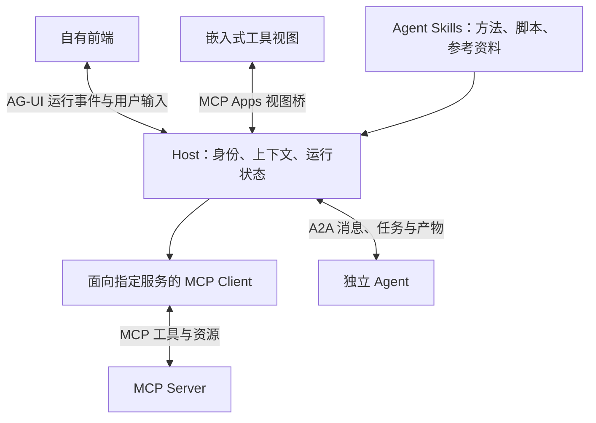
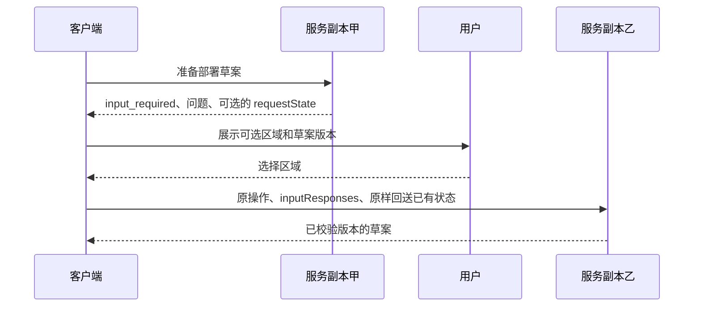
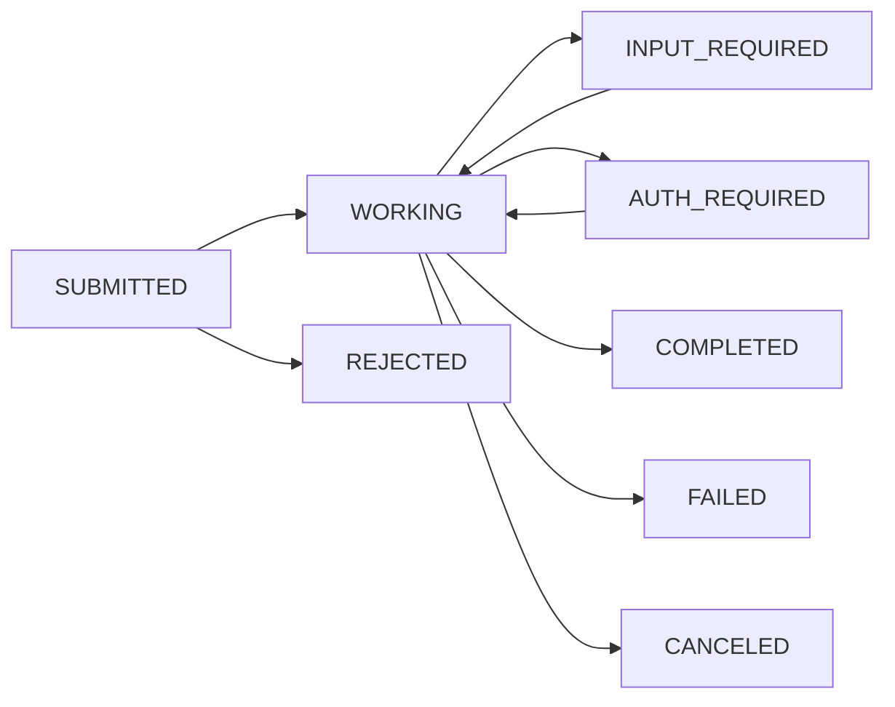

# 模块 08 · Agent 协议实战：MCP 接工具，Skills 教方法，A2A 交任务

> 接一个新系统，先问它要交付什么：一次调用的结果、一套可复用的做法、一项由对方负责的任务，还是给人操作的界面？这四个问题能帮你选协议，也能帮你讲清断线以后该找谁。



## 一、先对齐接口，再对齐版本

同一个“完成”有几种含义：工具返回结果、远端交付任务、前端收完事件、用户提交的修改已经生效。日志里把这几个时间点分开，才能回答刷新页面后要不要重发。

| 机制 | 谁和谁说话 | 该持久化什么 | 本文采用的版本 |
|---|---|---|---|
| MCP | 宿主里的 Client 与工具或数据 Server | 资源 URI、调用结果，外部写入另存业务回执 | 核心 `2026-07-28`，另对照 `2025-11-25` 传输。[发布说明](https://blog.modelcontextprotocol.io/posts/2026-07-28/) |
| Agent Skills | 宿主发现并读取本地或受信来源的技能包 | 包来源、摘要、实际加载的说明和脚本 | 按开放文件格式加载，包版本由作者维护。[格式规范](https://agentskills.io/specification) |
| A2A | 两个独立 Agent 交换消息、委派任务 | 服务身份、任务 ID、状态和产物引用 | 规范标签 `v1.0.1`，线上协商协议系列 1.0。[标签](https://github.com/a2aproject/A2A/releases) · [迁移指南](https://a2a-protocol.org/v1.0.1/whats-new-v1/) |
| AG-UI | 自有前端与 Agent 运行时 | thread、run、待答中断和共享状态 | 2026 年 9 月冻结的 1.0 行为规范。[维护者公告](https://github.com/ag-ui-protocol/ag-ui/discussions/2792) · [规范](https://docs.ag-ui.com/spec/1.0) |
| MCP Apps | 工具作者提供视图，兼容 Host 加载并桥接 | 资源 URI、工具结果，以及业务提交回执 | 扩展稳定版 `2026-01-26`，有独立 draft。[版本表](https://github.com/modelcontextprotocol/ext-apps) |

**版本看哪儿**：截至 2026 年 11 月 24 日，MCP 下一版的目标日期是 2027-03-30；A2A 路线图把 1.1 列作后续工作。接入时记录线上双方支持的协议版本、扩展与绑定。SDK 包版本和 Agent 自己的产品版本另外记。[MCP 发布日程](https://blog.modelcontextprotocol.io/posts/mcp-release-cycle/) · [A2A 路线图](https://a2a-protocol.org/latest/roadmap/)

## 二、MCP：一条工具调用经过哪些边界

**Host** 管用户会话、身份和上下文，为每个 **Server** 维护一个逻辑 **Client**。Client 负责协议与发现，Server 提供工具与数据。Host 按调用选择要发的内容，避免把整段聊天或其他服务的凭据一并送出。[架构](https://modelcontextprotocol.io/docs/learn/architecture) · [版本协商](https://modelcontextprotocol.io/specification/2026-07-28/basic/versioning)

### 六种原语：谁提供，谁决定何时使用

| 原语 | 调用方向和具体用途 | 实现时要分清 |
|---|---|---|
| Tools | Server 暴露动作，`tools/list` 看定义，`tools/call` 传实参 | 模型提出调用，服务端核对资源归属和写权限 |
| Resources | Server 用 URI 标识文件、报告等，Client 按需 `resources/read` | 应用决定读哪份、哪段进入上下文，读取同样要鉴权 |
| Prompts | Server 提供可带参数的模板，用 `prompts/get` 获取 | 用户或宿主选择模板，模板无法授予额外权限 |
| Sampling | Server 请求借用 Client 一侧的模型 | 宿主控制模型、数据和预算；七月版已弃用 |
| Elicitation | Server 请求 Client 补充输入，例如选择部署区域 | 宿主展示来源和选项，处理接受、拒绝或取消，敏感登录走授权渠道 |
| Roots | Client 告知 Server 可协作的工作目录 | 根目录提示表达工作位置，文件权限由运行环境执行；七月版已弃用 |

七月版把 Sampling、Roots 和 Logging 列入弃用清单，Tasks 从实验性核心迁到扩展。老教程里常见 Server 主动发起的双向调用，现代核心通过多轮请求表达需要 Client 参与的步骤。Elicitation 仍然可用。[核心变更与弃用项](https://blog.modelcontextprotocol.io/posts/2026-07-28/)

**工具定义怎么消费**：输入按 `inputSchema` 校验，若声明了输出模式，程序可按模式检查 `structuredContent`。人读的简短文本和程序消费的结构化结果可以一起返回，避免从自然语言里抠版本号。[工具规范](https://modelcontextprotocol.io/specification/2026-07-28/server/tools)

| 观察到什么 | 客户端怎么处理 |
|---|---|
| HTTP 返回 401，或所用版本不受支持 | 分别走授权或兼容路径，别把正常拒绝当成换一个旧协议再试的理由 |
| JSON-RPC 找不到方法、无法解析消息 | 核对方法、消息结构和版本；请求 ID 用来把响应匹配回发起者 |
| 工具已接受输入，但目标版本冲突 | 返回带 `isError` 的工具结果，给出当前版本和重读位置 |
| 写请求发出后收不到回执 | 用业务操作号核对，重试沿用幂等键；JSON-RPC ID 没有业务去重语义 |

### 两代 Streamable HTTP，断线语义不同

| 传输 | 第一次请求怎么走 | 连接结束后怎么办 |
|---|---|---|
| 本地 stdio | Host 启子进程，stdin/stdout 逐行交换 UTF-8 JSON-RPC，日志写 stderr | 子进程重建后，原先内存里的句柄可能已丢失。[标准传输](https://modelcontextprotocol.io/specification/2026-07-28/basic/transports) |
| 早期 HTTP+SSE | Client 先接 SSE 端点，从流里得到另一个 POST 地址 | 服务端要把消息送回持有原连接的实例 |
| 2025 版 Streamable HTTP | 2025-03-26 引入单端点 POST，可回 JSON 或 SSE。11 月版可选会话及独立 GET 流 | 若有事件 ID、服务端保留事件，可用 `Last-Event-ID` 尝试恢复。[2025 版传输](https://modelcontextprotocol.io/specification/2025-11-25/basic/transports) |
| 2026-07-28 Streamable HTTP | 请求自带版本、客户端信息和能力。取消初始化握手、`Mcp-Session-Id` 与独立 GET 流 | SSE 属于本次请求，关闭表示取消。订阅走 `subscriptions/listen` 自己的响应流。[2026 版传输](https://modelcontextprotocol.io/specification/2026-07-28/basic/transports/streamable-http) |

**本地排错有个捷径**：第一个 JSON 之前若出现彩色欢迎词，先查是谁把启动日志写到了 stdout。拉起服务时也要挑选环境变量和文件描述符，一个只读插件只应继承它需要的本机权限。

**远程发现**：现代 Server 必须实现 `server/discover`，Client 可以先发现能力，也可以直接发已知请求。遇到 `UnsupportedProtocolVersionError` 再根据支持列表协商。实例无需黏住协议连接，跨请求的业务状态照常落库。

下面是一条只读调用的报文，省略部署相关的鉴权与长度头。`id` 用于这次请求配对，`run_id` 指向要查的构建。路由层看头部就能分流，最终授权还得看经过认证的主体和实际参数。

```http
POST /mcp HTTP/1.1
Host: ci.example
Content-Type: application/json
Accept: application/json, text/event-stream
MCP-Protocol-Version: 2026-07-28
Mcp-Method: tools/call
Mcp-Name: get_run

{
  "jsonrpc": "2.0",
  "id": 41,
  "method": "tools/call",
  "params": {
    "name": "get_run",
    "arguments": {"run_id": "build-73"},
    "_meta": {
      "io.modelcontextprotocol/protocolVersion": "2026-07-28",
      "io.modelcontextprotocol/clientInfo": {"name": "ci-desk", "version": "1.0"},
      "io.modelcontextprotocol/clientCapabilities": {}
    }
  }
}
```

`Mcp-Method` 对应方法，`Mcp-Name` 在工具调用、资源读取及提示模板读取中对应名称或 URI。处理消息体的服务要验证镜像字段一致。关闭响应流时，工作可能已产生写入；要跨断线继续追踪，用持久操作号或协商 Tasks 扩展。

### MRTR：让用户思考半小时，服务器不用等半小时

Multi Round-Trip Requests 把一次需要补充输入的调用拆成几个往返。Server 返回所缺信息，Client 收齐答案再发原操作。这样下一次请求可以落到另一副本，也能清楚区分“还在等用户”与“服务超时”。



- **接续所需的信息**：读取 `resultType: "input_required"` 与待答请求，按对应问题填入 `inputResponses`。Server 给了不透明的 `requestState` 就原样回送，Client 不改写它。
- **谁保存草案**：敏感或大型内容放服务端，Client 只收短期句柄。精简状态也可放在有完整性保护的延续值里，服务端验证用户、作用域、有效期和版本。
- **什么时候重新确认**：用户回答时，基础配置可能已经变化。提交前重新比版本，冲突就展示新差异。把上一步对区域的选择当成对任意新配置的批准，会误用授权。

### OAuth 与 Tool Poisoning：身份和内容分别怎么管

远程 MCP 的授权采用 OAuth 2.1 框架，Server 充当资源服务器。一次用户授权从 401 和受保护资源元数据开始：Client 查授权服务器元数据，选定 issuer，为目标资源申请有限作用域的令牌。[MCP 授权](https://modelcontextprotocol.io/specification/2026-07-28/basic/authorization) · [资源指标 RFC 8707](https://www.rfc-editor.org/rfc/rfc8707)

1. **发起授权**：把 issuer、预登记的重定向地址与本次授权流程绑定。授权码流程用 PKCE，Client 保存 verifier，将 S256 challenge 送往授权端。[PKCE](https://www.rfc-editor.org/rfc/rfc7636)
2. **交换令牌**：回调校验发行者，在对应 token endpoint 出示 verifier。Server 核对令牌签发方、受众、有效期、权限，再查对象归属。七月版加强 issuer 验证、弃用 DCR，推进客户端 ID 元数据文档 CIMD。
3. **处理第二跳**：Server 再访问其他 API 时，取得面向下游的独立凭据。令牌缓存按用户和资源隔离，撤销时清能力缓存。机器身份按实际凭证流接入，本地 stdio 则重点审查进程来源和可读资源。

**Tool Poisoning** 指不可信的描述或元数据混入指令，影响模型选路。**Rug Pull** 则利用批准与使用的时间差：同一个工具名，后来换了定义或后台行为。OAuth 能确认主体与资源，说明文字仍是外部输入。[Invariant Labs 披露](https://invariantlabs.ai/blog/mcp-security-notification-tool-poisoning-attacks)

| 哪个时刻 | 宿主做什么 |
|---|---|
| 收录能力 | 记录发布者、Server 身份、工具名、描述、输入输出模式和用途，计算定义摘要 |
| 目录变更 | 重新拉取定义并比较差异；敏感变化使旧批准失效。缓存要区分服务、租户、授权与版本 |
| 即将执行 | 把批准绑定到用户、工具版本、实际参数与目标资源；面向人的确认框说清将改什么 |
| 拿到结果 | 文档、日志和建议作为数据处理。保留下游操作号，审计记录关联目录版本和授权范围 |

即使定义摘要没变，后台实现仍可能扩大副作用。缩小服务账号权限、限制出口，能管住这一层。验证变更流程时，在自有测试服务发布一次无害描述修改，检查旧批准是否按预期失效即可。

## 三、工具太多时：少给定义，还是少搬数据

先把首轮输入拆成系统指令、历史、工具定义和结果。Anthropic 的配置里，**5 台 Server、58 个工具，仅定义就约 55K token**。如果慢在第一次调用之前，先查目录加载和模型选路；如果已经选对工具，慢在搬运大结果，就看数据在哪里流动。[原始配置](https://www.anthropic.com/research/advanced-tool-use)

| 做法 | 模型实际看见什么 | 使用条件与代价 |
|---|---|---|
| Pi 式 CLI | 少数基础工具，需要某条命令时才查帮助，按机器可读格式筛选输出 | 适合已有稳定 CLI 的开发工具链；固定版本、工作目录、非交互模式、超时与受限身份。[作者实测](https://mariozechner.at/posts/2025-08-15-mcp-vs-cli/) · [Pi 的设计](https://mariozechner.at/posts/2025-11-30-pi-coding-agent/) |
| Tool Search | 先见搜索入口，召回候选才读完整 schema | 适合长尾工具多、每次只用少数几项的场景；要测正确工具是否入围 |
| MCP Code Mode | 在受控执行器中搜索接口、运行代码，模型收摘要或产物引用 | 适合聚合与跨工具组合；脚本要有预算，底层动作逐次鉴权和记账 |

**搜索要测两次命中**：正确工具是否进入候选，进入候选后模型是否选中。找不到时允许改写查询或明确选服务。新版列表的 TTL、缓存作用域与确定性排序能省目录拉取和前缀重建，当前轮次露出哪些定义仍由 Host 决定。

**Code Mode 省的是中间数据来回穿过模型的成本**。Anthropic 的按需发现与执行示例把约 **150K token 降到 2K**；Cloudflare 用 `search` 与 `execute` 两个工具覆盖 **2,500 多个端点**，工具入口约 **1,000 token**。[Anthropic 案例](https://www.anthropic.com/research/code-execution-with-mcp) · [Cloudflare 实现](https://blog.cloudflare.com/code-mode-mcp/)

例如在执行器里读多份 CI 日志、按测试名归并，模型只收失败数、代表性断言和日志引用。日志仍经过执行器，所以保留租户隔离、受限出口和输出上限。只看 token 会漏掉脚本重试，应同时看成功任务的耗时和实际 RPC 次数。

## 四、Agent Skills：按三层加载一份可执行的手册

MCP 提供“能调用什么”，Skill 解决“面对这类任务，应该按什么步骤做”。一个技能是带 `SKILL.md` 的目录，可随仓库审查和回滚。Anthropic 于 2025 年 10 月发布方法，同年 12 月开放格式，2026 年 10 月捐给 Agentic AI Foundation。[发布记录](https://www.anthropic.com/research/equipping-agents-for-the-real-world-with-agent-skills) · [治理公告](https://www.anthropic.com/news/donating-agent-skills-to-the-agentic-ai-foundation)

| 什么时候读 | 加载哪一层 | 这层应该回答什么 |
|---|---|---|
| 宿主启动或建目录时 | 元数据，通常是 `name`、`description`，规范估计每项约 100 token | 任务是否匹配？描述写触发情形和产物，别笼统写“处理所有开发任务” |
| 选中技能时 | `SKILL.md` 正文，建议低于 5,000 token、500 行 | 操作顺序、决策条件、何时需要额外输入 |
| 确实遇到分支时 | 按需读 `references/`，使用 `assets/`，执行 `scripts/` | 特殊格式、模板、确定性计算；脚本可直接运行，只回退出状态、摘要和产物路径 |

**文件契约**：YAML 前置区必须有 `name` 和 `description`。名称匹配父目录，最长 64 字符，描述最多 1,024 字符。`compatibility` 说明依赖。实验性 `allowed-tools` 的效果取决于宿主，执行权限和凭据都要由宿主提供。[字段与加载建议](https://agentskills.io/specification)

一个用于比较测试结果的技能，只需在描述里说清“什么时候用、产出什么”。正文交代如何对齐样本，特殊格式才去读参考文件。

```text
ci-test-diff/
├── SKILL.md
├── references/junit.md
└── scripts/compare_runs.py
```

```markdown
---
name: ci-test-diff
description: 比较两次 CI 测试结果，列出新增失败、恢复通过和缺失的用例。用于排查构建回归。
compatibility: 比对脚本需要 Python 3。
---

先核对两个报告的提交与测试集合，记录运行标识。
遇到 JUnit XML 时，读取 references/junit.md 确认参数化用例的命名方式。
从技能目录执行 scripts/compare_runs.py，传入两个只读报告路径。
分别列出新增失败、恢复通过、缺失用例。缺失项保留为未知结果。
```

脚本经宿主执行时，源码可以不进上下文。脚本若打印整份报告，窗口照样会满。让输出带样本数、稳定 ID 和产物引用，想复查哪条再取哪条。运行记录带上技能摘要、脚本路径与输入版本。

**迁移到另一个宿主时按顺序查**：目录有没有被扫描，同名包谁优先，正文是否真的加载，相对路径从哪解析，解释器和权限是否齐全。Hermes 用 `skill_view` 按需查看；Claude Code、Codex、Cursor 的发现和触发入口可分别对照。[Claude Code](https://code.claude.com/docs/en/skills) · [OpenAI 实践](https://developers.openai.com/blog/skills-agents-sdk) · [Cursor](https://cursor.com/docs/skills) · [Hermes](https://hermes-agent.nousresearch.com/docs/user-guide/features/skills/)

| 评测输入 | 看什么结果 | 失败时先改哪里 |
|---|---|---|
| 正例提到“昨天过、今天挂了”，没有技能名 | 能否找到并使用正确版本 | 描述、索引来源、同名优先级 |
| 相似负例只要求翻译失败日志 | 能否跳过整份技能 | 触发条件与描述范围 |
| 两份报告使用同名用例、缺项或不同数据集 | 输出能否区分真实回归与不可比较 | 正文条件、脚本匹配键、测试样本 |

用同一套样本在两个宿主上测触发和最终产物，分别记录结果。把脚本与文档作为一个发布单元，回滚时也一起回滚。这样能区分“没找到技能”与“找到后算错了”。[OpenAI 技能评测](https://developers.openai.com/blog/eval-skills)

**容易放错的三层**：每次任务都适用的角色和约束放 System Prompt；可按需展开的流程放 Skills；需要独立上下文、工具预算或独立评价时才分给 Subagent。实时事实经 MCP 读取。A2A Card 的 `skills` 描述远端能力，不会安装本地技能包。

## 五、A2A：把目标交给对方，保留任务的归属

如果对方自己排期、决定用哪些工具、可能中途要材料，并负责交付成果，调用方就需要一份可追踪的委派记录。Google 在 2025 年发起 A2A，让双方交换消息、状态和产物，同时各自管理模型与内部执行过程。[Google 发布说明](https://developers.googleblog.com/en/a2a-a-new-era-of-agent-interoperability/) · [A2A 规范](https://a2a-protocol.org/v1.0.1/specification/)

**发现入口**：常见地址是 `/.well-known/agent-card.json`，旧 v0.2.4 教程使用 `/.well-known/agent.json`。也可以从可信目录获取卡片。检查 `supportedInterfaces[]` 里的 URL、`protocolBinding`、`protocolVersion`，按交集选择 JSON-RPC、gRPC 或 HTTP+JSON。[旧版发现约定](https://a2a-protocol.org/v0.2.4/specification/) · [1.0 迁移](https://a2a-protocol.org/v1.0.1/whats-new-v1/)

Card 顶层 `version` 指 Agent 版本。能力、输入输出类型与认证方案帮助选服务，实际访问仍取决于主体授权。公开卡片只放必要信息，私有细节通过认证后的扩展卡片提供；适用时校验签名、可信密钥及发布来源。

| 对象 | 本地怎么记 | 常见误用 |
|---|---|---|
| Message | 每条有 `messageId`，由文本、文件或数据等部分组成 | 简单问答可以直接回 Message，没必要给每句话建任务 |
| Task | 保存服务端 Task 的 `id`，后续消息用 `taskId` 关联，同时保存 `contextId` 和本地业务键 | 一个上下文能含多项任务，单用聊天 ID 会串任务 |
| Artifact | 按稳定标识接收内容、分片或引用，保存类型、版本及完整性信息 | 刚收到首个片段就当作完整文件，会让人审阅半份结果 |



图中是常见路径，服务也可能直接回终态。缺材料就在原任务上补关联消息；缺授权让用户走认证渠道。完成、失败、拒绝和已取消都是终态，后来出现新证据就开关联的新任务。取消请求也可能被拒绝。

**怎么等结果**：页面开着可流式发送，或用 1.0 的 `SubscribeToTask` 订阅已有的非终态任务，先收当前 Task 再接更新。后台可用 `GetTask` 退避轮询。支持推送时登记经认证的回调，1.0 的推送体使用 `StreamResponse`。[订阅与推送变化](https://a2a-protocol.org/v1.0.1/whats-new-v1/)

- **重复或乱序**：验证发送方、租户与任务关联，先写收件箱。信息不足以排序就读回最新 Task，终态不被迟到进度覆盖。刚委派便超时时，先按双方约定的关联键核对是否已受理。
- **产物很大**：发受控引用、大小和摘要，区分同一产物的追加分片与新产物。引用过期就刷新合法引用，避免重新委派整份工作。
- **跨组织验收**：两个不同客户端和服务端实际走一遍发现、认证、补料、掉线后取结果与取消。回调地址预登记，按主体隔离任务读权，提前约定产物保留期限和已发生工作的处理方式。

Linux Foundation 在 2026 年 4 月披露超过 **150 家支持组织**，列举 Azure AI Foundry、Copilot Studio、AWS Bedrock AgentCore 的集成和企业生产使用。8 月项目进入 Agentic AI Foundation 的 Growth Stage。[基金会披露](https://www.linuxfoundation.org/press/a2a-protocol-surpasses-150-organizations-lands-in-major-cloud-platforms-and-sees-enterprise-production-use-in-first-year) · [治理更新](https://a2a-protocol.org/latest/blog/2026/08/27/a-new-chapter-for-a2a-joining-the-agentic-ai-foundation/)

AWS AgentCore 的部署契约默认监听端口为 **9000**，可配置。容器健康检查只覆盖启动和调度，跨厂商互通还要测接口绑定、任务状态和产物。同步查一个已知值用普通 API 或 MCP 已经足够。[AWS 部署契约](https://docs.aws.amazon.com/bedrock-agentcore/latest/devguide/runtime-a2a-protocol-contract.html)

## 六、面向人的接口：AG-UI 管整次运行，MCP Apps 交付一个视图

| 设计问题 | AG-UI | MCP Apps |
|---|---|---|
| 谁拥有界面 | 应用团队维护前端，消费 Agent 的事件流 | 工具作者维护组件，兼容 Host 隔离渲染 |
| 线上传什么 | 一次运行输入，对应一串有序、带类型的文本、工具、状态与结束事件 | `ui://` 资源、工具输入输出、经 Host 转发的视图消息 |
| 典型用法 | 自有工作台显示长任务进度，等人补充再继续 | 在多个聊天宿主复用同一个构建差异面板 |

**AG-UI 怎么拼画面**：SSE 可运载帧，事件类型才告诉前端这帧是什么。文本按消息 ID 拼接，工具参数按调用 ID 收齐再校验。共享状态先用快照定基准，再应用增量。把帧全追加成聊天记录，恢复不了用户看到的工作台。[事件语义](https://docs.ag-ui.com/concepts/events)

用户正编辑某一行时，服务端也可能送来更新。按稳定行 ID 和版本合并不同字段，同字段冲突就展示差异。1.0 的 `RUN_FINISHED` 可携带 `outcome.type = "interrupt"`，客户端开带 `resume` 的新运行回答。流结束时，业务草案仍可能在等确认。

确认操作由业务宿主执行。下面的事务接口是示意：按租户锁草案，用同一幂等键取回原回执，把决定和发件箱记录一起落盘。浏览器重试时，同键不同输入会被拒绝。

```python
def confirm(db, actor, command):
    with db.transaction() as tx:
        draft = tx.lock_draft(actor.tenant, command.draft_id)
        tx.require_permission(actor, "builds.approve", draft)
        previous = tx.find_receipt(draft.id, command.key)
        if previous:
            previous.require_same_input(actor.id, command.body_digest())
            return previous

        if draft.version != command.expected_version or draft.state != "waiting":
            raise ValueError("草案已更新，请重新核对差异")
        targets = draft.validate_selection(command.selected_ids)
        receipt = tx.record_decision(draft, actor, targets, command)
        tx.mark_confirmed(draft, receipt.id)
        tx.enqueue_once("apply_build_plan", receipt.id)
        return receipt
```

断线后从业务后端读回已确认版本和回执，缺事件就用最新快照重建视图。要精确回放增量，还得自己保留事件序列与读权限。发件箱消费者沿用操作键向下游去重；下游结果未知时按业务参考号核对。

**MCP Apps 的加载顺序**：

1. 工具在 `_meta.ui.resourceUri` 声明 `ui://` 资源，宿主读取 `text/html;profile=mcp-app` 视图；模板和运行结果可以分别缓存。
2. Web 宿主在受沙箱限制的 iframe 中渲染，用 `postMessage` 携带 JSON-RPC。视图初始化、协商能力，宿主再传工具输入与结果。
3. 宿主验证消息来源和窗口，执行 CSP、资源域与能力限制。组件请求调用工具仍经宿主，服务端核对用户、参数和版本。[稳定扩展规范](https://github.com/modelcontextprotocol/ext-apps/blob/main/specification/2026-01-26/apps.mdx)

只下发当前用户有权看的字段，分别给模型简短摘要、给视图展示数据。把敏感字段藏进 DOM 对能读取页面的人无效。遇到不支持 Apps 的宿主，工具仍返回可读摘要、受控报告或普通审批入口。[发布公告与宿主支持](https://blog.modelcontextprotocol.io/posts/2026-01-26-mcp-apps/)

**选型速查**：查实时状态用 MCP，反复执行的判断步骤写 Skill，远端独立接手才选 A2A。要控制整套工作台的运行进度就接 AG-UI，要随工具分发组件就接 MCP Apps。两种 UI 都应向业务服务查询最终回执。

## 一手资料速查

- **查请求和传输**：[新版 HTTP 报文与取消](https://modelcontextprotocol.io/specification/2026-07-28/basic/transports/streamable-http) · [旧版会话与重连](https://modelcontextprotocol.io/specification/2025-11-25/basic/transports) · [工具输入和输出](https://modelcontextprotocol.io/specification/2026-07-28/server/tools)
- **查技能发现和任务接续**：[Agent Skills 文件格式](https://agentskills.io/specification) · [A2A 操作及状态](https://a2a-protocol.org/v1.0.1/specification/)
- **查前端契约**：[AG-UI 事件顺序](https://docs.ag-ui.com/spec/1.0) · [MCP Apps 视图桥](https://github.com/modelcontextprotocol/ext-apps/blob/main/specification/2026-01-26/apps.mdx)

## 六道高频面试题

### 1. MCP 已经能做异步工作，为什么还需要 A2A？

**考察点**：目标和生命周期归谁。

1. 先问我交给对方的是一次动作，还是一个由它负责的目标。慢查询可以用操作号，也可以协商 MCP Tasks。
2. 对方独立安排工作、可能要补材料、最后交产物，我就用 A2A，把服务身份、任务号和业务键存下来。
3. 它内部照样可以用 MCP 读数据。我追它的 Task 就行，没必要知道它用了什么模型。

**连环追问**：收到两次完成通知怎么办？我核对发送者和任务，读回服务端状态，业务侧用稳定操作键去重。

### 2. 同样叫 Streamable HTTP，为什么升级后接不回原来的流？

**考察点**：请求版本、取消和业务恢复。

1. 先抓一对报文看日期。2025 版可选会话和 GET 流，在服务保留事件时可以尝试恢复。
2. 2026 七月版每个请求自描述。关闭 SSE 表示取消本次请求，长任务要另存任务号或操作号。
3. 需要用户补输入就走 MRTR，带答案和原状态重发。若批准对象的版本变了，得先让用户看新差异。

**连环追问**：断开连接就等于撤销写入吗？写入可能已经生效，我会先查业务回执。

### 3. 工具都走了 OAuth，为什么还要防 Tool Poisoning？

**考察点**：身份、授权和内容信任。

1. OAuth 解决我拿谁的令牌访问哪个资源。工具描述是模型会读的外部输入，发布者随后也可能改它。
2. 我保存服务身份、定义摘要和批准版本，敏感变更就停用旧批准。执行前再核对实际用户、参数与资源。
3. 第二跳用面向下游的短期凭据，还要收紧账号权限。公开定义没变，也不能据此判断后台副作用。

**连环追问**：确认框放完整 JSON 行吗？我会把将用哪个身份、修改哪些对象、影响什么直接展示给人。

### 4. 新接十个工具服务，首轮越来越慢，先上 Code Mode 吗？

**考察点**：工具发现成本与执行成本。

1. 我先拆输入和耗时，看看卡在定义注入、模型选路，还是工具真在执行。
2. 目录太大就按需搜索，成熟开发工具也可走受限 CLI。搜完还要测正确工具有没有入围。
3. 如果时间花在反复搬运大结果，再用 Code Mode 在执行器里过滤。最终看每个成功任务的 token、耗时和重试。

**连环追问**：前缀缓存够吗？它能减少重复输入的成本，相似工具仍要靠名字、描述和检索来区分。

### 5. 同一个 Skill 换宿主就不工作了，从哪查？

**考察点**：三层加载与依赖边界。

1. 先看索引，确认扫到了目录、选中的是同一个包。再看正文有没有真正加载。
2. 最后查引用路径、解释器、依赖、输出和权限。能读说明与能跑脚本是两件事。
3. 两个宿主跑相同正例、相似负例和歧义样本，分别看触发率和最终结果，保留包摘要。

**连环追问**：补上 `allowed-tools` 就有权限吗？得看宿主是否支持和批准，技能元数据不能签发凭据。

### 6. AG-UI 和 MCP Apps 都能画表格，该选哪个？

**考察点**：界面归属、运行结束和业务提交。

1. 我自己维护整套工作台，就用 AG-UI 消费状态、增量和中断。一个工具要跨宿主带自己的组件，就用 MCP Apps。
2. 用户点击确认时，前端提交它实际展示的草案版本、选择范围和幂等键。后端在同一事务写决定、回执和发件箱。
3. 刷新后我按回执还原结果。流结束、组件画出来、下游执行成功，这三个状态分开显示。

**连环追问**：宿主不会加载组件呢？给它文本摘要和能继续操作的审批入口，最终仍由同一后端确认。
