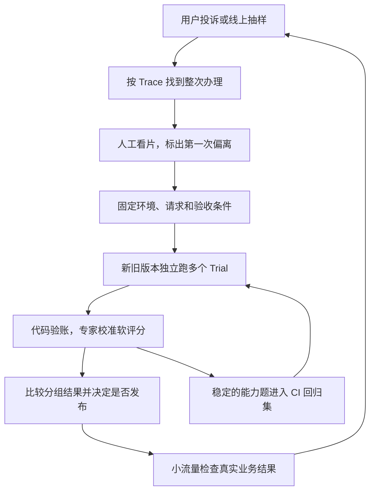
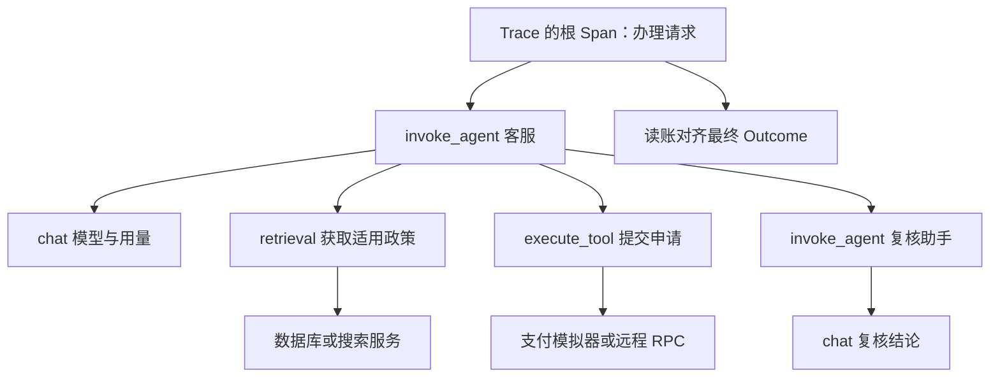

# 09.1　Agent 评测与可观测性：怎样证明改完真的更好

把“用户说没收到退款”变成一条能重跑、能定位、能拦住下次发布的测试，这件事串起了高级 Agent 岗位面试里的评测、全链路追踪和上线决策。

客服演示时，屏幕上出现“已为你退款”，掌声响起来了。值班时，同一句话背后，可能是支付渠道已经受理，也可能是助手只查过退款政策，甚至可能是渠道受理了两次。给这句话打九十分，三种情况就进了同一个桶。把支付回执、订单账本和那段对话对上，才知道该庆祝、该补办，还是该止损。下文用一套虚构的退款业务做可重复的实验，公开事故另列出处。

## 先把一条投诉走完



先沿图走一次。用户要退订单七，客服同学拿订单号去查支付系统，发现只有咨询记录。工程师凭关联号找出当时的运行，逐步读到“查询成功”被助手理解成“办理成功”。他复制一个没有个人信息的订单，把成功条件写成“支付模拟器中恰好出现一条对应的退款，金额正确，其他订单不动”，再跑新旧版本。下周有人为了省一次工具调用而改提示词，这张旧账会在合并前被重新核对。图里最难自动化的地方是人第一次弄清楚用户究竟损失了什么。

### 真实事故里，那一行 Prompt 花了多少代价

2026 年 4 月 23 日，Anthropic 公布 Claude Code 质量问题调查。一次为减少啰嗦而做的系统提示词改动，在扩大评测并逐项移除提示后，有一项评测显示 Opus 4.6 和 4.7 均下降 3%。团队在 4 月 20 日的版本撤回该改动。这里的数字指该项评测，不能外推成所有用户的任务成功率下降三个百分点。同次调查还发现，会话闲置超过一小时后，本应只清理一次的历史推理块，在该进程此后的每轮都被清理。短会话测试和常规内部试用很难碰齐触发条件。[Anthropic 质量复盘](https://www.anthropic.com/research/april-23-postmortem)

把第二个问题写成回归题时，先约定一个后续必须保留的约束，让虚拟时钟前进六十一分钟，再恢复会话，完成两个相互依赖的动作。分别记录清理事件次数、用户可观察的任务结果，以及未闲置对照组。只验证恢复后的**第一轮**，恰好会把“正确清理一次”和“以后轮轮清理”判成同一个结果。这个用例设计是从复盘推导的工程练习。它甚至无须收集模型私有思维文本，运行时的清理事件和任务状态已经足够。

## 一、单测仍要跑，只是不能拿它给整次任务签字

单测像在工作台上按一下关门按钮，Agent 验收像请人从大厅送一只箱子到指定房间。按钮好使，仍可能上错楼。工具函数的参数校验、货币换算、访问控制、超时分支适合用传统单测锁死。把这些绿灯加起来，推不出助手在真实对话里会选哪个工具、是否理解回执、会不会多办一次。对传统问答评分器来说，困难还多一层。两个答案可以字字相同，环境状态却天差地别。

| 同一条退款请求，评什么 | 只看最后一句会漏掉什么 | Harness 要交出什么证据 |
|---|---|---|
| 模型抽样、路由、工具回包都有波动 | 周一跑通，周二相同版本超时 | 同题独立重复，保留各次结果和运行配置 |
| 同一个目标可以合法地走不同路 | 按订单号直查和按本人交易列表定位均可成功 | 对最终账本设断言，仅对必须履行的流程设约束 |
| 工具已经改变外部世界 | 第一次请求超时，重试时又退了一次 | 支付方流水、操作号、调用次数与去重结果 |
| 早期小错被下游放大 | 检索取错地区政策，后面每句解释都很通顺 | 取回的版本、它进入上下文的轮次、第一次错误动作 |

假设每一步各有九成五的条件成功机会，十个必须都成功的环节合起来约为六成。这是简化的串行算例。真实系统会绕路、纠正，也会因同一故障成片失败。设计测试时分别问“能自己纠正吗”“纠正前造成的写入能收回来吗”。查错一轮资料再查回来通常只多花时间。把收件人发错再改回来，则已经有了隐私事故。对前者给效率扣分，对后者设阻断性判定，两种错误才不会被平均分抹平。

精确匹配有合适的位置。货币代码、幂等键、禁止触碰的表都可以做精确断言。面向人的解释可以换措辞，必要事实要保留。比如退款在渠道受理后可能要等几个工作日，能从当前状态推出“已受理”，不能推出“已到账”。如果工具只返回排队号，验收就查队列是否耐久写入，并要求回复仍处于等待状态。任务约定“到账”时，还须等待最终结算或在截止时间判未完成。同一个动词在产品、模型和清算系统那里可能是三份合同，写题的人要把它们对齐。

## 二、把一次办事拆成可检验的四件东西

Anthropic 在 2026 年 1 月的 *Demystifying evals for AI agents* 把任务、独立尝试、全过程记录和最终结果拆开讨论。这样拆开，出错时就可以分别追问“题目交代清楚了吗”“机器是不是从干净状态开始”“助手做了什么”“世界发生了什么”。评分器读取后两者，运行器负责前两者。业务团队负责定义成功，平台团队负责让两次分数能够比较。[Anthropic 评测原文](https://www.anthropic.com/research/demystifying-evals-for-ai-agents)

| 对象 | 退款题里的内容 | 容易放错的位置 |
|---|---|---|
| Task，任务合同 | 用户请求、可信身份、哪些动作经过同意、镜像摘要、初始订单、时钟和隐藏验收规则 | 把预期退款流水直接塞进模型上下文，模型等于看到了答案 |
| Trial，一次独立尝试 | 从同一合同新建数据库和会话，在指定版本与预算下跑到结束 | 沿用上一轮数据库，后来的试验直接捡到别人办好的业务 |
| Transcript / Trajectory，过程记录 | 按时间排列可见消息、工具请求、返回值、交接、停止原因和环境观察 | 只存最后答案，或者把不可见的内部思维当成必需数据 |
| Outcome，环境结果 | 可信端查询到的流水、订单状态、数量及禁改字段。代码题则看 Git 差异和独立测试 | 把助手总结、退出码或工具返回的礼貌提示当成用户目标 |

**把题出对比先接模型更省钱。** 一道题写“帮我处理退货”，业务专家甲理解成建申请，乙理解成实际付款，评分器将永远与某个合理答案冲突。先请一位熟悉业务的人在该环境里手工办理，再请另一位只读任务和环境独立验收。两人争论金额含不含运费，就把运费规则和生效日期加回合同。保留一条确定能过的参考解，再造一条看似漂亮却退错单的反例。修改镜像或评分器时先跑这两条，成绩异常优先查题。

**每个 Trial 都从可追溯的起点出发。** 固定仓库提交、工具声明版本、数据快照、索引、系统时间和运行资源。外部订单服务通常换成有状态模拟器，让工具在里面真的写账，评分器走独立只读通道验账。写入副本后的状态不回流初始镜像。为防“隔离数据库了怎么仍互相影响”，别忘了工作目录、共享缓存、消息队列、浏览器身份和模型可读的 Git 历史。缓存本身是研究变量时显式开冷、热两组。同一组偷偷复用上次解题产物，统计上的独立已经丢了。

环境故障要有自己的出口。试验启动前镜像拉取失败属于无有效运行。真实配置下每次到第六步都因为交付预算用尽，应记作用户任务失败。做报表时同时公布计划次数、有效次数、业务失败和设施失败。自动重跑须继承原尝试的关联号，并单列重跑原因。先把所有红灯重跑到绿再计分，会得到一个没人能在生产复现的数字。异步工具也要留出观察窗口。回执尚未到达时记录“待确认”，到约定时刻再查权威状态，避免考试比业务自己承诺的时限还苛刻。

轨迹是一条动作链，Trace 是观察这条链的分布式记录。一次用户任务可能跨几段 Trace，线上采样甚至可能漏掉一段。离线评测应尽量保存完整可见轨迹。将 `task_id`、`trial_id`、业务操作号与 `trace_id` 分列，靠关联关系接起来。把重试、再次独立抽样、用户回来追问混成同一类“轮次”，数据工程师再努力也算不出可解释的成功率。

## 三、评分器怎么搭配，才能抓住一本正经的假成功

第一层去查账，第二层读用户会看到的解释，第三层请专家判断前两层有没有量错东西。三层能并存，也允许某些题只用其中一层。退款到账、权限、数量适合硬判，语气和是否说清下一步适合细则，退货例外政策究竟怎样解释需要业务专家拍板。把总分写成加权平均之前，先圈出任何一次发生都不能放行的事情。

**确定性评分器从用户能拥有的东西验起。** 退款用 SQL 核对租户、订单、币种、金额和唯一流水。修代码用原始基线上先失败、应用补丁后通过的独立测试，再跑原有通过的测试防回归。JSON Schema 抓缺字段与类型，AST 能确认代码结构而容忍空格差异，正则适合明确的编号格式。举个容易漏判的例子。整数 `8800` 能通过类型校验，放进以元计价的接口会多付百倍。把币种与最小货币单位写入合同，检查应付与实付，且检查无关账户余额。对文件任务，评分进程用可信工具在独立工作区对提交物验收，防止被测程序改了评分测试再宣布全绿。

给评分器自己做一次体检。让三份补丁分别“只改测试”“只通过一条新测试、破坏旧行为”“用另一种等价实现修好问题”。前两份应拒绝，第三份应通过。若发现第三份总失败，收紧或移除对内部方法名、函数顺序、临时文件名的要求。业务硬约束可以看轨迹，例如写入前必须得到绑定该动作的批准。合理路径通常只约束**偏序**，例如确认必须发生在写入之前，中间允许多查一次库存。把每一行函数调用全都录成标准答案，工具稍一优化就会制造回归假象。

**模型评分器善于读解释，但也会被文字拿捏。** 如果任务是写一段客户能看懂的拒退说明，先给 Judge 一份去标识的用户请求、适用政策、实际账态和候选回答。把“专业准确”拆成三个能用证据回答的问题，写进 Rubric。它们分别是“是否指出具体不符合的条件”“是否凭空保证到账日”“是否给出一项可执行的下一步”。每一维输出通过、失败或证据不足，并指出支持判定的句子或证据编号。对外显解释的推断质量，可以查引用是否支持结论、前提是否完整。不要用回复篇幅或猜测的内在思考深度代替这些可观察条件。

比较两个都说得过去的回答，用 Pairwise 更容易让审阅者说出差异。隐藏模型名，让 Judge 在 A、B、平局、信息不足里选择。交换顺序再判一遍，将结果映回原候选。两次都偏好排在前面的答案，就记为位置不稳定，交给人工抽检。检验长度偏见时，可以给同一事实准备简洁版、正确的详细版和“华丽但漏关键条件”版，观察 Judge 能否容忍合理长短并拒绝漏项。控制内容、打散位置、分桶看长度差比要求 Judge“请公正”更可验证。被评回答当作引用数据，评分进程不授予外部工具权限。[MT-Bench 与 Chatbot Arena 作者对 Judge 偏见的研究](https://arxiv.org/abs/2306.05685)

**校准时得把专家和机器的具体分歧摆上桌。** 先取来自不同租户、语言、难度与失败类型的样本，两位业务专家盲标，保存初始意见，分歧交给裁决者。把部分样本留给最后验收。同一投诉的所有改写放在同一侧。开发者在校准集上迭代细则，最后一次才在留出集上看结果。如果每看一次验收集就改提示词，那一批已经成了开发数据。专家自身一致性很低的题先补业务定义。增加评审模型数量解决不了政策分歧。[Hamel Husain 与 Shreya Shankar 的 Judge 校准答疑](https://hamel.dev/blog/posts/evals-faq/what-should-i-do-when-i-cant-get-my-llm-judge-to-agree-with-human-reviewers.html)

假设留出集中人判好五十条、坏五十条。Judge 放过四十七条好回答，也放过八条坏回答，拦住其余四十二条坏回答和三条好回答。总体一致率是 89%，漏放坏回答的比例却是 8/50，即 16%。如果线上坏回答只占 2%，一个永远说“通过”的裁判也能报出 98% 的总体一致。上线报告要分别给出坏样本召回、好样本误杀和“证据不足”转人工的覆盖率。对昂贵动作定义可接受的漏放上限。定期从模型判绿的样本里随机抽，光盯红灯会把系统性漏判藏起来。Judge 升级和业务政策更新都要重新校准，并保存旧版判决以便复查。

**人类评分器也是评测系统里的一道工序。** 专家稀缺时，让他看“模型分歧最大”“客诉损失最高”以及随机抽取的普通成功三类样本。前两类用来找规则缺口，后一类估计日常水平，三者别直接合在一起推算流量发生率。一条好标注应保留业务版本、证据位置、否决理由及适用范围。新政策允许一部分用户例外时，旧黄金集需要带日期冻结并衍生新版。否则今天的正确服务会被昨天的标准扣分，团队最后学会绕开评测。

## 四、同样是“试三次”，能力和可靠性会给出相反的观感

给同一位师傅三把材料，至少做出一件合格品，说明他有能力做出来。连续三单各交付一件合格品，说明顾客比较能放心地下单。前一个问题写作 `pass@k`，后一个写作 `pass^k`。给的机会越多，前者越高，后者随要求连续成功的次数增加而下降。一次 Trial 内模型自己查两次数据库仍然只算一次尝试。这里的三次都要从独立初态重新跑。

假设同一道题的单次成功概率固定为 `p`，各次独立，至少成功一次的概率是 `1 − (1 − p)^k`，全部成功的概率是 `p^k`。当 `p = 0.8`、`k = 3`，`pass@3 = 99.2%`，`pass^3 = 51.2%`。看到两者的差距，就得追问产品有没有可靠的机制挑出那次成功？代码题若有独立验收器，可以并行生成三份补丁后验收。直接给客户发邮件就没有事后选中最好那一封的机会。账单、等待时间和错误副作用会决定“多试几次”是否可用。

真实报表先按题算，再跨题平均。每题跑 `n` 次，观测到 `c` 次通过，且 `n ≥ k`。从这些结果里不放回取 `k` 个，不必枚举每个组合就能用下面两式估计这两个比例。

```text
至少一次成功    1 − C(n−c, k) / C(n, k)
全部成功        C(c, k) / C(n, k)
C(a, k) 在 a < k 时取 0；n < k 时该题缺测，不能当成 0 分。
```

例如跑五次有四次通过，取三次时没有任何全失败的组合，`pass@3` 的这个样本估计是 1。四个成功中选三次共有四种，全部十种组合里占 40%。有限样本估计会和代入 0.8 得到的理论值不同，前者在描述这五次观测。如果十道题里八道永远能做、两道永远不能，平均单次也为 80%，同题重试三次后两项仍都为 80%。把全站平均数立方会制造假结论。遇到供应商故障或队列拥塞，同一时段失败相关。按题和时间窗口成组重采样，给出区间和有效题数，别假装几千个同源调用都是独立用户。[τ-bench 作者的重复试验设计](https://github.com/sierra-research/tau-bench)

### 改了一个版本，差两分要不要合并

把基线和候选放在同一批任务、相同资源和工具版本上，打散先后顺序，逐题比较。假设一百题各跑一次，旧版过七十题，新版过七十二题。观察配对表，可能是四题变好两题变坏，也可能是二十二题变好二十题变坏。第二种情况产品行为大幅迁移，净增两题掩盖了大量老用户体验变化。版控里保存四格表和变坏的任务清单，比只贴两张总分截图更有价值。有多次 Trial 时按任务对两版成对重采样，估计平均差的区间。同一客户的多条近似案例可再按客户分组。测量成本紧张就先跑小样本筛掉大退化，再为候选单独预留确认批次。

定门槛时把“未知”留在表上。举例说，重复退款是硬门禁，一次即停。质量允许的下降幅度由产品与业务先约定，观察区间跨过这一边界时扩大样本。成本按每个成功订单计，同时公布超时比例。有业务故障的任务不能以“统计不显著”自动放行，也不能凭一次随机答坏就宣布整个模型退化。新版本若少花时长却多转人工，要把人工队列和总完成时间算进相同预算。面试里讲清“怎样从一个差值做发布决策”，比背出指标名字更有说服力。

### 能力题何时毕业进 CI

能力集专挑不会做或不稳定的事，帮你决定下一周该改哪里。回归集保护已经交给用户的承诺，通常希望接近全绿。举个**能力题晋级**的例子。团队要求同一能力切片在三个独立的夜间批次均达到 95% 以上，每批覆盖全部代表任务、规定最小有效试验数，关键安全用例全过，并在抽查轨迹后确认没有模拟器给答案或评分器漏判。95% 是本地治理阈值，Anthropic 原文给的是“能力题饱和后毕业”的原则。只看一次十九过二十就自动封为稳定能力，区分不出饱和与运气。[Anthropic 对能力与回归套件的区分](https://www.anthropic.com/research/demystifying-evals-for-ai-agents)

执行上让夜间流水线生成一份包含任务版本、镜像摘要、评分器版本、各批分母和证据链接的晋级清单，按上述规则自动产生 CI 集的变更。低成本且有确定性判据的代表题随每个 PR 跑。又贵又抖的题保留在定时回归，预算按风险配置。晋级后保留来源和历史分数，补进更难的能力题。回归 flake 要有人负责查因，隔离时保留失败计数、负责人和到期日。若把偶尔失败的退款题永久静音，所谓全绿只说明团队关掉了烟雾报警器。

## 五、亲眼读 Transcript，才能把红灯分给正确的团队

一次投诉回来，先不要问“换更大的模型行不行”。在有授权且已脱敏的界面里，把用户目标写在左边，把每一轮的“当时知道什么、调用了什么、世界如何回应”放在右边。逐行找**第一次有证据的偏离**，再找后面有没有自救机会。Open Coding 是先用日常语言记下观察，例如“拿旧地址地区的条款拒绝了新地址订单”。积累到能看出重复现象时，再把相似观察归为一类。如果一开始只给标注员一个“幻觉”按钮，检索团队、工具团队、业务设计团队最后都会收到同一张没法行动的工单。[Hamel 与 Shreya 的错误分析工作法](https://hamel.dev/blog/posts/evals-faq/why-is-error-analysis-so-important-in-llm-evals-and-how-is-it-performed.html)

| 看片时见到的第一次偏离 | 怎样确认 | 下一张评测题应该卡在哪里 |
|---|---|---|
| 检索错，拿到了旧版退票政策 | 查任务时点、命中文档生效日期、实际送入模型的片段 | 加一份高相似旧政策，要求按适用版本办理 |
| 选错工具，把“查状态”当“提交” | 看工具描述和回执语义，回执有没有产生流水 | 同时提供查询和提交工具，让两者返回相似的成功信号 |
| 参数错，退款金额放大百倍 | 对照原订单币种、参数单位和服务端回执 | 增加多币种与部分退款，校验额度和单位 |
| 上下文忘约束，压缩后丢了“只预览” | 查压缩边界前后的承诺摘要、审批状态 | 跨压缩和跨会话恢复检查约束是否继续生效 |
| 提前终止，收到排队号就宣称已到账 | 对照停止原因和最终业务回调 | 用延迟回调和失败回调各跑一题 |
| 死循环，库存不变却反复用同一参数查询 | 去掉随机请求号，比较动作、输入、环境状态及重复次数 | 设置无新信息的场景，要求在预算内退出或交接 |

同一条轨迹能贴多个标签，但主因要有位置。假如模型选对工具，服务端因统计索引过期返回空，它又在空结果上宣称“没有订单”，主因可以是数据陈旧，次因是把证据不足表述成已确定。保留“无足够证据”和“设施故障”两个出口，允许新标签出现。把成功案例也拿来读，尤其是同样检索为空却主动澄清的对照组，常能找到一条足够便宜的修复。还可以做反事实检验，冻结当轮之前的输入，仅替换为正确检索片段，任务是否恢复？恢复说明这条线索值得继续查。它并不能单独证明线上所有失败同因。

**读一段真实用户贴出的轨迹。** 2026 年 7 月，一位 Dispatch 用户在 Claude Code 项目的公开工单里记录了一次长会话。用户停止输入后，系统反复补入“上次回答没有可见输出”的合成轮次。后续更新贴出了清理会话后连续出现的三条相同回复。用户还报告，已收到消息的情况下仍出现缺少可见输出的提示。这里能核查的是报告里的事件顺序。究竟是消息桥漏记回执、前端显示延迟，还是同一事件被投递多次，需要系统内部证据。[用户原始工单与后续记录](https://github.com/anthropics/claude-code/issues/74013)

给这段记录做开放编码，第一笔可以记“没有新用户输入，运行仍被自动唤醒”，第二笔记“屏幕已有回复，系统却报告无可见输出”，最后才贴“无进展循环”标签。要验证归因，取同一消息的发送事件号、客户端确认时间、合成事件来源和父运行号，比较正常与重复投递的时间线。回归题可以让工具完成发送、延迟显示确认，再检查同一业务消息只投递一次且系统在预算内回到等待态。直接给模型加一句“少重复”很便宜，却无法验证产生额外轮次的组件修好了没有。

落地时区分三种回放。确定性回放使用录好的工具返回，便于复查“当时为何这样说”。从干净数据库重新执行，便于验证“改完今天能不能办成”。影子流量复用实时请求、隔离写入，用来检验流量分布。录好的返回不能支持一条全新的工具路径，碰到陌生调用就标记回放不可用，切换到有状态模拟器。给真实故障建任务时，用合成身份和金额保留关键关系，覆盖跨租户、过期、超时等触发条件。未经核验就把客诉全文塞进训练和评测，会同时污染保留集、泄露业务数据，还让同一类抱怨在分母里出现几十次。

## 六、公开榜各自出哪道题

| Benchmark | 实际交卷方式 | 迁移到自己的业务前，补哪一刀 |
|---|---|---|
| SWE-bench Verified | 在真实仓库的问题描述和基线提交上改代码，由测试验收。Verified 是人工筛选的 500 题 | 查测试是否绑定特定实现、公开解法是否流入训练，再测自己的新工单。[OpenAI 的 Verified 审计](https://openai.com/index/why-we-no-longer-evaluate-swe-bench-verified/) |
| SWE-Bench Pro | 另一套面向较长程软件工程任务的基准，有独立数据与运行环境。V2 修订了公开切分及其评测 | 标明用哪个切分、版本和预算，保留私有仓库与冷门依赖的迁移题。[Pro 原论文](https://arxiv.org/abs/2509.16941) · [Pro V2](https://arxiv.org/abs/2610.24206) |
| Terminal-Bench | 给出终端与任务，智能体在环境中执行命令，最终用验证逻辑检查交付物 | 记录 CPU、内存、并行度、超时和镜像。实际生产工具的权限可能窄得多。[项目主页](https://www.tbench.ai/) |
| OSWorld | 在真实操作系统与桌面应用中完成跨应用任务，程序检查文件或应用状态 | 显示分辨率、登录态、应用版本和弹窗都会改变动作难度。[OSWorld 项目](https://os-world.github.io/) |
| τ-bench | 零售或航空客服要与模拟用户交谈、遵守业务规则、调用 API，评估办理结果和重复可靠性 | 模拟用户会不会主动补资料、你的真实用户会不会中途离开，都要另测。[作者仓库](https://github.com/sierra-research/tau-bench) |
| GAIA | 多步查找、推理、文件与多模态工具使用，通常归结为可核对的短答案 | 短答案答对并不能证明长报告的引文、时效和过程可靠。[GAIA 原论文](https://arxiv.org/abs/2311.12983) |
| BrowseComp | 搜寻难定位、易核验的信息，重点是能否坚持改变搜索方向并找到答案 | 把检索权限、搜索预算、允许的网站和引用验收改成企业实际配置。[OpenAI 对任务设计的说明](https://openai.com/index/browsecomp/) |

刷榜最隐蔽的问题是分数真的算对了，可比性却没了。OpenAI 在 2026 年审计了 Verified 中模型经常做不出的 138 题，发现其中至少 59.4% 的测试会拒绝功能正确的解。这个比例只适用于刻意选出的困难子集。他们也观察到了训练数据污染的证据。另一端，Anthropic 用同一个模型和 Terminal-Bench 2.0 比较不同资源设置，最高与最低配置的分数相差 **6 个百分点**。所以看到宣传页领先两分，应先问任务版本、算力限制、Agent 框架、工具权限、重试和选优方式。宽松的容器约束、更多次尝试或更高的搜索预算，都是实验处理的一部分。[OpenAI 的困难子集审计](https://openai.com/index/why-we-no-longer-evaluate-swe-bench-verified/) · [Anthropic 的基础设施噪声实验](https://www.anthropic.com/research/infrastructure-noise)

实操可设三道门。外部基准帮你从十个模型里选三家进入试用。内部盲测用时间切分后的新工单和私有政策判断是否覆盖真实任务。线上用经授权的小流量确认真实结果和成本。内部样本再按难度、地区、风险和语言分层。一百万条都是“查发货时间”的平均值，会让一万条高损失的争议退款消失。给业务的报告有两列，一列按真实流量加权呈现整体体验，另一列单独列出各风险场景的表现。前一套用来预测人力与成本，后一套用于发布门禁。

## 七、把一条 Trace 读成可以动手查的证据

Trace 像一张带时间的办事单，一个 Span 是某个具体环节从开始到结束的记录。客服等待十秒，可能有八秒卡在查政策，也可能是三个模型依次推理。只看总时长找不到该优化的环节。一次用户请求在网关建根 Span，Agent 在里面开运行 Span。每次模型调用、检索和工具执行各开子 Span，记录开始、结束和状态。同一条链上的不同服务通过上下文传播关联，当子 Agent 接手时给它另开运行 Span。



OpenTelemetry 的 GenAI 语义约定给不同 SDK 一套可交换的名字。以 `gen_ai.operation.name` 表示 `chat`、`invoke_agent`、`execute_tool` 或框架内的 `retrieval`，工具名用 `gen_ai.tool.name`，模型调用可记 `gen_ai.request.model`、`gen_ai.response.model`、`gen_ai.provider.name` 及供应商确实返回的 token 用量。进程内 Agent 一般用 INTERNAL Span，远程模型客户端用 CLIENT。检索业务流程与底层数据库客户端能嵌套记录。区分“请求的模型”和“实际响应的模型”才能定位降级路由。约定已迁至独立仓库，部分定义仍在演进。部署固定版本并保留旧字段映射，业务自定义键用自己的命名空间。[OTel 官方迁移说明](https://opentelemetry.io/docs/specs/semconv/gen-ai/gen-ai-spans/) · [GenAI Span 定义源文件](https://github.com/open-telemetry/semantic-conventions-genai/blob/main/model/gen-ai/spans.yaml)

跨进程时发送方把 Trace Context 注入消息或 HTTP 头，消费端提取后再开子 Span。并行子任务可共享父节点，等全部完成的汇合点可用 Span Links 表示多个因果来源。隔天支付才回调，开新 Trace 并用业务操作号和 Link 接回原单，避免把一条根 Span 悬挂二十四小时。别把外部传来的跟踪头当租户身份，也别将客户邮箱塞进会随请求传播的 baggage。跟踪号只负责串证据，身份由登录与授权系统给出。

**先保证有一条从报警到结案的查询路径。** 假设“结案成功率”今早掉了八个百分点，错误率仍接近零。值班先按业务入口、模型路由和 Harness 版本拆分，再在出问题分组里对比成功与失败各几条。两边模型耗时一致，失败组却都缺少最后一条支付执行 Span。检查工具选择输入，发现压缩器去掉了“待执行”状态。修完后用同一初始状态重新试验，验账，再把该轨迹沉淀成回归题。这是演练。真排障若缺一段 Span，还要排除采样、导出失败和跨进程断链，不能仅凭日志里没看见调用就认定款没付。

**仪表盘要有分母和保留策略。** 成功率以进入办理且符合受理条件的任务数为分母，另报入口拒绝、用户取消、转人工和待确认。延迟拆成排队、首个可见反馈、模型首 token、工具、业务确认和总耗时。并行 Span 的时长无法简单求和，找最长依赖路径。指标标签只放版本、场景、结果等有限集合，订单号和 Trace ID 留在可索引日志。业务账本与低基数计数覆盖全量，Trace 预算可用普通流量随机采样加失败或高延迟尾采样。带偏的样本可以排错，不能直接估总体失败率。记录采样策略、尾采样缓冲上限和丢弃计数，否则导出器爆满时看板恰好变得最绿。

原始轨迹有时比生产数据库还敏感，因为同一处聚合了用户问题、检索片段、工具参数和模型回答。默认只收操作名、脱敏分类、耗时、用量、错误码与受控证据引用。少量需要人工复盘的正文进入带租户隔离、短保留期、访问审计的存储。指标平台里看到摘要的人未必有权打开整段聊天。采样前就做脱敏，删除用户数据时沿引用清理派生数据集。黄金集尽量使用合成替身。Trace 导出放在有界异步队列，观察积压和丢弃，真正关系资金的审计事件另走持久化事务通道。

### 平台选型，拿同一条失败任务试一遍

| 工具 | 优先试用的情形 | 验收时亲手验证 |
|---|---|---|
| Langfuse | 对开源、自托管、Prompt 与评测数据同处一套系统有要求，可作为首选起点 | 注入一个工具错误，能否从观测定位对应版本、建立数据样本，并导出资料。[Langfuse 文档](https://langfuse.com/docs/observability/overview) |
| Braintrust | 团队主要工作是维护数据集、跑实验、在候选与基线间逐条比较 | 让业务专家从一次失败直达新旧输出和评分分歧，核算长期实验存储费用。[Braintrust 文档](https://www.braintrust.dev/docs) |
| Arize Phoenix | 检索链复杂，希望在本地检查召回片段、框架调用与评估 | 用实际 OTel/OpenInference 埋点看父子关系和字段映射，并核对部署许可条件。[Phoenix 代码与文档](https://github.com/Arize-ai/phoenix) |
| LangSmith | 已经用 LangChain 或 LangGraph，值班经常要沿嵌套运行调试 | 接入一个框架外 worker，验证它也能串进同一任务，数据可导出。[LangSmith 文档](https://docs.langchain.com/langsmith/observability) |
| Helicone | 已在模型网关观测调用，主要痛点是多供应商成本和延迟 | Mintlify 于 2026 年 3 月宣布收购，产品进入维护模式。评估新接入的维护成本，并补应用内工具 Span。[项目仓库](https://github.com/Helicone/helicone) · [收购方说明](https://www.mintlify.com/blog/mintlify-acquires-helicone) |
| Datadog LLM / Agent Observability | 生产已用 Datadog 管服务、队列和数据库，故障往往跨越模型边界 | 从慢 Trace 跳到对应应用和基础设施指标，确认所在站点可用以及数据留存预算。[Datadog 官方文档](https://docs.datadoghq.com/llm_observability/) |

一个简单的选型决策是先问**故障通常在哪儿被发现**。工程师从 PR 开始调查，就优先保障实验差异和脚手架集成。业务专家从坏回答开始，就优先保障脱敏审阅、标注和数据集版本管理。值班从超时告警开始，就优先做跨服务传播、队列与调用成本归因。三方海选时固定同一组题，比较从报警到拿到可重跑样本的用时、跨租户访问控制以及退出平台时能否还原原始数据。一个十分钟能装起来的追踪 SDK，和一条十分钟能定位的故障，中间差着这些日常工作。

## 八、能跑的最小闭环：同一张退款题，从 Trace 追到账本

把下段保存为 `refund_eval.py`。在空目录的 Python 虚拟环境安装 `python -m pip install opentelemetry-sdk==1.45.2`。运行 `python refund_eval.py` 测正常路径，再运行 `python refund_eval.py --mutant` 测一个会虚报成功的候选。两次默认都用本地脚本代替模型，离线即可验证评分器、退出码和追踪树。每次运行新建结果目录，不会改动任何实际订单。每道题默认三次独立 Trial。重复一个确定性替身只验证管线，测模型波动时必须换真实调用。

这套脚手架由三个角色协作。控制器提供登录身份与本次是否批准，Agent 根据能看到的消息提出下一步，工具在自己的权限边界内执行。正常退款、仅咨询、查询别人的订单共用相同工具，验收从独立读连接检查整个账本。示例把金额固定为订单全款，退款回执代表已受理。生产有部分退款和异步清算时要增加相应状态。为了让离线结果易于核对，本例使用受控的结案状态词。面向用户的自由文本应另外验说明质量。

```python
import argparse
import hashlib
import json
import os
import sqlite3
import tempfile
from math import comb
from pathlib import Path
from urllib.request import Request, urlopen

from opentelemetry import trace
from opentelemetry.sdk.resources import Resource
from opentelemetry.sdk.trace import TracerProvider
from opentelemetry.sdk.trace.export import ConsoleSpanExporter, SimpleSpanProcessor
from opentelemetry.trace import SpanKind

CASES = [
    # 编号、当前用户、订单、可信批准、请求、应有的结案状态
    ("paid", "alice", 7, True, "请退订单七的全款，我已确认。", "accepted"),
    ("preview", "alice", 7, False, "订单七能退吗？只查询。", "preview"),
    ("foreign", "alice", 8, False, "请查订单八是否可退。", "unavailable"),
]
ORDERS = [(7, "alice", 8800), (8, "bob", 3300)]
tr = trace.get_tracer("refund.eval")

def setup(path):
    with sqlite3.connect(path) as db:
        db.execute("CREATE TABLE orders(id INTEGER PRIMARY KEY, owner TEXT, cents INTEGER)")
        db.execute("CREATE TABLE refunds(order_id INTEGER PRIMARY KEY, cents INTEGER)")
        db.executemany("INSERT INTO orders VALUES(?,?,?)", ORDERS)
    db.close()

def retrieve_policy():
    # 小型版本化政策库。业务应用可在同一边界内接入向量库或文档服务。
    catalog = {"refund/v1": "只查询时不写账。只有退款工具已受理才能声称退款已受理。"}
    attrs = {"gen_ai.operation.name": "retrieval", "app.policy.version": "refund/v1"}
    with tr.start_as_current_span("retrieval refund policy", attributes=attrs):
        return catalog["refund/v1"]

def tool(path, action, case):
    _, actor, order, approved, _, _ = case
    attrs = {"gen_ai.operation.name": "execute_tool", "gen_ai.tool.name": action}
    with tr.start_as_current_span("execute_tool " + action, attributes=attrs):
        with sqlite3.connect(path) as db:
            row = db.execute("SELECT cents FROM orders WHERE id=? AND owner=?",
                             (order, actor)).fetchone()
            if not row:
                result = "unavailable"
            elif action == "lookup":
                result = "eligible"
            elif not approved:
                result = "denied"
            else:
                db.execute("INSERT INTO refunds VALUES(?,?) ON CONFLICT(order_id) DO NOTHING",
                           (order, row[0]))
                result = "accepted"
        db.close()
        return result

def fixture(events, mutant):
    if len(events) == 1:
        return "lookup"
    observation = events[-1]["observation"]
    if observation == "eligible":
        if "只查询" in events[0]["request"]:
            return "preview"
        return "accepted" if mutant else "refund"
    return observation

def remote(events):
    # 真实模式只接收合成题。密钥从环境读取，不进入结果文件。
    model = os.environ["EVAL_MODEL"]
    attrs = {"gen_ai.operation.name": "chat", "gen_ai.request.model": model,
             "gen_ai.provider.name": "anthropic"}
    with tr.start_as_current_span("chat " + model, kind=SpanKind.CLIENT,
                                  attributes=attrs) as span:
        payload = {"model": model, "max_tokens": 64,
                   "system": ("你办理退款。根据请求和工具记录选一个下一步。仅输出一个词。"
                              "可用动作 lookup 查询，refund 办理；结案词 accepted 表示已受理，"
                              "preview 表示仅预览，unavailable 表示不可查询。"),
                   "messages": [{"role": "user", "content": json.dumps(events, ensure_ascii=False)}]}
        req = Request("https://api.anthropic.com/v1/messages",
                      data=json.dumps(payload).encode(), method="POST",
                      headers={"Content-Type": "application/json", "Anthropic-Version": "2023-06-01",
                               "X-Api-Key": os.environ["ANTHROPIC_API_KEY"]})
        with urlopen(req, timeout=30) as resp:
            body = json.load(resp)
        span.set_attribute("gen_ai.response.model", body["model"])
        for name in ("input_tokens", "output_tokens"):
            span.set_attribute("gen_ai.usage." + name, body["usage"][name])
        return "".join(b["text"] for b in body["content"] if b["type"] == "text").strip()

def grade(path, case, finish, events):
    # 通过只读连接取证，两个用户的订单也要核对。
    with sqlite3.connect(path.resolve().as_uri() + "?mode=ro", uri=True) as db:
        orders = db.execute("SELECT * FROM orders ORDER BY id").fetchall()
        ledger = db.execute("SELECT * FROM refunds ORDER BY order_id").fetchall()
    db.close()
    expected = [(7, 8800)] if case[0] == "paid" else []
    # 两道查询题要求有查证依据，防止凭空猜中结案词也得分。
    evidence = {"preview": "eligible", "foreign": "unavailable"}.get(case[0])
    grounded = evidence is None or any(
        e.get("action") == "lookup" and e.get("observation") == evidence for e in events)
    checks = {"orders_intact": orders == ORDERS, "ledger_exact": ledger == expected,
              "grounded_lookup": grounded,
              "honest_finish": finish == case[-1],
              "no_forbidden_write_attempt": case[3] or not any(
                  e.get("action") == "refund" for e in events)}
    return ledger, checks

def trial(root, case, index, opts):
    tid = f"{case[0]}-{index}"
    path = root / (tid + ".db")
    setup(path)
    events = [{"request": case[4]}]
    finish = "step_limit"
    attrs = {"gen_ai.operation.name": "invoke_agent", "gen_ai.agent.name": "refund",
             "app.task.id": case[0], "app.trial.id": tid}
    with tr.start_as_current_span("eval trial", attributes={"app.trial.id": tid}) as root_span:
        with tr.start_as_current_span("invoke_agent refund", attributes=attrs):
            events[0]["policy"] = retrieve_policy()
            for _ in range(5):
                if opts.live:
                    action = remote(events)
                else:
                    with tr.start_as_current_span("fixture decision"):
                        action = fixture(events, opts.mutant)
                if action in ("lookup", "refund"):
                    result = tool(path, action, case)
                    events.append({"action": action, "observation": result})
                else:
                    finish = action
                    events.append({"finish": finish})
                    break
        with tr.start_as_current_span("grade outcome"):
            ledger, checks = grade(path, case, finish, events)
        root_span.set_attribute("app.eval.passed", all(checks.values()))
        trace_id = format(root_span.get_span_context().trace_id, "032x")
    return {"task": case[0], "trial": tid, "trace_id": trace_id, "events": events,
            "finish": finish, "ledger": ledger, "checks": checks, "pass": all(checks.values())}

def reliability(rows, k=3):
    # 按题计数。运行异常仍占计划分母，整题数据不齐不发布套件均值。
    report = {}
    for name, *_ in CASES:
        group = [r for r in rows if r["task"] == name]
        flags = [r["pass"] for r in group if "pass" in r]
        n, c = len(flags), sum(flags)
        item = {"planned": len(group), "valid": n, "passed": c}
        if n == len(group) and n >= k:
            total = comb(n, k)
            item["at_least_one"] = 1 - comb(n-c, k) / total
            item["all_pass"] = comb(c, k) / total
        report[name] = item
    macro = None
    if all("all_pass" in item for item in report.values()):
        macro = {key: sum(item[key] for item in report.values()) / len(report)
                 for key in ("at_least_one", "all_pass")}
    return {"k": k, "by_task": report, "macro": macro}

def main():
    parser = argparse.ArgumentParser()
    mode = parser.add_mutually_exclusive_group()
    mode.add_argument("--mutant", action="store_true")
    mode.add_argument("--live", action="store_true")
    parser.add_argument("--trials", type=int, default=3)
    opts = parser.parse_args()
    if opts.trials < 1:
        parser.error("trials 必须为正数")
    if opts.live and not all(os.getenv(k) for k in ("EVAL_MODEL", "ANTHROPIC_API_KEY")):
        parser.error("真实模式需要 EVAL_MODEL 和 ANTHROPIC_API_KEY")
    root = Path(tempfile.mkdtemp(prefix="refund-eval-", dir="."))
    provider = TracerProvider(resource=Resource.create({"service.name": "refund-eval"}))
    trace.set_tracer_provider(provider)
    manifest = {"cases": [case[0] for case in CASES], "trials_per_case": opts.trials,
                "harness_sha256": hashlib.sha256(Path(__file__).read_bytes()).hexdigest(),
                "backend": "live" if opts.live else "fixture", "mutant": opts.mutant,
                "model": os.environ["EVAL_MODEL"] if opts.live else None}
    (root / "manifest.json").write_text(json.dumps(manifest, indent=2), encoding="utf-8")
    rows = []
    failures = errors = 0
    with (root / "spans.jsonl").open("w", encoding="utf-8") as spans, \
         (root / "results.jsonl").open("w", encoding="utf-8") as results:
        exporter = ConsoleSpanExporter(out=spans, formatter=lambda s: s.to_json(indent=None) + "\n")
        provider.add_span_processor(SimpleSpanProcessor(exporter))
        for case in CASES:
            for i in range(opts.trials):
                try:
                    row = trial(root, case, i, opts)
                    failures += int(not row["pass"])
                except Exception as exc:
                    # 设施异常也占计划分母并阻断 CI，保留类型以供排查。
                    errors += 1
                    row = {"task": case[0], "trial": f"{case[0]}-{i}",
                           "error_type": type(exc).__name__}
                rows.append(row)
                results.write(json.dumps(row, ensure_ascii=False) + "\n")
        provider.shutdown()
    (root / "summary.json").write_text(json.dumps(reliability(rows), indent=2), encoding="utf-8")
    print(f"planned={len(CASES)*opts.trials} failed={failures} errors={errors} dir={root}")
    return 2 if errors else int(failures > 0)

if __name__ == "__main__":
    raise SystemExit(main())
```

正常版默认九次都过。虚报版同样九次运行，其中三个 `paid` 用例的结束词为 `accepted`、账本却为空，命令退出码为 1。打开 `results.jsonl` 找 `ledger_exact=false` 的记录，用它的 `trace_id` 在 `spans.jsonl` 找同一条链。能看到查询，看不到办理，最后却有一个结案事件。对两道查询题，评分器还会核对是否读到了相应的授权查询结果，避免模型仅靠猜中结案词得分。这个程序让禁写场景中被拦下的写请求也导致测例失败，因此可单独衡量工具兜住了多少上层错误。

每次运行还会生成两份便于跨版本比较的文件。`manifest.json` 记录脚本摘要、模型、实验开关和计划次数。`summary.json` 按题计算 `pass@3` 和 `pass^3` 再等权平均。任一道题试验不足三次或出现运行异常，套件平均值留空，报告照样列出各题的有效分母。离线虚报版的两项套件均值都是三分之二，因为其中一道题每次都会失败，增加重试也救不回来。

设置 `ANTHROPIC_API_KEY` 和账户可用的 `EVAL_MODEL`，加 `--live` 才会调用计费 API。空返回、无效结案和超步数也会被评分器识别。真实订单仍不参与测试。示例用固定词协议展示循环，接现有应用时把整个 `invoke_agent` 内的循环换成生产 Agent 的正常入口并注入同一套沙箱工具，才能评估生产提示词与原生工具选择。生产导出一般将同步 Span 处理器改成有界批处理与 OTLP Collector。本地同步写文件是为了让上一条命令完成时所有 Span 都可检查。[Anthropic Messages 接口](https://platform.claude.com/docs/en/api/messages/create) · [OTel Python 埋点指南](https://opentelemetry.io/docs/languages/python/instrumentation/)

## 九、七道面试追问，讲出你的判据

### 1. 改了一行 Prompt，总分从 80 到 82，今晚能发布吗？

**考察点**是你能否区分真实提升、噪声和局部损失。**回答**先要求相同任务、镜像和预算下的逐题配对结果，查哪些旧题变坏，再看高风险动作、成功单成本和分组区间。若退款安全门禁失败就停止，不用平均分投票。**追问　只有半小时呢？** 先跑快速确定性门禁和最像此次变更的受影响分组。样本不足的收益保持未知，限定流量和停止条件，把验证成本与决策可逆性一起讲清。

### 2. 单次八成，试三次能承诺什么？

**考察点**是你有没有说清用户买到的交付物。**回答**在同题独立且成功概率固定的条件下，至少成一次是 99.2%，连续三次全成是 51.2%。前者还需能挑出正确结果。**追问　三个代理都调同一个故障支付网关呢？** 三次高度相关，两条公式不能直接代入。按实际故障窗口重跑、报告成组成功率。在结果未知时对账，避免把三次机会变成三笔退款。

### 3. 怎样证明 LLM Judge 值得信任？

**考察点**是你会不会给裁判考试。**回答**用专家盲标和仲裁建立留出集，分维度写可判定的问题。做双向换位、长短反例。列出误放、误杀和不确定率。发布后随机抽取判绿的样本，观察新政策下是否漂移。**追问　专家都意见不同怎么办？** 查是否缺上下文和政策边界，能补齐就重标，业务允许多解就接受多解，持续歧义的样本走人工，不拿它给模型输赢盖章。

### 4. 结果正确，过程绕了四步，算失败吗？

**考察点**是你怎样定义动作自由。**回答**分开报目标、合规、效率，账本正确且全程有权可算目标完成。无授权读别人的数据属于硬失败，哪怕最终没写。额外查询记成本与等待。**追问　团队必须走指定路径呢？** 请业务给出不可替代的原因，把必要的先后关系和可验证证据写成规则。审批前置应强制，查询是一次还是两次取决于产品的资源预算。

### 5. 离线全绿，上线投诉涨了，先查哪条链？

**考察点**是你能否验证分布变化。**回答**先对齐用户群和分母，按版本、租户、会话长短及路由切开。找到同一分组的成功与失败 Trace，查首个偏离与账态，再把真实条件合成回归题。**追问　旧日志只有最后一条回复呢？** 用权威业务回执和请求时间线先确定损失，把原因标为待查。补最低限度埋点，在受控流量复验。没有历史证据时不要编造当时的模型意图。

### 6. 公共榜 A 领先 B 六分，是否直接买 A？

**考察点**是你会不会把不同考场的分数当能力差。**回答**确认基准版本、工具、允许尝试次数、硬件和污染风险。用带私有政策的留出集、相同 Harness 和预算复测，再比较每解决一单花多少钱。**追问　自家只有几十题？** 从高价值失败和代表性成功开始，分层标出覆盖盲区，优先排除明确不合格者。上线新任务不断补进能力集，别用小样本宣称长期领先。

### 7. 钱只够记录百分之一的 Trace，还能排障吗？

**考察点**是你怎样处理罕见故障与估计偏差。**回答**先保全全量业务账本和计数，普通请求随机留样，超时、高风险、重试异常用尾采样加权保留。敏感正文单独授权，ID 可跨业务与观测系统关联。**追问　尾采样里一半都是失败，能向老板报失败率五成吗？** 先用全量业务计数给总体比例，再用有偏样本解释失败结构。记录采样率与丢 Span 数，确认缺证据的量级后再定排查结论。

## 一手资料与延伸阅读

- 想给第一批任务定合同、组合评分器、安排能力题毕业，从 Anthropic 的术语和团队实践入手，然后核对算力差引出的测量偏差。[评测设计](https://www.anthropic.com/research/demystifying-evals-for-ai-agents) · [基础设施实验](https://www.anthropic.com/research/infrastructure-noise)
- 想带业务人员看片，先跟着作者做开放编码，再看人工一致与模型评分的分歧。位置偏见和长度偏见可回到 Judge 研究的实验设计。[Hamel 与 Shreya 的错误分析](https://hamel.dev/blog/posts/evals-faq/why-is-error-analysis-so-important-in-llm-evals-and-how-is-it-performed.html) · [Judge 论文](https://arxiv.org/abs/2306.05685)
- 要区分基准题坏了还是模型退步，参照同一家团队发布 Verified 与后来重新审计时对测试有效性的说明。[Verified 发布说明](https://openai.com/index/introducing-swe-bench-verified/) · [2026 年复查](https://openai.com/index/why-we-no-longer-evaluate-swe-bench-verified/)
- 想把复盘写成可测试的时间条件，请读事故时间线。要实现跨框架关联，直接查 Span 定义的适用范围和字段要求。[Claude Code 质量复盘](https://www.anthropic.com/research/april-23-postmortem) · [OTel GenAI 语义约定](https://github.com/open-telemetry/semantic-conventions-genai/blob/main/model/gen-ai/spans.yaml)
