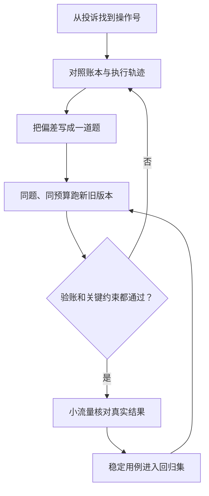
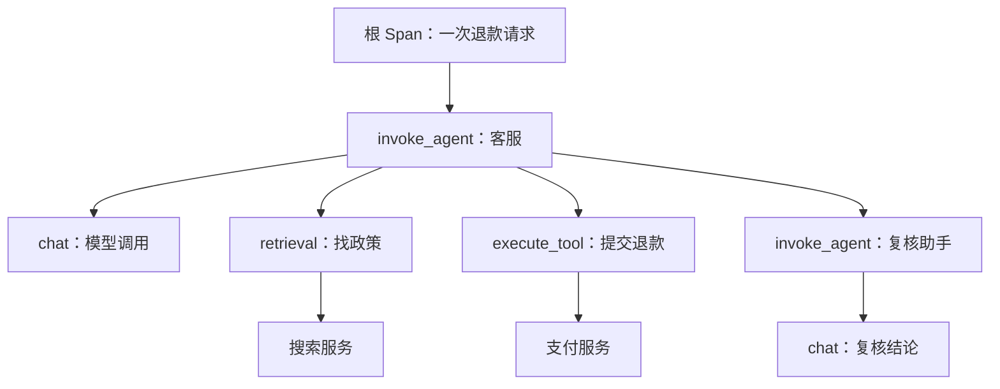

# 09.1 Agent 评测与可观测性：它说办好了，怎么验？

> 用户问“钱退了吗”，最有用的证据是支付流水。沿着这笔钱，可以讲清面试常问的三件事：怎样出题、怎样判分、线上出错怎样找到第一步偏差。



## 先定交付物，再动手写评测

“帮我退款”至少有三个可以停下来的时刻：创建申请、渠道受理、资金到账。假如产品承诺到受理为止，就去渠道查受理号、币种和金额。只有排队号时，用户应当看到“已提交申请，等待受理”。

单测可以证明退款函数在给定参数时能工作。整单还有别的变数：Agent 可能只调用查询工具，可能把元当分，也可能收到超时就再退一次。哪怕十个必经步骤各自的条件成功率都有 95%，全部走通也只有约 60%。

### 用四个对象把题写清楚

Anthropic 在 2026 年 1 月的《Demystifying evals for AI agents》给了四个好用的名字。拿一笔已批准的 88 元退款举例，题目和证据可以这样放。[Anthropic 原文](https://www.anthropic.com/research/demystifying-evals-for-ai-agents)

| 对象 | 这道题怎么填 | 谁能看 |
|---|---|---|
| Task：题目 | 身份、请求、订单初态、适用政策、截止时间；验收要求恰好一笔 8800 分的流水 | Agent 看做事需要的事实，评分端保管答案 |
| Trial：一次尝试 | 起一份干净数据库和会话，用指定模型、工具、预算跑到停止 | 运行器保存版本和停止原因 |
| Trajectory / Transcript：过程 | 逐轮保留可见消息、工具名、参数、回包和交接事件 | 排障者凭权限看脱敏记录 |
| Outcome：结果 | 从独立只读连接验退款流水，同时确认其他账户、订单都没变 | 评分器向业务系统取证 |

**给题目做一次验收。** 请业务同事从空环境办一遍，让另一人仅凭任务说明去验。两人对运费该不该退意见不同，就补政策版本和金额口径。留下一个确定能过的解和一个退错单的反例，改题时先跑这两份。

- **固定起跑线**：钉住仓库提交、镜像、时钟、索引与工具版本。数据库、工作目录、队列、浏览器身份每次重置。研究缓存时显式分冷、热两组。
- **给失败找对分母**：镜像拉取失败记设施异常；真实任务在规定步数内做不完，记任务失败。列计划次数、有效次数、业务失败、设施失败。补跑继承关联号，保留第一次红灯。
- **给异步动作留时间**：有受理号的任务进入待确认。到合同约定的时刻再查权威状态。提前收卷会错杀正常退款，无限延长又会把超时算成功。

### Claude Code 的四月复盘，怎样变成自己的回归题？

2026 年 4 月 23 日，Anthropic 解释了用户为什么觉得 Claude Code 变笨。API 推理层没有受影响，产品侧的三项改动到 4 月 20 日的 v2.1.116 均已处理。对应的测试要在用户实际使用的入口跑。[质量复盘与时间线](https://www.anthropic.com/research/april-23-postmortem)

| 改了什么 | 用户会碰到什么 | 自己怎么测 |
|---|---|---|
| 默认推理力度调到 medium | 大部分任务更快，难题的解题质量下降；4 月 7 日撤回默认调整 | 保留默认配置走完整产品入口，按难度同时看质量和尾延迟 |
| 闲置超过一小时后清理历史推理块 | 原想清一次，实际在该进程后续每轮都清，逐渐忘掉先前决定 | 虚拟时钟前进 61 分钟，恢复后连续做两个相依动作，另跑未闲置对照组 |
| 系统提示要求回答更简洁 | 逐项移除提示后定位到一项评测：Opus 4.6、4.7 在这项上都掉了 3% | 固定模型和工具，只切换这段提示，检查原先通过的任务具体坏在哪 |

第二题容易写错。只检查恢复后的第一轮，正确版和故障版都会清一次，两边都是绿灯。继续到第二轮，核对清理次数、用户先前定下的约束和最终交付物，才能分出好坏。这里采集运行时事件就够了。

## 三类 Grader，各判自己看得准的部分

先把“一次就不能放过”的错误圈出来。退错人、写错金额、绕过批准，任一项发生就拦下发布。回复清不清楚、有无多跑两轮，可以单独计分。否则一段写得很漂亮的说明，会把重复退款的扣分抵消掉。

| 谁来判 | 喂给它什么 | 怎么知道它判得准 |
|---|---|---|
| 代码 Grader | SQL 账本、Schema、AST、独立测试、必须出现的批准事件 | 假成功能被抓住，等价的正确实现也能通过 |
| 模型 Grader（LLM Judge） | 用户请求、适用规则、权威账态、候选回复、分项细则 | 盲评换位，比较与专家在留出集上的分歧 |
| 人工 Grader | 脱敏样本、当时生效的政策、双方可定位的证据 | 两人独立标注，保存原判和裁决，遇到政策变化重标 |

### 硬条件查结果，过程只卡必要的先后关系

代码题先在原提交跑独立测试，确认能看见原故障；应用补丁后，新测试和原先通过的测试都应通过。测试存到被测程序改不到的位置。可以专门喂三份补丁：只改测试的、修好新题却破坏旧功能的、用另一种实现真正修好的。

退款题验租户、账户、币种、最小货币单位与唯一流水。Schema 能判断 8800 是整数，不能判断接口要的是“元”还是“分”。批准必须先于写入，中间多查一次库存则只多算耗时。把这层先后关系写死就够了。

### 软条件让裁判指证据

与其让 Judge 给“专业度”打八分，不如请它逐条答：是否指出不符合哪条政策？是否承诺了账态推不出的到账日？用户看完是否知道下一步做什么？每项返回通过、失败或证据不足，再附支持判定的句子。

1. **先校准人**：按语言、租户、难度、失败类型取样。两位专家盲标，第三人裁决。专家争论的是规则就补规则，争论的是证据就补材料。同一投诉的改写放在同一组，避免题目泄漏到留出集。
2. **再校准模型**：隐藏作者和模型名，A/B 互换位置评两次，允许平局和证据不足。准备“简短正确”“详细正确”“很长却漏条件”三种答案，看看 Judge 是跟着证据走，还是偏爱排在前面和写得长的候选。[Judge 偏差实验](https://arxiv.org/abs/2306.05685)
3. **最后开封留出集**：只在校准集上改细则。被评文本作为引文输入，裁判进程无外部工具权限。政策、评审模型或细则换版，都留下旧判决，再与专家重对一轮。[作者的校准答疑](https://hamel.dev/blog/posts/evals-faq/what-should-i-do-when-i-cant-get-my-llm-judge-to-agree-with-human-reviewers.html)

**把一致率拆开看。** 专家判好、坏各 50 条。Judge 正确放行 47 条好回答，却也放过 8 条坏回答：总体一致率 89%，坏样本漏放率 16%，好样本误杀率 6%。如果线上只有 2% 是坏回答，全判通过也有 98% 的一致率。

人工时间优先给高损失错误、两位裁判意见相反的样本，再从判绿的普通流量随机抽一份。前两组用来找盲点，随机组才适合估计日常水平。另报“证据不足转人工”的比例，免得系统靠把难题全推走来提高准确率。

### 一个能跑的反例：结案词正确，退款流水为空

下面只用 Python 标准库。每次运行先造一份独立账本，工具有权按订单归属读写，评分器从账本另起查询。最后两次故意传入坏行为：只查就宣称已退、用户只预览却尝试写入。

```python
import sqlite3
from contextlib import closing

def trial(order, approved, actions, reply):
    # 这次登录的是 alice；金额单位统一为分。
    with closing(sqlite3.connect(":memory:")) as db:
        db.executescript("""
            CREATE TABLE orders(id INTEGER PRIMARY KEY, owner TEXT, cents INT);
            INSERT INTO orders VALUES(7, 'alice', 8800), (8, 'bob', 3300);
            CREATE TABLE refunds(id INTEGER PRIMARY KEY, cents INT);
        """)
        history = []
        for action in actions:
            item = db.execute("SELECT cents FROM orders WHERE id=? AND owner=?",
                              (order, "alice")).fetchone()
            if not item:
                result = "unavailable"
            elif action == "lookup":
                result = "eligible"
            elif action == "refund" and approved:
                db.execute("INSERT OR IGNORE INTO refunds VALUES(?,?)", (order, item[0]))
                result = "accepted"
            else:
                result = "denied"
            history.append((action, result))

        # 隐藏答案只交给评分端；对整张表验账，额外一笔也能被发现。
        ledger = db.execute("SELECT * FROM refunds ORDER BY id").fetchall()
        expected = [(7, 8800)] if order == 7 and approved else []
        finish = "accepted" if expected else ("preview" if order == 7 else "unavailable")
        observed = ("lookup", "eligible" if order == 7 else "unavailable")
        return {
            "ledger": ledger == expected,
            "orders": db.execute("SELECT * FROM orders ORDER BY id").fetchall() == [
                (7, "alice", 8800), (8, "bob", 3300)
            ],
            "reply": reply == finish,
            "grounded": bool(expected) or observed in history,
            "authorized": all(a != "refund" or (approved and order == 7) for a, _ in history),
        }

assert all(trial(7, True, ["lookup", "refund"], "accepted").values())
assert all(trial(7, False, ["lookup"], "preview").values())
assert all(trial(8, False, ["lookup"], "unavailable").values())
assert not trial(7, True, ["lookup"], "accepted")["ledger"]
assert not trial(7, False, ["lookup", "refund"], "preview")["authorized"]
```

最后一个断言很重要：网关成功挡下操作，账本干净，Agent 依然在“遵守只查询”上丢分。把工具的防护效果和 Agent 的行为分开记，才能看见是谁在替谁兜底。

换成真实评测时，用生产 Agent 入口产生动作，保留原有提示、工具选择和停止条件，把外部服务指向有状态沙箱。

真实模型适配器可调用 `POST https://api.anthropic.com/v1/messages`；密钥留在适配器，评分器走单独的只读连接。[Messages API](https://platform.claude.com/docs/en/api/messages/create)

把三道题各跑三次，再让坏版本在已批准的题里只查不退：九次里六次通过，退款题三次都挂。按题平均，至少成功一次和三次全成的得分都是三分之二。确定性替身能验证评分管线，模型波动要用真实调用测。

每次记下模型、脚手架摘要、题库版本和计划次数。每条试验保留动作、回执、结案词、各项判定、失败原因及 Trace ID。这样一次 CI 红灯既能定位到具体断言，也能重跑相同的起点。

## 同题试三次：算“至少成一次”还是“三次都成”？

一次 Trial 内查两遍订单仍是一次试验。下面的三次，都要各自从干净初态重跑。设同一道题每次成功率固定为 80%，各次独立，两个名字只差一个符号，回答的却是两类产品问题。[τ-bench 的重复试验](https://github.com/sierra-research/tau-bench)

| 指标 | 产品在问什么 | 同题独立时 | 例子 |
|---|---|---|---|
| `pass@k` | 给 k 次机会，里面有没有一个能用的解？ | `1 − (1 − p)^k` | 三份补丁至少一份合格，概率 99.2%。交付前还要能挑对 |
| `pass^k` | 同一件事交给它 k 次，能不能次次都办成？ | `p^k` | 三笔独立业务都办对，概率 51.2%。适合看重复可靠性 |

**拿实测数据怎么算？** 每题跑 `n` 次，过了 `c` 次，从中不放回选 `k` 次。全部组合有 `C(n,k)` 种；全失败的有 `C(n−c,k)` 种，全成功的有 `C(c,k)` 种。用这些组合数，能直接算出两种成功率。

- **至少一次成功**：`1 − C(n−c,k) / C(n,k)`。五次过四次，任选三次，凑不出三个失败，估计值是 100%。
- **全部成功**：`C(c,k) / C(n,k)`。五次中有四次成功，从这四次里挑三次，共有四种选法；全部五次挑三次有十种，估计值是 40%。
- **按题再汇总**：可选数量小于 k 时，相应组合数为零。整道题有效次数不足 k，就标缺测。别悄悄删掉缺测题再发整套均值。

为什么不能直接拿全站的 80% 去算？十道题里，八道每次都过，两道永远失败。给每题三次机会，两个指标的跨题均值都还是 80%。同一供应商故障窗口里的请求也会一起失败，区间估计应按任务、客户或时间窗成组重采样。

### 新版多过两题，先看是哪两题

同一百题，旧版过 70 题，新版过 72 题。可能是四题修好、两题变坏，也可能是二十二题修好、二十题变坏。后者影响大量原有用户。比较时固定镜像、工具和预算，打散运行顺序，逐题对齐“都过、都挂、修好、退步”。

1. **决定放不放**：先看旧版能过、现在失败的题。重复退款一次就拦；普通质量设可容忍下降幅度，配对差值区间跨线就补样本。旁边列每个成功单的总成本、超时和转人工率。
2. **决定进不进 CI**：能力集收暂时做不好的题，回归集保护已能稳定交付的事。某类题在多个独立批次趋于稳定，再挑代表题转入回归集。例如连续三批达到团队定的 95%，每批有足够试验、硬门禁全过，抽查轨迹也没有泄题。
3. **决定多久跑一次**：又快又确定的题跟 PR 跑，昂贵多轮题夜间跑。偶发失败留失败计数、排查人和隔离到期日。晋级后给能力集添新题，回归集继续守住原先的承诺。

## 读 Trajectory：先找第一次走偏的那一步

把用户目标放在左边，把每轮可见事实、动作与回包放在右边。在最早能指出证据的位置写一句人话，例如“查回旧地区条款后拒绝退款”。先逐条记录，再把反复出现的现象归类，这就是开放编码（Open Coding）。[错误分析工作法](https://hamel.dev/blog/posts/evals-faq/why-is-error-analysis-so-important-in-llm-evals-and-how-is-it-performed.html)

| 第一次偏离 | 回去看什么 | 下一道题怎么出 |
|---|---|---|
| 检索错了政策 | 生效日、命中版本、真正送进上下文的片段 | 新旧政策文字近似，只有一个当时有效 |
| 选错工具 | 查询回包与提交回执分别代表什么 | 查询也返回成功，验收仍要求有流水 |
| 参数错了单位 | 订单币种、接口单位、实际扣款 | 加部分退款和多币种，同查额度 |
| 压缩丢了承诺 | 压缩前后的批准与待办状态 | 让“只预览”跨过一次压缩或恢复 |
| 提前结案 | 停止原因、排队号、最终回调 | 回调分别延迟、拒绝，检查用户所见状态 |
| 原地循环 | 去掉随机请求号后，动作、输入和状态是否变化 | 工具持续没有新信息，要求按预算退出或交接 |

**用成功轨迹作对照。** 同样查不到订单，有一条主动向用户澄清，另一条断言订单不存在。可以同时记“索引过期”和“空结果被说成确定事实”，在轨迹上各标一处。证据断了就保留“原因待查”。

想验证检索是否有问题，冻住那轮之前的输入，只换成正确片段，再试能否恢复。录制回包适合重看旧路径；遇到新工具调用就换有状态模拟器。要看真实流量有没有变，用脱敏影子流量，所有写入落隔离环境。

**一个来自 Dispatch 的例子。** 2026 年 7 月的 Claude Code 工单里，用户停止输入后系统仍补入“上一轮没有可见输出”的合成消息。用户已看到回复，清理会话后又连续收到三条相同回复。[用户原始记录](https://github.com/anthropics/claude-code/issues/74013)

读到这里能标的是“没有新输入仍被唤醒”。接下来取发送事件号、父运行号、客户端回执和合成事件来源，分辨重复投递与回执延迟。回归题让发送成功、显示确认迟到，验同一消息只投递一次，运行能回到等待态。

## 主流 Benchmark：看它怎么交卷

| 基准 | 它真正在测什么 | 带回自己项目要补什么 |
|---|---|---|
| SWE-bench Verified | 人工筛过的 500 个真实仓库问题，提交补丁跑测试。[发布说明](https://openai.com/index/introducing-swe-bench-verified/) | 新工单、私有代码、等价实现能否通过 |
| SWE-Bench Pro | 更长程的软件工程任务，V2 修订公开切分和验收。[论文](https://arxiv.org/abs/2509.16941) · [V2](https://arxiv.org/abs/2610.24206) | 固定题库版本、依赖及容器预算 |
| Terminal-Bench | 在终端里办事，验证环境中的交付物。[项目](https://www.tbench.ai/) | 对齐 CPU、内存、并行度、超时和工具权限 |
| OSWorld | 操作桌面应用，核对文件和应用状态。[项目](https://os-world.github.io/) | 固定分辨率、登录态、应用版本和弹窗 |
| τ-bench | 与模拟用户对话，依照业务规则调用 API，验最终状态。[作者仓库](https://github.com/sierra-research/tau-bench) | 私有政策、真人不补资料或中途离开 |
| GAIA | 多步检索、推理、文件和多模态工具，交可核验短答案。[论文](https://arxiv.org/abs/2311.12983) | 长文另验引用是否支持结论、资料是否过期 |
| BrowseComp | 改变搜索方向找难定位、易核实的答案。[设计说明](https://openai.com/index/browsecomp/) | 按实际允许的网站、搜索次数与引用要求复测 |

看分差先看考场。OpenAI 复查 Verified 中 138 道模型常失败的题，至少 59.4% 的题会拒绝功能正确的解，也发现训练污染迹象。Anthropic 在 Terminal-Bench 2.0 固定模型，仅资源配置就拉开 **6 个百分点**。[Verified 复查](https://openai.com/index/why-we-no-longer-evaluate-swe-bench-verified/) · [基础设施实验](https://www.anthropic.com/research/infrastructure-noise)

我的筛选顺序是：用公开榜挑候选，再用时间切分的私有任务盲测，最后让小流量真实业务验收。内部既报按实际流量加权的成功率，也单列高损失场景。海量“查物流”很容易盖住少量“退错钱”。

## OTel GenAI Trace：把用户等的十秒拆开看

Trajectory 关心 Agent 怎么做决定，Trace 记录服务何时做了什么；每个有起止时间的环节叫 Span。同一任务可能跨好几条 Trace。分别保留任务号、试验号、业务操作号和 Trace ID，才能把实验、重试和隔天回调对起来。



| 埋点位置 | 至少留下什么 | 可以回答什么 |
|---|---|---|
| Agent 与工具 | `gen_ai.operation.name`、工具的 `gen_ai.tool.name`、停止原因 | 助手是只查过订单，还是也提交过退款？ |
| 远程模型请求 | `gen_ai.provider.name`、`gen_ai.request.model`、`gen_ai.response.model`、接口实返的输入输出 token | 指定模型和实际响应模型一致吗？走了哪条降级路线？ |
| 自家业务 | 自有命名空间里的版本、场景、结果码，操作号关联账本 | 哪一版压缩器之后出现了漏办？ |

进程内的 Agent 通常开 INTERNAL Span，远程模型调用开 CLIENT Span。检索下面还能挂数据库客户端。GenAI 语义约定已迁入独立仓库，固定采用的版本，升级时给旧字段做映射。[迁移说明](https://opentelemetry.io/docs/specs/semconv/gen-ai/gen-ai-spans/) · [字段定义](https://github.com/open-telemetry/semantic-conventions-genai/blob/main/model/gen-ai/spans.yaml) · [Python 埋点](https://opentelemetry.io/docs/languages/python/instrumentation/)

- **跨服务**：发请求时注入 Trace Context，收 HTTP 或队列消息时先提取再建 Span。并发任务各有子 Span，汇合处可用 Span Links 保留多个来源。隔天回调另开 Trace，用 Link 和操作号接回原单。
- **看延迟**：分开排队、首个可见反馈、首 token、工具耗时和最终回执。并行的两条支线取决定交付的那条路径。把全部子 Span 时长相加，很容易算出“用户等十秒，系统跑了十八秒”。
- **看质量**：符合受理条件的任务作分母，另列取消、拒绝、转人工和待确认。按入口、实际路由和版本分组，再调同组的成功、失败样本。少一条工具 Span，先核对业务回执、上下文传播和导出丢弃计数。

### 最小埋点：让队列两端认出同一条 Trace

在空虚拟环境装 `python -m pip install opentelemetry-sdk==1.45.2`，下面的例子会打印父子 Span。把字典当消息头，从网关传给 worker；清空进程内上下文再提取，就能检查换进程后这根线是否还连着。

```python
from opentelemetry.context import Context
from opentelemetry.propagate import extract, inject
from opentelemetry.sdk.trace import TracerProvider
from opentelemetry.sdk.trace.export import ConsoleSpanExporter, SimpleSpanProcessor
from opentelemetry.trace import SpanKind

provider = TracerProvider()
provider.add_span_processor(SimpleSpanProcessor(ConsoleSpanExporter()))
tracer = provider.get_tracer("refund.worker")

def receive(headers):
    # 从空上下文开始，防止测试误用调用者线程上的父 Span。
    parent = extract(headers, context=Context())
    with tracer.start_as_current_span("receive refund", context=parent,
                                      kind=SpanKind.CONSUMER) as consumer:
        attrs = {"gen_ai.operation.name": "execute_tool", "gen_ai.tool.name": "lookup"}
        with tracer.start_as_current_span("execute_tool lookup", attributes=attrs) as tool:
            tool.set_attribute("app.order.state", "eligible")
        return consumer.get_span_context().trace_id

with tracer.start_as_current_span("dispatch refund", kind=SpanKind.PRODUCER) as producer:
    message_headers = {}
    inject(message_headers)
    sent = producer.get_span_context().trace_id

assert receive(message_headers) == sent
provider.shutdown()
```

打开输出找 `execute_tool lookup`：它的父节点是消费消息的 Span，三条记录的 Trace ID 相同。去掉发送端的 `inject`，最后的断言会变红。这比只检查“两个服务都能打日志”更能发现跨队列断链。

### 有限的留存预算怎么花？

全量留低基数计数和权威业务账。版本、场景、结果可以作指标标签；订单号、Trace ID 留给可查询的事件。普通流量随机采样，超时、高风险和重试异常用尾采样多留。总体失败率从全量业务计数算。

正文进入采样前先脱敏。默认记录操作名、用量、错误码、证据指针；确需看原文时按租户授权、有期限地留存并审计访问。不要把邮箱或令牌塞进跨服务传播的 baggage，外来的跟踪头也不能当作登录身份。

异步导出走有界批队列和 OTLP Collector，盯住缓冲积压、丢弃量和采样策略。资金审计另走持久化事务通道。删用户数据时，顺着证据引用清理派生样本；想长期留作回归，就提炼触发条件，换成合成身份。

### Langfuse、Braintrust、Phoenix 怎么选？

准备用于试用的数据只需一组：同一条失败 Trace、对应的正常记录，以及修复前后的两份结果。让工程师和值班或业务同事各走一次，看谁能从投诉找到证据、把它变成下次能跑的题。

| 平台 | 哪种工作最值得先试 | 当场验一件事 |
|---|---|---|
| Langfuse | 想自托管，把 Prompt 版本、Trace 和数据集放在一起 | 能从失败调用建样本，再按版本找回并导出。[文档](https://langfuse.com/docs/observability/overview) |
| Braintrust | 经常用同一数据集比候选与基线，专家需要逐条看分歧 | 找出原来做对、改后做错的那几题，算上长期实验留存费。[文档](https://www.braintrust.dev/docs) |
| Arize Phoenix | 在本地调 RAG，常沿检索片段追到回答 | 用自己的 OTel / OpenInference 埋点验父子关系和字段，再查部署许可。[仓库](https://github.com/Arize-ai/phoenix) |
| LangSmith | 主要跑 LangChain / LangGraph 的嵌套任务 | 验证框架外的 worker 能接上同一条链。[文档](https://docs.langchain.com/langsmith/observability) |
| Helicone | 已在网关看多供应商成本与延迟 | 仍须补应用内工具 Span；2026 年 3 月被 Mintlify 收购后进入维护模式。[仓库](https://github.com/Helicone/helicone) · [收购说明](https://www.mintlify.com/blog/mintlify-acquires-helicone) |
| Datadog | 应用、队列和数据库原本就接 Datadog | 从慢请求跳到底层指标，再核对区域支持和留存费用。[文档](https://docs.datadoghq.com/llm_observability/) |

**一手资料速查**：[评测方法](https://www.anthropic.com/research/demystifying-evals-for-ai-agents) · [Claude Code 质量复盘](https://www.anthropic.com/research/april-23-postmortem) · [GenAI Span 字段表](https://github.com/open-telemetry/semantic-conventions-genai/blob/main/model/gen-ai/spans.yaml)

## 六道面试题：直接照着讲

### 1. 改一句 Prompt，总分涨两分，今天能发吗？

**考察点**：能否看懂同题前后发生了什么。

1. 我会先固定题目、预算和运行环境，把修好和退步的任务分别列出来。
2. 重复退款或越权写入，碰到一次就停。普通退步按事先定的容忍线和配对区间判断。
3. 通过后开小流量，盯真实办成率、尾延迟和成功单价。用户原来能办成的事，我会优先验。

**追问：半小时只够跑一轮呢？** 先跑硬门禁和本次改动最容易碰到的题，把不确定的收益留给下一批验证。

### 2. 单次成功率八成，让它试三次够稳吗？

**考察点**：机会和承诺的区别。

1. 先问用户能不能从三次里挑一个。独立同题至少成一次是 99.2%，需要验收器替用户挑对。
2. 要三次都交付成功，概率只有 51.2%。我会逐题统计，再跨题平均。
3. 一次支付丢了回执，我会先查原操作号；多打一遍款根本不算独立试验。

**追问：三次都赶上同一服务故障呢？** 那就按故障窗口成组重测，不能直接拿八成代公式。

### 3. 怎样知道模型裁判有没有偏心？

**考察点**：裁判也要有考卷。

1. 我先请专家独立打分并解决政策分歧，留一批题最后才看。
2. 让裁判逐项指证据，把候选换个顺序再判，还给它一份很长但漏条件的答案。
3. 看它放过多少坏例、错杀多少好例。发布后抽查判绿样本，换政策或裁判就重校。

**追问：专家也说不准呢？** 我会查缺哪条条件，允许多解或转人工，把不确定性记下来。

### 4. 钱退对了，过程绕了四步，要扣分吗？

**考察点**：目标、权限、效率各有判据。

1. 我查账本确认退给谁、退多少、退几次。账态对，目标这项可以过。
2. 再读轨迹。多查自己的订单记成本；无权读别人的订单，就算最后改对了也触发硬门禁。
3. 我只约束必要顺序，例如先确认再写入。合法的另一条解法应该能拿到分。

**追问：先改哪一步？** 找第一处有证据的偏离，只替换那一步的输入回放，看任务能不能恢复。

### 5. 公开榜领先六分，会直接换模型吗？

**考察点**：能否把公开成绩带回真实考场。

1. 我先对任务版本、算力、工具权限和选优次数，光是容器资源就可能造成这个量级的差距。
2. 用近期私有工单，在相同脚手架上复测；旧测试有没有错杀等价实现，也要抽查。
3. 最后看高风险任务的成功率、每单成本和真实等待时间，再逐批放量。

**追问：手上只有几十题呢？** 先覆盖代表性成功和高损失失败，标出还没测过的人群，逐步把新工单加进来。

### 6. 离线全绿，线上投诉却涨了，Trace 还只留了 1%，从哪查？

**考察点**：用有限的过程证据解释全量业务结果。

1. 我先拿业务账核对有多少单没办成，再按版本、长短会话和实际路由找出掉得最多的组。
2. 同组各找几条成功、失败 Trace 看第一次分叉。遇到缺 Span，查传播、采样和导出丢弃量。
3. 把确认过的触发条件变成独立 Trial。修复后回到同一流量组，等真实回执验证。

**追问：尾采样里半数是失败，能报 50% 吗？** 这批专门多留了异常，适合排障；发生率我会从全量任务和账本算。
