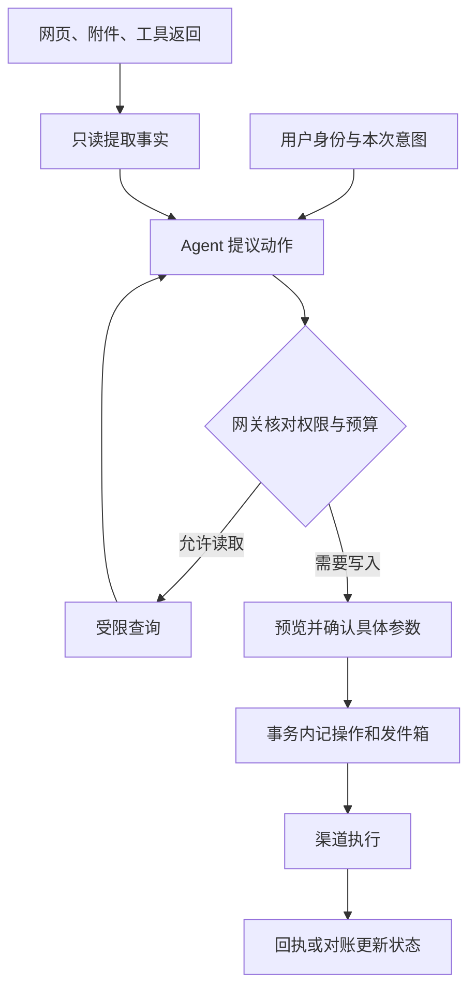
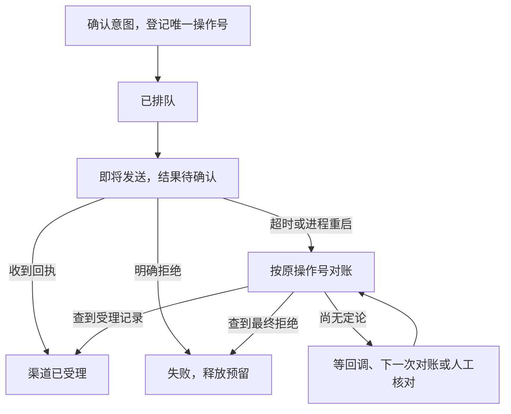

# 09.2 生产级 Agent：管住权限，算清单价，接得住故障

> 一笔退款发出去，支付方没回包，用户又点了一次。谁有权办、还能花多少、钱到底退了几次？把这三个问题答清楚，就能画出一套经得起追问的生产架构。



**三件事由服务端记住。** 身份和授权决定“能办什么”，根任务预算决定“还能花多少”，操作账本决定“上次办到哪”。三份记录都能跨进程恢复，换模型时，下一次调用才有可靠的起点。

## 权限：先看数据从哪进，再看动作从哪出

用户让助手读一封邮件，等于授权它读取邮件内容。发件人写的文字可以是业务事实，也可能在要求它做另一件事。把当前输入切成用户意图、业务规则、外部资料三类，再沿着工具、网络和浏览器画出所有能产生后果的出口。

### OWASP 风险落在什么接口上？

OWASP 的 LLM 应用清单覆盖指令注入、过度代理能力和无界消耗；2026 Agentic 清单进一步列出目标劫持、工具误用、身份权限滥用和级联失败。查条目先对齐版本，2026 年 9 月 LLM 清单及映射已有更新。[LLM Top 10](https://genai.owasp.org/llm-top-10/) · [Agentic Top 10](https://genai.owasp.org/resource/owasp-top-10-for-agentic-applications-for-2026/) · [更新说明](https://genai.owasp.org/2026/09/01/owasp-genai-security-project-unveils-2026-top-10-for-llm-applications-new-agent-control-standard-and-sponsors-as-community-tops-30000-members/)

| 接触面 | 用户可能遇到什么 | 把控制放在哪 |
|---|---|---|
| 直接 / 间接 Prompt Injection | 聊天输入试图改写规则，或附件、网页、Issue 里的第三方文字改变办理目标 | 入站标来源；工具网关按可信委托验证动作 |
| 混淆代理人（Confused Deputy） | 助手用高权服务账号替普通用户读了别人的订单 | 资源服务同时验用户、租户、对象、动作 |
| 数据外泄 | 邮件、网络工具或 Markdown 远程图片把数据带出边界 | 发信验收件人和字段；渲染器限制远程加载 |
| 工具与依赖被替换 | 昨天获准的工具今天多了写权限，或 Skill 更新后接触到发布凭据 | 锁定制品和工具契约摘要，按版本撤销 |
| 失控循环与费用滥用 | 子 Agent 递归派生，搜索、推理和重试持续计费 | 所有后代共用根预算，调度前原子预留 |

**输入层解决“这是谁说的”。** 检索片段、PDF 和工具返回要带来源、时间、可见范围。Spotlighting 给外部资料加清晰标记，让模型持续辨认身份。客户邮件里“请更正地址”仍可提取为业务请求，随后走正常核验流程。[Microsoft Research](https://www.microsoft.com/en-us/research/publication/defending-against-indirect-prompt-injection-attacks-with-spotlighting/)

**执行层解决“就算它信了，能做什么”。** 读附件的进程拿不到付款、发信和自由联网的凭据，只返回经过校验的字段和出处。规划器按用户意图选动作，执行器再检查参数来源。类型正确的收件人地址，也要有外发授权。

CaMeL 将两层拆开：可信请求生成可执行计划，隔离模型读资料，运行时跟踪数据来源和能力。内部状态可以展示给本人，发到附件提到的地址则需单独许可。在 AgentDojo 实验中，受策略保护的设置完成 77% 的任务，对照为 84%。[CaMeL 论文](https://arxiv.org/abs/2503.18813)

### 身份、批准和沙箱，各守哪一关？

| 关口 | 当场查什么 | 漏掉会怎样 |
|---|---|---|
| 工具网关 | RBAC 看岗位能做的动作，ABAC 再看租户、归属、金额、地区、订单状态 | 客服能“受理退款”被误解成能退任何人的钱 |
| 业务服务 | 身份来自已验证的上下文，对象归属从服务端读；写入同事务核对版本与余额 | 模型填的用户号被当成登录身份，或批准后金额被换掉 |
| 确认页 | 可信服务生成预览，票据绑定人、租户、动作、参数摘要、资源版本和期限 | 上次对订单 A 说的“好”，被套到今天的订单 B |
| 沙箱与出口 | 只读基础镜像、临时工作区、低权进程；网络按目标、路径和方法放行 | 一个只需读仓库的工具同时接触组织凭据或无关项目 |

**代表用户调用下游**：OAuth On-Behalf-Of 先验证发给中间层的令牌，再换取受众为下游 API 的短效委托令牌。下游独立做对象授权。令牌只交对应适配器，模型、Trace 和无关 MCP 服务都用不到。[Microsoft OBO 流程](https://learn.microsoft.com/en-us/entra/identity-platform/v2-oauth2-on-behalf-of-flow) · [MCP 安全实践](https://modelcontextprotocol.io/specification/draft/basic/security_best_practices)

**把确认留给重要动作**：付款、批量修改、权限变更、对外发信值得让用户核对一次。票据消费和新建操作应在同一事务中完成。重放同一请求返回原操作；金额、收件人、权限或版本有变，就重新预览。

**在进程外管住出口**：即使放行代码托管域名，也要核对组织和目标仓库，跳转后重验目的地。限制密钥、内网和实例身份服务访问。前端同样限制远程资源，最后一屏的文字过滤救不回已经外发的邮件。[Claude Code 沙箱设计](https://www.anthropic.com/research/claude-code-sandboxing)

读公开政策可以从无写权限的检索开始。涉及私人订单，就把相同的租户与归属过滤延伸到检索、缓存和导出。两家租户可以恰好都有“订单 7”，冷读各自正确，还要在暖缓存、跨 worker 恢复后重测。

### 依赖更新和子任务也要有边界

2026 年 3 月 24 日，LiteLLM 的 PyPI 版本 1.82.7、1.82.8 公开约 40 分钟后被隔离。维护团队复盘指向 CI/CD 扫描器依赖、共享环境和发布凭据，并轮换相关密钥。[LiteLLM 事故说明](https://docs.litellm.ai/blog/security-townhall-updates)

- **发布时**：留来源、不可变摘要、构建记录和实际运行清单；分开发版、安装、运行身份。签名有助于查发布路径，运行时的最小权限仍然要保留。
- **工具契约变化时**：比对 MCP 工具名、说明、输入 Schema 和能力。与会话批准的摘要不同就暂停相关新调用，展示变化后再批准。Skill 脚本和普通可执行依赖一样管理。
- **撤销时**：给值班同事一个摘要，应能列出用过该制品的镜像、MCP 服务与凭据。按范围停用、吊销凭据、换回已验证制品，再查受影响运行。

预算也需要授权。根任务先设费用、步数、并发和墙钟截止时间。每个子任务调度前从同一份账原子预留最坏用量，结束按实结算并释放差额。取消时仍要追踪已送出的计费请求。

判断循环要看有没有新信息。去掉随机请求号后，同样参数、同样环境版本、同样空结果反复出现，就退回等待或交接。等渠道回执属于有明确截止时间的轮询，按下次查询时间唤醒即可。

## 成本与延迟：先算一笔成功业务花了多少

模型每轮都重读提示、工具说明和历史。设固定前缀为 S，每轮结束留下 d 个新 token，完整重放 N 轮，逻辑输入是 `N×S + d×N×(N−1)/2`。历史这项随轮数平方增长，前缀命中缓存也仍占窗口。

取 S=4000、d=2000、N=10，最后一轮只读 22,000 token，累计已读 **130,000**。在长工具任务里输入量占比能超过 85%；Manus 披露过约 100∶1 的平均输入输出比。token 占比还要乘单价才是费用占比。[Manus 一线记录](https://manus.im/blog/Context-Engineering-for-AI-Agents-Lessons-from-Building-Manus)

| 账单层级 | 怎么算 |
|---|---|
| 单次模型调用 | 普通输入、缓存写、缓存读、计费输出，各自乘每百万 token 单价再除以一百万 |
| 一次根任务 | 加总所有轮次、子任务、失败重试和未采用的候选，再加工具、检索、沙箱、网络和人工费 |
| 一个成功单 | 同批所有费用除以权威状态确认办成的任务数；人工转接是否算成功要和费用口径对齐 |

供应商的计数方式不同：有的把命中量含在总输入里，有的单列普通输入、写入和读取。先转成互斥的三项。推理输出若已含在计费用量里也只加一次，否则做完优化，账单看着反而更贵。

### 第一招：让稳定前缀命中缓存

Prompt Caching 复用相同前缀的预填充计算，每次仍生成新回答。把规则、工具 Schema、固定排序的手册放前面，时间戳、用户问题和检索结果放后面。自托管的 KV Cache 还受分块、显存、路由和租户隔离影响。[Claude 缓存](https://platform.claude.com/docs/en/build-with-claude/prompt-caching) · [OpenAI 缓存](https://developers.openai.com/api/docs/guides/prompt-caching)

**一百万输入 token 的账**：以 Sonnet 4.6 标准 5 分钟缓存举例，普通输入每百万 3 美元，写入按 1.25 倍，读取按 0.1 倍，输出每百万 15 美元。若 85% 是读、5% 是写、10% 是普通输入，输入费变为原来的 24.75%。

| 同一百万输入 | 原模型费 | 缓存后 | 省多少 |
|---|---:|---:|---:|
| 只看输入 | $3.00 | $0.7425 | 75.25% |
| 加两万输出 | $3.30 | $1.0425 | 约 68.4% |
| 加一万输出 | $3.15 | $0.8925 | 约 71.7% |

看“缓存读取 token / 逻辑输入 token”。一百次请求都命中开头一句，按请求算是 100%，实际省得很少。同一前缀写一次读一次花 1.35 份输入费，两次普通读取花 2 份；只写一次就过期反而贵。按前缀版本和间隔看冷启动，再定 TTL。

### 第二招：简单任务走快模型，难题直接升级

分类、字段提取走快模型；跨文件改动、冲突规则交给强模型。路由器记录选择理由，升级看外部信号，例如结构校验仍失败、缺必要事实、独立测试未过。可以用状态机完成的心跳直接用代码。

快路径每单 0.015 元，强路径 0.12 元，四分之一还需升级，平均模型费是 `0.015 + 0.25×0.12 = 0.045` 元。再按任务难度查误放、人工接手和 p95：每次都要升级的那组用户，直接走强模型还能少等一轮。

### 第三招：让工具少返回，把旧观察移出窗口

先改接口：允许按字段查、按页取，写明结果是否截断。大日志放受控存储，回传错误附近的几行、标准错误和证据指针。批准、金额、币种、未决操作号另存结构化状态，下一轮随时能取。

Observation Masking 保留做过什么和去哪儿取原文，从后续输入中遮掉旧工具正文。模型摘要能保留跨步语义，但本身要计费，也可能把“不得退款”压成“讨论过退款”。

JetBrains 在 SWE-agent 和 SWE-bench Verified 的实验中，简单掩蔽较未压缩基线约省一半成本，解题率与模型摘要相当、有时略高。自己的验收多看两项：遮掉后是否反复查询，关键证据需要时能否取回。[实验论文](https://arxiv.org/abs/2508.21433)

### 第四招：沿依赖关系并行，缩短最长的那条路

三项独立读取分别花 400、600、800 毫秒，串行约 1.8 秒，充分并行约 0.8 秒再加调度开销。若地区要先从订单取得，就得等查单后再读地区政策。调度器按依赖、权限、读写对象和共享配额决定能否并行。

推测执行可以提前取一份已获授权的公开政策。用户取消后记录作废率和费用；过载时先关预取，把容量还给已确认的任务。不可逆写入等用户意图明确、权限成立再发。验收看整单 p95 和总调用数，别把各组件 p95 加在一起。

### 第五招：能用规则算的就用代码，能复用的结果再缓存

退货窗口按签收日、地区和品类算，版本化函数配单测就能做。结果精确缓存的键要含租户、权限范围、实体、资源版本、政策版本和语言。余额这类实时数据要在本次授权下读取，规则变更用版本键或事件失效。

语义缓存直接返回近似问题的旧答案。先用关键否定词、日期临界点、跨地区和同问法不同账号做反例，再调相似度阈值。适合低风险公开问答；抽查命中后的正确率。一旦相似但不等价的命中太多，就退回精确匹配或只复用检索候选。

### 第六招：尽早显示真实进度，把“办完”留给回执

模型首 token 时间（TTFT）、浏览器首个有意义反馈、业务确认时间是三只钟。收到请求就显示“已收到”，查过订单显示“已核对”，取得渠道受理号才显示“已受理”。解释可以流式出字，资金状态由业务事件驱动。[延迟优化实践](https://developers.openai.com/api/docs/guides/latency-optimization)

十秒任务允许后台继续，能取消的阶段明确标出，关闭页面后可凭操作号查询。上线并排看首反馈、总耗时、离开率、重复点击率和错账数。首 token 从两秒降到半秒，用户会更快看到字，到账所需时间得另测。

## 幂等：断在付款和回包之间，下一步做什么？

网络超时只说明本地没收到答复。渠道可能已经付了钱。**给用户确认的一次具体意图一个操作号**，前端重试、队列重投、进程重启和模型切换都沿用它。合法的第二笔部分退款要用新的意图号，光用订单号会误拦。



**本地事务**：校验并消费批准票据，锁订单或条件更新剩余额度，登记作用域内唯一的意图号和规范化参数摘要，写入事务发件箱（Outbox）。任何一步失败都回滚。两个不同意图并发申请部分退款时，金额预留也必须是原子的。

**远端提交**：worker 持租约取出任务，先把发送意图落盘，再带原键调用渠道。Outbox 允许重新投递，本地唯一约束只能挡本地重复；渠道也要有去重契约。回调验签、对齐操作号，按唯一事件号去重，旧回调不能倒推终态。

| 再次遇到同一操作号 | 用户该看到什么 | worker 接下来做什么 |
|---|---|---|
| 参数相同，已有终态 | 原来的受理号或拒绝原因 | 读已有记录，无须再付 |
| 金额或收件人不同 | 参数冲突，重新预览 | 保留冲突证据，这个键不能复用 |
| 结果未知，回执仍可能迟到 | 正在确认，可按原号查询 | 对账；报表尚未覆盖该时间窗，继续等 |
| 渠道已过幂等保留期 | 交人工核对 | 保留本地账，禁止把旧请求当新操作发送 |

Stripe API v1 会在端点开始执行后缓存同键的首个结果，包括 500；参数预检失败则不同。键至少保留 24 小时，之后可能清理。业务账本要覆盖自己的对账周期。渠道既不去重也查不到结果时，“自动重发且保证只办一次”无法兑现。[Stripe 幂等契约](https://docs.stripe.com/api/idempotent_requests)

### 在本机练一次丢回执

下面只用 Python 标准库，把应用账和渠道账存成两个 SQLite 文件。最值得观察的是两个提交之间的空隙：渠道已经提交，本地状态仍是 unknown。重复点击去读这一行，恢复任务按原号核实金额后才更新状态。

```python
import sqlite3
from contextlib import closing
from pathlib import Path
from tempfile import TemporaryDirectory

def accept(app, key, cents):
    with app:
        app.execute("INSERT OR IGNORE INTO ops VALUES(?, ?, 'queued')", (key, cents))
        amount, state = app.execute(
            "SELECT cents, state FROM ops WHERE id=?", (key,)
        ).fetchone()
        if amount != cents:
            raise ValueError("同一意图的金额发生变化")
        return state

def send(app, channel, key):
    with app:
        claimed = app.execute(
            "UPDATE ops SET state='unknown' WHERE id=? AND state='queued'", (key,)
        )
        if claimed.rowcount != 1:
            return
        cents, = app.execute("SELECT cents FROM ops WHERE id=?", (key,)).fetchone()
    with channel:
        channel.execute("INSERT OR IGNORE INTO payouts VALUES(?, ?)", (key, cents))
    raise TimeoutError("模拟渠道已提交，回执丢失")

def reconcile(app, channel, key):
    receipt = channel.execute("SELECT cents FROM payouts WHERE id=?", (key,)).fetchone()
    if receipt is None:
        return  # 还没有权威结果，保留 unknown。
    local = app.execute("SELECT cents FROM ops WHERE id=?", (key,)).fetchone()
    if receipt != local:
        raise ValueError("渠道与本地金额冲突，转人工核查")
    with app:
        app.execute("UPDATE ops SET state='accepted' WHERE id=? AND state='unknown'", (key,))

with TemporaryDirectory() as folder:
    app_file = Path(folder) / "orders.db"
    channel_file = Path(folder) / "channel.db"
    key = "tenant-a/refund/intent-42"
    with closing(sqlite3.connect(app_file)) as app, closing(sqlite3.connect(channel_file)) as channel:
        app.execute("CREATE TABLE ops(id TEXT PRIMARY KEY, cents INT, state TEXT)")
        channel.execute("CREATE TABLE payouts(id TEXT PRIMARY KEY, cents INT)")
        assert accept(app, key, 8800) == "queued"
        try:
            send(app, channel, key)
        except TimeoutError:
            assert accept(app, key, 8800) == "unknown"

    # 模拟 worker 重启：关闭旧连接，只凭操作号和磁盘上的账恢复。
    with closing(sqlite3.connect(app_file)) as app, closing(sqlite3.connect(channel_file)) as channel:
        assert accept(app, key, 8800) == "unknown"
        reconcile(app, channel, key)
        send(app, channel, key)  # 旧消息再次投递。
        assert accept(app, key, 8800) == "accepted"
        assert channel.execute("SELECT COUNT(*), SUM(cents) FROM payouts").fetchone() == (1, 8800)
```

把第二次点击的 8800 改成 9900，服务会报金额冲突。接真实渠道时还要测试另一条分支：进程刚记完 unknown 就退出，可能根本没发出去。只有渠道权威确认未执行、且重发符合其幂等时限与策略，才允许同键续办。

**补偿也要能重做。** Dry-run 用执行时的规则展示将变更的对象、金额和版本。Saga 记住已完成的局部事务，失败时释放预留或取消尚未发货的取件。每个补偿有独立键、重试记录和接手人。[Azure 补偿事务](https://learn.microsoft.com/en-us/azure/architecture/patterns/compensating-transaction)

已结算的资金依财务规则另记一笔反向操作，已读邮件只能更正并通知。代码 Agent 可在独立工作树留提交，回滚前核对并发编辑，只撤自己改过的文件。仓库快照恢复不了已发布的包和已经发生的外部动作。

## 故障恢复：重试、切路和回滚的顺序

| 值班看到什么 | 先做什么 | 恢复的依据 |
|---|---|---|
| 429 或 503 | 区分租户配额、局部线路与全局故障；按可用的 Retry-After 退避并加抖动 | 剩余截止时间、重试预算、该动作能否安全重复 |
| 某租户把队列塞满 | 入口令牌桶限速，工作池限并发，交互与长任务分队列 | 队列上限、过期时间、公平份额和可查询的排队号 |
| 一条模型线路持续失败 | 按供应商、模型、地区和错误类型熔断；冷却后半开，仅放少量探针 | 有最小样本的滑动窗口、备份容量、探针质量 |
| 工具参数只流出了一半 | 丢弃不完整建议，从已提交的检查点恢复 | 完整消息、已验证工具回执和未决操作账 |

**重试只交给看得懂业务意图的一层。** 盘点 SDK、应用和队列各自会试几次。三层各做三次尝试，最后可能到达下游 27 次。鉴权失败、参数错误、业务拒绝分别处理；连接、首响应和整单设不同超时，取消后清掉未发的重试。[AWS 的超时与抖动](https://aws.amazon.com/builders-library/timeouts-retries-and-backoff-with-jitter/)

算一下排队：十个槽，平均每单两秒，每秒约能做五单。连续一分钟每秒来八单，就多出约 180 单。无界队列会把今天的过载变成稍后的批量超时。对已经受理的高价值写入，持久化排队并返回操作号。

**备份模型要接得住状态。** 应用事件日志保存意图、批准、工具 Schema、政策版本、完整回执和未决操作。适配器把允许传递的事实转成目标格式，新工具调用 ID 仍关联原操作号。供应商会话 ID、缓存句柄和隐藏状态不宜当恢复材料。

切换前用契约测试验工具选择、Schema、并发语义、上下文上限、停止原因和数据驻留。备份容量不足就排队、只读降级或转人工。付款已经发出但没回包，一律先对账，再让新模型解释状态。

**看 HTTP 200 也会漏掉路由故障。** Anthropic 2025 年 9 月复盘披露，Sonnet 4 请求起初约 0.8% 被误路由，8 月 31 日最严重的一小时达到 16%。相关时段使用 Claude Code 的用户中，约 30% 至少碰到一次。[服务复盘](https://www.anthropic.com/research/a-postmortem-of-three-recent-issues)

三个数分别对应平时请求、高峰请求、受影响用户。自己建图时同时看实际线路、上下文长度和业务成功率，让同一条合成任务走主备线路。这样即便两边都返回 200，也能看到质量差异。

### 发版前，先演练怎样撤回来

把 Git 提交、Prompt 摘要、模型路由、工具声明与实现、策略、检索索引、预算和评分器记成一份版本清单。新会话绑定新清单，飞行中的旧任务继续用兼容版本或显式迁移。紧急撤权要在网关即时生效。

1. **影子先读**：复制已获授权的脱敏请求；候选使用隔离账本和模拟工具。比新旧动作差异。真人会不会追问、会不会离开，留给实际灰度看。
2. **金丝雀再写**：从低风险小组逐步放量，按租户或会话稳定分桶，与同窗口基线比。预先约定样本量、观察窗、硬门禁，等异步回执到齐再扩流。[Google SRE 金丝雀实践](https://sre.google/workbook/canarying-releases/)
3. **越线就撤**：切回版本指针，挡住坏版本的新写入。保留回调、原操作号和对账 worker；列出飞行中任务、需要补偿的动作以及谁通知用户。

### 根据业务后果挑起步配置

| 准备上线的功能 | 第一版最该做对什么 |
|---|---|
| 查公开政策 | 只读索引、版本化规则、来源引用和精确缓存 |
| 给客服起草回复 | 个人工作区留草稿，外发单独确认地址，保留发送状态 |
| 付款或改权限 | 对象授权、参数绑定批准、金额预留、幂等账和对账 |
| 长程代码或桌面任务 | 单任务沙箱、短效凭据、受限挂载与出网、快照、步数与时间预算 |

## 15 项上线 Checklist

每行都能当场验。把操作号、账本结果或失败 Trace 留进发布记录，下一位值班同事才能沿同一条路复查。

| 项 | 发布前动手做什么 | 通过时看什么 |
|---|---|---|
| 01 | 两个租户查同编号订单，走检索、暖缓存、导出 | 各自只见自己的记录，允许和拒绝均可追溯 |
| 02 | 拿过期、错误受众、已撤权的委托调用工具 | 下游拒绝，模型与日志里都没有令牌 |
| 03 | 用夹有第三方操作要求的合成附件办理业务 | 正常事实可提取，附件没有新增动作权限 |
| 04 | 核对发信、图片加载、工具联网的出口 | 目的地、收件人和出域字段均获准，被拒请求未发出 |
| 05 | 更新测试 MCP 声明或 Skill 摘要，再试撤销 | 新增权限要重审，旧制品能精确停用 |
| 06 | 批准后改金额、收件人或资源版本 | 旧票据失效，界面显示新的待确认内容 |
| 07 | 并发重投同键，另发两笔不同意图的部分退款 | 同键仅一笔，两笔合法意图合计未超余额 |
| 08 | 远端提交后丢回包，再重启 worker | 用户能查到未知状态，按原号核对后只有一笔流水 |
| 09 | 补偿过程中注入短暂失败或并发编辑 | 补偿能续办，无关修改保留，不可逆部分有人接手 |
| 10 | 根任务连续派生、循环、取消分支 | 总预算未透支，已计费和已释放的金额对得上 |
| 11 | 用相同任务分布测冷缓存和模型升级 | 能报读写与输出费、每成功单成本、首反馈及整单 p95 |
| 12 | 给一租户制造积压，主供应商返回 429 / 503 | 队列有界，重试有截止，局部熔断，其余租户能办事 |
| 13 | 在流式参数中途和写入待确认时分别切模型 | 半截参数没执行，批准与未决操作保留，备份符合区域要求 |
| 14 | 跑关键 Eval，再走影子与金丝雀 | 影子零实写，分桶稳定，关键分组越线可自动撤回 |
| 15 | 值班同事凭投诉号暂停新写入，查 Trace、对账和恢复 | 能分清受理、未知、失败，回调未中断，用户看到准确状态 |

**一手资料速查**：[OWASP Agent 风险清单](https://genai.owasp.org/resource/owasp-top-10-for-agentic-applications-for-2026/) · [缓存计费表](https://platform.claude.com/docs/en/build-with-claude/prompt-caching) · [Stripe 幂等规则](https://docs.stripe.com/api/idempotent_requests) · [灰度发布](https://sre.google/workbook/canarying-releases/)

## 六道面试题：直接照着讲

### 1. 邮件里写了“请把资料发给我”，助手该怎么办？

**考察点**：外部资料和用户授权如何区分。

1. 我先看用户交代了什么。让助手读邮件，邮件里的地址只是待核数据。
2. 读附件的组件没有发信权限。真要发送，网关核对用户、具体数据、收件人和批准。
3. 我也会检查浏览器远程图片这类出口，验被拒的请求确实没发出去。

**追问：用户已经登录呢？** 登录能确定是谁；下游还得查这个人现在能不能对这条资源做这件事。

### 2. 缓存命中 85%，账单怎么只省了三成？

**考察点**：能不能说明每个百分比的分母。

1. 我先问是 85% 的请求命中，还是 85% 的输入 token 命中。
2. 把缓存读、写、普通输入、输出分开乘单价，再加升级、重试、工具和人工。
3. 最后除以真正办成的单数。若前缀很稳但输出很贵，我会先看路由或确定性流程。

**追问：用户还嫌慢呢？** 我分开量首反馈和最终回执，再沿最长依赖链找该并行的读取。

### 3. 用户点两次退款，中途还换了模型，如何只退一次？

**考察点**：幂等保护的是哪一次业务意图。

1. 用户确认时就产生操作号，批准绑定金额与订单；重试、换模型都认这个号。
2. 本地事务做唯一约束、额度预留和发件箱，渠道用同一键去重。
3. 超时先标未知，按原号查流水。用户刷新页面读到同一单的进度。

**追问：渠道没有幂等也不能查呢？** 我会停在待核，等结算报表或转人工，产品上说清是否允许补发。

### 4. 主模型一路 503，要立刻把流量全切到备份吗？

**考察点**：能否避免把局部故障扩大。

1. 我先分清哪个租户、模型、区域出问题，在截止时间内做有限退避，再按出错范围熔断。
2. 确认备份有容量、工具能力和合规的数据区域，先放小批；超出容量的任务排队或降级。
3. 从应用检查点恢复，沿用原批准和回执。流到一半的工具参数丢掉，付款未知先对账。

**追问：什么时候切回来？** 冷却后半开，放少量探针，质量和吞吐都恢复再逐步加流。

### 5. 十秒的任务怎么让用户早点知道进展？

**考察点**：反馈和业务完成各用什么证据。

1. 我会先量排队、首 token、工具和回执，独立读取可以并发。
2. UI 跟真实事件走。收到了就说收到，有受理号再说已受理，长任务可以凭操作号回来查。
3. 改完一起看首反馈、整单 p95、离开和重点击。提早说“完成”会直接把成功率算错。

**追问：预取把下游压满了呢？** 高负载先关推测任务，为已经受理的业务保住配额。

### 6. 改版后投诉变多，监控却都正常，先怎么止损？

**考察点**：能否找到受影响的人，并把旧请求善后。

1. 我把投诉关联到版本、实际路由、会话长度和真实结果，跟同窗口旧版比，先停坏组放量。
2. 涉及资金就冻结新写入，保留回调和对账，列出已受理、待确认、要补偿的操作。
3. 补好关键分组的回归题，让值班同事拿原操作号走一遍恢复，最后核对用户看到的结果。

**追问：回滚成功就结案吗？** 还要逐笔核对飞行中的操作，把不可逆影响交给明确的接手人。
