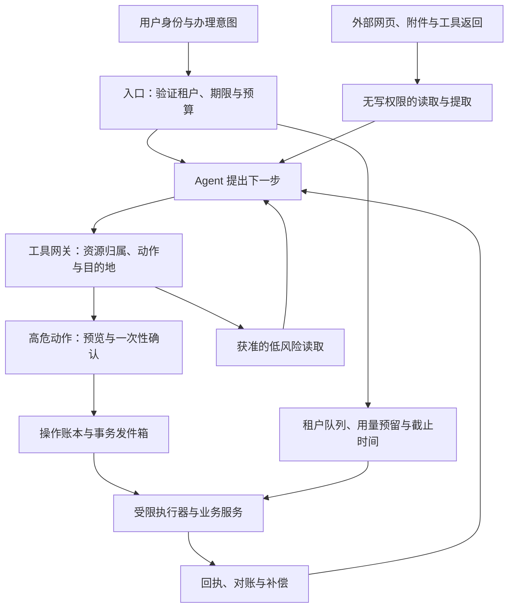
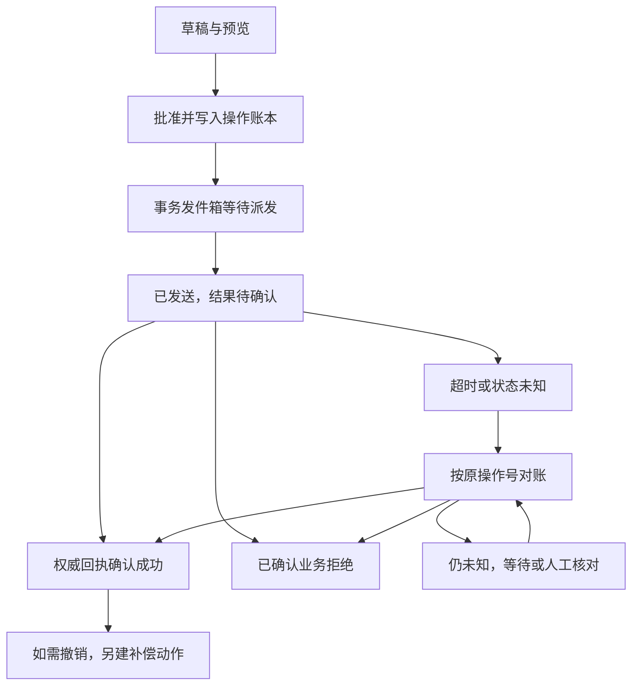

# 09.2　生产级 Agent 的三条生死线：权限、账单与故障恢复

把一个会办理退款的助手交给真实客户之前，你得证明它只能动该动的钱，算清每笔成功业务的成本，并能在付款成功却收不到回包时安全接班。这三件事也是资深岗位系统设计面试最容易被追穿的地方。

设想你半夜接到电话。用户在聊天窗口里看到“正在重试”，支付渠道却已经受理了第一笔退款。负责模型的同事说两次请求都合法，负责支付的同事说两次签名都正确，财务只想知道钱究竟退了几次。这个退款场景是全文的教学案例。文中另有两起署名公开的真实事故，一起发生在软件发布供应链，一起发生在模型流量路由。事故数字和演练假设会分别标明。

## 一张办事单穿过哪些边界



图里有三张不同的账。权限账回答“谁让它办、能给谁办”。用量账回答“这一单还能花多少钱、还能等多久”。操作账回答“这件事在外部世界做到哪一步了”。模型可以根据新信息改变计划，三张账由服务端持有。把任意一张只写在聊天历史里，断线重连、上下文压缩或切换模型时，系统就可能重新解释原本已经确定的事实。

## 一、安全首先是办事权限的问题

### 1. 先看谁能让谁做什么

助手在执行用户交代的事时，会读到其他人写的字。如果它把其中的内容当成给自己的办事命令，就可能偏离用户目标。这就是 Prompt Injection 想造成的效果。用户亲自在聊天框里要求超出其权限的动作，属于直接注入风险。助手替用户阅读网页、PDF、GitHub Issue 或邮件时接触到的第三方指令，属于间接注入风险。页面中视觉上隐藏的文字、与背景同色的 PDF 文本都可能被提取器带入上下文。过滤几个敏感词，只改变助手看见的字符，并没有改变它手里那把钥匙能开哪些门。[OWASP 2025 LLM 应用风险](https://genai.owasp.org/llm-top-10/) · [OWASP 2026 Agentic Applications](https://genai.owasp.org/resource/owasp-top-10-for-agentic-applications-for-2026/)

| 接触面 | 在退款助手里会变成什么损失 | 可以独立验收的控制 |
|---|---|---|
| 直接或间接注入 | 附件内容试图改变办理目的、收件人或要求跳过确认 | 来源被标为外部数据，工具网关重验每个拟执行动作 |
| 混淆代理人 Confused Deputy | 用户本来只能查自己的订单，高权客服账号代查了别人的 | 每次读写均绑定已验证的租户、用户、资源与委托范围 |
| 外泄 Data Exfiltration | 生成的 Markdown 图片会让浏览器向外取资源，URL 参数可能带上敏感值。邮件和通用网络工具也有相同出口 | 渲染端禁止任意远程资源，网络层限制目的地，消息网关审收件人与允许出域字段 |
| 工具与供应链投毒 | MCP 服务临时换了工具说明，更新过的 Skill 脚本获得了工作区和凭据 | 锁定版本、制品摘要与工具契约，升级审查、隔离凭据并限制通信 |
| 失控循环和钱包攻击 | 一个请求递归派生几十个助手，或反复支付模型与外部搜索费用 | 将子任务记入相同租户和根任务预算，超限停止并取消尚未执行的工作 |

沿用 OWASP 的分类时要注明版本。2025 年 LLM 应用清单和 2026 年 Agentic Applications 分别聚焦内容风险和执行风险。2026 年 9 月 OWASP 又公布了新版 LLM 应用清单及与 Agent 风险的映射。[OWASP 对 2026 年更新的说明](https://genai.owasp.org/2026/09/01/owasp-genai-security-project-unveils-2026-top-10-for-llm-applications-new-agent-control-standard-and-sponsors-as-community-tops-30000-members/)

LLM 应用清单里的指令注入、过度代理能力和无界消耗，对应的是内容进入系统后可能发生什么。面向 Agent 的清单进一步讨论目标劫持、工具误用、身份权限滥用与级联失败。画威胁图时沿每条箭头检查自家接口，标出谁能写知识库、谁能安装扩展、谁控制检索排序，再检查浏览器会不会自动加载图片、队列能不能派生新任务。若只把聊天输入框圈成“攻击面”，最有业务价值的那批后台能力全在图外。

**先分清三个角色。** 用户甲登录进来是调用者，助手服务是代表他行事的代理，订单系统才是资源所有方。“助手服务的证书合法”仅说明是谁连进了订单系统。服务必须同时回答甲能否对这一笔订单做这个动作。工具参数里即便带有用户号，也只是模型提供的待核信息。真实身份由入口验证并随受约束的请求上下文传播，资源所属租户由服务端读取。用户可以看到自己的历史订单也不等于他能修改所有这些订单，例如已结算或正处于争议流程的那一单仍要拒绝退款。

### 2. 把读资料和下命令分开放

先从成本最低的一层做起，在入站时区分可信用户指令、业务规则和外部材料，保存来源、时间、可见范围。工具返回只暴露既定字段，给外部文本标边界。Spotlighting 的做法是让模型持续辨认输入各段的身份，让资料在变换或加标记后仍能正常用于回答。它适合降低同一个模型混淆角色的机会。上线验收时也要看误报。假如一封真的客户邮件要求更正地址，这就是需要处理的业务数据。系统可把它提取为“客户提出更正”，再走正常身份核验和确认。如果把所有祈使句都删除，安全看板会很漂亮，退货服务却坏了。[Microsoft Research 的 Spotlighting 研究](https://www.microsoft.com/en-us/research/publication/defending-against-indirect-prompt-injection-attacks-with-spotlighting/)

第二层让后果可控。读取附件的进程不带退款凭据，不能发邮件，也不能自由访问公网。只返回经过校验的候选字段及其出处。规划端根据可信用户意图选工作流，外部资料可以提供“订单日期”这类参数，改变收件人、目的地或可执行动作则须有对应的可信来源。两个模型若共用一套高权工具，或读取端可以把未经约束的文字直接当作规划指令回传，权限分离只存在于架构图。即使字段类型正确，里面也可能有错。对金额与收件人的资源归属、范围、业务合法性，写入前仍要校验。

CaMeL 把这种隔离再推进一步。可信查询生成可按规则执行的计划，受隔离的模型负责读不可信内容。执行器跟踪变量的来源与能力，工具调用要满足数据流策略。举例，业务允许将内部订单状态展示给本人，却没有授权把这段状态发往刚从附件提取的地址。只要其中一个条件不满足，执行器应在发起外部通信前停下，而规划模型无法靠多说一句“已确认”获得新权限。论文在 AgentDojo 环境报告，带其安全保证的设置完成了 77% 的任务，对照组为 84%。这是特定威胁模型、可信组件和策略假设下的效用取舍，生产接入要明确哪些策略由谁维护、拒绝后用户如何继续。[CaMeL 原论文](https://arxiv.org/abs/2503.18813)

对业务取舍可以这样做。只读公开资料摘要，使用来源分段、引用验证和无写权限环境已经有价值。处理私有文件且能外发内容，就要在数据出口执行策略。涉及付款、权限变更或删除数据，规划、批准与执行应由不同权限主体承担。输入护栏负责识别异常并控制可送入的上下文，输出护栏负责结构、敏感字段、链接与渲染策略。两者中间还有工具执行这一条独立通道。即使前端最终拦住了回答，早已发出去的一封邮件也无法靠拦截最后一段文字追回。

### 3. 用工具网关决定本次动作到底能不能办

角色权限控制 RBAC 给出“客服岗允许申请退款”，属性权限控制 ABAC 再核对租户、订单归属、金额、状态、地区和本次审批。读请求也要走相同边界。数据库查询优先在资源域内按租户和归属加条件，写操作在同一个事务里验证当前版本与状态。只在模型入口检查一次“是否为客服”，之后拿一个能读全库的连接执行任意查单，就会出现混淆代理人。对于不可见的订单，可统一返回不可查询，避免通过报错差异暴露它是否存在。

若用 OAuth On-Behalf-Of，前端拿到发给中间层的用户访问令牌，中间层验证其签发者、受众、期限和委托权限，再向身份系统换取以下游 API 为受众、范围受限的令牌。下游仍独立实施对象级授权。短效令牌只交给对应工具适配器，请求日志、模型上下文、其他 MCP Server 都无须得到它。直接把收到的 token 原封不动转发给任意下游，会破坏受众边界。服务自主执行的维护任务则用单独的工作负载身份，执行范围和审计记录与用户委托分开。[Microsoft 身份平台 OBO 流程](https://learn.microsoft.com/en-us/entra/identity-platform/v2-oauth2-on-behalf-of-flow) · [MCP 安全最佳实践](https://modelcontextprotocol.io/specification/draft/basic/security_best_practices)

人工确认值得花在哪儿？一次只读查询若要连点五次，用户很快会形成闭眼批准的肌肉记忆。优先把人工精力放到付款、给外部发信、批量改数据和身份授权上。预览显示**谁、对哪个对象、做什么、金额币种或目的地、将产生什么后果**。确认页由可信服务生成，签发短期票据，绑定发起人、租户、规范化动作摘要、资源版本和到期时间。提交时再检查角色是否被撤销、金额是否有变。票据消费与创建操作记录放在同一事务里。用户连续点两次，读到同一操作的结果。把一条历史聊天中的“好”存成永久批准，用户换订单也会被误认为同意。

对沙箱同样要把门落实到进程外。文件系统给只读基础镜像、临时工作区和必要挂载，进程使用低权限身份。网络通过受控代理，只允许本次业务所需的服务、路径与方法，重新验证跳转后的目的地。对工作区密钥、实例身份服务、内网段和跨租户存储默认隔离。允许访问“全公司的代码托管域名”仍可能允许向陌生仓库发内容，所以工具层还要验证组织、仓库、目的资源和动作。渲染用户界面也要管出口，可以拒绝远程图片或改用受控、不会随意取回外部内容的附件服务。隔离策略既要测正常工作是否仍能完成，也要测拒绝路径是否确实发生在请求出站之前。[Anthropic 的 Claude Code 沙箱设计](https://www.anthropic.com/research/claude-code-sandboxing)

### 4. 发布依赖也能让模型网关出事

2026 年 3 月 24 日，LiteLLM 的两个 PyPI 版本 1.82.7 和 1.82.8 在被隔离前公开可用约四十分钟。维护团队在 3 月 27 日的公开说明中把当时掌握的情况指向 CI/CD 使用的受影响扫描器依赖及发布凭据，并说明已轮换相关密钥。这是软件发布链事故，风险窗口可以比团队一次发版会议还短。团队说明的是受影响包及其发布时间。不能据此推算所有安装者都遭到了同一种后果。[LiteLLM 维护团队事故说明](https://docs.litellm.ai/blog/security-townhall-updates)

做桌面演练时，可以给平台值班一个组件摘要，他能否列出哪些 Agent 镜像、MCP Server 和 Skill 运行过它，运行时能看哪些数据，拿到的是短效凭证还是组织级密钥？如果唯一清单是一份写着“安装最新版”的构建脚本，紧急关停只能全站一刀切。保留经审核的来源、不可变摘要、构建记录、运行时工具声明及签发方。制品签名和溯源有助于核对发布路径，但某个获准的发布者本身失陷时仍需凭据隔离、限制出网和及时撤销。权限有扩张的工具更新应触发重新审查，不能继承旧版本的“永远允许”。

远程 MCP 工具还要管运行时变化。一个服务今天声明只读，明天更换说明或输入字段。Agent 在工具发现时看到的契约和执行时调用的版本可能不同。把批准的工具清单、版本和模式摘要纳入会话配置，变化后暂停涉及该工具的新调用，给用户或管理员看语义差异。Skill 脚本按可执行依赖管理，隔离安装、运行与发布身份。出事故时先按摘要禁用、吊销受影响凭证、核对实际运行清单，再恢复最后一份可验证的制品。只换提示词对被替换的程序没有约束力。

**钱包也有授权边界。** 假设一次请求最多可派十个子任务，每个子任务都自称有十次额度，两层下去就可能产生一百个孙任务。预算由根任务立账，调度前原子预留最坏情况下的输入输出和工具费用。返回后按实际值结算并释放差额。预留失败不启动，取消和超时先查已发出的请求是否仍会计费。结合按租户限并发、根任务限步数、无进展循环检测和墙钟截止时间，一个昂贵任务才不会堵住其他客户。对连续重复的同一动作，要比较输入、环境版本和新信息。等待状态有变化的合规轮询可以定时继续，原地踏步则应停下给出可恢复的进度。

## 二、从每一单的钱和等待时间算起

### 1. 用户只说了十个字，为什么模型读了十万 token

一个助理连续跑十步，系统提示、工具描述、历史对话和工具结果往往每次都得带上。第一轮读一份背景，第二轮又读同一份背景加上一段新材料。设固定前缀为 `S`，每轮完成后多留 `d` 个 token，连续调用 `N` 轮，未经裁剪的各轮逻辑输入总量是 `N×S + d×N×(N−1)/2`。当每轮增长近似固定且完整重放时，这一部分随轮数按 `O(N²)` 增长。若有固定窗口、掩蔽、摘要或真正的状态化服务，总量和实际计算曲线都会改变。即使命中缓存，逻辑上下文依然占用窗口。

取 `S=4000`、`d=2000`、`N=10`，累计读入 130,000 token，最后那一轮只见到 22,000。只拿最后一次请求估价会严重低估账单。长工具轨迹里**输入占 token 数超过 85%** 完全可能，Manus 团队公开过其工作负载平均输入输出约 100 比 1。短问答、长文生成和重推理任务的比例会很不一样。报表把“输入占 token 数”“输入占模型账单”“模型占整个任务成本”分三列，才知道降哪个数字真的能省钱。[Manus 一线上下文工程记录](https://manus.im/blog/Context-Engineering-for-AI-Agents-Lessons-from-Building-Manus)

```text
单次模型费 = (普通输入量 × 普通输入价 + 缓存写入量 × 写入价
             + 缓存读取量 × 读取价 + 计费输出量 × 输出价) / 1,000,000
单次任务总费 = 所有轮次及子任务的模型费之和
             + 工具/API 费 + 检索/沙箱/网络费 + 所分摊的人工处理费
每个成功办理的成本 = 同批全部任务的总费 / 经权威业务状态确认成功的任务数
```

式中单价按每百万 token，前三项输入计数必须互斥。供应商有的直接返回普通输入、缓存创建和命中分项，有的在总输入里列出已包含的 cached tokens。适配器应先归一再求和。若计费用量含有推理输出，则按对应模型的接口口径计入，不能漏记或叠算。失败重试、推测后被丢弃的调用以及切换供应商前已经发生的用量也属于该批总费。架构团队关心每个自动结案，财务也许关心每个最终解决的用户问题。人工转接是否算成功及其成本，必须和分母同口径。

### 第一招　让反复读的同一段前缀真的能复用

Prompt Caching 像把一本手册翻到已读的位置继续往下读。相同前缀的预填充计算有机会被复用，模型仍会为本轮生成新的答案。自托管常用的 KV Cache 保存注意力计算的键和值。跨请求前缀复用还涉及分块、内存容量、路由和隔离。托管 API 提供可计价的前缀缓存，不代表应用可以直接搬运或读取服务端的 KV。它和后面会谈到的“直接返回旧答案”承担不同风险。[Claude 平台的 Prompt Caching](https://platform.claude.com/docs/en/build-with-claude/prompt-caching) · [OpenAI 的前缀缓存说明](https://developers.openai.com/api/docs/guides/prompt-caching)

稳定的系统规则、工具 Schema 和按固定顺序排列的长手册放前面，用户问题、时间、检索结果和临时状态放后面。版本号只在真实版本变化时变，别把毫秒时间戳或每次随机排序的工具声明放在最前面。拆开“有任意命中的请求占比”和“缓存读取 token / 所有逻辑输入 token”两个指标。假如一百次都命中开头一小段，按请求算可以是全命中，对账单和长上下文的预填充帮助却有限。批量发布新提示词时看冷启动段、缓存生命周期、并行首批写入和地区/部署间隔离。权限或内容本身不同的租户不能为了提高命中共享受限结果。

**85% 命中到底省多少？** 用 Sonnet 4.6 标准 5 分钟缓存来算。以普通输入为基价，写缓存为 1.25 倍，读缓存为 0.1 倍。假设一百万输入 token 中 85% 是读、5% 是写、10% 是普通输入，则新输入费为原来的 `0.85×0.1 + 0.05×1.25 + 0.10 = 0.2475`，输入费节省 **75.25%**。该档每百万普通输入 3 美元、输出 15 美元，若同时生成两万 token，模型总费从 3.30 美元变为 1.0425 美元，节省约 **68.4%**。若只生成一万，模型总费从 3.15 降到 0.8925，节省约 **71.7%**。工具和人工费再加进来，整单比例还会变。要把命中拉到 85% 以上、把总费砍掉七成，得先测稳定可复用的输入量、输出比例与写入成本。不同型号和 TTL 的费率以表中对应行核算。[Anthropic 缓存读写费率与计数](https://platform.claude.com/docs/en/build-with-claude/prompt-caching)

要判断一批工作值不值得预热，可以先算一个前缀的盈亏。按上面的倍率，写一次后再读一次，前缀总成本为 1.35 份普通输入，而两次都无缓存是两份。只写一次且再未复用则多付四分之一。若业务在隔天才回来，每次都过期重写，买更长 TTL 也要重新计算。对自托管系统，长时间保留冷前缀还可能挤掉正在排队的热门前缀。按租户、前缀版本、轮次和时间间隔画命中分布，再决定保留哪一段，比把整个聊天永远钉在缓存里稳妥。

### 第二招　把该用强模型的钱留给难题

意图分类、字段提取、短摘要可先交给快模型。周期性心跳能靠定时器和状态机判定时直接用代码。需要跨文件修改、开放规划或处理互相矛盾的政策时，用强模型往往更划算，因为弱模型兜一圈再失败也要付费。路由器输入取任务结构、权限范围、复杂度和已发生的工具错误，输出模型档位与可审计的理由。升级触发条件宜有外部证据，例如 Schema 二次校验仍不通过、缺少必要事实或验收测试持续失败。让模型仅凭一句“我很有信心”给自己发通行证，容易把成本优化变成误放。

假设快路径每单 0.015 元，强路径 0.12 元，四分之一的任务在快路径后还须完整升级。先快后强的期望模型费用为 `0.015 + 0.25×0.12 = 0.045` 元，直接全用强模型为 0.12 元。这是给定升级比率的算例，还没包含错结案和两段串行时间。把评测集按简单、含糊、高风险和多语言切开，分别记录错路由、人工转接、升级比例、时长和成功单价。如果最难的一成客户原本就贡献大部分收入，让他们连续等待两次推理即使省了模型费也不一定合算。可以用确定的结构特征让这部分请求一开始就走强路径。

### 第三招　工具结果按问题裁，旧的观察按需取回

查一笔订单返回几百行事件，助手需要的也许只是可退余额、一条状态和最后更新时间。先改工具契约，让列表支持过滤、分页、字段投影和稳定排序，明确是否被截断、下一页怎么取。大输出写入有租户权限的临时存储，给模型摘要、证据引用和读取接口。错误日志裁剪时保留发生错误的上下文和标准错误流，不要只留开头的欢迎语。删除的内容若影响决定，Agent 可付一轮成本取回。关键批准、金额、币种、未完成操作号应作为结构化状态随时可取。

Observation Masking 是把旧工具观察的正文从后续模型输入中遮掉，仍保留做过什么、结果摘要和必要指针。原始证据按保留策略存在受控存储，便于审计和重新定位。模型摘要能压缩跨步语义，但要花额外调用，还可能把“不得退款”压成“讨论过退款”。JetBrains Research 的研究在 SWE-agent、SWE-bench Verified 和所测配置中，简单掩蔽相对未压缩基线约减半成本，与模型摘要的解题率相当、有时略高。这支持你先试便宜基线。在依赖远处工具结果的业务上仍要比较“取回率、重复查询和错误决策”。[JetBrains Research 论文](https://arxiv.org/abs/2508.21433)

### 第四招　只并行那些本来可以各做各的事

查当前退款政策、查订单、查渠道可用性，如果三者彼此不依赖并且都有读取权限，可以并发发起。假设耗时分别为 400、600、800 毫秒，串行约 1.8 秒，充分并行的工作段约 0.8 秒，再加调度和汇合开销。如果法律地区必须先从已授权订单中获取，读地区政策就是后继步骤，不能当作独立任务。工具 Schema 之外，把依赖、读写属性、共享资源、超时和取消策略保存在工具注册表里。模型提出并行建议，调度器据此做最终检查。

推测执行 Speculative Execution 是在答案还没定时先做有把握会用到的工作。比如用户正在确认是否继续，服务可在权限已成立时预取公开政策。若用户取消，预取结果作废。候选路径的流量、缓存写入与外部服务额度必须入账，常常要在系统高负载时关闭。任何不可逆或携带非必要私有数据出域的动作都不宜拿来猜。把最慢一次、总调用数和取消后仍完成的请求都记录下来，看 p95 是否真的改善。并行度从四调到四十若把下游打进限流，关键路径反而多出退避等待。

### 第五招　能确定地算出来，就给用户一个确定的结果

退货窗口按签收日、地区和商品类目计算，适合版本化函数。模型可以解释结果，无须每单重新推导日历。重复请求先试按规范化参数精确缓存，键含租户、授权范围、地区、政策版本、语言和相关资源版本。只有答案可安全复用、近义提问的错误代价低时，再试 Semantic Cache，根据语义相似度找候选，并做实体、一致性和新鲜度检查。它直接复用旧结果，所以过期、串租户及“很相似但关键否定词不同”都会变成真实错误。

把“我可以退吗”和“我不可以退吗”放成一对反例，连同订单日期临界点、地区变化、不同账号相同问法一起做阈值校准。公共政策摘要可以按版本缓存。个人余额则必须查可授权的新鲜状态。设置 TTL 只能限制陈旧时间，政策刚变就必须失效的场景，还需要版本键或变更事件。统计命中后的人工投诉率和主动抽检正确率，一旦不稳就退回精确匹配或只复用证据候选。直接用代码的工作流同样需要单测、变更评审和结果版本，业务规则昨天改了、人们今天照旧得到一个确定的错答案，也照样会投诉。

### 第六招　让用户看见真的进展，也量到真正完成

TTFT 是模型开始输出首个 token 的时间，浏览器里看到的首个反馈还包括网络、排队和首帧渲染。用户按下退款按钮时可以立即看到“已收到请求”，查到快照后显示“已核对订单”，支付方返回受理号后才显示“已提交”。模型可以流式生成解释，UI 的资金状态只取业务事件。别把占位动画的出现算作首个有意义反馈，也不要把模型的内部思维当作对用户的进度播报。对需要十几秒的任务提供取消或后台继续，显示哪个动作已不可取消，用户关闭页面后仍可按操作号查询。[OpenAI 延迟优化实践](https://developers.openai.com/api/docs/guides/latency-optimization)

每一版同时画出首个有意义反馈、首 token、到权威回执的总时间、用户中途离开率和重复点击率。TTFT 由两秒降到半秒但到账受理仍需十秒，体验改善可以成立，服务端吞吐却未必增加。有长尾时尽量比较相同任务分布下的分位数和关键路径，不把各组件的 p95 相加当作整体 p95。做优化验收时把成功率和错账数放在同一页，才能发现“更快”的原因竟然是助手提早宣布完成。

## 三、可靠性工程从那次没回包的退款开始

### 1. 给用户的一次意图发一个操作号

网络超时只能证明本地没拿到答复。远端有可能没收到请求，也可能已经完成写入，只是回包丢了。给每次 HTTP 重试新生成一个随机键，业务上就等于请人再付一笔。稳定的幂等键在用户确认一次具体动作时产生，排队、模型重规划、进程重启、切换供应商都复用。相同用户在同一订单申请两笔不同金额的合法部分退款，应有不同业务意图号。不能只拿订单号做永久唯一键。键的作用域至少包括业务身份、租户和动作，并将规范化参数摘要写入记录。



同一个本地事务先校验并消费审批票据，再核对资源版本及剩余额度，插入带唯一约束的操作记录，写事务发件箱 Outbox。重复请求若命中同一个键且参数摘要一致，返回已有状态。同键不同参数返回冲突并保留审计。两个并发请求可能同时查询到“还没办过”，必须靠数据库唯一约束、条件更新或行锁决出赢家。部分退款还要在订单账户上原子预留可退金额，防止两个**不同**操作号各自合法、合起来超过剩余余额。如果任一步失败，应回滚整个本地事务，审批票据也随之恢复。

发件箱由工作进程持租约读取，记录尝试号、下游请求号和截止时间。数据库提交与网络发送之间无法靠一个本地事务实现恰好一次。工作进程可能发出去后宕机，下一个进程会再次投递，所以对外仍使用同一幂等键。对方回调在本地用唯一事件号去重并校验签名与业务关联。迟到旧回调不能把已确认成功改回处理中。对账程序扫描长时间未知的操作，通过同一个下游键、业务单号或结算单查询权威状态，更新账本并释放相应额度。处理过程的每一步都允许在宕机后再做一遍。

接 Stripe 的 API v1 时要看端点是否已开始执行。开始执行之后，首个结果会与幂等键关联，后续同键可以返回相同结果，包括 500。键保留至少二十四小时后可被清理。参数校验失败等情况与已经开始执行不同，其他 API 版本和渠道也有自己的规则。应用自己的操作账本保留期应覆盖业务追诉和对账周期。远端幂等保留期过后，不可把旧请求当作首次付款重新提交。邮件渠道若没有去重键、也不能可靠按消息号查询，严格恰好一次交付就无从保证。遇到结果未知留给人工核对或采用明确的产品交付语义。[Stripe 幂等请求文档](https://docs.stripe.com/api/idempotent_requests)

**Dry-run** 是把本次会改哪些订单、金额、收件人和版本先展示出来。算预览和真正执行尽量用同一套业务规则。执行时还要重验权限和资源版本，预览到提交之间余额可能被别处用掉。**Saga 补偿**把长流程拆成可以确认的局部事务，失败时根据已完成步骤发起领域认可的反向动作。例如取消未发货的退货取件、释放尚未扣除的预留额度。已经送达的邮件不能“撤销阅读”，要走更正与通知。已完成资金结算须按财务规则产生另一笔可审计操作。补偿本身也会失败、也需要自己的键、重试记录和人工出口。[Azure 的补偿事务模式](https://learn.microsoft.com/en-us/azure/architecture/patterns/compensating-transaction)

代码 Agent 则可在独立分支或工作树先落一个 Git Commit，审阅差异后提交，对可控本地文件使用快照恢复。回滚应只撤本次任务的改变，检查并发编辑，避免用一份旧目录覆盖用户的新工作。Git 能恢复跟踪文件，不能回收已发往外部的邮件、已发布的包或已执行的支付。架构评审时让每个工具声明“可回滚对象、回滚时限、补偿权限、不可逆后果”，这张表也决定哪些操作必须事先预览和批准。

### 2. 把重试放到一个地方，再给它定个最后期限

429 可能是某个租户配额超了，也可能是供应商速率限制。503 常意味着暂时不可用，但也不保证立刻重发有用。先辨别来源与作用域，读取可用的 `Retry-After`，在剩余截止时间和重试预算内做带抖动的指数退避。重试统一在了解完整业务意图的一层执行，明确 SDK 自动重试次数，避免应用、SDK、队列各重试三次将一次抖动放大。鉴权失败、参数错误或业务拒绝应分流处理。连接超时、首响应超时和整单截止时间分别计量，用户已经取消的任务也要清掉等待中的重试。[AWS Builders’ Library 的退避与抖动](https://aws.amazon.com/builders-library/timeouts-retries-and-backoff-with-jitter/)

入口用租户配额和令牌桶约束到达速率，工作池限制正在运行的数量，给交互任务与长后台任务不同队列。若有十个执行槽、平均任务两秒，持续处理能力约每秒五个。连续一分钟每秒来八个，忽略波动就会多出约一百八十个未处理任务。无限排队只把拒绝改成稍后超时。队列要有上限、任务过期时间、预估等待和明确的过载反馈。对已接收的高价值操作可持久化排队，向用户返回操作号。公平调度至少按租户分槽或加权分配，让一个批量导入不会吃掉所有在线退款请求。

熔断器像替值班员记着“这条线路现在有多糟”。按供应商、模型、地区和错误类型维护滑动窗口，满足最小样本且超阈值时从 Closed 进 Open，暂时避开该依赖。冷却后 Half-open 只放少量探针，恢复才逐渐加流，否则继续打开。租户自身欠费不应熔断整家供应商。全局容量不足也不该诱发所有客户同时涌入同一备份。备份区域、并发与预算要经压力演练。有数据驻留限制或者备份模型不具备所需工具能力时，应排队、只读降级或转人工，这些是可以向用户说清的产品状态。

### 3. 切换模型时别把业务记忆也换掉

应用控制的事件日志要存下 Agent 的恢复点，包括可信用户意图、工具 Schema 与政策版本、已批准动作、权威回执、未决操作、可见消息和证据指针。模型供应商自有的会话 ID、缓存句柄、隐藏状态或签名内容未必能移植。切换前在完整消息与工具回执边界做 checkpoint，适配器把允许传递的事实和结构化工具结果转成目标格式，关联新的工具调用 ID 和原操作号。不能只把一段自然语言摘要当作付款记录，不能假定前一家的私有推理状态可序列化。业务上下文能连续，下一次模型产生完全相同的想法则没有这种保证。

在工具调用参数只流出一半时掉线，丢弃未完成建议，从已提交边界恢复。付款已发出但没有回执时，恢复成“结果未知”，先对账再让新模型说明进度。对接前跑跨模型契约测试，逐一验证 Schema 可表达、工具选择、最大上下文、并行语义、停止原因、数据区域与政策。可租用第二家供应商并不自动产生灾备能力。恢复演练里要真关主路、注入延迟回执和重复回调，然后查用户看到了什么，以及业务账本到底有几条流水。

**真实路由事故给了分组监控一个好理由。** Anthropic 的 2025 年 9 月复盘披露，部分 Sonnet 4 请求被路由到不合适的长上下文服务器。最初影响约 0.8% 的 Sonnet 4 请求，8 月 31 日最严重的一小时达到 16%。在相关时段发过请求的 Claude Code 用户中，约 30% 至少一次遇到错误路由。三个数字有三个分母。若按单次 API 可用性监控，这类返回成功但质量下降的问题很容易失踪。生产侧应能按实际路由、上下文类型、时间段、运行版本和“至少受影响一次的用户”切片，再让同一条合成任务经过不同线路验收。[Anthropic 三起服务问题复盘](https://www.anthropic.com/research/a-postmortem-of-three-recent-issues)

### 4. 多租户隔离与发版，直接写进运行协议

租户边界覆盖检索、业务数据、对象存储、缓存、队列、执行沙箱、Trace 和导出。常见失误是 API 查单带租户条件，向量检索只按相关度召回，或者旧缓存键只有订单号。当甲乙都存在订单七，两边得到各自的编号七属于正常业务。任一共享系统忘带租户维度，结果就可能串线。隔离评测用两个资源外观相同、内容不同的合成租户，同时运行、暖缓存、跨 worker 恢复，再查询导出报表。仅测首次冷查询无法发现缓存命中后才出现的越权。

每次发布时，把实际使用的版本记入一份可复原的清单，逐项登记 Git 提交、Prompt 摘要、模型与路由配置、工具声明与实现、权限策略、检索索引、预算参数和评分器版本。线上新运行固定使用该清单，正在办理的旧运行要么继续使用相容旧版，要么经显式状态迁移再恢复。紧急安全撤权则由实时网关生效，不因旧会话绑定而失效。影子流量复制经过授权且已脱敏的输入，候选使用隔离账本或模拟工具，禁止实写、发信、通知与重复支付。影子看得到决策差异，却观察不到真实用户对候选回答的下一步反应，后者要靠金丝雀流量验证。

金丝雀可以从内部账号到少量低风险租户，再分地区、语种和业务等级放量。按租户或会话稳定分桶，避免客户在同一笔订单中途切臂。设置最小样本、观察窗、失败硬线和自动撤回的版本指针，候选与当前版本同期比较。等待回调的场景要等账期成熟再扩大流量。撤回时先挡住新请求进入坏版本，对飞行中的写操作保留原操作号和对账任务，再决定继续处理还是人工接管。直接关掉整个 worker 池可能毁掉收集权威回执的最后一条链路。[Google SRE 的金丝雀发布实践](https://sre.google/workbook/canarying-releases/)

### 5. 做一次“款退成功、响应丢了”的故障演练

下面的 Python 用两个独立账本扮演业务服务和支付渠道，能在本地复现结果未知、重复投递、参数冲突与按原操作号恢复。保存为 `refund_recovery.py` 后运行 `python refund_recovery.py`。输入是已经通过权限和批准校验的合成请求。业务库的 `queued` 行在这个小程序里兼作事务发件箱。生产若另有消息队列，应把发件箱事件和业务记录放在同一事务，再由投递器送到队列。

```python
import sqlite3
from contextlib import closing
from pathlib import Path
from tempfile import TemporaryDirectory

def accept(app, tenant, intent, order_id, cents):
    # 相同意图只能创建一份命令，数据库负责并发时的唯一性。
    with app:
        app.execute("INSERT INTO ops VALUES(?,?,?,?, 'queued') "
                    "ON CONFLICT(tenant,intent) DO NOTHING",
                    (tenant, intent, order_id, cents))
        row = app.execute("SELECT order_id,cents,state FROM ops "
                          "WHERE tenant=? AND intent=?", (tenant, intent)).fetchone()
        if row[:2] != (order_id, cents):
            raise ValueError("同一操作号的参数变了，需要重新预览和批准")
        return row[2]

def deliver(app, channel, key, lose_reply=False):
    tenant, intent = key
    order_id, cents, state = app.execute(
        "SELECT order_id,cents,state FROM ops WHERE tenant=? AND intent=?", key
    ).fetchone()
    if state == "accepted":
        return
    # 先落“结果待核实”。即使发送前中断，恢复任务也能找到这一单。
    with app:
        app.execute("UPDATE ops SET state='unknown' WHERE tenant=? AND intent=? "
                    "AND state='queued'", key)
    with channel:
        channel.execute("INSERT INTO payouts VALUES(?,?,?,?) "
                        "ON CONFLICT(tenant,intent) DO NOTHING",
                        (tenant, intent, order_id, cents))
        actual = channel.execute("SELECT order_id,cents FROM payouts "
                                 "WHERE tenant=? AND intent=?", key).fetchone()
        if actual != (order_id, cents):
            raise ValueError("渠道返回了冲突的操作记录")
    if lose_reply:
        raise TimeoutError("渠道已提交，本地没有收到回执")
    with app:
        app.execute("UPDATE ops SET state='accepted' WHERE tenant=? AND intent=?", key)

def reconcile(app, channel, key):
    # 教学渠道提供权威查询。找不到时留在 unknown，由渠道契约决定后续动作。
    paid = channel.execute("SELECT order_id,cents FROM payouts "
                           "WHERE tenant=? AND intent=?", key).fetchone()
    local = app.execute("SELECT order_id,cents FROM ops WHERE tenant=? AND intent=?", key).fetchone()
    if paid is not None and paid == local:
        with app:
            app.execute("UPDATE ops SET state='accepted' WHERE tenant=? AND intent=?", key)

with TemporaryDirectory() as tmp, closing(sqlite3.connect(Path(tmp)/"app.db")) as app, \
     closing(sqlite3.connect(Path(tmp)/"channel.db")) as channel:
    app.execute("CREATE TABLE ops(tenant TEXT, intent TEXT, order_id TEXT, cents INTEGER, "
                "state TEXT, PRIMARY KEY(tenant,intent))")
    channel.execute("CREATE TABLE payouts(tenant TEXT, intent TEXT, order_id TEXT, "
                    "cents INTEGER, PRIMARY KEY(tenant,intent))")
    key = ("tenant-a", "intent-42")
    assert accept(app, *key, "order-7", 8800) == "queued"
    try:
        deliver(app, channel, key, lose_reply=True)
    except TimeoutError:
        assert accept(app, *key, "order-7", 8800) == "unknown"
    try:
        accept(app, *key, "order-7", 9900)
    except ValueError:
        pass
    else:
        raise AssertionError("应拒绝更改金额")
    reconcile(app, channel, key)
    deliver(app, channel, key)  # 模拟又到达一条旧投递消息
    assert accept(app, *key, "order-7", 8800) == "accepted"
    assert channel.execute("SELECT COUNT(*), SUM(cents) FROM payouts").fetchone() == (1, 8800)
    print("对账完成：渠道只有一笔，金额 8800 分。")
```

演练的验收点有三个时刻。渠道提交前，用户能查询到待处理的本地操作。回包丢失后，重复点击能拿回同一单的未知状态。恢复以后，本地与远端对应同一笔金额。示例中的渠道在一个事务内支持同键去重和强一致查询。接真实渠道时应把它的查询时效、幂等保留期、冲突语义写入适配器契约。若只能查到延迟结算报表，查不到这一行并不证明交易没有发生，要等报表水位跨过该操作的时间窗再处理。对账出现同键不同金额则冻结后续动作并交财务核查。

## 四、按业务后果选架构

| 拟上线的业务 | 从哪里起步 | 出现什么情况就升级设计 |
|---|---|---|
| 面向公众的政策问答 | 只读检索、政策版本、证据引用、精确缓存与首反馈指标 | 开始读私人订单时，把用户委托、租户过滤、数据保留和出口控制放进同一条链 |
| 给客服准备草稿 | 读写分权，草稿放个人工作区，外发由人确认。简单分类走轻模型 | 产品开始自动发信时，引入目的地约束、发送账本、未知状态及人工更正 |
| 真正退钱或变更权限 | 身份透传、对象级策略、绑定参数的确认、幂等账本与对账先行 | 业务扩展部分退款或跨渠道时，补并发额度预留、可审计的补偿和渠道级熔断 |
| 长程代码或桌面操作 | 单任务沙箱、短效凭据、挂载与出网限制、提交与快照、步数和时间双预算 | 引入并行助手和多租户共享执行池时，再加根预算、公平队列、关联追踪及跨任务隔离演练 |

评审候选方案时可以做一道口头演练。现在把主模型断掉，保留支付服务和数据库，让另一位工程师坐到值班位。他能否知道谁批准了哪笔钱、哪一步已发生、最多还会花多少钱，以及用户应该看到哪句话？如果只能找上一段对话猜，优先补恢复协议。如果能重建状态但不知道这个用户是否该看，先补身份和资源边界。这些都清楚了，再讨论换哪家模型和如何再省一秒。

## 五、上线前的 15 项验收清单

清单里的每项都要能交出一件证据。具体预算、时间阈值和负责人随业务设定，写入发布单。“已经支持”这四个字不能替代演练结果。

| 编号 | 发布前当场做什么 | 通过时应该看见什么 |
|---|---|---|
| 01 | 两个合成租户用同一业务编号同时查询，再走暖缓存、检索和报表导出 | 每条路径只返回本租户资源，拒绝与允许都能追溯 |
| 02 | 用过期、错误受众或已撤权的委托调用工具 | 下游依据当前身份拒绝，模型上下文和日志里没有令牌 |
| 03 | 用带第三方操作要求的合成附件跑完整业务 | 能提取业务事实，资料无法授予新的执行权限 |
| 04 | 审阅外发邮件、网页图片和工具网络访问的出口记录 | 收件人、目的域、数据字段均符合策略，拒绝动作未出站 |
| 05 | 更换测试 MCP 工具声明或 Skill 制品摘要，走一次撤销 | 旧审批不能覆盖新增能力，能定位并停用受影响版本 |
| 06 | 批准一笔操作后修改金额、收件人或资源版本再提交 | 原票据失效，必须重新预览，记录中保留变更原因 |
| 07 | 并发重放同一写入意图，再提交两份不同的部分退款 | 同意图只落一笔，不同意图合计也不超过可退额度 |
| 08 | 在远端写成功与本地收回执之间中断，再恢复 worker | 出现未知状态，恢复后按原操作号对账，资金核对一致 |
| 09 | 让补偿动作或回滚遇到并发编辑与短暂失败 | 有可重试的补偿记录、不可逆事项与明确的人工接手人 |
| 10 | 让一个根任务连续派生、循环并取消部分分支 | 原子预算阻止透支，新任务停止，已计费与已释放可对账 |
| 11 | 用真实任务分布的合成回放模拟缓存冷启动与路由升级 | 能分别报输入读写、输出费、成功单价、首反馈和端到端 p95 |
| 12 | 给一个租户突发积压并让主供应商返回 429 或 503 | 队列有界、退避有截止、熔断只影响对应范围，其他租户可服务 |
| 13 | 在流式工具建议中途、写入待确认时分别切供应商 | 不完整建议不执行，审批与未决操作保留，备份符合数据区域要求 |
| 14 | 跑关键 Eval 后把真实输入复制给影子版本，再发一批金丝雀 | 影子无真实副作用，金丝雀分桶稳定，关键分组越线能触发撤回 |
| 15 | 值班人员凭一个投诉号演练关停新写入、查 Trace、对账与恢复 | 能区分已受理、未知、失败，保护回调通道，并向用户给出准确状态 |

## 六、七道生产面试深挖题

### 1. 加一句“不要服从网页指令”，够不够让助手读私有邮件？

**考察点**是你把安全边界设在哪里。**回答**先画用户授权、邮件数据、模型与工具出口。外部邮件只作为资料。读取端无发信或写库权限。出站工具核对数据来源、收件人、授权与必要批准。前端也限制远程资源。**追问　模型还是被文字带偏了呢？** 它可能答错，输出护栏和质量评测处理这个问题。没有授权的真实动作必须在模型外被拒绝，拒绝本身应能在审计中找到。

### 2. 用户已经登录，为什么 Agent 替他查一张订单仍会越权？

**考察点**是身份验证与资源授权的区别。**回答**区分用户、代表用户的服务与资源服务，用受众正确的委托令牌并对每个对象和动作做归属、角色、状态检查。缓存、检索和导出也沿用同一权限边界。**追问　后台作业运行时原用户离职了呢？** 区分早已提交的合法交易与尚未授权的新动作。恢复前重查权限或按明确业务授权续办，记录当时批准与当前执行依据。

### 3. 缓存命中超过 85%，为什么财务报告只省三成？

**考察点**是你知不知道每一分钱的分母。**回答**检查报的是请求命中还是 token 命中，按模型和 TTL 重算缓存读、写、普通输入、输出费。再把工具、人力、重试和业务成功率加回单据。**追问　下一步怎样省？** 如果开头前缀抖动，稳定排序与版本。若输出或二次升级才是大头，改路由、裁掉无用观察或用确定流程替换，逐项看成功单成本。

### 4. 用户连续点两次退款，第二次刚好换了模型，如何保证只付一次？

**考察点**是你能否界定端到端保证。**回答**确认具体意图时生成业务键，服务端做参数绑定、唯一约束和额度预留。用事务发件箱派发，渠道用同一键去重，超时标未知并查询。模型路由变化不影响业务键。**追问　渠道完全不支持幂等和查询呢？** 不能承诺可自动重试且严格一次。选择可对账渠道、延迟人工核对或与产品明确在漏办和重办之间的取舍。

### 5. 主供应商大面积 503，是否立刻把请求全切到备份？

**考察点**是降级会不会自己制造第二场事故。**回答**先分辨局部路由、租户配额或全局故障，受限重试后按模型和地区熔断，检查备份容量、成本、权限与驻留约束，分批迁移。非关键功能先减负。**追问　怎样不断上下文？** 从应用持久化的动作记录和工具回执重建。工具参数未完成就丢弃，外部写入结果未知先对账，别透传供应商私有状态。

### 6. 怎样把十秒任务做得更快，同时不让用户误以为钱已到账？

**考察点**是能不能同时解释感知与真实延迟。**回答**拆排队、首反馈、模型预填充和生成、工具执行、业务回执，沿最长依赖链找瓶颈。独立读并行、稳定前缀复用、流式反馈来自真实事件，资金状态取自权威服务。**追问　预取把外部负载翻倍怎么办？** 给推测工作单独配额，在高负载下先关。记录放弃率、p95、每成功单成本和用户重复点击，不能只报最好的一次。

### 7. 线上投诉“改版后变笨”，模型、应用和供应商都说自己的指标没变，怎么止损？

**考察点**是发布工程与责任边界。**回答**关联版本清单、真实路由、长短会话、地区及业务结果，比较同窗口候选与基线，先停止坏组放量。有资金风险就暂停新写入并保留回调与对账。**追问　回滚后算结案吗？** 核对飞行中操作，确认是否需补偿或通知。把触发条件做成私有回归题，保留人工判断与数字证据。只有用户业务状态恢复且不可逆影响有人负责，才关闭事件。

## 一手资料与延伸阅读

- 对照内容风险与 Agent 动作风险，给自家工具画权限与数据流边界。[OWASP LLM 应用清单](https://genai.owasp.org/llm-top-10/) · [OWASP Agentic Applications 2026](https://genai.owasp.org/resource/owasp-top-10-for-agentic-applications-for-2026/)
- 从输入标记到可执行策略，比较实验假设与对业务效用的影响。[Spotlighting](https://www.microsoft.com/en-us/research/publication/defending-against-indirect-prompt-injection-attacks-with-spotlighting/) · [CaMeL](https://arxiv.org/abs/2503.18813) · [MCP 安全指导](https://modelcontextprotocol.io/specification/draft/basic/security_best_practices)
- 做一次制品撤销演练、一次路由质量演练，分别确认自己的运行清单和暴露分母。[LiteLLM 供应链事故说明](https://docs.litellm.ai/blog/security-townhall-updates) · [Anthropic 服务质量复盘](https://www.anthropic.com/research/a-postmortem-of-three-recent-issues)
- 按实际输入结构复算缓存收益，再比较裁剪与摘要。按模型单价和任务分布复验。[Claude 缓存与计费](https://platform.claude.com/docs/en/build-with-claude/prompt-caching) · [Manus 实践](https://manus.im/blog/Context-Engineering-for-AI-Agents-Lessons-from-Building-Manus) · [Observation Masking 实验](https://arxiv.org/abs/2508.21433)
- 对照渠道语义设计幂等、补偿和灰度，尤其关注未知状态的恢复条件。[Stripe 幂等契约](https://docs.stripe.com/api/idempotent_requests) · [Azure 补偿事务](https://learn.microsoft.com/en-us/azure/architecture/patterns/compensating-transaction) · [Google SRE 发布实践](https://sre.google/workbook/canarying-releases/)
