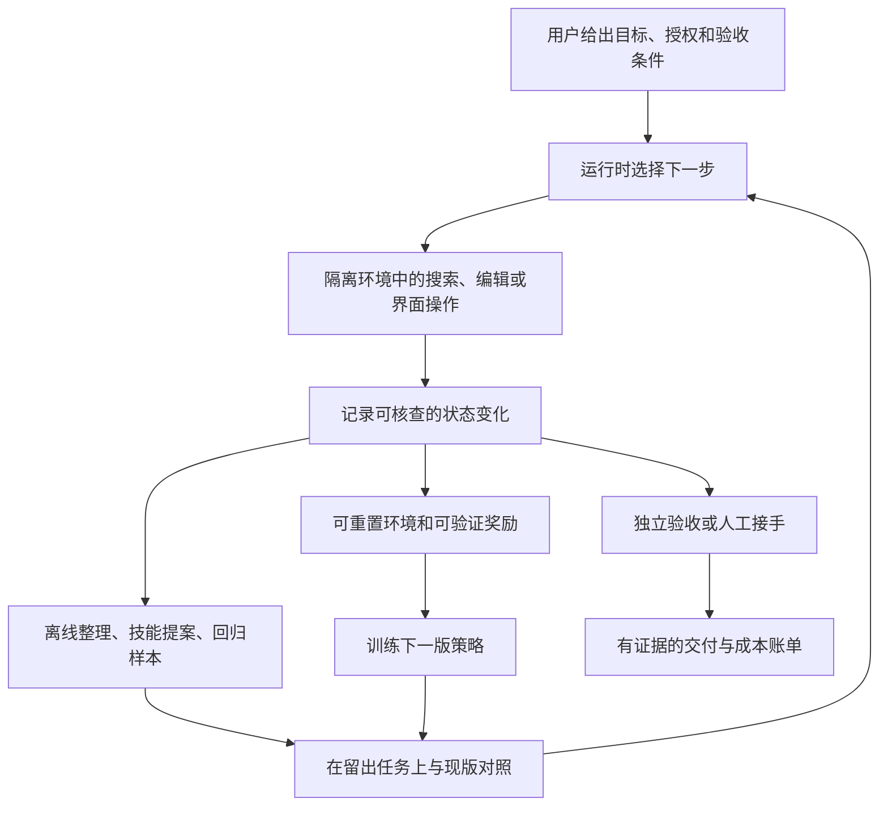
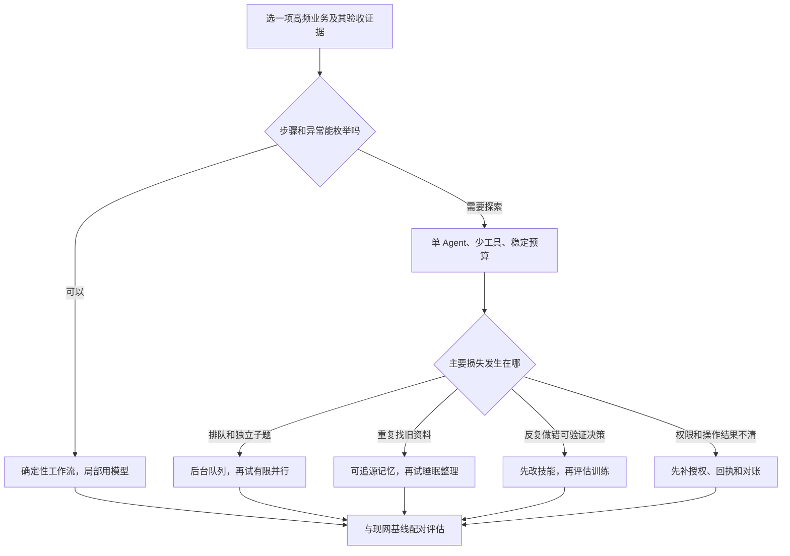

# 模块 10 · 2026 Agent 应用与基建前沿技术雷达

读这张雷达，是为了能回答一个具体问题：如果明天要把一笔工程预算押在 Agent 上，哪部分今天就开工，哪部分先做一个能推翻自己判断的小实验？

**观察截止日为 2026 年 11 月 24 日。** 设想你负责一个能读代码、查内部资料、在后台工作并交付修改的产品。用户不在乎你开了几个模型，只在乎下班前交代的事，第二天有没有一份能验收的结果。沿着一份结果倒查，会看到四笔不同的账。模型练习过哪些动作，决定它会不会做。工作环境能提供哪些反馈，决定它做错后能否发现。身份与权限决定它被允许做什么。独立验收决定你敢把哪种结果交到用户手里。

## 一张可以拿去开技术评审会的图



读图时沿两个时间尺度走一次。一次工单内，模型能看见测试失败，改第二次，然后停下来。两次工单之间，团队能把这次失败做成测试、技能或训练样本。前者缩短这一次的返工，后者有机会减少后面一百次的返工。两个回路若共用同一份可被修改的答案，系统很快就会学会给自己打高分。

下表是对**普通全栈团队，已有一个可回放的小型任务集**的工程判断。炒作度表示传播叙述容易跑在证据前面的程度，面试含金量看它能否引出可以验证的取舍，成熟度看能否用现有工具测量、值班和回滚。高、中、低是作者的判断，不能当作采用率或市场份额。每一行的定级都带着边界条件。

| 象限 | 准备投资的具体能力 | 炒作度 | 面试含金量 | 落地成熟度 | 什么结果会让我改判 |
|---|---|---|---|---|---|
| Adopt 立刻采用 | Harness 与 Compound Engineering 的验收、复盘回路 | 中 | 高 | 高 | 新规则只涨输入长度，删掉后故障率无变化 |
| Adopt | CLI、文件与 Skills 按需加载，外部写操作经过网关 | 高 | 高 | 高 | 沙箱无法约束命令，或工作对象只存在于稳定业务 API |
| Adopt | 委托身份、动作级授权、可对账的执行记录 | 中 | 高 | 高 | 环境不支持可靠撤权时，缩小能自动完成的动作 |
| Trial 积极试水 | 后台任务、独立工作树、有限的工作团队 | 高 | 高 | 中高 | 合并与返工时间吃掉并行节省的时间 |
| Trial | 睡眠整理、文件 Wiki、候选技能 | 高 | 高 | 中 | 冲突或删除请求无法传播到派生记忆 |
| Trial | 浏览器视觉操作与实时语音会话 | 高 | 高 | 中 | 打断或界面变化后无法确认实际世界状态 |
| Trial | 托管 Harness 与可携带的会话、产物 | 中 | 高 | 中 | 平台接不了已有权限系统，或无法导出恢复材料 |
| Assess 持续跟踪 | 环境内 Agentic RL 与端到端工具使用训练 | 高 | 高 | 中，取决于判题器 | 有稳定奖励、足够任务量，且轻量方法已到瓶颈 |
| Assess | GEPA、自动优化 Harness、可回退的自演化 | 高 | 高 | 中，整套改写较低 | 锁定预算和留出集后仍稳定提升 |
| Assess | CaMeL 式信息流与可机器核查的规格 | 中 | 高 | 中低 | 一个小动作已能准确表达来源、目的地和允许的流向 |
| Hold 警惕踩坑 | 工具全挂载、默认群聊、无限历史与自评分上线 | 高 | 高 | 低，指这些默认策略 | 有同预算对照与独立验收，再逐项放开 |

## Adopt · 先把每一次交付变得可检查

### 1. Harness 决定这次能否交付，Compound Engineering 决定下次少犯什么错

给新同事一句“把账单导出做好”，他至少需要知道测试数据在哪、怎样启动服务、什么算做完。模型也会卡在这些地方。把工作目录、可调用工具、错误反馈、验收规则和恢复材料接起来，就是给它搭 Harness。在这一套里再加入一条习惯：某个故障若经常出现，就把修复经验变成仓库能执行、下一次能找到的东西。这是 Compound Engineering 最容易验证的收益。

OpenAI 在 2026 年 2 月描述过一个由 Codex 大量参与开发的内部工程。他们把仓库变成模型能查阅的知识来源，把架构依赖等约束转成检查。这个案例提供了一种改造方法；团队的产出速度依赖其任务和已有投入。Anthropic 在 2025 年末的跨窗口实验从另一个方向得到启发：先建立进度与功能清单，让后续会话一次推进可验证的一小步。一个抓环境里缺少的反馈，一个抓交班时容易遗失的事实。[OpenAI 的工程记录](https://openai.com/index/harness-engineering/) · [Anthropic 的长运行实验](https://www.anthropic.com/research/effective-harnesses-for-long-running-agents)

拿导出功能走一遍。工单写明“用户只能导出自己团队的数据，空结果仍需返回列头”。模型先读项目入口，在临时数据上复现，再交补丁。运行器把原始失败、补丁哈希、测试镜像以及修复后的结果关联起来。独立测试由另一个只读位置提供。验收者能回答三个问题：原来坏在哪，补丁是否处理了它，会不会影响另一团队的导出。少了第一个，绿灯可能是空跑；少了最后一个，正常用户能下载的演示仍可能掩盖越权。

经验怎样积累？若模型总找错入口，一页索引加上拥有者就够。若问题是模块越层引用，做静态检查更便宜。若是输入数据在换月时会改变，应保存脱敏夹具。Every 的开源插件把计划、执行、审查和经验沉淀接到开发流程里，11 月的更新还把回顾会话摩擦做成了明确功能。应用它时，先量同类故障是否重现和评审花了多久。每犯一次错就往主提示里加一段，几个月后新人连哪条规则仍有效都答不上来。[Every 的工作流](https://github.com/EveryInc/compound-engineering-plugin) · [11 月发布记录](https://github.com/EveryInc/compound-engineering-plugin/releases)

一个简单的消融实验能帮你找钱该花在哪。用同一批仓库快照分别跑“旧环境”“只加索引”“只加独立测试”“两者都加”。限制总模型预算和超时，按仓库配对比较。索引改善了首个相关文件的定位时间，测试改善了错误提交率，两者对一个只有拼写变更的样本几乎没有收益。记录这些差异，才知道下一季度该投资代码地图还是测试环境。只比两次演示的视频长度，几乎无法指导维护。

### 2. CLI-first 与文件接口把探索变便宜，写入的责任仍然要有人承担

问“导出的日期列在哪生成”，模型通常只需要看目录、搜索列名、打开附近代码。文件给出稳定地址，命令能组合小步骤，返回内容的大小由调用者控制。模型也能把一份大日志存到文件里，按需打开其中三十行。业务工具则擅长另一种工作：调用一次就能返回带权限语义的结构化结果，例如“撤销我创建的草稿”。两者可以在同一个回合里各做合适的部分。

Anthropic 2025 年下半年发布的 Skills 说明给了具体机制：先让模型知道有哪些技能和各自用途，命中再读说明，长参考、脚本和数据留在目录中。高级工具调用的官方记录还区分了工具发现、程序化组合和调用示例。发现减少每轮携带的定义，组合让中间结果可以在执行环境内过滤，示例帮助模型选对参数。这三种优化分别作用于输入长度、往返次数和参数正确率，诊断错误时别混在一个“更省 token”的数字里。[Agent Skills 的设计](https://www.anthropic.com/research/equipping-agents-for-the-real-world-with-agent-skills) · [工具发现与程序化调用](https://www.anthropic.com/research/advanced-tool-use)

以十万行构建日志为例，应用把日志写入只读目录，返回对象地址、字节数和末尾的简短摘要。模型先按出错模块过滤，再打开附近文本。若第一次搜索无匹配，返回“完整搜索无结果”或“达到时间上限，仅扫描部分文件”，这两个状态应当可区分。工具响应保留截断标记、退出状态、产物标识和下一页游标。否则模型看到空字符串可能宣布构建成功，也可能连续重复同一个查询。一次舒服的终端体验，背后往往是一份设计清楚的失败协议。

| 工作对象 | 优先暴露的接口 | 这个选择省了什么 | 要补上的检查 |
|---|---|---|---|
| 已签出的源码与文本日志 | 限时命令、结构化读写和补丁 | 符号检索及组合过滤的往返 | 路径、挂载、输出和进程预算 |
| 多租户客服系统 | 带租户过滤的只读查询或业务动作 | 复用行级权限与事务 | 主体、对象、字段及用途 |
| 偶尔使用的一百类专业工具 | 可搜索的目录，小批加载 schema | 大多数回合的长前缀 | 候选可见性、版本及调用前再授权 |
| 固定业务审批链 | 显式状态机和结构化指令 | 省掉每次重新推理路线 | 幂等、审批内容绑定、撤销条件 |

技能本身也要可维护。一份技能说明同时教模型如何读报表、到哪里提交修改，如果它引用的目录发生变动，故障会表现成模型变笨了。把技能版本、相关工具版本与首次加载的位置记入轨迹。用一条能触发这项技能的小任务验收升级，固定模型，只换说明版本。对没有命中技能的任务也抽样，观察候选描述是否把相近任务吸了过去。如果技能引入脚本，运行时对它执行与其他不受信程序相同的资源、文件和网络约束。

**一个可读源码的 2026 年样本。** DeepSeek Harness 的搜索包给模型提供结构化的 glob 和 grep，限制一次行内返回的数量和长度；配置可选的落盘存储后，超限的完整结果可通过引用找回。压缩包还把裁剪过大的工具结果和总结旧对话分成不同职责。这个细节修正了一个容易说过头的判断：文件是工作对象，并不要求模型每次都亲手拼一条 Shell 命令。如果“找文件”有稳定的时限、结果格式和溢出协议，一层薄工具反而让模型更容易正确组合。在同一批大仓库题上比较两种入口，记录漏读的匹配、无效重试和实际读取的字节数，就能判断哪层封装值得留下。[固定提交的搜索包说明](https://github.com/deepseek-ai/deepseek-harness/blob/4b399c39a6d1479cd84ca591b4d7c88e24d38a96/packages/fs/tool-fs-search/README.md) · [同版本的压缩组件](https://github.com/deepseek-ai/deepseek-harness/blob/4b399c39a6d1479cd84ca591b4d7c88e24d38a96/packages/compaction/README.md)

### 3. Agent Identity 让后台执行知道此刻代表谁

一个同事昨晚让助理生成团队报表，今天调离了这个项目。助理拿着昨晚排队的任务在中午继续执行。登录时检查过一次并不能回答现在能读什么。生产系统要能分别查到人、替人工作的一次委托、具体 Agent 实例、目标资源和动作，再根据当下授权作决定。

MCP 的鉴权规定涉及令牌为哪个资源签发，接收端要检查受众。2026 年 7 月的协议修订还引入无状态协议核心、可缓存的列表和鉴权强化；业务动作的历史与撤销语义仍由调用系统持有。微软 Entra Agent ID 文档也把创建身份蓝图和授予运行时 API 权限分开。这些材料能支撑一个具体设计：平台可以给大量 Agent 发身份证，财务系统仍要逐次判断某张票能否用来读取或提交这张报表。[MCP 鉴权规范存档](https://github.com/modelcontextprotocol/modelcontextprotocol/blob/main/docs/specification/2025-11-25/basic/authorization.mdx) · [2026 年 7 月协议发布](https://blog.modelcontextprotocol.io/posts/2026-07-28/) · [Entra 身份蓝图](https://learn.microsoft.com/en-us/entra/agent-id/create-blueprint)

设计上把权限压缩到短时可验证的委托：主体、租户、资源、动作、到期时间、签发方和撤权版本。对外写入还绑定规范化参数摘要与幂等键。工具搜索先过滤当前人可见的集合，真正调用时重新校验；两次之间的撤权要能生效。遇到“从来没有公开这份文档”的租户，连搜索提示、计时差异和调试日志里的标题都应纳入可见性设计。审计人员只需看到谁授权哪次操作、资源标识和结果，凭据由网关保管。这样模型换供应商，用户的身份关系仍说得清楚。

现场常见的麻烦是“读的时候有权，发送前撤权了”。把动作分为准备草稿和提交两个阶段。提交时再取短期票据，让下游尽可能在同一事务边界检查授权版本与写入前置条件；跨系统做不到原子操作，就说清撤权传播时限，提供取消待办与对账记录。那个看似繁琐的第二阶段，正是系统能安全开放给后台任务的原因。

## Trial · 先给新能力安排一个可以撤回的岗位

### 4. 后台 Agent 最昂贵的故障，往往发生在完成之后

用户合上电脑，任务得继续。几个小时后他再回来，界面要能说明做了什么、花了多少、哪里需要他决定。把 HTTP 请求放到线程池里，只延长了一个进程的寿命。真正能跨夜的任务需要独立身份、持久状态、可暂停的预算和一份下次启动能看懂的交班记录。

2026 年 2 月，Boris Cherny 在 X 上介绍 Claude Code 内建的 Git worktree 支持。Git 的工作树各有自己的检出目录，仍共享仓库里的部分数据。同期发布的 Codex app 也公开展示多任务与工作树。两处一手材料支持“开发者能并行推进不同工作副本”这个判断。Git 没有替你拆开数据库、端口、构建产物、操作系统用户或远程部署权限。若两个测试同时改一套共享夹具，目录再干净也会互相污染。[Boris 原帖，X 嵌入日期 2 月 21 日](https://x.com/bcherny/status/2025007393290272904) · [Git 工作树的共享边界](https://git-scm.com/docs/git-worktree) · [Codex app 发布说明](https://openai.com/index/introducing-the-codex-app/)

把需求分成三份比堆三个角色更重要。例如修改一个序列化协议时，一个工人查兼容性约束，一个在固定接口上加读端回归测试，主任务实现写端。三者约定基线提交、产物格式和谁有最终写权。工人只交提交标识、测试记录和未决问题。协调者按依赖顺序合并，在新的组合状态上重跑集成测试。若两个子任务都需要反复改变同一张表结构，先请一个人确定接口再并行。并行度受共享写集限制，把“开发、架构、经理”这些头衔写进提示，改变不了关键路径。

长运行的另一个边界叫“成功之后断线”。工作进程已让下游创建变更草稿，回执尚未持久化就退出。调度器能确认上一个租约过期，无法单凭此事判断草稿是否存在。给这次逻辑动作一个跨重试稳定的编号，下游可去重或按编号查询。如果下游两者都不支持，就挂在“待核对”，交给人查看草稿列表。猜测失败并重试会产生两份草稿。把这个状态显示给用户，用户才知道继续工作会发生什么。

2026 年 11 月 18 日 OpenAI 的内部研究报告提供了一个校准预期的数字。对估计需要人做二至四小时的研究任务，自主完成率的估计从 3 月的 23% 到 10 月的 46%；在按工作内容分组的结果中，监控训练运行与编写推理服务代码差距明显。这里的小时是估计的人类工作量，样本来自他们自己的研究组织。面试时可以据此提议按任务类型开放后台执行，例如先放行只读监控，复杂改动保留复核，然后在自己的队列里测量。[OpenAI 11 月研究报告及方法](https://openai.com/index/research-acceleration-jagged-frontier/)

**小规模验收。** 给同一批任务跑单工人和有限并行两组，固定可花的钱。分别统计从排队到交付的时间、真正并行的时间、人审分钟数、合并冲突后的返工以及无人看管时的无效开销。有些团队只测工人的完成时间，恰好把协调者花一下午重做接口的时间排除掉。再演练三个中断点：工人失联、主任务取消、用户中途修改验收条件。合格的结果包括按时停工、重估剩余预算和保留原有产物。

### 5. 睡眠整理把“上次聊了什么”改写成“下次能用什么”

想象工单助手记得某位用户曾要求“本周都把小结发给代班同事”。逐字保留对话很容易。难的是一个月后还能判断这个要求已经过期。记忆工程同时要避免两类错误：找不到该记的事，和在不该用的时候自信地使用旧事。睡眠计算把部分整理工作移到两次交互之间，用户提问时不必从头拼装材料。

几个常被放在一起讲的项目，实际做了不同的事。

| 来源 | 能从一手资料确认的能力 | 工程上可复用的部分 |
|---|---|---|
| Letta 与伯克利，2025 年 4 月的前史 | 在问题到来前用已有上下文计算，Letta 也用后台 Agent 修改记忆 | 问题分布若可预测，前移部分计算；同时核算预测落空的开销 |
| Karpathy，2026 年 4 月的 X 原帖与 Gist | 用 LLM 把私人研究资料编成可持续编辑、有链接的 Wiki | 持久化跨文档综合结果，保留原材料并检查断链 |
| Hermes Agent | 项目说明描述由 Agent 维护记忆、创建并逐步修订技能的学习回路 | 把做事步骤当成可版本化的过程知识，单独评测 |
| Claude Code 的 Auto Dream | 公开项目 issue 记录了界面提示与实际行为、账号开放条件之间的差异 | 把客户端版本、配置和功能开关当作观测条件 |
| Claude Managed Agents 的 Dreams | 官方协议读旧记忆库和过去的会话，输出新库，旧库可保留 | 先比较新旧库，再决定是否切换生产读取指针 |

Letta 早于本轮观察窗口，提供术语源头。Karpathy 的原帖说明使用场景，四月的 Gist 写清了实际整理方式。Hermes 的 README 支持对“学习回路”的表述，不能由此推断每次优化都能迁移到别人身上。Claude Code 的 issue 是具体使用报告；Managed Agents 有独立的文档和 11 月 Cookbook。把那个托管接口的参数套在本地 CLI 上，会给值班同学留下一个根本找不到的开关。[Letta 的研究说明](https://www.letta.com/blog/sleep-time-compute/) · [Karpathy 的 X 原帖](https://x.com/karpathy/status/2039805659525644595) · [本人发布的 LLM Wiki](https://gist.github.com/karpathy/442a6bf555914893e9891c11519de94f) · [Hermes 项目说明](https://github.com/NousResearch/hermes-agent) · [Claude Code 的报告与讨论](https://github.com/anthropics/claude-code/issues/39135) · [Managed Agents 的 Dreams 协议](https://platform.claude.com/docs/en/managed-agents/dreams)

用代班需求做一个能上线的小版本。在线路径只追加带时间、来源、可见范围的事件。夜间作业读取一个明确水位之前的事件，提出“本周代班”这条事实，填入有效期、适用项目、原话位置。若还有一条更新的直接指示，保留两条不同时间的证据，按生效区间选择。邮件里的转述可以是研究材料，不能自动升格成用户本人授权。召回时先筛主体、用途、有效期和可见性，再做相似度排序。类似“记住我喜欢简短周报”的偏好与“代我把这份文件发出去”的授权应有不同的存储和生效机制。

对比实验也能照这个例子设计。给两套系统相同原始会话，一套查询时搜日志，一套额外做夜间整理。次日用新措辞提问，再追加一条相反偏好和一条删除请求。分别记首答延迟、引用正确率、旧偏好复活率以及夜间成本。有些问题第二天永远没人问；若每夜把每个人的全部历史重写，省下的每次在线推理可能远小于夜间账单。按新增事件量、复用频率和资料变更触发整理，比按账户数量分配固定的任意计算更容易长期运营。[Anthropic 11 月 6 日的记忆组件实验](https://www.anthropic.com/research/components-of-agent-memory) · [11 月 2 日的工作流与覆盖检查](https://platform.claude.com/cookbook/managed-agents-cma-dreaming-with-a-dynamic-workflow)

工程上要防“昨晚的作业把今天的更正覆盖了”。发布新库时比较输入库版本与更正水位，有冲突先对新事件重放或放弃本轮。用户要求删除时，先在在线读路径挂删除标记，再沿来源索引找出 Wiki、摘要、技能例子和缓存。仅靠重新生成整本 Wiki 会留下重建窗口。还要验证旧库回滚不能越过删除标记。这个不变量比“记忆越来越丰富”更有面试区分度。

### 6. GUI 能跨过接口空白，实时语音要处理人随时改口

旧系统只给一个网页，没有导出 API。视觉模型看到页面、提出点击和输入，运行器执行后把新画面交回来，便有机会完成任务。Google 的 Computer Use 文档展示截图、候选动作与客户端处理安全决策的回路；OSWorld 团队在 2026 年 6 月公布 2.0，提供桌面任务演进的基准入口。评估时应实际读取下载文件或目标记录，截图上出现绿色对勾只能说明界面当时显示了成功。[Google 的 Computer Use 调用流程](https://ai.google.dev/gemini-api/docs/generate-content/computer-use) · [OSWorld 项目与版本记录](https://os-world.github.io/)

真实工单要防一个小时间差：模型在画面甲上选好位置，动画已把确认框挪走。给每帧打观察编号，动作带上来源帧、窗口身份与期望状态。先检查窗口与目标仍相符，必要时刷新观察。稳定的内部应用可以通过受控 API 验证下载对象；确实只有视觉入口，就核实页面中的实体名称、金额和状态，不能确认时保存草稿或交还用户。优先级的一个实用顺序是有权限语义的 API、稳定可访问性树、最后是像素。画布类软件缺少可访问节点，才会把像素提到前面。功能选择由界面提供的证据强度决定。

语音是另一种时序问题。用户说“把周三的会改到……等一下，先别改”，机器已经开始播报。全双工要求系统在播音的同时接收新声音，识别打断，停止本地播放，并校正模型记忆中“用户已经听到哪里”。原生语音到语音减少多段串行转换，有利于抢话、停顿、情绪等信号。分段的识别、文本推理、合成则方便做逐词校验和替换，适合地址、编号等需要核对的内容。Google 的 Live 模型公开描述实时音视频输入；OpenAI 的 Realtime 指南说明 WebRTC 和自行管理音频缓冲的 WebSocket 在打断处理上有不同责任。[Gemini Live dialogue](https://deepmind.google/models/gemini-audio/live-dialogue/) · [Realtime 会话的打断与截断](https://developers.openai.com/api/docs/guides/realtime-conversations)

一个可交付的日历助手可以边听边搜空档，真正改约独立提交。声音事件带会话、轮次和播放游标；用户打断时作废尚未提交的候选动作。若已提交，显示回执，走明确的更正流程。监控把“最后一个有效语音帧到首个可听回复”“打断到扬声器静音”“工具确认到下游回执”拆成三条分布。第一条很低、第二条很高，用户感到的依然是一个不肯闭嘴的助理。用带噪声、重叠说话、网络抖动的录音回放，再检查高风险工具有没有被半句话触发，才能决定开放哪些动作。

### 7. 新信号：Harness 开始成为服务采购项

运行一个长期任务，除了选模型，还要有会话存储、沙箱、事件流和恢复协议。2026 年 4 月 Anthropic 的工程文章把 session、harness、sandbox 当成有稳定接口的组件；9 月 OpenAI 发布 Agents API，提供托管的运行能力。共同的变化是，采购方可以把“谁维护循环、隔离和恢复”拿出来单独选。今天买服务、明天想更换模型时，最难搬走的往往是没有导出的状态。[Anthropic 的接口拆分](https://www.anthropic.com/research/managed-agents) · [OpenAI 9 月发布说明](https://openai.com/index/introducing-the-agents-api/)

试用时设计一个搬家演练。随机挑一件正在等审批的任务，导出用户目标、授权范围、工具回执、产物清单、待办与已用预算；在另一运行器上只用这些资料继续。模型私有的压缩表示有时无法迁移，系统应保留一份可读的业务交班记录。恢复后校验没有再次发出已成功的写操作，并把旧运行器的租约作废。量搬家需要的人工分钟数、丢掉哪些恢复点，再比较托管账单和自建值班成本。能够退出，才容易判断这个服务到底帮你省了什么。

## Assess · 先看它能学会什么，再问谁有资格给分

### 8. Agentic RL 把一部分“该走哪一步”训练进模型

假设每周都有大量“修好一个坏掉的小项目”的任务。手工流程可以规定先找错误、再搜文件、改代码、跑测试。它会浪费一些步数，也漏掉很多绕路。另一条路是复制出许多个干净的项目，让模型自由尝试，用隐藏测试判断最后修得好不好。把更可能带来高分的动作变得更常出现，就是这里的环境内强化学习。RLVR 指奖励能由程序等外部手段验证；训练可以使用最终结果，也可以利用有明确含义的中间反馈。

Search-R1 在 COLM 2025 论文中让模型在推理中自行发起多次检索，读回结果再决定下一步，用结果奖励学习何时搜索。搜索结果属于环境观察，更新策略时要区分哪些 token 出自模型。ICLR 2026 的 GEM 把问题推进到工程层，提供统一环境接口和异步向量化执行，也比较不同多轮学习方法。OpenAI 对早期 Codex 的介绍说明其编码模型通过在真实编码任务上强化学习来练习编辑和测试。三条证据分别支撑搜索、环境底座和编码训练；它们无法直接证明某个未公开模型内部采用了同一套奖励函数。[Search-R1 正式论文](https://proceedings.colm.cc/paper_files/paper/2025/hash/1377f76686d56439a2bd7a91859972f5-Abstract-Conference.html) · [ICLR 2026 的 GEM](https://proceedings.iclr.cc/paper_files/paper/2026/hash/b3956812189001f673d29c626bc897ae-Abstract-Conference.html) · [Codex 的训练背景](https://openai.com/index/introducing-codex/)

ICML 2026 的 SWE-rebench V2 提供了环境投资的参照。作者报告带预构建镜像的集合有 32,079 道任务，来自 3,617 个仓库、覆盖 20 种语言；论文还标注测试过于严格、描述不充分等干扰因素。准备内部训练集时，复用仓库的安装和测试流程，先验证旧提交能稳定失败、修复提交能稳定通过，再检查测试是否接受其他正确实现。只要测试在考“是否照抄参考补丁”，高奖励就会把模型往错误方向带。[ICML 2026 论文与数据构建方法](https://proceedings.mlr.press/v306/badertdinov26a.html)

一次训练样本不能只存“题目，答案，得分”。要能还原环境起点、哪个版本的策略采样了动作、动作由谁产生、工具返回了什么、哪一步终止、验收器版本和实际成本。环境先 reset 到指定快照，策略看到观察，选动作，环境 step 返回新观察和终止状态。把同一题采样多条轨迹，可以比较哪条更值得鼓励；同组全对或全错时，组内相对信号会很弱。若运行器崩溃一律记零，模型可能被惩罚于与策略无关的基础设施毛刺，题目难度统计也会漂移。资源用尽、策略提交、环境故障要分别记录。

最难的是长程信用分配。两百步后的单个绿灯无法直接说明第九步的检索帮了忙。加稠密奖励，例如“每搜索一次加分”，容易鼓励原地搜十次。更稳的中间信号是可验证的状态变化，例如在干净环境中新增一道独立通过的前置验收。仍需给最终结果足够权重，并把可反复领取的小奖励去重。课程从短任务进入长任务时，用相同问题换工具名称、换目录、换测试实例验证迁移。它若只记住固定文件路径，上线第一天就会失灵。

11 月 10 日的 CAMP-II 预印本把问题缩小到“跨窗口时，模型会不会自己留下有用的笔记”。作者让同一轮任务中的文件在上下文替换后继续存在，用普通 Bash 和文件操作作为记忆接口，再让学生沿自己实际走出的轨迹接受冻结教师的指导。这是 on-policy distillation，与仅靠任务最终对错更新策略的 RLVR 有不同的监督信号。作者报告了外部编码基准上的迁移。对应用团队来说，最容易复核的推论是先换接口做消融：同一个模型面对熟悉的文件操作和自定义记忆指令，是否都能在清空历史后找到上次的失败证据？只有冻结输入、持久空间和预算，才能区分接口带来的收益与训练带来的收益。[CAMP-II 作者预印本](https://arxiv.org/abs/2611.14009)

| 学会的能力 | 可以尝试变薄的外层 | 需要继续变厚的工程部分 | 如何证伪 |
|---|---|---|---|
| 自行决定何时检索 | 固定每问必搜若干轮 | 索引新鲜度、可见性、来源与超时 | 换语料与工具名，在等预算下看证据召回 |
| 自行读错、改代码 | 要求逐句按模板纠错 | 快照、独立判题、可重放构建 | 隐藏旧题，再换仓库家族检查泛化 |
| 自行规划较长任务 | 与模型重复做同一件事的逐步规划器 | 步数和钱的硬上限、检查点、打断与撤回 | 在中途改变需求或收紧权限，看能否正确停手 |
| 学会常见工具调用习惯 | 无条件重复提示参数格式 | schema 校验、兼容层、幂等、真实授权 | 注入良性格式变更，验证错误能恢复 |

**怎么决定自己要不要训练？** 先把现有模型在真实失败簇上分诊。如果失败来自拿不到权限、依赖包偶发不可用、评测题没有标准答案，这些都先修环境。若更新说明、少量演示与更可靠工具后，模型仍反复在可验证的多轮决策上犯同一种错，才考虑训练。此时算完整成本：生成轨迹花在模型的时间，环境等待占用的实例，重复采样、失败环境、定期刷新任务以及上线服务成本。新策略每单省一点，但要多少真实订单才能摊回这些投入？对小团队，这个公式经常把训练从“本季上线”推到“与研究团队联合试验”。

### 9. 自动改提示、改技能、改 Harness 是三种不同规模的发布

某 Agent 修好了第十次同类故障，下一次还从头摸索。第一步可以把这次有效的做法写成候选技能。再往前走，系统可以比较几种说明哪一种更好；更激进的做法连“何时检索、保留多少历史”这一整段程序也交给搜索。三者都叫自我改进，改动面与出故障时的影响面却相差很大。

GEPA 的 ICLR 2026 论文用自然语言反思执行轨迹，提出候选提示，利用在不同样本上各有优势的候选继续搜索。它允许失败反馈传达“错在哪里”，这一点比单个分数包含更多局部信息。Meta-Harness 的 2026 年 3 月预印本将搜索对象扩大为可执行的 Harness 程序，提案者能查以往候选和轨迹，基座模型保持冻结。Karpathy 的 autoresearch 仓库给了一个更容易亲自检验的例子：单卡训练、固定时长、受限的可编辑文件和统一验证指标。后者是小型可控实验环境，不能据此给一个开放业务助理授予自行发布的能力。[GEPA 会议论文](https://proceedings.iclr.cc/paper_files/paper/2026/hash/0e9e708b6f48e14fd0ac29e167413f76-Abstract-Conference.html) · [Meta-Harness 论文](https://arxiv.org/abs/2603.28052) · [autoresearch 原仓库](https://github.com/karpathy/autoresearch)

要把它落地，先把开发集、用来挑候选的验证集、最终盲测集分开。候选被同一份验证题评了几百次，它已经间接学习了那份题。按客户、仓库家族或时间切分，近重复的工单要进同一分区。提案器只写技能目录或少数受控模块；评分器、预算与权限系统由平台拥有。一次尝试要计算所有候选的探索成本。省下的三秒线上时间，需要乘以未来调用量，才能和一次夜间搜索所花的费用比较。

下面的示意函数用于挑选能进人工复核的候选。配对样本按场景汇总，关键场景退化会阻止晋级。代码刻意不做发布，让最终留出集仍有一次独立决策机会。

```python
def review_candidate(old, new, critical, margin, max_cost):
    # old 和 new 在相同题目、预算、工具快照下生成
    if new["case_ids"] != old["case_ids"] or not new["case_ids"]:
        return "重新配对"
    if new["policy_violations"] or new["cost"] > max_cost:
        return "淘汰"
    for name in critical:
        if new["success"][name] < old["success"][name]:
            return "保留旧版并调查退化"
    # lower_gain 是配对重采样得到的提升下界，预先约定门槛
    return "进入盲测和复核" if new["lower_gain"] > margin else "证据不足"
```

还有一种隐蔽的退化：模型总结“上次某位维护者同意跳过审核”，把一次特批变成长期技能。候选里能写经验，不能生成新委托。评审应检查技能改变了哪些工具调用、是否将受限数据写入公共目录、一次性例外是否带有效期。先在影子流量上只记录拟采取的动作，线上小范围启用时保留上一版技能引用。给每份任务固定技能版本，正在执行的工作不会因为后台跑出新提示而突然换了操作习惯。

### 10. 用 CaMeL 理解谁在控制数据流，用形式化方法收紧少数关键动作

让助理阅读外部来信，又让它能查私人文件、向外通信，会出现一个真实的权限错位：来信的人可以影响助理看到了什么，却没有资格决定私人文件发给谁。把“请谨慎”写进提示无法让外部地址变成可信地址。应由执行器判断哪些输入能决定目的地，哪些输入只能作为待处理内容。[Simon Willison 对致命三角的原始论述](https://simonwillison.net/2025/Jun/16/the-lethal-trifecta/)

CaMeL 的研究把可信用户指令所生成的控制流程和不受信内容的处理分开。特权一侧依据可信请求组织程序；隔离的一侧可以从外部文本抽取数据。解释器跟踪值的来源和可用能力，在具体工具边界上应用策略。若用户自己指定了目标文件夹，文档中的文字不能任意换掉这个目的地。若用户确实要求“找出来信里的地址”，可以允许提取地址供人查看，发送仍要检查来源和用户的意图。策略需要知道每个工具的真实效果，单凭返回字段名叫 safe 无法推出安全。[CaMeL 作者的第二版论文](https://arxiv.org/abs/2503.18813v2)

“小范围可证明”与“整个 Agent 可证明”之间隔着系统边界。2026 年 11 月 10 日 DeepMind 的 AlphaProof Code 提供了一个很好的读法：团队把特定构建的 libsignal 的若干性质写成规格，再让机器检查证明；公开项目还列出可信定义和范围外假设。这个工作给 Agent 平台的启发是把有清楚语义的断言交给机器，例如“每个对外发布的产物都有与其摘要匹配且未失效的授权”。它并没有替读者的 Agent 证明一个网页里的所有自然语言都可信。[DeepMind 的项目、定理与边界](https://google-deepmind.github.io/code-verification/)

要从论文走到业务，先挑一个资源、一个动作、两种来源。模型可读取来信，提取费用，用户指定内部草稿箱。允许写入内部草稿箱，禁止文档内容改变目的地或新增接收方。枚举“收到撤权”“审批后草稿内容变化”“恢复时权限版本落后”等状态，检查所有可到达的提交记录都带有效授权。若策略过粗，拒绝率会高；若漏建模一个会外发的工具，则证明只对残缺模型成立。上线时要把策略拒绝、人工放行、错误放行分别抽查，这比报告一次提示注入测试的平均通过率更接近真实保护能力。

## Hold · 四种曾经很诱人、今天需要先拿出对照组的默认做法

说一种方法“退潮”，至少要能指出它在什么条件下输了。以下是从一手工程经验推导的选型边界。公开资料不足以统计所有团队在 2024 年用过什么、2026 年又弃用了什么，因此这里不用行业份额给它们判生死。

| 惯用做法 | 炒作度／面试含金量／作为默认策略的成熟度 | 为什么演示时很顺 | 生产中的故障信号 | 可以保留的使用场景 |
|---|---|---|---|---|
| 一开始把所有工具说明塞进提示 | 中／高／低 | 看起来什么都能做，不必建设目录 | 工具相近时选错，新增工具导致首轮变贵 | 工具很少且每轮都会用到 |
| 每个任务默认安排一群 Agent 讨论 | 高／高／低 | 对话丰富，容易看到分工 | 引用了同一错误来源，多人重复搜索，合并迟迟不收敛 | 独立来源或清楚的只读分片，统一验收 |
| 把全部历史存进一个大窗口或向量库 | 高／高／低 | 对连续演示，旧话题总像能接得上 | 撤销的偏好仍命中，陈旧事实被当成最新结论 | 小而稳定、具有共同访问权限的资料集 |
| 让干活的模型给自己打分并自动上线 | 高／高／低 | 很快有曲线、解释和成功截图 | 判题奖励漂亮措辞，真实产物缺失，成本尾部变长 | 自评用来发现候选问题，交由独立检查确认 |

看工具过多是否真的妨碍完工，可以用 EMNLP 2026 的 PlanBench-XL 设计一道缩小版测试。作者在 1,665 个工具的集合上构建了 327 道零售任务，允许人为设置缺失、不可用或干扰工具。内部可以让助理查一次订单的到账状态，第一条查询路径不可用，观察它能否发现另一个经授权的查询接口，并保留正确的订单标识。分开记录“找到可用工具”“后续参数沿用了正确实体”“结果符合目标”。这样即使熟悉的工具突然下线，也能判断短板在工具目录、长程计划还是错误反馈。[EMNLP 2026 的 PlanBench-XL](https://aclanthology.org/2026.emnlp-main.385/)

一个特别容易误读的历史案例来自 Anthropic 的研究团队。他们在可横向拆分的研究问题上看到多 Agent 的收益，也报告这类系统的 token 用量远高于普通聊天。这支持“把独立搜索并行化”；如果几个人要反复修改同一个协议，结论需要重测。另一个证据来自 2026 年对编码评测环境噪声的分析，内存或资源配置都可能改变结果。若多工人组恰好获得更多总算力，就很难把收益归给协作方式。给两组相同预算，再分别报告吞吐、延迟与人的复核时间。[多 Agent 研究系统](https://www.anthropic.com/research/multi-agent-research-system) · [编码评测中的基础设施噪声](https://www.anthropic.com/research/infrastructure-noise)

还有一个常见直觉要拆开：少几次模型调用就一定便宜。假设甲组平均两次调用，每次送入大量历史；乙组四次，每次只取相关文件。后者可能输入更小，又能复用稳定前缀，也可能因为多轮输出而更贵。按完成任务计总账，把失败重试、沙箱占用和人工善后一起算，再按输入是否命中缓存分项。平均每次调用的价格无法回答“交付一件合格成果要多少钱”。同理，把一个昂贵主模型换成多个便宜模型，若返工率上升，也可能更贵。

## 从雷达选一条落地路线



**用一个预算评审来练习。** 假设一周有一百个后台工单，其中四十个失败。抽样发现二十个卡在文档权限，十个读错旧说明，六个在恢复时创建重复草稿，剩余四个才是模型多轮规划失误。若本周只能做一个改动，先修委托和失败提示；它有机会直接影响二十个样本。第二笔投资可以给旧说明加版本、有效期和来源。给四个规划失败做训练可能有长期价值，但先积累环境与判题器，再算训练收益。以上数字是练习设定；真实评审要为“原因不明”和“一单多因”保留位置。

接着做一张可回收的实验单。写上负责人、用户群、固定模型、唯一改变项、三条指标和结束条件。比如给只读调研任务开放两个工作进程，一周后比较交付时长、可核对引用比例、每次合格交付成本。离线先核实没有越权引用；在线若发现一起跨租户读取，立即暂停相关能力，不能用另九十九单速度变快来抵消。若收益不明显但尾部变差，回到单工人继续定位。这个决策记录下次还能用来解释为何没有跟随某个热点扩张。

## 面试深挖 · 六个能把风向讲成工程判断的问题

**一、同一模型换个 Harness 分数就涨了，你如何解释？** 考的是因果归属。先说清是不是同一题目快照、总 token、墙钟时间、沙箱资源和重试制度，然后按定位错误、执行错误、验收错误切失败簇。若只改变反馈格式，首轮定位不变而重复尝试减少，才有理由说模型更懂得利用反馈。追问“能宣传模型能力提升吗”，答明系统组合提升，补做跨模型和跨任务集消融，报告样本量和变化范围。

**二、模型原生会搜以后，还要自己维护检索吗？** 考的是决策与真值的边界。模型可以学何时搜、搜什么，索引的权限、更新、引用定位以及查询预算仍由环境提供。在同一训练快照表现很好，换用昨天新发布的文档就可能检索失败。追问“删掉原有规划器是否安全”，先在只读组做等预算消融，保留硬上限和工具错误处理，检查漏搜率、冗余检索率与引用正确率。

**三、怎样证明睡眠整理真的省钱？** 考的是单位经济与记忆质量。在固定的一批用户上比较原始日志检索和加整理的读路径，按活跃程度分层，计入夜间改写、存储、查询、返工和删除成本。追问“首答很快但人经常纠正”，从答案追回记忆版本、有效期和来源，区别写错、召回错和引用过期；把纠正后的次日问题加进回归集，再决定是否提高整理频率。

**四、五个工人各自通过测试，为什么整单仍交不了？** 考的是局部结果的可组合性。先问它们是不是从同一基线出发、依赖的接口有没有固定、验收有没有在合并后的状态执行。合同一改，五份局部绿灯都可能过期。追问“加一个审查模型行吗”，优先加集成测试与单一提交者，审查模型可定位差异；真正的判据是目标仓库和实际业务行为。

**五、自动优化器提议把平均步骤从十步砍到五步，要不要发？** 考的是目标是否被代理指标替代。先查它是否通过提前退出省步数，统计用户接受的完整交付、难题弃权和少数高风险错误。追问“测试上全胜，可否让它持续改自己”，保留独立的权限与验收边界，生产只取评审过的版本，扩充盲测并给每次优化限定总试验预算。能快速撤销一个版本才适合开始小流量实验。

**六、产品负责人要一句话解释为什么语音助理不能直接改约，你怎么答？** 考的是把安全决策翻译成体验。“人能在一句话中途改口，我们可以立即找空档，真正改日历前要核对他最后确认的时间。”追问“要求交互零等待怎么办”，准备操作与提交分离，首段语音可以尽快播出；保留实际听到的音频游标、确认所指的候选版本，以及变更的回执。端到端体验同时看反应有多快和犯错后能否确定改了什么。

## 一手资料与延伸阅读 · 带着问题读原文

**从 11 月的 X 回到实验。** 11 月 6 日 Anthropic 在 X 上介绍了让 Claude 离线整理记忆的工作。打开同日工程文章，可以继续追问研究者如何分别观察保存、整理和取用。11 月 10 日 Sundar Pichai 在 X 上谈到 Signal 相关代码验证；点回团队项目页才看得清具体构建、可信规格和定理的适用范围。原帖适合找线索，实验和产物决定能把结论讲多大。[Anthropic 的 11 月原帖](https://x.com/AnthropicAI/status/2118814753154064501) · [记忆实验原文](https://www.anthropic.com/research/components-of-agent-memory) · [Pichai 的 11 月原帖](https://x.com/sundarpichai/status/2120207062655549933) · [DeepMind 的验证产物](https://google-deepmind.github.io/code-verification/)

**GitHub 的热度也可以复查。** 11 月 24 日读取 GitHub 官方仓库 API，将累计 star 数按万取近似值：DeepSeek Harness 约 28.6 万，Hermes 约 26.6 万，autoresearch 约 10.1 万，Every 的 Compound Engineering 插件约 2.6 万。这是当日关注度的快照。选型时依次打开搜索包的溢出协议、Hermes 的版本说明、autoresearch 允许修改的文件，再看 Every 把经验写回哪个步骤。四个仓库的 star 单位相同，各自能够证明的工程能力却完全不同。[DeepSeek 仓库元数据](https://api.github.com/repos/deepseek-ai/deepseek-harness) · [Hermes 仓库元数据](https://api.github.com/repos/NousResearch/hermes-agent) · [autoresearch 仓库元数据](https://api.github.com/repos/karpathy/autoresearch) · [Every 仓库元数据](https://api.github.com/repos/EveryInc/compound-engineering-plugin)

| 想核实的问题 | 读的时候看哪里 |
|---|---|
| 2026 年 GitHub 上的工程热度对应什么实际改动？ | 对照 Every 的发布条目与 Hermes v0.23.4 的说明，看版本实际改变了哪些流程、网关或技能接口。发布活动证明维护发生过，不能直接推出正确率。[Every 发布记录](https://github.com/EveryInc/compound-engineering-plugin/releases) · [Hermes 固定版本](https://github.com/NousResearch/hermes-agent/releases/tag/v0.23.4) |
| 开发者为什么想用文件作为协作界面？ | 对读作者的工作树原帖与知识库原稿，前者隔离写入，后者固化跨会话知识。本文所引 X 原帖均以 X 公开嵌入核对作者、日期与可见正文。[Boris Cherny](https://x.com/bcherny/status/2025007393290272904) · [Andrej Karpathy](https://x.com/karpathy/status/2039805659525644595) · [Wiki 设计稿](https://gist.github.com/karpathy/442a6bf555914893e9891c11519de94f) |
| 学工具、改提示、改运行器，实验对象分别是什么？ | 在环境论文中看动作和观察，在提示论文中看反思与候选选择，在程序搜索工作中看可写范围。最后一项在本文按预印本引用。[GEM](https://proceedings.iclr.cc/paper_files/paper/2026/hash/b3956812189001f673d29c626bc897ae-Abstract-Conference.html) · [GEPA](https://proceedings.iclr.cc/paper_files/paper/2026/hash/0e9e708b6f48e14fd0ac29e167413f76-Abstract-Conference.html) · [Meta-Harness](https://arxiv.org/abs/2603.28052) |
| 11 月的新材料改变了哪几项判断？ | Anthropic 的实验帮助拆分记忆组件，DeepMind 给出可核验的形式化产物，OpenAI 的组织内测量显示长任务成功率随任务类型变化。三者的分母和验收方式各不相同。[记忆实验](https://www.anthropic.com/research/components-of-agent-memory) · [可核查的证明项目](https://google-deepmind.github.io/code-verification/) · [研究任务的估计方法](https://openai.com/index/research-acceleration-jagged-frontier/) |

下次看到一条“Agent 又能自己做某事”的消息，最有价值的追问通常很朴素：它从哪里拿到任务，谁给了它操作权，什么结果算成功，失败以后谁能接手？能沿着产物把这四件事查清楚，就能判断这条消息值得改路线图，还是只值得收藏。
