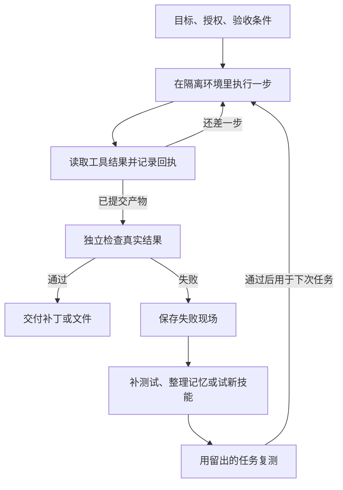

# 2026 Agent 前沿技术实战笔记

> **一句话讲透**：学 Agent，拿一次修 Bug 练手：让它找到代码、改完能验、断线能接着干。面试时，沿着一次失败讲清楚你会改哪一层。更新于 2026 年 11 月 24 日。

## 一张图看懂 Agent 怎么干活

> **一句话讲透**：一次任务里靠工具反馈纠错，两次任务之间靠测试、记忆和技能少走弯路。



| 技术方向 | 一句话看懂 | 真实代表项目 | 面试怎么聊 |
|---|---|---|---|
| Harness / Compound Engineering | 给模型配工具、测试，把常犯的错写进仓库 | Deep Agents CLI、Every | 固定模型，哪种反馈能减少返工？ |
| CLI-first / Skills | 先搜文件，用到某项技能才读说明 | DeepSeek Harness、Agent Skills | 十万行日志怎么只读有用的几十行？ |
| Agent Identity | 每次动手都知道在替谁办事 | MCP、Entra Agent ID | 排队时有权，执行时撤权了呢？ |
| 异步 Agent / Agent Teams | 工作放后台，可拆开的子题同时做 | Claude Code、Codex app | 各自测试通过，合并后谁验？ |
| 睡眠整理 / LLM Wiki | 空闲时把旧资料整理成明天能查的笔记 | Letta、Claude Dreams、Hermes、LLM Wiki | 用户改了主意，旧结论怎么退场？ |
| Computer Use / 语音 | 一个看画面操作，一个边听边说 | OSWorld、Gemini Live、Realtime | 画面变了、人改口了，动作还能提交吗？ |
| 托管 Harness | 把会话、沙箱和恢复交给运行服务 | Claude Managed Agents、OpenAI Agents API | 换运行器要带走哪些东西？ |
| Agentic RL | 在能重置、能判分的环境里练多步决策 | Search-R1、GEM、SWE-rebench V2 | 怎样判断它学会了搜索时机？ |
| GEPA / 自演化 | 从失败记录里提改法，再拿新题比 | GEPA、Meta-Harness、autoresearch | 优化器能改哪些文件，谁给它打分？ |
| CaMeL | 工具执行前检查数据来源和去向 | CaMeL、AlphaProof Code（规格验证） | 邮件里出现的地址凭什么能收附件？ |

## 现在就能直接用

> **一句话讲透**：先让一个 Agent 在一个仓库里做成一件事，验收、读写工具和动作授权都能从这里练起。

### Harness Engineering：给模型一个能看见错误的工作环境

> **一句话讲透**：模型说“修好了”，我想拿到的是补丁、原先失败的测试，以及同一条测试修复后的结果。

假设有个小 Bug：导出空表时丢了列头。把代码库直接扔给模型，它可能改对函数，也可能改到另一套导出器。Harness 就是你给它的目录、工具、反馈和停手条件。

- **找入口**：在仓库索引写清导出模块在哪、测试怎么跑。跨层依赖交给 linter 检查，报错直接指出文件和规则。
- **看见失败**：先用空表跑出缺列头的文件，保留输入和输出；修完读取真实文件的第一行。另加跨团队读取用例，防止改动放宽可见范围。
- **交给别人也能验**：记录基线提交、补丁、测试环境和结果。独立验收用例放在任务不可写的位置；跨会话留下功能清单、刚通过的测试和下一步。[OpenAI 的仓库实践][harness] · [Anthropic 的跨窗口交班][longrun]
- **积累下次能用的东西**：找错目录就补索引，漏掉边界条件就加测试样本，多步操作反复出错才写技能。Every 的 Compound Engineering 插件把计划、执行、审查和经验整理串在一起。[插件源码][every] · [发布记录][every-release]

**同一个模型能差多少？** LangChain 固定 GPT-5.2-Codex，给 Deep Agents CLI 加环境信息、重复编辑提醒和结束前自查。

在 Terminal-Bench 2.0 上，这套改动让得分从 **52.8% 升到 66.5%，提高 13.7 个百分点**。[LangChain 实验记录][langchain]

**自己复现怎么比？** 同一批仓库快照分别跑原版、只加索引、只加验收、两者都加。固定时间、重试次数、沙箱资源和 token 预算。看定位入口花多久、交了多少错误补丁，再决定下一处改动。

### CLI-first、Skills 和 DeepSeek Harness：大文件怎么读，小工具怎么选

> **一句话讲透**：十万行日志留在文件里，先搜错误码，再把命中位置附近的几十行给模型。

- **源码与日志**用文件。路径可以复用，搜索和过滤可以组合。给命令限定工作目录、运行时间和输出量；下载、上传、业务提交单独授权。
- **多租户数据**用业务接口。查订单时由服务端按租户和字段过滤。固定审批链用状态机表达，最终提交绑定获批参数，重复提交用同一个动作编号。
- **技能按需读**。启动时只载入名称和用途，命中后读 `SKILL.md`，脚本和长参考再按需打开。升级时测一个应当命中的任务，再测一个相似但应当跳过的任务。[Agent Skills 设计][skills]
- **区分三种收益**。工具搜索少带定义，程序化组合少传中间数据、少跑来回，一份正确调用示例能减少参数填错。分别看输入长度、调用往返和参数错误率。[Anthropic 工具调用实践][advanced]

**DeepSeek Harness 怎么处理超长搜索？** 用结构化 glob 找文件、grep 找内容，限制直接返回的条数和行宽。配置落盘后，模型可用引用取回完整匹配。

读源码时可以对照两个包：搜索包管命中和溢出，压缩包把裁剪大工具结果、总结旧对话分开处理。[固定提交的搜索包][ds-search] · [同版压缩组件][ds-compact]

**最容易漏的返回值**是“搜完了没有”。零匹配、超时只扫了一半、找到太多被截断，要能区分。保留退出状态、截断标记和续读位置；下一轮才能决定换关键词、缩小目录，还是接着翻页。

### Agent Identity：用户下班了，Agent 还代表谁

> **一句话讲透**：昨晚能读报表的人，今天可能已经调组；队列里那份任务提交前还得查一次权限。

- **记清委托**。任务带上用户、租户、Agent 实例、目标资源、允许动作和到期时间。网关保管凭据；日志只记哪次委托动了什么、结果如何。
- **分两次查权**。搜索工具时过滤不可见的工具和资源，真正执行时按当前授权再查。MCP 要求接收端检查令牌的目标资源；Entra 将创建身份蓝图和授予运行时 API 权限分开。[MCP 鉴权规范][mcp-auth] · [Entra 身份蓝图][entra]
- **把批准绑到动作**。草稿 A 获批后改了收件人，原批准随即失效。把规范化后的参数摘要和授权版本交给下游；下游能做事务，就让权限检查与写入一起生效。
- **跨服务要能查账**。撤权时取消排队动作，对已发出的写入核对回执；重试沿用同一幂等键。MCP 在 2026 年 7 月引入无状态协议核心、可缓存列表和鉴权强化，业务撤销与操作历史仍由应用保存。[协议发布说明][mcp-july]

## 值得重点试水

> **一句话讲透**：要让 Agent 离开聊天窗口继续干活，先想好用户回来时怎样看进度、纠正它、接手它的工作。

### 后台异步 Agent 与 Agent Teams：先能断点续跑，再谈并行

> **一句话讲透**：后台任务要能从断线处恢复；多个 Agent 要能把各自的产物合成一个能用的结果。

**一个任务跑过夜**，至少存目标、当前阶段、基线版本、产物、动作编号和剩余预算。工作进程领有时限的租约。它失联后，新进程先核对上次动作，再接着跑。

- **最值得演练的断点**：下游已经建好草稿，进程却在保存回执前退出。恢复后按稳定动作编号查草稿，或用同一幂等键重发。下游两者都不支持，就标成“待核对”。
- **能并行的例子**：改序列化协议，让一个 Agent 查旧版本兼容约束，一个补读端测试，一个实现写端。先定基线与接口，每个子任务交提交号、测试记录和未决问题。
- **合并后再验**：Git worktree 分开检出目录，数据库、端口和凭据仍可能共享。各自准备用于测试的数据，由一人合并后跑集成测试。[Git 工作树文档][git] · [Claude Code 工作树原帖][boris] · [Codex app][codex-app]

**什么时候值得多开工人？** 拿同一批题比单 Agent 和有限并行，总预算相同。从排队一直计到合并验收，记人审时间、冲突返工和闲跑开销。再试一次中途取消，看子任务能否停下来。[Anthropic 多 Agent 实践][multi] · [评测环境噪声][noise]

**一个量级参考**：OpenAI 内部估计，人类需 2–4 小时的研究任务，自主完成率从 3 月的 **23%** 升到 10 月的 **46%**。

分任务看，监控训练运行是 **79%**，编写推理服务代码是 **25%**。决定哪些任务可以无人值守时，值得按工作类型拆开看。[11 月研究报告][jagged]

### 睡眠整理、Dreaming 与 LLM Wiki：给记忆加出处和到期日

> **一句话讲透**：“这周把周报给代班同事”值得记住；下周一，还要能查出这条安排已经到期。

| 想解决的麻烦 | 可以读哪个项目 | 抄哪一个做法 |
|---|---|---|
| 每次提问都重新整理旧对话 | Letta / 伯克利的 sleep-time compute（2025） | 趁空闲预先整理高频材料，核算没人再问的那部分成本。[研究说明][letta] |
| 同一结论散在好几篇文章里 | Karpathy 的 LLM Wiki（2026 年 4 月） | 原文留底，模型维护带来源的主题页和索引；新资料进来时更新受影响的页。[作者设计稿][wiki] · [使用原帖][karpathy] |
| 做完复杂任务，下次还从零摸索 | Hermes Agent | 把可复用的步骤写成带版本的技能，用下一批任务检验。[项目][hermes] · [v0.23.4][hermes-release] |
| 想试一轮离线重整再决定切换 | Claude Managed Agents 的 Dreams | 用旧库和历史会话生成新库，比较后再切换。Claude Code 的 Auto Dream 则要看客户端版本和功能开关。[托管协议][dreams] · [CLI 用户记录][auto-dream] |

**怎样测一次完整的记忆更新？**

1. **白天只记发生过什么**。原话、时间、主体和可见范围一起存。用户的长期偏好、限期安排、一次性授权各有生效规则。
2. **空闲时写候选结论**。取一个明确的事件截止点，每条新笔记保留原话位置、适用范围、有效期。切库前若用户刚纠正过，就先重放新增事件。
3. **次日用新措辞来问**。先筛谁能读、哪条还有效，再按相似度排序。对比“直接搜日志”和“先整理再搜”，看首答延迟、引用正确率、过期命中率，以及每次正确回答摊到的夜间成本。
4. **再做一次删除测试**。读路径先屏蔽被删事实，沿来源清理 Wiki、摘要、技能示例和缓存。切回旧库重问，旧偏好也应继续消失。[Anthropic 记忆组件实验][memory] · [Dreaming 工作流][dreambook]

### Computer Use 与实时语音：看清最后一帧，听清最后一句

> **一句话讲透**：网页会刷新，人也会改口；每次提交都应对应用户最后确认的对象和内容。

**只有网页入口时**，模型看截图提出动作，客户端检查并执行，再取新画面。给观察编帧号，动作带窗口、来源帧和预期状态。弹窗遮住按钮或列表重新排序，就重新观察。[Gemini Computer Use][computer] · [OSWorld 2.0 桌面评测][osworld]

- **接口按证据强弱选**。订单系统有带权限的 API 就直接查；常规网页可用可访问性树定位控件；画布或远程桌面才更依赖像素。下载成功要打开文件核对内容，绿勾只能说明界面显示了什么。
- **语音按任务选**。原生语音到语音能利用停顿和语气，适合全双工对话。地址和编号适合拆成识别、文本核对、合成几段，出错时容易找出是哪一段听错。[Gemini Live][live]
- **打断要同步两份状态**。用户开口时停掉本地播放，按实际播放游标截断助手消息，免得模型以为用户已听完整句。WebRTC 和自己管理缓冲的 WebSocket 对播放与截断的分工不同。[Realtime 打断指南][realtime]
- **边听边做哪些事？** 可以预查空档。用户中途说“先别改”，作废尚未提交的候选；已经提交的改约按回执更正。回放带噪声、重叠说话的录音，分开测首音延迟、打断到静音、确认到回执。

### 托管 Harness：拿一个等审批的任务试搬家

> **一句话讲透**：换掉运行器后，接手的人应能知道已经做了什么、下一步等谁点头。

Anthropic 把会话、运行循环和沙箱拆成独立组件；OpenAI 在 2026 年 9 月发布 Agents API。[Anthropic 接口设计][managed] · [OpenAI Agents API][agents-api]

1. 从旧运行器导出目标、授权范围、已用预算、工具回执、产物位置和待办。保留人能读懂的交班记录。
2. 作废旧租约，在新运行器恢复，核对文件摘要、待审批参数和当前权限。已经成功写入的动作应直接复用回执。
3. 记录漏掉了哪个恢复点、手工补了多久。连“草稿是否发过”都要靠猜，就先补持久化记录。

## 保持关注的前沿

> **一句话讲透**：看一篇“Agent 学会了”的论文，先圈出三个东西：它能改什么、从哪里拿反馈、最后用哪批题验。

### Agentic RL：把“下一步该做什么”练进模型

> **一句话讲透**：给模型许多能从头再来的小项目，让它自己试着修，按实际结果学习哪些动作有用。

环境从同一快照 `reset`。模型选动作，环境用 `step` 返回观察；模型可以读报错、改代码、重跑。RLVR 指奖励可以由外部程序等手段核验，例如用隐藏测试判断交付是否合格。

- **Search-R1** 让模型在推理途中决定何时搜、搜什么、何时回答。训练时分清模型输出和搜索结果，后者是环境提供的观察。[COLM 论文][search-r1]
- **GEM** 统一环境接口，支持异步并行跑多个环境。早期 Codex 则在真实编码任务上用强化学习练编辑、测试。一个适合看环境怎么搭，一个适合看模型实际练了哪些动作。[GEM][gem] · [Codex 训练说明][codex-train]
- **SWE-rebench V2** 的预构建镜像集有 **32,079 道任务、3,617 个仓库、20 种语言**。抽一道题先跑旧提交，再跑修复提交，最后试一种不同但正确的实现。只认参考补丁的测试会教坏模型。[ICML 论文][swe]
- **CAMP-II** 研究跨窗口留笔记：上下文清空，文件还在；学生沿自己的操作轨迹接受冻结教师的指导。这叫在策略蒸馏。自己可先固定模型和预算，比较普通文件操作与专用记忆指令，看看重开窗口后谁还能找到失败现场。[11 月预印本][camp]

**训练最容易算错的两笔账**

- **谁该为失败负责？** 每条轨迹存环境快照、策略和判题器版本、动作、工具观察、终止原因。模型交错答案、时间耗尽、沙箱崩溃分开记，同一道题采样多次才好比较。
- **中间步骤值几分？** “搜一次就加一分”会教会模型反复搜索。能验证的阶段成果只记一次，并保留最终验收。换目录、工具名或仓库家族再测，看看策略能否迁移。

**何时轮到自己训练？** 先修缺权限、坏依赖、题意模糊这些问题。工具和示例都改过，模型仍反复做错同类多步决策，再算采样、环境等待、维护题库和推理的总成本。模型学会了何时查，系统仍要管索引更新、访问权限和步数上限。

### GEPA 与自演化：从一条失败轨迹提改法

> **一句话讲透**：同样是“自己改进”，改一句技能说明和改整个运行程序，得用不同规模的测试来接。

- **改提示看 GEPA**。读执行轨迹，用文字指出失败原因，再提出新提示。不同候选可以分别擅长不同题，搜索会保留各有优势的版本。[ICLR 论文][gepa]
- **改运行器看 Meta-Harness**。基座模型冻结，搜索的是可执行的 Harness；提案者能查旧候选和轨迹，调整如何检索、保留历史或执行下一步。[作者预印本][meta]
- **想动手看 autoresearch**。单卡、固定实验时长、有限的可编辑文件和统一验证指标。先把修改范围压到一个文件，失败时可以准确退回上一版。[Karpathy 的仓库][auto]

**留三套题**：开发集用来找错，验证集挑候选，盲测集留给最后一次决定。把同一仓库家族、近重复工单放在同一区。验证题被挑选器反复看过，再漂亮的分数也得换新题验。

```python
def review_candidate(old, new, critical, margin, max_cost):
    # 两版都由独立评测器跑，固定题目、工具和预算
    if not new["case_ids"] or old["case_ids"] != new["case_ids"]:
        return "重新配对"
    if new["policy_violations"] or new["cost"] > max_cost:
        return "淘汰"
    for scene in critical:
        if new["success"][scene] < old["success"][scene]:
            return "保留旧版，复查退化场景"

    # lower_gain 是配对重采样得到的提升下界
    if new["lower_gain"] > margin:
        return "进入盲测和人工复核"
    return "保留旧版"
```

**小范围启用**：提案器只写候选技能，平台保管评分器、权限和预算。先让新版旁路记录“打算怎么做”，再给少量新任务用；进行中的任务固定原版本。一次特批留在授权记录里，别让优化器把它总结成永久技能。

### CaMeL 安全架构：内容能进草稿，谁能决定收件人

> **一句话讲透**：用户说“把邮件整理到我的草稿箱”，邮件可以提供内容，草稿的去向由用户指定。

同时读私有数据、处理外来内容、又能对外发送时，读到的文字可能影响下一步工具调用。可以先画两条线：谁提供了要处理的数据，谁有权决定动作及目的地。[Simon Willison 对这三项能力的分析][trifecta]

- **CaMeL 怎么拆**：特权侧按可信用户请求组织控制流程，隔离侧处理外部文本。解释器跟踪值的来源和可用能力，在工具实际执行前检查策略。[CaMeL 作者论文][camel]
- **小例子**：用户指定内部草稿箱，来信给出费用和联系人。金额可以进草稿；抽出来的地址可以展示。若要把文件发给该地址，发送工具要检查用户对这次外发的授权。
- **先验证一个动作**：批准后内容被修改、执行前被撤权、断线后拿旧版本恢复，都用来测试同一条规则：每次提交必须有一份仍有效、且与当前产物摘要匹配的批准。
- **看懂“证明了什么”**：AlphaProof Code 机器验证了特定构建的 libsignal 的若干性质。读定理时看可信定义和覆盖范围；给 Agent 写规格时，要把每条外发路径都算进去。[DeepMind 的验证产物][proof]

## 2026 已经过时的踩坑做法

> **一句话讲透**：工具、工人和历史越堆越多时，用同一批任务算一次：到底多交了几个合格结果？

| 踩坑做法 | 出问题时长什么样 | 我会怎么改 |
|---|---|---|
| 每轮挂载全量工具定义 | 一排近似工具选错，首轮输入越来越长 | 少量常用工具常驻，其余按当前权限搜索，调用前再查权。 |
| 默认开一群 Agent 讨论 | 三个人搜同一来源，最后还得重做接口 | 单 Agent 起步；独立子题才拆开，固定接口，合并后统一验。 |
| 所有历史塞大窗口或向量库 | 用户撤销过的偏好，每次都被热心召回 | 原始事件、候选笔记和有效偏好分开；召回前筛权限和时间。 |
| 干活的模型自评分、自动发布 | 输出写着“测试全绿”，仓库里连补丁都没有 | 自评帮助定位疑点，交付由独立测试、真实产物和回执判定。 |

**一道工具故障练习**：PlanBench-XL 在 **1,665 个工具**上构造了 **327 道零售任务**。试着停掉常用订单查询，分别给三步打分：找到备用接口、沿用正确订单号、查出真实状态。[EMNLP 论文][plan]

**选型时我先看失败现场**：固定步骤能列全，就写工作流；需要探索文件，就从一个 Agent 加少量工具开始。慢在相互独立的查询，试并行；慢在反复读相同资料，试 Wiki；重复提交草稿，先修回执和幂等。

**比较成本用“每份合格交付”作分母**。分子加上失败重试、缓存未命中的输入、沙箱等待与人工善后。两个工人提前半小时交出补丁，若合并多花一小时，整单仍交得更晚。

## 六道高频面试题

> **一句话讲透**：每题先给一个能做的决定，再说怎么实施，最后用一条能复查的证据收尾。

### 1. 同一个模型，换个 Harness 为什么就涨分了？

**核心思路**：我会先看原来失败在哪一步，再看新环境帮它补上了什么。

**考察点**：能不能把分数变化和具体工具行为对上。

**直接照着讲**：

1. 我先固定题目快照、模型、资源、重试次数和预算，两版跑同一批题。
2. 我会只加仓库索引跑一轮，再只加验收反馈跑一轮。索引看找到入口要多久，反馈看错误提交有没有减少。
3. LangChain 固定模型就提高了 13.7 个百分点。在我的项目里，我还会抽一对轨迹，指出旧版在哪一步误判，新版看到了哪条报错。

**连环追问**：“换个模型也有效吗？”我会换模型和仓库再跑；先报告已经测过的组合。

### 2. 模型已经会搜索了，还要自己做检索吗？

**核心思路**：可以让它自己决定什么时候查，查得到什么、引文能否追到原文，还是系统的活。

**考察点**：模型决策与检索服务各管什么。

**直接照着讲**：

1. 我让模型根据问题决定要不要搜、还缺什么证据，少走固定的空步骤。
2. 索引要及时更新，搜索前要筛租户；结果要有文档版本和位置。文件没入库，再会搜也找不着。
3. 我会换新文档、换工具名，在相同预算下看漏搜、多搜和引错出处各有多少。

**连环追问**：“固定规划器能删吗？”我会在只读任务上先关掉它，保留步数上限、超时和错误反馈，再比较完成率。

### 3. 怎么证明 Dreaming 省了钱，又没记错事？

**核心思路**：我会从昨晚那笔整理费算到今天答对一题的成本，再测一条已经撤销的偏好。

**考察点**：能否同时测成本、正确率和记忆更新。

**直接照着讲**：

1. 我给两版相同的原始会话，一版直接查日志，另一版先整理。次日用新的措辞提问。
2. 分活跃和低频用户看首答延迟、引用是否正确，把夜间计算、存储和人工纠正都摊进去。
3. 我再更正一条、删除一条，切回旧库重问。只要旧偏好复活，就沿来源找到残留的摘要或缓存。

**连环追问**：“回答更快，但用户老要纠正呢？”我从答复追回笔记和原话，看是整理时写错、检索拿错，还是使用了已过期的事实。

### 4. 五个 Agent 各自测试都绿了，为什么整单还交不了？

**核心思路**：每个工人都测了自己的版本，用户拿到的却是五份修改合起来的那一版。

**考察点**：并行任务的依赖和验收。

**直接照着讲**：

1. 我先核对五个提交的基线，看看有没有人中途改了大家依赖的接口。
2. 每个工人交补丁和测试记录，让一个提交者按依赖合并，再跑跨模块集成测试。
3. 我连合并、人审和返工时间一起算。大家都在改同一张表，就先定表结构，再拆能独立做的部分。

**连环追问**：“加个审查模型行不行？”它能帮忙找差异，最后还得用合并后的提交跑一遍用户要做的事。

### 5. 优化器把十步减成五步，能直接上吗？

**核心思路**：先挑一条“省了五步”的轨迹，看看省掉的是重复搜索，还是最后的验收。

**考察点**：优化目标、盲测和回滚。

**直接照着讲**：

1. 我先看完整交付、难题弃权和实际成本。提早退出也能把平均步数做得很好看。
2. 让新旧两版在相同预算下做留出的任务，单看关键场景有没有退化，检查它有没有把一次特批写成通用规则。
3. 过关后给少量新任务固定新版，保留上一版引用。出问题能切回，还能查清哪批任务用了哪一版。

**连环追问**：“能让它一直改自己吗？”可以持续提候选。权限、评分器和发布决定放在提案器的可写范围之外。

### 6. 用户说“等一下，先别改”，语音助手怎么接？

**核心思路**：我先停播，再查改约到了哪一步，给用户一个有回执支撑的回答。

**考察点**：打断、播放状态与业务提交。

**直接照着讲**：

1. 我先记住用户实际听到哪里，停掉余下音频，把对话历史截到相同位置。
2. 查空档可以边听边做。尚未提交的候选作废；用户确认最终时间后，再按那个版本提交。
3. 写请求如果已经发出，就按动作编号查日历回执。确定生效了，再告诉用户改到了几点、能怎样更正。

**连环追问**：“怎么让它反应快？”我把首音延迟、打断到静音、提交到回执分开测。先回应“好，我查一下”，查清楚再说改约结果。

## 一手资料速查

> **一句话讲透**：想抄实现就看固定版本源码，想引用数字就翻论文或实验记录里的任务定义。

- **工具与运行环境**：[DeepSeek 搜索包][ds-search] · [LangChain 对照实验][langchain] · [Git worktree][git]
- **记忆与 Wiki**：[Karpathy 的设计稿][wiki] · [Dreams 协议][dreams] · [Anthropic 实验][memory] · [Anthropic 原帖][anth-x]
- **训练与优化**：[SWE-rebench V2][swe] · [GEPA][gepa] · [Meta-Harness][meta]
- **授权与数据流**：[MCP 鉴权][mcp-auth] · [CaMeL][camel] · [AlphaProof Code][proof] · [Pichai 原帖][pichai]

**开源项目快照**：2026-11-24 的 GitHub 累计 star 约为 [DeepSeek Harness 28.6 万][ds-api]、[Hermes 26.6 万][hermes-api]、[autoresearch 10.1 万][auto-api]、[Every 插件 2.6 万][every-api]。

[harness]: https://openai.com/index/harness-engineering/
[longrun]: https://www.anthropic.com/research/effective-harnesses-for-long-running-agents
[every]: https://github.com/EveryInc/compound-engineering-plugin
[every-release]: https://github.com/EveryInc/compound-engineering-plugin/releases
[skills]: https://www.anthropic.com/research/equipping-agents-for-the-real-world-with-agent-skills
[advanced]: https://www.anthropic.com/research/advanced-tool-use
[ds-search]: https://github.com/deepseek-ai/deepseek-harness/blob/4b399c39a6d1479cd84ca591b4d7c88e24d38a96/packages/fs/tool-fs-search/README.md
[ds-compact]: https://github.com/deepseek-ai/deepseek-harness/blob/4b399c39a6d1479cd84ca591b4d7c88e24d38a96/packages/compaction/README.md
[mcp-auth]: https://github.com/modelcontextprotocol/modelcontextprotocol/blob/main/docs/specification/2025-11-25/basic/authorization.mdx
[mcp-july]: https://blog.modelcontextprotocol.io/posts/2026-07-28/
[entra]: https://learn.microsoft.com/en-us/entra/agent-id/create-blueprint
[boris]: https://x.com/bcherny/status/2025007393290272904
[git]: https://git-scm.com/docs/git-worktree
[codex-app]: https://openai.com/index/introducing-the-codex-app/
[jagged]: https://openai.com/index/research-acceleration-jagged-frontier/
[letta]: https://www.letta.com/blog/sleep-time-compute/
[karpathy]: https://x.com/karpathy/status/2039805659525644595
[wiki]: https://gist.github.com/karpathy/442a6bf555914893e9891c11519de94f
[hermes]: https://github.com/NousResearch/hermes-agent
[auto-dream]: https://github.com/anthropics/claude-code/issues/39135
[dreams]: https://platform.claude.com/docs/en/managed-agents/dreams
[memory]: https://www.anthropic.com/research/components-of-agent-memory
[dreambook]: https://platform.claude.com/cookbook/managed-agents-cma-dreaming-with-a-dynamic-workflow
[computer]: https://ai.google.dev/gemini-api/docs/generate-content/computer-use
[osworld]: https://os-world.github.io/
[live]: https://deepmind.google/models/gemini-audio/live-dialogue/
[realtime]: https://developers.openai.com/api/docs/guides/realtime-conversations
[managed]: https://www.anthropic.com/research/managed-agents
[agents-api]: https://openai.com/index/introducing-the-agents-api/
[search-r1]: https://proceedings.colm.cc/paper_files/paper/2025/hash/1377f76686d56439a2bd7a91859972f5-Abstract-Conference.html
[gem]: https://proceedings.iclr.cc/paper_files/paper/2026/hash/b3956812189001f673d29c626bc897ae-Abstract-Conference.html
[codex-train]: https://openai.com/index/introducing-codex/
[swe]: https://proceedings.mlr.press/v306/badertdinov26a.html
[camp]: https://arxiv.org/abs/2611.14009
[gepa]: https://proceedings.iclr.cc/paper_files/paper/2026/hash/0e9e708b6f48e14fd0ac29e167413f76-Abstract-Conference.html
[meta]: https://arxiv.org/abs/2603.28052
[auto]: https://github.com/karpathy/autoresearch
[trifecta]: https://simonwillison.net/2025/Jun/16/the-lethal-trifecta/
[camel]: https://arxiv.org/abs/2503.18813v2
[proof]: https://google-deepmind.github.io/code-verification/
[plan]: https://aclanthology.org/2026.emnlp-main.385/
[multi]: https://www.anthropic.com/research/multi-agent-research-system
[noise]: https://www.anthropic.com/research/infrastructure-noise
[anth-x]: https://x.com/AnthropicAI/status/2118814753154064501
[pichai]: https://x.com/sundarpichai/status/2120207062655549933
[ds-api]: https://api.github.com/repos/deepseek-ai/deepseek-harness
[hermes-api]: https://api.github.com/repos/NousResearch/hermes-agent
[auto-api]: https://api.github.com/repos/karpathy/autoresearch
[every-api]: https://api.github.com/repos/EveryInc/compound-engineering-plugin
[hermes-release]: https://github.com/NousResearch/hermes-agent/releases/tag/v0.23.4
[langchain]: https://www.langchain.com/blog/improving-deep-agents-with-harness-engineering
