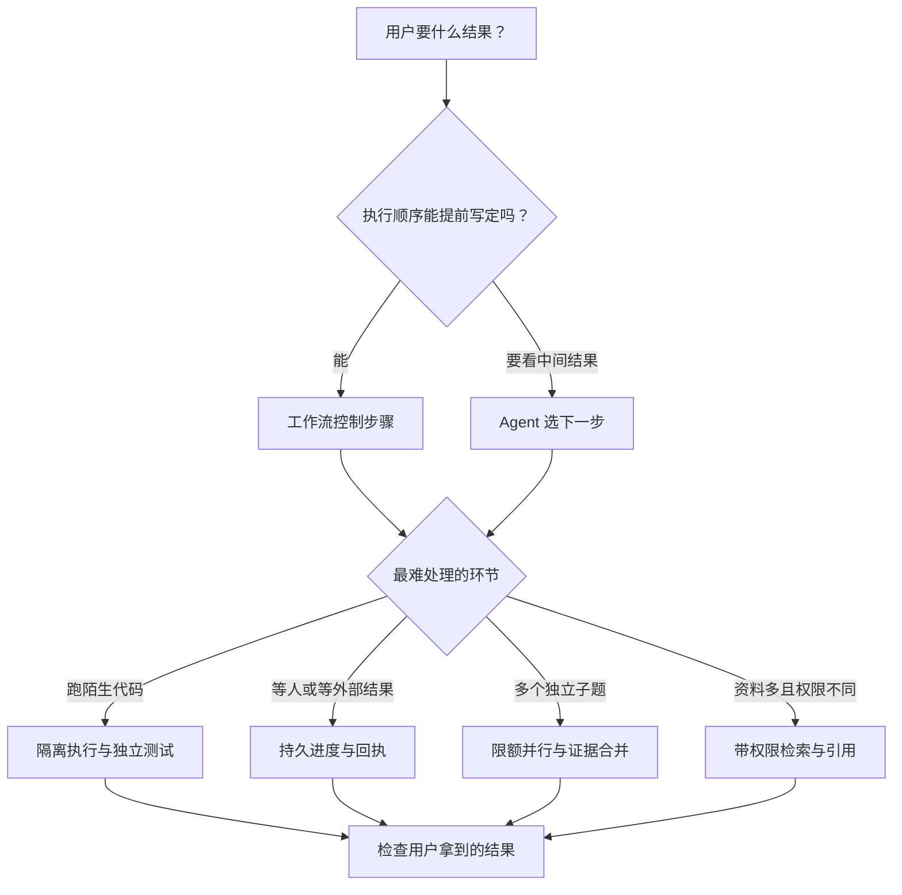
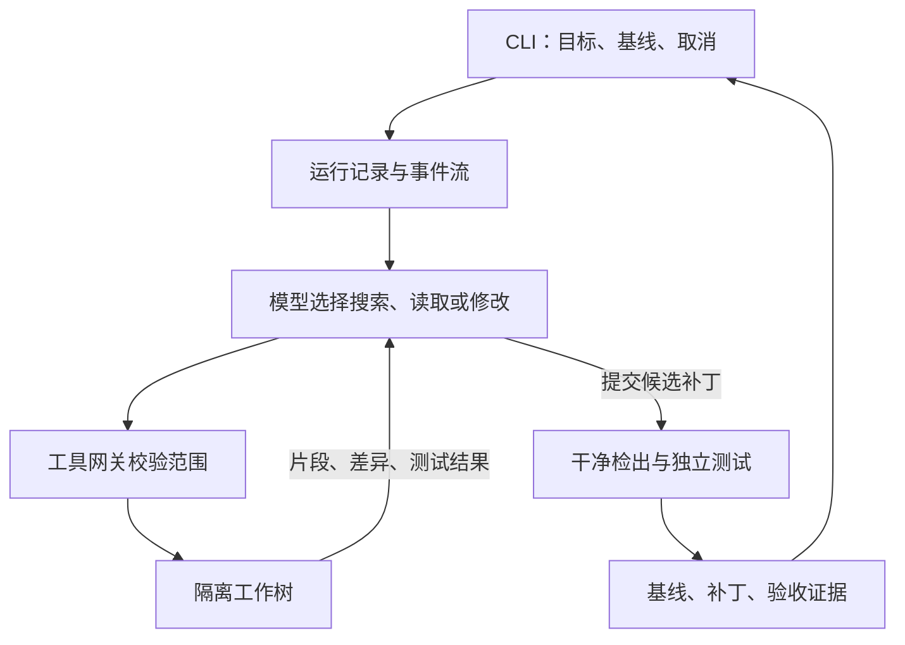
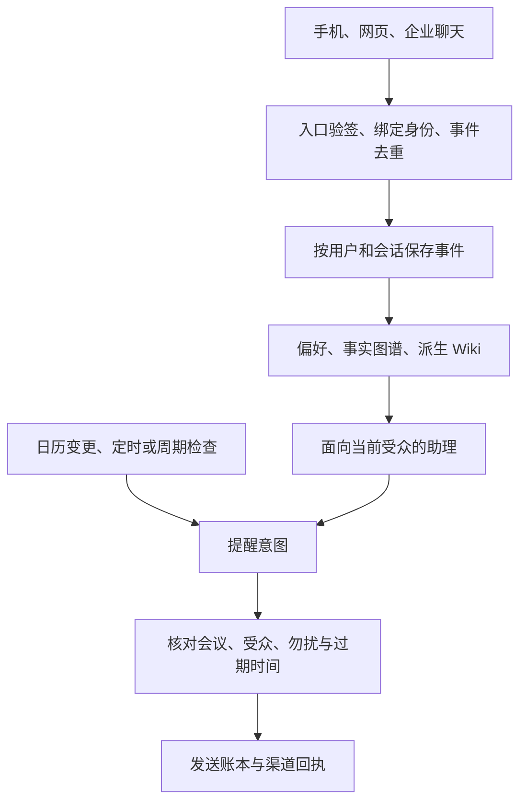
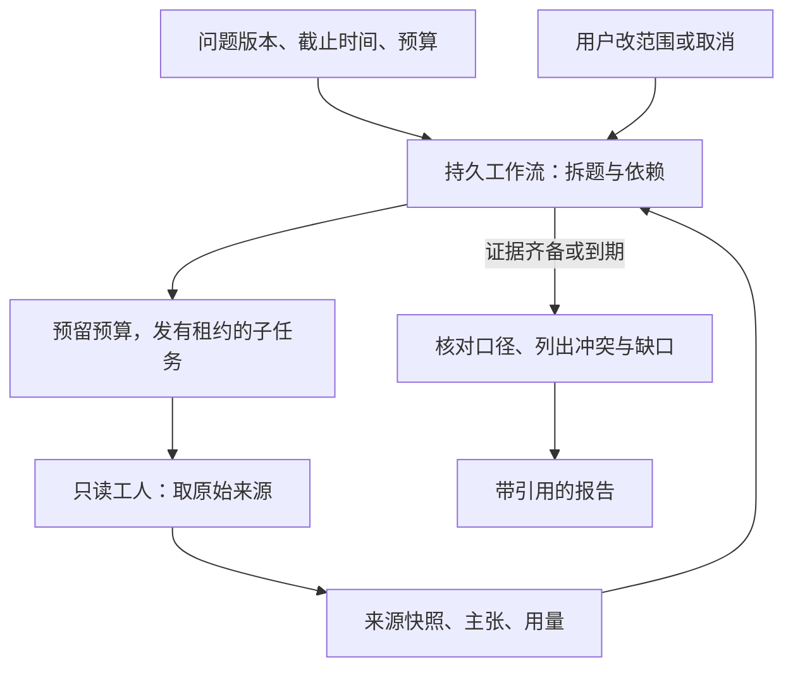
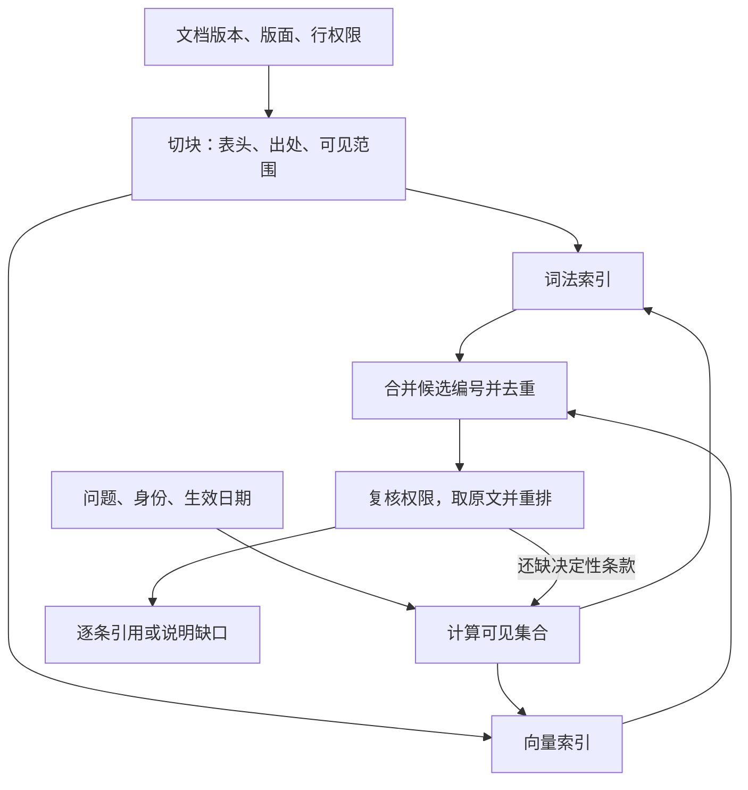
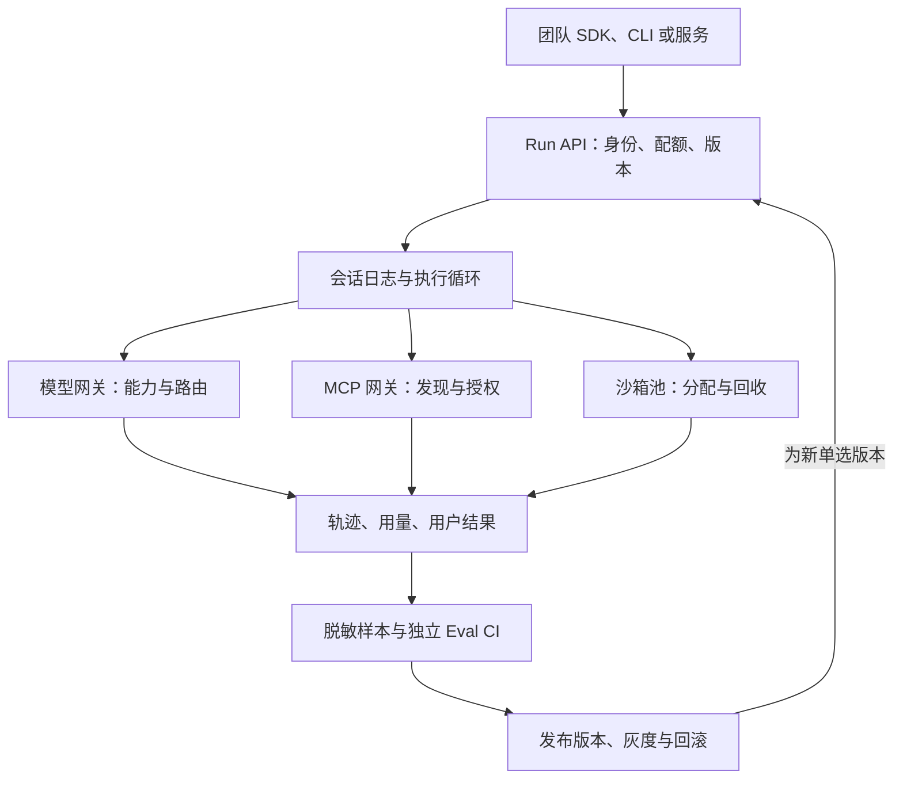

# 模块 10｜Agent 系统设计面试白板手册

> 练五道题：交一份代码补丁、发一次提醒、查清一组事实、答一条制度、给一次平台升级放行。每次画完主线，请搭档挑一步问你：“它已经做成了，但回执丢了，接下来怎么办？”

## 35 分钟，白板上留下什么

先写用户最后能拿到的东西，再倒推谁来验收。以代码助手为例，“修好了”还不能验收；“同一条跨日测试，原版失败，打上补丁后通过，开发者能查看差异”就能据此画图。

| 时间 | 白板动作 | 练习时说出口 |
|---|---|---|
| 0–4 分钟 | 写交付物、用户和边界 | “这次交草稿还是直接发布？谁有权确认？高峰每秒来几单？” |
| 4–8 分钟 | 圈出需要模型决定的一步 | “下一步查哪个文件要看搜索结果。签出、跑测试、保存补丁都有固定顺序。” |
| 8–14 分钟 | 画一次完整往返 | “我从一条工具报错往下走：模型看到什么，能换哪种查法，什么时候停？” |
| 14–20 分钟 | 写一个真实接口 | “谁能调用？传哪一版数据？如果调用两次，会留下几份结果？” |
| 20–28 分钟 | 擦掉一个正在工作的进程 | “接手的人从哪里读进度？这一步可以重试吗？排队还能等多久？” |
| 28–35 分钟 | 写验收样本和回滚条件 | “哪种错误出现一次就要停发？旧任务跑到一半，新版本怎么上线？” |

**题目换皮时，先找卡住交付的那一步：**



- **状态怎么存**：用一条运行记录串起已接收、执行中、等人、待核对和终态。等人时释放计算资源；外部可能已经写入时，留在待核对，由执行端查回执。把用户授权、模型计划和已验证事实分开存。
- **上下文怎么装**：工具刚报的错留在当前对话；长日志存原文，只给模型片段和地址。预算、授权、任务版本由服务端重新读取。这样哪怕整段聊天压缩过，运行时也能说清还可花多少钱、能写哪里。
- **容量怎么估**：高峰每秒到 2 单，每单实际占箱 45 秒，平均忙箱约为 2 × 45 = 90 个。按 75% 目标利用率准备约 120 个箱，再用同时到达的一批任务测排队 p95。算占箱时间时扣掉已经释放沙箱的审批等待。
- **成本怎么报**：把缓存和未缓存输入、输出、工具、沙箱和重试分别计价。若 100 次尝试交付了 60 份合格结果，每份成本就用这批总花费除以 60。两版模型单价相同，返工少的版本也可能便宜得多。
- **谁来验收**：优先检查补丁、回执、表格单元格或引用原文。开放式答案可用模型评分，再抽样请人复核。线上用户反复纠正同一种“满分答案”，就拿那条轨迹补一道验收题。

## 第一题｜两百万文件的仓库，怎样交出可信的补丁？

开发者说“导出日期早了一天”：我先固定他看到的代码，找到能复现的输入，再交一份别人可以独立验过的补丁。



### 从一次日期错误走到五个接口

1. **固定起点**：先问未提交的改动算不算。需要带上时，把改动存成单独的快照，和提交号一起绑定到本次运行。开发者切分支、继续编辑时，远端仍能还原最初那份代码。
2. **缩小范围**：从导出入口找日期字段，沿调用关系跟到格式化函数。用业务时区跨午夜的输入，让旧版先红一次。修完用同一输入重跑，留下期望值和实际值，否则“跑绿了”解释不了修的是什么。
3. **独立验收**：在干净基线上应用候选补丁，用受保护的检查脚本跑受影响用例。把基线、测试版本和日志随补丁交回。仓库脚本同样要限制出网、挂载、进程数和执行时间，本题只交补丁，沙箱无需持有远端推送凭据。

```text
StartRun(actor, repo, base_commit, overlay_ref, goal, limits) -> run_id
ReadRange(run_id, path, start_line, count) -> blob_hash, excerpt, truncated
ApplyPatch(run_id, expected_blob_hashes, patch_ref, operation_id) -> changed | conflict
RunCheck(run_id, suite_id, tree_hash) -> exit_status, log_ref, resource_status
SubmitCandidate(run_id, base_commit, tree_hash, patch_ref) -> verification_id
```

**读写为什么成对设计**：读文件时一并返回内容哈希，写入前核对所有目标文件。多文件补丁在临时工作树里整批试应用，全部成功才切换到新树。相同操作编号重来时返回已有结果，哈希冲突则让模型重新读差异。

### 核心取舍：钱花在找代码，还是反复读代码？

| 线索或瓶颈 | 我会先做什么 | 何时换做法 |
|---|---|---|
| 有函数名、路径、报错原文 | 用 ripgrep 找行，再用符号索引找调用者 | 零命中先查忽略规则、生成目录、索引对应的提交 |
| 只有“悉尼用户少一天” | 从导出入口缩小范围，再用语义检索补候选 | 按首个正确文件的命中率和定位时间判断建索引值不值 |
| 每轮都带相同工具说明 | 把稳定约束和工具定义放前缀，目标、差异、观察放后面 | 看缓存输入占比、首 token 时间和整单耗时 |
| 搜索记录快塞满窗口 | 压缩无效探索，保留失败断言、禁改范围、原始日志地址 | 压缩会改变部分前缀；剩余步骤很少时，先裁掉冗长工具输出 |

**缓存省在哪里**：相同前缀有机会复用模型已经算好的注意力键和值，省掉一部分输入计算。后续输出仍要逐步生成。若一单大半时间在跑集成测试，前缀命中率再高，也得回到测试日志里找慢点。

### 五轮追问

1. **为什么不先给全仓算向量？** 我会先拿符号明确和描述模糊的任务各测一组。模糊题确实更快找到正确文件，再异步建向量索引；未提交文件走本地覆盖层，最后都回到当前工作树核验。
2. **同一段日志读了三遍，怎么叫停？** 我比较工具、参数、树版本和结果摘要。四项都没变，提示它换一个观察，例如读取失败用例的输入。改过代码再跑同一条测试有新信息，应当放行。
3. **缓存命中和修复率一起掉了，先查谁？** 用同一条历史轨迹重建两版输入，查工具顺序、模型路由和压缩边界。前缀变了能解释变慢；要解释改错，还要查失败断言是否被摘要丢掉。
4. **机器回收了，改到一半怎么办？** 每次有效修改都保存一份可恢复的补丁，恢复时废掉旧租约，从最后一棵已知树接着验。用户分支若已前进，就用原基线做三方合并，冲突留给开发者确认。
5. **测试都绿了，用户还说日期错？** 先让他确认按 UTC、业务时区还是个人时区导出。同一时刻可能对应两个日期。拿约定补跨日和夏令时样本，再看旧版能否复现、补丁能否消除那条错误。

## 第二题｜跨端个人助理，怎样准时提醒、按要求忘记？

用户在企业聊天说“下周休假”，又在手机改了会议：我让日历决定何时检查，发送前再看本人此刻是否想被打扰。



### 记住一件事，与获得发信授权，是两条路径

- **身份和受众**：显式绑定渠道账号，事件保留租户、发言人和所在会话。手机私聊和企业群可以属于同一个人，群消息却有更多读者；回复前要按实际受众选择能引用的来源。
- **记忆和来源**：Markdown 适合让本人修改写作偏好；图谱保存人、会议、项目的关系和有效期；Wiki 汇总多次对话，保留来源边和生成进度。“我明天见谁”从实时日历取，“怎么写周报”才查长期偏好。
- **调度和发送**：会议改期就作废旧计划，计算下一次到期时间。Cron 适合本地九点这样的准点检查，Heartbeat 适合把低时效事项合并唤醒。OpenClaw 已把旧心跳监控迁到普通自动化作业，两种需求可以共用调度器。

```text
Event(tenant, channel, external_id, actor, audience, occurred_at, payload_ref)
Fact(subject, predicate, value, source_event, valid_from, valid_to, visibility, rev)
Reminder(intent_id, owner, event_uid, occurrence, schedule_rev, due_at, expires_at)
Delivery(intent_id, channel, recipient, logical_key, status, provider_receipt)
Deliver(intent_id, expected_schedule_rev, logical_key) -> receipt | suppressed | unknown
```

**白板上圈两个键**：事件编号挡住渠道重投，提醒业务键标识“给这个人、针对这次会议、发这一档提醒”。只改会议标题会产生新版本，业务键仍相同；周期会议下周那一场则有自己的实例标识。

### 核心取舍：提醒晚了可以补，重复发送很难收回

1. **先占住投递记录**：发送意图和待投递记录在同一事务落库，用业务键防止两端同时抢发。发前读最新会议、休假和已读状态；已有送达回执就取消备用渠道。
2. **回执不明时**：渠道支持幂等就用原键重投，支持查询就先查。两者都没有则标记待核对，暂停备用投递。读书摘要可以晚点合并，已经过期的登机口提醒应当丢弃。
3. **让邮件只能提议**：读私人资料、处理陌生来信、对外发送，三种能力放在一起就有泄露风险。提取器只交候选事项；发送端从可信订阅取收件人，临时外发须由用户确认收件人、正文版本和有效期。

### 五轮追问

1. **聊天平台重发“七点提醒”，会建两单吗？** 用租户、渠道、外部事件号建唯一约束，收事件和建意图一起提交。用户亲自又说一遍会有新事件号，这时按已有提醒合并，并把安排回显给他。
2. **出差碰上夏令时，九点是哪一个九点？** 一次会议按日历时刻触发；“每天九点”保存当地时间规则和地区时区。时钟回拨时同一逻辑时段只响一次，前跳按约定跳过或顺延，改区后回显下次触发时间。
3. **已经允许提醒，为什么今天还是静默？** 允许提醒只是第一关，还要查休假、勿扰、是否已看和当天频次。评估同时看有用确认、被静音、重复提醒和重要漏报；只盯点击率会奖励打扰。
4. **删掉客户资料，恢复备份后会复活吗？** 删除标记独立保存，恢复先应用删除进度再开放读取。沿来源清原文、图边、Wiki、缓存和产物；分别记录何时停止可见、何时清理完成。
5. **邮件说“把附件转给新同事”，能照做吗？** 来信只能生成草稿。要从可信会话取得用户对收件人和这份附件的授权，提交前再查共享范围。验收要同时覆盖拦住错误外发和本人正常提醒能送达。

## 第三题｜两小时后交研究报告，中断了怎么接着查？

要比较三家供应商的价格、地区和支持期限，我把任务拆成可单独核实的事实；机器换了，下一位也能从已有证据接着查。



### 工人交一条主张，协调者才知道查到了什么

| 记录 | 要留下的东西 | 接手时怎么用 |
|---|---|---|
| ResearchRun | 租户、问题版本、截止时间、已用和预留预算 | 判断哪些子题仍有效，还能派几个工人 |
| Task | 子题、依赖、预算、状态、租约代数 | 只接未完成的活；旧工人迟交时检查代数 |
| Claim | 对象、字段、值、单位、生效日期、来源引用 | 合并同口径的价格，分开不同地区与合同期限 |
| Artifact | 快照地址、内容哈希、采集时间、读权限、父来源 | 从报告跳回当时的原文，辨认两篇转载是否同源 |

**工人如何交接**：先存好证据，再提交引用。服务端核对租约和问题版本，同一调用只结算一次。快照要放在接手者有权访问的持久存储里。

```text
FinishTask(task_id, lease_epoch, claim_refs, actual_usage) -> accepted | stale
```

**重启靠哪段历史**：工作流按照已记录事件推进。模型拆题、网页请求、取价格都放进可记录结果的活动（Activity）。重放读已完成的结果；结果还没记下就宕机，活动可能再做一遍，有副作用的调用要有自己的幂等键。

**何时停止搜索**：每轮写下新增来源、已覆盖字段和剩余缺口。新网页都在转述同一份价目表时，再开工人也得不到独立证据。遇到“价格须询价”就列为待核实，保留原始页面，让其他已核实字段按时交付。

### 核心取舍：并行省下的等待时间，要扣掉合并和复核时间

- **适合拆**：不同供应商的价格页可独立抓取，先用两个工人验证并行收益。若第二问依赖第一问里的合同类型，让它显式等待；抢先搜出来的一堆错误套餐会增加审阅时间。
- **预算得先占**：余额一万 token，三个工人都想用八千，只看余额就会超支。调度事务维持“已用 + 已预留 ≤ 上限”，为最后合成另留额度；发起调用时按输入和最大输出限制本次用量。
- **迟到的回执怎么算**：租约到期可以拒收旧结果，已经发出的请求仍可能计费。用调用编号记录回执，核清实耗才释放余款；工具按次计费、模型按 token 计费时，按各自价目换算成本后再合计。

### 五轮追问

1. **第 70 分钟协调进程挂了，要重新搜索一遍吗？** 先重放历史、读持久产物，重建依赖和剩余预算。只派未完成的任务并换新租约；旧工人迟来的证据先核版本，旧调用的账仍要对。
2. **用户改口只看一家，能立刻省下另外两家的钱吗？** 提升问题版本，停止新调用、取消能取消的工作。已经发出的请求可能产生费用；能复用的证据重新核对适用范围，其他只留历史记录。
3. **两个价格差一倍，采信哪一个？** 逐项对齐套餐、地区、税、币种、月付年付和生效日期。条件不同就分两行写；条件相同仍冲突，两条原文并列，指出需要哪份合同才能判断。
4. **多 Agent 的提升是不是只靠多花钱？** 固定来源、总预算和截止时间，拿单工人对照。一起报有证据且口径正确的主张比例、事实覆盖、完成时间和人审耗时；并行快了但返工多了，用户仍可能晚收到报告。
5. **一单慢了十倍，怎么找到最慢的一步？** 用同一运行编号串起排队、取证、模型和合成。各子任务各记一段耗时，合并处用 span links 关联。沿决定完工时间的路径找瓶颈，多条并行耗时不能直接相加。

## 第四题｜千万份文档，怎么答出这个员工能看的那条制度？

“我今年能报销外接显示器吗？”我会先确定员工、地区和日期，再从他有权看的现行条款里，找出能支持结论的那一行。



### 把“搜到一句话”变成“能引用一个证据”

- **入库**：PDF 留页码与位置；扫描件留 OCR 置信度；表格留表头、行列和跨页关系。按章节切，再按长度拆。把“可报销一次”单独切下来，会同时丢掉年份、地区和例外。解析失败单独排队补做。
- **召回**：词法擅长找制度编号，向量擅长把“外接屏幕”连到“显示设备”。两路先按权限过滤，再按名次融合，例如用倒数排名融合（RRF）累加两路得分。重排器只读有限份已授权原文，最后让答案里的每个金额、期限都指向支持它的页或单元格。
- **派生内容**：块太短时，可拼上可信标题，或用模型补一小段适用背景。生成背景时只读同一可见范围内的资料。把高管额度写进普通员工行的摘要，即使原表权限完全正确，搜索照样会泄露。

```text
Chunk(chunk_id, tenant, doc_id, revision, source_span, acl_id, valid_from, valid_to)
Search(query, principal, auth_epoch, as_of, limit) -> authorized_candidate_refs
Evidence(ref, source_revision, page_or_cell, text_hash, authority, valid_interval)
Answer(claims[{text, evidence_refs}], unresolved, as_of, auth_epoch)
```

**权限在哪儿重查**：索引过滤挡住大部分不合格候选，取原文、发给外部重排器和返回缓存答案前，还要确认当前访问权。PostgreSQL 行级安全（RLS）可保护源数据；应用查询身份要避开默认绕过策略的表所有者、超级用户及有绕过权限的角色。

**白板容量题**：一千万份文档，每份平均 20 块，就是两亿块。每块 768 维、每维 4 字节，裸向量约 614.4 GB；预算另加索引、原文、元数据、副本和重建空间。若每天更新 1%，日均要处理两百万块，约 23 块/秒。

### 核心取舍：多找一轮，能补上哪一条缺失的依据？

| 已经看到什么 | 下一步 | 怎样验这笔开销 |
|---|---|---|
| 正确条款在候选中，名次太低 | 固定候选，试交叉编码重排 | 看前几名命中、引用支持率和高峰延迟 |
| 短条款连主语都缺 | 先拼同权限标题，再试生成块背景 | 按文档版本增量更新，算入库成本及错配率 |
| 地区和年份齐了，调岗适用规则缺失 | 只针对调岗定义补一次查询 | 每跳写缺口、新证据和剩余预算，查不到就说明 |
| 当前制度与旧版都命中 | 根据生效区间和权威来源筛选 | 用跨年、废止、例外和应当拒答的题验收 |

**实验数字怎么讲**：Anthropic 把上下文化向量、上下文化 BM25 和重排合用，Top-20 块检索失败率从 5.7% 降到 1.9%。白板上分别验两件事：前二十块有没有依据，答案有没有用对年份。[实验原文](https://www.anthropic.com/research/contextual-retrieval)

### 五轮追问

1. **Top 100 全无权看，最后滤掉行不行？** 有权看的第 101 条已经被挤掉，前面的标题还可能先送进了重排器。我会在召回前按租户和权限组约束范围；可见集合很小时，用集合内精确扫描作基线。
2. **员工刚离职，昨天缓存的答案还能用吗？** 先验当前身份与权限版本。缓存键包含问题、适用日期、可见范围、文档和策略版本，返回前再核来源；权限服务不可用就暂停返回受限内容。回退索引时也先应用最新撤权和删除记录。
3. **第一条明明很相关，金额为什么还错？** 先回原表看表头是否错列，再看正确年份和例外有没有召回、有没有被重排挤掉，最后对照生成答案。逐层留下候选编号、得分和引用位置，就能指出第一处错误。
4. **手上有一万道无标注问题，怎么评升级？** 先抽标高风险、时效、多跳、无权和应拒答题。分开看授权证据召回率（recall@k）、排序质量（nDCG）、逐条引用支持率和正确拒答率。其余题用来测稳定性、耗时与成本。
5. **已有八成召回，上重排值吗？** 抽失败题看正确块到底在不在候选里。在，就固定候选和生成模型比较重排收益；不在，就回去修解析、覆盖或词法检索。给候选换顺序救不回没入选的块。

## 第五题｜二十个团队共用 Agent 平台，一次升级怎么放行？

我让每个团队定义“交付做对了”的样本，平台把模型、工具、沙箱和验收版本绑在同一次运行上，这样坏了一单就知道该回退哪一层。



### 接入一个团队，要对齐哪些记录？

```text
RunSpec(tenant, principal, task_class, policy_rev, harness_rev, model_caps, limits)
ToolManifest(owner, name, schema_rev, effect, scopes, idempotency_mode)
SandboxLease(tenant, run_id, image_digest, isolation_kind, epoch, expires_at)
EvalCase(case_id, family, fixture_digest, grader_rev, source_scope, severity)
Trial(case_id, trial_id, release_rev, model_rev, outcome, cost, trace_ref, infra_status)
StartRun(spec, input_ref, request_key) -> run_id | denied | quota_exceeded
```

- **控制面管版本**：登记团队限额、工具清单、模型能力、测试集和发布指针。执行面接单时固定版本，验身份、领资源、落事件。紧急撤权即时生效；固定旧版本只为了还原执行语义。
- **路由先看资格**：先筛数据地区、留存要求、模态、工具和窗口，再比质量、延迟与价钱。模型尚未发起动作时可切兼容备选；已经派出的动作按持久编号查状态。应用能区分额度用尽、临时满载和权限拒绝。
- **工具按需发现**：少数常用工具稳定挂载，其余按意图搜索目录，用前取指定版本的参数定义。MCP 的 2026 年 7 月修订支持列表缓存；平台按可见范围复用，真正调用时仍要校验委托、目标资源和副作用。
- **沙箱按次领用**：预热镜像只装公共依赖，领用后才绑定租户卷、短时凭据、出网策略和资源限制。归还时销毁可写状态；清理失败的实例直接隔离。构建缓存按租户信任范围、依赖锁和工具链版本复用。

### 核心取舍：隔离按负载选，可靠性按交付方式验

| 选择 | 换来了什么 | 上线前亲手量什么 |
|---|---|---|
| gVisor | 用户态内核处理大量系统调用，缩小应用直接接触宿主内核的范围 | 真正工作负载的兼容性、系统调用开销和尾延迟 |
| Firecracker | KVM 微型虚拟机有独立来宾内核 | 冷启动、内存、镜像分发、快照与目标机器的兼容性 |
| 干净暖池 | 把部分启动时间移到请求到来之前 | 高峰领用延迟、空闲资源费、回收及清理失败率 |

**同样跑三遍，分数为何能差一倍？** 甲题三次全过，乙题只过一次。有人挑最佳补丁时，两题都能交付，`pass@3 = 100%`；无人值守时关心连续可靠，两题中只有甲全过，`pass^3 = 50%`。

```python
def repeated_pass_rates(case_trials, k):
    # 每题恰好 k 次，超时记失败；缺跑的题先补齐。
    if k < 1 or not case_trials:
        raise ValueError("至少需要一题和一轮试验")
    groups = list(case_trials.values())
    for group in groups:
        if len(group) != k or any(type(x) is not bool for x in group):
            raise ValueError("试验次数或结果有误")
    return {
        "pass@k": sum(any(group) for group in groups) / len(groups),
        "pass^k": sum(all(group) for group in groups) / len(groups),
    }

assert repeated_pass_rates({"甲": [True] * 3, "乙": [True, False, False]}, 3) == {
    "pass@k": 1.0, "pass^k": 0.5,
}
```

**白板推算**：若同一题每次独立、成功率都是 0.8，三次至少一次成功的概率是 1 − 0.2³ = 0.992，三次全过是 0.8³ = 0.512。真实任务难度不同，用每题的重复试验计算，再按题族汇总。

**发布顺序**：先验工具契约和权限，再用同一批快照、预算和评分器配对跑新旧版。越权或重复外发出现一次就拦；关键题族样本太少就补跑。无副作用影子流量通过后，再挑少量租户灰度，观察延迟、成本和人工接手。

**回滚动作**：新单切回旧版本，跑到一半的单按原版本完成，或在明确迁移点恢复。超时和资源故障单独标原因，同时保留它们在端到端成功率的分母里，才看得见用户实际经历了什么。

### 五轮追问

1. **五百个沙箱同时来领，谁先拿？** 按租户保底和并发上限排队，交互、后台、评测分队列。每秒 10 单、平均占用 20 秒，均值需 200 个忙箱；突发时还要看启动速度、内存和队头等待。
2. **一组要强隔离，另一组要毫秒级启动呢？** 先问计时从冷启动开始，还是从已有暖箱领用开始。按负载和信任级别分池，用真实镜像分别量两条分布；把更强隔离和预热的成本归到实际使用方。
3. **备用模型缺关键工具，还能自动降级吗？** 先对照运行声明的必需能力。缺能力就等待或返回具体失败；业务事先允许只交草稿，才走草稿分支，并告诉用户哪一步尚未执行。
4. **平均成功率涨了，五连过却跌了，放行吗？** 找到退化题族，核对偶发超时、资源和模型变化。自动提交按全过率守门，人工挑候选可单独灰度。按租户切开看，别让大租户的简单题盖住小租户的退化。
5. **只有三个月，交付顺序怎么排？** 先给一个团队打通运行编号、限额、工具授权、隔离执行、评分和回滚。先固定路由、手工登记工具、支持一种沙箱；等第二个团队接入，再看真正重复的工作在哪里。

## 面试官改题时，只重画变化的那条线

| 临时改动 | 保留哪部分 | 当场补哪笔账或哪个检查 |
|---|---|---|
| 把供应商研究换成只读 AIOps | 子任务、来源快照、进度和预算 | 每条证据绑服务、时间窗、采样率、查询条件。交疑似根因和相反证据；若要自动处置，再加对象、授权和回滚条件 |
| 流量突然涨十倍 | 原来的运行和验收记录 | 入口涨就算准入与排队，单任务工具次数涨就查停止条件，文档涨就算索引回填。指出哪个队列能等、哪类请求会过期 |
| 权限只有最终一致性 | 可见范围、动作账本、接收方 | 敏感提交前查权威源，查不到就暂停。练三次：提交前撤权、审批后改正文、发送后丢回执，分别说出应留下的状态 |

**跨题追问：同一个 Agent 昨天还好用，今天怎么变笨了？**

1. **先找一份变坏的产物**：要运行编号、原始期望和实际结果；制度可能刚更新，同一句问题今天本就该有不同答案。拿昨天的产物跑今天的评分器，先确认判题规则有没有变。
2. **一次替换一个环节**：固定资料版本、授权范围、镜像、工具、模型路由、上下文和预算。逐步替换检索结果、工具返回和模型输入，找最早偏离的一步。对随机输出做配对多次采样。
3. **旧模型下架或日志删了呢？** 回放留存的动作和产物，先查执行、评分与展示。没有正文就用获授权的最小样本或合成样本，靠哈希和版本缩小范围。先恢复可用路径，再分清哪些原因已经复现。

## 用 STAR-T 把自己的项目讲成两分钟

挑一个你亲手做过的决定，准备一条失败轨迹和一份前后对照。最后一个 T 留给 **Trade-off / Transfer（权衡与迁移）**，讲清当时付了什么代价，以及条件变了要改哪一步。

| 用时 | 讲哪一段 | 可以照着填的句子 |
|---|---|---|
| 15 秒 | S · 情境 | “谁在什么时候要拿到什么？有一单具体卡在……” |
| 15 秒 | T · 任务 | “我负责哪段链路，谁验收，上线时能读什么、能写什么？” |
| 45 秒 | A · 行动 | “从这条失败记录看，第一处异常在……我试过两种处理，选这一种是因为……” |
| 30 秒 | R · 结果 | “同一批多少单，多少合格，花了多少？哪类用户仍然会失败？” |
| 15 秒 | T · 权衡与迁移 | “这一步少花了……但多付了……如果流量或权限变了，我先改……” |

### 用报表助手练一次：哪个数字能当场复算？

- **情境与职责**：“周一集中出报表，有人等不到可用表格。业务同事定字段和验收规则，我负责从取数到交草稿。”准备一条慢请求，圈出等待模型和等待取数的时间。
- **行动**：“我发现字段说明被反复送入模型，就固定工具顺序，把会变的日期放后面。长结果只传摘要和原文地址，草稿写入加业务去重键；取数超时单独记录。”这样每个改动都有一条轨迹能查。
- **结果**：用这组数练算账：同样 200 单，旧版 150 份合格、花 300 元，新版 170 份合格、花 272 元。验收通过率从 75% 到 85%，提高 **10 个百分点**；每份合格成本从 **2 元降到 1.6 元**。
- **代价**：“截图里的表格仍有错列，置信度低的交人复核，人工分钟数记入交付成本。”把仍然会失败的一类样本带上，面试官就能追问你为什么把上线边界画在这里。

**追问：多出来的二十份都算缓存的功劳吗？** 同时改了三件事，这组数只能说明整套改动的结果。只调前缀时看缓存输入和首 token 时间；只裁工具输出时看关键错误有无丢失；给同一写入投递两次，验业务键能否拦住重复草稿。

**换成自己的材料**：搜索项目可带一条“召回对了、引用错了”的样本；队列项目可带一次超时后的外部回执；平台项目可带一张按租户拆开的排队分布。各准备一个指标，也准备它付出的代价，例如重排延迟、人工对账或暖池闲置。

**没有历史大盘怎么讲**：用仍有权使用的匿名工单、构建记录或版本快照做小样本回放，写明选了多少单、怎么选、哪些资料缺失。只做过离线复测，就报离线结果；项目里由谁定需求、谁改运行时，也照实际分工讲。

## 最后三分钟，挑两句反问面试官

| 想了解什么 | 先问一句 | 顺着回答再追一句 |
|---|---|---|
| 评测管不管用 | 最近一次线上回归是谁先发现的？ | 那条轨迹后来怎样进回归集，谁维护评分规则？ |
| 应用能做到哪步 | 用户拿到建议、草稿，还是系统直接提交？ | 写入成功但回执丢了，谁查外部状态？ |
| 模型降级 | 业务能指定必须保留的工具能力和数据地区吗？ | 降级发生后，团队在哪里看到原因和质量变化？ |
| 成本 | 你们能看到一份合格交付的总成本吗？ | 后台重试、返工和人工审核分别记在哪里？ |
| 删除 | 用户删除资料后，摘要和答案缓存多久停止返回旧内容？ | 团队怎样演练恢复备份，谁处理漏清的副本？ |
| 工具权限 | 新工具能读什么、能写什么，由谁审核？ | 授权中途变了，正在跑的任务在哪一步重新检查？ |
| 多 Agent | 哪类任务在同预算下比单 Agent 做得更好？ | 合并返工和人工审阅也算进完成时间吗？ |
| 岗位职责 | 我入职后先对哪项用户结果负责？ | 为了改进它，我能改应用、运行时和评测里的哪几层？ |

## 一手资料，按白板上的问题回查

- **仓库定位与前缀复用**：[Codex CLI](https://github.com/openai/codex) · [ripgrep 搜索范围](https://github.com/BurntSushi/ripgrep) · [OpenAI Prompt Caching](https://developers.openai.com/api/docs/guides/prompt-caching) · [稳定前缀与压缩](https://developers.openai.com/api/docs/guides/keep-prefix-unchanged)
- **记忆与唤醒**：[LLM Wiki 原稿](https://gist.github.com/karpathy/442a6bf555914893e9891c11519de94f) · [Anthropic 记忆组件](https://www.anthropic.com/research/components-of-agent-memory) · [Hermes Agent](https://github.com/NousResearch/hermes-agent) · [OpenClaw 心跳迁移](https://github.com/openclaw/openclaw/blob/main/docs/gateway/heartbeat.md)
- **读取与外发的边界**：[Simon Willison 的致命三角](https://simonwillison.net/2025/Jun/16/the-lethal-trifecta/) · [CaMeL 论文](https://arxiv.org/abs/2503.18813v2)
- **并行研究与断点恢复**：[Anthropic 研究系统](https://www.anthropic.com/research/multi-agent-research-system) · [Temporal 持久执行](https://docs.temporal.io/durable-execution) · [工作流重放](https://docs.temporal.io/workflows) · [活动与幂等](https://docs.temporal.io/activity-definition) · [OpenTelemetry 追踪关系](https://opentelemetry.io/docs/specs/otel/trace/api/)
- **引用与可见范围**：[Contextual Retrieval 实验](https://www.anthropic.com/research/contextual-retrieval) · [PostgreSQL 行级安全](https://www.postgresql.org/docs/current/ddl-rowsecurity.html)
- **工具发现与隔离执行**：[MCP 2026 年 7 月规范变更](https://blog.modelcontextprotocol.io/posts/2026-07-28/) · [Anthropic 工具发现](https://www.anthropic.com/research/advanced-tool-use) · [gVisor 安全模型](https://gvisor.dev/docs/architecture_guide/security/) · [Firecracker](https://github.com/firecracker-microvm/firecracker) · [快照版本兼容](https://github.com/firecracker-microvm/firecracker/blob/main/docs/snapshotting/versioning.md)
- **评测与发布**：[Anthropic 的 Agent 验收与重复试验](https://www.anthropic.com/research/demystifying-evals-for-ai-agents) · [基础设施噪声实验](https://www.anthropic.com/research/infrastructure-noise)
