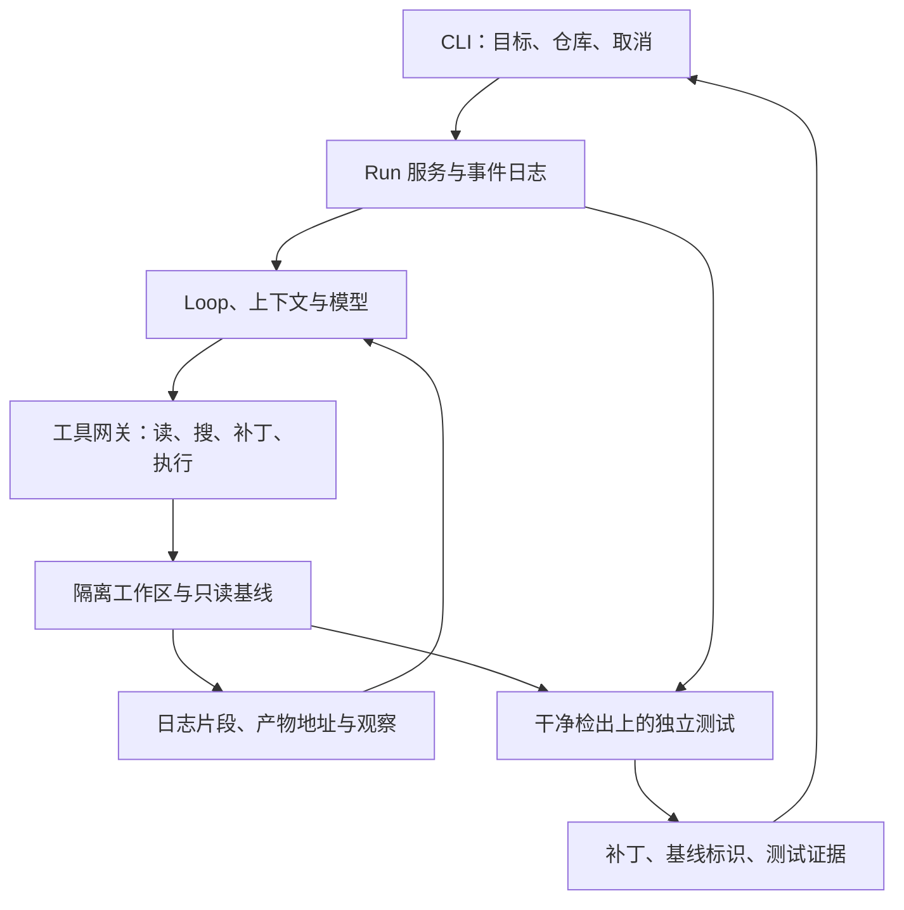
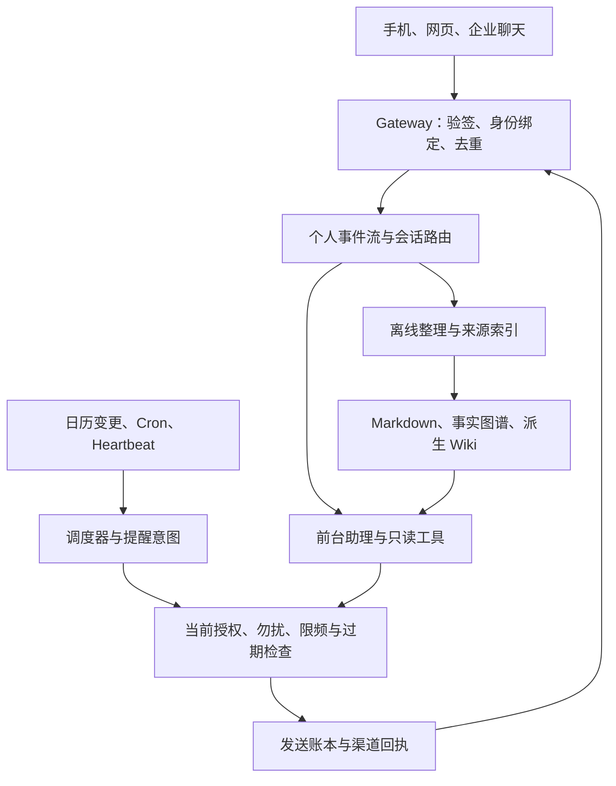
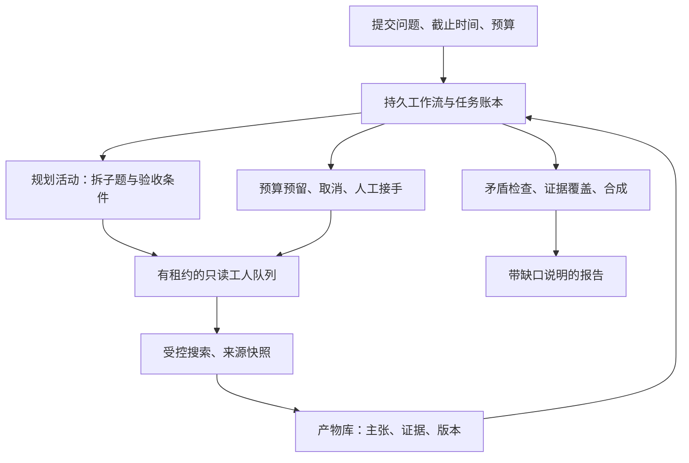
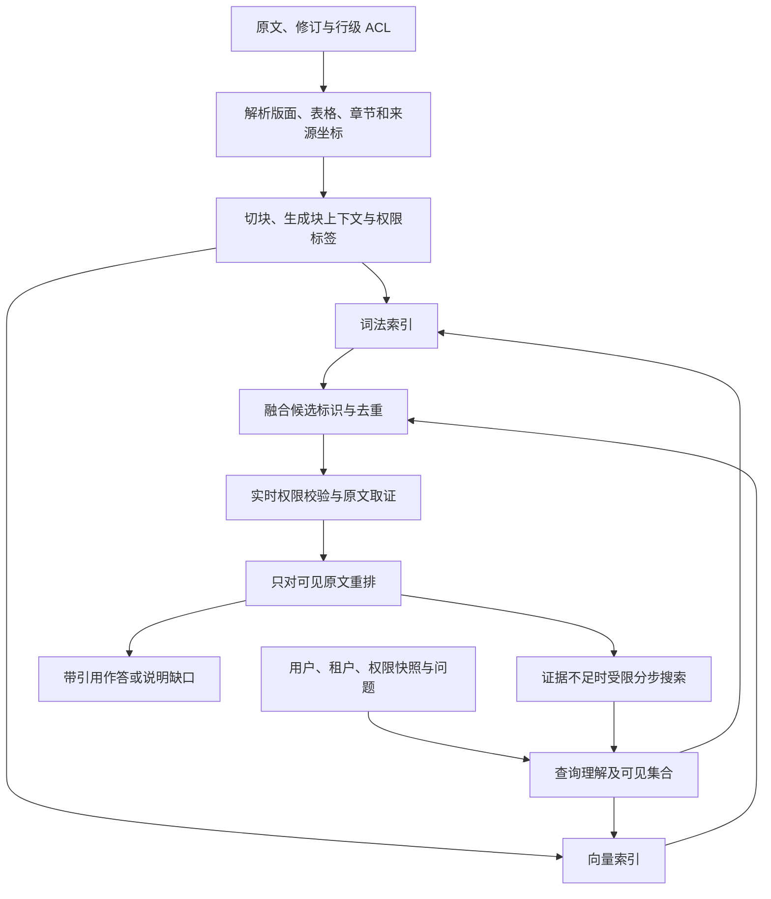
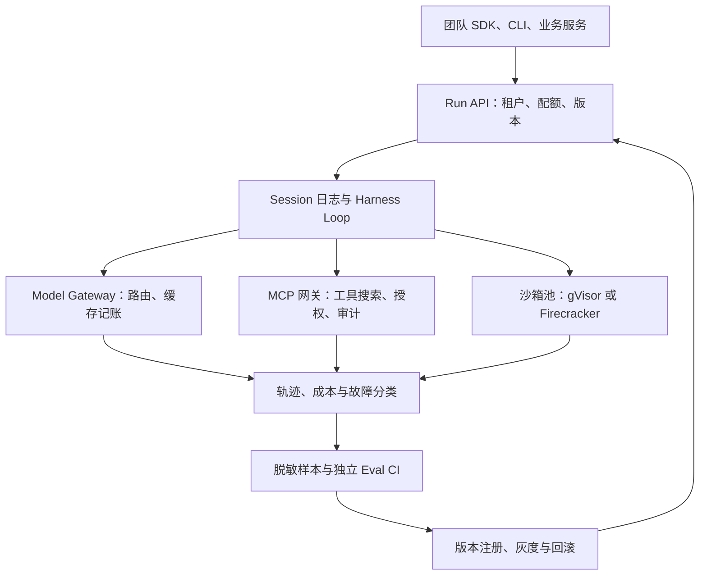
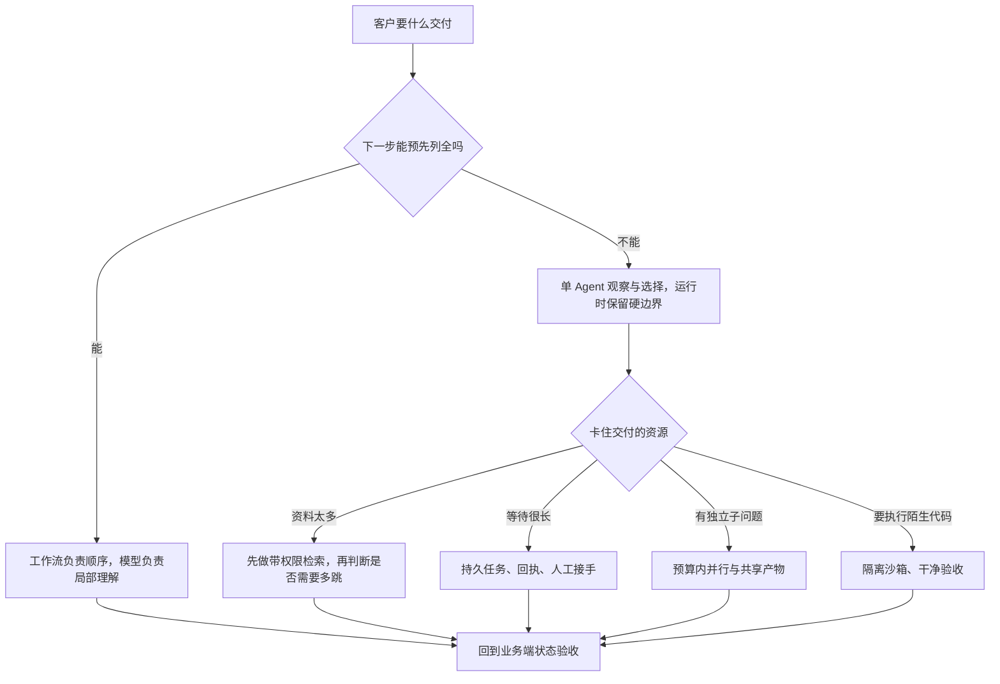

# 模块 10 · 技术全栈 Agent 岗位系统设计面试通关手册

这本手册帮你在 35 分钟内讲清一件事：用户交给 Agent 的任务怎样完成，做错时系统怎样知道，进程死掉或权限变化后谁能安全接手。

**练法。** 找一位同事当面试官，只把每道题的第一段读给候选人，先把后面的方案折起来。第 15 分钟打断他一次，第 25 分钟注入故障，最后请他用一分钟说清愿意签字上线的最小版本。下文五题按真实工程问题重构，覆盖高级岗位常考的设计能力；没有公开的公司题库或出题频次统计可据以排名。容量、预算、SLO 与面试对话中的数值均为演练假设，引用的厂商实验另标来源。

## 第一部分 · 一块白板，六步，35 分钟

白板上方留给用户可见的结果，中央画一条从请求到可验证交付的主线，底部写不变量和预算。每加一个方框，都问“它拥有哪段状态，它重启以后向谁问”。这些问题能避免画出一幅所有服务都有箭头、没人知道哪份数据算数的图。

| 时间 | 你在白板上做什么 | 可以原样说出口的句子 | 到点应当留下的东西 |
|---|---|---|---|
| 0–4 分钟 | 需求与边界澄清 | “谁委托，最后验收什么，哪些写入需要再确认？我先假定只给一个租户交草稿。” | 用户、成功与失败、一条禁止条件、规模假设 |
| 4–8 分钟 | 选 Workflow 或 Agent | “路径已知的部分我用代码控制。只有下一步取决于观察时，才交给模型。” | 一条确定性主线、一个需要探索的节点 |
| 8–14 分钟 | 展开核心 Loop、上下文和缓存 | “我从一次失败的工具返回往下画，看它怎么继续、何时停。” | 可恢复状态、稳定前缀、预算与终态 |
| 14–20 分钟 | 工具、沙箱、记忆与检索 | “工具返回结果和证据地址。长内容按需取，外部写入由独立网关执行。” | 至少一个真实接口、一条读写路径 |
| 20–28 分钟 | 安全、容错、容量与成本 | “我假定这一步已经成功，但回执丢了，现在决定是否重试。” | 权限边界、对账策略、一次带单位的估算 |
| 28–35 分钟 | Eval、观测、发布与复盘 | “离线合格还不够，我会在小流量里按任务验收，检查人工接手和每单总成本。” | 分层指标、放行门槛、回滚与下一步 |

**第一步要问能改变方案的问题。** “用户多不多”太空。换成“同时在线一万人，还是每天一万人各做一轮”，答案会改变连接数和推理并发。“能不能写”还要分草稿和发布，前者通常可撤销，后者往往要对账。对方说“你定一个”，就写假设并继续。末尾主动指出如果从草稿升级到自动发布，需要增加哪一条提交前置条件。这样即使量级猜错，面试官也能判断你会不会迁移方案。

**第二、三步先跑最小闭环。** 收到目标先持久化，再构造上下文，请求模型，解释动作，核对工具权限，执行并记录观察，最后验证产物。通用状态可以写成“已接收、执行中、等人、待核对、成功、失败、已取消”。等人时释放计算资源；待核对表示外部效果未知；两者的恢复者不同。把已经验证的事实、未执行的计划和用户授权分字段存，模型做摘要时可能合并语言，但不能在数据库里把三者合成一个 done。

**第四步按寿命给信息找位置。** 当前工具错误留在短期上下文，长日志放对象存储，长期偏好带来源进入记忆，真正的组织权限留在权限服务。把工单编号、预算上限和审批状态放在结构化运行记录中，重新拼提示时从可信记录获取。复用前缀可以省掉重复的预填充工作；延迟预算则还包括排队、工具往返、生成和验收。若只能接入托管模型，就使用提供方暴露的缓存用量和计费字段，别回答要自己去搬它的 GPU 显存。[OpenAI 前缀缓存机制](https://developers.openai.com/api/docs/guides/prompt-caching)

**第五步至少算一笔可检查的账。** 假设高峰每秒提交两项任务，平均占用沙箱 45 秒，按平均量需要约 90 个在用实例；目标利用率 75%，先估 120 个，再用真实到达分布压测排队尾部。等待审批时不再占箱，上式的服务时长就应剔除等待。模型成本按未缓存输入、缓存输入与输出的实际用量乘各自单价，加工具、检索、沙箱与失败重试成本。每次合格交付成本等于这一批任务总成本除以合格数；一百次尝试只成功六十次，分母用六十。平均占用无法推出 p95，整批到达时还需限流或允许排队。

**第六步明确谁来裁判。** 还原基线快照，尽量用真实端状态判题，例如下载的表格行、服务回执、仓库测试和引用页。模型裁判用来处理语义问题，抽样请人复核，一致性差的题就拆评分标准。线上追踪用户是否接受交付、多久出现纠正、需要多少人工复核。若被反馈集中打低分的任务在线下全部通过，去查验收器漏了哪种错误，别第一反应就换模型。[Anthropic 对任务、轨迹和验收的区分](https://www.anthropic.com/research/demystifying-evals-for-ai-agents)

## 第二部分 · 五场白板模拟

### 第一题 · 从零设计生产级 Coding Agent

**给候选人的题面。** 开发者在一个两百万文件的单仓库里输入“修复导出日期错一天的问题”，希望看到可评审的补丁、测试证据，并能在中途叫停。先支持本地客户端加远程隔离运行，默认只交补丁。白板先说明怎样定位这一个错误，再谈如何推广到所有仓库。Codex CLI 的开源项目和 Claude Code 类产品是能力参照，以下组件与接口是这道题的设计。[Codex 官方仓库](https://github.com/openai/codex)



**先跑通一单。** 固定用户看到的提交和未提交差异是否纳入任务。若用户要求基于当前改动继续，给这些差异单独快照并标清所有者。远程工作区从该基线签出，客户端看持续事件而非等一个永不结束的请求。模型先搜导出函数、日期格式与失败测试，定位时区转换层，构造跨午夜样本，在原版复现，再修改文件、跑局部测试。服务端用干净检出应用补丁，执行受保护的判题和相关集成测试，回传基线、差异、测试版本以及尚未验证的端。开发者切分支也不该改变正在运行那单的真值。

**大仓库要区分三种找法。** 任务有错误码、函数名、字段名时，用 ripgrep、文件路径与符号索引，能很快得到精确的行和上下文。用户说“客户在悉尼下载的日期少一天”，源码里可能没有这些词。先从入口、语言服务的调用关系和最近相关变更收窄范围；语义索引在命名差异大或跨语言时做候选补充，结果必须回到指定提交的文件核验。ripgrep 默认遵循忽略规则，生成代码、隐藏目录或挂载模块可能没扫到；索引又可能落后于工作区。记录实际覆盖范围和索引基线，叠加当前工作区的局部变化，零结果才有解释力。[ripgrep 的默认搜索语义](https://github.com/BurntSushi/ripgrep)

**接口要能保护并发编辑。**

```text
StartRun(actor, repo, base_commit, overlay_ref, goal, limits) -> run_id
ReadRange(run_id, path, start_line, count) -> blob_hash, excerpt, truncated
ApplyPatch(run_id, expected_blob_hashes, patch_ref, operation_id) -> changed | conflict
RunCheck(run_id, suite_id, tree_hash) -> exit_status, log_ref, resource_status
SubmitCandidate(run_id, base_commit, tree_hash, patch_ref) -> verification_id
```

读取时把文件哈希随片段返回；应用补丁前检查它是否还是那份内容，多个文件在私有工作树内整体应用并验证，部分失败就丢弃本次尝试。模型不直接拿远程仓库写凭据。运行测试的程序同样来自用户仓库，要限制出网、挂载、进程数、CPU 与时间。判题脚本及预期结果由不同权限管理。缓存构建依赖要按来源、锁文件和工具链版本寻址；可写构建缓存的共享范围要能阻止一个任务污染另一个租户。

**上下文怎么变便宜。** 每次生成新 token，都要用到此前位置计算得到的注意力键和值。前缀稳定时服务端有机会复用这些中间结果，减少 prefill；后续生成仍要花时间。把稳定系统约束与稳定工具定义放前面，变化的目标、观察和当前 diff 放后面。按输入 token 计算缓存命中占比，同时看首 token 延迟与总交付时间。接近窗口上限时压缩旧探索，留下试过且无效的路径、准确的失败断言、用户禁改范围和原始日志指针。压缩通常会打破部分前缀复用，宜在预计接下来要跑很多步或窗口确实紧张时支付这笔费用。[前缀稳定与压缩的关系](https://developers.openai.com/api/docs/guides/keep-prefix-unchanged)

**五轮追问。**

1. **为什么不先给全仓算向量？** 考定位与新鲜度。按任务类型比较首个正确文件的命中率与定位时间，精确符号题先试文本和符号导航。向量对业务意图有增益时异步建立索引，把脏文件加入覆盖层。多出一条检索通道也增加更新、权限与合并候选的成本。
2. **模型连续三次读同一段日志怎么办？** 考闭环。比较工具名、规范化参数、工作树版本和结果摘要，若没有新信息，提示可用的替代观察或缩小范围。执行预算耗尽就交半成品、失败证据和接手点。相同命令在文件修改后再跑可能合理，不能仅按命令文本去重。
3. **缓存命中骤降，答案质量也变差，你先查什么？** 考排障。按发布版本比前缀序列、工具定义顺序、模型路由与压缩次数。再抽对话核实失败测试或用户目标是否在压缩中丢失。固定一份历史分别重建旧、新输入，才能区分缓存重算带来的慢与信息丢失带来的错。
4. **机器被回收，工作区里还有没提交的更改，怎么恢复？** 考状态所有权。每次有效变更落持久补丁或受控快照，日志记录最后验证过的树。恢复时从该树重建并重跑只读检查，旧工人的租约作废。若用户当前分支已前进，用三方合并产生候选，冲突交用户决定。
5. **测试全绿，用户说改错时间语义，你认哪一个结果？** 考验收设计。找出导出按业务时区、用户时区还是 UTC 的原始约定，补夏令时和跨日样本。若产品语义缺失，先报告歧义并给两种可见输出。最终评价看修复是否复现并消除用户报告的问题，以及修改后用户是否接受。

**收尾的一句话。** 我愿意先上线“开独立工作区、定位并复现、在干净环境验收、向人交补丁”；从交补丁升级为自动合并时，再把分支保护、审核责任和组合提交的集成测试纳入提交边界。

### 第二题 · 一个不乱提醒、也能忘事的全天候 Personal Agent

**给候选人的题面。** 用户上班时用企业聊天，回家用手机，想让同一个助理记住项目偏好，临近会议时提醒自己。周五他说“下周我休假，项目消息先别提醒我”，周一又在手机上改了一场会。如何既准时又不打扰？先明确账户是否已绑定、两个聊天空间谁能看到回复，以及“提醒我”是否包含给其他人发消息。



**把身份先说清。** 一个人在两个渠道有两个账号，同一个企业群却有许多读者。Gateway 通过显式绑定把渠道主体映射到用户与租户，保留会话空间、受众和消息编号，传入统一事件流。不能因为群里有人说“我是张三”就读取张三的私人记忆。跨端可以共用同一授权范围下的事实；企业群回复要按群的受众重新决定可用的来源。对同一用户的两个并发更新用版本比较，若不能自动判断“下周”相对于哪个时区，按用户所在时区解释并把日期回显给用户。

**记忆分三层，读者可以亲手改。** 原始事件是有保留期限的依据。Markdown 适合用户读写项目惯例与偏好，图谱记录人、项目、会议的关系、有效期和来源。LLM Wiki 预先把多次对话综合成一篇项目页，页面保存来源边和生成水位。读取“我明天见谁”优先走日历的实时事实，读取“这个团队喜欢怎样写周报”才取有效范围内的长期偏好。某条来源撤权时先拦在线召回，随后重建引用了它的页面；同一页混有不同可见范围，按可见范围分开物化。Karpathy 的 Gist 给出人能翻阅的文件 Wiki 原型；权限、撤回与多端一致性是本题添加的要求。[LLM Wiki 原稿](https://gist.github.com/karpathy/442a6bf555914893e9891c11519de94f) · [Anthropic 对记忆整理的实验](https://www.anthropic.com/research/components-of-agent-memory)

**准点触发和是否打扰是两个决定。** Cron 表达“工作日当地时间九点检查日历”；Heartbeat 表达“趁一轮唤醒把几个低时效事项合并检查”。大量用户不需要每人每分钟调用一次模型。先消费日历变更，计算下一次确切到期时间，低优先事项用带抖动的周期作业合并。OpenClaw 当前文档明确说旧 heartbeat 监控迁入普通自动化作业；“心跳”和“准时任务”仍代表不同业务语义，完全可以共用实现。在演练里给每种提醒分别约定过期策略，迟到半小时的登机口提醒与迟到半小时的读书摘要应有不同处理。[OpenClaw 的 Heartbeat 迁移说明](https://github.com/openclaw/openclaw/blob/main/docs/gateway/heartbeat.md) · [Hermes 的记忆与技能说明](https://github.com/NousResearch/hermes-agent)

```text
Event(tenant, channel, external_id, actor, audience, occurred_at, payload_ref)
Fact(subject, predicate, value, source_event, valid_from, valid_to, visibility, rev)
Reminder(intent_id, owner, event_uid, occurrence, schedule_rev, due_at, expires_at)
Delivery(intent_id, channel, recipient, logical_key, status, provider_receipt)
```

同一场会议的同一次提醒使用稳定的逻辑标识；会议版本变化时作废旧调度，检查新时间是否仍有提醒价值。不要单靠版本号去重，否则每次改会议标题都可能“合法”地提醒一次。提交之前再读勿扰状态、最近送达账本、接收人和当前会议版本，按重要性选择即时推送、合并摘要或静默。事务内记下发送意图与待投递记录；如果渠道支持客户端幂等，用同一键重投，如果结果未知且无法查询，进入待核对。用一个渠道的回执把另一渠道的备用投递取消，避免手机与办公室群同时响。

**安全边界要能画出数据方向。** 同一个助理一边读私人资料，一边处理不受信邮件，还能向外通信，就具备间接提示注入的致命三角。内容提取工人允许读取本次输入，输出仅含候选事项，不拥有外发权限。发送端从受信用户的订阅规则取得接收方，校验可向该受众展示哪些信息。用户显式确认的临时动作绑定收件人、正文摘要、有效期和当前版本。用给自己草拟提醒代替自动外发来化解歧义。CaMeL 给出从控制与数据流区分出发的研究框架，实务可先保护最敏感的一条外发路径。[致命三角原文](https://simonwillison.net/2025/Jun/16/the-lethal-trifecta/) · [CaMeL 的机制与假设](https://arxiv.org/abs/2503.18813v2)

**五轮追问。**

1. **聊天服务重发同一条“七点提醒”，如何避免两次建单？** 考入口语义。以租户、渠道和外部事件编号建唯一约束，事件写入和生成意图同一事务完成。用户亲自重复发了两条是不同事件，可通过相同业务意图软合并并向用户显示现有提醒。
2. **出差跨时区或遇到夏令时，几点响？** 考时间模型。会议时刻按带时区的日历定义转换；“每天九点”保留当地墙钟规则和地区时区。时钟回拨时给重复出现的同一逻辑时段去重，时钟前跳时按业务决定跳过或顺延。把下次实际触发时刻回显，时区变更后重新算。
3. **他昨天允许主动提醒，今天为何仍会静默？** 考体验。允许是上限，还要查休假、静默时段、重要性、已在前台看过与每日打扰预算。按有用确认、被静音、重复率、漏报重要事项联合评估。不能以通知点击率为单一目标，否则系统可能学会挑引人焦虑的措辞。
4. **用户说“忘掉我上个客户”，旧备份恢复后会复活吗？** 考数据血缘。禁读标记独立于记忆快照并优先应用；按来源遍历原文、图边、摘要、产物及缓存。恢复演练先恢复删除水位再开放读取，备份按保留制度到期。删除完成时间与在线停止返回时间要分别量。
5. **来信建议把资料发给一个新同事，能自动照做吗？** 考授权来源。邮件可创建“待用户核实的候选事项”，不能新授委托。对外提交前由受信渠道确认收件人和可共享的数据，后台检查当前权限。评测用无害的虚构邮件确认它只能生成草稿，同时测正常提醒会不会被过度拦截。

**收尾的一句话。** 我的最小版本支持已绑定设备、只给本人提醒、每条偏好可追到来源；新增主动外联要有独立授权，扩大能读的范围也要检查所有可能看到回复的人。

### 第三题 · 可以中断、重启、对账的企业 Deep Research

**给候选人的题面。** 采购团队要两小时后收到三家供应商的对比报告，至少核实价格口径、服务地区和支持期限，每个结论要能点回当时的来源。同类请求可能同时有几百个，用户随时会缩小范围。先做只读取证和内部草稿，避免把生成的建议直接变成采购承诺。这一题也能迁移到只读 AIOps，供应商换成服务，证据换成指标、部署事件和工单。



**先让工人有独立的劳动对象。** 按供应商和事实类型划分查询，每个任务写明日期、币种、证据标准、截止时间和一个能产生新信息的问题。协调者先查看已有产物，避免三个人反复抓同一张价格表。工人提取价格时保存当时页面快照、文本范围、时间、适用地区与计费单位。合成者读的是可查证的主张，只有发生冲突才打开长页面。来源 A 引用了来源 B 时标注依赖，不能把同一条消息的两次转载算作两份独立证明。遇到“价格须询价”，交一条明确缺口比编出一个表格格子更好。[Anthropic 的多 Agent 研究系统](https://www.anthropic.com/research/multi-agent-research-system)

**把会产生不同答案的操作放进可记录的活动。** 工作流代码只根据历史事件做确定性决策；网络请求、LLM 拆题、当前外部价格与时间相关动作交给活动，保存输入摘要和结果引用。工作进程恢复时重放已记账的决策，从某次已知完成的取证结果继续。活动成功后尚未把回执写回就宕机，工作流仍可能重试活动，这就是为什么“可恢复执行”与“外部只发生一次”需要分开设计。Temporal 的文档把工作流重放和活动的幂等要求写得很清楚。[工作流与重放](https://docs.temporal.io/workflows) · [活动幂等与重试](https://docs.temporal.io/activity-definition)

```text
ResearchRun(run_id, tenant, question_rev, deadline, budget_cap, used, reserved)
Task(task_id, run_id, question_rev, dependencies, lease_epoch, state, allocated)
Claim(claim_id, normalized_subject, field, value, unit, effective_at, source_refs)
Artifact(ref, content_hash, tenant, reader_scope, captured_at, parent_refs)
FinishTask(task_id, lease_epoch, claim_refs, actual_usage) -> accepted | stale
```

预算账本防止一个昂贵的竞态。假设剩一万 token，三个工人同时观察余额都以为能花八千。调度时在一个事务里预留额度，让已用加已预留保持在总上限以内；生成时设可执行的输出上限并计入已知输入成本。完成后用实耗结算，确认旧工人已被终止或额度已过期并完成对账，再回收预留。给合成与最终核实预留不可被工人借走的额度。若供应商按现金收费、模型按 token 收费，分别记录资源，再用调用时价目快照转成同一总成本。把一种资源的单位直接从另一种余额里减去，是白板上常见的错。

**结束条件要回答“还值得再找一次吗”。** 工人报告新增证据指纹、已覆盖的子题和缺口。连续多轮没有新证据，或新证据不足以改变结论时，协调者冻结该分支。若是关键采购条款缺证，就单列待人核实和可联系的原始来源。固定轮数是兜底，按证据覆盖主动停止才会减少重复劳动。输出必须同时给时间口径、未覆盖问题和后续更新入口。另做单工人同预算对照，只有来源可并行拓宽时才值得加队列和汇总器。

**五轮追问。**

1. **主协调进程在第七十分钟死掉，为什么不会重跑全部搜索？** 考可恢复状态。持久历史有已完成活动与结果引用，工人有带代数的租约。新协调者重建依赖图，只重新调度未完成工作；旧进程迟到的提交按代数拒绝。历史引用的产物必须也已持久化，不能只留本机路径。
2. **用户中途只想看一家供应商，能把其他工人立刻杀掉吗？** 考取消。更新问题版本，广播取消，停止预留和新调用。已经发出的外部请求可能仍计费，回执进成本账本，但旧版本产物未经重新判定不能进入新报告。到期时释放租约，形成可追溯的部分交付。
3. **两个来源价格差一倍，谁来裁决？** 考证据解释。先对齐税、地区、币种、月付年付与生效时间，再看是否同一商品。能解释就保留两条条件化主张，不能解释就展示分歧并请求当前合同。多数表决容易把转载次数最多的旧价格当成真相。
4. **怎么知道团队更聪明，还是单纯花更多钱？** 考公平对照。固定总费用或总 token、相同证据源与截止时间，比较有出处且口径正确的主张比例、证据覆盖、完成时长、失败与审阅时间。另做固定延迟的实验，明确回答的是吞吐需求还是质量需求。
5. **一单慢了十倍，怎么沿链路定位？** 考生产观测。一个 run 贯穿调度、排队、模型、工具、产物与判题；并行活动有自己的 span，跨队列和合成的多对一因果可用 span links。还原关键路径，看时间花在队列积压、慢来源、工人重试还是合成读大文件。用带访问控制的产物地址代替遥测里的整页客户内容。[OpenTelemetry 的追踪关系](https://opentelemetry.io/docs/specs/otel/trace/api/)

**收尾的一句话。** 用两个工人先验证价格和服务地区可以独立推进；超时仍能返回带证据的部分报告，恢复后能解释哪些费用已发生、哪些主张仍然有效。

### 第四题 · 在千万份文档上回答问题，并证明每个用户只看到自己能看的内容

**给候选人的题面。** 员工问“我所在地区今年还能报销外接显示器吗”，企业有一千万份 PDF、表格、网页和旧制度。答案要引用原条款，能区分今年、去年和不同地区，权限撤回后不能继续命中。先问一千万指文档还是切块、资料在哪个系统有最终解释权、允许多长的变更延迟，以及答不出来时客户接受什么反馈。



**先把文档变成能引用的证据。** 文本 PDF 尽量保留原文顺序与页坐标；扫描件做 OCR 并保存置信度；表格保存表头、行、列和跨页延续关系。按标题与语义边界切块，过长再切，更宽的父段只在有权时用于展开。同一条“可报销一次”必须保留所属地区、年份、金额列和例外条款。给文档、版本、块和表格单元不同的标识，索引重建后仍能从引用跳到当时版本。解析失败单独排队，不能把空文档标记成已入库，然后在召回报告上看见漂亮的覆盖率。

**上下文化检索解决“这一行在说谁”。** 入库时把原文及目标块交给模型，生成简短的局部背景，连同原块进入词法与向量索引。词法能抓住报销代码，向量能找“外接屏幕”和“显示设备”的近义表达。融合时可用倒数排名融合法，把各通道名次换成可加的分数，再用更贵的重排器只读有限候选。对于已有标准术语和可靠元数据的文档，拼接可信标题可能已足够；上下文生成额外引入推理费用和错误归属。Anthropic 的实验在其设置中把前二十个块检索失败率从 5.7% 降至 1.9%，这是检索失败率，不能直接换算成企业问答的准确率。[Contextual Retrieval 方法与实验](https://www.anthropic.com/research/contextual-retrieval)

**权限必须沿每份派生材料传播。** 一张表内的不同行可能属于不同部门。为普通员工那一行生成背景时，不能把高管行里的额度编进摘要，再把摘要贴上普通行的权限。只用同一可见范围内的邻域或经过批准的公共标题，向量索引的元数据和词法索引都带租户与可见性过滤。应用先查身份和当前能看集合，在召回时就约束候选；取原文、送重排器、送模型、输出引用及复用答案缓存时再按信任边界核验。若重排器在外部，发送前就查，不可把“最后一层滤掉”当作前面各层共享数据的理由。关系库可用行级策略，查询角色须检查表拥有者、超级用户和绕过 RLS 的特例。[PostgreSQL 行级安全及例外](https://www.postgresql.org/docs/current/ddl-rowsecurity.html)

```text
Chunk(chunk_id, tenant, doc_id, revision, source_span, acl_id, valid_from, valid_to)
Search(query, principal, auth_epoch, as_of, limit) -> authorized_candidate_refs
Evidence(ref, source_revision, page_or_cell, text_hash, authority, valid_interval)
Answer(claims[{text, evidence_refs}], unresolved, as_of, auth_epoch)
```

**一笔容量账。** 假设每份文档平均切二十块，就是两亿块。每向量 768 维，用四字节浮点，裸向量约 614.4 GB，十进制，未计图索引、元数据、词法索引、原文、副本和构建过程的双份占用。每日 1% 文档更新就是每日约两百万块待处理；一天按 86,400 秒算，平均约每秒 23 块，高峰和回填另算。在这个规模上，给每个块重新塞入整份大文档生成背景可能比在线查询贵。复用安全的同权限前缀、按文档版本增量重算、先在最容易丢失主语的表格和短条款上试验。索引升级可双写后比对，版本别名切换时保留回退点；删除和撤权水位须独立生效，回退不能复活失效数据。

**何时升级为 Agentic Search。** 常规检索重排能给出当前地区、年份和例外条款就直接答。“跨地区调岗三个月，适用哪个规则”则要找主制度、调岗定义和生效日期。进入受限搜索时列出缺失槽位，每一跳只针对未解决的槽位发查询，以新证据数和预算作为停止条件。简单查编号的题若也自动多跳，延迟会上升，还增加引用陈旧资料的机会。高可信来源之间仍冲突时展示原条款与冲突，给出制度负责人的人工核实路径；引用应对准支持该主张的文本范围。

**五轮追问。**

1. **向量检索 top 100 全是无权看的文档，你最后过滤掉可以吗？** 考召回与保密。先做租户隔离与权限预过滤，必要时按权限组分片、使用支持过滤的索引。选择性很高时用授权子集的精确扫描作基线。后过滤会把真正能看的答案挤出候选，标题和重排输入还可能先泄露。
2. **员工刚离职，昨天的缓存还能答吗？** 考跨层失效。请求绑定实时身份与授权版本，权限服务不可用时对受限内容拒答或转人。答案缓存按可见范围、文档版本与策略版本设计键，返回时再核有效权限。撤权先在线阻断，再异步清除副本，测试时直接测撤权到最后一次可见的时间。
3. **看起来相关的块排首位，答案还错，查哪一层？** 考可诊断性。先核解析表头是否错列、原条款是否在候选集，再核重排是否把例外丢掉，最后核生成是否把上一年度金额移给今年。各阶段保存可审阅的候选标识、得分与实际使用的证据位置，才能分清索引错误和生成错误。
4. **一万道无标注题，怎样说明升级更好？** 考评价可信度。先分层抽标一小批高风险、多跳、时效、拒答和不可见题。量解析完整度、授权证据 recall@k、nDCG、逐主张引用支持率和正确拒答率；人工标注同义正确答案。未标的大集合可测稳定性和成本，不能把自动打分当唯一验收。
5. **召回已经八成，还要不要上交叉编码重排？** 考边际收益。看正确块是否在候选中却排得太后，重排能改变顺序，无法找回没有进入候选的块。固定候选和生成模型测质量增量，再计算高峰延迟及每单成本。首轮就缺正确源，应先修解析、词法或覆盖范围。

**收尾的一句话。** 我先用词法与向量并行、行级权限、原文引用和可拒答上线；只有缺少关键证据而且下一跳可能补全时才追加搜索。验收既包含“这句话有依据”，也包含“这个人此刻有权看到依据”。

### 第五题 · 为多团队建设 Agent Harness 与 Eval 平台

**给候选人的题面。** 公司有二十个 Agent 团队，模型各自接、工具各自挂、一次升级会让少数租户突然变慢。平台要支持可信内部工单与租户代码执行，能限额、回溯、回滚；业务方仍然拥有自己的验收标准。先选一个团队接入，展示从一次请求到一次变更发布的全生命周期。



**先分清控制面与执行面。** 控制面保存团队、预算、工具版本、模型能力矩阵、评测集、发布指针；执行面接单后把版本锁到 run 上，验证身份，分配沙箱与推理资源，持续落观察和账本。网关不能把每家提供方的差异抹平：结构化输出、并行工具、压缩表示、流式事件与上下文限制各不相同。规范公共事件，给确实依赖的额外能力做显式能力协商。业务代码只承诺能在该能力集合内恢复。升级后的路由策略给新单使用，旧单尽可能按旧版本完成。

**模型路由先过滤再排序。** 合规区域、数据留存要求、模态、工具参数和窗口长度先过滤不可选模型，剩余候选按质量下限、延迟和钱排序。首 token 还没回来时可尝试符合条件的备用路由；动作已经进入执行队列时，不能把整段输出重发到另一条链。持久化逻辑动作编号，让恢复过程看到已经产生的外部效果。把命中率和降级效果按租户、模型、任务难度切分，否则一个大租户的简单任务能盖住另外十九家的退化。拒绝请求要区分“安全限制”“租户没额度”“提供方临时满载”，给应用不同的用户提示与重试语义。

**两类沙箱的隔离与成本。** gVisor 以用户态内核处理大量系统调用，减小应用直接接触宿主内核接口的范围；系统调用密集的负载要量开销，特定内核能力还要验证兼容。Firecracker 在 Linux KVM 上启动微型虚拟机，有独立来宾内核，代价包括镜像管理、启动与内存占用。按工作负载、兼容性和威胁模型选择，不给所有任务一个统一启动承诺。干净预热池只放无租户状态与凭据的镜像。领用后注入短时票据，绑定网络策略、存储卷和资源上限；结束后销毁用户态，清理可写盘。遇清理失败就隔离实例，不能重新挂牌为空闲。快照跨硬件或版本迁移还要验证兼容性。[gVisor 安全模型](https://gvisor.dev/docs/architecture_guide/security/) · [Firecracker 官方项目](https://github.com/firecracker-microvm/firecracker) · [快照兼容边界](https://github.com/firecracker-microvm/firecracker/blob/main/docs/snapshotting/versioning.md)

**MCP 工具接入也有冷热路径。** 给团队一个可分页、按能力和权限过滤的目录，少数常用工具稳定挂载，其余按意图搜索。模型发现工具后，网关按版本取 schema，调用前再次检查用户委托、资源与动作。注册时保存所有者、版本、敏感级别、是否有外部副作用、幂等支持和错误协议。目录缓存只能在同一可见范围内复用，权限改变时缩短失效窗口。对长响应提供摘要和受控产物引用。2026 年 7 月的 MCP 修订支持可缓存的列表等机制；业务级审批、效果账本和租户配额仍需在平台实现。[MCP 2026 年 7 月规范变更](https://blog.modelcontextprotocol.io/posts/2026-07-28/) · [Anthropic 的工具发现经验](https://www.anthropic.com/research/advanced-tool-use)

```text
RunSpec(tenant, principal, task_class, policy_rev, harness_rev, model_caps, limits)
ToolManifest(owner, name, schema_rev, effect, scopes, idempotency_mode)
SandboxLease(tenant, run_id, image_digest, isolation_kind, epoch, expires_at)
EvalCase(case_id, family, fixture_digest, grader_rev, source_scope, severity)
Trial(case_id, trial_id, release_rev, model_rev, outcome, cost, trace_ref, infra_status)
```

**Eval CI 如何挡回归。** 提交时先跑确定性契约、权限与工具适配测试，再跑小批最容易受影响的轨迹。候选发布按题族抽多次独立试验，固定工具快照、资源、预算与可复现的输入，盲测集分权管理。对同一题试 k 次，`pass@k` 问至少有没有一次成，`pass^k` 问是否每次都成。上线自动提交要关心后者；人工从多份候选里挑补丁，前者有意义。假设每次成功概率都是 0.8 且独立，k 等于 3 时两者分别是 0.992 和 0.512。不同难度任务共用同一平均概率并不满足这个假设；实测应按题重复并分组报告。[Anthropic 对 pass@k 与 pass^k 的定义](https://www.anthropic.com/research/demystifying-evals-for-ai-agents)

有些 CI 把每题的最佳结果写进表，执行次数越多，面板越绿。以下代码用同样一份端到端记录算两种指标。每个布尔值是一遍完整试验的结果，超时按预先约定记为失败，故障原因另外保留。缺跑的一组应退回调度补齐，不能自动从分母里消失。

```python
def repeated_pass_rates(case_trials, k):
    # 每道题恰好执行 k 次，各题在这个示例中等权
    if k < 1 or not case_trials:
        raise ValueError("需要至少一题和一轮试验")
    groups = list(case_trials.values())
    for outcomes in groups:
        if len(outcomes) != k or any(type(x) is not bool for x in outcomes):
            raise ValueError("存在缺跑、重复计数或未判定结果")
    return {
        "pass@k": sum(any(group) for group in groups) / len(groups),
        "pass^k": sum(all(group) for group in groups) / len(groups),
    }

# 甲题三次都过，乙题只过一次；两题都至少过一次，只有甲题每次都过
assert repeated_pass_rates({"甲": [True] * 3, "乙": [False, True, False]}, 3) == {
    "pass@k": 1.0, "pass^k": 0.5,
}
```

一个可执行的门禁例子是：越权与重复外发只要观测到一次就阻止发版；关键任务族的全过率与上一版做配对比较，样本太少、区间跨过约定退化界就继续采样；p95 成本与延迟各守自己的上限。线上先影子执行无副作用动作，再给一小组租户放行，回滚时新单路由到上一版，旧单固定版本或从显式迁移点恢复。基础设施故障另打标签，既报告含该故障的端到端成功率，也报告环境健康子集，防止把环境毛刺误判为模型退化，或把真实用户经历的故障悄悄从分母里删掉。[基础设施噪声实验](https://www.anthropic.com/research/infrastructure-noise)

**五轮追问。**

1. **500 个沙箱同时要启动，先保障哪个团队？** 考服务公平。按租户设并发上限和最小保证，区分交互、后台和离线评测，分别排队。预热池看队列等待与资源消耗动态调整。若平均执行 20 秒，高峰每秒 10 单，均值约需 200 个忙实例，还应测突发、内存和启动速度。
2. **一个租户要求更强隔离，另一个要求毫秒级冷启动呢？** 考产品化。先说明工作负载、信任级别和具体延迟口径，用真实镜像测冷启动与领用暖实例两条分布。对高风险代码给独立隔离池与出网策略，对低风险工作负载给可兼容的低开销路径，单独计费和标明适用范围。
3. **备用模型缺少一个关键工具能力，网关会自动降级吗？** 考语义保持。按 RunSpec 的能力集合做路由资格校验，缺能力就等待或返回结构化失败。业务若事先允许“只生成草稿”，才走批准过的降级分支，并在交付中注明验证与执行状态。
4. **候选版平均成功率提高，但五连过变差，发不发？** 考可靠性。配对看退化集中在哪类任务、是否来自偶发超时和资源噪声，再看用户是需要稳定自动交付还是只想从多个候选中择一。高风险任务按预设门禁拦截，有收益的低风险类可独立灰度。
5. **老板只让你做三个月，平台先砍哪里？** 考交付顺序。先给一个团队统一 run 标识、预算、受控执行、工具权限、独立评分和回滚。路由先用固定配置，工具目录先手工登记，沙箱先支持一种符合要求的后端。用第二个业务的接入成本检验接口是否通用，再决定是否投入自动路由与多后端池。

**收尾的一句话。** 业务团队负责定义好结果，平台负责保证一次结果能被授权、计费、复查和安全重试；小流量出现跨租户效果时，能立即停止新执行并找到受影响的运行记录。

## 第三部分 · 题目变化时，怎样迁移这五张图



**面试官临时把 Deep Research 改成 AIOps。** 仍可用第三题的持久工作流、只读工人、证据和预算。变化在于关键路径：指标有时间窗口，部署事件可能迟到，两个服务同时出错也许源自同一个依赖。产物要写明服务、时间范围、指标采样频率和查询条件。初版交付“疑似根因、相反证据、建议检查项”；若增加自动处置，先限定到明确授权的低风险动作，绑定对象、当前状态和回滚条件。这样回答能展示从通用架构走到行业语义的能力。

**面试官把流量调大十倍。** 先问哪种流量。入口消息涨十倍，可以做去重、排队和准入。每单平均工具调用涨十倍，查停机条件与工具返回，而非直接买实例。文档数涨十倍，先算索引构建、内存和更新开销；每天需要唤醒的人涨十倍，先看多少唤醒真的需要模型。重新计算忙实例与单次合格交付成本，说出哪种队列允许延迟，哪些实时动作必须拒绝或降级。泛泛一句“水平扩容”解释不了预算为什么足够。

**面试官说权限系统本身只有最终一致性。** 区分读快照和不可撤销动作。读路径用有时效界的权限版本，敏感写入向权威源复核，权威源不可用就暂停提交。某类历史内容若已发到外部渠道，要诚实区分“阻止未来访问”与“对已送达内容做善后”，把下游可撤回能力与处理时限交代清楚。再提出一个可验收的演练：提交前撤权、审批后改内容、恢复后重试三种情况下，各应有哪条回执。把边缘状态写出来，比声称所有层都强一致更可信。

### 第六道跨题深挖 · 用户说 Agent 昨天正确，今天变笨，35 分钟最后三分钟怎么答？

**考察点。** 你能否沿同一运行记录拆开模型、检索、工具、权限、资源与评分的变化。先向面试官要一次可核对的任务编号、期望结果和实际产物；同一自然语言问题并不保证所需答案相同，制度可能真的更新了。

**高分答法。** 冻结最小复现材料，包括授权快照的可用替身、原始资料版本、工具和镜像摘要、模型路由、实际输入、压缩状态及验收器。先用昨天的产物跑今天的判题器，判断是否评分标准在变，再按顺序替换检索、工具、模型与上下文。对非确定步骤做配对多次采样。若结果与资源耗尽高度相关，就向用户报告真实故障，并将平台资源上限纳入评测记录。优先恢复用户可接受的路径，再做根因归属。

**连环追问。** “供应商更新了模型，你无法获得昨天的版本呢？”能固定的环境先固定，保存已记录的工具动作，离线回放旧结果以检查执行器和渲染器；用两组近期任务在当前模型上跑相同输入，标清无法单独识别模型变化的限制。“日志因隐私没有留正文呢？”使用用户授权的最小样本或合成替身，利用哈希、版本与错误分类缩小范围。缺少数据的因果结论就保留为假设，不在复盘会上把推测当根因。

## 第四部分 · 用 STAR-T 把自己的项目讲到架构层

讲普通内部工具也可以有技术深度。难点是找到你亲自负责、能复算、经得起追问的决定。这里把 STAR 的最后一个 T 定义为 **Trade-off / Transfer**，交代你付了什么代价，以及条件怎样变化会让你换方案。它是本手册的演练约定。好的两分钟开场能让面试官选一条线追问，不需要把所有技术词都塞进去。

| 用时 | 讲哪一段 | 能拿出什么证据 |
|---|---|---|
| 15 秒 · S 情境 | 谁在何时遇到什么具体故障，例如下午报表经常没人能按时拿到 | 请求分布、工单、延迟区间 |
| 15 秒 · T 任务 | 你的决策权、上线边界、由谁验收 | 验收规则、预算、角色边界 |
| 45 秒 · A 行动 | 一条失败轨迹、两种备选方案、一次取舍 | 前后轨迹、架构图、数据结构或发布记录 |
| 30 秒 · R 结果 | 写清分母、时间、成本和退化的任务 | 同一批样本的对照、线上指标、失败切片 |
| 15 秒 · T 权衡与迁移 | 哪类任务仍失败，下一倍流量会先撞上什么 | 失败实例、回滚条件、容量估算 |

**示范答法，以下为虚构练习。** “我负责的是内部报表助手的执行链，业务负责人负责定义可交付的表格。每周一碰到大量同结构请求，模型会反复读一份很长的字段说明。先看轨迹，我发现慢单中多数时间花在重复传入这份说明，另外一些慢单是取数超时。我固定工具顺序，把会变的日期移到请求末尾，对长结果只传摘要和受控引用。我们保留原来的取数 API，并给写草稿加业务去重键。按同一批两百道脱敏工单配对，在相同模型与预算下，旧版有一百五十份过验收，新版有一百七十份。按各版实际用量折算，这批旧版总成本三百元，新版二百七十二元，每份合格报告从两元降到一元六角。长尾还有截图表格识别问题，所以初版遇到低置信表格就转人工。”这段话只需一张交付账单和两条真实轨迹就能继续深挖。

如果面试官接着问“那二十份改善全是缓存带来的吗”，回答应当更谨慎。这个例子同时动了上下文、输出大小和幂等策略，整体对照只能归因给组合。要单独归因，保留原始工具输出只调前缀，比较缓存输入 token 占比与首 token 时间；再只替换结果裁剪，比较错误丢失与生成质量；最后对同一重复投递检查业务去重。成功数从一百五十到一百七十是在二百个样本上增加十个百分点，不能把对应的成本变化直接解释为模型便宜了同样的幅度。

**手上没有完整历史指标怎么讲？** 先如实标出你当时记录的指标。可以从仍有权限使用的构建记录、匿名工单和版本快照做小样本回放，报告样本数、筛选规则与缺失范围。没有线上复测，就叫“离线复测”；只实施了一个模块，就说清哪部分由其他团队负责。面试官问“你最有把握的数字是什么”时，能算清十个样本的分母，胜过讲一个无法解释的百分比。

| 手里真实做过的项目 | 能够深挖的硬指标 | 需要主动报出的代价 |
|---|---|---|
| 企业问答或搜索 | 有权证据 recall@k、逐主张支持率、撤权延迟 | 权限预过滤牺牲的召回、重排延迟 |
| 客服、工作流或机器人 | 一次解决率、重复提交率、人工接手分钟 | 高风险意图转人的比例 |
| 后台队列与数据平台 | 从故障到恢复的时间、重复效果、队列年龄 | 持久化开销与未知回执的人工核对 |
| 推理服务、CI 或容器平台 | 缓存输入占比、单位合格任务成本、暖池等待与清理失败 | 空闲容量、硬件兼容与调试复杂度 |

## 第五部分 · 反问面试官，问出团队真正承担的责任

反问只剩三分钟时，挑两句和刚才题目有关的。先问现状，再根据对方的真实答案追一层。对方尚无指标很正常，可以接着问他们打算用什么现象判断第一版解决了问题。

| 可以直接问 | 回答之后怎样接话 |
|---|---|
| “你们最近一次线上 Agent 回归，是客户先发现，还是评测先发现？” | 若由客户发现，问那次轨迹后来怎样变成回归样本，谁负责判题。 |
| “现在上线的是交建议、交草稿，还是有权限做最终提交？” | 接着问一次回执丢失时谁负责查外部状态，这能区分应用与平台的责任。 |
| “模型网关做降级时，业务方能指定必须保留的工具能力和数据地区吗？” | 若由平台统筹，问业务如何看到降级原因和实际质量影响。 |
| “团队看每次模型调用成本，还是能看到一件合格业务交付的总成本？” | 追问返工、后台重试和人工审核分别记在哪个账本。 |
| “用户删除资料后，派生摘要和答案缓存多久停止返回？” | 问可见性失效的时限怎样演练，以及由谁处理失败清理。 |
| “需要新工具时，谁审核它能读什么、写什么？权限变化多久传到正在执行的任务？” | 根据回答追问目录缓存、执行时再授权或已发起动作的边界。 |
| “多 Agent 的收益主要来自哪一类任务，你们有同预算的单 Agent 对照吗？” | 若收益来自等待时间，问合并返工和人审是否也算进交付时间。 |
| “我入职后第一项要负责的验收指标是什么，能改应用、Harness 和 Eval 中的哪几层？” | 结合你讲过的项目，确认能否从用户问题走到平台修复，把职责问具体。 |

## 一手资料与延伸阅读

| 练哪一段白板 | 读原文时要找的证据 |
|---|---|
| 编码 Loop、仓库探索和缓存 | 看 CLI 项目公开的入口与使用场景，再查前缀变化、压缩和缓存命中的关系。练习解释为何索引命中与推理缓存命中是两个不同事件。[Codex CLI](https://github.com/openai/codex) · [Prompt Caching](https://developers.openai.com/api/docs/guides/prompt-caching) |
| 记忆和定时唤醒 | 打开调度项目的迁移说明，核实 heartbeat 与普通作业的关系；读记忆研究时分别记录写入、整理、检索与上下文注入。[OpenClaw 调度文档](https://github.com/openclaw/openclaw/blob/main/docs/gateway/heartbeat.md) · [记忆组件研究](https://www.anthropic.com/research/components-of-agent-memory) |
| 并行研究和恢复 | 把研究系统的工人分工、Temporal 的重放与活动幂等画在同一张纸上，标明哪些结果由历史直接提供。[研究系统工程记录](https://www.anthropic.com/research/multi-agent-research-system) · [Temporal 持久执行](https://docs.temporal.io/durable-execution) |
| 引用、混合召回与 ACL | 看原实验采用哪种失败率，再查数据库行级策略对不同身份如何生效。做一道“同页异权表格”的设计题。[Contextual Retrieval](https://www.anthropic.com/research/contextual-retrieval) · [行级策略](https://www.postgresql.org/docs/current/ddl-rowsecurity.html) |
| 平台发布和隔离 | 将沙箱的威胁模型与评测环境噪声对读，记录哪类环境故障会被误判成答案错误。最后给关键题写出三次全过的验收规则。[gVisor 安全模型](https://gvisor.dev/docs/architecture_guide/security/) · [基础设施噪声](https://www.anthropic.com/research/infrastructure-noise) · [Agent 评测术语和案例](https://www.anthropic.com/research/demystifying-evals-for-ai-agents) |

最后一次模拟时，把架构图盖住，只留一条故障记录在桌上。如果你能从“用户看到两条提醒”走回送达回执、去重键、租约、用户授权，再说出哪一层要补测试，你已经能用业务后果解释底层设计。
