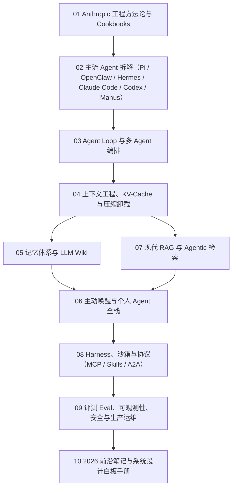

# Agent Engineering Handbook

面向技术全栈工程师的 **Agent 应用开发与底层 Infra / Harness** 实战笔记与面试手册。按技术栈分为 10 个模块、共 21 篇独立文档，兼顾上层应用落地与底层运行时/沙箱/评测基建，源码与论文资料核实至 **2026 年 11 月**。

## 技术全景

## 目录

### 01 · Anthropic 工程方法论与 Cookbooks
- [Anthropic Agent 工程精读：谁选下一步，谁证明做完了？](./01-anthropic-foundations/01-anthropic-agent-engineering-canon.md) — 梳理从 *Building Effective Agents*、*Contextual Retrieval*、*Multi-Agent Research*、*Context Engineering*、*Skills* 到 2026 年长程 Harness、Managed Agents 与 Agent 记忆实验的核心取舍。
- [Anthropic Cookbooks 精读：顺着一次调用，读懂六种工程模式](./01-anthropic-foundations/02-anthropic-cookbooks-and-patterns.md) — 整理官方 Cookbook / Notebook 清单，拆解路由、分工、评审、记忆工具、程序化工具调用（PTC）与跨会话交接的可手写实现。

### 02 · 主流明星 Agent 拆解
- [Pi 与 OpenClaw：从一次工具调用，读到一台常驻网关](./02-flagship-agents-teardown/01-pi-agent-and-openclaw.md) — 拆解 Pi Agent 的四工具哲学、内置 MCP 演进、四包分层、JSONL 会话树，以及 OpenClaw 的网关与自有运行时演进。
- [Hermes Agent：一次纠正，怎样在下一次会话里起作用？](./02-flagship-agents-teardown/02-hermes-agent.md) — 拆解 Hermes 的闭环学习机制、自我演化 Skill、持久化记忆边界、SQLite/FTS5 会话回读、子 Agent 委派与多端 Gateway。
- [Claude Code、Codex、Manus、Cursor 与 Devin：沿一次改动拆开五种 Agent](./02-flagship-agents-teardown/03-claude-code-codex-manus-comparison.md) — 从搜索、执行、上下文、权限到交付物，横向拆解五款代表性产品的 Harness 设计取舍。

### 03 · Agent Loop 与多 Agent 编排
- [Agent Loop：从一次工具调用到可恢复的 Runtime](./03-agent-loop-and-orchestration/01-agent-loop-internals.md) — 拆解 ReAct / Plan-and-Execute / CodeAct / Reflexion 等循环范式，以及并发调度、SSE 流式、Steering 插话、Durable Execution、防死循环与 HITL 审批恢复。
- [多 Agent 编排：什么时候分工，谁来收结果？](./03-agent-loop-and-orchestration/02-multi-agent-orchestration.md) — 对读 Cognition 与 Anthropic 的实践边界，拆解 6 种编排拓扑（Subagent / Orchestrator-Workers / Handoff / Graph / Critic / Agent Teams）与 5 类线上深坑。

### 04 · 上下文工程、KV-Cache 与压缩卸载
- [上下文工程与 KV-Cache：一个时间戳为什么能打掉几万 token 的缓存？](./04-context-engineering-and-compaction/01-context-engineering-and-kv-cache.md) — 讲透 Context Rot、四层预算管理、KV-Cache 显存与分代计费、6 种缓存击穿事故与 Progressive Disclosure 按需加载。
- [上下文压缩与卸载：为什么只留最近十条消息，反而会报 400？](./04-context-engineering-and-compaction/02-context-compaction-and-offloading.md) — 拆解大输出落盘卸载、Observation Masking、结构化压缩、换窗重置、工具批次配对约束与 Pi 上下文树。

### 05 · Agent 记忆体系与 LLM Wiki
- [Agent 记忆：让 Coding 助手记住偏好，也听得懂「只限这次」](./05-memory-and-llm-wiki/01-agent-memory-architecture.md) — 拆解四类认知记忆、Letta / Mem0 / Zep Graphiti / 本地 Markdown+FTS5 四大技术路线，以及抽取、双时态冲突消解、衰减与撤回。
- [LLM Wiki 实战：用 Obsidian、Markdown 和 Git 养一份技术笔记](./05-memory-and-llm-wiki/02-llm-wiki-and-knowledge-compounding.md) — 拆解 Karpathy 的 LLM Wiki 范式与社区实现，用三层目录和 Ingest / Query / Lint 工作流构建可持续复利的技术知识库。

### 06 · 主动性能力与个人 Agent
- [主动式 Agent：四种触发引擎、打扰控制与后台执行](./06-proactive-and-personal-agent/01-proactive-agent-and-background-autonomy.md) — 讲透 Heartbeat（含 OpenClaw 2026 演进）、Cron、Webhook、环境感知、两段式打扰过滤、并发预算熔断与后台断点续跑。
- [个人 Agent 全栈架构：多端 Gateway、工具执行与权限边界](./06-proactive-and-personal-agent/02-personal-agent-fullstack-architecture.md) — 拆解多端接入与会话路由、API / Browser Use / Computer Use 路线选型、EchoLeak 致命三角攻防、CaMeL 思想与凭据代理。

### 07 · 现代 RAG 与 Agentic 检索
- [生产级 RAG：从 PDF 里的一个数字，追到答案里的那句引用](./07-rag-and-modern-retrieval/01-modern-rag-pipeline-and-evolution.md) — 拆解 Naive RAG 的 7 种翻车场景，以及文档解析、切块、Contextual Retrieval、Hybrid Search + RRF + Rerank、GraphRAG 与行级 ACL 权限。
- [检索怎么选：读整本手册、建索引，还是让 Agent 自己找？](./07-rag-and-modern-retrieval/02-agentic-rag-vs-long-context-vs-filesystem.md) — 对比 Claude Code 放弃向量索引与 Cursor 2026 年转向 Instant Grep 的工程原因，给出长上下文、Pipeline RAG、Agentic RAG 与文件搜索的选型边界。

### 08 · Harness Engineering、沙箱与生态协议
- [Harness Engineering：从模型提议到沙箱验收](./08-agent-infra-harness-and-protocols/01-harness-engineering-and-sandbox.md) — 拆解 Harness 六大支柱、ACI 工具接口设计、CodeAct 程序化调用，以及 Seatbelt / bwrap / Docker / gVisor / Firecracker / E2B / WASM 沙箱、预热池与 Secret 代理。
- [Agent 协议实战：MCP 接工具，Skills 教方法，A2A 交任务](./08-agent-infra-harness-and-protocols/02-protocols-mcp-skills-a2a.md) — 拆解 MCP 2026 规范、工具投毒防护与 Code Mode、Agent Skills 三层按需加载，以及 A2A、AG-UI、MCP Apps 各自的定位与边界。

### 09 · 评测、可观测性、安全与生产运维
- [Agent 评测与可观测性：它说办好了，怎么验？](./09-eval-observability-and-production/01-agent-eval-and-observability.md) — 拆解 Anthropic 评测体系与 Claude Code 质量复盘、三类 Grader 校准、`pass@k` 与 `pass^k`、轨迹归因、公开 Benchmark 与 OTel Tracing 选型。
- [生产级 Agent：管住权限，算清单价，接得住故障](./09-eval-observability-and-production/02-security-cost-and-production-ops.md) — 拆解 OWASP Agent 安全攻击面与纵深防御、6 招降本提速、副作用幂等对账、供应商故障切换与 15 项上线检查。

### 10 · 2026 前沿笔记与系统设计面试
- [2026 Agent 前沿技术实战笔记](./10-frontier-trends-2026-and-interview-playbook/01-2026-frontier-tech-radar.md) — 整理 2026 年一线工程与研究动态（Harness、DeepSeek Harness、异步 Agent Teams、Dreaming、Agentic RL、GEPA/自演化、CaMeL）以及已经过时的反模式。
- [Agent 系统设计面试白板手册](./10-frontier-trends-2026-and-interview-playbook/02-interview-system-design-playbook.md) — 拆解 Coding Agent、个人 Agent、企业多 Agent 研究、千万级知识检索、公司级 Harness 平台 5 道白板大题（各附 5 轮追问），以及项目复盘与反问清单。
