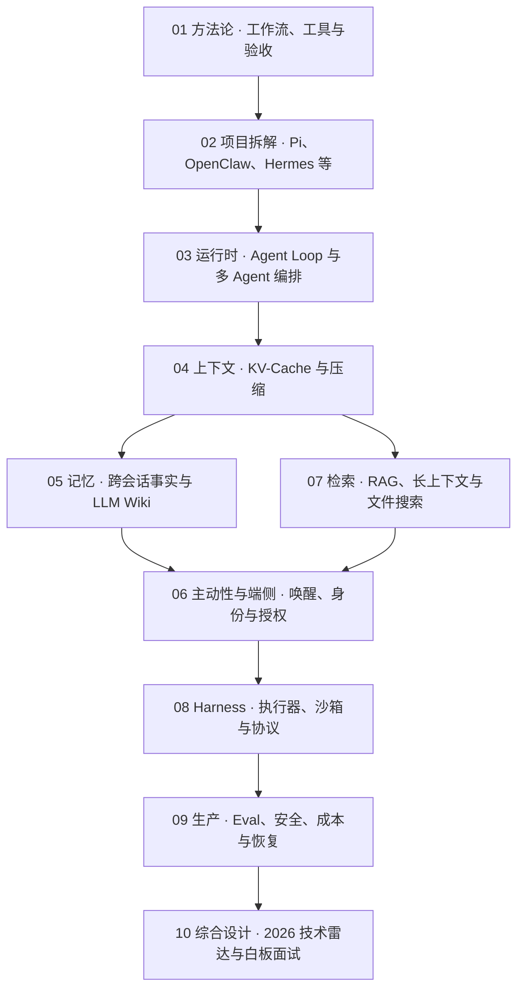

# Agent 应用开发与 Infra / Harness 深度知识库

## 1. 定位与全库统计概览

如果助手说“退款办好了”，你能找到交易回执吗？如果回执丢了，换个进程接手，你敢让它再点一次退款吗？这套知识库写给同时做 **Agent 应用开发和 Agent Infra / Harness** 的工程师。应用侧要讲清用户委托了什么、怎样才算办妥。平台侧要讲清模型能调用什么、状态存在哪里、出错怎样恢复。文章用同一类故障贯穿两侧，适合准备系统设计面试，也适合带着线上工单查问题。

**资料核实截止日期为 2026 年 11 月 24 日。**

| 模块 | 深度长文 | 正文汉字 | Mermaid 图 | 去重一手链接 | 面试主问题 |
| ---: | ---: | ---: | ---: | ---: | ---: |
| 10 | 21 | 231,998 | 62 | 486 | 145 |

统计范围为 10 个模块内的原文。字数只数正文汉字，含小节标题、表格、面试问答和链接的可见文字，剔除篇名、代码与图块、链接地址及篇末一手资料段。图数按 Mermaid 代码块计。一手链接取正文与参考区引用的原文、源码、规范、论文、作者访谈及原帖，按完整 URL 跨篇去重。前 20 篇共有 139 道编号主问题，末篇另有 5 道白板题和 1 道跨题诊断。白板题下的 25 个编号追问及末篇的 8 个候选人反问单列，不重复计入。

## 2. 全景技术知识图谱

沿箭头读。03 决定下一步做什么，04 决定这一步能看到什么。要找回旧资料，可以走 05 的记忆或 07 的检索。要让助手在手机锁屏后继续办事，再往下看谁能唤醒它、它能在哪里执行、最后由谁验收。

## 3. 全库 10 大模块 · 21 篇深度文档导航总表

编号的前两位是模块，后两位是篇号。点中文篇名进入原文。字数沿用上表的正文汉字口径。

| 编号 | 模块 | 文档 | 一句话看点 | 侧重视角 | 正文汉字 |
| --- | --- | --- | --- | --- | ---: |
| 01.01 | 方法论 | [Anthropic Agent 工程精读](./01-anthropic-foundations/01-anthropic-agent-engineering-canon.md) | 沿一笔重复扣费，判断该用固定工作流还是让模型选下一步，再用账本验证工具是否真办成了事。 | 双修必读 | 14,220 |
| 01.02 | 方法论 | [Anthropic Cookbooks 的六种模式](./01-anthropic-foundations/02-anthropic-cookbooks-and-patterns.md) | 对着官方 Notebook 拆路由、分工、评审和长任务交接，找出每种模式里由程序控制的那一步。 | 应用落地 | 11,165 |
| 02.01 | 明星项目 | [Pi 与 OpenClaw](./02-flagship-agents-teardown/01-pi-agent-and-openclaw.md) | 从 Pi 的四个工具和会话树读到 OpenClaw 的常驻网关，对照两个版本查清它们到底共享哪一层。 | 双修必读 | 9,166 |
| 02.02 | 明星项目 | [Hermes Agent](./02-flagship-agents-teardown/02-hermes-agent.md) | 跟一次月报纠错，看 Hermes 把事实、会话历史和可复用技能分别存在哪里，以及下个月怎样验证它学会了。 | 应用落地 | 9,176 |
| 02.03 | 明星项目 | [Claude Code、Codex、Manus、Cursor 与 Devin](./02-flagship-agents-teardown/03-claude-code-codex-manus-comparison.md) | 给五个助手同一张开发工单，比较代码定位、命令权限、长任务回执与最终交付物。 | 双修必读 | 10,466 |
| 03.01 | 核心运行时 | [Agent Loop 与生产级 Runtime](./03-agent-loop-and-orchestration/01-agent-loop-internals.md) | 把循环停在“工具已写入、回执未保存”的瞬间，检查事件记录、审批与重放能否让发布安全续跑。 | Infra & Harness | 10,948 |
| 03.02 | 核心运行时 | [多 Agent 编排](./03-agent-loop-and-orchestration/02-multi-agent-orchestration.md) | 对照六种拓扑，画清谁接管对话、谁只交回结果，以及并行修改何时需要统一合并。 | 双修必读 | 11,065 |
| 04.01 | 上下文工程 | [上下文组装与 KV-Cache](./04-context-engineering-and-compaction/01-context-engineering-and-kv-cache.md) | 比较两轮请求的第一个不同位置，解释工具顺序和时间戳如何影响前缀复用、首字延迟与账单。 | Infra & Harness | 11,005 |
| 04.02 | 上下文工程 | [上下文压缩、卸载与上下文树](./04-context-engineering-and-compaction/02-context-compaction-and-offloading.md) | 从一份过长日志逐级尝试外存、遮蔽、摘要和换窗，保住工具调用配对及接班所需的证据。 | Infra & Harness | 10,111 |
| 05.01 | 记忆与 Wiki | [Agent 记忆系统架构](./05-memory-and-llm-wiki/01-agent-memory-architecture.md) | 沿一条用户偏好走完写入、冲突、取用与撤回，检验旧事实何时还可查、何时必须停止返回。 | 双修必读 | 10,640 |
| 05.02 | 记忆与 Wiki | [LLM Wiki 与知识积累](./05-memory-and-llm-wiki/02-llm-wiki-and-knowledge-compounding.md) | 沿 Karpathy 的设计拆开原件、知识页和索引，看摄取、查询、校验怎样防止旧答案给自己作证。 | 应用落地 | 9,629 |
| 06.01 | 主动性与端侧 | [主动唤醒与后台自治](./06-proactive-and-personal-agent/01-proactive-agent-and-background-autonomy.md) | 用凌晨 CI 告警区分唤醒工作器和打扰用户，处理漏报、重复投递、预算与断点接班。 | 双修必读 | 10,476 |
| 06.02 | 主动性与端侧 | [Personal Agent 全栈架构](./06-proactive-and-personal-agent/02-personal-agent-fullstack-architecture.md) | 跟一张账单从手机到电脑，对比 API、浏览器定位和截图点击，核对最终发出的内容是否仍是用户批准的那份。 | 应用落地 | 12,872 |
| 07.01 | RAG 与检索 | [生产级 RAG 全链路调优](./07-rag-and-modern-retrieval/01-modern-rag-pipeline-and-evolution.md) | 从一格读错的退款比例倒查 PDF 解析、切块、混合召回和重排，找到证据最早丢失的位置。 | 双修必读 | 10,855 |
| 07.02 | RAG 与检索 | [RAG、长上下文与文件搜索怎么选](./07-rag-and-modern-retrieval/02-agentic-rag-vs-long-context-vs-filesystem.md) | 给四种方案相同语料、权限和预算，按查询类型判断该预建索引、整份阅读，还是让助手沿线索再搜一轮。 | 应用落地 | 10,461 |
| 08.01 | Harness 与协议 | [Harness 工程与沙箱](./08-agent-infra-harness-and-protocols/01-harness-engineering-and-sandbox.md) | 从工具接口追到执行器、沙箱、出网与密钥，最后在干净环境验收助手交回的补丁。 | Infra & Harness | 10,737 |
| 08.02 | Harness 与协议 | [MCP、Skills、A2A、AG-UI 与 MCP Apps](./08-agent-infra-harness-and-protocols/02-protocols-mcp-skills-a2a.md) | 用退货单区分五种接口各管什么，再顺着一次断线或重复回调查谁保存任务状态。 | 双修必读 | 11,694 |
| 09.01 | 评测与生产 | [Agent Eval 与可观测性](./09-eval-observability-and-production/01-agent-eval-and-observability.md) | 把退款投诉变成可重跑的题，用账本判成败，再用 Trace 和重复试验解释某次改动能否发布。 | 双修必读 | 10,812 |
| 09.02 | 评测与生产 | [生产安全、成本与恢复](./09-eval-observability-and-production/02-security-cost-and-production-ops.md) | 沿退款核对身份、单笔成功成本和渠道回执，练习在用户重复点击或供应商故障时恢复业务。 | Infra & Harness | 12,334 |
| 10.01 | 前沿与面试 | [2026 前沿技术雷达](./10-frontier-trends-2026-and-interview-playbook/01-2026-frontier-tech-radar.md) | 按采用、试用、观察、暂缓四档审视后台记忆、语音和自动优化，给每项投入设一个能推翻判断的实验。 | 双修必读 | 11,660 |
| 10.02 | 前沿与面试 | [全栈系统设计面试手册](./10-frontier-trends-2026-and-interview-playbook/02-interview-system-design-playbook.md) | 用 35 分钟演练编码助手、个人助手、企业调研、知识问答或平台设计，再应对面试官临时注入的故障。 | 双修必读 | 12,506 |

## 4. 三种高效阅读与面试冲刺路线

### 路线 A · 3 天突击面试版

只读下面 7 篇。每天先看指定章节，合上原文口答，答到需要猜的地方，再回去查那段实现。

| 天 | 优先读 | 用原题模拟 |
| --- | --- | --- |
| 第 1 天 · 讲清一轮执行 | [工程精读](./01-anthropic-foundations/01-anthropic-agent-engineering-canon.md) → [Agent Loop](./03-agent-loop-and-orchestration/01-agent-loop-internals.md) | 用 5 分钟画出模型、工具和账本。出题人先问 01.01 第 5 题“退款三次中一次成功能上线吗”，再用 03.01 第 4 题追问重放为何会重复登记。 |
| 第 2 天 · 找到故障边界 | [KV-Cache](./04-context-engineering-and-compaction/01-context-engineering-and-kv-cache.md) → [沙箱](./08-agent-infra-harness-and-protocols/01-harness-engineering-and-sandbox.md) | 各用 5 分钟答 04.01 第 2 题“换日期为何丢缓存”和 08.01 第 6 题“怎样访问私库又让令牌留在环境外”。白板上分别圈出首个变化位置和持有凭据的进程。 |
| 第 3 天 · 决定是否上线 | [Eval](./09-eval-observability-and-production/01-agent-eval-and-observability.md) → [生产运维](./09-eval-observability-and-production/02-security-cost-and-production-ops.md) → [系统设计](./10-frontier-trends-2026-and-interview-playbook/02-interview-system-design-playbook.md) | 取 10.02 第五题做 35 分钟白板模拟。第 15 分钟加入 09.01 第 1 题的总分变化，第 25 分钟加入 09.02 第 5 题的供应商 503，最后决定哪些任务继续放量。 |

### 路线 B · 7 天应用 + Infra 双修通关版

每天读 3 篇，七天恰好覆盖全库。每篇先读案例，再顺着架构图找一次数据读写，最后留 10 分钟完成当日练习。

| 天 | 三篇的阅读顺序 | 当天留下的东西 |
| --- | --- | --- |
| 1 · 从工单到循环 | [工程精读](./01-anthropic-foundations/01-anthropic-agent-engineering-canon.md) → [Cookbooks](./01-anthropic-foundations/02-anthropic-cookbooks-and-patterns.md) → [Agent Loop](./03-agent-loop-and-orchestration/01-agent-loop-internals.md) | 一张退款时序图，标明模型在哪一步能选工具、哪个服务有权确认到账。 |
| 2 · 读产品实现 | [Pi / OpenClaw](./02-flagship-agents-teardown/01-pi-agent-and-openclaw.md) → [Hermes](./02-flagship-agents-teardown/02-hermes-agent.md) → [五款 Harness 对照](./02-flagship-agents-teardown/03-claude-code-codex-manus-comparison.md) | 选同一项“下月再办”的任务，写下会话、技能和执行回执各由谁保管。 |
| 3 · 多人共用有限窗口 | [多 Agent 编排](./03-agent-loop-and-orchestration/02-multi-agent-orchestration.md) → [KV-Cache](./04-context-engineering-and-compaction/01-context-engineering-and-kv-cache.md) → [压缩与卸载](./04-context-engineering-and-compaction/02-context-compaction-and-offloading.md) | 给两个工人分派只读输入。压缩后，列出各自必须找回的证据和唯一有权合并的人。 |
| 4 · 把资料变成证据 | [RAG 管道](./07-rag-and-modern-retrieval/01-modern-rag-pipeline-and-evolution.md) → [检索选型](./07-rag-and-modern-retrieval/02-agentic-rag-vs-long-context-vs-filesystem.md) → [LLM Wiki](./05-memory-and-llm-wiki/02-llm-wiki-and-knowledge-compounding.md) | 用同一道政策题比较查原件、查 Wiki 的成本，并把答案中的一条主张追到生效版本。 |
| 5 · 让个人助手记得、也能忘 | [记忆架构](./05-memory-and-llm-wiki/01-agent-memory-architecture.md) → [后台唤醒](./06-proactive-and-personal-agent/01-proactive-agent-and-background-autonomy.md) → [端侧架构](./06-proactive-and-personal-agent/02-personal-agent-fullstack-architecture.md) | 画出用户撤回提醒后，记忆、待执行作业与手机通知分别如何更新。 |
| 6 · 接通工具并验收 | [协议与 Skills](./08-agent-infra-harness-and-protocols/02-protocols-mcp-skills-a2a.md) → [Harness 与沙箱](./08-agent-infra-harness-and-protocols/01-harness-engineering-and-sandbox.md) → [Eval](./09-eval-observability-and-production/01-agent-eval-and-observability.md) | 为“查订单、退一件货”标出工具、授权和沙箱边界，再写一条查询真实账本的验收条件。 |
| 7 · 做上线决定 | [生产运维](./09-eval-observability-and-production/02-security-cost-and-production-ops.md) → [技术雷达](./10-frontier-trends-2026-and-interview-playbook/01-2026-frontier-tech-radar.md) → [白板手册](./10-frontier-trends-2026-and-interview-playbook/02-interview-system-design-playbook.md) | 从五个白板题中抽一个，讲清成功单成本、停止放量的信号，以及故障后谁接手。 |

### 路线 C · 按面试官常考主题速查

| 听到的关键词 | 直接翻到哪里 | 先答清这个分界 |
| --- | --- | --- |
| Pi、Hermes、OpenClaw、Claude Code、Codex、Manus | [Pi / OpenClaw 的版本对照](./02-flagship-agents-teardown/01-pi-agent-and-openclaw.md)、[Hermes 的技能与记忆](./02-flagship-agents-teardown/02-hermes-agent.md)、[五款产品的交付对照](./02-flagship-agents-teardown/03-claude-code-codex-manus-comparison.md) | 谁选下一步，谁保管历史，谁能证明动作已完成？ |
| Loop、handoff、subagent、worker | [轮次和重放](./03-agent-loop-and-orchestration/01-agent-loop-internals.md)、[六种编排拓扑](./03-agent-loop-and-orchestration/02-multi-agent-orchestration.md) | 调专家以后，谁继续持有对话和写权限？ |
| KV-Cache、Compaction、窗口超限 | [六种前缀断点](./04-context-engineering-and-compaction/01-context-engineering-and-kv-cache.md)、[四级压缩与卸载](./04-context-engineering-and-compaction/02-context-compaction-and-offloading.md) | 查命中下降先比请求前缀，查压缩后忘事先追回原件和交接记录。 |
| LLM Wiki、长期记忆、删除 | [摄取 / 查询 / 校验](./05-memory-and-llm-wiki/02-llm-wiki-and-knowledge-compounding.md)、[记忆全生命周期](./05-memory-and-llm-wiki/01-agent-memory-architecture.md) | 知识页和个人偏好各从哪里取证，来源失效后哪些副本要更新？ |
| RAG、GraphRAG、长上下文、grep | [证据丢在哪一站](./07-rag-and-modern-retrieval/01-modern-rag-pipeline-and-evolution.md)、[四种检索方案](./07-rag-and-modern-retrieval/02-agentic-rag-vs-long-context-vs-filesystem.md) | 标准答案所需的原句有没有进入模型实际读到的材料？ |
| Heartbeat、Cron、端侧执行 | [四种唤醒方式](./06-proactive-and-personal-agent/01-proactive-agent-and-background-autonomy.md)、[账单的端侧操作路线](./06-proactive-and-personal-agent/02-personal-agent-fullstack-architecture.md) | 到点可以查什么，又可以向谁发什么？ |
| 沙箱、MCP、Skills、A2A | [隔离、出网与密钥](./08-agent-infra-harness-and-protocols/01-harness-engineering-and-sandbox.md)、[五种接口的退货案例](./08-agent-infra-harness-and-protocols/02-protocols-mcp-skills-a2a.md) | 工具由谁提供，流程由谁描述，执行前由谁检查权限？ |
| Eval、Trace、安全、成本、幂等 | [评分与追踪](./09-eval-observability-and-production/01-agent-eval-and-observability.md)、[权限与故障恢复](./09-eval-observability-and-production/02-security-cost-and-production-ops.md) | 去哪查真实业务结果，超时后凭什么决定要不要重试？ |
| 2026 技术取舍、系统设计 | [雷达的四档决策](./10-frontier-trends-2026-and-interview-playbook/01-2026-frontier-tech-radar.md)、[五场白板模拟](./10-frontier-trends-2026-and-interview-playbook/02-interview-system-design-playbook.md) | 给定同样的预算，用什么指标决定采用、灰度或撤回？ |

## 5. 全库面试高频深挖题速查索引

下面从每篇各抽一道原题，按答题时要解决的问题归类。**考前 30 分钟**里，前 21 分钟逐题口答，每题一分钟。接着用 6 分钟回读最卡的两题。最后用 3 分钟重讲其中一题，说出你会查哪条记录、怎样判断修复生效。链接旁的题号对应原文章节。

### 方法与项目实现

| 原题 | 一分钟自检 | 出处 |
| --- | --- | --- |
| 检索漏失下降 67%，为什么产品团队没看到答案正确率同步提高？ | 先说清 67% 的分母，再分开查召回与生成。 | [01.01 · 第 2 题](./01-anthropic-foundations/01-anthropic-agent-engineering-canon.md) |
| 模型分类也是不确定的，为什么还叫确定性 workflow？ | 画出模型负责的分类和宿主预先登记的合法出口。 | [01.02 · 第 1 题](./01-anthropic-foundations/02-anthropic-cookbooks-and-patterns.md) |
| OpenClaw 究竟是不是一个 Pi 包装器？ | 对照早期与后期源码，指出会话和执行器的归属。 | [02.01 · 第 5 题](./02-flagship-agents-teardown/01-pi-agent-and-openclaw.md) |
| 给我一个能区分“自我学习”和“恰好还没忘”的实验。 | 换新会话，临时隐藏技能，看同类任务是否退步。 | [02.02 · 第 1 题](./02-flagship-agents-teardown/02-hermes-agent.md) |
| 三十分钟的构建被客户端超时，能直接重跑吗？ | 查执行句柄、退出码与工件，判断哪一步可以重做。 | [02.03 · 第 6 题](./02-flagship-agents-teardown/03-claude-code-codex-manus-comparison.md) |

### 运行时与上下文

| 原题 | 一分钟自检 | 出处 |
| --- | --- | --- |
| 流程引擎提供可靠重放，为什么还会登记两次？ | 指出重放记录与外部写入之间的空隙。 | [03.01 · 第 4 题](./03-agent-loop-and-orchestration/01-agent-loop-internals.md) |
| `agent.as_tool()` 和 handoff 都能找专家，为什么要有两个接口？ | 说明谁拿回结果，谁接管用户的下一条消息。 | [03.02 · 第 2 题](./03-agent-loop-and-orchestration/02-multi-agent-orchestration.md) |
| 为何只是把日期从周一换成周二，缓存输入就少了几万？ | 找出首个不同的输入，再查它后面有多少前缀失去复用。 | [04.01 · 第 2 题](./04-context-engineering-and-compaction/01-context-engineering-and-kv-cache.md) |
| 为什么保留最近十条消息仍会报 400？ | 核对工具请求与返回的 ID、顺序以及裁剪边界。 | [04.02 · 第 2 题](./04-context-engineering-and-compaction/02-context-compaction-and-offloading.md) |

### 记忆、Wiki 与检索

| 原题 | 一分钟自检 | 出处 |
| --- | --- | --- |
| 用户点了“忘掉我”，怎么证明下一次真的忘了？ | 从用户原话追到摘要、检索索引和恢复后的备份。 | [05.01 · 第 7 题](./05-memory-and-llm-wiki/01-agent-memory-architecture.md) |
| 模型把自己的旧答案反复引用，怎么发现？ | 沿引用回到原件，找出答案引用自己的环。 | [05.02 · 第 3 题](./05-memory-and-llm-wiki/02-llm-wiki-and-knowledge-compounding.md) |
| 用户能在原 PDF 里指出答案，为什么大模型看了整页文本还会错？ | 对照表头、行列和脚注，定位第一个丢失的限定条件。 | [07.01 · 第 1 题](./07-rag-and-modern-retrieval/01-modern-rag-pipeline-and-evolution.md) |
| 如何证明 Agentic Search 的提升来自会搜索，而不是因为它花钱更多？ | 让不同方案拿到相同预算，再比较证据和单次合格成本。 | [07.02 · 第 7 题](./07-rag-and-modern-retrieval/02-agentic-rag-vs-long-context-vs-filesystem.md) |

### 主动性、端侧与工具权限

| 原题 | 一分钟自检 | 出处 |
| --- | --- | --- |
| Webhook 成功响应了，为什么过了一晚还是漏报？ | 区分收到事件、持久入队、投递提醒三个时刻。 | [06.01 · 第 3 题](./06-proactive-and-personal-agent/01-proactive-agent-and-background-autonomy.md) |
| 用户愿意对每封邮件点“同意”，如何证明最后发的是他看到的那封？ | 把确认绑定到收件人和正文版本，在提交前再核对。 | [06.02 · 第 6 题](./06-proactive-and-personal-agent/02-personal-agent-fullstack-architecture.md) |
| 要访问私有仓库，又不希望令牌进入代码环境，如何设计？ | 在图上圈出持有令牌的位置和允许访问的目标。 | [08.01 · 第 6 题](./08-agent-infra-harness-and-protocols/01-harness-engineering-and-sandbox.md) |
| MCP 已经有工具和 Tasks，为什么还要 A2A？ | 区分调用一个能力和委托一个能独立交付的伙伴。 | [08.02 · 第 1 题](./08-agent-infra-harness-and-protocols/02-protocols-mcp-skills-a2a.md) |

### 验收、生产与系统设计

| 原题 | 一分钟自检 | 出处 |
| --- | --- | --- |
| 单次八成，试三次能承诺什么？ | 说出三次中至少过一次和三次全过各适合什么产品。 | [09.01 · 第 2 题](./09-eval-observability-and-production/01-agent-eval-and-observability.md) |
| 用户连续点两次退款，第二次刚好换了模型，如何保证只付一次？ | 从用户意图追踪同一个业务键，直到支付渠道的回执。 | [09.02 · 第 4 题](./09-eval-observability-and-production/02-security-cost-and-production-ops.md) |
| 同一模型换个 Harness 分数就涨了，你如何解释？ | 固定题目、预算与沙箱资源，再拆开不同失败原因。 | [10.01 · 第 1 题](./10-frontier-trends-2026-and-interview-playbook/01-2026-frontier-tech-radar.md) |
| 用户说 Agent 昨天正确，今天变笨，35 分钟最后三分钟怎么答？ | 先用旧产物跑新评分器，再逐项替换检索、工具和模型。 | [10.02 · 第六道跨题深挖](./10-frontier-trends-2026-and-interview-playbook/02-interview-system-design-playbook.md) |
